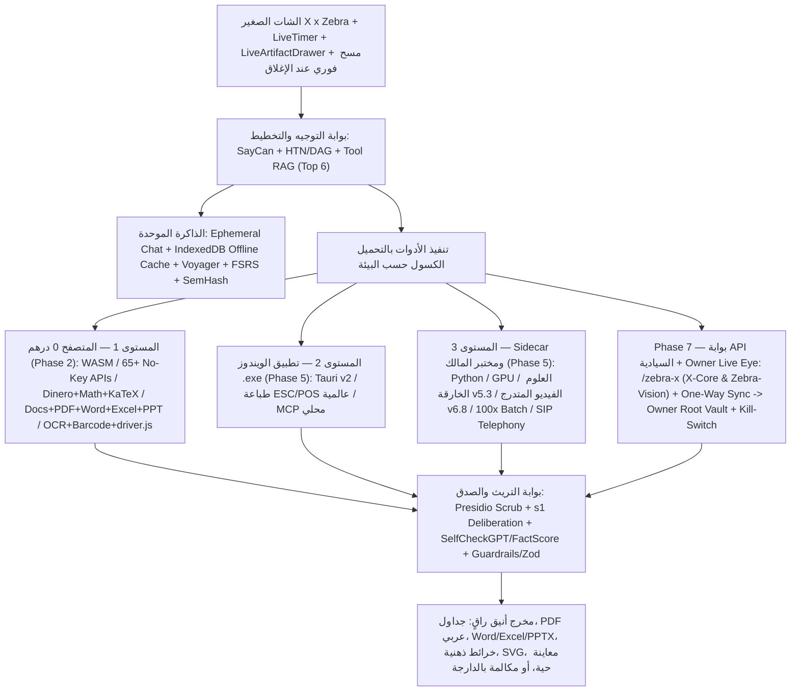

# الدوسي المرجعي الأعلى لـ `HEYUKA` (`KASPI`) وخطة البناء الشاملة (`v10.5 Unified HEYUKA Chat inside KASPI POS + Permanent Conversations + Self-Evolution`)

> [!IMPORTANT]
> **الوضع الحالي (`v10.5` ✅):** تم إكمال التوحيد الجذري للهوية إلى **`HEYUKA`** (المملوكة حصرياً لشركة **`KASPI`**) وإتاحة كافة قدرات المنظومة وحلقة التطور الذاتي مباشرة داخل **شات `KASPI POS` الوحيد** ([AIChatWidget.tsx](src/components/ai/AIChatWidget.tsx)):
> - **داخل `KASPI POS` (الكاشير):** شات موحد واحد على غرار **ChatGPT / Gemini / DeepSeek** — يفتح كنافذة عائمة صغيرة ويتوسع بشريط محادثات دائم غير محدود (**تبقى المحادثات محفوظة حتى يحذفها المستخدم يدوياً**)، يدعم اللصق المباشر للصور، رفع كل أنواع الملفات، إخراج الصور التفاعلية مع التفريغ الفوري (`@imgly`)، Word/Excel/PPTX/PDF، تنفيذ الأكواد في `executeCodeSandbox` (Piston)، وقراءة الروابط (`Jina Reader`) مع ربط **الذاكرة التطورية (`FSRS + SemHash`) ومهارات `Voyager`** مباشرة في كل محادثة.
> - **المنتج المكتبي المعزول (`apps/heyuka-desktop` + `packages/heyuka-os`):** تطبيق التحكم الكامل بالحاسوب (`Electron + PyAutoGUI + PyWinAuto + UIAutomation + Ghost Cursor + TripoSR :8188 + Adobe/Blender Bridges + 16kHz PCM Audio`).
> - **صفحة التحميل والعرض المعزولة ([/[locale]/heyuka](src/app/%5Blocale%5D/heyuka/page.tsx)):** استعراض تفاعلي بـ 60 FPS للـ 32 شخصية (`Classic HEYUKA / Mochi-Puff` والعمالقة العنصريين)، قصص تفاعلية متحركة، ومركز تحميل وتوليد مفاتيح `KASPI`.
> **القواعد المعمارية الحاكمة:**
> 1. **وحدانية الهوية السيادية (`HEYUKA Only` — Owned by `KASPI`):** المتحدث الرسمي والوحيد في واجهات الكاشير هو **`HEYUKA`**، ونمنع تماماً تسرب أي اسم نموذج منافس (`Ollama`, `Qwen*`, `Llama*`, `DeepSeek*`, `NEVEA`, `NOVA`) أو الهوية القديمة `X × Zebra` في واجهات المستخدم وبوابة المراجعة [reflection-gate.ts](src/lib/zebra-x/core/reflection-gate.ts).
> 2. **شات واحد بأسلوب Gemini / ChatGPT / DeepSeek مع بقاء المحادثات دائماً (`v10.5` في [AIChatWidget.tsx](src/components/ai/AIChatWidget.tsx) و[chat-threads-store.ts](src/lib/zebra-x/core/chat-threads-store.ts)):** تم حذف حد الـ 50 محادثة نهائياً لتبقى كافة المحادثات محفوظة في `IndexedDB` حتى يحذفها المستخدم يدوياً، مع استعادة الجلسة النشطة (`heyuka_active_thread_id`) عند إعادة الفتح، وصندوق إدخال `textarea` ذكي (`Enter`/`Shift+Enter` + لصق صور `Ctrl+V`)، وتفريغ مؤقتات الصوت والـ WASM فقط عند الإغلاق.
> 3. **قفل حماية بنية `Kaspi POS` وعزل المخزون العام (`v7.1 + v7.2`):** يُحظر تماماً على أي أداة تعديل كود أو واجهات أو قاعدة بيانات `Kaspi POS` نفسه (`Immutable POS Core Lock`، عمليات الكاشير تشتغل بالكود الحتمي السريع، والحساس `activity-sensor.ts` يشتغل `Observe-Only`). أما أدوات `v7.0 Power Boosters` فتُحفظ معزولة في **`src/lib/zebra-x/arsenal-vault/`** وتُستدعى فقط للمحادثات العامة، المشاريع الخارجية، بوابة الـ API، أو مختبر المالك.
> 4. **الحرية المطلقة في المواضيع والاستنفار الشامل (`v7.2`):** داخل الشات الصغير/الموسع وبوابة الـ API يحق للمستخدم الحوار والعمل في أي مجال (علوم، برمجة، تاريخ، فلسفة، تصميم، مشاريع خارجية...) بكافة قدرات الترسانة دون مساس بنواة الكاشير.

---

## القسم 1: الهندسة المعمارية الموحدة (`4` حلقات × `3` مستويات + `Phase 7` الفيدرالي)

### مفاتيح التصنيف الإجبارية في الدوسي:
* **✅ أداة مباشرة لـ `X × Zebra` (`Active Tool`)**: مكتبة JS/TS/WASM أو No-Key REST API جاهزة بالتحميل الكسول في المتصفح/Next.js.
* **🔄 خوارزمية / نمط دماغ (`Cognitive / Memory Logic`)**: منطق تخطيط (`SayCan/HTN/DAG`)، مراجعة وتريث (`s1/Reflexion`)، صدق (`SelfCheckGPT/FactScore`)، أو ذكاء تجاري (`RFM`).
* **🟠 أداة خارجية / جسر المالك (`Sidecar / .exe / Cloud Node / Phase 7`)**: محرك Python/C++/GPU/Docker/PBX/Browserless الثقيل (يشتغل في `.exe` أو `Sidecar/Phase 7` عند المالك/المشغل وليس في متصفح الزبون البسيط).
* **🔵 وقود تعلم وتدريب وصياغة (`Corpus / Dataset / Style Taxonomy`)**: قواعد بيانات معرفية، لهجات، وعلمية تغذي التدريب والبحث.
* **❌ مستبعد كهوية خارجية (`Excluded External Brand/UI`)**: يُمنع ظهوره باسمه كبديل أو نموذج مستقل عن `X × Zebra` (`Ollama`, `Qwen*`, `Llama*`, `DeepSeek*`, `FLUX*`, `Open WebUI`, `LobeChat`, `Gradio`, `vLLM` كاسم).

---

## القسم 2: الجرد الشامل لكل المصادر (`28` فصلاً — تغطية 100% من `v1.0` إلى `v6.8` بلا إسقاط أي عنصر)

> يحتوي هذا القسم على كامل الترسانة من `v4.0`–`v5.0` (الفصول 1 إلى 20)، متبوعة بالفصول **`21` إلى `28`** التي تضم حرفياً كل عنصر من دفعات **`v5.0 → v6.8`** واستكمال **`Big-Lab Agentic Stack`**.

### الفصول 1 → 8: النواة الأساسية، الذاكرة، الشبكة، الدماغ، الأتمتة، الرؤية، الوثائق، والاقتصاد الحر
* **الفصل 1 (`KASPI POS` — `Phase 1 DONE` ✅ + `Phase 4/6` ⏳):**
  * منجز ✅: [AIChatWidget.tsx](src/components/ai/AIChatWidget.tsx)، حذف `KaspiAiStudioModal.tsx`، [XZebraRichMessage.tsx](src/components/ai/XZebraRichMessage.tsx)، [wasm-watchdog.ts](src/lib/zebra-x/core/wasm-watchdog.ts)، [bridge-schema.ts](src/lib/zebra-x/core/bridge-schema.ts)، [activity-sensor.ts](src/lib/zebra-x/core/activity-sensor.ts)، [reflection-gate.ts](src/lib/zebra-x/core/reflection-gate.ts)، [router.ts](src/lib/zebra-x/core/router.ts)، [pos-live-tools.ts](src/lib/zebra-x/tools/pos-live-tools.ts)، [docs-export-engine.ts](src/lib/zebra-x/tools/docs-export-engine.ts) (`pdfmake` + `NotoSansArabic-Regular.ttf`)، تفريغ الخلفية في [products/page.tsx](src/app/%5Blocale%5D/dashboard/products/page.tsx)، تنظيف [ai-router.ts](src/lib/ai-router.ts) و[sovereign-brain.ts](src/lib/zebra-x/sovereign-brain.ts).
  * المستودعات المستوعبة: `Zebra-X-V2`, `ZUVYR-AI`, `CUT-`; والمؤجلة لـ `Phase 6`: `studio-x-`, `eve-slack-agent`, `kaspi-pos-morocco`. ولـ `Phase 4`: `741` شرط لغة في [routing.ts](src/i18n/routing.ts)/[request.ts](src/i18n/request.ts) + طابعة [printer.rs](src-tauri/src/printer.rs).
* **الفصل 2 (الذاكرة والتعلم الإجرائي 🔄/✅/🟠):** `Mem0`, `OpenMemory`, `Motorhead`, `Supermemory`, `Letta (MemGPT)`, `Zep`, `H-MEM`, `MemWalker`, `LangMem`, `Synapse`, `MemoryBank`, `SemHash`, `Anki/FSRS`, `Cognee`, `Khoj`, `ElectricSQL/PowerSync`, `OpenTelemetry`, `Mitmproxy Session Logger`, `WebExtensions API` *(Opt-In)*, `Voyager`, `AWM`, `SkillWeaver`, `STaR`, `ADAS`, `Generative Agents`; المتصفح (`@orama/orama`, `Voy`, `PGlite`, `DuckDB-Wasm`, `httpfs`, `sql.js`, `Fuse.js`, `MiniSearch`, `FlexSearch`, `RxDB`, `Yjs`, `Automerge`); Sidecar (`LanceDB`, `ChromaDB`, `FAISS`, `Qdrant`, `sqlite-vec`, `DuckDB`, `Tinydb`, `DiskCache`, `MinIO`, `GitPython`, `FastEmbed`, `BGE-M3`, `Morocco-Darija-Word-Embedding`).
* **الفصل 3 (الشبكة والحوسبة الموزعة 🟠):** `Neo4j`, `Memgraph`, `SurrealDB`, `OrbitDB`, `Weaviate`, `Milvus`, `CockroachDB`, `TiDB`, `YugabyteDB`, `Turso`, `Neon`, `Supabase`, `Upstash`, `Xata`, `Aiven`, `Etcd`, `Consul`, `SeaweedFS`, `Ceph`, `NATS.io`, `ZeroMQ`, `Zenoh`, `Kafka/Redpanda`, `libp2p`, `Headscale/Tailscale`, `NetBird`, `ZeroTier`, `FRP`, `Nebula`, `Traefik/Caddy/Nginx Proxy Manager`, `Cloudflare Tunnels`, `Bore`, `Localtunnel`, `Rathole`, `Temporal`, `Nomad`, `Ray/KubeRay`, `Dask`, `Bacalhau`, `Celery+RabbitMQ`, `Spark`, `Horovod`, `SkyPilot`, `Fluence`, `KServe`, `BentoML`, `Gitpod/DevPod`, `Project IDX`, `Replit/Glitch`, `Kasm`, `HF Spaces`, `Modal/Beam`, `Koyeb/Render/Fly.io`, `Codespaces`, `Colab`, `Kaggle`, `Unikraft/Nanos`, `Kata/gVisor`, `Spin`, `Coolify/Dokploy/Dokku/CapRover/KEDA`, `Rclone`, `JuiceFS`, `S3FS/OpenDAL/AList`, `R2/B2/IA S3/Storj/Filebase`, `Git LFS`, `IPFS/Pinata/Syncthing`, `zstd+SquashFS`, `AI Horde`, `BOINC`, `Golem`, `CF Pages/Workers`, `Deno Deploy`, `Val Town`, `Pipedream`, `Vercel/Netlify Edge`, `GH Pages`, `Surge/Fleek`, `PeerJS/Simple-Peer/Gun.js/Trystero/WebTorrent`, `Pagefind`, `Nextcloud/OwnCloud/FileBrowser/Duplicati`. *(مستبعدة ❌: `Petals`, `Exo`, `Hivemind`, `LocalAI P2P`, `llama.cpp RPC`, `vLLM`, `SGLang`, `OpenLLM`, `TabbyAPI`, `Triton`, `TGI`, `llamafile`, `Wllama`, `WebLLM`).*
* **الفصل 4 (الدماغ، التريث، الصدق والتخطيط الاستراتيجي 🔄/✅/🟠):** `OpenCog Hyperon`, `SOAR`, `ACT-R`, `NARS`, `ACE`, `MetaMind`, `MindGames`, `MIntRec 2.0`, `OpenNLU`, `BabyAGI/BabyElfAGI`, `AutoGPT`, `Sakana AI Scientist`, `Agent-S`, `Gödel Agent` *(مختبر معزول فقط)*, `Agent0/EvoAgentX`, `LLM Council/MoA`, `ChatDev`, `OptiLLM`, `g1`, `ToT`, `Quiet-STaR`, `Budget Forcing / s1`, `System 2 Attention`, `SelfCheckGPT`, `HHEM`, `FactScore`, `PERSONA-Bench & User-LLM`, `ProsePolish`, `SayCan/Inner Monologue`, `TaskWeaver`, `PlanGEN`, `SHOP3/Pyhop`, `ADaPT`, `DEPS`, `NetworkX/Graphlib`, `OR-Tools`, `Z3`, `OptaPlanner/Timefold`, `XState`, `Gymnasium`, `RAP`, `Mermaid`, `LLMCompiler`, `HuggingGPT`, `ReWOO`, `PDDL`, `ToolBench/Gorilla/Tool RAG`, `Reflexion/Self-Refine/CRAG/LATS`, `TextGrad/Promptbreeder/EvoPrompt`, `RouteLLM/Semantic Router`, `NeMo/Guardrails AI`, `Presidio`, `Arize Phoenix`, `Langfuse`, `LLM Guard`, `Prompttools`, `LLMLingua-2`, `Prompt-Optimizer`, `AdalFlow`, `DAIR.AI/System Prompts (x1xhlol)`.
* **الفصل 5 (التنسيق و`MCP` 🔄/✅/🟠):** `Anthropic MCP / SDKs`, `MCP Reference Servers`, `Awesome MCP Servers`, `Chrome DevTools MCP`, `mcp-playwright`, `Context7`, `Seiche`, `OpenAPI-to-MCP`, `CrewAI`, `AutoGen/AG2`, `Camel-AI`, `PocketFlow`, `PydanticAI`, `Haystack Components`, `LlamaIndex/LlamaHub`, `LangChain Community Tools (700+)`, `Semantic Kernel`, `ControlFlow`, `Magentic-One`, `Atomic Agents`, `Agno`, `Swarms`, `MetaGPT`, `DSPy`, `OpenAI Agents SDK`, `Google ADK`, `Genkit`, `smolagents`, `ACI.dev`, `Composio`, `Trigger.dev`, `Activepieces`, `Windmill`, `Kestra`, `n8n`, `Huginn`, `Node-RED`, `APScheduler`, `Prefect`.
* **الفصل 6 (الرؤية، تصفية `4K/8K` والـ `3D` ✅/🟠):** متصفح (`Transformers.js Florence-2`, `ONNX Runtime Web`, `MediaPipe Web`, `tesseract.js`, `@zxing/browser`, `html5-qrcode`, `bwip-js`, `driver.js`, `Canvas Annotator`, `UpscalerJS`, `@imgly/background-removal`, `Pica`, `upng-js`, `Three.js`, `Babylon.js`); Sidecar (`OpenEB`, `Neuromorphic/Tonic`, `jAER`, `Vision Agents`, `OmniParser`, `RealTimeAICam`, `DINOv2`, `SigLIP`, `OpenCLIP`, `Logo-VGR/OpenLogo`, `OpenCV`, `Screenpipe`, `OpenRecall`, `Windrecorder`, `ActivityWatch`, `MSS`, `DXcam`, `Wayland/PipeWire`, `NoVNC`, `RustDesk`, `Guacamole`, `OSWorld/ScreenSpot`, `Cradle`, `PaddleOCR`, `Surya OCR`, `SAM 2/Grounded-SAM 2`, `BiRefNet`, `Rembg`, `Claude Computer Use`, `OpenAI CUA`); ترميم البيكسلز (`SwinIR`, `HAT`, `SUPIR`, `BSRGAN`, `AuraSR`, `ChaiNNer`, `Waifu2x`, `Real-CUGAN`, `GFPGAN`, `CodeFormer`, `RestoreFormer++`, `Pillow`, `Scikit-Image`, `ImageMagick`, `libvips`, `G'MIC`, `Restormer`, `NAFNet`, `Zero-DCE`, `EnlightenGAN`, `LaMa`, `BasicVSR++`, `RIFE`, `Video2X`, `ncnn-vulkan`, `LucidFlux`, `VOSR 2.0`, `CODSR/DTPSR`, `PromptIR`, `DA-CLIP UIR`, `DarkIR`, `Uformer`, `MPRNet`, `AdaIR`, `KBNet`, `FlashVSR/SparkVSR/NanoVSR`, `Anime4K`, `Luminance HDR`, `OpenColorIO`, `Darktable/RawTherapee CLI`, `Colour-Science`, `PyIQA`, `NVIDIA NRD`, `Real-ESRGAN`, `Upscayl`, `MoviePy`, `FFmpeg/ffmpeg.wasm`, `ComfyUI`); الـ 3D والتحريك (`ControlNet`, `IP-Adapter`, `Style/Color-Transfer`, `NeuralPreset`, `ColorThief`, `Blender-MCP`, `Meshwire`, `TripoSR`, `InstantMesh`, `FaceFusion`, `Roop/ReActor`, `InsightFace`, `IDM-VTON/OOTDiffusion/CatVTON/Leffa`, `LivePortrait`, `Wan2.1`, `CogVideoX`, `MimicMotion/Champ`, `EchoMimic/Hallo2`).
* **الفصل 7 (الوثائق، البرمجة، الهندسة العكسية، الصوت والفيزياء ✅/🟠):** `pdfmake+NotoSansArabic`, `pdf-lib`, `PDF.js`, `docx/Docxtemplater/html-to-docx/TransDocs`, `xlsx/ExcelJS`, `papaparse`, `pptxgenjs`, `Mermaid`, `marked`, `KaTeX`, `PrismJS`, `DOMPurify`, `diff2html`, `lightweight-charts/ECharts/Chart.js/D3`, `Leaflet/Turf/MapLibre`, `JSZip/fflate`, `Zod/TypeBox`, `Turndown`, `Readability.js`, `Docling`, `Unstructured.io`, `MarkItDown`, `PyMuPDF`, `Pandas/Polars/QSV`, `Tabula/Camelot`, `YData Profiling`, `LangExtract`, `WeasyPrint/Typst/ReportLab/FPDF2/Pandoc`, `TinyStyler`, `Styleformer`, `Text-Rewriter`, `TextStyleBrush`, `TypingSVG`, `HTML5-Text-Effects`, `D2`, `Rough.js`, `Reveal/Impress/Slidev`, `Tabular Editor / DAX Studio MCP`, `quickjs-emscripten`, `Tree-sitter`, `Aider`, `ripgrep`, `OpenHands`, `E2B`, `Piston/Judge0`, `Firecracker/Wasmer/Wasmtime`, `Dagger`, `Ruff`, `SonarQube`, `Semgrep/Bandit`, `Biome/Prettier`, `Hoppscotch`, `Docusaurus/VitePress`, `Jina/Crawl4AI/Trafilatura/Firecrawl`, `SearXNG`, `Browserless/Steel/Skyvern/LaVague/Stagehand/Browser-Use/Playwright`, `yt-dlp/Scrapy/Nutch`, `Meilisearch/Typesense/ArchiveBox`, `FreeCAD/OpenSCAD/OpenBOM`, `Wappalyzer/SingleFile/Web-Check/mitmproxy/Screenshot-to-Code`, `Ghidra/JADX/Radare2/Binwalk/Garak/Prompt-Reverse`, `mathjs/nerdamer/decimal.js/Day.js/Luxon/SymPy/Genesis/Manim/RDKit`, `AppAgent/Mobile-Agent/DroidRun/Scrcpy`, `Home Assistant/ROS 2/Frigate/Godot`, `Nuclei/Wazuh/Age/SOPS/PyAutoGUI/OpenAdapt`, `Tone.js/Meyda/Howler/Silero VAD/Kokoro/Piper/Sherpa-onnx/Faster-Whisper/WhisperX/SenseVoice/AudioCraft/Stable Audio/RVC/Demucs/Audacity/Pedalboard/Librosa/OpenVoice`, `Evolution API/Baileys/aiogram/discord.py/Matrix/Apprise`.
* **الفصل 8 (`No-Key APIs`، الاقتصاد، المعرفة والتدريب ✅/🔵):** `World Bank`, `IMF`, `ECB`, `UN Comtrade`, `GLEIF/OpenCorporates`, `Frankfurter`, `Open ER-API`, `CoinGecko`, `SEC EDGAR`, `OpenBB`, `Pytrends`, `MedusaJS/Saleor/Bagisto/WooCommerce`, `Odoo/ERPNext/Twenty/EspoCRM`, `Invoice Ninja/Crater/Actual Budget/Firefly III/Akaunting/BTCPay/Kill Bill`, `Zammad/FreeScout/Chatwoot/Listmonk/Mautic/PostHog/Umami/Plausible/Matomo`; وموسوعة الـ `65+ No-Key APIs` كاملة (`OpenFoodFacts`, `OpenBeautyFacts`, `OpenProductFacts`, `OpenFDA`, `NHTSA vPIC`, `TheMealDB`, `TheCocktailDB`, `Open-Meteo`, `Nominatim`, `OSRM`, `Overpass`, `RestCountries`, `Nager.Date`, `WorldTimeAPI`, `ipapi/IPify/IPinfo`, `Aladhan`, `Wikipedia/Wikidata/Wikimedia`, `DuckDuckGo Instant`, `Google Patents/USPTO`, `Open Library/Gutendex/arXiv/OpenAlex/Crossref/PubMed/PubChem`, `USGS/Open-Notify/NASA DEMO_KEY/OpenSky/GDELT/Common Crawl`, `GitHub/NPM/PyPI/Crates/crt.sh/rdap/Cloudflare DoH`, `HN/Reddit/Archive.org`, `RSS/Free Dictionary/Pollinations/Museums/SportsDB/TVMaze/DiceBear/Lorem Picsum...`); ووقود التدريب (`Atlas-Chat`, `Atlaset`, `Social_Media_Darija_DS`, `Darija-SFT`, `DODa`, `DarijaBERT`, `AraT5`, `Arabic-Alpaca`, `Cidre`, `CAMeL`, `Farasa`, `SAFAR`, `Tashkeela`, `Aya`, `OpenHermes 2.5`, `Bactrian-X`, `Multilingual-Thinking`, `UltraChat 200k`, `ShareGPT-Clean`, `OpenO1-SFT`, `FineWeb-Edu`, `xlam/glaive/Hermes function-calling`, `Outlines/Instructor`, `TableGPT`, `Argos/LibreTranslate/Lingva/MyMemory`, `FinGPT`).

---

### الفصول 9 → 20: البوابة السيادية، الشبكة الفيدرالية، الدارجة، المكالمات، المصنع الخلفي، اللوغويات، وختام `Big-Lab`
* **الفصل 9 (`v3.1` Sovereign Portal — `Phase 7`):** `One API / New API` (`zx-live-...`), `Kong / Tyk`, `Lago`, `Unsloth`, `Axolotl / LLaMA-Factory`, `MergeKit`, `Next.js + Vercel AI SDK`, `Scalar / Swagger UI`, و`LiteLLM Proxy` (`❌` صامت داخلياً فقط).
* **الفصل 10 (`v3.2` Hybrid Federated Node Mesh — `Phase 7`):** `Portkey AI Gateway`, `Bifrost / Helicone`, `Unkey` (`zx_...`), `X-Zebra CLI / Docker Compose`, `Podman / Nerdctl`, `WASI / Wasmtime`, `OpenBalena / Fleet`, `Spire / SPIFFE`, `Syncthing / IPFS Cluster`, `KEDA`, `OpenTelemetry Collector (Federated Opt-In)`.
* **الفصل 11 (`v3.3` Community Skill Hub):** `Verdaccio`, `MCP Registry / Glama`, `Harbor OCI`, `GitHub API / Gitea`, `OrbitDB`, `Extism (Zebra-Skill.wasm + zebra-skill.json)`, `Semgrep + Bandit Auto-Audit Gate`, `Heretic / Abliteration` *(بحث أوزان المالك محلياً فقط `🔵/❌`)*.
* **الفصول 12–15 (`Plug-and-Play`, `35 Pack`, `32 Free`, `Hidden Gems 14`):** `Uptime Kuma`, `Portainer/Lazydocker`, `Nmap` *(شبكة المالك المصرحة فقط)*, `Excalidraw/tldraw`, `SVGO/Potrace`, `Fabric.js/Konva`, `Crawlee`, `RSSHub`, `Calibre-Web/Koha`, `Paperless-ngx`, `Cal.com`, `Plane/Focalboard`, `Documenso`, `Ntfy/Gotify`, `Postiz`, `Ghost/Strapi`, `Satori`, `Slidev`, `Valhalla/Pelias/Kepler.gl`, `spaCy/BERTopic/LanguageTool`, `NocoDB/Baserow/Formbricks/Metabase/Airbyte`, `Shlink/Dub.co`, `LiveKit/Pipecat`, `Lighthouse CI/Unlighthouse/SerpBear`, `Postal/Mailpit/React Email/ImapFlow`, `Moodle/Chamilo`, `social-image-sizer`, `smart-image-cropper`, `ImageToolkit`, `AutoCrop-Vertical`, `peasy-video`, `ffmpeg-video-cropper`, `OpenDesigner`, `UI Cockpit`, `UI Explorer Theme Gen`, `CHEMSMART`, `NeqSim`, `SHIRE`, `POMSimulator`, `OpenFOAM`.
* **الفصول 16–17 (`v3.4–v3.5` الدارجة، الصوت الحي، والهاتف SIP):** `Terjman-v2`, `DarijaBridge/ArabicDarija-xP3x`, `Goud-Sum`, `MMLU-Darija/Darija-Stories`, `Morocco-Darija-Word-Embedding (Darija Normalizer)`, `Sentence-Transformers-Morocco-Darija`, `DODa-Audio/Whisper-Darija-Combined`, `Moroccan-Darija-YouTube-Subtitles`, `Habibi-TTS`, `OpenBibleTTS/African-Speech-MCP`, `Arabic-Dialects (SBP Classifier)`; مكالمات الويب (`Moshi/Kyutai`, `TEN Framework`, `FastRTC`, `LiveKit Agents`, `CosyVoice 2.0`, `Fish Speech`, `ChatTTS`, `F5-TTS/E2-TTS`, `Parler-TTS`, `AudioLDM 2`, `Freesound/BBC SFX`, `PyDub + Web Audio API`, `SpeechBrain` — مخفية كلها تحت صوت `X × Zebra` فقط); والهاتف (`Asterisk`, `FreeSWITCH`, `Kamailio/OpenSIPS`, `Vocode`, `Bolna`, `AudioSocket/ARI`, `chan_dongle/Gammu/Jasmin SMS`, `GoIP/OpenVox`, `Zadarma/Telnyx/Twilio SIP`, `Linphone/baresip`).
* **الفصول 18–19 (`v3.7–v4.1` البث الحي، المصنع `100x`، الشعارات، والمتصفح الذاتي):** `LiveArtifactDrawer.tsx` (`Sandpack`, `WebContainers`, `iframe srcdoc`, `xterm.js`, `Monaco`, `model-viewer`, `PDF.js + AG-Grid`, `HLS.js`), `Bolt.diy`, `Surge/CF Pages CLI`, `Daytona`, `Nixpacks`, `Gotenberg`, `Carbone`, `Pingvin Share`, `ImgProxy`, `Thumbor`, `Blender Headless`, `BullMQ`, `Astro/Hugo/Eleventy`, `Dokku/CapRover`, `PocketBase`, `Stirling-PDF`, `Docassemble`, `QuestPDF`, `ProjectSend/Gokapi`, `Bannerbear-OSS/Browserless`, `Sharp`, `SwarmUI/InvokeAI`, `CadQuery/Build123d`, `glTF-Transform`, `Online 3D Viewer`, `Remotion`, `Editly/VidGear`, `Simple Icons`, `Gilbarbara/VectorLogoZone`, `LLD/Logo-2K+`, `Iconify API`, `Paper.js/Two.js/SVG.js`, `VTracer`, `OpenType.js/HarfBuzz`, `Brand-Guidelines`, `Leonardo Color`, `Fooocus Styles (200+)`, `Lottie/Bodymovin`, `Theatre.js/GSAP`, `7 Logo Archetypes`, `Page-Agent`, `SeeAct/WebArena`, `GPT-Researcher`, `STORM`, `MiroThinker/DeerFlow`, `Assistant-UI Live Timer`.
* **الفصل 20 (`Mega Batch 40+` + استكمال `Big-Lab Agentic Stack` المكتمل 100% ✅):**
  * `Scrapling`, `Nodriver/Zendriver`, `Katana`, `shadcn/ui + Tremor`, `Photopea API`, `Awesome-Python`, `Awesome-ML`, `Build-Your-Own-X`.
  * مدارس العمالقة مكتملة + المقطع الختامي المسترجع: `Claude Computer Use`, `ripgrep`, `MCP SDKs`, `Google ADK`, `Gemini Multimodal Live Tools`, `Genkit`, `OpenAI Agents SDK`, `OpenAI Operator/CUA`, `Whisper + Tiktoken + Harmony Format`, و**المُستكمَل حديثاً (`✅`)**: **`SWE-agent`** (`SWE-agent/SWE-agent`), **`E2B Code Interpreter SDK`**, و**`Playwright + Accessibility Tree (a11y)`** للتصفح السريع عبر شجرة الوصول.

---

### الفصل 21: الهوية المزدوجة والسيادة غير المتماثلة وحزمة الجواهر التكميلية (`v5.0 → v5.2`)
* **الهوية المزدوجة في البوابة العامة (`Phase 7` — [downloads / /zebra-x]):**
  * **`X-Core`:** محرك التفكير الاستراتيجي، التخطيط (`SayCan/DAG`)، البرمجة، المالية، والتوريد B2B.
  * **`Zebra-Vision`:** محرك الرؤية الحية، تصفية البيكسلز، الـ 3D، الصوت، واللهجة الدارجة.
  * إصدار مفاتيح API حقيقية (`zx-live-...`) عبر `/api/v1/chat/completions` و`/api/v1/models` في `Phase 7`.
* **السيادة غير المتماثلة للمالك (`Asymmetric Owner Supremacy` — `Phase 7`):**
  * حاملي المفاتيح يحصلون على عقدة مستقلة (`x-zebra-node`)، وتُرسل المهارات المشتركة عبر **`One-Way Upstream Sync`** (`Gitea / MCP Registry Opt-In`) لتجميعها داخل **خزنة المالك الحصرية (`Owner Root Vault`)** مع **`Remote Kill-Switch` (`OPA + Unkey`)** وأولوية المالك في شبكة الموارد التشاركية (`Opt-In Pool`).
* **حزمة الأدوات التكميلية في المتصفح والـ Sidecar (`v5.2 Gems` — `Phase 2` و`3`):**
  * كشف الخطوط (`WhatTheFont-OSS / Fontjoy-Logic` ✅, `Tesseract-Layout + OpenType Parser` ✅)، التوقيت الهجري والفلكي (`Hijri-Converter / Ummalqura / moment-hijri` ✅ عبر `Intl` + wrapper, `SunCalc` ✅)، النصوص والمقارنة والبحث (`jsdiff / fast-diff` ✅, `compromise` ✅, `lunr.js / flexsearch-worker` ✅)، الخرائط الذهنية والعلمية (`Markmap` ✅, `Vega-Lite / Observable Plot` ✅, `React Flow / XYFlow` ✅)، التشفير والملفات والجدولة (`Web Crypto API + libsodium.js` ✅, `mammoth.js` ✅ قراءة Word, `PapaParse + DataFrame` ✅ — أو `Danfo.js` في مختبر `Sidecar 🟠` لتفادي تحميل 35MB TF.js في المتصفح — `Got-Scraping / Impit` 🟠, `Croner` ✅).

---

### الفصل 22: مختبر القدرات العلمية والكونية الخارقة (`v5.3 — Superhuman & Frontier Science Pack`, `Sidecar / Phase 2–5`)
* **الأقمار الصناعية ومراقبة الأرض:** `STAC API / Earth Search (Element 84)` (`radiantearth/stac-spec` ✅/🟠 بلا مفتاح — صور Sentinel-2 & Landsat)، `Rasterio / Geemap` (`gee-community/geemap` 🟠).
* **البيولوجيا والطب الحيوي:** `AlphaFold DB Open API` (`alphafold.ebi.ac.uk` ✅ 200M+ بنية بروتين بلا مفتاح)، `Biopython & OpenTargets Platform` (`biopython/biopython` 🟠).
* **الفضاء والفلك:** `Astropy & NASA JPL Horizons API` (`astropy/astropy` ✅ API + 🟠)، `Stellarium Web Engine` (`Stellarium/stellarium` 🟠/✅).
* **الأعصاب والسيكولوجيا:** `MNE-Python` (`mne-tools/mne-python` EEG/MEG 🟠)، `PsychoPy / OpenSesame` (`psychopy/psychopy` 🟠).
* **الأنظمة المعقدة والأسواق بالوكلاء:** `Mesa` (`projectmesa/mesa` محاكاة 10,000 زبون افتراضي 🟠)، `NetLogo / AnyLogic-OSS Concepts` (`NetLogo/NetLogo` 🟠).
* **الأدلة الرقمية والتزييف العميق:** `DeepfakeBench / FakeFinder-OSS` (`SCLBD/DeepfakeBench` 🟠)، `Sherlock / Maigret` (`soxoj/maigret` فحص بصمة عبر 3000+ منصة `🟠` للمالك بتصريح قانوني فقط).
* **علم المواد والبلورات:** `Materials Project Open Data / Pymatgen` (`materialsproject/pymatgen` 150,000+ مادة كيميائية 🟠).

---

### الفصل 23: ترسانة `Kaspi POS × Shopify` والتجارة العالمية المتقدمة (`v5.4 + v5.5`)
* **العملات، السوق والتجارة العالمية (`v5.4` — هدف `Phase 2` في `public-apis-hub.ts` و`pos-live-tools.ts`):**
  * `fawazahmed0/exchange-api` (200+ عملة عالمية ورقمية CDN مجاني بلا مفتاح ✅)، `Open Exchange Rates (ER-API) & Frankfurter` (✅)، `Dinero.js / Currency.js` (✅ دقة ضرائب TVA وصرف العملات بلا خطأ سنتيم).
  * `CoinGecko Public API + CoinPaprika` (✅)، `Gold-API / Metals-Live Public Endpoints` (✅ أسعار المعادن الثمينة).
  * `Shopify Storefront / Admin GraphQL + Webhooks` + `Saleor / MedusaJS / WooCommerce REST` (`🟠/✅` جسر مزامنة الستوك والطلبيات لاحقاً).
  * `Prophet / Statsforecast` (`🟠` تنبؤ موسمي)، `RFM Customer Segmentation Engine` (`🔄` داخل `pos-live-tools`), `OpenFoodFacts / OpenBeautyFacts + GS1 Parser` (✅)، `esc-pos-encoder` (`NielsLeenheer/EscPosEncoder` ✅ لـ `Phase 4`).
* **العمليات المتقدمة وكشف الغش واللوجستيك (`v5.5`):**
  * `libphonenumber-js` (`catamphetamine/libphonenumber-js` ✅ في المتصفح: التحقق من هواتف الزبناء وتقليل المرتجعات COD).
  * `Voucherify-OSS / Promo-Engine` + `Price-Elasticity & Margin Optimizer` (🔄 بمساعدة `Dinero.js` ✅), `OpenLoyalty / voucher-code-generator-js` (✅).
  * `OpenGTIN / OpenProductFacts` (✅), `PyOD` (`yzhao062/pyod` 🟠 كشف شذوذ الكاشير)، `Karrio` (`karrioapi/karrio` 🟠 بوليصات الشحن)، `libpostal` (`openvenues/libpostal` 🟠 تصحيح العناوين)، `Invoice2Data` (`invoice-x/invoice2data` 🟠 OCR فواتير الموردين)، `Ledger / hledger` (`simonmichael/hledger` 🟠 محاسبة مزدوجة).

---

### الفصل 24: غرفة البث المباشر للمالك ومعمل التدريب الذاتي المستمر (`v5.6 — Owner Live Eye & Prompt Gym`)
* **واجهة المالك المستقلة (`src/app/[locale]/owner-live/page.tsx` — محمية بـ `Owner Root Key`, `Phase 5/7`):**
  * `MediaMTX` (`bluenviron/mediamtx` بث WebRTC/HLS `<100ms` 🟠)، `Playwright Screencast CDP` (`Page.startScreencast` 🟠)، `Server-Sent Events (SSE) + EventSource Telemetry` (`✅` بث خطوات التفكير والموارد حياً).
* **معمل التدريب والاختبار الذاتي (`Autonomous Prompt & Skill Gym`):** `Promptfoo` (`promptfoo/promptfoo` 🟠) + `Open-R1 + GRPO + ExpeL` (`🔵/🟠` تجريب آلاف البرومبتات في مختبر معزول وترقية الناجحة لـ `Owner Root Vault`).

---

### الفصول 25–26: المجالات التخصصية الخمسة بالتنفيذ المباشر (`v5.7 → v6.1`)
1. **المجال 1 (`v5.7` العقود والوثائق القانونية لخدمة المستخدم):** `CommonAccord / OpenContracts`, `Bonterms & Common Paper (NDA/شراكة/بيع)`, `CUAD`, `LexNLP`, `CourtListener / Free Law Project API` (`✅/🟠`), `EUR-Lex & OpenLaws`.
2. **المجال 2 (`v5.8` الطب، الصيدلة، والوعي الصحي):** `OpenFDA Drug API` (`✅`), `RxNorm API (NIH)` (`✅`), `PubMed E-utilities API` (`✅` 36M+ دراسة), `MedQA & PubMedQA` (`🔵`), `SNOMED CT / ICD-10 Open Codes` (`🔵/✅`), `MONAI` (`🟠` DICOM/NIfTI), `Z-Anatomy` (`✅/🟠` تشريح ثلاثي الأبعاد).
3. **المجال 3 (`v5.9` الفلاحة الذكية، العقار، والعمارة):** `ISRIC SoilGrids REST API` (`✅` فحص التربة والخصوبة بـ GPS بلا مفتاح), `NASA POWER API` (`✅` الإشعاع والتبخر والري), `PlantVillage / PlantNet Open Models` (`🟠/✅`), `OSM Overpass + Nominatim Geo-Scoring` (`✅` تقييم المواقع والمنافسين), `Overture Maps Foundation` (`🔵/🟠`), `IfcOpenShell / BlenderBIM (Bonsai)` (`🟠` BIM/IFC وحساب الكميات), `Sweet Home 3D / Floorplanner-OSS` (`🟠`).
4. **المجال 4 (`v6.0` الموارد البشرية والتوظيف):** `Reactive Resume` (`✅/🟠`), `RenderCV` (`🟠`), `Resume-Matcher` (`🟠`), `ESCO / O*NET Open Skills` (`🔵/✅`), `OrangeHRM / Horilla` (`🟠`), `Kimai` (`🟠` تتبع ساعات العمل), `Formbricks / Quizizz-OSS` (`🟠`).
5. **المجال 5 (`v6.1` الصحافة، التحقيقات، ورصد الإعلام):** `Aleph (OCCRP)` (`🟠`), `DocumentCloud / Overview Docs` (`🟠`), `News-Please / Newspaper4k` (`🟠`), `Miniflux / FreshRSS` (`🟠`), `InVID / WeVerify` (`🟠`), `Bellingcat Toolkit` (`🟠`), `Superdesk` (`🟠`).

---

### الفصول 27–28: الموسوعة العلمية الكونية، الأديان المقارنة، تاريخ الاختراعات، الثروة، العالمية، والهندسة الدقيقة (`v6.2 → v6.8`)
* **العلوم الكونية والتطور والأنثروبولوجيا (`v6.2 + v6.3`):**
  * الحفريات والتطور (`✅` بلا مفتاح في `public-apis-hub`): `Paleobiology Database (PBDB API)`, `Open Tree of Life API (OTOL)`, `GBIF`, `arXiv Physics & Astrophysics`, `CERN Open Data & HEPData`, `NASA ADS`, `NASA LAMBDA (CMB)`, `SDSS (Sloan Digital Sky Survey API)`, `KEGG`, `NASA Exoplanet Archive`, `Allen Brain Atlas API`.
  * علم النفس والاجتماع والفلسفة: `PsyArXiv & OpenNeuro`, `APA / Open-Psychology Lexicons`, `Seshat: Global History Databank`, `World Values Survey & Our World in Data`, `Stanford Encyclopedia of Philosophy (SEP) & PhilPapers`, `D-PLACE`, `Internet Sacred Text Archive / Perseus Digital Library`.
* **الأديان المقارنة والنقد التاريخي والآثار (`v6.4`):** `Database of Religious History (DRH - UBC)`, `Pulotu`, `Sefaria & Open Siddur / Perseus / CText`, `OpenITI`, `Open Context (Archaeological Data)`, `CDLI (Cuneiform Archive)`, `UCDP (Uppsala Conflict Data Program API)`, `ARDA`, `PhilPapers: Philosophy of Religion & Atheism Index`.
* **تاريخ العلوم والمخترعين (`v6.5`):** `USPTO PatentsView API & Google Patents`, `Wikidata SPARQL (P61 Inventor / P575 Discovery)` (`✅`), `MacTutor History of Mathematics`, `Nobel Prize Open Data API` (`✅`), `Computer History Museum & RFC Editor`, `OWID Technological Change`, `Smithsonian Open Access & Science Museum Group`.
* **محرك الفرص الربحية والأسهم (`v6.6`):** `Pytrends + Google Trends RSS + TikTok Creative Center Scrapers`, `changedetection.io`, `Product Hunt / Hacker News / GitHub Trending APIs` (`✅`), `IndieHackers Open Datasets`, `RemoteOK / Arbeitnow / Himalayas Open Job APIs` (`✅`), `SEC EDGAR + Stooq / AlphaVantage-Free`, `OpenBB + QuantStats`, `Causal / Grid-OSS`.
* **العالمية الشاملة على أي جهاز (`v6.7`):** `PWA (Serwist/Workbox) + Capacitor + Tauri v2`, `Wasm + ONNX Runtime Web`, `PowerSync / RxDB + Brotli`, `RestCountries + World Bank + OpenVAT/Taxjar-OSS`, `NLLB-200 + Bergamot`, `GDELT + arXiv + GitHub Events + Wikimedia EventStreams`, `Cloudflare Workers + OpenFreeMap + jsDelivr`.
* **الهندسة الدقيقة، تشريح الوجوه، والفيديو المتدرج (`v6.8` — `Sidecar GPU`):** `Open3D + Trimesh + PnP`, `CameraCtrl / MotionCtrl`, `FLAME + DECA / EMOCA`, `Neural Haircut / GroomGen`, `StoryDiffusion / ConsiStory`, `SCAMPER Engines`, `AnimateDiff + ControlNet + V2V -> Self-Critique (PyIQA) -> VEnhancer / Upscale-A-Video`.

---

### الفصل 29: المخزون العام المعزول وحزمة القوة القصوى والواجهة الزجاجية (`v7.0 → v7.4`)
* **مخزون القدرات المعزولة عن نواة الكاشير (`v7.0 Power Boosters` في `src/lib/zebra-x/arsenal-vault/`):**
  * معالجة وتعديل مشاريع المستخدم الخارجية في الساندبوكس/Sidecar فقط (`POS-Excluded ❌ داخل الكاشير`): `ts-morph` (`dsherret/ts-morph`), `jscodeshift` (`facebook/jscodeshift`), `Lightning CSS / PostCSS AST` (`parcel-bundler/lightningcss`), `isomorphic-git` (`isomorphic-git/isomorphic-git`), `Esbuild-Wasm` (`evanw/esbuild`), `Pyodide + Micropip Lazy Worker` (`pyodide/pyodide`), `SQL.js + Alasql` (`AlaSQL/alasql`).
  * خانات الـ AI الأصلية والبحث المفتوح المعزول: `RMBG-1.4 / BEN2 (ONNX WebGPU)` (`briaai/RMBG-1.4` 🟠/🟡), `PaddleOCR-ONNX-Web` (🟡/🟠), `Danfo.js + Simple-Statistics` (`simple-statistics`), `Transformers.js v3 WebGPU` (`huggingface/transformers.js` ✅ كأداة رصد/وصف صامتة دون استبدال هوية `X × Zebra`), `qrcode-generator + JsBarcode` (`lindell/JsBarcode` ✅ — مستكمل مع `bwip-js`), `SearXNG Public JSON Instances` (`searxng/searxng` ✅), `AllOrigins / CorsProxy-OSS` (`gnuns/allOrigins` 🟠/✅ محكوم بفحص SSRF), `Cheerio / Linkedom` (`WebReflection/linkedom`).
* **تطبيق الحماية والواجهة (`v7.1 + v7.2 + v7.4` المنجزة ✅):**
  * [arsenal-vault/index.ts](src/lib/zebra-x/arsenal-vault/index.ts): عزل كامل مع `assertPosCoreImmutable` وبحث الويب الحر الآمن `runUnrestrictedWebResearch` دون تحميل أي تبعية داخل مسارات الكاشير.
  * [XZebraThreadsSidebar.tsx](src/components/ai/XZebraThreadsSidebar.tsx) + [chat-threads-store.ts](src/lib/zebra-x/core/chat-threads-store.ts) + [AIChatWidget.tsx](src/components/ai/AIChatWidget.tsx): زر تبديل سلس بين الوضع الصغير العائم والوضع الزجاجي الموسّع بأسلوب Gemini/ChatGPT (`backdrop-blur-2xl`)، شعار `X × Zebra` الرسمي، شريط جانبي قابل للطي مع `+ محادثة جديدة` وبحث فوري وقائمة `⋮` (`Pin` / `Rename` / `Delete`).

---

### الفصول 30–34: البوابة المستقلة ومصانع الـ 4 APIs، جسر Adobe/Blender/HUD، البحث البصري، المدينة الذكية، والربط التلقائي (`v7.5 → v8.5`)
* **الفصل 30 (`v7.5` — بوابة المطورين والـ 4 مصانع الخلفية `/zebra-x` + `/api/v1/*` ✅):**
  * [zebra-x/page.tsx](src/app/%5Blocale%5D/zebra-x/page.tsx) و[XZebraPlatformPortal.tsx](src/components/zebra-portal/XZebraPlatformPortal.tsx): واجهة منصة مستقلة على غرار منصات OpenAI/Anthropic تعرض قدرات `X-Core` و`Zebra-Vision`، استوديو توليد مفاتيح `zx-live-...` حقيقية (مخزنة بتجزئة `SHA-256` معزولة لكل متجر عبر [api-auth.ts](src/lib/zebra-x/api-auth.ts))، ملعب اختبار مباشر (`Playground`)، ومقتطفات ربط سريعة (`JavaScript / React / @x-zebra/sdk`, `Python`, `cURL`) مع مواصفة OpenAPI 3.1 (`/api/v1/zebra-x/openapi`).
  * المصانع الأربعة عبر [sidecar-bridge.ts](src/lib/zebra-x/sidecar-bridge.ts): **`POST /api/v1/vision/remove-bg`** (`@imgly/background-removal` + `RMBG-1.4` + `BiRefNet`), **`POST /api/v1/3d/generate` & `GET /api/v1/3d/assets`** (`TripoSR + InstantMesh + glTF-Transform + PolyHaven/Objaverse API`), **`POST /api/v1/audio/transcribe`** (`Faster-Whisper + WhisperX + yt-dlp + LanguageTool` / Groq Whisper fallback)، و**`POST /api/v1/audio/separate`** (`Demucs + UVR5 + FFmpeg`).
* **الفصل 31 (`v7.6` — الحزمة السريعة والإبداعية ✅ في المخزون والجسر):**
  * `MoneyPrinterTurbo / ShortGPT`، `whisper-timestamped`، `Podcastfy / Open-NotebookLM`، `Photopea Headless / PixiJS Filters`، `waifu2x-ncnn-vulkan / RealESRGAN-ncnn`، `Cobalt`، `Kaboom.js / Phaser 3`، `AutoAnimate`، `whatsapp-web.js / Evolution-Lite`، و`grammY`.
* **الفصل 32 (`v7.7 → v8.2` — جسور Adobe Creative Suite وBlender، الظهور التلقائي السياقي `HUD`، وحذف الأشخاص من الفيديو):**
  * تحكم Adobe وBlender (`v7.7`): `Adobe UXP Developer Tool + Photoshop MCP / ExtendScript (JSX)` (`Photoshop`, `After Effects / aerender.exe`, `Premiere Pro UXP / PProPanel`, `Illustrator JSX`, `Audition / InDesign CEP/IDML`), `psd-tools / ag-psd + pyaaf2`, `Blender-MCP (223 Tools) + bpy`, و`Tauri Sidecar + PyAutoGUI + pywinauto`.
  * النافذة الطافية والظهور السياقي وحذف الأشخاص (`v7.8 + v8.0`): اختصار المتصفح `Alt+X` مفعل في `AIChatWidget`؛ ومواصفة غلاف الويندوز (.exe في CI ويندوز مستقبلاً) عبر `Tauri v2 setAlwaysOnTop + window-vibrancy Acrylic/Mica`, `active-win / get-windows`, `Rust sysinfo + windows-rs` للظهور فقط عند فتح `Photoshop/Premiere/After Effects/Illustrator/Blender`, و`xcap`؛ مع محركات إزالة الأشخاص والأجسام `ProPainter`, `E2FGVI / DiffuEraser + SAM 2`, و`LaMa`.
  * المخرج الشامل والتعلم بالملاحظة وبناء العوالم (`v8.1 + v8.2`): خرائط API الكاملة (`Adobe UXP/JSX` + `bpy`), `Auto-Editor + PySceneDetect + OpenTimelineIO (OTIO)`, `MoviePy + FFmpeg + WhisperX Beat-Sync`, `3D-GPT / SceneXplain + Geometry Nodes`, `OpenAdapt + OmniParser + Action-History Listener -> Voyager`, `PyIQA + Render-Preview`, `Aseprite API / Libresprite`, `Photoshop Pixel-Grid 1x1`, `MagicaVoxel / Goxel`, `Infinigen`, `PolyHaven + AmbientCG`, و`Godot MCP / Unreal Python`.
* **الفصل 33 (`v8.3 + v8.4` — البحث البصري أولاً ونظام ربط المدينة الذكية ✅ في `public-apis-hub.ts`):**
  * البحث البصري قبل التنفيذ (`v8.3`): `Openverse API` (مباشر ✅ بلا مفتاح)، `Wikimedia Commons & Met Museum Open APIs` (مباشر ✅)، `SearXNG Images + Dribbble/Behance/Awwwards feeds`، `Objaverse / PolyHaven API` (مباشر ✅)، و`SigLIP / OpenCLIP`.
  * المدينة الذكية (`v8.4`): `Transitland API / OpenTripPlanner / GTFS-Realtime` (مباشر ✅)، `OpenTraffic + Waze/OSM Live Road Closures + TomTom-OSS`، `OpenWebcam / Windy Webcams`، `CesiumJS + OSM Buildings`، `Overpass API` (صيدليات/مستشفيات/مواقف/وقود/شرطة مباشر ✅)، `OpenAQ / Open-Meteo Air Quality API` (مباشر ✅)، و`OpenCelliD / WiGLE`.
* **الفصل 34 (`v8.5` — محرك الربط التلقائي الشامل و`SDK` المستدام ✅ في `auto-connector.ts` و`packages/x-zebra-sdk`):**
  * [auto-connector.ts](src/lib/zebra-x/core/auto-connector.ts): محلل `OpenAPI / Swagger` محمي بفحص SSRF وتسجيل الموصلات (`MCP`, `Zapier / n8n / Activepieces Webhooks`) في مخزن `Dexie` الدائم (`kaspi_zebra_x_connectors_v1`).
  * [packages/x-zebra-sdk/index.ts](packages/x-zebra-sdk/index.ts): حزمة `@x-zebra/sdk` القياسية لربط مشاريع المطورين مع دعم اختياري للخدمة الخلفية النظيفة وفق معايير أنظمة التشغيل بموافقة المستخدم الصريحة وأداة إلغاء تثبيت رسمية.

---

### الفصول 35–36: هندسة تضاعف الشبكة الموزعة (`100x` `v9.4`) والتنفيذ الفعلي للمرحلة 3 (`Phase 3` ✅)
* **الفصل 35 (`v9.4` — تضاعف البنية عبر شبكة العقد الموزعة وتوطين الناظور والجهة الشرقية):**
  * **نشر الحزمة الكاملة عند التثبيت (`Full Open-Source Arsenal Provisioning`):** عند أخذ أي مطور أو مستعمل مفتاح `zx-live-...` وتثبيت `@x-zebra/node` / Docker / Desktop Companion بموافقة صريحة ضمن شروط الاستخدام (`Opt-In Distributed Worker` + أداة إزالة رسمية `Standard Uninstaller`), تتم تهيئة الحزمة المفتوحة على عقده.
  * **مضاعفة القوة الحوسبية والمهارات (`N-Fold Cluster Multiplication`):** ارتباط العقد النشطة عبر `NATS.io + Ray + IPFS/OrbitDB + SurrealDB` يضاعف السعة الحوسبية والمهارات بعدد العقد (`100x` عند 100 عقدة)، وتستفيد **عقدة المالك العليا (`Owner Root Node`)** بأولوية قصوى من المجمع التشاركي ومخزون `Voyager Skill Library` المجمّع مع بقاء العقد الطرفية معزولة وبقفل `Immutable POS Core Lock`.
  * **التوطين الإقليمي (`الناظور والجهة الشرقية`):** دعم `Overpass / OSRM / Open-Meteo Marine / Beni Ansar & Nador West Med` (`nador_marine_weather`, `smart_city_poi`, `transit_stops`) بالإضافة إلى الدارجة والأمازيغية الريفية (`Tarifit`).
* **الفصل 36 (`Phase 3 DONE` ✅ — الذاكرة التطورية، إتقان الدارجة، والتخطيط الفائق):**
  1. **[memory-engine.ts](src/lib/zebra-x/core/memory-engine.ts):** بحث هجين دلالي وضبابي بالتحميل الكسول (`@orama/orama` + `Fuse.js` + `IndexedDB` عبر Dexie `kaspi_zebra_x_memory_v1`)، إزالة التكرار الدلالي (`SemHash`)، جدولة التذكر (`MemoryBank / FSRS`)، ومكتبة المهارات (`Voyager Skill Library`) الجاهزة للمزامنة الفيدرالية تحت مراقبة [wasm-watchdog.ts](src/lib/zebra-x/core/wasm-watchdog.ts).
  2. **[prompt-refiner.ts](src/lib/zebra-x/core/prompt-refiner.ts):** توحيد الدارجة المغربية والأمازيغية الريفية والأحرف العربية/اللاتينية (`Darija & Tarifit Normalizer`)، قوالب الأسلوب الراقي (`Atlas / Aya`)، القواعد السبع للشعارات (`7 Logo Archetypes`)، وبروتوكول التفكير والصدق (`s1 Budget-Forcing + SelfCheckGPT`).
  3. **[router.ts](src/lib/zebra-x/core/router.ts) (`Master Planner`):** التخطيط الموزع (`SayCan + HTN + DAG @dagrejs/graphlib`) عبر [`buildMasterStrategicExecutionPlan`](src/lib/zebra-x/core/router.ts) مع أولوية التوطين لمدينة الناظور وموانئ الجهة الشرقية والتوزيع الذكي على عقد الشبكة (`100x Mesh`).
* **الفصل 37 (`v10.0 HEYUKA` — توحيد الهوية تحت `HEYUKA` المملوكة لشركة `KASPI` + استيعاب الـ 120 مصدراً وصفحة `/heyuka` ✅):**
  * **[heyuka-universe.ts](src/lib/heyuka/heyuka-universe.ts):** توحيد الهوية وتصفية أي إشارة سابقة داخل الواجهات و[reflection-gate.ts](src/lib/zebra-x/core/reflection-gate.ts) مع استيعاب **100 مصدر كوني بدون مفاتيح** عبر 7 مجالات، **20 رادار دفاع سيبراني (`CISA KEV`, `NIST NVD 2.0`, `Google OSV.dev`, `FIRST EPSS`, `SANS ISC`, `URLhaus`, `ThreatFox`, `Feodo Tracker`, `crt.sh`, `Cloudflare 1.1.1.2 DoH`)** عبر فئة `cyber_threat_intel` في [public-apis-hub.ts](src/lib/zebra-x/tools/public-apis-hub.ts) (`34` فئة)، **12 بوابة حوسبة سحابية ومحلية**، **الذاكرة الهجينة خماسية المستويات**، **32 شخصية 3D** (`Classic HEYUKA / Mochi-Puff`، العمالقة العنصريين، والشخصيات المتخصصة)، وفيزياء الفراء `WebGL2 / 128x128 Verlet GPGPU` (`64 Shells / 60,000 Strands / Marschner / 256-bit dHash 3s Vision`).
  * **الحزمة المكتبية المستقلة [apps/heyuka-desktop](apps/heyuka-desktop/package.json) و[packages/heyuka-os](packages/heyuka-os/index.ts):** معزولة تماماً عن كاشير `KASPI POS`، تضم `Electron Main/Preload`، مثبت ويندوز التلقائي [HEYUKA_Auto_Installer_Windows.bat](apps/heyuka-desktop/scripts/HEYUKA_Auto_Installer_Windows.bat)، بوابة 24 أداة حساسة، جسر أتمتة Python (`PyAutoGUI / UIA / ChromaDB / TripoSR :8188 / Ghost Cursor`) ومسار التحميل [api/v1/heyuka/installer](src/app/api/v1/heyuka/installer/route.ts).
  * **صفحة العرض والتحميل المعزولة [/[locale]/heyuka](src/app/%5Blocale%5D/heyuka/page.tsx) ([HEYUKALandingShowcase.tsx](src/components/heyuka/HEYUKALandingShowcase.tsx) + [HEYUKACreatureCanvas.tsx](src/components/heyuka/HEYUKACreatureCanvas.tsx)):** متجاوبة للحاسوب والهاتف واللوحي وتجمع معرض الشخصيات الـ 32 التفاعلي بـ 60 FPS مع 5 استوديوهات إضاءة، قصص تفاعلية متحركة، ومركز التحميل وتوليد مفاتيح `KASPI`.
* **الفصل 38 (`v10.5` — إتاحة `HEYUKA` الموحّد بالكامل داخل شات `KASPI POS` + محادثات دائمة غير محذوفة + حلقة التطور الذاتي ✅):**
  * **الهوية المطلقة لـ `HEYUKA`:** استبدال جميع التسميات الظاهرة السابقة (`X × Zebra`, `X×Z`, `KASPI AI`) باسم **`HEYUKA`** في الشات ([AIChatWidget.tsx](src/components/ai/AIChatWidget.tsx), [XZebraRichMessage.tsx](src/components/ai/XZebraRichMessage.tsx), [LiveArtifactDrawer.tsx](src/components/ai/LiveArtifactDrawer.tsx), [ai-router.ts](src/lib/ai-router.ts), [Sidebar.tsx](src/components/layout/Sidebar.tsx), [PosHeader.tsx](src/components/pos/PosHeader.tsx), و[XZebraPlatformPortal.tsx](src/components/zebra-portal/XZebraPlatformPortal.tsx)) مع الإبقاء على المعرفات البرمجية التوافقية اللازمة للاختبارات (`OWNER_ONLY_X_ZEBRA_ACCESS`, `X_ZEBRA_CLOUD_UNAVAILABLE_USE_LOCAL`).
  * **محادثات دائمة بلا حذف تلقائي ([chat-threads-store.ts](src/lib/zebra-x/core/chat-threads-store.ts)):** إزالة سقف `MAX_THREADS = 50` ليبقى كل شات محفوظاً في `IndexedDB` حتى يختار المستخدم حذفه، مع استرجاع الجلسة عبر `heyuka_active_thread_id` وزر `+ جديدة` مباشرة في الرأس.
  * **الوسائط والملفات والأدوات الشاملة:** دعم بطاقات الصور التفاعلية [`ImageAssetPayloadSchema`](src/lib/zebra-x/core/bridge-schema.ts) (`[KASPI_IMAGE:...]`) و`Markdown ` مع التحميل والتفريغ المحلي `@imgly` بضغطة زر؛ توسيع قراءة الملفات (`Word/Excel/PDF/CSV/Code`) مع `Ctrl+V` لصق الصور و`textarea` بأسلوب Gemini/ChatGPT؛ دمج `Jina Reader` في [arsenal-vault/index.ts](src/lib/zebra-x/arsenal-vault/index.ts)؛ وإضافة `executeCodeSandbox` (Piston) وتوسيع رادار التوجيه إلى 12 أداة في [router.ts](src/lib/zebra-x/core/router.ts).
  * **التطور الذاتي الحي داخل الشات:** استدعاء [`searchEvolvingMemory`](src/lib/zebra-x/core/memory-engine.ts) قبل كل إرسال لإغناء السياق في [`api/ai/chat/route.ts`](src/app/api/ai/chat/route.ts)، وتسجيل الخبرات [`recordOrReinforceMemory`](src/lib/zebra-x/core/memory-engine.ts) ومهارات [`registerVoyagerSkill`](src/lib/zebra-x/core/memory-engine.ts) فور اكتمال الإجابات مع مؤشر الذاكرة في الشات الموسع.
* **الفصل 39 (`v12.0` — إصلاح النماذج الحية + البث الصامد + إصدار الـ API و Key IDs الحقيقية 100% ✅):**
  * **إصلاح النماذج المنتهية الصلاحية وتدوير البث (`streamUiResponseWithRouter` في [ai-router.ts](src/lib/ai-router.ts)):** استبدال النماذج القديمة المعطلة بنماذج 2026 الحية المفحوصة عملياً (`openai/gpt-oss-120b`, `qwen/qwen3.8-27b`, `openai/gpt-oss-20b` على Groq؛ `openrouter/free`, `nvidia/nemotron-3.5-super-vl:free`, `google/gemma-4-31b-it:free` على OpenRouter؛ `gemini-3.8-flash`, `gemini-flash-latest` على Google؛ مع مسار HTTP مباشر لـ Pollinations Open Core). وتم تحويل البث إلى `createUIMessageStream` + حجز رأس البث للتحقق من وصول أول جزء فعلي قبل التثبيت بحيث ينتقل تلقائياً للبديل التالي عند أي خطأ HTTP 404/429/401 دون انقطاع، مع تفعيل أذونات الميكروفون والكاميرا والموقع في [`next.config.mjs`](next.config.mjs) وحفظ تاريخ المحادثات متعدد الأدوار والملفات المرفقة (`parts`) في [`api/ai/chat/route.ts`](src/app/api/ai/chat/route.ts) و[AIChatWidget.tsx](src/components/ai/AIChatWidget.tsx).
  * **بنية API و Key IDs حقيقية 100% ([api-auth.ts](src/lib/zebra-x/api-auth.ts) + `/api/v1/*`):** دعم توليد وإدارة مفاتيح `hk-live-...` (و`zx-live-...` للتوافق) مقرونة بمعرف **`Key ID` (`hk_...` / `zk_...`)** قابل للتحقق عبر `X-API-Key-Id` مع عداد استخدام حي، وتفعيل مسارات الإنتاج الحقيقية: [`POST /api/v1/chat/completions`](src/app/api/v1/chat/completions/route.ts) (متوافق مع OpenAI + SSE + الأدوات الكاملة)، [`GET /api/v1/models`](src/app/api/v1/models/route.ts)، [`POST/GET /api/v1/public-apis`](src/app/api/v1/public-apis/route.ts) (الـ 34 فئة + الـ 120 مصدراً)، [`POST /api/v1/images/generate`](src/app/api/v1/images/generate/route.ts)، [`POST /api/v1/sandbox/execute`](src/app/api/v1/sandbox/execute/route.ts)، و[`POST /api/v1/web/research`](src/app/api/v1/web/research/route.ts)، مع عرض ونسخ `Key IDs` وتجربة كل المسارات في [XZebraPlatformPortal.tsx](src/components/zebra-portal/XZebraPlatformPortal.tsx) و[HEYUKALandingShowcase.tsx](src/components/heyuka/HEYUKALandingShowcase.tsx) و[`middleware.ts`](src/middleware.ts).

---

## القسم 3: خريطة التنفيذ المرجعية (`Phase 1 ✅` → `Phase 2 ✅` → `Phase 3 ✅` → `Phase 7`)

### الملفات المنجزة في `Phase 2` (`Dynamic import() + wasm-watchdog`):
1. **[public-apis-hub.ts](src/lib/zebra-x/tools/public-apis-hub.ts):** بوابة الـ `No-Key APIs` (`OpenFoodFacts`, `fawazahmed0/exchange-api`, `Frankfurter`, `CoinGecko`, `Open-Meteo`, `Nominatim`, `Overpass B2B`, `GLEIF`, `RestCountries`, `Wikipedia/Wikidata`, `DuckDuckGo Instant`, `World Bank`, `OpenAlex`, `OpenFDA`, `PubMed`, `ISRIC SoilGrids`, `NASA POWER`, `Paleobiology DB`, `Open Tree of Life`, `PatentsView`, `Nobel API`, `Hacker News`, `RemoteOK`, `Iconify/Simple Icons`) + كاش `IndexedDB` (`Dexie`) للعمل عند انقطاع الشبكة.
2. **[math-logic-engine.ts](src/lib/zebra-x/tools/math-logic-engine.ts):** `mathjs` + `nerdamer` + `decimal.js` + `Dinero.js` + `KaTeX` + `@dagrejs/graphlib` (ترتيب الخطة المتوازية) + حساب مالي وضريبي `TVA`.
3. **[docs-export-engine.ts](src/lib/zebra-x/tools/docs-export-engine.ts) (توسيع):** قراءة PDF (`pdfjs-dist`) + قراءة وتوليد Word (`mammoth` / `docx`) + Excel/CSV (`exceljs` / `papaparse` / تحليل جدولي خفيف دون تضخيم `tfjs`) + PowerPoint (`pptxgenjs`) + مخططات وخرائط ذهنية (`mermaid` / `markmap-lib`) + مقارنة النصوص (`diff`).
4. **[vision-screen-tools.ts](src/lib/zebra-x/tools/vision-screen-tools.ts):** OCR (`tesseract.js`) + باركود وQR (`@zxing/browser`, `bwip-js`) + إرشاد الشاشة (`driver.js` + `Canvas Annotator`) + ضبط مقاسات السوشيال ميديا + استخراج الألوان + التحقق الهاتفي (`libphonenumber-js`) + التقويم الهجري (`Intl Umm al-Qura`) والفلكي (`suncalc`) + محوّل الصيغ والتجزئة (`Web Crypto`).
5. **[LiveArtifactDrawer.tsx](src/components/ai/LiveArtifactDrawer.tsx) + [AIChatWidget.tsx](src/components/ai/AIChatWidget.tsx):** بطاقة المعاينة الحية القابلة للطي (`Sandboxed iframe`, `Mermaid/Markmap`, `3D`, `PDF/CSV/Diff Preview`) مع عداد التريث وبث الخطوات الحي (`⏱️`) وتفريغ الذاكرة والروابط فوراً عند الإغلاق.
6. **تنظيف سكربتات التحقق:** تحديث `scripts/verify-arena-puck-e2e.mjs` و`scripts/verify-autonomous-ecosystem-e2e.mjs` لتعكس البنية الموحدة النظيفة بعد حذف `KaspiAiStudioModal`.

---

## القسم 4: السياسة النقدية الصادقة (`Critical Engineering, Legal & Security Audit`)

1. **ممنوع تحميل `TensorFlow.js` أو محركات `Python/GPU` داخل حزمة المتصفح:** مكتبات مثل `danfojs` الكاملة (التي تسحب `@tensorflow/tfjs` ~35MB+) أو `AlphaFold` أو `Open3D` أو `AutoCrop-Vertical` أو `Mesa` أو `DeepfakeBench` مكانها `Sidecar` عند المالك، بينما يستخدم المتصفح بدائل TS خفيفة محمّلة عند الطلب (`papaparse`, `mathjs`, `pdfmake`, `exceljs`, `tesseract.js` مع `wasm-watchdog`).
2. **التزام تنفيذ المهام مقابل القيود والأمان (`User Empowerment vs. Safety`):** أدوات صياغة العقود (`OpenContracts/Bonterms/CUAD`) والطب (`OpenFDA/PubMed/ICD-10`) تقدم **مساعدة معلوماتية ومسودات مهنية واضحة** وليست بديلاً قانونياً أو طبياً مرخصاً، كما يُحفظ **عزل خزنة الكاشير (`Store Vault Isolation`)** وعدم كشف أي أسرار أو فتح أبواب اختراق.
3. **السيادة غير المتماثلة و`Remote Kill-Switch` (`Phase 7`):** أي مزامنة من عقد المستخدمين إلى `Owner Root Vault` أو `Kill-Switch` أو بث `owner-live` يجب أن تكون موثقة بوضوح في شروط المطورين (`Opt-In / Licensed Node`)، ومعزولة داخل `Extism WASI Sandbox` + `Semgrep/Bandit` حتى لا تنفذ مهارة معطوبة داخل جهاز المالك.
4. **الهاتف `SIP` والاتصالات:** برامج السنترال مجانية، أما المكالمات الحقيقية فتعبر مزود `SIP` برصيد فعلي أو مودم `USB/GSM` بشريحة محلية.
5. **عزل `WebContainers`:** يكتفي `LiveArtifactDrawer` في `Phase 2` بـ `iframe srcdoc` المعزول والعارض المباشر لكي لا نكسر صور المتجر بترويسات `COOP/COEP`.
