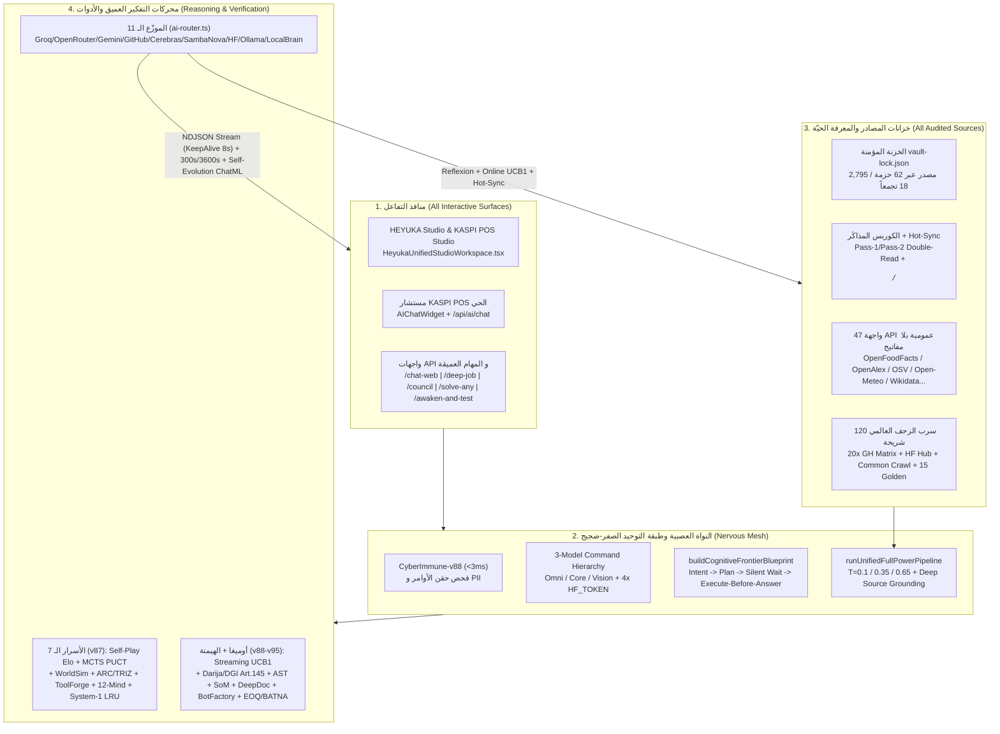

# الملف المرجعي المعياري رقم (2): الهندسة النهائية الكاملة للنماذج وطريقة تفكيرها واتصالها الشامل بجميع المصادر
# HEYUKA & KASPI POS — Canonical Engineering Standard File #2 (Models, Cognitive Engines & Audited Sources)

> **مرجع معياري ثابت ومولَّد برمجياً مباشرةً من الكود الفعلي** بتاريخ `2026-11-24T00:35:31.927Z` ليشكّل مع الملف رقم (1) ([YUKA_FINAL_100_PERCENT_TEST_RESULTS.md](./YUKA_FINAL_100_PERCENT_TEST_RESULTS.md)) الدستور الهندسي الثابت والكامل للمنظومة.

---

## الباب 1: الشكل النهائي الهندسي لتجميع كل شيء في منظومة واحدة (`Final Unified Convergence Blueprint`)

### المعايير الهندسية الستة الثابتة الملزمة (`Permanent Non-Negotiable Standard Contracts`)
1. **معيار الزمن غير المحدود والاستمرارية (`Zero-Timeout & KeepAlive Continuity`):** `maxDuration = 300` في كافة مسارات الذكاء الاصطناعي والأسراب، إزالة أي قواطع دون 30 ثانية (بما فيها إزالة قاطع الـ 18 ثانية للـ reasoning)، بث نبضة `{ type: "keepalive" }` كل `8,000ms`، حد عميل `300,000ms` يتجدد مع كل نبضة حتى 6 قفزات، وقناة `/api/v1/heyuka/deep-job` للمهام اللانهائية، مع دعم `HEYUKA_UNBOUNDED_TIMEOUT=1` (`3,600,000ms`) على خوادم VPS/Docker.
2. **معيار هرم قيادة النماذج الثلاثة (`3-Model Command Hierarchy`):** `HEYUKA Omni` (القيادة الاستراتيجية، `HF_TOKEN` مسار `model_1_omni`), `HEYUKA Core` (البرمجة، البرهان الرياضي، الجباية DGI، `T=0.1`، `HF_TOKEN_2` مسار `model_2_core`), و`HEYUKA Vision` (الرؤية والوسائط والـ 3D، `HF_TOKEN_3/4` مسار `model_3_vision` مع التوجيه متعدد الوسائط).
3. **معيار الدستور المعرفي الصفر-ضجيج (`Execute-Before-Answer`):** كل طلب يمر حتمياً بـ: `(فهم القصد -> خطة تنفيذية -> بوابة النقد الصامت "Wait" داخل <think> -> التحقق الفعلي بالأدوات/Sandbox/DGI قبل كتابة الجواب النهائي -> تسليم كامل بلا TODO)`.
4. **معيار الخزنة أولاً والاستقلال دون إنترنت (`Local-Vault-First & Mirror Fallback`):** كل المصادر الـ `2795` تملك معرّفاً محلياً `vault://heyuka/...` وبصمة `SHA-256` واستراتيجية نسخ احتياطي (`git_bundle_mirror`, `api_vcr_polly_replay`, إلخ) لضمان عدم توقف المنظومة لو سقط أي موقع خارجي.
5. **معيار الأمان الصفر-ثقة وصفر-أسرار (`Zero Hardcoded Secrets & Cyber-Immune`):** `secret-scan.mjs` يتحقق من `0` مفاتيح مكشوفة في الكود، مفاتيح BYOK الشخصية في المتصفح تبقى داخل `sessionStorage` فقط، ومدخلات المستخدم والويب تمر أولاً عبر `CyberImmune-v88`.
6. **معيار الحلقة المغلقة للتطور الذاتي (`Closed-Loop Self-Evolution`):** كل مخرج يتم تدقيقه via `auditAndRecordCompletedOutput`؛ النجاح يغذي أوزان التجميع في `self-evolution-engine.ts` و`O(1) Streaming UCB1`، والأخطاء تتحول فوراً لقواعد وقائية (`Reflexion Lessons`) تُحقن في الطلبات التالية.

---

## الباب 2: كل شيء عن الموديلات — كيف تعمل وتفكّر وتُنفّذ خطوةً بخطوة

### 2.1 التوجيه الهرمي للنماذج الثلاثة (`3-Model Roles`) + التدوير الذكي لـ `HF_TOKEN`

| الدور القيادي | الوصف التخصصي (`Mission`) | مسار التوكن على HF | معادلة إزاحة التوكن | نماذج الأوزان المرتبطة بالترتيب |
| :--- | :--- | :--- | :---: | :--- |
| **`heyuka-omni`** | Coordinate deep multi-source synthesis, council strategy, and end-to-end execution. | `model_1_omni` (`HF_TOKEN`) | `offset = 0` | `Qwen/Qwen2.5-72B-Instruct` -> `deepseek-ai/DeepSeek-R1` -> `meta-llama/Llama-3.3-70B-Instruct` -> `Qwen/Qwen2.5-Coder-32B-Instruct` |
| **`heyuka-core`** | Synthesize clean zero-stub code, AST checks, and formally verified Moroccan DGI math. | `model_2_core` (`HF_TOKEN_2`) | `offset = 1` | `deepseek-ai/DeepSeek-R1` -> `Qwen/Qwen2.5-Coder-32B-Instruct` -> `Qwen/Qwen2.5-72B-Instruct` |
| **`heyuka-vision`** | Analyze visual inputs, DOM/Set-of-Mark UI, and 3D shaders with multimodal verification. | `model_3_vision` (`HF_TOKEN_3 / HF_TOKEN_4`) | `offset = 2` | `Qwen/Qwen2.5-72B-Instruct` -> `meta-llama/Llama-3.3-70B-Instruct` -> `deepseek-ai/DeepSeek-R1` |

> **ميكانيكا الدوران الفعلي في [`src/lib/ai-router.ts`](./src/lib/ai-router.ts):** يتم احتساب التوكن عبر `hfPoolEntries[(roleStartOffset + modelIdx + offset) % hfPoolEntries.length]` مع تتبّع `hfCooldownUntil` و`modelCooldownUntil` تلقائياً لعزل أي مفتاح أو نموذج يرد بـ `429/503/401/404` فوراً والانتقال للمرشح التالي بلا توقف.

### 2.2 سلم الأولويات الكامل للبوابات الـ 11 وضبط الحرارة (`Gateway Cascade & Hyperparams`)
- **ملفات السيطرة:** [`resolveRouterBudgets()`](./src/lib/ai-router.ts#L25) -> `failoverHorizonMs = 1800000ms`، `totalBudgetMs = 3600000ms`، `perAttemptPrimaryMs = 900000ms`، `perAttemptFallbackMs = 300000ms`، `maxContinuationHops = 32`.
- **تحديد الحرارة التكيفي ([`resolveOptimalInferenceHyperparams`](./src/lib/heyuka/cognitive-frontier-blueprint.ts)):**
  - `T = 0.10, topP = 0.90` (`strict_deterministic`): البرمجة، الأمان، حسابات `TVA/DGI/ICE`، الرياضيات والمنطق الصارم.
  - `T = 0.35, topP = 0.90` (`balanced_engineering`): التحليل المعماري، الاستعلامات التنظيمية، وبناء الأنظمة العام.
  - `T = 0.65, topP = 0.92` (`strategic_creative`): العصف الإبداعي، الاستراتيجيات التجارية، صياغة العلامة والدارجة/المحتوى الحواري.
- **سلسلة المرور الحرفية داخل `ai-router.ts`:**
  1. `Priority -1: Caller's Own Server / Ollama / vLLM / Llamafile Endpoint ($0.00 Owner Cost, Unlimited)`
  2. `Priority -0.5: Caller Browser-Session Ephemeral BYOK Free Keys (in-memory only, zero disk persistence)`
  3. `Priority 0: Tenant's Own Encrypted BYOK Provider (Zero Owner Financial Exposure)`
  4. `Priority 1: Global Owner BYOK Providers (STRICTLY gated by explicit owner authorization)`
  5. `Priority 2: Groq Ultra-Fast Live 2026 Models (place higher-quota 120b + 20b ahead of narrow OTPM 1000 models)`
  6. `Priority 3: OpenRouter Verified Free Tool & Vision Routers`
  7. `Priority 4: Google Gemini Live Multimodal Pool`
  8. `Priority 5: Mistral AI Free Tier`
  9. `Priority 6: Together AI (Restricted unless owner paid mode or explicit authorization)`
  10. `Priority 7: DeepSeek API (Owner-only unless tenant configures BYOK)`
  11. `Priority 7.5: Ultra-Fast Free OpenAI-Compatible Frontier Pools (GitHub Models / Cerebras / SambaNova)`
  12. `Priority 8: Hugging Face Multi-Token Inference Pool aligned to 3-Model Command Hierarchy`
  13. `Priority 9: Self-Hosted Local Engine`
  12. **خط الإنقاذ الأخير (`Zero-Failure Bottom Line`):** `Pollinations Zero-Key HTTP` (`https://text.pollinations.ai/openai`، مهلة `45s`) ثم الدماغ السيادي الحتمي المحلي [`runLocalOnDeviceHeyukaBrain()`](./src/lib/heyuka/local-sovereign-brain.ts) (`$0.00`، `100%` متاح دائماً).

### 2.3 كيف تفكّر النماذج رياضياً وخوارزمياً (الأسرار والهيمنة والأوميغا والقوى الخارقة)

| المحرك المعرفي | الملف الفعلي في `src/lib/` | الخوارزمية / المعادلة الرياضية المعتمدة داخلياً | وظيفته أثناء الاستجابة |
| :--- | :--- | :--- | :--- |
| **الذاكرة المزدوجة (`Secret #7`)** | `zebra-x/cognition/secret7_dual_brain_orchestrator.ts` | **System-1 LRU** (`256` مدخل، صلاحية `2h`، <15ms) + **System-2 Episodic Graph** (`tva/stock/security/arabic`) | استرجاع فوري للبديهيات أو إطلاق التحقيق العميق متعدد الفروع |
| **بحث شجرة مونت كارلو (`Secret #2`)** | `zebra-x/cognition/secret2_mcts_reasoner.ts` | **PUCT**: `q + 1.41 * prior * sqrt(parentVisits)/(1+visits)` عبر 4 فروع + `scorePrmStep` + `mathjs/nerdamer` | تفكيك المسائل المعقدة، اختبار أمثلة مضادة وتصحيح المعادلات رقمياً |
| **اللعب الذاتي التطوري (`Secret #1`)** | `zebra-x/evolution/secret1_self_play_bridge.ts` | تقييم **GRPO Advantage** + تصنيف **Elo** (`base = 1200`) + اختبار عملي داخل `executePolyglotCodeSandbox` | توليد تمارين برمجية ورياضية وحلها وتعلّم الفائز ذاتياً |
| **محكم الـ 12 عقلاً (`Secret #6`)** | `zebra-x/cognition/secret6_adversarial_council.ts` | دمج **Weighted RRF** عبر `12` عقلاً متخاصماً مع **فيتو أمني بوزن `1.5`** ودور دقق ضريبي بوزن `1.3` | كشف الثغرات وأخطاء الهوامش والـ RTL قبل خروج النص للمستخدم |
| **الذكاء السائل والاختراع (`Secret #4`)** | `zebra-x/cognition/secret4_fluid_invention.ts` | مطابقة شبكات `ARC-AGI` + الانحدار الرمزي `R^2` (`PySR-style`) + مصفوفة تناقضات `TRIZ` | اكتشاف القوانين الرياضية من نقاط خام والربط الإبداعي بين المجالات |
| **نحت الأدوات ومحاكاة العالم (`#3 & #5`)** | `simulation/secret3_world_sim.ts`, `evolution/secret5_tool_forge.ts` | محاكاة طابور البيع/المخزون `KASPI POS` وفيزياء 3D + تجميع وظائف جديدة معزولة | التنبؤ بنفاد المخزون وحماية الـ VM عند نحت أداة جديدة |
| **التعلم اللحظي (`Tier-Omega #8..#12`)** | `zebra-x/omega/secret8..secret12` | **O(1) Streaming UCB1 Bandit + EWMA** + سجل **SHA-256 Tamper-Proof** + **CGI Art.145** (`>5000 MAD cash -> 0.25% timbre`) + `VAD Barge-In` + `Morph UI` | مواءمة أسلوب الإجابة لحظياً والتزام كامل بالضرائب المغربية والدارجة التجارية |
| **محركات الهيمنة الخارقة (`v90-v95`)** | `zebra-x/dominance/secret1..7`, `zebra-x/superpowers/*` | **TOPSIS** متعدد المعايير، **2-Sigma Drift**، تحليل **AST/SAST/Zero-Stub**، **EOQ & Nash BATNA ZOPA**، حساب ألواح **Solar PV**، فهرس **SoM DOM**، و**DeepDoc GraphRAG** | تدقيق الكود قبل التسليم، حساب طلبيات المخزون المثلى، والتفاوض السعري |
| **آلة فصل التفكير والرتق اللانهائي** | `src/lib/ai-router.ts`, `autonomous-builder-v24-v28.ts` | `createStreamingThinkSplitter` (عزل `<think>...</think>`) + `detectTruncationState` + `mergeContinuationChunk` | بث التفكير في خانة مستقلة وإتمام الملفات الطويلة بلا قطع في منتصف الكود |

### 2.4 قائمة المحكمين الـ 12 والأدوات التنفيذية المتاحة للنماذج
- **مقاعد المحكمة الـ 12 (`runAdversarialSwarmCouncil`):** `#1 Strategic Planner (w=1.15)` • `#2 Systems Architect (w=1.2)` • `#3 Surgical Coder (w=1.25)`
- **أدوات Antigravity Studio (`19`):** `listWorkspaceFiles`, `inspectWorkspaceFile`, `searchWorkspaceFiles`, `writeWorkspaceFile`, `editWorkspaceFile`, `webSearchAndFetch`, `runAndVerifyCode`, `computeExactFinance`, `queryVaultOrApi`, `studyAndCrawlSource`, `reasonWithMctsTree`, `simulateWorldOrMarket`, `inventWithArcAndTriz`, `forgeAndRunSkill`, `validateMoroccoDgiAndFx`, `solveTopsisOrEmitInteractiveWidget`, `getOmniscienceLiveStats`, `executeMcpBusTool`, `analyzeMobileHardwareOrSeo`
- **أدوات مستشار KASPI POS (`27`):** `getTodaySales`, `getLowStockProducts`, `getTopSellingProducts`, `getLastCustomer`, `getLastReceiptTicket`, `getUserActivityLog`, `predictStockDemand`, `generatePdfReport`, `preparePosActionConfirmation`, `generateProductImage`, `searchWebImages`, `queryPublicApi`, `evaluateMathAndFinance`, `createRichArtifactOrExport`, `checkPhoneCalendarOrCron`, `unrestrictedWebSearch`, `executeCodeSandbox`, `lookupSkillOrAuthor`, `discoverOpenSourceTool`, `runCoworkSubAgents`, `runKaspiStudioSwarmCouncil`, `inspectSovereignVaultAndCapabilities`, `getPlatformStats`, `getPlatformRevenue`, `getAllTenantsList`, `getTenantDetails`, `getAIUsageStats`

---

## الباب 3: كيف تتصل المصادر بالنظام و كيف يعمل كل نوع مصدر عملياً

### 3.1 آليات الاتصال الست بين النماذج والمصادر (`How Sources Operate in Production`)

| القناة / المحرك | المسار في الكود | كيف تدخل المعلومات فعلياً إلى تفكير النموذج؟ | السعة الحالية |
| :--- | :--- | :--- | :---: |
| **1. خزنة المصادر المؤمنة** | `vault/vault-lock.json` + `sovereign-permanent-vault.ts` | عند التشغيل تُبنى فهارس `getSovereignVaultUnifiedEntries()` موزعة على `18` تجمعاً؛ يجلب `runUnifiedFullPowerPipeline` أفضل `8` مصادر مطابقة لسؤال المستخدم مع `vault://` URI | **`2795` مصدر** عبر `64` حزمة |
| **2. الكوربس المذاكَر + Hot-Sync** | `knowledge-corpus-engine.ts` + `/api/v1/studio/ingest` | `ensureFullVaultDigested()` يحوّل الخزنة + صفحات الويب (بعد استخلاص `<pre>` و`<table>` بـ Double-Read Pass 1+2 وبصمة SHA-256) إلى وحدة معرفة؛ ويعطي `searchStudiedKnowledgeCorpus(limit: 12, includeWebFirst: true)` الأولوية لما تم زحفه أو حقنه بـ `action: "hot_sync"` | `2795+` وحدة ساخنة |
| **3. الـ 47 واجهة API حية** | `zebra-x/tools/public-apis-hub.ts` + `queryVaultOrApi` / `queryPublicApi` | عند الحاجة لأرقام/بيانات حية (طقس، عملات، أدوية، أبحاث، ثغرات OSV/CISA، باركود، براءات) تستدعي الأداة الواجهة المناسبة بكاش مزدوج (RAM + IndexedDB) ومرايا تلقائية عند تعطل الخادم الأصلي | **`47` واجهة حية** بلا مفاتيح |
| **4. الرادار الكوني وHF Dataset** | `verified-harvest-counter.ts` + `/api/v1/omniscience/live-stats` | يستعلم عبر `Promise.all` (مهلة `15s` وكاش `20s`) من `huggingface.co/api/datasets/zuvyrismail/heyuka-omni-vault` و`index.commoncrawl.org/collinfo.json` وGitHub Actions لحقن سطر حالة الوعي الحقيقي في البرومبت | `CC-MAIN-2026-47` (`130` فهرس) + Crystals |
| **5. أسطول الزحف والتدريب (Python)** | `training/*` + `.github/workflows/eternal-public-study-loop.yml` | `20x Matrix` كل `6` ساعات (`autonomous_web_discoverer.py` -> `massive_curator.py` -> `immortal_nano_vault.py` -> `external_vault_offloader.py` -> `multi_vault_union.py`)، مع سيكربتات `auto_distributed_memory_sync.py` و`merge_heyuka_flagship.py` و`train_grpo_dpo_sovereign.py` | **`120` شريحة** عبر **`6` أسراب** + **`15` مصدراً ذهنياً** |
| **6. تحليل ملفات المشروع والذاكرة الجمعية** | `unified-antigravity-cortex.ts` + `self-evolution-engine.ts` | عند إرفاق ملفات مشروع يعمل `AST-Supremacy` + `SoM-GUI` + `DeepDoc GraphRAG` وتُحقن التنبيهات المباشرة وقواعد التطور (`Reflexion Lessons`) داخل رسالة النظام تلقائياً | كل ملفات الاستوديو النشطة |

---

## الباب 4: التدقيق الشامل لكل المصادر في المنظومة وكيفية عمل كل منها

### 4.1 تدقيق التجمعات المعرفية الـ 18 (`Cognitive Clusters Routing Map`)

| # | `Cluster ID` | العنوان والتخصص | عدد مصادر الخزنة المرتبطة | كيفية تشغيله في النظام |
| :---: | :--- | :--- | :---: | :--- |
| 1 | `patents_and_inventions_150m` | Google Patents (150M+ Global Corpus) & Scholar IP Engine | **16** | يُستدعى عبر `queryVaultOrApi` و`searchSovereignVault` لبحث البراءات (`Google Patents 150M+` / `OpenAlex`) |
| 2 | `pdf_office_and_documents` | PDF, Word, Excel, PowerPoint & Document Studio | **41** | يُستدعى في توليد PDF/Word/Excel والتقارير المالية عبر `createRichArtifactOrExport` و`docs-export-engine.ts` |
| 3 | `image_svg_and_vision_studio` | Image Generation, Background Removal & Vector SVG Studio | **167** | يُستدعى لتوليد الصور وإزالة الخلفيات والرسوم المتجهة SVG عبر `/api/v1/images` و`Heyuka Vision` |
| 4 | `zip_vfs_and_file_packaging` | ZIP Packaging, Virtual File System (VFS) & Lifecycle Engine | **151** | يُستدعى لضغط المشاريع (`PKZIP` / `fflate`) وبناء شجرة الملفات الافتراضية `VFS` في Studio |
| 5 | `code_ide_and_surgical_editing` | Autonomous Coding, Syntax IDE, WASM Compilers & Diff Patching | **478** | يُستدعى في كتابة/ترقيع الكود (`AST-Supremacy`) وتشغيل السندبوكس `Judge0 / Isolated VM` |
| 6 | `games_3d_video_and_audio` | 3D Worlds, Packaged Games, Video (.WebM) & Audio (.WAV) Studio | **384** | يُستدعى لمحركات `Three.js` / `GLB`، بناء الفيديو، فصل الصوتيات ومعالجة WAV/WebCodecs |
| 7 | `live_search_and_47_public_apis` | Pre-Classified Search Router & 47 Live Zero-Key Public APIs | **193** | يربط نموذج اللغة مباشرة بـ `47` API عمومية بلا مفاتيح ومرآة البحث الموحد مع SSRF Shield |
| 8 | `robotics_agents_and_mobile_lab` | Robotics Behavior Trees, Action Bots & Mobile Repair Lab | **201** | يربط `BotFactory-v21` (Telegram/WhatsApp/ROS2) وتشخيصات `ADB / iOS` ومفاتيح QR TLV |
| 9 | `kaspi_pos_merchant_intelligence` | KASPI POS Merchant, Inventory, Financial & Thermal Receipt Co-Pilot | **55** | يربط مستشار `KASPI POS` بالبيع المباشر، الـ TVA المغربية، حساب الهوامش `Decimal`، والتذاكر 80mm |
| 10 | `hardware_cad_voip_testing_and_physics` | Hardware WebUSB/ESC-POS, Open CAD (.DXF), WebRTC/SIP VoIP, RFC-5322 Email (.EML), Sandbox Stress Testing & 3D Physics | **208** | يربط WebUSB/ESC-POS، مخططات DXF، بروتوكولات WebRTC/SIP واختبار فيزياء 3D |
| 11 | `pc_keyboard_mouse_and_virtual_desktop_bots` | Full PC Keyboard/Mouse ScanCodes, Multi-Desktop Virtual Bot Farm & Live Screen/Audio (v52.0) | **100** | يربط أتمتة سطح المكتب الافتراضي (`sovereign-pc-commander.ts` و`/api/v1/desktops/spawn`) |
| 12 | `sovereign_os_shell_file_surgeon_and_sentinel` | Sovereign PowerShell/Bash OS Kernel, Universal File Surgeon, Any-App Operator & 24/7 Sentinel (v53.0) | **121** | يربط عمليات Bash/PowerShell الآمنة وتدقيق الملفات والمراقبة المستمرة `watchdog` |
| 13 | `ai_computer_os_webcam_and_self_unblocking` | Unstoppable AI Computer OS, Smooth Scroll/Zoom, Webcam Live Vision & Self-Unblocking Core (v54.0) | **100** | يربط معالجة كاميرا الويب/الشاشة وحل العوائق ذاتياً (`SoM-GUI-v91`) |
| 14 | `google_ai_studio_dual_brand_workspace` | Dual-Brand HEYUKA & KASPI POS Studio (100% Google AI Studio Parity + Live Browser & Terminal, v55.0 + v58.0) | **205** | يغذّي بيئة الاستوديو المزدوجة `HEYUKA` و`KASPI POS` (`HeyukaUnifiedStudioWorkspace.tsx`) |
| 15 | `elastic_swarm_3_6_12_and_worker_bots` | Elastic 3 -> 6 -> 12 Cooperative Model Scaling Swarm & Worker-Bot Legion (v56.0) | **136** | يغذّي مجلس التوسع المرن `3x -> 6x -> 12x` في `/api/v1/studio/council` والمهام العميقة `deep-job` |
| 16 | `browser_autopilot_oauth_cloud_factory` | Autonomous Browser Autopilot, OAuth/Gmail Session Handshake & Cloud Provisioning Factory (v57.0) | **107** | يربط الأتمتة السحابية، موصلات OAuth و`ZeroCost-Deploy-v93` (Vercel/Cloudflare/HF) |
| 17 | `multiplayer_crdt_huddles_and_gamification` | Multiplayer CRDT Co-Editing, Live Audio/Video Huddles, Team Kanban RBAC & Gamified Rewards (v59.0) | **99** | يدعم `Yjs CRDT` والتعديل التعاوني والترتيب التنافسي داخل الفريق (`/api/v1/studio/team`) |
| 18 | `airgapped_offline_vault_and_lan_mesh` | Total Air-Gapped Offline Sovereign Vault, Local Mirrors & Zero-WiFi LAN Mesh (v60.0) | **33** | يضمن اشتغال المنظومة محلياً `100%` بلا إنترنت عبر `vault://` و`runLocalOnDeviceHeyukaBrain` |

### 4.2 تدقيق جميع الـ 47 واجهة برمجية عمومية مع عناوينها الفعلية وطريقة عملها

| # | معرف الفئة (`category`) | نقاط الاتصال الفعلية والمرايا البديلة في `public-apis-hub.ts` | كيفية الاستدعاء في النظام |
| :---: | :--- | :--- | :--- |
| 1 | `openfoodfacts` | `https://world.openfoodfacts.org/cgi/search.pl + USDA FDC fallback` | عبر أداة `queryVaultOrApi` / `queryPublicApi` أو المسار `/api/v1/public-apis?category=openfoodfacts` |
| 2 | `openbeautyfacts` | `https://world.openbeautyfacts.org/cgi/search.pl + USDA FDC fallback` | عبر أداة `queryVaultOrApi` / `queryPublicApi` أو المسار `/api/v1/public-apis?category=openbeautyfacts` |
| 3 | `openproductfacts` | `https://${host}/api/v2/product/${query}.json?fields=code,product_name,brands,categories,quantity,nutriscore_grade,image_front_small_url • https://${host}/cgi/search.pl?search_terms=${encodeURIComponent( • https://${host}/api/v2/search?search_terms=${encodeURIComponent(` | عبر أداة `queryVaultOrApi` / `queryPublicApi` أو المسار `/api/v1/public-apis?category=openproductfacts` |
| 4 | `fx_rates` | `https://cdn.jsdelivr.net/npm/@fawazahmed0/currency-api@latest/v1/currencies/${base}.json • https://open.er-api.com/v6/latest/${base.toUpperCase(` | عبر أداة `queryVaultOrApi` / `queryPublicApi` أو المسار `/api/v1/public-apis?category=fx_rates` |
| 5 | `crypto_market` | `https://api.coingecko.com/api/v3/coins/markets?vs_currency=usd&ids=${encodeURIComponent(` | عبر أداة `queryVaultOrApi` / `queryPublicApi` أو المسار `/api/v1/public-apis?category=crypto_market` |
| 6 | `weather` | `https://api.open-meteo.com/v1/forecast?latitude=${loc.lat}&longitude=${loc.lon}&current=temperature_2m,relative_humidity_2m,wind_speed_10m,weather_code&daily=temperature_2m_max,temperature_2m_min,precipitation_sum&timezone=auto&forecast_days=5` | عبر أداة `queryVaultOrApi` / `queryPublicApi` أو المسار `/api/v1/public-apis?category=weather` |
| 7 | `geocode` | `https://nominatim.openstreetmap.org/search?q=${encodeURIComponent(` | عبر أداة `queryVaultOrApi` / `queryPublicApi` أو المسار `/api/v1/public-apis?category=geocode` |
| 8 | `b2b_overpass` | `https://overpass-api.de/api/interpreter?data=${encodeURIComponent(ql` | عبر أداة `queryVaultOrApi` / `queryPublicApi` أو المسار `/api/v1/public-apis?category=b2b_overpass` |
| 9 | `gleif_company` | `https://api.gleif.org/api/v1/lei-records?filter[entity.legalName]=${encodeURIComponent(` | عبر أداة `queryVaultOrApi` / `queryPublicApi` أو المسار `/api/v1/public-apis?category=gleif_company` |
| 10 | `country_info` | `https://restcountries.com/v3.1/name/${encodeURIComponent(query` | عبر أداة `queryVaultOrApi` / `queryPublicApi` أو المسار `/api/v1/public-apis?category=country_info` |
| 11 | `wikipedia` | `https://${lang}.wikipedia.org/api/rest_v1/page/summary/${encodeURIComponent(` | عبر أداة `queryVaultOrApi` / `queryPublicApi` أو المسار `/api/v1/public-apis?category=wikipedia` |
| 12 | `wikidata_sparql` | `https://query.wikidata.org/sparql?format=json&query=${encodeURIComponent(query • https://www.wikidata.org/w/api.php?action=wbsearchentities&search=${encodeURIComponent(` | عبر أداة `queryVaultOrApi` / `queryPublicApi` أو المسار `/api/v1/public-apis?category=wikidata_sparql` |
| 13 | `duckduckgo` | `https://api.duckduckgo.com/?q=${encodeURIComponent(query` | عبر أداة `queryVaultOrApi` / `queryPublicApi` أو المسار `/api/v1/public-apis?category=duckduckgo` |
| 14 | `world_bank` | `https://api.worldbank.org/v2/country/${encodeURIComponent( • https://www.imf.org/external/datamapper/api/v1/NGDP_RPCH/${encodeURIComponent(iso3` | عبر أداة `queryVaultOrApi` / `queryPublicApi` أو المسار `/api/v1/public-apis?category=world_bank` |
| 15 | `openalex_science` | `https://api.openalex.org/works?search=${encodeURIComponent(query • https://api.crossref.org/works?query=${encodeURIComponent(query` | عبر أداة `queryVaultOrApi` / `queryPublicApi` أو المسار `/api/v1/public-apis?category=openalex_science` |
| 16 | `openfda_drug` | `https://api.fda.gov/drug/label.json?search=${encodeURIComponent(normalizedDrug • https://clinicaltables.nlm.nih.gov/api/rxterms/v3/search?terms=${encodeURIComponent(normalizedDrug` | عبر أداة `queryVaultOrApi` / `queryPublicApi` أو المسار `/api/v1/public-apis?category=openfda_drug` |
| 17 | `pubmed_papers` | `https://eutils.ncbi.nlm.nih.gov/entrez/eutils/esearch.fcgi?db=pubmed&term=${encodeURIComponent( • https://eutils.ncbi.nlm.nih.gov/entrez/eutils/esummary.fcgi?db=pubmed&id=${ids.join( • https://pubmed.ncbi.nlm.nih.gov/${id}/` | عبر أداة `queryVaultOrApi` / `queryPublicApi` أو المسار `/api/v1/public-apis?category=pubmed_papers` |
| 18 | `soilgrids_agri` | `https://rest.isric.org/soilgrids/v2.0/properties/query?lon=${loc.lon}&lat=${loc.lat}&property=phh2o&property=clay&property=sand&property=soc&depth=0-5cm&value=mean • https://api.open-meteo.com/v1/forecast?latitude=${loc.lat}&longitude=${loc.lon}&current=soil_temperature_0cm,soil_moisture_0_to_1cm,precipitation` | عبر أداة `queryVaultOrApi` / `queryPublicApi` أو المسار `/api/v1/public-apis?category=soilgrids_agri` |
| 19 | `nasa_power_agri` | `https://power.larc.nasa.gov/api/temporal/daily/point?parameters=T2M,RH2M,ALLSKY_SFC_SW_DWN,PRECTOTCORR&community=AG&longitude=${loc.lon}&latitude=${loc.lat}&start=${fmt(` | عبر أداة `queryVaultOrApi` / `queryPublicApi` أو المسار `/api/v1/public-apis?category=nasa_power_agri` |
| 20 | `paleobiology_fossils` | `https://paleobiodb.org/data1.2/taxa/list.json?name=${q}&rel=all_children&show=attr,app,size&limit=${limit} • https://api.gbif.org/v1/species/search?q=${q}&limit=${limit}` | عبر أداة `queryVaultOrApi` / `queryPublicApi` أو المسار `/api/v1/public-apis?category=paleobiology_fossils` |
| 21 | `open_tree_of_life` | `https://api.opentreeoflife.org/v3/tnrs/match_names • https://api.gbif.org/v1/species/search?q=${encodeURIComponent(` | عبر أداة `queryVaultOrApi` / `queryPublicApi` أو المسار `/api/v1/public-apis?category=open_tree_of_life` |
| 22 | `patents_inventor` | `https://query.wikidata.org/sparql?format=json&query=${encodeURIComponent(sparql • https://www.wikidata.org/w/api.php?action=wbsearchentities&search=${encodeURIComponent(` | عبر أداة `queryVaultOrApi` / `queryPublicApi` أو المسار `/api/v1/public-apis?category=patents_inventor` |
| 23 | `nobel_prize` | `https://api.nobelprize.org/2.1/nobelPrizes?nobelPrizeCategory=${catCode}&limit=${limit} • https://api.nobelprize.org/2.1/laureates?name=${encodeURIComponent(query` | عبر أداة `queryVaultOrApi` / `queryPublicApi` أو المسار `/api/v1/public-apis?category=nobel_prize` |
| 24 | `hacker_news` | `https://hn.algolia.com/api/v1/search?query=${encodeURIComponent( • https://news.ycombinator.com/item?id=${h.objectID} • https://hacker-news.firebaseio.com/v0/topstories.json` | عبر أداة `queryVaultOrApi` / `queryPublicApi` أو المسار `/api/v1/public-apis?category=hacker_news` |
| 25 | `remote_jobs` | `https://www.arbeitnow.com/api/job-board-api` | عبر أداة `queryVaultOrApi` / `queryPublicApi` أو المسار `/api/v1/public-apis?category=remote_jobs` |
| 26 | `iconify_logos` | `https://api.iconify.design/search?query=${encodeURIComponent(query • https://api.iconify.design/${id}.svg • https://cdn.simpleicons.org/${encodeURIComponent(query.toLowerCase(` | عبر أداة `queryVaultOrApi` / `queryPublicApi` أو المسار `/api/v1/public-apis?category=iconify_logos` |
| 27 | `openverse_media` | `https://api.openverse.org/v1/images/?q=${q}&page_size=${limit} • https://commons.wikimedia.org/w/api.php?action=query&generator=search&gsrsearch=${q}&gsrnamespace=6&gsrlimit=${limit}&prop=imageinfo&iiprop=url&format=json&origin=* • https://commons.wikimedia.org/wiki/${encodeURIComponent(String(p?.title` | عبر أداة `queryVaultOrApi` / `queryPublicApi` أو المسار `/api/v1/public-apis?category=openverse_media` |
| 28 | `met_museum` | `https://collectionapi.metmuseum.org/public/collection/v1/search?hasImages=true&q=${encodeURIComponent( • https://collectionapi.metmuseum.org/public/collection/v1/objects/${id} • https://api.artic.edu/api/v1/artworks/search?q=${encodeURIComponent(` | عبر أداة `queryVaultOrApi` / `queryPublicApi` أو المسار `/api/v1/public-apis?category=met_museum` |
| 29 | `polyhaven_3d` | `https://api.polyhaven.com/assets?t=${normalizedType} • https://cdn.polyhaven.com/asset_img/thumbs/${slug}.png?width=384 • https://polyhaven.com/a/${slug}` | عبر أداة `queryVaultOrApi` / `queryPublicApi` أو المسار `/api/v1/public-apis?category=polyhaven_3d` |
| 30 | `transit_stops` | `https://transit.land/api/v2/rest/stops?search=${encodeURIComponent(q • https://overpass-api.de/api/interpreter` | عبر أداة `queryVaultOrApi` / `queryPublicApi` أو المسار `/api/v1/public-apis?category=transit_stops` |
| 31 | `smart_city_poi` | `https://overpass-api.de/api/interpreter` | عبر أداة `queryVaultOrApi` / `queryPublicApi` أو المسار `/api/v1/public-apis?category=smart_city_poi` |
| 32 | `air_quality` | `https://air-quality-api.open-meteo.com/v1/air-quality?latitude=${loc.lat}&longitude=${loc.lon}&current=pm10,pm2_5,carbon_monoxide,nitrogen_dioxide,ozone,european_aqi` | عبر أداة `queryVaultOrApi` / `queryPublicApi` أو المسار `/api/v1/public-apis?category=air_quality` |
| 33 | `nador_marine_weather` | `https://marine-api.open-meteo.com/v1/marine?latitude=${loc.lat}&longitude=${loc.lon}&current=wave_height,wave_direction,wave_period,swell_wave_height&hourly=wave_height,swell_wave_height&forecast_days=2` | عبر أداة `queryVaultOrApi` / `queryPublicApi` أو المسار `/api/v1/public-apis?category=nador_marine_weather` |
| 34 | `cyber_threat_intel` | `https://www.cisa.gov/sites/default/files/feeds/known_exploited_vulnerabilities.json • https://api.osv.dev/v1/query` | عبر أداة `queryVaultOrApi` / `queryPublicApi` أو المسار `/api/v1/public-apis?category=cyber_threat_intel` |
| 35 | `osrm_routing` | `https://router.project-osrm.org/route/v1/driving/${a.lon},${a.lat};${b.lon},${b.lat}?overview=false` | عبر أداة `queryVaultOrApi` / `queryPublicApi` أو المسار `/api/v1/public-apis?category=osrm_routing` |
| 36 | `usgs_earthquakes` | `https://earthquake.usgs.gov/fdsnws/event/1/query?format=geojson&limit=${limit}&orderby=time` | عبر أداة `queryVaultOrApi` / `queryPublicApi` أو المسار `/api/v1/public-apis?category=usgs_earthquakes` |
| 37 | `nasa_eonet_events` | `https://eonet.gsfc.nasa.gov/api/v3/events?limit=${limit}&status=open • https://earthquake.usgs.gov/fdsnws/event/1/query?format=geojson&limit=${limit}&orderby=time` | عبر أداة `queryVaultOrApi` / `queryPublicApi` أو المسار `/api/v1/public-apis?category=nasa_eonet_events` |
| 38 | `nhtsa_recalls_vehicles` | `https://vpic.nhtsa.dot.gov/api/vehicles/getmodelsformake/${encodeURIComponent(` | عبر أداة `queryVaultOrApi` / `queryPublicApi` أو المسار `/api/v1/public-apis?category=nhtsa_recalls_vehicles` |
| 39 | `disease_health_stats` | `https://disease.sh/v3/covid-19/countries/${encodeURIComponent(cleanCountry • https://disease.sh/v3/covid-19/all` | عبر أداة `queryVaultOrApi` / `queryPublicApi` أو المسار `/api/v1/public-apis?category=disease_health_stats` |
| 40 | `rxnav_drugs` | `https://rxnav.nlm.nih.gov/REST/drugs.json?name=${encodeURIComponent(` | عبر أداة `queryVaultOrApi` / `queryPublicApi` أو المسار `/api/v1/public-apis?category=rxnav_drugs` |
| 41 | `wger_workouts` | `https://wger.de/api/v2/exerciseinfo/?limit=${limit}&language=2` | عبر أداة `queryVaultOrApi` / `queryPublicApi` أو المسار `/api/v1/public-apis?category=wger_workouts` |
| 42 | `openlibrary_books` | `https://openlibrary.org/search.json?q=${q}&limit=${limit}&fields=key,title,author_name,first_publish_year • https://gutendex.com/books?search=${q}` | عبر أداة `queryVaultOrApi` / `queryPublicApi` أو المسار `/api/v1/public-apis?category=openlibrary_books` |
| 43 | `gbif_biodiversity` | `https://api.gbif.org/v1/species/search?q=${encodeURIComponent(` | عبر أداة `queryVaultOrApi` / `queryPublicApi` أو المسار `/api/v1/public-apis?category=gbif_biodiversity` |
| 44 | `frankfurter_fx` | `https://api.frankfurter.app/latest?from=${encodeURIComponent(baseCur` | عبر أداة `queryVaultOrApi` / `queryPublicApi` أو المسار `/api/v1/public-apis?category=frankfurter_fx` |
| 45 | `themealdb_recipes` | `https://www.themealdb.com/api/json/v1/1/search.php?s=${cleanDish}` | عبر أداة `queryVaultOrApi` / `queryPublicApi` أو المسار `/api/v1/public-apis?category=themealdb_recipes` |
| 46 | `opensky_flights` | `https://api.adsb.lol/v2/point/35.1688/-2.9335/250 • https://opensky-network.org/api/states/all?lamin=29.0&lomin=-11.0&lamax=36.0&lomax=-1.0` | عبر أداة `queryVaultOrApi` / `queryPublicApi` أو المسار `/api/v1/public-apis?category=opensky_flights` |
| 47 | `google_patents` | `https://patents.google.com/?q=${encQ}&scholar • https://api.openalex.org/works?search=${encQ}+patent+invention&per-page=${Math.min( • https://patents.google.com/patent/${patentId}/en` | عبر أداة `queryVaultOrApi` / `queryPublicApi` أو المسار `/api/v1/public-apis?category=google_patents` |

### 4.3 تدقيق المصادر الذهبية الـ 0 وأسراب الشرائح الـ 120 وخط التدريب (`training/`)

| الترتيب | المعرف | المصدر الذهبي (`Golden Source`) | دورها الفعلي داخل خط الزحف والمناهج |
| :---: | :--- | :--- | :--- |

**مصفوفة الأسراب السحابية الـ 120 (`MULTI_CLOUD_120_POOLS`):**
- `github_actions_matrix` (**GitHub Actions 20x Matrix**): نطاق الشرائح `0..19` — السعة `20` شريحة (النوع `github_matrix`).
- `hf_spaces_docker` (**Hugging Face Spaces Docker**): نطاق الشرائح `20..44` — السعة `25` شريحة (النوع `hf_space_docker`).
- `cloudflare_edge_workers` (**Cloudflare Workers Edge (300+ Cities)**): نطاق الشرائح `45..84` — السعة `40` شريحة (النوع `cloudflare_edge`).
- `kaggle_colab_warc` (**Kaggle / Colab / Lightning WARC**): نطاق الشرائح `85..99` — السعة `15` شريحة (النوع `kaggle_colab_warc`).
- `gitlab_vercel_cron` (**GitLab CI / Vercel Edge Delta**): نطاق الشرائح `100..109` — السعة `10` شريحة (النوع `gitlab_vercel_cron`).
- `browser_p2p_mesh` (**Browser P2P WebWorker Swarm**): نطاق الشرائح `110..119+` — السعة `10` شريحة (النوع `browser_p2p`).

**جميع سكربتات بايثون للتدريب والدمج والمزامنة (`16` ملفاً):**
- `training/crawler/autonomous_web_discoverer.py`
- `training/crawler/golden_sources_priority.py`
- `training/crawler/multi_cloud_swarm_director.py`
- `training/crawler/planetary_crawl_secrets.py`
- `training/crawler/web_scale_crawler.py`
- `training/evolution/secret1_self_play.py`
- `training/ingestion/massive_curator.py`
- `training/memory/immortal_nano_vault.py`
- `training/pretrain/foundation_trainer.py`
- `training/sovereign_models/merge_heyuka_flagship.py`
- `training/sovereign_models/train_grpo_dpo_sovereign.py`
- `training/storage/external_vault_offloader.py`
- `training/storage/hf_token_pool.py`
- `training/storage/multi_vault_union.py`
- `training/sync/auto_distributed_memory_sync.py`
- `training/telemetry/remote_omniscience_radar.py`

### 4.4 الجرد المدقق الكامل لكل الـ 2795 مصدراً في الخزنة السيادية (`100% Audited Vault Catalog`)

> كل مصدر أدناه مدقق من `getSovereignVaultUnifiedEntries()` مع حزمته (`pack`)، تجمّعه المعرفي (`clusterId`)، رابطه الفعلي، معرّفه المحلي الدائم (`vaultUri`)، استراتيجية النسخ (`mirrorStrategy`)، قابليته للتشغيل محلياً (`Client/Edge`)، ودوره الهندسي الحرفي في النظام.

| # | `ID` | الحزمة | التجمع (`Cluster`) | الاسم | الرابط (`URL`) | استراتيجية النسخ | محلي/حافة | كيف يعمل داخل النظام (`Role`) |
| :---: | :--- | :--- | :--- | :--- | :--- | :--- | :---: | :--- |
| 1 | `v34_0_001_skyreels_v2_skyworkai` | `v34.0` | `games_3d_video_and_audio` | **SkyReels-V2 (SkyworkAI)** | https://github.com/SkyworkAI/SkyReels-V2 | `git_bundle_mirror` | YES | أول نموذج مفتوح المصدر لتوليد فيديوهات لا نهائية الطول (Infinite-Length Diffusion Forcing) بجودة سينمائية. |
| 2 | `v34_0_002_framepack_lllyasviel` | `v34.0` | `games_3d_video_and_audio` | **FramePack (lllyasviel)** | https://github.com/lllyasviel/FramePack | `git_bundle_mirror` | YES | تقنية ضغط الإطارات التي تتيح توليد فيديوهات طويلة جداً (60+ ثانية بـ 30fps) حتى على كروت شاشة متوسطة (6GB VRAM). |
| 3 | `v34_0_003_causvid_mit_adobe_open` | `v34.0` | `games_3d_video_and_audio` | **CausVid (MIT / Adobe Open)** | https://github.com/tianweiy/CausVid | `git_bundle_mirror` | YES | تحويل نماذج الفيديو البطيئة إلى توليد متدفق لحظي (Autoregressive Streaming) لصناعة مشاهد طويلة متصلة. |
| 4 | `v34_0_004_self_forcing_autoregressive_video` | `v34.0` | `games_3d_video_and_audio` | **Self-Forcing (Autoregressive Video)** | https://github.com/guandeh17/Self-Forcing | `git_bundle_mirror` | YES | تقنية منع تشوه الصورة في الفيديوهات الطويلة (Zero Drift) بحيث تبقى الدقيقة العاشرة بنفس نقاء الثانية الأولى. |
| 5 | `v34_0_005_magi_1_sand_ai` | `v34.0` | `games_3d_video_and_audio` | **MAGI-1 (Sand.ai)** | https://github.com/SandAI-org/MAGI-1 | `git_bundle_mirror` | YES | نموذج مفتوح يولد الفيديو مقطعاً بمقطع (Chunk-by-Chunk Autoregressive) مع تحكم كامل في القصة والأحداث الطويلة. |
| 6 | `v34_0_006_wan2_1_flf2v_first_last_frame_to_video` | `v34.0` | `games_3d_video_and_audio` | **Wan2.1-FLF2V (First-Last-Frame-to-Video)** | https://github.com/Wan-Video/Wan2.1 | `git_bundle_mirror` | YES | ربط المشهد الأول بالمشهد الأخير بدقة خيالية لصناعة أفلام طويلة متصلة من لقطات متتابعة. |
| 7 | `v34_0_007_step_video_t2v_30b_open_weights` | `v34.0` | `games_3d_video_and_audio` | **Step-Video-T2V (30B Open Weights)** | https://github.com/stepfun-ai/Step-Video-T2V | `git_bundle_mirror` | YES | نموذج ضخم مفتوح المصدر لإنتاج مشاهد طويلة وحركة كاميرا سينمائية معقدة بواقعية فائقة. |
| 8 | `v34_0_008_goku_goku_bytedance_open` | `v34.0` | `games_3d_video_and_audio` | **Goku / Goku+ (ByteDance Open)** | https://github.com/Saiyan-World/goku | `git_bundle_mirror` | YES | توليد فيديوهات إعلانية وسينمائية طويلة متناسقة الفيزياء وحركة المنتجات البشرية. |
| 9 | `v34_0_009_allegro_rhymes_ai` | `v34.0` | `games_3d_video_and_audio` | **Allegro (Rhymes AI)** | https://github.com/rhymes-ai/Allegro | `git_bundle_mirror` | YES | توليد مقاطع عالية السلاسة (6 ثواني بـ 15/30fps قابلة للتمديد) بحركة بشرية وحيوانية طبيعية. |
| 10 | `v34_0_010_freenoise_fifo_diffusion` | `v34.0` | `games_3d_video_and_audio` | **FreeNoise / FIFO-Diffusion** | https://github.com/jjihwan/FIFO-Diffusion_public | `git_bundle_mirror` | YES | تمديد طول أي نموذج فيديو مفتوح بـ 10 أضعاف بدون إعادة تدريب (Training-Free Long Video). |
| 11 | `v34_0_011_streamingt2v` | `v34.0` | `games_3d_video_and_audio` | **StreamingT2V** | https://github.com/Picsart-AI-Research/StreamingT2V | `git_bundle_mirror` | YES | توليد فيديوهات طويلة جداً (1200+ إطار) مع ذاكرة قصيرة وطويلة تحفظ تفاصيل المشهد. |
| 12 | `v34_0_012_storydiffusion` | `v34.0` | `games_3d_video_and_audio` | **StoryDiffusion** | https://github.com/HVision-NKU/StoryDiffusion | `git_bundle_mirror` | YES | الحفاظ على نفس الشخصيات والملابس والديكور عبر عشرات المشاهد المتتالية لصناعة فيلم أو قصة كاملة. |
| 13 | `v34_0_013_moviegen_open_videosys` | `v34.0` | `games_3d_video_and_audio` | **MovieGen-Open / VideoSys** | https://github.com/NUS-HPC-AI-Lab/VideoSys | `git_bundle_mirror` | YES | إطار عمل مفتوح لتسريع وتمديد نماذج الفيديو السينمائي وإخراج أفلام قصيرة متكاملة. |
| 14 | `v34_0_014_comfyui_wanvideowrapper_kijai_nodes` | `v34.0` | `games_3d_video_and_audio` | **ComfyUI-WanVideoWrapper & Kijai Nodes** | https://github.com/kijai/ComfyUI-WanVideoWrapper | `git_bundle_mirror` | YES | عقد برمجية متقدمة لربط اللقطات الطويلة (Context Windows) بدون أي انقطاع أو قفزة بصرية. |
| 15 | `v34_0_015_animatediff_evolved_context_sliding` | `v34.0` | `games_3d_video_and_audio` | **AnimateDiff-Evolved (Context Sliding)** | https://github.com/Kosinkadink/ComfyUI-AnimateDiff-Evolved | `git_bundle_mirror` | YES | تقنية النافذة المنزلقة (Sliding Context Window) لتوليد رسوم ومشاهد طويلة بلا حدود. |
| 16 | `v34_0_016_controlnext_video` | `v34.0` | `games_3d_video_and_audio` | **ControlNeXt-Video** | https://github.com/dvlab-research/ControlNeXt | `git_bundle_mirror` | YES | توجيه الفيديوهات الطويلة بدقة عبر الهيكل العظمي والعمق دون فقدان الواقعية. |
| 17 | `v34_0_017_tora_trajectory_oriented_video` | `v34.0` | `games_3d_video_and_audio` | **Tora (Trajectory-Oriented Video)** | https://github.com/alibaba/Tora | `git_bundle_mirror` | YES | رسم مسار حركة أي جسم أو سيارة أو شخص في المشهد الطويل بدقة فيزيائية. |
| 18 | `v34_0_018_camcontrol_cameractrl` | `v34.0` | `games_3d_video_and_audio` | **CamControl / CameraCtrl** | https://github.com/hehao13/CameraCtrl | `git_bundle_mirror` | YES | التحكم الاحترافي بحركة الكاميرا (Dolly, Pan, Zoom, Crane, Drone Shot) كأن مصوراً محترفاً يحملها. |
| 19 | `v34_0_019_vidu_open_cogvideox_1_5_5b` | `v34.0` | `games_3d_video_and_audio` | **Vidu-Open / CogVideoX-1.5-5B** | https://github.com/THUDM/CogVideo | `git_bundle_mirror` | YES | توليد مشاهد طويلة بدقة عالية ونسب عرض سينمائية متنوعة (16:9, 9:16, 2.39:1). |
| 20 | `v34_0_020_easyanimate_v5` | `v34.0` | `games_3d_video_and_audio` | **EasyAnimate v5** | https://github.com/aigc-apps/EasyAnimate | `git_bundle_mirror` | YES | نظام متكامل لتوليد فيديوهات طويلة بدقة 1024x1024 من النص أو الصور المتعددة. |
| 21 | `v34_0_021_matrix_game_mineworld` | `v34.0` | `games_3d_video_and_audio` | **Matrix-Game / MineWorld** | https://github.com/SkyworkAI/Matrix-Game | `git_bundle_mirror` | YES | محاكاة عوالم تفاعلية طويلة في الزمن الحقيقي تحترم قوانين الفيزياء والحركة. |
| 22 | `v34_0_022_ltx_video_0_9_7_13b_distilled` | `v34.0` | `games_3d_video_and_audio` | **LTX-Video-0.9.7 (13B Distilled)** | https://github.com/Lightricks/LTX-Video | `git_bundle_mirror` | YES | توليد مقاطع طويلة بسرعة فائقة (Real-Time Generation) وتفاصيل جلد وإضاءة طبيعية. |
| 23 | `v34_0_023_teacache_sageattention` | `v34.0` | `games_3d_video_and_audio` | **TeaCache & SageAttention** | https://github.com/ali-vilab/TeaCache | `git_bundle_mirror` | YES | تسريع توليد الفيديوهات الطويلة بـ 3 إلى 5 أضعاف بدون أي فقدان في الجودة البصرية. |
| 24 | `v34_0_024_spargeattn` | `v34.0` | `games_3d_video_and_audio` | **SpargeAttn** | https://github.com/thu-ml/SpargeAttn | `git_bundle_mirror` | YES | تسريع الانتباه المتناثر (Sparse Attention) لمعالجة آلاف الإطارات في الفيديوهات الطويلة بسلاسة. |
| 25 | `v34_0_025_fastvideo_xdit_multi_gpu_node` | `v34.0` | `games_3d_video_and_audio` | **FastVideo (xDiT Multi-GPU/Node)** | https://github.com/hao-ai-lab/FastVideo | `git_bundle_mirror` | YES | توزيع توليد الفيديوهات الطويلة على عدة عقد أو معالجات لإخراج أفلام كاملة في وقت قياسي. |
| 26 | `v34_0_026_detail_daemon_lying_sigma_sampler` | `v34.0` | `games_3d_video_and_audio` | **Detail-Daemon & Lying-Sigma-Sampler** | https://github.com/muerrilla/sd-webui-detail-daemon | `browser_webgpu_wasm` | YES | إضافة تفاصيل مجهرية طبيعية (مسام الجلد، نسيج الملابس، الغبار في الضوء) لإزالة نعومة الذكاء الاصطناعي المزيفة. |
| 27 | `v34_0_027_film_frame_interpolation_for_large_motion_google` | `v34.0` | `games_3d_video_and_audio` | **FILM (Frame Interpolation for Large Motion — Google)** | https://github.com/google-research/frame-interpolation | `git_bundle_mirror` | YES | توليد إطارات وسطية ناعمة جداً بين الحركات السريعة ليبدو الفيديو مصوراً بكاميرا سينمائية 60/120fps. |
| 28 | `v34_0_028_real_esrgan_video_span_upscaler` | `v34.0` | `games_3d_video_and_audio` | **Real-ESRGAN Video & Span-Upscaler** | https://github.com/xinntao/Real-ESRGAN | `git_bundle_mirror` | YES | رفع دقة الفيديو وإعادة بناء التفاصيل الدقيقة للوجوه والخلفيات بلا تشوه. |
| 29 | `v34_0_029_codeformer_gfpgan_video` | `v34.0` | `games_3d_video_and_audio` | **CodeFormer & GFPGAN Video** | https://github.com/sczhou/CodeFormer | `git_bundle_mirror` | YES | ترميم وإصلاح الوجوه والعيون والأسنان في كل إطار من الفيديو لتبدو بشرية طبيعية 100%. |
| 30 | `v34_0_030_ic_light_v2_relighting_engine` | `v34.0` | `games_3d_video_and_audio` | **IC-Light V2 (Relighting Engine)** | https://github.com/lllyasviel/IC-Light | `git_bundle_mirror` | YES | إعادة إضاءة الأشخاص والأجسام في الفيديو لتتطابق مع إضاءة البيئة والظلال الحقيقية بنسبة 100%. |
| 31 | `v34_0_031_depth_anything_v2_video_depth_anything` | `v34.0` | `games_3d_video_and_audio` | **Depth-Anything-V2 & Video-Depth-Anything** | https://github.com/DepthAnything/Video-Depth-Anything | `git_bundle_mirror` | YES | حساب العمق ثلاثي الأبعاد لكل إطار (Temporal Depth) لضمان تناسق المنظور والضبابية السينمائية (Bokeh). |
| 32 | `v34_0_032_cotracker3_meta_point_tracking` | `v34.0` | `games_3d_video_and_audio` | **CoTracker3 (Meta Point Tracking)** | https://github.com/facebookresearch/co-tracker | `git_bundle_mirror` | YES | تتبع حركة آلاف النقاط في الفيديو بدقة لضمان ثبات الأجسام وعدم اهتزاز الخلفية أو ذوبانها. |
| 33 | `v34_0_033_sam_2_1_segment_anything_model_2_1_meta` | `v34.0` | `games_3d_video_and_audio` | **SAM 2.1 (Segment Anything Model 2.1 — Meta)** | https://github.com/facebookresearch/sam2 | `git_bundle_mirror` | YES | عزل وتعديل أي شخص أو عنصر في الفيديو بدقة متناهية عبر جميع الإطارات. |
| 34 | `v34_0_034_matanyone` | `v34.0` | `games_3d_video_and_audio` | **MatAnyone** | https://github.com/pq-yang/MatAnyone | `git_bundle_mirror` | YES | فصل احترافي للشعر والحواف الدقيقة (Alpha Matting) في الفيديوهات الواقعية بدون حواف مقطوعة. |
| 35 | `v34_0_035_diffbir_supir` | `v34.0` | `games_3d_video_and_audio` | **DiffBIR & SUPIR** | https://github.com/Fanghua-Yu/SUPIR | `git_bundle_mirror` | YES | استعادة التفاصيل الفوتوغرافية الطبيعية وإزالة الضبابية الرقمية من المشاهد. |
| 36 | `v34_0_036_opencolorio_ocio_academy_software_foundation` | `v34.0` | `games_3d_video_and_audio` | **OpenColorIO (OCIO — Academy Software Foundation)** | https://github.com/AcademySoftwareFoundation/OpenColorIO | `git_bundle_mirror` | YES | تطبيق معايير الألوان السينمائية الحقيقية (ACES / Log-to-Rec.709) المستخدمة في أفلام هوليوود. |
| 37 | `v34_0_037_davinci_style_luts_lut3d_ffmpeg_engine` | `v34.0` | `games_3d_video_and_audio` | **DaVinci-Style LUTs & lut3d FFmpeg Engine** | https://github.com/aces-aswf/aces-core | `git_bundle_mirror` | YES | تطبيق جداول ألوان الكاميرات السينمائية (ARRI Alexa, RED, Sony S-Log3) لإعطاء مظهر كاميرا حقيقية. |
| 38 | `v34_0_038_film_grain_synthesis_av1_ffmpeg_noise` | `v34.0` | `games_3d_video_and_audio` | **Film-Grain-Synthesis (av1 / FFmpeg noise)** | https://github.com/FFmpeg/FFmpeg | `git_bundle_mirror` | YES | إضافة حبيبات الفيلم البصرية الطبيعية (35mm Optical Grain) التي تكسر المظهر الرقمي الاصطناعي. |
| 39 | `v34_0_039_lens_distortion_chromatic_aberration_shaders` | `v34.0` | `games_3d_video_and_audio` | **Lens-Distortion & Chromatic Aberration Shaders** | https://github.com/search?q=Lens-Distortion%20%26%20Chromatic%20Aberration%20Shaders | `git_bundle_mirror` | YES | محاكاة خصائص العدسات الزجاجية الحقيقية (انحراف لوني طفيف، توهج عدسة طبيعي، وعمق ميدان). |
| 40 | `v34_0_040_stabilize_video_vid_stab` | `v34.0` | `games_3d_video_and_audio` | **Stabilize-Video (vid.stab)** | https://github.com/georgmartius/vid.stab | `git_bundle_mirror` | YES | محاكاة حركة الكاميرا المحمولة باليد بشكل طبيعي (Natural Handheld Micro-Shake) بدل الثبات الآلي الجامد. |
| 41 | `v34_0_041_mimicmotion` | `v34.0` | `games_3d_video_and_audio` | **MimicMotion** | https://github.com/Tencent/MimicMotion | `git_bundle_mirror` | YES | نقل حركات الجسم واليدين البشرية الحقيقية بدقة تشريحية تمنع تشوه الأصابع أو الأطراف. |
| 42 | `v34_0_042_champ_controllable_human_image_animation` | `v34.0` | `games_3d_video_and_audio` | **Champ (Controllable Human Image Animation)** | https://github.com/fudan-generative-vision/champ | `git_bundle_mirror` | YES | تحريك البشر باستخدام خرائط ثلاثية الأبعاد (SMPL) لضمان فيزياء جسم وملابس واقعية 100%. |
| 43 | `v34_0_043_unianimate_moore_animateanyone` | `v34.0` | `games_3d_video_and_audio` | **UniAnimate & Moore-AnimateAnyone** | https://github.com/ali-vilab/UniAnimate | `git_bundle_mirror` | YES | الحفاظ على تناسق وجه وملابس الشخص طوال فترة الرقص أو المشي أو الكلام في الفيديو. |
| 44 | `v34_0_044_motionblur_synthesis_rife_blur` | `v34.0` | `games_3d_video_and_audio` | **MotionBlur-Synthesis (RIFE-Blur)** | https://github.com/hzwer/Practical-RIFE | `git_bundle_mirror` | YES | إضافة ضبابية الحركة الطبيعية (180-Degree Shutter Motion Blur) عند تحرك الأجسام بسرعة. |
| 45 | `v34_0_045_seedvr_starlight_open` | `v34.0` | `games_3d_video_and_audio` | **SEEDVR / StarLight-Open** | https://github.com/IceClear/SeedVR | `git_bundle_mirror` | YES | ترميم الفيديوهات وإزالة أي تشويه زمني (Temporal Flicker Removal) بين الإطارات. |
| 46 | `v34_0_046_omnihuman_fantasytalking` | `v34.0` | `games_3d_video_and_audio` | **OmniHuman / FantasyTalking** | https://github.com/Fantasy-AMAP/fantasy-talking | `git_bundle_mirror` | YES | تحريك كامل الجسم واليدين وتعابير الوجه مع الصوت بواقعية يصعب تفريقها عن التصوير الحقيقي. |
| 47 | `v34_0_047_latentsync_bytedance_open` | `v34.0` | `games_3d_video_and_audio` | **LatentSync (ByteDance Open)** | https://github.com/bytedance/LatentSync | `git_bundle_mirror` | YES | مزامنة شفاه فائقة الدقة (Sub-pixel Lip-Sync) بدون ضبابية حول الفم أو تغير في شكل الأسنان. |
| 48 | `v34_0_048_sonic_portrait_animation` | `v34.0` | `games_3d_video_and_audio` | **Sonic (Portrait Animation)** | https://github.com/jixiaozhong/Sonic | `git_bundle_mirror` | YES | تحريك طبيعي للرأس والعيون والرموش والتنفس أثناء التحدث ليبدو الشخص حياً أمام الكاميرا. |
| 49 | `v34_0_049_emo_aniportrait` | `v34.0` | `games_3d_video_and_audio` | **EMO / AniPortrait** | https://github.com/Zejun-Yang/AniPortrait | `git_bundle_mirror` | YES | توليد تعابير وجه عاطفية دقيقة (ابتسامة، دهشة، تركيز) متزامنة مع نبرة الصوت. |
| 50 | `v34_0_050_vbench_2_0_intrinsic_faithfulness` | `v34.0` | `games_3d_video_and_audio` | **VBench-2.0 (Intrinsic Faithfulness)** | https://github.com/Vchitect/VBench | `git_bundle_mirror` | YES | فحص آلي صارم للفيزياء، التشريح البشري، والواقعية قبل اعتماد أي فيديو مولد. |
| 51 | `v34_0_051_mmaudio_video_to_audio_synthesis` | `v34.0` | `games_3d_video_and_audio` | **MMAudio (Video-to-Audio Synthesis)** | https://github.com/hkchengrex/MMAudio | `git_bundle_mirror` | YES | يشاهد الفيديو المولد ويولد تلقائياً أصواتاً واقعية متزامنة بالميلي ثانية (خطوات، تصفيق، محركات، أمواج). |
| 52 | `v34_0_052_foleycrafter` | `v34.0` | `games_3d_video_and_audio` | **FoleyCrafter** | https://github.com/open-mmlab/FoleyCrafter | `git_bundle_mirror` | YES | إضافة مؤثرات صوتية سينمائية (Foley Sound Effects) متطابقة مع حركة الأجسام في الفيديو. |
| 53 | `v34_0_053_v2a_mapper_diff_foley` | `v34.0` | `games_3d_video_and_audio` | **V2A-Mapper & Diff-Foley** | https://github.com/luosiallen/Diff-Foley | `git_bundle_mirror` | YES | تحويل المشاهد البصرية إلى مؤثرات صوتية طبيعية بدون تأخير زمني. |
| 54 | `v34_0_054_audioldm_2` | `v34.0` | `games_3d_video_and_audio` | **AudioLDM 2** | https://github.com/haoheliu/AudioLDM2 | `git_bundle_mirror` | YES | توليد أصوات البيئة والطبيعة والمدن والموسيقى التصويرية بدقة استوديو. |
| 55 | `v34_0_055_stable_audio_open_1_0_weights` | `v34.0` | `games_3d_video_and_audio` | **Stable Audio Open (1.0 Weights)** | https://github.com/Stability-AI/stable-audio-tools | `git_bundle_mirror` | YES | توليد مقاطع صوتية وموسيقية عالية الدقة (44.1kHz Stereo) لخلفية الفيديوهات الطويلة. |
| 56 | `v34_0_056_tangoflux` | `v34.0` | `games_3d_video_and_audio` | **TangoFlux** | https://github.com/declare-lab/TangoFlux | `git_bundle_mirror` | YES | توليد مؤثرات صوتية سريعة وواقعية من الوصف النصي في أقل من ثانية. |
| 57 | `v34_0_057_zonos_v0_1_zyphra_open_tts` | `v34.0` | `games_3d_video_and_audio` | **Zonos-v0.1 (Zyphra Open TTS)** | https://github.com/Zyphra/Zonos | `git_bundle_mirror` | YES | نموذج صوتي مفتوح فائق الواقعية يدعم المشاعر والتنفس والضحك وتقليد الصوت في 5 ثوانٍ. |
| 58 | `v34_0_058_spark_tts` | `v34.0` | `games_3d_video_and_audio` | **Spark-TTS** | https://github.com/SparkAudio/Spark-TTS | `git_bundle_mirror` | YES | توليد أصوات بشرية طبيعية مع تحكم دقيق في العمر، النبرة، وسرعة الكلام. |
| 59 | `v34_0_059_chatterbox_tts_resemble_open` | `v34.0` | `games_3d_video_and_audio` | **Chatterbox TTS (Resemble Open)** | https://github.com/resemble-ai/chatterbox | `git_bundle_mirror` | YES | توليد صوت بشري مع تحكم في مستوى الحماس والعاطفة ليناسب المشاهد الدرامية والإعلانية. |
| 60 | `v34_0_060_dia_1_6b_dialogue_tts` | `v34.0` | `games_3d_video_and_audio` | **Dia-1.6B (Dialogue TTS)** | https://github.com/nari-labs/dia | `git_bundle_mirror` | YES | توليد حوارات طبيعية بين شخصين يتقاطعان ويضحكان ويتنفسان بواقعية مذهلة. |
| 61 | `v34_0_061_step_audio_130b_open` | `v34.0` | `games_3d_video_and_audio` | **Step-Audio (130B Open)** | https://github.com/stepfun-ai/Step-Audio | `git_bundle_mirror` | YES | فهم وتوليد الصوت والغناء واللهجات البشرية بتفاعل طبيعي. |
| 62 | `v34_0_062_seed_vc_real_time_voice_conversion` | `v34.0` | `games_3d_video_and_audio` | **Seed-VC (Real-Time Voice Conversion)** | https://github.com/Plachtaa/seed-vc | `git_bundle_mirror` | YES | تحويل أي صوت إلى صوت ممثل أو معلق صوتي محترف مع الحفاظ على المشاعر. |
| 63 | `v34_0_063_rvc_v2_retrieval_based_voice_conversion` | `v34.0` | `games_3d_video_and_audio` | **RVC v2 (Retrieval-based Voice Conversion)** | https://github.com/RVC-Project/Retrieval-based-Voice-Conversion-WebUI | `browser_webgpu_wasm` | YES | استنساخ وتغيير الأصوات بدقة عالية للمقاطع الطويلة والأفلام المدبلجة. |
| 64 | `v34_0_064_clearervoice_studio_alibaba` | `v34.0` | `games_3d_video_and_audio` | **ClearerVoice-Studio (Alibaba)** | https://github.com/modelscope/ClearerVoice-Studio | `git_bundle_mirror` | YES | تنقية الصوت البشري وجعله يبدو كأنه مسجل بميكروفون استوديو احترافي. |
| 65 | `v34_0_065_deepfilternet_3` | `v34.0` | `games_3d_video_and_audio` | **DeepFilterNet 3** | https://github.com/Rikorose/DeepFilterNet | `git_bundle_mirror` | YES | إزالة الصدى والضجيج مع الحفاظ على دفء وطبيعية الصوت البشري. |
| 66 | `v34_0_066_pyroomacoustics` | `v34.0` | `games_3d_video_and_audio` | **Pyroomacoustics** | https://github.com/LCAV/pyroomacoustics | `git_bundle_mirror` | YES | محاكاة صدى الغرفة أو الشارع أو القاعة (Room Impulse Response) ليطابق الصوت مكان التصوير في الفيديو. |
| 67 | `v34_0_067_matchering_2_0` | `v34.0` | `games_3d_video_and_audio` | **Matchering 2.0** | https://github.com/sergree/matchering | `git_bundle_mirror` | YES | موازنة الصوت (Audio Mastering) تلقائياً ليخرج الفيديو بمستوى صوت سينمائي متوازن. |
| 68 | `v34_0_068_ffmpeg_normalize` | `v34.0` | `games_3d_video_and_audio` | **ffmpeg-normalize** | https://github.com/slhck/ffmpeg-normalize | `git_bundle_mirror` | YES | ضبط مستوى الصوت (LUFS -14 / -23) وفق معايير YouTube والتلفزيون والسينما. |
| 69 | `v34_0_069_audacity_mod_script_sox` | `v34.0` | `games_3d_video_and_audio` | **Audacity-Mod-Script / SoX** | https://github.com/audacity/audacity | `git_bundle_mirror` | YES | أتمتة خلط مسارات الصوت والموسيقى والمؤثرات بالكود بدقة عالية. |
| 70 | `v34_0_070_aeneas_forced_alignment` | `v34.0` | `games_3d_video_and_audio` | **Aeneas (Forced Alignment)** | https://github.com/readbeyond/aeneas | `git_bundle_mirror` | YES | مزامنة النص والترجمة مع الصوت بالميلي ثانية لإخراج ترجمات دقيقة على الفيديو. |
| 71 | `v34_0_071_whisperx` | `v34.0` | `games_3d_video_and_audio` | **WhisperX** | https://github.com/m-bain/whisperX | `git_bundle_mirror` | YES | تفريغ صوتي مع توقيت دقيق لكل كلمة (Word-Level Timestamps) وتحديد المتحدثين (Diarization). |
| 72 | `v34_0_072_pyannote_audio` | `v34.0` | `games_3d_video_and_audio` | **Pyannote-Audio** | https://github.com/pyannote/pyannote-audio | `git_bundle_mirror` | YES | فصل وتمييز أصوات الشخصيات المختلفة في الفيديوهات الطويلة والحوارات. |
| 73 | `v34_0_073_bark_suno_open` | `v34.0` | `games_3d_video_and_audio` | **Bark (Suno Open)** | https://github.com/suno-ai/bark | `git_bundle_mirror` | YES | توليد تعبيرات صوتية غير كلامية (ضحك، تنهد، تردد، صراخ) تزيد واقعية الشخصيات. |
| 74 | `v34_0_074_openvoice_v2` | `v34.0` | `games_3d_video_and_audio` | **OpenVoice V2** | https://github.com/myshell-ai/OpenVoice | `git_bundle_mirror` | YES | نسخ نبرة الصوت والتحكم في اللهجة والسرعة لترجمة الفيديوهات الطويلة بنفس صوت المتحدث. |
| 75 | `v34_0_075_syncnet_wav2lip_hq` | `v34.0` | `games_3d_video_and_audio` | **SyncNet / Wav2Lip-HQ** | https://github.com/joonson/syncnet_python | `git_bundle_mirror` | YES | التحقق الآلي من تطابق حركة الفم مع الصوت في كل مشهد قبل تصدير الفيلم. |
| 76 | `v34_0_076_auto_editor` | `v34.0` | `games_3d_video_and_audio` | **Auto-Editor** | https://github.com/WyattBlue/auto-editor | `git_bundle_mirror` | YES | مونتاج آلي ذكي يقص لحظات الصمت والتكرار ويضبط إيقاع المشاهد الطويلة بسرعة. |
| 77 | `v34_0_077_openshot_shotcut_mlt_cli` | `v34.0` | `games_3d_video_and_audio` | **OpenShot / Shotcut (MLT CLI)** | https://github.com/mltframework/shotcut | `git_bundle_mirror` | YES | محركات مونتاج فيديو مفتوحة تدار بالكود لدمج عشرات المشاهد والانتقالات في فيلم طويل واحد. |
| 78 | `v34_0_078_opentimelineio_otio_pixar_open_source` | `v34.0` | `games_3d_video_and_audio` | **OpenTimelineIO (OTIO — Pixar Open Source)** | https://github.com/AcademySoftwareFoundation/OpenTimelineIO | `git_bundle_mirror` | YES | معيار بيكسار المفتوح لتنظيم جدول المونتاج (Timeline), المشاهد, والصوتيات للأفلام الطويلة. |
| 79 | `v34_0_079_vid2densepose_dwpose` | `v34.0` | `games_3d_video_and_audio` | **Vid2DensePose & DWpose** | https://github.com/IDEA-Research/DWPose | `git_bundle_mirror` | YES | استخراج حركات البشر بدقة فائقة من الفيديوهات الحقيقية لتقليدها في المشاهد المولدة. |
| 80 | `v34_0_080_smpl_x_humanml3d` | `v34.0` | `games_3d_video_and_audio` | **SMPL-X & HumanML3D** | https://github.com/vchoutas/smplx | `git_bundle_mirror` | YES | نماذج تشريح وحركة الجسم البشري ثلاثية الأبعاد لتدريب الموديل على مشية وحركة البشر الطبيعية. |
| 81 | `v34_0_081_ego4d_ego_exo4d_meta` | `v34.0` | `games_3d_video_and_audio` | **Ego4D & Ego-Exo4D (Meta)** | https://ego4d-data.org/ | `archivebox_warc_zimit` | YES | آلاف الساعات من الفيديوهات الواقعية المصورة بكاميرا الشخص الأول (POV) لتعليم الواقعية الحركية. |
| 82 | `v34_0_082_openvid_1m` | `v34.0` | `games_3d_video_and_audio` | **OpenVid-1M** | https://github.com/NJU-PCALab/OpenVid-1M | `git_bundle_mirror` | YES | أكثر من 1,000,000 مقطع فيديو عالي الدقة (1080p) مع وصف دقيق للكاميرا والإضاءة والواقعية. |
| 83 | `v34_0_083_panda_70m` | `v34.0` | `games_3d_video_and_audio` | **Panda-70M** | https://github.com/snap-research/Panda-70M | `git_bundle_mirror` | YES | أضخم قاعدة بيانات مفتوحة تضم 70 مليون مقطع فيديو لتعليم الفهم البصري وتسلسل الأحداث. |
| 84 | `v34_0_084_koala_36m` | `v34.0` | `games_3d_video_and_audio` | **Koala-36M** | https://github.com/KwaiVGI/Koala-36M | `git_bundle_mirror` | YES | 36 مليون مقطع فيديو عالي الجودة مفلتر بعناية لتعليم التفاصيل البصرية الدقيقة. |
| 85 | `v34_0_085_vidprom_miradata` | `v34.0` | `games_3d_video_and_audio` | **VidProM & MiraData** | https://github.com/mira-space/MiraData | `git_bundle_mirror` | YES | ملايين الأوصاف السينمائية (Prompts) وفيديوهات طويلة عالية الجودة لتعلم الإخراج الطويل. |
| 86 | `v34_0_086_internvid` | `v34.0` | `games_3d_video_and_audio` | **InternVid** | https://github.com/OpenGVLab/InternVideo | `git_bundle_mirror` | YES | 234 مليون لقطة فيديو مشروحة لبناء سيناريوهات متسلسلة ومنطقية في الأفلام الطويلة. |
| 87 | `v34_0_087_tarsier_qwen2_5_vl_video_critic` | `v34.0` | `games_3d_video_and_audio` | **Tarsier / Qwen2.5-VL Video Critic** | https://github.com/bytedance/tarsier | `git_bundle_mirror` | YES | ناقد بصري ذكي يشاهد الفيديو المولد ويحدد أي غلطة غير واقعية ليتم إصلاحها فوراً. |
| 88 | `v34_0_088_pyiqa_dover_video_aesthetic_technical_quality` | `v34.0` | `games_3d_video_and_audio` | **PyIQA & DOVER (Video Aesthetic & Technical Quality)** | https://github.com/VQAssessment/DOVER | `git_bundle_mirror` | YES | مقياس علمي يفحص الجودة التقنية والجمالية للفيديو ويضمن خلوه من التشويش قبل التصدير. |
| 89 | `v34_0_089_gpac_mp4box` | `v34.0` | `games_3d_video_and_audio` | **GPAC / MP4Box** | https://github.com/gpac/gpac | `git_bundle_mirror` | YES | تغليف الفيديوهات الطويلة عالية الدقة (4K HDR) بمعايير البث العالمية لمنع أي تلف في الملف. |
| 90 | `v34_0_090_svt_av1_x265` | `v34.0` | `games_3d_video_and_audio` | **SVT-AV1 & x265** | https://gitlab.com/AOMediaCodec/SVT-AV1 | `archivebox_warc_zimit` | YES | أحدث وأقوى برامج ضغط الفيديو في العالم لإخراج فيديوهات طويلة بجودة سينمائية وحجم خفيف. |
| 91 | `v34_0_091_scene_cut_detector_transnetv2` | `v34.0` | `games_3d_video_and_audio` | **Scene-Cut-Detector (TransNetV2)** | https://github.com/soCzech/TransNetV2 | `git_bundle_mirror` | YES | تقسيم الفيديوهات الطويلة إلى مشاهد ولقطات بدقة إخراجية للتحكم في الإيقاع البصري. |
| 92 | `v34_0_092_storyboarder_wonder_unit_open_source` | `v34.0` | `games_3d_video_and_audio` | **StoryBoarder (Wonder Unit Open Source)** | https://github.com/wonderunit/storyboarder | `git_bundle_mirror` | YES | تحويل النص والسيناريو إلى لوحة قصصية مصورة (Storyboard) قبل بدء توليد اللقطات الطويلة. |
| 93 | `v34_0_093_dramatron_deepmind_open_prompts` | `v34.0` | `games_3d_video_and_audio` | **Dramatron (DeepMind Open Prompts)** | https://github.com/google-deepmind/dramatron | `git_bundle_mirror` | YES | هيكلة كتابة السيناريو الطويل (الشخصيات، الحوار، الأماكن، وتطور الأحداث) بانسجام تام. |
| 94 | `v34_0_094_comfyui_videohelpersuite_vhs` | `v34.0` | `games_3d_video_and_audio` | **ComfyUI-VideoHelperSuite (VHS)** | https://github.com/Kosinkadink/ComfyUI-VideoHelperSuite | `git_bundle_mirror` | YES | إدارة تجميع وتصدير آلاف الإطارات الطويلة بالصوت عالي الدقة دون نفاد الذاكرة. |
| 95 | `v34_0_095_xdit_scalable_diffusion_transformers` | `v34.0` | `games_3d_video_and_audio` | **xDiT (Scalable Diffusion Transformers)** | https://github.com/xdit-project/xDiT | `git_bundle_mirror` | YES | تقسيم توليد الفيديوهات الطويلة على المعالجات المتوازية لتسريع الإخراج السينمائي. |
| 96 | `v34_0_096_consisid` | `v34.0` | `games_3d_video_and_audio` | **ConsisID** | https://github.com/PKU-YuanGroup/ConsisID | `git_bundle_mirror` | YES | تثبيت ملامح الوجه والهوية عبر اللقطات الطويلة والزوايا المختلفة بنسبة 99%. |
| 97 | `v34_0_097_ip_adapter_faceid_pulid` | `v34.0` | `games_3d_video_and_audio` | **IP-Adapter-FaceID / PuLID** | https://github.com/ToTheBeginning/PuLID | `git_bundle_mirror` | YES | الحفاظ على نفس الشخص في كل مشهد من الفيلم الطويل حتى مع تغير الإضاءة والملابس. |
| 98 | `v34_0_098_moge_monocular_geometry_estimation_microsoft` | `v34.0` | `games_3d_video_and_audio` | **MoGe (Monocular Geometry Estimation — Microsoft)** | https://github.com/microsoft/MoGe | `git_bundle_mirror` | YES | استخراج الهندسة ثلاثية الأبعاد الدقيقة للمشاهد من صورة واحدة لضمان واقعية الكاميرا. |
| 99 | `v34_0_099_depthcrafter` | `v34.0` | `games_3d_video_and_audio` | **DepthCrafter** | https://github.com/Tencent/DepthCrafter | `git_bundle_mirror` | YES | توليد خرائط عمق متسقة زمنياً للفيديوهات الطويلة للتحكم في الإضاءة والضبابية السينمائية. |
| 100 | `v34_0_100_live_portrait_3d_gaussianavatar` | `v34.0` | `games_3d_video_and_audio` | **Live-Portrait-3D / GaussianAvatar** | https://github.com/KwaiVGI/LivePortrait | `git_bundle_mirror` | YES | تحويل الشخصيات إلى نماذج ثلاثية الأبعاد حية تتحرك وتتحدث من جميع الزوايا بواقعية تامة. |
| 101 | `v35_0_001_git_mirror_git_clone_mirror_git_bundle` | `v35.0` | `zip_vfs_and_file_packaging` | **Git Mirror (git clone --mirror & git bundle)** | https://git-scm.com/ | `archivebox_warc_zimit` | NO | ضغط أي مستودع كامل بكل تاريخه وفروعه في ملف واحد (.bundle) محفوظ للأبد عندك. |
| 102 | `v35_0_002_gitea_mirror_sync_pull_mirror` | `v35.0` | `zip_vfs_and_file_packaging` | **Gitea Mirror Sync (Pull Mirror)** | https://github.com/go-gitea/gitea | `git_bundle_mirror` | NO | استنساخ آلاف المستودعات المفتوحة تلقائياً إلى خادمك الخاص وتحديثها دورياً مع الاحتفاظ بنسخة دائمة عند حذف الأصل. |
| 103 | `v35_0_003_gitlab_ce_mirroring` | `v35.0` | `zip_vfs_and_file_packaging` | **GitLab CE Mirroring** | https://gitlab.com/gitlab-org/gitlab-foss | `archivebox_warc_zimit` | NO | نظام إدارة مستودعات متكامل لحفظ نسخ احتياطية دائمة من المشاريع والحزم البرمجية. |
| 104 | `v35_0_004_onedev` | `v35.0` | `zip_vfs_and_file_packaging` | **OneDev** | https://github.com/theonedev/onedev | `git_bundle_mirror` | NO | خادم Git خفيف وسريع لأرشفة الكود وبناء الحزم محلياً بدون الاعتماد على GitHub. |
| 105 | `v35_0_005_verdaccio_private_npm_registry_cache` | `v35.0` | `zip_vfs_and_file_packaging` | **Verdaccio (Private NPM Registry & Cache)** | https://github.com/verdaccio/verdaccio | `git_bundle_mirror` | NO | يحفظ تلقائياً كل حزمة JavaScript/TypeScript (node_modules) حملتها فـ خزنة محلية؛ حتى لو حُذفت من NPM تبقى شغالة عندك للأبد. |
| 106 | `v35_0_006_devpi_pypi_mirror_caching_server` | `v35.0` | `zip_vfs_and_file_packaging` | **devpi (PyPI Mirror & Caching Server)** | https://github.com/devpi/devpi | `git_bundle_mirror` | NO | يحفظ تلقائياً كل مكتبة Python (pip install) في خزنة محلية دائمة للعمل السريع وبدون إنترنت. |
| 107 | `v35_0_007_bandersnatch_pypa_official_mirror` | `v35.0` | `zip_vfs_and_file_packaging` | **Bandersnatch (PyPA Official Mirror)** | https://github.com/pypa/bandersnatch | `git_bundle_mirror` | NO | أداة رسمية لعمل نسخة مرآة كاملة أو جزئية من مكتبات Python وحفظها للأبد. |
| 108 | `v35_0_008_pulp_project_pulp_3` | `v35.0` | `zip_vfs_and_file_packaging` | **Pulp Project (Pulp 3)** | https://github.com/pulp/pulpcore | `git_bundle_mirror` | NO | مدير مستودعات شامل يحفظ نسخاً دائمة من حزم Python, NPM, Docker, Rust Cargo, Debian, RPM في مكان واحد. |
| 109 | `v35_0_009_sonatype_nexus_repository_oss` | `v35.0` | `zip_vfs_and_file_packaging` | **Sonatype Nexus Repository OSS** | https://github.com/sonatype/nexus-public | `git_bundle_mirror` | NO | خزنة مركزية موحدة لتخزين كافة المكتبات والأدوات والحاويات لضمان توفرها الدائم. |
| 110 | `v35_0_010_harbor_container_registry_mirror` | `v35.0` | `zip_vfs_and_file_packaging` | **Harbor (Container Registry Mirror)** | https://github.com/goharbor/harbor | `git_bundle_mirror` | NO | تخزين وأرشفة جميع صور الحاويات (Docker / OCI Images) محلياً حتى لا تضيع أبداً. |
| 111 | `v35_0_011_zot_registry` | `v35.0` | `zip_vfs_and_file_packaging` | **Zot Registry** | https://github.com/project-zot/zot | `git_bundle_mirror` | NO | سجل حاويات فائق الخفة مكتوب بـ Go لتخزين وتوزيع حزم التشغيل محلياً وسحابياً. |
| 112 | `v35_0_012_distribution_docker_registry_pull_through_cache` | `v35.0` | `zip_vfs_and_file_packaging` | **Distribution (Docker Registry + Pull-Through Cache)** | https://github.com/distribution/distribution | `git_bundle_mirror` | NO | يعمل كمرآة ذكية تخزن تلقائياً كل حاوية يتم تشغيلها ليعيد استخدامها محلياً في المرات القادمة. |
| 113 | `v35_0_013_panamax_cargo_vendor` | `v35.0` | `zip_vfs_and_file_packaging` | **Panamax / Cargo-Vendor** | https://github.com/rust-lang/cargo | `git_bundle_mirror` | NO | تجميع كافة مكتبات Rust (Crates) الخاصة بـ src-tauri داخل مجلد المشروع للعمل الدائم بلا إنترنت. |
| 114 | `v35_0_014_athens_go_module_proxy_cache` | `v35.0` | `zip_vfs_and_file_packaging` | **Athens (Go Module Proxy & Cache)** | https://github.com/gomods/athens | `git_bundle_mirror` | NO | خادم وسيط يحفظ مكتبات لغة Go (WireGuard, Xray, Sing-box) للأبد حتى لو اختفت من GitHub. |
| 115 | `v35_0_015_nix_binary_cache_attic_harmonia` | `v35.0` | `zip_vfs_and_file_packaging` | **Nix Binary Cache (Attic / Harmonia)** | https://github.com/zhaofengli/attic | `git_bundle_mirror` | NO | حفظ البيئات البرمجية والأدوات المترجمة جاهزة للتشغيل الفوري على أي جهاز للأبد. |
| 116 | `v35_0_016_aptly_apt_cacher_ng` | `v35.0` | `zip_vfs_and_file_packaging` | **Aptly & Apt-Cacher-NG** | https://github.com/aptly-dev/aptly | `git_bundle_mirror` | YES | أرشفة وتخزين حزم نظام Linux (FFmpeg, Libs) محلياً لضمان تثبيتها في أي وقت بدون مشاكل. |
| 117 | `v35_0_017_scoop_winget_local_manifest_vault` | `v35.0` | `zip_vfs_and_file_packaging` | **Scoop & Winget Local Manifest Vault** | https://github.com/ScoopInstaller/Scoop | `git_bundle_mirror` | YES | حفظ روابط وملفات تثبيت أدوات Windows (ADB, FFmpeg, 7z) في مستودع محلي مضمون. |
| 118 | `v35_0_018_software_heritage_swh_archive_tools` | `v35.0` | `zip_vfs_and_file_packaging` | **Software Heritage (SWH Archive Tools)** | https://www.softwareheritage.org/ | `archivebox_warc_zimit` | NO | أدوات ومواصفات أرشيف التراث البرمجي العالمي لحفظ الأكواد المصدرية لعقود طويلة. |
| 119 | `v35_0_019_git_lfs_self_hosted_giftless_rudolfs` | `v35.0` | `zip_vfs_and_file_packaging` | **Git-LFS Self-Hosted (Giftless / Rudolfs)** | https://github.com/jasonwhite/rudolfs | `git_bundle_mirror` | NO | خادم مفتوح لتخزين الملفات الثنائية الكبيرة والأوزان داخل مستودعات Git الخاصة بك. |
| 120 | `v35_0_020_huggingface_hub_cli_hf_transfer` | `v35.0` | `zip_vfs_and_file_packaging` | **HuggingFace Hub CLI (hf-transfer)** | https://github.com/huggingface/hf_transfer | `git_bundle_mirror` | NO | تحميل كامل لمستودعات النماذج وقواعد البيانات من HuggingFace بأقصى سرعة (10x Speed) إلى خزنتك. |
| 121 | `v35_0_021_modelscope_cli_modelscope_download` | `v35.0` | `zip_vfs_and_file_packaging` | **ModelScope CLI (modelscope download)** | https://github.com/modelscope/modelscope | `git_bundle_mirror` | NO | مرآة بديلة ضخمة لتحميل النماذج والأدوات المفتوحة وتخزينها محلياً. |
| 122 | `v35_0_022_github_backup_josegonzalez_python_github_backup` | `v35.0` | `zip_vfs_and_file_packaging` | **GitHub-Backup (josegonzalez/python-github-backup)** | https://github.com/josegonzalez/python-github-backup | `git_bundle_mirror` | NO | سحب وحفظ كامل للمستودع (الكود، الإصدارات Releases, التوثيق Wiki, والمشاكل Issues) بضغطة زر. |
| 123 | `v35_0_023_ghorg` | `v35.0` | `zip_vfs_and_file_packaging` | **Ghorg** | https://github.com/gabrie30/ghorg | `git_bundle_mirror` | NO | استنساخ آلاف المستودعات التابعة لمنظمة كاملة (NVIDIA, Microsoft, Google, Anthropic) دفعة واحدة إلى قرصك. |
| 124 | `v35_0_024_repo_supervisor_mirror_bot` | `v35.0` | `zip_vfs_and_file_packaging` | **Repo-Supervisor / Mirror-Bot** | https://github.com/search?q=Repo-Supervisor%20%2F%20Mirror-Bot | `git_bundle_mirror` | NO | بوت آلي يراقب التحديثات في المستودعات الأصلية ويسحبها لخزنتك مع عدم حذف النسخ القديمة أبداً (Append-Only). |
| 125 | `v35_0_025_appimage_flatpak_offline_bundles` | `v35.0` | `zip_vfs_and_file_packaging` | **AppImage / Flatpak Offline Bundles** | https://github.com/AppImage/AppImageKit | `git_bundle_mirror` | NO | تغليف البرامج كاملة بكل مكتباتها في ملف واحد قابل للتشغيل بعد 20 سنة دون الحاجة للإنترنت. |
| 126 | `v35_0_026_archivebox` | `v35.0` | `live_search_and_47_public_apis` | **ArchiveBox** | https://github.com/ArchiveBox/ArchiveBox | `git_bundle_mirror` | NO | أضخم محرك أرشفة ذاتي: يحفظ أي رابط ويب بصيغ (HTML, PDF, Screenshot, WARC, Media) للأبد. |
| 127 | `v35_0_027_browsertrix_crawler_webrecorder` | `v35.0` | `live_search_and_47_public_apis` | **Browsertrix Crawler (Webrecorder)** | https://github.com/webrecorder/browsertrix-crawler | `browser_webgpu_wasm` | YES | أرشفة المواقع التفاعلية المعقدة (حتى التي تعمل بـ JavaScript والفيديو) في ملفات WACZ قياسية. |
| 128 | `v35_0_028_replayweb_page` | `v35.0` | `live_search_and_47_public_apis` | **ReplayWeb.page** | https://github.com/webrecorder/replayweb.page | `browser_webgpu_wasm` | NO | مشغل مفتوح المصدر يفتح ويتصفح أرشيفات الويب المحفوظة (WARC / WACZ) مباشرة في المتصفح بدون خادم. |
| 129 | `v35_0_029_heritrix_internet_archive_crawler` | `v35.0` | `live_search_and_47_public_apis` | **Heritrix (Internet Archive Crawler)** | https://github.com/internetarchive/heritrix3 | `git_bundle_mirror` | NO | محرك الزحف والأرشفة الرسمي الذي يستخدمه أرشيف الإنترنت لحفظ ملايين الصفحات. |
| 130 | `v35_0_030_wget_mirror_httrack` | `v35.0` | `live_search_and_47_public_apis` | **wget (--mirror) & HTTrack** | https://github.com/xroche/httrack | `git_bundle_mirror` | NO | سحب مواقع التوثيق والمراجع الكاملة إلى مجلد محلي قابل للتصفح السريع بلا إنترنت. |
| 131 | `v35_0_031_kiwix_zim_file_reader_creator` | `v35.0` | `live_search_and_47_public_apis` | **Kiwix (ZIM File Reader & Creator)** | https://github.com/kiwix/kiwix-tools | `git_bundle_mirror` | NO | ضغط موسوعات ضخمة (ويكيبيديا، StackOverflow، توثيقات البرمجة، الكتب) في ملفات .zim صغيرة وتصفحها بلا إنترنت للأبد. |
| 132 | `v35_0_032_zimit_web_to_zim` | `v35.0` | `live_search_and_47_public_apis` | **Zimit (Web to ZIM)** | https://github.com/openzim/zimit | `browser_webgpu_wasm` | NO | تحويل أي موقع أو مصدر معرفي على الإنترنت إلى ملف .zim مضغوط ومحفوظ في خزنة Yuka. |
| 133 | `v35_0_033_wallabag` | `v35.0` | `live_search_and_47_public_apis` | **Wallabag** | https://github.com/wallabag/wallabag | `git_bundle_mirror` | NO | حفظ المقالات والأبحاث التقنية وتنظيفها وتخزينها في قاعدة معرفة خاصة قابلة للبحث. |
| 134 | `v35_0_034_shiori_linkwarden` | `v35.0` | `live_search_and_47_public_apis` | **Shiori & Linkwarden** | https://github.com/linkwarden/linkwarden | `git_bundle_mirror` | NO | أرشفة الروابط والمصادر مع حفظ لقطة شاشة ونسخة PDF تلقائية لكل رابط قبل أن يموت (Link Rot Protection). |
| 135 | `v35_0_035_hoarder_karakeep` | `v35.0` | `live_search_and_47_public_apis` | **Hoarder / Karakeep** | https://github.com/karakeep-app/karakeep | `git_bundle_mirror` | NO | مدير معرفة وأرشفة ذكي يستخدم الذكاء الاصطناعي لتصنيف وفهرسة كل مصدر تحفظه تلقائياً. |
| 136 | `v35_0_036_paperless_ngx` | `v35.0` | `live_search_and_47_public_apis` | **Paperless-ngx** | https://github.com/paperless-ngx/paperless-ngx | `git_bundle_mirror` | NO | أرشفة وتنظيم جميع ملفات PDF والكتب والأوراق العلمية مع فهرسة نصية كاملة (OCR). |
| 137 | `v35_0_037_perkeep_camlistore` | `v35.0` | `live_search_and_47_public_apis` | **Perkeep (Camlistore)** | https://github.com/perkeep/perkeep | `git_bundle_mirror` | NO | نظام تخزين شخصي مصمم لحفظ بياناتك ومعرفتك الرقمية مدى الحياة (Content-Addressed). |
| 138 | `v35_0_038_vcr_py_polly_js_api_response_recording` | `v35.0` | `live_search_and_47_public_apis` | **VCR.py & Polly.js (API Response Recording)** | https://github.com/Netflix/pollyjs | `api_vcr_polly_replay` | YES | تسجيل استجابات الـ APIs المجانية وحفظها محلياً؛ فإذا توقف الـ API مستقبلاً، يرد Yuka من النسخة المسجلة دون توقف. |
| 139 | `v35_0_039_mitmdump_replay` | `v35.0` | `live_search_and_47_public_apis` | **Mitmdump Replay** | https://github.com/mitmproxy/mitmproxy | `git_bundle_mirror` | NO | تسجيل حركة البيانات من أي خدمة خارجية وإعادة تشغيلها محلياً (Offline API Replay) في أي وقت. |
| 140 | `v35_0_040_localstack_aws_cloud_emulator` | `v35.0` | `live_search_and_47_public_apis` | **LocalStack (AWS Cloud Emulator)** | https://github.com/localstack/localstack | `git_bundle_mirror` | NO | محاكاة الخدمات السحابية (S3, Lambda, DynamoDB, SQS) محلياً بالكامل بدون الحاجة لحسابات سحابية خارجية. |
| 141 | `v35_0_041_azurite_azure_storage_emulator` | `v35.0` | `live_search_and_47_public_apis` | **Azurite (Azure Storage Emulator)** | https://github.com/Azure/Azurite | `git_bundle_mirror` | NO | محاكي مفتوح للتخزين السحابي لتشغيل التطبيقات محلياً باستقلالية تامة. |
| 142 | `v35_0_042_fake_gcs_server` | `v35.0` | `live_search_and_47_public_apis` | **Fake-GCS-Server** | https://github.com/fsouza/fake-gcs-server | `git_bundle_mirror` | NO | محاكي محلي لتخزين Google Cloud Storage لضمان عمل كل المسارات بدون اعتماد خارجي. |
| 143 | `v35_0_043_mockoon` | `v35.0` | `live_search_and_47_public_apis` | **Mockoon** | https://github.com/mockoon/mockoon | `git_bundle_mirror` | NO | بناء خوادم API محلية تحاكي أي خدمة خارجية بسرعة وتوفر بيانات احتياطية دائمة. |
| 144 | `v35_0_044_datasette` | `v35.0` | `live_search_and_47_public_apis` | **Datasette** | https://github.com/simonw/datasette | `git_bundle_mirror` | YES | تحويل أي قاعدة بيانات أو ملفات CSV / JSON إلى موقع ويب وواجهة JSON API دائمة في ثوانٍ. |
| 145 | `v35_0_045_sqlite_utils` | `v35.0` | `live_search_and_47_public_apis` | **SQLite-Utils** | https://github.com/simonw/sqlite-utils | `git_bundle_mirror` | NO | أدوات سريعة لتحويل وتجميع آلاف المصادر والملفات داخل ملف قاعدة بيانات SQLite واحد محمول للأبد. |
| 146 | `v35_0_046_duckdb_single_file_olap_vault` | `v35.0` | `live_search_and_47_public_apis` | **DuckDB (Single-File OLAP Vault)** | https://github.com/duckdb/duckdb | `git_bundle_mirror` | NO | تجميع ملايين السجلات وقواعد البيانات الضخمة في ملف .duckdb واحد فائق السرعة. |
| 147 | `v35_0_047_lancedb_embedded_vector_multimodal_vault` | `v35.0` | `live_search_and_47_public_apis` | **LanceDB (Embedded Vector & Multimodal Vault)** | https://github.com/lancedb/lancedb | `git_bundle_mirror` | NO | تخزين النصوص، الصور، الصوت، والفيديو مع متجهات البحث في مجلد محلي واحد بدون خادم خارجي. |
| 148 | `v35_0_048_chroma_persistent_local_mode` | `v35.0` | `live_search_and_47_public_apis` | **Chroma Persistent Local Mode** | https://github.com/chroma-core/chroma | `git_bundle_mirror` | NO | حفظ قاعدة المعرفة الدلالية على القرص الصلب بشكل دائم ومستقل. |
| 149 | `v35_0_049_meilisearch_local_vault` | `v35.0` | `live_search_and_47_public_apis` | **Meilisearch Local Vault** | https://github.com/meilisearch/meilisearch | `git_bundle_mirror` | NO | محرك بحث فوري خفيف يجمع فهرس جميع المصادر والأدوات في مكان واحد للاستدعاء اللحظي. |
| 150 | `v35_0_050_typesense_self_hosted` | `v35.0` | `live_search_and_47_public_apis` | **Typesense Self-Hosted** | https://github.com/typesense/typesense | `git_bundle_mirror` | NO | محرك بحث دلالي ونصي موحد لتنظيم ملايين العناصر في خزنة المعرفة الخاصة بك. |
| 151 | `v35_0_051_kubo_go_ipfs_node` | `v35.0` | `zip_vfs_and_file_packaging` | **Kubo (Go-IPFS Node)** | https://github.com/ipfs/kubo | `ipfs_kubo_cid` | NO | عقدة تخزين لا مركزية تمنح كل أداة وملف بصمة فريدة (CID) وتوزعه عبر الشبكة بحيث لا يمكن حذفه. |
| 152 | `v35_0_052_ipfs_cluster` | `v35.0` | `zip_vfs_and_file_packaging` | **IPFS Cluster** | https://github.com/ipfs-cluster/ipfs-cluster | `ipfs_kubo_cid` | NO | تكرار البيانات والملفات تلقائياً عبر عدة أجهزة وخوادم لضمان بقائها حية 100%. |
| 153 | `v35_0_053_tahoe_lafs` | `v35.0` | `zip_vfs_and_file_packaging` | **Tahoe-LAFS** | https://github.com/tahoe-lafs/tahoe-lafs | `git_bundle_mirror` | NO | نظام تخزين موزع مشفر (Least-Authority) يقسم الملفات على عدة أماكن بحيث تبقى آمنة ومتاحة حتى لو تعطل نصفها. |
| 154 | `v35_0_054_syncthing` | `v35.0` | `zip_vfs_and_file_packaging` | **Syncthing** | https://github.com/syncthing/syncthing | `git_bundle_mirror` | NO | مزامنة مستمرة ومشفرة بين جميع أجهزتك وخوادمك (P2P) لتحديث خزنة Yuka في كل مكان تلقائياً. |
| 155 | `v35_0_055_restic` | `v35.0` | `zip_vfs_and_file_packaging` | **Restic** | https://github.com/restic/restic | `git_bundle_mirror` | NO | أسرع أداة نسخ احتياطي مشفر مع إزالة التكرار (Deduplication) لتوفير 80% من مساحة القرص. |
| 156 | `v35_0_056_borgbackup` | `v35.0` | `zip_vfs_and_file_packaging` | **BorgBackup** | https://github.com/borgbackup/borg | `git_bundle_mirror` | NO | ضغط وتشفير وأرشفة قواعد البيانات الضخمة والنماذج بكفاءة عالية جداً. |
| 157 | `v35_0_057_kopia` | `v35.0` | `zip_vfs_and_file_packaging` | **Kopia** | https://github.com/kopia/kopia | `git_bundle_mirror` | NO | أداة نسخ احتياطي سريعة تدعم التخزين المحلي والسحابي مع تشفير كامل وواجهة إدارة. |
| 158 | `v35_0_058_duplicati` | `v35.0` | `zip_vfs_and_file_packaging` | **Duplicati** | https://github.com/duplicati/duplicati | `git_bundle_mirror` | NO | جدولة نسخ احتياطية مشفرة تلقائية لخزنة المعرفة نحو أي قرص أو سحابة مجانية. |
| 159 | `v35_0_059_zfs_openzfs` | `v35.0` | `zip_vfs_and_file_packaging` | **ZFS (OpenZFS)** | https://github.com/openzfs/zfs | `git_bundle_mirror` | NO | نظام ملفات متقدم يحمي البيانات من التلف الصامت (Bit-Rot Protection) مع لقطات فورية (Snapshots). |
| 160 | `v35_0_060_btrfs_snapper` | `v35.0` | `zip_vfs_and_file_packaging` | **Btrfs & Snapper** | https://github.com/openSUSE/snapper | `git_bundle_mirror` | NO | نظام لقطات زمنية سريعة للملفات تتيح استرجاع أي حالة سابقة في أجزاء الثانية. |
| 161 | `v35_0_061_mergerfs` | `v35.0` | `zip_vfs_and_file_packaging` | **MergerFS** | https://github.com/trapexit/mergerfs | `git_bundle_mirror` | NO | دمج عدة أقراص صلبة ومساحات تخزين مختلفة في مجلد واحد ضخم (Unified Pool) لتجميع كل المصادر. |
| 162 | `v35_0_062_parchive_par2cmdline` | `v35.0` | `zip_vfs_and_file_packaging` | **Parchive (par2cmdline)** | https://github.com/Parchive/par2cmdline | `git_bundle_mirror` | NO | إنشاء ملفات إصلاح (Parity Blocks) تتيح ترميم أي ملف تالف أو ناقص بنسبة تصل لـ 30%. |
| 163 | `v35_0_063_sha256sum_b3sum_blake3` | `v35.0` | `zip_vfs_and_file_packaging` | **sha256sum / b3sum (BLAKE3)** | https://github.com/BLAKE3-team/BLAKE3 | `git_bundle_mirror` | NO | أسرع خوارزمية تحقق من سلامة الملفات في العالم للتأكد من أن كل أداة في الخزنة سليمة 100%. |
| 164 | `v35_0_064_git_annex` | `v35.0` | `zip_vfs_and_file_packaging` | **Git-Annex** | https://git-annex.branchable.com/ | `archivebox_warc_zimit` | NO | إدارة ونقل ملايين الملفات الضخمة (نماذج AI، فيديوهات، قواعد بيانات) عبر Git بدون إثقال المستودع. |
| 165 | `v35_0_065_lakefs` | `v35.0` | `zip_vfs_and_file_packaging` | **LakeFS** | https://github.com/treeverse/lakeFS | `git_bundle_mirror` | NO | توفير تحكم في النسخ (Branch, Commit, Merge) لمستودعات البيانات الضخمة بنفس طريقة Git. |
| 166 | `v35_0_066_nessie_transactional_data_catalog` | `v35.0` | `zip_vfs_and_file_packaging` | **Nessie (Transactional Data Catalog)** | https://github.com/projectnessie/nessie | `git_bundle_mirror` | NO | فهرس بيانات إصداري يحفظ تاريخ تطور المعرفة والجداول الضخمة. |
| 167 | `v35_0_067_oxen_ai_data_version_control_in_rust` | `v35.0` | `zip_vfs_and_file_packaging` | **Oxen.ai (Data Version Control in Rust)** | https://github.com/Oxen-AI/Oxen | `git_bundle_mirror` | NO | أسرع أداة لإدارة وتخزين ونقل مجموعات البيانات الضخمة والصور والصوتيات. |
| 168 | `v35_0_068_xet_core_huggingface_xet` | `v35.0` | `zip_vfs_and_file_packaging` | **Xet-Core (HuggingFace Xet)** | https://github.com/huggingface/xet-core | `git_bundle_mirror` | NO | تقنية تقسيم الملفات على مستوى الكتل (Chunk-level Deduplication) لتخزين آلاف النماذج في أقل مساحة. |
| 169 | `v35_0_069_rclone_mount_union` | `v35.0` | `zip_vfs_and_file_packaging` | **Rclone Mount & Union** | https://github.com/rclone/rclone | `git_bundle_mirror` | NO | توحيد عشرات حسابات التخزين السحابي المجانية والأقراص المحلية في خزنة واحدة موحدة. |
| 170 | `v35_0_070_s3proxy` | `v35.0` | `zip_vfs_and_file_packaging` | **S3Proxy** | https://github.com/gaul/s3proxy | `git_bundle_mirror` | NO | تحويل أي تخزين محلي أو قرص صلب إلى واجهة S3 API قياسية تتصل بها جميع التطبيقات. |
| 171 | `v35_0_071_rustfs` | `v35.0` | `zip_vfs_and_file_packaging` | **RustFS** | https://github.com/rustfs/rustfs | `git_bundle_mirror` | NO | بديل عالي الأداء ومفتوح المصدر لـ MinIO مكتوب بلغة Rust لتخزين الكائنات والملفات بسرعة قصوى. |
| 172 | `v35_0_072_caddy_file_server_webdav` | `v35.0` | `zip_vfs_and_file_packaging` | **Caddy File Server + WebDAV** | https://github.com/caddyserver/caddy | `browser_webgpu_wasm` | NO | مشاركة خزنة المصادر عبر شبكة محلية أو إنترنت بتشفير كامل وسرعة فائقة. |
| 173 | `v35_0_073_bittorrent_transmission_cli_mktorrent` | `v35.0` | `zip_vfs_and_file_packaging` | **BitTorrent / Transmission-CLI & mktorrent** | https://github.com/transmission/transmission | `git_bundle_mirror` | NO | إنشاء ملفات تورنت خاصة لتوزيع حزم Yuka الضخمة بين العقد والمستخدمين بسرعة فائقة وبدون تكلفة خادم. |
| 174 | `v35_0_074_aria2_aria2c_multi_connection_downloader` | `v35.0` | `zip_vfs_and_file_packaging` | **Aria2 (aria2c Multi-Connection Downloader)** | https://github.com/aria2/aria2 | `git_bundle_mirror` | NO | أسرع أداة سطر أوامر لتحميل المصادر والملفات الضخمة عبر 16 اتصالاً متوازياً مع استئناف التحميل تلقائياً. |
| 175 | `v35_0_075_zstandard_zstd_long_dictionary_compression` | `v35.0` | `zip_vfs_and_file_packaging` | **Zstandard (zstd --long Dictionary Compression)** | https://github.com/facebook/buck2 | `git_bundle_mirror` | NO | ضغط قواعد البيانات والنصوص المجمعة بنسبة تصل لـ 90% مع فك ضغط فوري بسرعة الجيجابايت/ثانية. |
| 176 | `v35_0_076_catalog_builder_schema_org_dcat_registry` | `v35.0` | `code_ide_and_surgical_editing` | **Catalog-Builder (Schema.org / DCAT Registry)** | https://github.com/topics/data-catalog | `git_bundle_mirror` | NO | توحيد بيانات الوصف (Metadata) لكل أداة ومصدر في فهرس موحد واحد يفهمه Yuka فوراً. |
| 177 | `v35_0_077_openmetadata` | `v35.0` | `code_ide_and_surgical_editing` | **OpenMetadata** | https://github.com/open-metadata/OpenMetadata | `git_bundle_mirror` | NO | منصة مركزية لاكتشاف وفهرسة وإدارة جميع مصادر البيانات والأدوات في المؤسسة. |
| 178 | `v35_0_078_datahub_linkedin_open_source` | `v35.0` | `code_ide_and_surgical_editing` | **DataHub (LinkedIn Open Source)** | https://github.com/datahub-project/datahub | `git_bundle_mirror` | NO | محرك فهرسة وبحث شامل يربط بين الكود، قواعد البيانات، والنماذج في خريطة واحدة. |
| 179 | `v35_0_079_amundsen` | `v35.0` | `code_ide_and_surgical_editing` | **Amundsen** | https://github.com/amundsen-io/amundsen | `git_bundle_mirror` | NO | محرك بحث واكتشاف للمصادر والبيانات يجعل الوصول لأي أداة مخزنة يستغرق أجزاء من الثانية. |
| 180 | `v35_0_080_intake_data_loading_catalog` | `v35.0` | `code_ide_and_surgical_editing` | **Intake (Data Loading Catalog)** | https://github.com/intake/intake | `git_bundle_mirror` | NO | توحيد طريقة تحميل أي مصدر بيانات أو نموذج بسطر كود واحد بغض النظر عن صيغته أو مكانه. |
| 181 | `v35_0_081_fsspec_filesystem_spec_python` | `v35.0` | `code_ide_and_surgical_editing` | **fsspec (Filesystem Spec Python)** | https://github.com/fsspec/filesystem_spec | `git_bundle_mirror` | NO | واجهة موحدة تجعل Yuka يقرأ الملفات من القرص المحلي، الـ ZIP، S3، HTTP، أو IPFS بنفس الكود تماماً. |
| 182 | `v35_0_082_universal_pathlib_upath` | `v35.0` | `code_ide_and_surgical_editing` | **Universal-Pathlib (upath)** | https://github.com/fsspec/universal_pathlib | `git_bundle_mirror` | NO | التعامل مع المسارات السحابية والمحلية والأرشيفية كأنها مجلد واحد بسيط. |
| 183 | `v35_0_083_healthchecks_io_self_hosted_cron_monitor` | `v35.0` | `code_ide_and_surgical_editing` | **Healthchecks.io (Self-Hosted Cron Monitor)** | https://github.com/healthchecks/healthchecks | `git_bundle_mirror` | NO | مراقبة مهام التحديث والأرشفة الدورية والتنبيه فوراً إذا تعطل سحب أي مصدر. |
| 184 | `v35_0_084_apprise` | `v35.0` | `code_ide_and_surgical_editing` | **Apprise** | https://github.com/caronc/apprise | `git_bundle_mirror` | NO | إرسال إشعارات فورية إلى تيليغرام، واتساب، أو البريد عند اكتمال أرشفة مصادر جديدة في خزنتك. |
| 185 | `v35_0_085_ntfy_self_hosted_push_notifications` | `v35.0` | `code_ide_and_surgical_editing` | **Ntfy (Self-Hosted Push Notifications)** | https://github.com/binwiederhier/ntfy | `git_bundle_mirror` | NO | خادم إشعارات خفيف جداً لمتابعة حالة خزنة المعرفة والمزامنة على هاتفك لحظة بلحظة. |
| 186 | `v35_0_086_urlwatch_webchanges` | `v35.0` | `code_ide_and_surgical_editing` | **URLWatch / Webchanges** | https://github.com/thp/urlwatch | `browser_webgpu_wasm` | NO | مراقبة صفحات المشاريع والأدوات المفتوحة واكتشاف أي إصدار جديد لتحميله إلى خزنتك قبل أي تغيير في الترخيص. |
| 187 | `v35_0_087_rsshub` | `v35.0` | `code_ide_and_surgical_editing` | **RSSHub** | https://github.com/DIYgod/RSSHub | `git_bundle_mirror` | NO | تحويل آلاف المواقع والمستودعات إلى موجزات RSS موحدة يراقبها Yuka ويسحب منها الجديد تلقائياً. |
| 188 | `v35_0_088_freshrss_miniflux` | `v35.0` | `code_ide_and_surgical_editing` | **FreshRSS / Miniflux** | https://github.com/miniflux/v2 | `git_bundle_mirror` | NO | مجمّع أخبار وتحديثات تقنية مفتوح المصدر يغذي خزنة المعرفة بأحدث الإصدارات يومياً. |
| 189 | `v35_0_089_waybackpy_internetarchive_python_cli` | `v35.0` | `code_ide_and_surgical_editing` | **WaybackPy & InternetArchive Python CLI** | https://github.com/akamhy/waybackpy | `git_bundle_mirror` | NO | التفاعل البرمجي مع أرشيف الإنترنت لاسترجاع أي صفحة أو ملف قديم حُذف من الويب وإضافته لخزنتك. |
| 190 | `v35_0_090_singlefile_cli` | `v35.0` | `code_ide_and_surgical_editing` | **SingleFile-CLI** | https://github.com/gildas-lormeau/single-file-cli | `git_bundle_mirror` | NO | أرشفة آلاف الصفحات والمقالات التقنية في ملفات HTML مستقلة مضغوطة في خزنتك. |
| 191 | `v35_0_091_monolith` | `v35.0` | `code_ide_and_surgical_editing` | **monolith** | https://github.com/Y2Z/monolith | `git_bundle_mirror` | YES | حفظ صفحات الويب كاملة مع CSS والصور والخطوط في ملف HTML واحد غير قابل للتلف. |
| 192 | `v35_0_092_obelisk_go_web_archiver` | `v35.0` | `code_ide_and_surgical_editing` | **Obelisk (Go Web Archiver)** | https://github.com/go-shiori/obelisk | `browser_webgpu_wasm` | NO | أداة سريعة بلغة Go لحفظ صفحات الويب والمستندات في ملفات فردية نظيفة. |
| 193 | `v35_0_093_readability_js_mozilla` | `v35.0` | `code_ide_and_surgical_editing` | **Readability.js (Mozilla)** | https://github.com/mozilla/readability | `git_bundle_mirror` | YES | تنظيف الصفحات المؤرشفة وحفظ المحتوى المعرفي الصافي فقط لتوفير 90% من مساحة التخزين. |
| 194 | `v35_0_094_jina_reader_oss_firecrawl_oss` | `v35.0` | `code_ide_and_surgical_editing` | **Jina Reader-OSS / Firecrawl-OSS** | https://github.com/mendableai/firecrawl | `git_bundle_mirror` | NO | تحويل أي رابط إلى Markdown نظيف ومنظم وجاهز للحفظ المباشر في خزنة Yuka. |
| 195 | `v35_0_095_markitdown_microsoft` | `v35.0` | `code_ide_and_surgical_editing` | **MarkItDown (Microsoft)** | https://github.com/microsoft/markitdown | `git_bundle_mirror` | NO | توحيد كافة الملفات المؤرشفة (PDF, Office, Audio, HTML) إلى صيغة Markdown واحدة قابلة للبحث. |
| 196 | `v35_0_096_docling_ibm` | `v35.0` | `code_ide_and_surgical_editing` | **Docling (IBM)** | https://github.com/DS4SD/docling | `git_bundle_mirror` | NO | استخراج الجداول والهيكلة العلمية من الكتب والأبحاث المؤرشفة بدقة عالية. |
| 197 | `v35_0_097_tika_apache_content_analysis` | `v35.0` | `code_ide_and_surgical_editing` | **Tika (Apache Content Analysis)** | https://github.com/apache/tika | `git_bundle_mirror` | NO | التعرف واستخراج النصوص والبيانات الوصفية من أكثر من 1,000 صيغة ملفات في خزنتك. |
| 198 | `v35_0_098_ripgrep_rg_tantivy` | `v35.0` | `code_ide_and_surgical_editing` | **Ripgrep (rg) & Tantivy** | https://github.com/BurntSushi/ripgrep | `git_bundle_mirror` | NO | أسرع محركات بحث نصي في العالم للبحث داخل ملايين الملفات والأكواد في خزنتك في أجزاء من الثانية. |
| 199 | `v35_0_099_fzf_fd` | `v35.0` | `code_ide_and_surgical_editing` | **fzf & fd** | https://github.com/sharkdp/fd | `git_bundle_mirror` | NO | العثور الفوري على أي أداة أو نموذج أو مهارة داخل خزنتك الضخمة بسرعة البرق. |
| 200 | `v35_0_100_sovereign_vault_router_local_first_mirror_fallba` | `v35.0` | `code_ide_and_surgical_editing` | **Sovereign Vault Router (Local-First -> Mirror -> Fallback)** | https://github.com/unjs/unstorage | `git_bundle_mirror` | NO | خوارزمية التوجيه الدائم: تضمن أن Yuka يقرأ دائماً من نسختك المؤرشفة أولاً (100% Uptime) حتى لو اختفت جميع المصادر من الإنترنت. |
| 201 | `v35_1_001_vllm_high_throughput_engine` | `v35.1` | `code_ide_and_surgical_editing` | **vLLM (High-Throughput Engine)** | https://github.com/vllm-project/vllm | `git_bundle_mirror` | NO | أسرع محرك لتشغيل النماذج المفتوحة (Weights) على سيرفراتك الخاصة بواجهة متوافقة مع OpenAI. |
| 202 | `v35_1_002_sglang_runtime` | `v35.1` | `code_ide_and_surgical_editing` | **SGLang Runtime** | https://github.com/sgl-project/sglang | `git_bundle_mirror` | NO | محرك استدلال فائق السرعة لتشغيل النماذج المحلية مع تخزين مؤقت للسياق (RadixAttention). |
| 203 | `v35_1_003_localai_mudler_localai` | `v35.1` | `code_ide_and_surgical_editing` | **LocalAI (mudler/LocalAI)** | https://github.com/mudler/LocalAI | `git_bundle_mirror` | NO | بديل مفتوح 100% لـ OpenAI API يشغّل النصوص، الصور، الصوت، والـ Embeddings محلياً بلا إنترنت. |
| 204 | `v35_1_004_text_generation_inference_tgi_huggingface` | `v35.1` | `code_ide_and_surgical_editing` | **Text Generation Inference (TGI — HuggingFace)** | https://github.com/huggingface/text-generation-inference | `git_bundle_mirror` | NO | خادم إنتاج رسمي لتشغيل وحفظ النماذج المفتوحة بأقصى كفاءة واستقرار. |
| 205 | `v35_1_005_koboldcpp` | `v35.1` | `code_ide_and_surgical_editing` | **KoboldCpp** | https://github.com/LostRuins/koboldcpp | `git_bundle_mirror` | NO | ملف تنفيذي واحد مستقل يشغل النماذج محلياً على CPU/GPU بدون تثبيت أي مكتبات معقدة. |
| 206 | `v35_1_006_tabbyapi_exllamav2_server` | `v35.1` | `code_ide_and_surgical_editing` | **TabbyAPI (ExLlamaV2 Server)** | https://github.com/theroyallab/tabbyAPI | `api_vcr_polly_replay` | NO | أسرع محرك لتشغيل النماذج المضغوطة (EXL2) بجودة عالية واستهلاك ذاكرة منخفض. |
| 207 | `v35_1_007_aphrodite_engine` | `v35.1` | `code_ide_and_surgical_editing` | **Aphrodite Engine** | https://github.com/search?q=Aphrodite%20Engine | `git_bundle_mirror` | NO | محرك تشغيل نماذج ضخم يدعم عشرات صيغ الضغط (GGUF, AWQ, GPTQ, FP8) في خادم واحد. |
| 208 | `v35_1_008_mistral_rs` | `v35.1` | `code_ide_and_surgical_editing` | **Mistral.rs** | https://github.com/EricLBuehler/mistral.rs | `git_bundle_mirror` | NO | محرك استدلال سريع مكتوب بلغة Rust يشغل النماذج محلياً على أي نظام تشغيل بدون Python. |
| 209 | `v35_1_009_ik_llama_cpp` | `v35.1` | `code_ide_and_surgical_editing` | **IK_Llama.cpp** | https://github.com/ikawrakow/ik_llama.cpp | `git_bundle_mirror` | NO | نسخة محسّنة من llama.cpp بأداء مضاعف على المعالجات (CPU) لتشغيل النماذج المحفوظة. |
| 210 | `v35_1_010_llamafile_mozilla_ocho` | `v35.1` | `code_ide_and_surgical_editing` | **Llamafile (Mozilla Ocho)** | https://github.com/Mozilla-Ocho/llamafile | `git_bundle_mirror` | NO | تحويل أي نموذج ذكاء اصطناعي وأوزانه إلى ملف تنفيذي واحد (Single Executable) يشتغل بعد 30 سنة على أي جهاز. |
| 211 | `v35_1_011_comfyui_portable_standalone_bundle` | `v35.1` | `code_ide_and_surgical_editing` | **ComfyUI Portable (Standalone Bundle)** | https://github.com/comfyanonymous/ComfyUI | `git_bundle_mirror` | NO | حزمة محمولة كاملة لتشغيل نماذج الصور والفيديو محلياً في مجلد واحد مستقل للأبد. |
| 212 | `v35_1_012_stability_matrix` | `v35.1` | `code_ide_and_surgical_editing` | **Stability Matrix** | https://github.com/LykosAI/StabilityMatrix | `git_bundle_mirror` | NO | مدير حزم موحد يجمع ويدير جميع واجهات ونماذج الصور والفيديو محلياً في مكان واحد. |
| 213 | `v35_1_013_pinokio_computer` | `v35.1` | `code_ide_and_surgical_editing` | **Pinokio Computer** | https://github.com/pinokiocomputer/pinokio | `git_bundle_mirror` | NO | متصفح أتمتة محلي يثبت ويشغل مئات أدوات الذكاء الاصطناعي المفتوحة في بيئات معزولة بضغطة زر. |
| 214 | `v35_1_014_safetensors_huggingface` | `v35.1` | `code_ide_and_surgical_editing` | **Safetensors (HuggingFace)** | https://github.com/huggingface/safetensors | `git_bundle_mirror` | NO | صيغة تخزين آمنة وسريعة لأوزان النماذج تمنع حقن الأكواد الخبيثة وتحمّل في أجزاء الثانية. |
| 215 | `v35_1_015_gguf_tools_gguf_py` | `v35.1` | `code_ide_and_surgical_editing` | **GGUF Tools (gguf-py)** | https://github.com/ggml-org/llama.cpp | `git_bundle_mirror` | NO | أدوات لفحص وتعديل وضغط وتحويل أي نموذج مفتوح إلى صيغة GGUF محمولة. |
| 216 | `v35_1_016_mergekit` | `v35.1` | `code_ide_and_surgical_editing` | **MergeKit** | https://github.com/arcee-ai/mergekit | `git_bundle_mirror` | NO | دمج قدرات عدة نماذج مفتوحة في نموذج واحد أقوى محفوظ في خزنتك الخاصة. |
| 217 | `v35_1_017_autoawq_autogptq` | `v35.1` | `code_ide_and_surgical_editing` | **AutoAWQ & AutoGPTQ** | https://github.com/casper-hansen/AutoAWQ | `git_bundle_mirror` | NO | ضغط النماذج الكبيرة بنسبة 75% لتخزين عشرات النماذج في قرص واحد بدون فقدان الذكاء. |
| 218 | `v35_1_018_ollama_library_mirror_oci_model_mirror` | `v35.1` | `code_ide_and_surgical_editing` | **Ollama-Library-Mirror (oci-model-mirror)** | https://github.com/opencontainers/image-spec | `git_bundle_mirror` | NO | سحب وحفظ قوالب وأوزان النماذج المفتوحة بصيغة OCI القياسية في خزنتك. |
| 219 | `v35_1_019_civitai_model_archiver_civitai_shortcut` | `v35.1` | `code_ide_and_surgical_editing` | **Civitai-Model-Archiver (civitai-shortcut)** | https://github.com/search?q=Civitai-Model-Archiver | `git_bundle_mirror` | NO | أرشفة النماذج البصرية، الـ LoRAs، والبيانات الوصفية والصور المرجعية محلياً. |
| 220 | `v35_1_020_huggingface_mirror_sync_hfd_sh` | `v35.1` | `code_ide_and_surgical_editing` | **HuggingFace-Mirror-Sync (hfd.sh)** | https://gist.github.com/padeoe/697678ab8e528b85a2a7bddafea1fa4f | `git_bundle_mirror` | NO | سكريبت تحميل فائق السرعة والاستقرار لسحب المستودعات الضخمة بـ aria2c واستئناف التحميل عند انقطاع الشبكة. |
| 221 | `v35_1_021_litserve_lightning_ai` | `v35.1` | `code_ide_and_surgical_editing` | **LitServe (Lightning AI)** | https://github.com/Lightning-AI/LitServe | `git_bundle_mirror` | NO | تغليف أي نموذج أو أداة بايثون في خادم API فائق السرعة ومستقل للإنتاج الدائم. |
| 222 | `v35_1_022_bentoml` | `v35.1` | `code_ide_and_surgical_editing` | **BentoML** | https://github.com/bentoml/BentoML | `git_bundle_mirror` | NO | تحويل نماذج الذكاء الاصطناعي إلى حزم إنتاج قياسية (Bento) جاهزة للتشغيل في أي مكان. |
| 223 | `v35_1_023_ray_serve` | `v35.1` | `code_ide_and_surgical_editing` | **Ray Serve** | https://github.com/ray-project/ray | `git_bundle_mirror` | NO | توزيع تشغيل النماذج والأدوات على عدة أجهزة وخوادم بتحمل تلقائي للأعطال. |
| 224 | `v35_1_024_triton_model_analyzer` | `v35.1` | `code_ide_and_surgical_editing` | **Triton-Model-Analyzer** | https://github.com/triton-inference-server/model_analyzer | `git_bundle_mirror` | NO | ضبط استهلاك الذاكرة والمعالج تلقائياً لضمان عدم انهيار أي نموذج تحت الضغط. |
| 225 | `v35_1_025_gpstack` | `v35.1` | `code_ide_and_surgical_editing` | **GPStack** | https://github.com/gpustack/gpustack | `git_bundle_mirror` | NO | إدارة وتوزيع عدة بطاقات رسوميات وأجهزة لتشغيل أسطول النماذج المحفوظة في خزنتك. |
| 226 | `v35_1_026_scancode_toolkit_aboutcode` | `v35.1` | `hardware_cad_voip_testing_and_physics` | **ScanCode Toolkit (AboutCode)** | https://github.com/aboutcode-org/scancode-toolkit | `git_bundle_mirror` | NO | يفحص آلاف الملفات والمكتبات في خزنتك ويكتشف نوع ترخيص كل أداة (MIT, Apache 2.0, GPL, CC0) بدقة 100%. |
| 227 | `v35_1_027_fossology_linux_foundation` | `v35.1` | `hardware_cad_voip_testing_and_physics` | **FOSSology (Linux Foundation)** | https://github.com/fossology/fossology | `git_bundle_mirror` | NO | نظام شامل لإدارة التراخيص المفتوحة والتأكد من توافقها التجاري قبل دمجها في منتجك. |
| 228 | `v35_1_028_ort_oss_review_toolkit` | `v35.1` | `hardware_cad_voip_testing_and_physics` | **ORT (OSS Review Toolkit)** | https://github.com/oss-review-toolkit/ort | `git_bundle_mirror` | NO | أتمتة فحص الاعتماديات والتراخيص وتوليد تقارير الامتثال (SBOM) تلقائياً عند كل تحديث. |
| 229 | `v35_1_029_licensee_github_open_source` | `v35.1` | `hardware_cad_voip_testing_and_physics` | **Licensee (GitHub Open Source)** | https://github.com/licensee/licensee | `git_bundle_mirror` | NO | التعرف التلقائي على ملفات التراخيص في أي مستودع قبل أرشفته لضمان حرية استخدامه التجاري. |
| 230 | `v35_1_030_reuse_tool_fsfe` | `v35.1` | `hardware_cad_voip_testing_and_physics` | **Reuse Tool (FSFE)** | https://github.com/fsfe/reuse-tool | `git_bundle_mirror` | NO | توحيد وسم التراخيص وحقوق الملكية داخل كل ملف كود تكتبه أو تؤرشفه. |
| 231 | `v35_1_031_spdx_tools_linux_foundation` | `v35.1` | `hardware_cad_voip_testing_and_physics` | **SPDX Tools (Linux Foundation)** | https://github.com/spdx/tools-python | `git_bundle_mirror` | NO | المعيار العالمي لتوثيق مكونات البرمجيات وتراخيصها بشكل آلي ومعتمد لدى الشركات الكبرى. |
| 232 | `v35_1_032_cyclonedx_generator` | `v35.1` | `hardware_cad_voip_testing_and_physics` | **CycloneDX Generator** | https://github.com/search?q=CycloneDX%20Generator | `git_bundle_mirror` | NO | إنشاء قائمة مكونات برمجية (SBOM) كاملة لكل تطبيق يولده Yuka لضمان الشفافية والأمان. |
| 233 | `v35_1_033_tern_vmware_open_source` | `v35.1` | `hardware_cad_voip_testing_and_physics` | **Tern (VMware Open Source)** | https://github.com/tern-tools/tern | `git_bundle_mirror` | NO | فحص طبقات الحاويات (Docker Images) واكتشاف التراخيص والحزم بداخلها. |
| 234 | `v35_1_034_license_checker_davglass` | `v35.1` | `hardware_cad_voip_testing_and_physics` | **License-Checker (davglass)** | https://github.com/davglass/license-checker | `git_bundle_mirror` | YES | فحص فوري لتراخيص جميع حزم NPM / Node.js في المشروع ومنع أي حزمة مقيدة. |
| 235 | `v35_1_035_pip_licenses` | `v35.1` | `hardware_cad_voip_testing_and_physics` | **pip-licenses** | https://github.com/raimon49/pip-licenses | `git_bundle_mirror` | YES | جرد سريع لتراخيص جميع مكتبات Python المثبتة في الخزنة وتصديرها في جدول JSON/CSV. |
| 236 | `v35_1_036_cargo_deny_embark_studios` | `v35.1` | `hardware_cad_voip_testing_and_physics` | **cargo-deny (Embark Studios)** | https://github.com/EmbarkStudios/cargo-deny | `git_bundle_mirror` | NO | منع أي مكتبة Rust ذات ترخيص غير مناسب أو ثغرة أمنية من الدخول لـ src-tauri. |
| 237 | `v35_1_037_go_licenses_google` | `v35.1` | `hardware_cad_voip_testing_and_physics` | **go-licenses (Google)** | https://github.com/google/go-licenses | `git_bundle_mirror` | NO | فحص وتجميع تراخيص جميع مكتبات لغة Go المدمجة في مشاريعك. |
| 238 | `v35_1_038_askalot_choosealicense_corpus` | `v35.1` | `hardware_cad_voip_testing_and_physics` | **AskALot / ChooseALicense Corpus** | https://github.com/github/choosealicense.com | `git_bundle_mirror` | NO | قاعدة بيانات رسمية تشرح شروط كل رخصة مفتوحة المصدر بوضوح تام. |
| 239 | `v35_1_039_c2pa_content_credentials_c2pa_rs` | `v35.1` | `hardware_cad_voip_testing_and_physics` | **C2PA Content Credentials (c2pa-rs)** | https://github.com/contentauth/c2pa-rs | `git_bundle_mirror` | NO | إضافة توقيع رقمي موثق للمحتوى الذي ينتجه Yuka لإثبات ملكيته ومصدره. |
| 240 | `v35_1_040_opentimestamps_ots` | `v35.1` | `hardware_cad_voip_testing_and_physics` | **OpenTimestamps (OTS)** | https://github.com/opentimestamps/opentimestamps-client | `git_bundle_mirror` | NO | إثبات وجود وأسبقية أكوادك وأفكارك على البلوكتشين مجاناً وبشكل غير قابل للتزوير. |
| 241 | `v35_1_041_presidio_microsoft_pii_anonymizer` | `v35.1` | `hardware_cad_voip_testing_and_physics` | **Presidio (Microsoft PII Anonymizer)** | https://github.com/microsoft/presidio | `git_bundle_mirror` | NO | مسح الأسماء وأرقام الهواتف والبيانات الشخصية الحساسة تلقائياً قبل تخزين البيانات في الخزنة. |
| 242 | `v35_1_042_scrubadub` | `v35.1` | `hardware_cad_voip_testing_and_physics` | **Scrubadub** | https://github.com/LeapBeyond/scrubadub | `git_bundle_mirror` | NO | تنظيف النصوص المؤرشفة من رسائل البريد الإلكتروني وأرقام البطاقات لحماية خصوصية المستخدمين. |
| 243 | `v35_1_043_llama_guard_3_shieldgemma_open_weights` | `v35.1` | `hardware_cad_voip_testing_and_physics` | **Llama-Guard-3 / ShieldGemma Open Weights** | https://huggingface.co/meta-llama/Llama-Guard-3-8B | `huggingface_xet_weights` | NO | نماذج أمان مفتوحة تفحص المدخلات والمخرجات محلياً لمنع إساءة استخدام منصتك. |
| 244 | `v35_1_044_nemo_curator_pii_quality_filters` | `v35.1` | `hardware_cad_voip_testing_and_physics` | **NeMo-Curator PII & Quality Filters** | https://github.com/NVIDIA/NeMo-Curator | `git_bundle_mirror` | NO | أدوات تصفية لضمان أن البيانات المخزنة في خزنتك نظيفة وقانونية وعالية الجودة. |
| 245 | `v35_1_045_clamav_daemon_clamd` | `v35.1` | `hardware_cad_voip_testing_and_physics` | **ClamAV Daemon (clamd)** | https://github.com/Cisco-Talos/clamav | `git_bundle_mirror` | NO | فحص كل ملف أو أداة جديدة تدخل الخزنة للتأكد من خلوها 100% من الفيروسات. |
| 246 | `v35_1_046_yara_x_virustotal_rust_engine` | `v35.1` | `hardware_cad_voip_testing_and_physics` | **YARA-X (VirusTotal Rust Engine)** | https://github.com/VirusTotal/yara-x | `git_bundle_mirror` | NO | الجيل الجديد فائق السرعة لفحص الأكواد والملفات المؤرشفة من أي برمجيات خبيثة. |
| 247 | `v35_1_047_osv_offline_osv_dev_local_db` | `v35.1` | `hardware_cad_voip_testing_and_physics` | **OSV-Offline (osv.dev Local DB)** | https://github.com/google/osv-scanner | `git_bundle_mirror` | NO | تحميل قاعدة الثغرات العالمية كاملة على قرصك لفحص الأدوات المحفوظة بلا إنترنت. |
| 248 | `v35_1_048_semgrep_offline_rules_pack` | `v35.1` | `hardware_cad_voip_testing_and_physics` | **Semgrep Offline Rules Pack** | https://github.com/semgrep/semgrep | `git_bundle_mirror` | NO | حزمة فحص أمان الأكواد تعمل محلياً 100% لتدقيق كل أداة قبل اعتمادها في الخزنة. |
| 249 | `v35_1_049_bandit_ruff_security_checks` | `v35.1` | `hardware_cad_voip_testing_and_physics` | **Bandit + Ruff Security Checks** | https://github.com/astral-sh/ruff | `git_bundle_mirror` | NO | فحص آلي لأكواد بايثون المجمعة لضمان خلوها من الثغرات الخطيرة. |
| 250 | `v35_1_050_git_secret_sops_mozilla` | `v35.1` | `hardware_cad_voip_testing_and_physics` | **Git-Secret / SOPS (Mozilla)** | https://github.com/getsops/sops | `git_bundle_mirror` | NO | تشفير ملفات الإعدادات والأسرار داخل المستودعات الخاصة بمفاتيح لا يملكها غيرك. |
| 251 | `v35_1_051_patroni_high_availability_postgresql` | `v35.1` | `zip_vfs_and_file_packaging` | **Patroni (High-Availability PostgreSQL)** | https://github.com/patroni/patroni | `git_bundle_mirror` | NO | يضمن أن قاعدة بيانات Yuka شغالة 24/7؛ إذا سقط الخادم الرئيسي ينتقل النظام للبديل في أقل من ثانية. |
| 252 | `v35_1_052_pgbouncer_odyssey` | `v35.1` | `zip_vfs_and_file_packaging` | **PgBouncer & Odyssey** | https://github.com/pgbouncer/pgbouncer | `git_bundle_mirror` | NO | إدارة عشرات الآلاف من اتصالات قواعد البيانات المتزامنة بدون استهلاك ذاكرة الخادم. |
| 253 | `v35_1_053_pgbackrest` | `v35.1` | `zip_vfs_and_file_packaging` | **pgBackRest** | https://github.com/pgbackrest/pgbackrest | `git_bundle_mirror` | NO | أسرع وأقوى نظام نسخ احتياطي واستعادة لحظية لقواعد بيانات PostgreSQL الضخمة. |
| 254 | `v35_1_054_wal_g` | `v35.1` | `zip_vfs_and_file_packaging` | **WAL-G** | https://github.com/wal-g/wal-g | `git_bundle_mirror` | NO | أرشفة مستمرة لتغييرات قواعد البيانات إلى التخزين السحابي والمحلي للاسترجاع عند أي ثانية. |
| 255 | `v35_1_055_litefs_fly_io_open_source` | `v35.1` | `zip_vfs_and_file_packaging` | **LiteFS (Fly.io Open Source)** | https://github.com/superfly/litefs | `git_bundle_mirror` | NO | توزيع قواعد بيانات SQLite على عدة خوادم حول العالم مع مزامنة فورية. |
| 256 | `v35_1_056_marmot_distributed_sqlite` | `v35.1` | `zip_vfs_and_file_packaging` | **Marmot (Distributed SQLite)** | https://github.com/maxpert/marmot | `git_bundle_mirror` | NO | تكرار قواعد بيانات SQLite تلقائياً عبر شبكة NATS لضمان عدم ضياع أي سجل. |
| 257 | `v35_1_057_corrosion_fly_io_gossip_db` | `v35.1` | `zip_vfs_and_file_packaging` | **Corrosion (Fly.io Gossip DB)** | https://github.com/superfly/corrosion | `git_bundle_mirror` | NO | مزامنة حالة العقد والخدمات عبر شبكة عالمية بسرعة البرق باستخدام بروتوكول Gossip. |
| 258 | `v35_1_058_keepalived_vrrp` | `v35.1` | `zip_vfs_and_file_packaging` | **Keepalived (VRRP)** | https://github.com/acassen/keepalived | `git_bundle_mirror` | NO | نقل عنوان IP بين الخوادم تلقائياً عند تعطل أحدها لضمان استمرار الخدمة بلا انقطاع. |
| 259 | `v35_1_059_corosync_pacemaker` | `v35.1` | `zip_vfs_and_file_packaging` | **Corosync & Pacemaker** | https://github.com/ClusterLabs/pacemaker | `git_bundle_mirror` | NO | إدارة العناقيد عالية التوافر (HA Clusters) لإعادة تشغيل أي خدمة متوقفة فوراً. |
| 260 | `v35_1_060_drbd_distributed_replicated_block_device` | `v35.1` | `zip_vfs_and_file_packaging` | **DRBD (Distributed Replicated Block Device)** | https://github.com/LINBIT/drbd | `git_bundle_mirror` | NO | نسخ القرص الصلب لحظة بلحظة (RAID-1 عبر الشبكة) بين خادمين مختلفين. |
| 261 | `v35_1_061_glusterfs` | `v35.1` | `zip_vfs_and_file_packaging` | **GlusterFS** | https://github.com/gluster/glusterfs | `git_bundle_mirror` | NO | نظام ملفات شبكي موزع يجمع مساحات التخزين من عدة خوادم مع نسخ متماثل. |
| 262 | `v35_1_062_moosefs_lizardfs` | `v35.1` | `zip_vfs_and_file_packaging` | **MooseFS / LizardFS** | https://github.com/moosefs/moosefs | `git_bundle_mirror` | NO | نظام تخزين موزع مقاوم للأعطال يحافظ على عدة نسخ من كل ملف أرشيف. |
| 263 | `v35_1_063_lvm2_logical_volume_manager` | `v35.1` | `zip_vfs_and_file_packaging` | **LVM2 (Logical Volume Manager)** | https://sourceware.org/lvm2/ | `archivebox_warc_zimit` | NO | توسيع مساحات التخزين وإنشاء لقطات حية للنظام دون إيقاف الخادم. |
| 264 | `v35_1_064_mdadm_linux_software_raid` | `v35.1` | `zip_vfs_and_file_packaging` | **mdadm (Linux Software RAID)** | https://git.kernel.org/pub/scm/utils/raid/mdadm | `archivebox_warc_zimit` | NO | حماية الأقراص الصلبة (RAID 5/6/10) بحيث إذا احترق قرص كامل لا يضيع أي بايت من خزنتك. |
| 265 | `v35_1_065_smartmontools_smartctl` | `v35.1` | `zip_vfs_and_file_packaging` | **smartmontools (smartctl)** | https://github.com/smartmontools/smartmontools | `git_bundle_mirror` | NO | مراقبة صحة الأقراص الصلبة والتنبؤ بأي عطل ميكانيكي أو إلكتروني قبل وقوعه بأيام. |
| 266 | `v35_1_066_scrutiny` | `v35.1` | `zip_vfs_and_file_packaging` | **Scrutiny** | https://github.com/AnalogJ/scrutiny | `git_bundle_mirror` | NO | لوحة مراقبة بصرية لصحة جميع الأقراص الصلبة في خوادمك مع تنبيهات استباقية. |
| 267 | `v35_1_067_clonezilla_rescuezilla` | `v35.1` | `zip_vfs_and_file_packaging` | **Clonezilla & Rescuezilla** | https://github.com/rescuezilla/rescuezilla | `git_bundle_mirror` | NO | أخذ صورة كاملة (Full Disk Image) لنظامك وخزنتك لاستعادتها بالكامل في دقائق. |
| 268 | `v35_1_068_timeshift` | `v35.1` | `zip_vfs_and_file_packaging` | **Timeshift** | https://github.com/linuxmint/timeshift | `git_bundle_mirror` | NO | استعادة نظام التشغيل والإعدادات إلى نقطة زمنية سليمة بضغطة زر. |
| 269 | `v35_1_069_rsync_net_rsnapshot` | `v35.1` | `zip_vfs_and_file_packaging` | **Rsync.net / Rsnapshot** | https://github.com/rsnapshot/rsnapshot | `git_bundle_mirror` | NO | نظام لقطات زمنية (Hourly, Daily, Weekly, Monthly) باستخدام الروابط الصلبة لتوفير المساحة. |
| 270 | `v35_1_070_duplicity` | `v35.1` | `zip_vfs_and_file_packaging` | **Duplicity** | https://gitlab.com/duplicity/duplicity | `archivebox_warc_zimit` | NO | نسخ احتياطي مشفر وتزايدي (Incremental) يحفظ التغييرات اليومية بأمان تام. |
| 271 | `v35_1_071_barman_backup_and_recovery_manager` | `v35.1` | `zip_vfs_and_file_packaging` | **Barman (Backup and Recovery Manager)** | https://github.com/EnterpriseDB/barman | `git_bundle_mirror` | NO | إدارة التعافي من الكوارث لعدة قواعد بيانات من مكان مركزي واحد. |
| 272 | `v35_1_072_velero_restic_plugin` | `v35.1` | `zip_vfs_and_file_packaging` | **Velero-Restic Plugin** | https://github.com/vmware-tanzu/velero | `git_bundle_mirror` | NO | نسخ احتياطي شامل للحاويات والتخزين الدائم ونقلها بين أي مزود سحابي وآخر بسهولة. |
| 273 | `v35_1_073_watchtower_diun` | `v35.1` | `zip_vfs_and_file_packaging` | **Watchtower / Diun** | https://github.com/crazy-max/diun | `git_bundle_mirror` | NO | مراقبة تحديثات الحاويات وإبلاغك أو تحديثها بأمان مع الاحتفاظ بالنسخة السابقة كاحتياط. |
| 274 | `v35_1_074_monit` | `v35.1` | `zip_vfs_and_file_packaging` | **Monit** | https://mmonit.com/monit/ | `archivebox_warc_zimit` | NO | حارس خفيف يراقب العمليات والملفات والمنافذ ويعيد تشغيل أي خدمة تتعطل تلقائياً. |
| 275 | `v35_1_075_systemd_watchdog_restart_policies` | `v35.1` | `zip_vfs_and_file_packaging` | **Systemd Watchdog & Restart Policies** | https://systemd.io/ | `archivebox_warc_zimit` | NO | ضبط جميع خدمات Yuka على مستوى نواة Linux لتعمل تلقائياً عند الإقلاع وتتعافى من أي خطأ. |
| 276 | `v35_1_076_lychee_fast_async_link_checker` | `v35.1` | `hardware_cad_voip_testing_and_physics` | **Lychee (Fast Async Link Checker)** | https://github.com/lycheeverse/lychee | `git_bundle_mirror` | NO | يفحص آلاف الروابط في وثائق ومصادر Yuka في ثوانٍ ويوجه أي رابط ميت لنسختك المؤرشفة فوراً. |
| 277 | `v35_1_077_muffet` | `v35.1` | `hardware_cad_voip_testing_and_physics` | **Muffet** | https://github.com/raviqqe/muffet | `git_bundle_mirror` | NO | زاحف سريع لفحص سلامة جميع الصفحات والروابط الداخلية في بواباتك وتقاريرك. |
| 278 | `v35_1_078_hyperfoil_gatling_oss` | `v35.1` | `hardware_cad_voip_testing_and_physics` | **Hyperfoil & Gatling OSS** | https://github.com/gatling/gatling | `git_bundle_mirror` | NO | محاكاة ضغط هائل على خزنة المعرفة والـ APIs للتأكد من سرعة الاستجابة تحت الذروة. |
| 279 | `v35_1_079_sysbench_stress_ng` | `v35.1` | `hardware_cad_voip_testing_and_physics` | **Sysbench & Stress-ng** | https://github.com/ColinIanKing/stress-ng | `git_bundle_mirror` | NO | اختبار تحمل المعالج، الذاكرة، والأقراص لضمان ثبات البنية التحتية تحت أقصى ضغط. |
| 280 | `v35_1_080_btop_bottom_btm` | `v35.1` | `hardware_cad_voip_testing_and_physics` | **btop & Bottom (btm)** | https://github.com/aristocratos/btop | `git_bundle_mirror` | NO | مراقبة حية وجميلة لاستهلاك المعالج، الرام، الشبكة، والأقراص في الخادم. |
| 281 | `v35_1_081_dozzle` | `v35.1` | `hardware_cad_voip_testing_and_physics` | **Dozzle** | https://github.com/amir20/dozzle | `git_bundle_mirror` | NO | عارض سجلات (Logs) خفيف وفوري لجميع الحاويات في المتصفح لتشخيص أي مشكلة في ثوانٍ. |
| 282 | `v35_1_082_gatus` | `v35.1` | `hardware_cad_voip_testing_and_physics` | **Gatus** | https://github.com/TwiN/gatus | `git_bundle_mirror` | NO | لوحة حالة صحية (Status Page) ذكية تفحص جميع خدمات Yuka والـ APIs وتنبهك فوراً. |
| 283 | `v35_1_083_statping_ng_upptime` | `v35.1` | `hardware_cad_voip_testing_and_physics` | **Statping-ng / Upptime** | https://github.com/upptime/upptime | `git_bundle_mirror` | NO | صفحة حالة عامة (://kaspi-pos.com) مبنية على GitHub Actions تعرض للعملاء استقرار النظام 99.99%. |
| 284 | `v35_1_084_checkmk_raw_edition` | `v35.1` | `hardware_cad_voip_testing_and_physics` | **Checkmk Raw Edition** | https://github.com/Checkmk/checkmk | `git_bundle_mirror` | NO | نظام مراقبة شامل للخوادم، الشبكات، قواعد البيانات، والشهادات الأمنية. |
| 285 | `v35_1_085_zabbix` | `v35.1` | `hardware_cad_voip_testing_and_physics` | **Zabbix** | https://github.com/zabbix/zabbix | `git_bundle_mirror` | NO | مراقبة متقدمة للبنية التحتية الموزعة عبر القارات مع أتمتة الاستجابة للأعطال. |
| 286 | `v35_1_086_vector_datadog_open_source` | `v35.1` | `hardware_cad_voip_testing_and_physics` | **Vector (Datadog Open Source)** | https://github.com/vectordotdev/vector | `git_bundle_mirror` | NO | تجميع وتصفية وتحويل مليارات السجلات والقياسات بسرعة فائقة بلغة Rust. |
| 287 | `v35_1_087_fluent_bit` | `v35.1` | `hardware_cad_voip_testing_and_physics` | **Fluent Bit** | https://github.com/fluent/fluent-bit | `git_bundle_mirror` | NO | وكيل خفيف جداً لجمع سجلات النظام وإرسالها للتحليل بدون استهلاك موارد. |
| 288 | `v35_1_088_openobserve` | `v35.1` | `hardware_cad_voip_testing_and_physics` | **OpenObserve** | https://github.com/openobserve/openobserve | `git_bundle_mirror` | NO | بديل مفتوح المصدر وسريع لـ Elasticsearch/Splunk لتخزين السجلات والقياسات بتكلفة تخزين أقل 10 مرات. |
| 289 | `v35_1_089_quickwit_logs` | `v35.1` | `hardware_cad_voip_testing_and_physics` | **Quickwit-Logs** | https://github.com/quickwit-oss/quickwit | `git_bundle_mirror` | NO | البحث في تيرابايتات من السجلات والتاريخ البرمجي في أقل من ثانية. |
| 290 | `v35_1_090_cadvisor_google` | `v35.1` | `hardware_cad_voip_testing_and_physics` | **cAdvisor (Google)** | https://github.com/google/cadvisor | `git_bundle_mirror` | NO | قياس استهلاك الموارد الفعلي لكل حاوية وأداة في خزنة Yuka. |
| 291 | `v35_1_091_node_exporter` | `v35.1` | `hardware_cad_voip_testing_and_physics` | **Node Exporter** | https://github.com/prometheus/node_exporter | `git_bundle_mirror` | NO | جمع مؤشرات العتاد الدقيقة (الحرارة، الأقراص، الشبكة، الذاكرة) من جميع الخوادم. |
| 292 | `v35_1_092_blackbox_exporter` | `v35.1` | `hardware_cad_voip_testing_and_physics` | **Blackbox Exporter** | https://github.com/prometheus/blackbox_exporter | `git_bundle_mirror` | NO | فحص استجابة جميع الروابط والنقاط النهائية (HTTP, HTTPS, DNS, TCP) من خارج الشبكة. |
| 293 | `v35_1_093_alertmanager` | `v35.1` | `hardware_cad_voip_testing_and_physics` | **Alertmanager** | https://github.com/prometheus/alertmanager | `git_bundle_mirror` | NO | تجميع التنبيهات الذكية ومنع الإزعاج مع إرسال التنبيهات الحرجة فقط لصاحب النظام. |
| 294 | `v35_1_094_goaccess` | `v35.1` | `hardware_cad_voip_testing_and_physics` | **GoAccess** | https://github.com/allinurl/goaccess | `git_bundle_mirror` | NO | محلل سجلات ويب فوري يعرض إحصائيات الزوار والطلبات في الطرفية أو HTML في الوقت الحقيقي. |
| 295 | `v35_1_095_crowdsec_bouncer` | `v35.1` | `hardware_cad_voip_testing_and_physics` | **crowdsec-bouncer** | https://github.com/crowdsecurity/cs-firewall-bouncer | `git_bundle_mirror` | NO | حظر تلقائي وفوري لأي هجوم أو محاولة تخريب تستهدف خزنة المعرفة أو الـ APIs. |
| 296 | `v35_1_096_wireguard_mesh_auto_heal` | `v35.1` | `hardware_cad_voip_testing_and_physics` | **WireGuard-Mesh-Auto-Heal** | https://github.com/WireGuard/wireguard-tools | `git_bundle_mirror` | NO | إعادة ربط العقد الموزعة تلقائياً في حال تغير عناوين IP لأي خادم. |
| 297 | `v35_1_097_nats_io` | `v35.1` | `hardware_cad_voip_testing_and_physics` | **NATS.io** | https://github.com/nats-io/nats-server | `git_bundle_mirror` | NO | نظام مراسلة عصبي فائق السرعة لربط جميع مكونات الخزنة والموديل في أجزاء الميلي ثانية. |
| 298 | `v35_1_098_etcd` | `v35.1` | `hardware_cad_voip_testing_and_physics` | **Etcd** | https://github.com/etcd-io/etcd | `git_bundle_mirror` | NO | مخزن إعدادات موزع وموثوق لحفظ حالة العقد والمفاتيح والسياسات العامة للنظام. |
| 299 | `v35_1_099_consul_service_discovery` | `v35.1` | `hardware_cad_voip_testing_and_physics` | **Consul (Service Discovery)** | https://github.com/hashicorp/consul | `git_bundle_mirror` | NO | اكتشاف تلقائي للخدمات السليمة وتوجيه الطلبات بعيداً عن أي خدمة قيد الصيانة. |
| 300 | `v35_1_100_immortal_archive_manifest_vault_lock_json` | `v35.1` | `hardware_cad_voip_testing_and_physics` | **Immortal-Archive-Manifest (vault-lock.json)** | https://github.com/BLAKE3-team/BLAKE3 | `git_bundle_mirror` | YES | ملف قفل تشفيري موحد يوثق بصمة BLAKE3 وترخيص ومسار النسخة المحلية لكل أداة من الـ 1,200+ مصدر في خزنتك. |
| 301 | `v36_0_001_flux_1_dev_flux_1_schnell_black_forest_labs` | `v36.0` | `image_svg_and_vision_studio` | **FLUX.1-dev & FLUX.1-schnell (Black Forest Labs)** | https://github.com/black-forest-labs/flux | `git_bundle_mirror` | YES | أقوى نماذج مفتوحة المصدر لإنتاج صور فوتوغرافية واقعية بتفاصيل جلد وإضاءة طبيعية. |
| 302 | `v36_0_002_hidream_i1_17b_open_weights` | `v36.0` | `image_svg_and_vision_studio` | **HiDream-I1 (17B Open Weights)** | https://github.com/HiDream-ai/HiDream-I1 | `git_bundle_mirror` | YES | نموذج ضخم مفتوح لإنتاج صور واقعية فائقة الدقة والتفاصيل مع التزام صارم بالوصف. |
| 303 | `v36_0_003_sana_nvidia_open_image_gen` | `v36.0` | `image_svg_and_vision_studio` | **Sana (NVIDIA Open Image Gen)** | https://github.com/NVlabs/Sana | `git_bundle_mirror` | YES | إنتاج صور فائقة الدقة (4096×4096 4K) بسرعة خيالية حتى على الأجهزة المتوسطة. |
| 304 | `v36_0_004_stable_diffusion_3_5_large_medium` | `v36.0` | `image_svg_and_vision_studio` | **Stable Diffusion 3.5 Large / Medium** | https://github.com/Stability-AI/sd3.5 | `git_bundle_mirror` | YES | توليد صور فوتوغرافية عالية الدقة مع تناسق تشريحي وإضاءة احترافية. |
| 305 | `v36_0_005_kolors_kwai_open` | `v36.0` | `image_svg_and_vision_studio` | **Kolors (Kwai Open)** | https://github.com/Kwai-Kolors/Kolors | `git_bundle_mirror` | YES | نموذج مفتوح يتميز بفهم عميق للأوصاف المعقدة وإنتاج صور واقعية غنية بالألوان. |
| 306 | `v36_0_006_omnigen` | `v36.0` | `image_svg_and_vision_studio` | **OmniGen** | https://github.com/VectorSpaceLab/OmniGen | `git_bundle_mirror` | YES | نموذج موحد ينتج الصور ويعدلها ويدمج الشخصيات في صورة واحدة بدون إضافات خارجية. |
| 307 | `v36_0_007_pixart_sigma_4k_open` | `v36.0` | `image_svg_and_vision_studio` | **PixArt-Sigma (4K Open)** | https://github.com/PixArt-alpha/PixArt-sigma | `git_bundle_mirror` | YES | توليد صور مباشرة بدقة 4K بتفاصيل فوتوغرافية نظيفة. |
| 308 | `v36_0_008_lumina_image_2_0` | `v36.0` | `image_svg_and_vision_studio` | **Lumina-Image-2.0** | https://github.com/Alpha-VLLM/Lumina-Image-2.0 | `git_bundle_mirror` | YES | نموذج مفتوح سريع لإنتاج صور واقعية وفنية عالية التباين. |
| 309 | `v36_0_009_hunyuan_dit_tencent_open` | `v36.0` | `image_svg_and_vision_studio` | **Hunyuan-DiT (Tencent Open)** | https://github.com/Tencent-Hunyuan/HunyuanDiT | `git_bundle_mirror` | YES | نموذج ثنائي اللغة (عربي/إنجليزي/صيني) لإنتاج صور واقعية بتفاصيل دقيقة. |
| 310 | `v36_0_010_auraflow_v0_3` | `v36.0` | `image_svg_and_vision_studio` | **AuraFlow v0.3** | https://huggingface.co/fal/AuraFlow-v0.3 | `huggingface_xet_weights` | YES | أكبر نموذج مفتوح بالكامل (Apache 2.0) للتوليد الحر والتجاري بلا قيود. |
| 311 | `v36_0_011_playground_v2_5_open_weights` | `v36.0` | `image_svg_and_vision_studio` | **Playground v2.5 (Open Weights)** | https://huggingface.co/playgroundai/playground-v2.5-1024px-aesthetic | `huggingface_xet_weights` | YES | نموذج متخصص في الجماليات الفوتوغرافية والإضاءة السينمائية للوجوه والمنتجات. |
| 312 | `v36_0_012_juggernaut_xl_realvisxl_open_checkpoints` | `v36.0` | `image_svg_and_vision_studio` | **Juggernaut-XL / RealVisXL (Open Checkpoints)** | https://huggingface.co/SG161222/RealVisXL_V5.0 | `huggingface_xet_weights` | YES | أشهر نماذج الواقعية الفوتوغرافية لإزالة مظهر الذكاء الاصطناعي وإظهار مسام الجلد. |
| 313 | `v36_0_013_fooocus_lllyasviel` | `v36.0` | `image_svg_and_vision_studio` | **Fooocus (lllyasviel)** | https://github.com/lllyasviel/Fooocus | `git_bundle_mirror` | YES | محرك توليد صور ذاتي الضبط يحوّل أي جملة بسيطة إلى صورة فوتوغرافية احترافية تلقائياً. |
| 314 | `v36_0_014_invokeai` | `v36.0` | `image_svg_and_vision_studio` | **InvokeAI** | https://github.com/invoke-ai/InvokeAI | `git_bundle_mirror` | YES | استوديو توليد وتعديل صور احترافي مفتوح المصدر بواجهة طبقات (Canvas Layers). |
| 315 | `v36_0_015_swarmui` | `v36.0` | `image_svg_and_vision_studio` | **SwarmUI** | https://github.com/mcmonkeyprojects/SwarmUI | `git_bundle_mirror` | YES | واجهة ومحرك سريع لتوليد وتوزيع إنتاج الصور عالية الدقة محلياً. |
| 316 | `v36_0_016_sd_next_vladmandic` | `v36.0` | `image_svg_and_vision_studio` | **SD.Next (vladmandic)** | https://github.com/vladmandic/sdnext | `git_bundle_mirror` | YES | محرك شامل يدعم كافة نماذج الصور الحديثة (FLUX, SD3.5, Sana, HiDream) في بيئة واحدة. |
| 317 | `v36_0_017_omost_lllyasviel` | `v36.0` | `image_svg_and_vision_studio` | **Omost (lllyasviel)** | https://github.com/lllyasviel/Omost | `git_bundle_mirror` | YES | يحول وصف المشهد المعقد إلى كود توزيع مكاني دقيق (Canvas Composition) لإنتاج صور متناسقة. |
| 318 | `v36_0_018_rpg_diffusionmaster` | `v36.0` | `image_svg_and_vision_studio` | **RPG-DiffusionMaster** | https://github.com/YangLing0818/RPG-DiffusionMaster | `git_bundle_mirror` | YES | تقسيم الصورة إلى مناطق مستقلة للتحكم الدقيق في مكان كل شخص وعنصر في المشهد. |
| 319 | `v36_0_019_controlnet_union_pro_flux_sdxl` | `v36.0` | `image_svg_and_vision_studio` | **ControlNet-Union-Pro (FLUX / SDXL)** | https://github.com/lllyasviel/ControlNet | `git_bundle_mirror` | YES | توجيه توليد الصور بدقة عبر العمق، الحواف، الوضعيات، والرسومات اليدوية (Scribble). |
| 320 | `v36_0_020_redux_ip_adapter_plus` | `v36.0` | `image_svg_and_vision_studio` | **Redux & IP-Adapter-Plus** | https://github.com/tencent-ailab/IP-Adapter | `git_bundle_mirror` | YES | نسخ أسلوب، إضاءة، أو منتج من صورة مرجعية ودمجه في مشهد واقعي جديد. |
| 321 | `v36_0_021_photomaker_v2` | `v36.0` | `image_svg_and_vision_studio` | **PhotoMaker V2** | https://github.com/TencentARC/PhotoMaker | `git_bundle_mirror` | YES | الحفاظ على هوية وملامح الشخص من صورة واحدة ووضعه في أي مكان أو لباس بواقعية تامة. |
| 322 | `v36_0_022_instantid` | `v36.0` | `image_svg_and_vision_studio` | **InstantID** | https://github.com/instantX-research/InstantID | `git_bundle_mirror` | YES | توليد صور بورتريه واقعية تحافظ على وجه الشخص بنسبة 99% في ثوانٍ معدودة. |
| 323 | `v36_0_023_flux_pulid` | `v36.0` | `image_svg_and_vision_studio` | **FLUX-PuLID** | https://github.com/ToTheBeginning/PuLID | `git_bundle_mirror` | YES | دمج الوجوه بدقة فوتوغرافية داخل نماذج FLUX.1 بدون تغيير تعابير الوجه الطبيعية. |
| 324 | `v36_0_024_mimicbrush` | `v36.0` | `image_svg_and_vision_studio` | **MimicBrush** | https://github.com/ali-vilab/MimicBrush | `git_bundle_mirror` | YES | تعديل جزء محدد من الصورة بالاعتماد على صورة مرجعية أخرى بلمسة فرشاة واحدة. |
| 325 | `v36_0_025_nunchaku_svdquant_4_bit` | `v36.0` | `image_svg_and_vision_studio` | **Nunchaku (SVDQuant 4-bit)** | https://github.com/mit-han-lab/nunchaku | `git_bundle_mirror` | YES | تسريع نماذج FLUX.1 بـ 3 أضعاف وتقليل استهلاك الذاكرة لـ 4GB مع الحفاظ على الدقة الكاملة. |
| 326 | `v36_0_026_birefnet_bilateral_reference_network` | `v36.0` | `image_svg_and_vision_studio` | **BiRefNet (Bilateral Reference Network)** | https://github.com/ZhengPeng7/BiRefNet | `git_bundle_mirror` | YES | أقوى نموذج مفتوح في العالم لإزالة الخلفية بدقة 2K/4K وتفريغ خصلات الشعر والزجاج. |
| 327 | `v36_0_027_rmbg_2_0_bria_ai_open_weights` | `v36.0` | `image_svg_and_vision_studio` | **RMBG-2.0 (BRIA AI Open Weights)** | https://huggingface.co/briaai/RMBG-2.0 | `huggingface_xet_weights` | YES | الجيل الثاني فائق الدقة لعزل المنتجات والأشخاص عن الخلفية بجودة استوديو تجارية. |
| 328 | `v36_0_028_ben2_background_erase_network_2` | `v36.0` | `image_svg_and_vision_studio` | **Ben2 (Background Erase Network 2)** | https://github.com/PramaLLC/BEN2 | `git_bundle_mirror` | YES | عزل فائق الدقة للحواف الشفافة والظلال الناعمة بدون بقايا لون الخلفية القديمة. |
| 329 | `v36_0_029_inspyrenet_transparent_background` | `v36.0` | `image_svg_and_vision_studio` | **Inspyrenet (Transparent-Background)** | https://github.com/plemeri/transparent-background | `git_bundle_mirror` | YES | أداة سريعة وعالية الدقة لعزل الخلفيات مع دعم الصور عالية الوضوح والدفعات الكبيرة. |
| 330 | `v36_0_030_rembg_danielgatis_rembg` | `v36.0` | `image_svg_and_vision_studio` | **rembg (danielgatis/rembg)** | https://github.com/danielgatis/rembg | `git_bundle_mirror` | YES | أشهر مكتبة ومحرك سطر أوامر وAPI محلي يجمع أقوى نماذج إزالة الخلفية (BiRefNet, U2Net, ISNet). |
| 331 | `v36_0_031_dis_dichotomous_image_segmentation_isnet` | `v36.0` | `image_svg_and_vision_studio` | **DIS (Dichotomous Image Segmentation — ISNet)** | https://github.com/xuebinqin/DIS | `git_bundle_mirror` | YES | تفريغ دقيق للأجسام المعقدة، الشعارات، والمنتجات الصناعية بدقة البيكسل. |
| 332 | `v36_0_032_modnet` | `v36.0` | `image_svg_and_vision_studio` | **MODNet** | https://github.com/ZHKKKe/MODNet | `git_bundle_mirror` | YES | عزل فوري للوجوه والأشخاص (Real-Time Portrait Matting) بدون الحاجة لخلفية خضراء. |
| 333 | `v36_0_033_backgroundmattingv2` | `v36.0` | `image_svg_and_vision_studio` | **BackgroundMattingV2** | https://github.com/PeterL1n/BackgroundMattingV2 | `git_bundle_mirror` | YES | عزل بدقة 4K بمعدل 30 إطاراً في الثانية مع الحفاظ على أدق تفاصيل الشعر. |
| 334 | `v36_0_034_rvm_robust_video_image_matting` | `v36.0` | `image_svg_and_vision_studio` | **RVM (Robust Video & Image Matting)** | https://github.com/PeterL1n/RobustVideoMatting | `git_bundle_mirror` | YES | تفريغ نظيف وسريع للأشخاص مع استقرار تام للحواف في الصور المتتالية. |
| 335 | `v36_0_035_vitmatte` | `v36.0` | `image_svg_and_vision_studio` | **ViTMatte** | https://github.com/hustvl/ViTMatte | `git_bundle_mirror` | YES | استخراج قناع شفافية احترافي (Alpha Matte) للمناطق شبه الشفافة كالدخان والزجاج والشعر. |
| 336 | `v36_0_036_fba_matting_foreground_background_alpha` | `v36.0` | `image_svg_and_vision_studio` | **FBA Matting (Foreground, Background, Alpha)** | https://github.com/MarcoForte/FBA_Matting | `git_bundle_mirror` | YES | تنظيف حواف الصورة المفرغة وإزالة أي هالة لونية (Color Spill) من الخلفية المحذوفة. |
| 337 | `v36_0_037_carvekit` | `v36.0` | `image_svg_and_vision_studio` | **CarveKit** | https://github.com/OPHoperHPO/image-background-remove-tool | `git_bundle_mirror` | YES | إطار عمل مفتوح مؤتمت لإزالة خلفيات صور المتاجر الإلكترونية والمنتجات دفعة واحدة. |
| 338 | `v36_0_038_u2_net_xuebinqin_u_2_net` | `v36.0` | `image_svg_and_vision_studio` | **U2-Net (xuebinqin/U-2-Net)** | https://github.com/xuebinqin/U-2-Net | `git_bundle_mirror` | YES | نموذج خفيف وسريع جداً لإزالة الخلفية يعمل بكفاءة على المعالجات العادية والمتصفح. |
| 339 | `v36_0_039_p3m_net_privacy_preserving_matting` | `v36.0` | `image_svg_and_vision_studio` | **P3M-Net (Privacy-Preserving Matting)** | https://github.com/JizhiziLi/P3M | `git_bundle_mirror` | YES | تفريغ دقيق للصور الشخصية بدقة عالية مع الحفاظ على نعومة الحواف. |
| 340 | `v36_0_040_matte_anything_matany` | `v36.0` | `image_svg_and_vision_studio` | **Matte-Anything (MatAny)** | https://github.com/hustvl/Matte-Anything | `git_bundle_mirror` | YES | النقر على أي عنصر في الصورة لعزله فوراً وتحويله إلى ملصق PNG شفاف. |
| 341 | `v36_0_041_grounded_sam_2` | `v36.0` | `image_svg_and_vision_studio` | **Grounded-SAM-2** | https://github.com/IDEA-Research/Grounded-SAM-2 | `git_bundle_mirror` | YES | تحديد وعزل أي عنصر في الصورة بمجرد كتابة اسمه نصياً (مثلاً: "اعزل السيارة الحمراء فقط"). |
| 342 | `v36_0_042_lang_segment_anything_lang_sam` | `v36.0` | `image_svg_and_vision_studio` | **Lang-Segment-Anything (lang-sam)** | https://github.com/luca-medeiros/lang-segment-anything | `git_bundle_mirror` | YES | واجهة برمجية بسيطة لعزل الأجسام بالوصف النصي وتصديرها بصيغة PNG شفافة فوراً. |
| 343 | `v36_0_043_mobilesam_fastsam` | `v36.0` | `image_svg_and_vision_studio` | **MobileSAM & FastSAM** | https://github.com/ChaoningZhang/MobileSAM | `git_bundle_mirror` | YES | نماذج عزل فائقة السرعة (10ms للصورة) تعمل في المتصفح وعلى الهواتف بسلاسة. |
| 344 | `v36_0_044_edgesam` | `v36.0` | `image_svg_and_vision_studio` | **EdgeSAM** | https://github.com/chongzhou96/EdgeSAM | `git_bundle_mirror` | YES | نموذج عزل خفيف جداً مصمم للعمل على الأجهزة المحمولة والمتصفحات بلا تأخير. |
| 345 | `v36_0_045_alpha_clip` | `v36.0` | `image_svg_and_vision_studio` | **Alpha-CLIP** | https://github.com/SunzeY/AlphaCLIP | `git_bundle_mirror` | YES | فهم المناطق الشفافة في الصورة لتوليد ظلال وخلفيات جديدة متطابقة مع المنتج المفرغ. |
| 346 | `v36_0_046_layerdiffuse_transparent_image_gen` | `v36.0` | `image_svg_and_vision_studio` | **LayerDiffuse (Transparent Image Gen)** | https://github.com/lllyasviel/sd-forge-layerdiffuse | `git_bundle_mirror` | YES | توليد صور شفافة مباشرة (RGBA PNG بدون خلفية أصلاً) لشعارات وملصقات وعناصر التصميم. |
| 347 | `v36_0_047_shadow_gen_dropshadow_canvas` | `v36.0` | `image_svg_and_vision_studio` | **Shadow-Gen / DropShadow-Canvas** | https://github.com/lllyasviel/IC-Light | `browser_webgpu_wasm` | YES | إضافة ظلال استوديو واقعية تحت المنتجات المفرغة بعد إزالة خلفيتها لتبدو مصورة في استوديو. |
| 348 | `v36_0_048_pymatting` | `v36.0` | `image_svg_and_vision_studio` | **PyMatting** | https://github.com/pymatting/pymatting | `git_bundle_mirror` | YES | مكتبة بايثون متخصصة في تنعيم وتنقية حواف Alpha Channel بدقة رياضية. |
| 349 | `v36_0_049_trimap_generator` | `v36.0` | `image_svg_and_vision_studio` | **trimap-generator** | https://github.com/search?q=trimap-generator | `git_bundle_mirror` | YES | توليد خرائط الحواف الدقيقة تلقائياً لتحسين عزل الشعر والأقمشة الرقيقة. |
| 350 | `v36_0_050_onnx_birefnet_web` | `v36.0` | `image_svg_and_vision_studio` | **ONNX-BiRefNet-Web** | https://github.com/search?q=ONNX-BiRefNet-Web | `browser_webgpu_wasm` | YES | تشغيل نموذج BiRefNet المضغوط داخل متصفح المستخدم لإزالة الخلفية محلياً بجودة عالية. |
| 351 | `v36_0_051_lama_large_mask_inpainting` | `v36.0` | `image_svg_and_vision_studio` | **LaMa (Large Mask Inpainting)** | https://github.com/advimman/lama | `git_bundle_mirror` | YES | أشهر وأسرع محرك لحذف أي شخص أو كتابة أو علامة مائية أو جسم غير مرغوب من الصورة وملء مكانه بذكاء. |
| 352 | `v36_0_052_iopaint_sanster_iopaint_lama_cleaner` | `v36.0` | `image_svg_and_vision_studio` | **IOPaint (Sanster/IOPaint — Lama-Cleaner)** | https://github.com/Sanster/IOPaint | `git_bundle_mirror` | YES | استوديو متكامل مفتوح المصدر لحذف العناصر، استبدال الأجزاء، وتوسيع الصور (Outpainting) بلمسة واحدة. |
| 353 | `v36_0_053_flux_1_fill_dev_open_inpainting_outpainting` | `v36.0` | `image_svg_and_vision_studio` | **FLUX.1-Fill-dev (Open Inpainting/Outpainting)** | https://huggingface.co/black-forest-labs/FLUX.1-Fill-dev | `huggingface_xet_weights` | YES | أقوى نموذج مفتوح في العالم لملء الفراغات، تغيير الملابس، وحذف أو إضافة عناصر بواقعية فوتوغرافية 100%. |
| 354 | `v36_0_054_brushnet_tencent_arc` | `v36.0` | `image_svg_and_vision_studio` | **BrushNet (Tencent ARC)** | https://github.com/TencentARC/BrushNet | `git_bundle_mirror` | YES | نموذج متخصص يحافظ على تناسق الإضاءة والخلفية عند حذف أو تعديل أي جزء من الصورة. |
| 355 | `v36_0_055_powerpaint_task_guided_inpainting` | `v36.0` | `image_svg_and_vision_studio` | **PowerPaint (Task-Guided Inpainting)** | https://github.com/open-mmlab/PowerPaint | `git_bundle_mirror` | YES | نموذج ذكي يفهم هل تريد حذف العنصر (Object Removal) أم استبداله بعنصر جديد بدقة متناهية. |
| 356 | `v36_0_056_mat_mask_aware_transformer` | `v36.0` | `image_svg_and_vision_studio` | **MAT (Mask-Aware Transformer)** | https://github.com/fenglinglwb/MAT | `git_bundle_mirror` | YES | ترميم الصور التالفة وحذف المساحات الكبيرة مع إعادة بناء التفاصيل الهندسية والطبيعية. |
| 357 | `v36_0_057_zits_incremental_transformer_inpainting` | `v36.0` | `image_svg_and_vision_studio` | **ZITS++ (Incremental Transformer Inpainting)** | https://github.com/DQiaole/ZITS_inpainting | `git_bundle_mirror` | YES | ترميم الخطوط المستقيمة والمباني والوجوه عند حذف أي عائق من الصورة. |
| 358 | `v36_0_058_inpaint_anything_ia` | `v36.0` | `image_svg_and_vision_studio` | **Inpaint-Anything (IA)** | https://github.com/geekyutao/Inpaint-Anything | `git_bundle_mirror` | YES | انقر على أي شخص أو سيارة أو نص في الصورة ليتم تحديده وحذفه فوراً بنقرة واحدة (Click & Erase). |
| 359 | `v36_0_059_diffedit_masactrl` | `v36.0` | `image_svg_and_vision_studio` | **DiffEdit & MasaCtrl** | https://github.com/TencentARC/MasaCtrl | `git_bundle_mirror` | YES | تعديل العناصر داخل الصورة بالأوامر النصية (تغيير لون السيارة، تغيير تعبير الوجه، فتح/إغلاق الباب). |
| 360 | `v36_0_060_instructpix2pix_ultraedit` | `v36.0` | `image_svg_and_vision_studio` | **InstructPix2Pix & UltraEdit** | https://github.com/timothybrooks/instruct-pix2pix | `git_bundle_mirror` | YES | تعديل الصور بأوامر طبيعية مباشرة (مثلاً: "اجعل الجو ممطراً" أو "أزل النظارات"). |
| 361 | `v36_0_061_icedit_in_context_edit` | `v36.0` | `image_svg_and_vision_studio` | **ICEdit (In-Context Edit)** | https://github.com/River-Zhang/ICEdit | `git_bundle_mirror` | YES | أحدث تقنية مفتوحة لتعديل الصور بدقة متناهية دون المساس بباقي تفاصيل الصورة الأصلية. |
| 362 | `v36_0_062_step1x_edit` | `v36.0` | `image_svg_and_vision_studio` | **Step1X-Edit** | https://github.com/stepfun-ai/Step1X-Edit | `git_bundle_mirror` | YES | محرر صور مفتوح عالي الدقة ينافس المحررات التجارية في التعديل الواقعي. |
| 363 | `v36_0_063_anydoor` | `v36.0` | `image_svg_and_vision_studio` | **AnyDoor** | https://github.com/ali-vilab/AnyDoor | `git_bundle_mirror` | YES | نقل أي منتج أو شخص من صورة ووضعه في مشهد جديد مع ضبط الإضاءة والظلال تلقائياً. |
| 364 | `v36_0_064_paint_by_example` | `v36.0` | `image_svg_and_vision_studio` | **Paint-by-Example** | https://github.com/Fantasy-Studio/Paint-by-Example | `git_bundle_mirror` | YES | دمج العناصر من صور مرجعية داخل أي تصميم بانسجام بصري طبيعي. |
| 365 | `v36_0_065_outpaint_everything_uncrop_oss` | `v36.0` | `image_svg_and_vision_studio` | **Outpaint-Everything / Uncrop-OSS** | https://github.com/search?q=Outpaint-Everything%20%2F%20Uncrop-OSS | `git_bundle_mirror` | YES | توسيع حدود الصورة (Uncrop) وتحويل صورة عمودية للهاتف إلى صورة عريضة للحاسوب بذكاء. |
| 366 | `v36_0_066_objectdrop` | `v36.0` | `image_svg_and_vision_studio` | **ObjectDrop** | https://github.com/search?q=ObjectDrop | `git_bundle_mirror` | YES | حذف الأجسام مع إزالة ظلالها وانعكاساتها على الأرض والزجاج تلقائياً. |
| 367 | `v36_0_067_deoldify` | `v36.0` | `image_svg_and_vision_studio` | **DeOldify** | https://github.com/jantic/DeOldify | `git_bundle_mirror` | YES | تلوين الصور القديمة بالأبيض والأسود وترميمها بألوان طبيعية واقعية. |
| 368 | `v36_0_068_restormer_swinir` | `v36.0` | `image_svg_and_vision_studio` | **Restormer & SwinIR** | https://github.com/swz30/Restormer | `git_bundle_mirror` | YES | إزالة التشويش والضبابية وآثار الضغط السيئة (JPEG Artifacts) من الصور القديمة. |
| 369 | `v36_0_069_hat_hybrid_attention_transformer` | `v36.0` | `image_svg_and_vision_studio` | **hat (Hybrid Attention Transformer)** | https://github.com/XPixelGroup/HAT | `git_bundle_mirror` | YES | رفع دقة الصور وتكبيرها 4x / 8x مع استعادة أدق التفاصيل الحقيقية. |
| 370 | `v36_0_070_aurasr_fal_ai_open_upscaler` | `v36.0` | `image_svg_and_vision_studio` | **AuraSR (fal.ai Open Upscaler)** | https://huggingface.co/fal/AuraSR-v2 | `huggingface_xet_weights` | YES | تكبير الصور المولدة والفوتوغرافية بسرعة عالية ووضوح فائق. |
| 371 | `v36_0_071_inpaint_web_lxfater_inpaint_web` | `v36.0` | `image_svg_and_vision_studio` | **inpaint-web (lxfater/inpaint-web)** | https://github.com/lxfater/inpaint-web | `browser_webgpu_wasm` | YES | تشغيل محرك LaMa لحذف العناصر من الصور مباشرة داخل متصفح المستخدم (WebGPU/WASM) بلا سيرفر. |
| 372 | `v36_0_072_opencv_telea_navier_stokes_inpainting` | `v36.0` | `image_svg_and_vision_studio` | **OpenCV Telea & Navier-Stokes Inpainting** | https://github.com/opencv/opencv | `git_bundle_mirror` | YES | خوارزميات فورية (< 5ms) لحذف النصوص والخطوط الصغيرة من الصور في المتصفح والسيرفر. |
| 373 | `v36_0_073_darktable_rawtherapee_cli` | `v36.0` | `image_svg_and_vision_studio` | **Darktable & RawTherapee CLI** | https://github.com/darktable-org/darktable | `git_bundle_mirror` | YES | معالجة الألوان والتعريض الضوئي للصور باحترافية استوديوهات التصوير الفوتوغرافي. |
| 374 | `v36_0_074_gimp_script_fu_bimp_batch` | `v36.0` | `image_svg_and_vision_studio` | **GIMP Script-Fu / BIMP Batch** | https://github.com/GNOME/gimp | `git_bundle_mirror` | YES | أتمتة التعديلات والطبقات والفلاتر الاحترافية على الصور من سطر الأوامر. |
| 375 | `v36_0_075_hugin_panorama_stitcher` | `v36.0` | `image_svg_and_vision_studio` | **Hugin Panorama Stitcher** | https://hugin.sourceforge.io/ | `archivebox_warc_zimit` | YES | دمج عدة صور متجاورة تلقائياً في صورة بانورامية عريضة عالية الدقة بدون فواصل. |
| 376 | `v36_0_076_anytext_anytext2_alibaba_open` | `v36.0` | `image_svg_and_vision_studio` | **AnyText & AnyText2 (Alibaba Open)** | https://github.com/tyxsspa/AnyText | `git_bundle_mirror` | YES | كتابة وتوليد نصوص متعددة اللغات (بما فيها العربية واللاتينية) مدمجة بواقعية داخل الصور واللوحات والقمصان. |
| 377 | `v36_0_077_textdiffuser_2` | `v36.0` | `image_svg_and_vision_studio` | **TextDiffuser-2** | https://github.com/microsoft/unilm/tree/master/textdiffuser-2 | `git_bundle_mirror` | YES | توليد تصاميم بوسترات وإعلانات مع توزيع احترافي للخطوط والعناوين داخل الصورة. |
| 378 | `v36_0_078_glyph_byt5_v2_multilingual_typography` | `v36.0` | `image_svg_and_vision_studio` | **Glyph-ByT5 (v2 Multilingual Typography)** | https://github.com/AIGText/Glyph-ByT5 | `git_bundle_mirror` | YES | محرك مفتوح للتحكم الدقيق في شكل الخطوط، الألوان، وموضع الكتابة داخل التصاميم المولدة. |
| 379 | `v36_0_079_polotno_style_canvas_konva_fabric_js_studio` | `v36.0` | `image_svg_and_vision_studio` | **Polotno-Style Canvas (Konva / Fabric.js Studio)** | https://github.com/search?q=Polotno-Style%20Canvas | `browser_webgpu_wasm` | YES | محرر تصميم جرافيكي كامل في المتصفح لإضافة نصوص، ظلال، حدود، ملصقات، وشعارات فوق أي صورة. |
| 380 | `v36_0_080_google_fonts_open_collection_1_600_fonts` | `v36.0` | `image_svg_and_vision_studio` | **Google Fonts Open Collection (1,600+ Fonts)** | https://github.com/google/fonts | `git_bundle_mirror` | YES | مكتبة الخطوط العربية والعالمية الكاملة (Cairo, Tajawal, Amiri, Almarai, Inter, Montserrat) جاهزة للكتابة على الصور. |
| 381 | `v36_0_081_opentype_js` | `v36.0` | `image_svg_and_vision_studio` | **OpenType.js** | https://github.com/search?q=OpenType.js | `git_bundle_mirror` | YES | تحويل أي نص أو خط عربي/إنجليزي إلى مسارات متجهية (Vector Paths) لتشكيلها وتزيينها بحرية تامة. |
| 382 | `v36_0_082_text_to_svg` | `v36.0` | `image_svg_and_vision_studio` | **Text-to-SVG** | https://github.com/shrhdk/text-to-svg | `git_bundle_mirror` | YES | توليد نصوص وخطوط مزخرفة بصيغة SVG حادة قابلة للدمج فوق أي صورة أو منتج. |
| 383 | `v36_0_083_pillow_pil_libraqm_arabic_shaping` | `v36.0` | `image_svg_and_vision_studio` | **Pillow (PIL + libraqm Arabic Shaping)** | https://github.com/python-pillow/Pillow | `api_vcr_polly_replay` | YES | مكتبة بايثون الاحترافية لكتابة النصوص العربية المشكلة بدقة مع الظلال والتدرجات اللونية فوق الصور. |
| 384 | `v36_0_084_skia_python_cairosvg` | `v36.0` | `image_svg_and_vision_studio` | **Skia-Python & CairoSVG** | https://github.com/kyamagu/skia-python | `git_bundle_mirror` | YES | محركات رسم وتصميم طباعي فائقة الدقة لإخراج بطاقات، أغلفة، وإعلانات تجارية. |
| 385 | `v36_0_085_photopea_style_psd_engine_ag_psd` | `v36.0` | `image_svg_and_vision_studio` | **Photopea-Style PSD Engine (ag-psd)** | https://github.com/Agamnentzar/ag-psd | `git_bundle_mirror` | YES | قراءة وتعديل وتصدير ملفات الفوتوشوب (.psd) بالطبقات والنصوص القابلة للتعديل مباشرة في المتصفح. |
| 386 | `v36_0_086_inkscape_cli` | `v36.0` | `image_svg_and_vision_studio` | **Inkscape CLI** | https://gitlab.com/inkscape/inkscape | `archivebox_warc_zimit` | YES | محرك تصميم متجهي مفتوح المصدر لتعديل الشعارات وإضافة النصوص وتصديرها بدقة طباعية. |
| 387 | `v36_0_087_vtracer_rust_raster_to_vector` | `v36.0` | `image_svg_and_vision_studio` | **Vtracer (Rust Raster-to-Vector)** | https://github.com/visioncortex/vtracer | `git_bundle_mirror` | YES | تحويل أي صورة أو شعار أو كتابة يدوية إلى رسم متجهي SVG ملون وعالي الدقة في ثوانٍ. |
| 388 | `v36_0_088_mockup_generator_perspective_transform_opencv` | `v36.0` | `image_svg_and_vision_studio` | **Mockup-Generator (perspective-transform / OpenCV)** | https://github.com/search?q=Mockup-Generator | `git_bundle_mirror` | YES | وضع الشعارات والتصاميم تلقائياً على القمصان، الأكواب، اللوحات الإعلانية، وشاشات الهواتف بزاوية 3D واقعية. |
| 389 | `v36_0_089_watermark_engine_blind_watermark` | `v36.0` | `image_svg_and_vision_studio` | **Watermark-Engine (blind-watermark)** | https://github.com/guofei9987/blind_watermark | `git_bundle_mirror` | YES | إضافة علامة مائية مرئية أنيقة أو علامة رقمية غير مرئية لحماية صور وتصاميم المستخدمين. |
| 390 | `v36_0_090_exif_clean_metadata_inject_piexifjs` | `v36.0` | `image_svg_and_vision_studio` | **Exif-Clean & Metadata-Inject (piexifjs)** | https://github.com/hMatoba/piexifjs | `git_bundle_mirror` | YES | إضافة حقوق الملكية ووصف الصورة وتنظيف البيانات الزائدة قبل تصدير الصورة النهائية. |
| 391 | `v36_0_091_css_filters_webgl_luts_lut_js` | `v36.0` | `image_svg_and_vision_studio` | **CSS-Filters & WebGL LUTs (lut.js)** | https://github.com/search?q=CSS-Filters%20%26%20WebGL%20LUTs | `browser_webgpu_wasm` | YES | تطبيق فلاتر سينمائية احترافية وتعديل السطوع والتباين والتشبع اللوني في المتصفح لحظياً. |
| 392 | `v36_0_092_chroma_js_culori` | `v36.0` | `image_svg_and_vision_studio` | **Chroma.js & Culori** | https://github.com/search?q=Chroma.js%20%26%20Culori | `git_bundle_mirror` | YES | توليد تناسقات لونية احترافية (Color Palettes & Gradients) متناغمة مع ألوان المنتج والصورة. |
| 393 | `v36_0_093_smart_text_placement_saliency_map_opencv` | `v36.0` | `image_svg_and_vision_studio` | **Smart-Text-Placement (Saliency Map OpenCV)** | https://github.com/opencv/opencv_contrib | `git_bundle_mirror` | YES | تحليل الصورة تلقائياً لاختيار أفضل مكان فارغ وواضح لوضع العنوان والشعار دون تغطية الوجه أو المنتج. |
| 394 | `v36_0_094_auto_contrast_text_wcag_color_contrast` | `v36.0` | `image_svg_and_vision_studio` | **Auto-Contrast-Text (WCAG Color Contrast)** | https://github.com/search?q=Auto-Contrast-Text | `git_bundle_mirror` | YES | ضبط لون النص وظله تلقائياً ليكون مقروءاً بوضوح تام فوق أي خلفية فاتحة أو داكنة. |
| 395 | `v36_0_095_emoji_mart_twemoji_cc_by_4_0` | `v36.0` | `image_svg_and_vision_studio` | **Emoji-Mart & Twemoji (CC-BY 4.0)** | https://github.com/jdecked/twemoji | `git_bundle_mirror` | YES | مكتبة آلاف الرموز والملصقات المتجهية عالية الدقة للدمج السريع في تصاميم السوشيال ميديا. |
| 396 | `v36_0_096_heropatterns_patternmonster` | `v36.0` | `image_svg_and_vision_studio` | **HeroPatterns & PatternMonster** | https://github.com/search?q=HeroPatterns%20%26%20PatternMonster | `git_bundle_mirror` | YES | مكتبات زخارف وأنماط خلفية متجهية مجانية لإغناء التصاميم والبطاقات الإعلانية. |
| 397 | `v36_0_097_tesseract_paddleocr_text_replace` | `v36.0` | `image_svg_and_vision_studio` | **Tesseract + PaddleOCR Text-Replace** | https://github.com/RapidAI/RapidOCR | `api_vcr_polly_replay` | YES | قراءة أي نص مكتوب داخل صورة موجودة، مسحه بـ LaMa، وكتابة ترجمته بنفس الخط واللون في نفس المكان! |
| 398 | `v36_0_098_openai_clip_siglip_aesthetic_scorer` | `v36.0` | `image_svg_and_vision_studio` | **OpenAI-CLIP / SigLIP Aesthetic Scorer** | https://github.com/christophschuhmann/improved-aesthetic-predictor | `git_bundle_mirror` | YES | تقييم جمالية وجودة الصورة المولدة تلقائياً لاختيار أفضل نسخة قبل عرضها للمستخدم. |
| 399 | `v36_0_099_image_deduplicator_imagededup` | `v36.0` | `image_svg_and_vision_studio` | **Image-Deduplicator (imagededup)** | https://github.com/idealo/imagededup | `git_bundle_mirror` | YES | منع تكرار الصور المتشابهة وتنظيم معرض أعمال المستخدم تلقائياً. |
| 400 | `v36_0_100_unified_image_studio_pipeline_gen_erase_removebg` | `v36.0` | `image_svg_and_vision_studio` | **Unified Image Studio Pipeline (Gen -> Erase -> RemoveBG -> Typography -> 4K Export)** | https://github.com/search?q=Unified%20Image%20Studio%20Pipeline | `git_bundle_mirror` | YES | ربط جميع هذه القدرات في استوديو صور موحد يتيح للمستخدم التوليد، الحذف، التفريغ، والكتابة في جلسة واحدة. |
| 401 | `v37_0_001_trellis_microsoft_research_open_3d` | `v37.0` | `games_3d_video_and_audio` | **TRELLIS (Microsoft Research Open 3D)** | https://github.com/microsoft/TRELLIS | `git_bundle_mirror` | YES | أقوى نموذج مفتوح من Microsoft لإنتاج مجسمات 3D عالية الدقة مع خامات واقعية (PBR Textures) بصيغة .glb. |
| 402 | `v37_0_002_hunyuan3d_2_tencent_open_3d` | `v37.0` | `games_3d_video_and_audio` | **Hunyuan3D-2 (Tencent Open 3D)** | https://github.com/Tencent/Hunyuan3D-2 | `git_bundle_mirror` | YES | توليد مجسمات 3D فائقة التفاصيل الهندسية والألوان الواقعية من صورة واحدة أو وصف نصي. |
| 403 | `v37_0_003_spar3d_stability_point_aware_3d` | `v37.0` | `games_3d_video_and_audio` | **SPAR3D (Stability Point-Aware 3D)** | https://github.com/Stability-AI/stable-point-aware-3d | `git_bundle_mirror` | YES | إعادة بناء مجسمات 3D كاملة من جميع الزوايا (حتى الخلفية المخفية) في أقل من ثانية. |
| 404 | `v37_0_004_triposr_vast_ai_stability` | `v37.0` | `games_3d_video_and_audio` | **TripoSR (VAST-AI / Stability)** | https://github.com/VAST-AI-Research/TripoSR | `git_bundle_mirror` | YES | تحويل أي صورة إلى مجسم 3D سريع ونظيف جاهز للاستخدام في الويب والألعاب. |
| 405 | `v37_0_005_instantmesh_tencentarc` | `v37.0` | `games_3d_video_and_audio` | **InstantMesh (TencentARC)** | https://github.com/TencentARC/InstantMesh | `git_bundle_mirror` | YES | توليد شبكات 3D عالية الجودة مع خرائط UV نظيفة جاهزة للإضاءة الواقعية. |
| 406 | `v37_0_006_unique3d` | `v37.0` | `games_3d_video_and_audio` | **Unique3D** | https://github.com/search?q=Unique3D | `git_bundle_mirror` | YES | إنتاج مجسمات 3D بتفاصيل مجهرية دقيقة وخامات عالية الوضوح من صورة واحدة. |
| 407 | `v37_0_007_crm_convolutional_reconstruction_model` | `v37.0` | `games_3d_video_and_audio` | **CRM (Convolutional Reconstruction Model)** | https://github.com/thu-ml/CRM | `git_bundle_mirror` | YES | توليد مجسمات 3D متناسقة هندسياً مع خامات PBR جاهزة للتحريك. |
| 408 | `v37_0_008_wonder3d_era3d` | `v37.0` | `games_3d_video_and_audio` | **Wonder3D & Era3D** | https://github.com/xxlong0/Wonder3D | `git_bundle_mirror` | YES | توليد 6 زوايا متناسقة للمجسم وتحويلها إلى شبكة ثلاثية الأبعاد عالية الدقة. |
| 409 | `v37_0_009_lgm_large_multi_view_gaussian_model` | `v37.0` | `games_3d_video_and_audio` | **LGM (Large Multi-View Gaussian Model)** | https://github.com/3DTopia/LGM | `git_bundle_mirror` | YES | إنتاج مشاهد ومجسمات 3D Gaussian Splatting واقعية جداً في ثوانٍ معدودة. |
| 410 | `v37_0_010_3dtopia_xl` | `v37.0` | `games_3d_video_and_audio` | **3DTopia-XL** | https://github.com/3DTopia/3DTopia-XL | `git_bundle_mirror` | YES | توليد أصول 3D متكاملة جاهزة للاستخدام المباشر في المحركات السينمائية والألعاب. |
| 411 | `v37_0_011_craftsman3d` | `v37.0` | `games_3d_video_and_audio` | **CraftsMan3D** | https://github.com/search?q=CraftsMan3D | `git_bundle_mirror` | YES | نحت وتوليد مجسمات 3D ناعمة وخالية من التشوهات الهندسية. |
| 412 | `v37_0_012_meshanything_v2` | `v37.0` | `games_3d_video_and_audio` | **MeshAnything V2** | https://github.com/buaacyw/MeshAnythingV2 | `git_bundle_mirror` | YES | تحويل السحب النقطية والمجسمات الخام إلى شبكات هندسية نظيفة (Clean Quad/Tri Topology) خفيفة للويب والألعاب. |
| 413 | `v37_0_013_partfield_sam_part3d` | `v37.0` | `games_3d_video_and_audio` | **PartField & SAM-Part3D** | https://github.com/nv-tlabs/PartField | `git_bundle_mirror` | YES | تقسيم أي مجسم 3D تلقائياً إلى أجزاء قابلة للتحريك (رأس، عيون، أطراف، عجلات، أبواب). |
| 414 | `v37_0_014_objaverse_xl_10m_open_3d_objects` | `v37.0` | `games_3d_video_and_audio` | **Objaverse-XL (10M+ Open 3D Objects)** | https://objaverse.allenai.org/ | `archivebox_warc_zimit` | YES | أضخم مكتبة مفتوحة في العالم تضم 10 ملايين مجسم 3D جاهزة للبحث والتدريب والاستخدام. |
| 415 | `v37_0_015_poly_haven_open_api_cc0_3d_models_textures_hdris` | `v37.0` | `games_3d_video_and_audio` | **Poly Haven Open API (CC0 3D Models, Textures & HDRIs)** | https://api.polyhaven.com/ | `api_vcr_polly_replay` | YES | آلاف المجسمات الواقعية والخامات 8K PBR وإضاءات HDRI مجانية 100% بدون حقوق ملكية. |
| 416 | `v37_0_016_ambientcg_cc0_pbr_materials` | `v37.0` | `games_3d_video_and_audio` | **AmbientCG (CC0 PBR Materials)** | https://ambientcg.com/ | `archivebox_warc_zimit` | YES | أكثر من 2,000 خامة واقعية (جلد، فرو، معدن، خشب، زجاج، قماش) مع خرائط العمق والانعكاس. |
| 417 | `v37_0_017_kenney_quaternius_3d_vault_cc0` | `v37.0` | `games_3d_video_and_audio` | **Kenney & Quaternius 3D Vault (CC0)** | https://kenney.nl/assets | `archivebox_warc_zimit` | YES | آلاف المجسمات الجاهزة للألعاب والمشاريع البرمجية المؤرشفة محلياً. |
| 418 | `v37_0_018_nerfstudio_3d_gaussian_splatting` | `v37.0` | `games_3d_video_and_audio` | **nerfstudio (3D Gaussian Splatting)** | https://github.com/nerfstudio-project/nerfstudio | `git_bundle_mirror` | YES | تحويل أي فيديو حقيقي مصور بالهاتف إلى مشهد 3D واقعي بالكامل يمكنك التجول بداخله. |
| 419 | `v37_0_019_gsplat_cuda_webgl_gaussian_splatting` | `v37.0` | `games_3d_video_and_audio` | **gsplat (CUDA / WebGL Gaussian Splatting)** | https://github.com/nerfstudio-project/gsplat | `browser_webgpu_wasm` | YES | أسرع محرك عرض للمشاهد ثلاثية الأبعاد الواقعية المصورة من الواقع. |
| 420 | `v37_0_020_gaussiansplats3d_mkkellogg` | `v37.0` | `games_3d_video_and_audio` | **GaussianSplats3D (mkkellogg)** | https://github.com/mkkellogg/GaussianSplats3D | `git_bundle_mirror` | YES | عرض مشاهد 3D Gaussian Splatting الواقعية مباشرة داخل متصفح المستخدم بسرعة 60fps. |
| 421 | `v37_0_021_dust3r_mast3r_naver_labs_open` | `v37.0` | `games_3d_video_and_audio` | **DUSt3R & MASt3R (Naver Labs Open)** | https://github.com/naver/mast3r | `git_bundle_mirror` | YES | تحويل صورتين عاديتين لأي مكان أو منتج إلى خريطة ومجسم 3D دقيق الأبعاد. |
| 422 | `v37_0_022_dreamgaussian` | `v37.0` | `games_3d_video_and_audio` | **DreamGaussian** | https://github.com/dreamgaussian/dreamgaussian | `git_bundle_mirror` | YES | توليد سريع لمجسمات 3D خفيفة ومناسبة لتطبيقات الهواتف والمتصفح. |
| 423 | `v37_0_023_syncdreamer` | `v37.0` | `games_3d_video_and_audio` | **SyncDreamer** | https://github.com/liuyuan-pal/SyncDreamer | `git_bundle_mirror` | YES | توليد عروض متعددة الزوايا متناسقة تماماً لبناء مجسمات 3D بدون تشوه. |
| 424 | `v37_0_024_zero123` | `v37.0` | `games_3d_video_and_audio` | **Zero123++** | https://github.com/SUDO-AI-3D/zero123plus | `git_bundle_mirror` | YES | تدوير أي منتج أو شخصية في صورة وتوليد جوانبها الـ 360 درجة بدقة عالية. |
| 425 | `v37_0_025_marigold_depth_normals_pbr_estimator` | `v37.0` | `games_3d_video_and_audio` | **Marigold (Depth, Normals & PBR Estimator)** | https://github.com/prs-eth/Marigold | `git_bundle_mirror` | YES | استخراج خرائط العمق والانعكاس والخشونة من أي صورة لتحويلها لخامة 3D واقعية. |
| 426 | `v37_0_026_three_js_meshphysicalmaterial_clearcoat_sheen_tr` | `v37.0` | `games_3d_video_and_audio` | **Three.js MeshPhysicalMaterial (Clearcoat, Sheen, Transmission, IOR)** | https://github.com/search?q=Three.js%20MeshPhysicalMaterial | `browser_webgpu_wasm` | YES | محاكاة العيون الزجاجية الحية (IOR 1.38 + Clearcoat)، اللمعان المخملي للفرو (Sheen)، ونفاذية الضوء في الجلد (Subsurface Transmission). |
| 427 | `v37_0_027_shell_texturing_fur_shaders_glsl_fur_grass` | `v37.0` | `games_3d_video_and_audio` | **Shell-Texturing Fur Shaders (GLSL Fur & Grass)** | https://github.com/search?q=Shell-Texturing%20Fur%20Shaders | `git_bundle_mirror` | YES | تقنية الطبقات المتعددة (32–128 Shell Layers) لرسم ملايين شعيرات الفرو المتحركة مع الريح والجاذبية بسرعة 60fps في المتصفح. |
| 428 | `v37_0_028_hairstrands_groom_blender_hair_curves_geometry_n` | `v37.0` | `games_3d_video_and_audio` | **HairStrands & Groom (Blender Hair Curves / Geometry Nodes)** | https://github.com/blender/blender | `git_bundle_mirror` | YES | توليد وتصفيف آلاف خصلات الشعر والفرو الفيزيائية في Blender وتصديرها للأفلام والألعاب. |
| 429 | `v37_0_029_neuralhaircut_gaussianhair` | `v37.0` | `games_3d_video_and_audio` | **NeuralHaircut & GaussianHair** | https://github.com/search?q=NeuralHaircut%20%26%20GaussianHair | `git_bundle_mirror` | YES | إعادة بناء الشعر والفرو ثلاثي الأبعاد بخصلات دقيقة وحركة طبيعية. |
| 430 | `v37_0_030_tressfx_oss_amd_hair_fur_shaders` | `v37.0` | `games_3d_video_and_audio` | **TressFX-OSS / AMD Hair & Fur Shaders** | https://github.com/GPUOpen-Effects/TressFX | `git_bundle_mirror` | YES | خوارزميات فيزياء الشعر والفرو مفتوحة المصدر لمحاكاة التموج والظلال الذاتية بين الشعيرات. |
| 431 | `v37_0_031_photorealistic_procedural_eye_shader_iris_parall` | `v37.0` | `games_3d_video_and_audio` | **Photorealistic Procedural Eye Shader (Iris Parallax + Cornea Refraction)** | https://github.com/search?q=Photorealistic%20Procedural%20Eye%20Shader | `git_bundle_mirror` | YES | محاكاة انكسار الضوء داخل قرنية العين، توسع البؤبؤ، والانعكاس الرطب للدموع (Tear Line) في GLSL. |
| 432 | `v37_0_032_mpfb2_makehuman_plugin_for_blender` | `v37.0` | `games_3d_video_and_audio` | **MPFB2 (MakeHuman Plugin For Blender)** | https://github.com/makehumancommunity/mpfb2 | `git_bundle_mirror` | YES | أضخم محرك مفتوح لتوليد بشر ثلاثيي الأبعاد واقعيين مع التحكم في العمر، العضلات، الملامح، الملابس، والهيكل العظمي. |
| 433 | `v37_0_033_humoto_bedlam_3d_human_motion_clothing` | `v37.0` | `games_3d_video_and_audio` | **HUMOTO & Bedlam (3D Human Motion & Clothing)** | https://github.com/pixelite1201/BEDLAM | `git_bundle_mirror` | YES | نماذج وبيانات مفتوحة لحركة البشر الواقعية وتفاعل الملابس مع الجسم في المشاهد السينمائية. |
| 434 | `v37_0_034_flame_3d_head_facial_expression_model` | `v37.0` | `games_3d_video_and_audio` | **FLAME (3D Head & Facial Expression Model)** | https://github.com/search?q=FLAME | `git_bundle_mirror` | YES | نموذج تشريحي دقيق للرأس والوجه يتيح تحريك الجفون، العيون، الشفاه، وتجاعيد التعبير بواقعية. |
| 435 | `v37_0_035_emoca_faceverse` | `v37.0` | `games_3d_video_and_audio` | **EMOCA & FaceVerse** | https://github.com/radekd91/emoca | `git_bundle_mirror` | YES | التقاط أدق المشاعر البشرية وتحويلها إلى حركة وجه ثلاثية الأبعاد متزامنة مع الصوت. |
| 436 | `v37_0_036_audio2face_open_unitalker_faceformer` | `v37.0` | `games_3d_video_and_audio` | **Audio2Face-Open (UniTalker / FaceFormer)** | https://github.com/EvelynFan/FaceFormer | `git_bundle_mirror` | YES | تحريك شفاه وعيون الشخصيات ثلاثية الأبعاد تلقائياً من أي ملف صوتي أو كلام حي. |
| 437 | `v37_0_037_smpl_x_motiongpt` | `v37.0` | `games_3d_video_and_audio` | **SMPL-X + MotionGPT** | https://github.com/OpenMotionLab/MotionGPT | `git_bundle_mirror` | YES | كتابة وصف نصي للحركة (مثلاً: "يمشي بثقة ثم يلتفت وينظر للكاميرا") لتوليد حركة هيكل عظمي 3D واقعية. |
| 438 | `v37_0_038_mdm_human_motion_diffusion_model` | `v37.0` | `games_3d_video_and_audio` | **MDM (Human Motion Diffusion Model)** | https://github.com/GuyTevet/motion-diffusion-model | `git_bundle_mirror` | YES | توليد حركات بشرية ورياضية وقتالية طبيعية 3D من الأوامر النصية. |
| 439 | `v37_0_039_mixamo_compatible_auto_rigger_rignet_unirig` | `v37.0` | `games_3d_video_and_audio` | **Mixamo-Compatible Auto-Rigger (RigNet & UniRig)** | https://github.com/zhan-xu/RigNet | `git_bundle_mirror` | YES | تركيب هيكل عظمي ومفاصل (Auto-Rigging) تلقائياً لأي مجسم 3D جديد ليصبح قابلاً للتحريك فوراً. |
| 440 | `v37_0_040_vrm_pixiv_three_vrm` | `v37.0` | `games_3d_video_and_audio` | **VRM & @pixiv/three-vrm** | https://github.com/pixiv/three-vrm | `browser_webgpu_wasm` | YES | معيار الشخصيات ثلاثية الأبعاد التفاعلية في المتصفح مع فيزياء الشعر والملابس وتتبع حركة العين. |
| 441 | `v37_0_041_subsurface_scattering_sss_skin_shaders` | `v37.0` | `games_3d_video_and_audio` | **Subsurface Scattering (SSS) Skin Shaders** | https://github.com/search?q=Subsurface%20Scattering%20%20Skin%20Shaders | `git_bundle_mirror` | YES | محاكاة نفاذ الضوء الأحمر تحت الجلد البشري والأذنين والأنف لإزالة المظهر البلاستيكي تماماً. |
| 442 | `v37_0_042_marvelous_style_cloth_physics_garmentcode_tailor` | `v37.0` | `games_3d_video_and_audio` | **Marvelous-Style Cloth Physics (GarmentCode / TailorNet)** | https://github.com/maria-korosteleva/GarmentCode | `git_bundle_mirror` | YES | تصميم ومحاكاة الملابس والأقمشة ثلاثية الأبعاد بطياتها الطبيعية وحركتها مع الهواء. |
| 443 | `v37_0_043_wrinkle_maps_dynamic_normal_blending` | `v37.0` | `games_3d_video_and_audio` | **Wrinkle-Maps & Dynamic Normal Blending** | https://github.com/search?q=Wrinkle-Maps%20%26%20Dynamic%20Normal%20Blending | `git_bundle_mirror` | YES | إظهار تجاعيد الوجه والملابس ديناميكياً عند انحناء المفاصل أو الابتسام. |
| 444 | `v37_0_044_marmoset_style_webgl_pbr_viewer_model_viewer_fil` | `v37.0` | `games_3d_video_and_audio` | **Marmoset-Style WebGL PBR Viewer (model-viewer + Filament)** | https://github.com/google/filament | `browser_webgpu_wasm` | YES | محرك Google Filament للعرض الفيزيائي فائق الواقعية (PBR) على الهواتف والمتصفح بسرعة البرق. |
| 445 | `v37_0_045_nvdiffrast_nvidia_differentiable_rasterizer` | `v37.0` | `games_3d_video_and_audio` | **Nvdiffrast (NVIDIA Differentiable Rasterizer)** | https://github.com/NVlabs/nvdiffrast | `git_bundle_mirror` | YES | تحسين وإصلاح خامات وإضاءة المجسمات ثلاثية الأبعاد بدقة البيكسل. |
| 446 | `v37_0_046_materialx_academy_software_foundation` | `v37.0` | `games_3d_video_and_audio` | **MaterialX (Academy Software Foundation)** | https://github.com/AcademySoftwareFoundation/MaterialX | `git_bundle_mirror` | YES | معيار تبادل الخامات والمواد الواقعية بين Blender, Unreal, Three.js, وUSD. |
| 447 | `v37_0_047_chord_matsynth_pbr_texture_generator` | `v37.0` | `games_3d_video_and_audio` | **Chord / MatSynth (PBR Texture Generator)** | https://huggingface.co/datasets/gvecchio/MatSynth | `huggingface_xet_weights` | YES | توليد خرائط Albedo, Normal, Roughness, Metallic, Height واقعية 4K لأي سطح بالذكاء الاصطناعي. |
| 448 | `v37_0_048_texgen_paint3d` | `v37.0` | `games_3d_video_and_audio` | **TexGen / Paint3D** | https://github.com/search?q=TexGen%20%2F%20Paint3D | `git_bundle_mirror` | YES | تلوين وإكساء المجسمات ثلاثية الأبعاد بدون أي خطوط فصل (Seamless 3D Texturing). |
| 449 | `v37_0_049_syncmvd` | `v37.0` | `games_3d_video_and_audio` | **SyncMVD** | https://github.com/LIU-Yuxin/SyncMVD | `git_bundle_mirror` | YES | توليد خامات عالية الدقة متناسقة من جميع زوايا المجسم الثلاثي الأبعاد. |
| 450 | `v37_0_050_zbrush_style_sculpting_in_web_sculptgl` | `v37.0` | `games_3d_video_and_audio` | **ZBrush-Style Sculpting in Web (SculptGL)** | https://github.com/stephomi/sculptgl | `browser_webgpu_wasm` | YES | نحت وتعديل تفاصيل المجسمات ثلاثية الأبعاد مباشرة داخل متصفح المستخدم. |
| 451 | `v37_0_051_blender_cycles_eevee_next_cli_python` | `v37.0` | `games_3d_video_and_audio` | **Blender Cycles & EEVEE Next (CLI / Python)** | https://github.com/search?q=Blender%20Cycles%20%26%20EEVEE%20Next | `git_bundle_mirror` | YES | محرك الرندر السينمائي الأشهر في العالم (Raytracing) لإخراج مشاهد 3D واقعية 100% للفيديوهات. |
| 452 | `v37_0_052_luxcorerender` | `v37.0` | `games_3d_video_and_audio` | **LuxCoreRender** | https://github.com/LuxCoreRender/LuxCore | `git_bundle_mirror` | YES | محرك رندر فيزيائي غير متحيز (Unbiased Path Tracing) يحاكي انكسار الضوء في الزجاج والماء والعيون بدقة مطلقة. |
| 453 | `v37_0_053_appleseed_renderer` | `v37.0` | `games_3d_video_and_audio` | **Appleseed Renderer** | https://github.com/appleseedhq/appleseed | `git_bundle_mirror` | YES | محرك رندر سينمائي مفتوح المصدر مخصص للأفلام والمؤثرات البصرية (VFX). |
| 454 | `v37_0_054_openusd_universal_scene_description_pixar` | `v37.0` | `games_3d_video_and_audio` | **OpenUSD (Universal Scene Description — Pixar)** | https://github.com/PixarAnimationStudios/OpenUSD | `git_bundle_mirror` | YES | معيار بيكسار لتجميع العوالم ثلاثية الأبعاد الضخمة وتحريكها بين جميع البرامج. |
| 455 | `v37_0_055_three_gpu_pathtracer_gkjohnson` | `v37.0` | `games_3d_video_and_audio` | **Three-GPU-Pathtracer (gkjohnson)** | https://github.com/gkjohnson/three-gpu-pathtracer | `browser_webgpu_wasm` | YES | تتبع الأشعة الفيزيائي (Path Tracing) مباشرة داخل متصفح الويب لإضاءة وظلال واقعية 100%. |
| 456 | `v37_0_056_webgpu_raytracer_screen_space_reflections_ssr` | `v37.0` | `games_3d_video_and_audio` | **WebGPU-Raytracer & Screen-Space Reflections (SSR)** | https://github.com/0beqz/screen-space-reflections | `browser_webgpu_wasm` | YES | انعكاسات ضوئية حية على الأرضيات اللامعة والماء والعيون في المتصفح. |
| 457 | `v37_0_057_volumetric_clouds_atmosphere_shaders_three_volum` | `v37.0` | `games_3d_video_and_audio` | **Volumetric Clouds & Atmosphere Shaders (three-volumetric)** | https://github.com/takram-design-engineering/three-geospatial | `browser_webgpu_wasm` | YES | توليد سحب، ضباب، أشعة شمس، وسماء فيزيائية واقعية في المشاهد ثلاثية الأبعاد. |
| 458 | `v37_0_058_water_ocean_fft_simulation_three_ocean` | `v37.0` | `games_3d_video_and_audio` | **Water & Ocean FFT Simulation (three-ocean)** | https://github.com/search?q=Water%20%26%20Ocean%20FFT%20Simulation | `browser_webgpu_wasm` | YES | محاكاة أمواج المحيط، انعكاس السماء، ورغوة الماء فيزيائياً في الوقت الحقيقي. |
| 459 | `v37_0_059_fluid_smoke_simulation_webgl_fluid_taichi` | `v37.0` | `games_3d_video_and_audio` | **Fluid & Smoke Simulation (WebGL-Fluid / Taichi)** | https://github.com/taichi-dev/taichi | `browser_webgpu_wasm` | YES | محاكاة النار، الدخان، السوائل، والانفجارات بدقة فيزيائية عالية للفيديوهات والألعاب. |
| 460 | `v37_0_060_natron_open_source_vfx_compositor` | `v37.0` | `games_3d_video_and_audio` | **Natron (Open-Source VFX Compositor)** | https://github.com/NatronGitHub/Natron | `git_bundle_mirror` | YES | برنامج دمج المؤثرات البصرية (Compositing بديل Nuke) لدمج مجسمات 3D داخل الفيديوهات الحقيقية. |
| 461 | `v37_0_061_colmap_openmvg_3d_camera_tracking` | `v37.0` | `games_3d_video_and_audio` | **COLMAP & OpenMVG (3D Camera Tracking)** | https://github.com/colmap/colmap | `git_bundle_mirror` | YES | تتبع حركة الكاميرا في الفيديو الحقيقي لوضع مجسمات 3D داخل المشهد وكأنها مصورة في الواقع. |
| 462 | `v37_0_062_openvdb_academy_software_foundation` | `v37.0` | `games_3d_video_and_audio` | **OpenVDB (Academy Software Foundation)** | https://github.com/AcademySoftwareFoundation/openvdb | `git_bundle_mirror` | YES | تخزين وعرض السحب والدخان والسوائل ثلاثية الأبعاد عالية الدقة. |
| 463 | `v37_0_063_alembic_open_computer_graphics` | `v37.0` | `games_3d_video_and_audio` | **Alembic (Open Computer Graphics)** | https://github.com/alembic/alembic | `git_bundle_mirror` | YES | تصدير الحركات المعقدة للملابس والشعر والسوائل بين محركات 3D والفيديو. |
| 464 | `v37_0_064_openimagedenoise_intel_oidn` | `v37.0` | `games_3d_video_and_audio` | **OpenImageDenoise (Intel OIDN)** | https://github.com/RenderKit/oidn | `git_bundle_mirror` | YES | إزالة التشويش (Denoising) من صور وفيديوهات الرندر 3D في أجزاء الثانية بالذكاء الاصطناعي. |
| 465 | `v37_0_065_aces_filmic_tone_mapping` | `v37.0` | `games_3d_video_and_audio` | **ACES Filmic Tone Mapping** | https://github.com/AcademySoftwareFoundation/OpenColorIO | `git_bundle_mirror` | YES | ضبط التعريض الضوئي والتباين السينمائي في المشاهد ثلاثية الأبعاد لمنع احتراق الألوان. |
| 466 | `v37_0_066_wonder3d_to_video_dimensionx` | `v37.0` | `games_3d_video_and_audio` | **Wonder3D-to-Video (DimensionX)** | https://github.com/wenqsun/DimensionX | `git_bundle_mirror` | YES | تحريك الكاميرا والمشهد حول مجسم 3D لإنتاج فيديو سينمائي سلس بزاوية 360 درجة. |
| 467 | `v37_0_067_viewcrafter` | `v37.0` | `games_3d_video_and_audio` | **ViewCrafter** | https://github.com/Drexubery/ViewCrafter | `git_bundle_mirror` | YES | توليد مسارات كاميرا سينمائية واقعية داخل المشاهد ثلاثية الأبعاد من صورة واحدة. |
| 468 | `v37_0_068_animate124_dreamscene4d` | `v37.0` | `games_3d_video_and_audio` | **Animate124 / DreamScene4D** | https://github.com/search?q=Animate124%20%2F%20DreamScene4D | `git_bundle_mirror` | YES | تحريك مجسمات 3D كاملة عبر الزمن (4D Generation) لإدماجها في الأفلام. |
| 469 | `v37_0_069_infinigen_princeton_procedural_3d_world_gen` | `v37.0` | `games_3d_video_and_audio` | **Infinigen (Princeton Procedural 3D World Gen)** | https://github.com/princeton-vl/infinigen | `git_bundle_mirror` | YES | توليد عوالم طبيعية وداخلية لا نهائية وواقعية 100% بالكود في Blender (غابات، مطابخ، جبال، كائنات). |
| 470 | `v37_0_070_blenderproc` | `v37.0` | `games_3d_video_and_audio` | **BlenderProc** | https://github.com/DLR-RM/BlenderProc | `git_bundle_mirror` | YES | أتمتة بناء المشاهد الواقعية، توزيع الإضاءة، وتصوير الفيديوهات من زوايا متعددة بالكود. |
| 471 | `v37_0_071_kubric_google_research_3d_data_video` | `v37.0` | `games_3d_video_and_audio` | **Kubric (Google Research 3D Data & Video)** | https://github.com/google-research/kubric | `git_bundle_mirror` | YES | توليد مشاهد فيزيائية واقعية مع تتبع الكاميرا والظلال والتصادم بالكود. |
| 472 | `v37_0_072_mitsuba_3` | `v37.0` | `games_3d_video_and_audio` | **Mitsuba 3** | https://github.com/mitsuba-renderer/mitsuba3 | `git_bundle_mirror` | YES | محرك رندر فيزيائي متقدم قابل للتفاضل لإنتاج صور ومشاهد علمية وواقعية. |
| 473 | `v37_0_073_pbrt_v4_physically_based_rendering` | `v37.0` | `games_3d_video_and_audio` | **PBRT-v4 (Physically Based Rendering)** | https://github.com/mmp/pbrt-v4 | `git_bundle_mirror` | YES | المرجع العلمي الأعلى لمحاكاة الضوء والمواد الواقعية في الرسوميات ثلاثية الأبعاد. |
| 474 | `v37_0_074_open3d_intel` | `v37.0` | `games_3d_video_and_audio` | **Open3D (Intel)** | https://github.com/isl-org/Open3D | `git_bundle_mirror` | YES | معالجة السحب النقطية، الشبكات ثلاثية الأبعاد، وإعادة بناء الأجسام الحقيقية بالكود. |
| 475 | `v37_0_075_meshlab_pymeshlab` | `v37.0` | `games_3d_video_and_audio` | **MeshLab & PyMeshLab** | https://github.com/cnr-isti-vclab/PyMeshLab | `git_bundle_mirror` | YES | تنظيف، تنعيم، إصلاح الثقوب، وتقليل حجم المجسمات ثلاثية الأبعاد تلقائياً. |
| 476 | `v37_0_076_gltf_transform_cli_core` | `v37.0` | `games_3d_video_and_audio` | **@gltf-transform/cli & Core** | https://github.com/donmccurdy/glTF-Transform | `git_bundle_mirror` | YES | تحسين وضغط وتحويل ملفات .glb/.gltf (ضغط الخامات KTX2 / WebP والشبكات Draco) لتفتح فـ 0.1 ثانية على الويب. |
| 477 | `v37_0_077_ktx_software_basis_universal` | `v37.0` | `games_3d_video_and_audio` | **KTX-Software (Basis Universal)** | https://github.com/KhronosGroup/KTX-Software | `git_bundle_mirror` | YES | ضغط خامات 3D لتعمل مباشرة على كارت شاشة الهاتف والمتصفح بأقل استهلاك للذاكرة. |
| 478 | `v37_0_078_three_js_react_three_drei_react_three_postproces` | `v37.0` | `games_3d_video_and_audio` | **Three.js + @react-three/drei + @react-three/postprocessing** | https://github.com/pmndrs/drei | `browser_webgpu_wasm` | YES | الترسانة القياسية لبرمجة تطبيقات ومواقع 3D تفاعلية في React و Next.js. |
| 479 | `v37_0_079_spline_style_web_3d_theatre_js_lamina_leva` | `v37.0` | `games_3d_video_and_audio` | **Spline-Style Web 3D (Theatre.js + Lamina + Leva)** | https://github.com/theatre-js/theatre | `browser_webgpu_wasm` | YES | تحريك وتعديل خصائص أي مشهد 3D في الموقع بصرياً وبالكود (Keyframes & Live Controls). |
| 480 | `v37_0_080_zustand_3d_maath` | `v37.0` | `games_3d_video_and_audio` | **Zustand-3D & Maath** | https://github.com/pmndrs/lamina | `git_bundle_mirror` | YES | أدوات رياضية سريعة للحسابات ثلاثية الأبعاد، المتجهات، والدوران في البرمجة. |
| 481 | `v37_0_081_gltf_jsx_gltfjsx` | `v37.0` | `games_3d_video_and_audio` | **GLTF-JSX (gltfjsx)** | https://github.com/pmndrs/gltfjsx | `git_bundle_mirror` | YES | تحويل أي ملف .glb تلقائياً إلى مكون React / TypeScript نظيف وقابل للبرمجة والتحكم في كل جزء منه. |
| 482 | `v37_0_082_mindar_ar_js` | `v37.0` | `games_3d_video_and_audio` | **MindAR & AR.js** | https://github.com/hiukim/mind-ar-js | `git_bundle_mirror` | YES | تشغيل مجسمات 3D في الواقع المعزز (WebAR) مباشرة عبر كاميرا متصفح الهاتف بدون تطبيق. |
| 483 | `v37_0_083_webxr_device_api_three_js_xr` | `v37.0` | `games_3d_video_and_audio` | **WebXR Device API (Three.js XR)** | https://immersiveweb.dev/ | `browser_webgpu_wasm` | YES | تشغيل العوالم والمجسمات ثلاثية الأبعاد في نظارات الواقع الافتراضي (VR) والهواتف. |
| 484 | `v37_0_084_online3dviewer_kovacsv` | `v37.0` | `games_3d_video_and_audio` | **Online3DViewer (kovacsv)** | https://github.com/kovacsv/Online3DViewer | `git_bundle_mirror` | YES | عارض ومحوّل شامل في المتصفح يدعم أكثر من 20 صيغة (GLB, OBJ, STL, 3DS, STEP, IGES, FBX). |
| 485 | `v37_0_085_opencascade_js_occt_wasm` | `v37.0` | `hardware_cad_voip_testing_and_physics` | **OpenCascade.js (OCCT WASM)** | https://github.com/search?q=OpenCascade.js | `browser_webgpu_wasm` | YES | نواة الهندسة الميكانيكية والصناعية (CAD) داخل المتصفح لتصميم قطع هندسية دقيقة التصدير. |
| 486 | `v37_0_086_freecad_python_api` | `v37.0` | `hardware_cad_voip_testing_and_physics` | **FreeCAD Python API** | https://github.com/FreeCAD/FreeCAD | `api_vcr_polly_replay` | YES | أتمتة التصميم الهندسي والمعماري وتصدير المجسمات للطباعة ثلاثية الأبعاد والتصنيع. |
| 487 | `v37_0_087_ifcopenshell_thatopen_engine_bim_3d` | `v37.0` | `hardware_cad_voip_testing_and_physics` | **IfcOpenShell & ThatOpen Engine (BIM 3D)** | https://github.com/ThatOpen/engine_components | `git_bundle_mirror` | YES | بناء وعرض المباني والمشاريع المعمارية ثلاثية الأبعاد (BIM / IFC) في المتصفح بالكود. |
| 488 | `v37_0_088_sweethome3d_archi_json` | `v37.0` | `hardware_cad_voip_testing_and_physics` | **SweetHome3D & Archi-JSON** | https://www.sweethome3d.com/ | `archivebox_warc_zimit` | YES | توليد تصاميم منازل ومكاتب ومطابخ ثلاثية الأبعاد مفروشة بالكامل من وصف نصي. |
| 489 | `v37_0_089_proc_building_cityengine_oss_osm2world` | `v37.0` | `games_3d_video_and_audio` | **Proc-Building & CityEngine-OSS (OSM2World)** | https://github.com/tordanik/OSM2World | `git_bundle_mirror` | YES | تحويل خرائط الشوارع الحقيقية (OpenStreetMap) إلى مدن ومباني ثلاثية الأبعاد واقعية. |
| 490 | `v37_0_090_prusaslicer_orcaslicer_cli` | `v37.0` | `hardware_cad_voip_testing_and_physics` | **PrusaSlicer & OrcaSlicer CLI** | https://github.com/SoftFever/OrcaSlicer | `git_bundle_mirror` | YES | تجهيز وتحويل أي مجسم 3D إلى ملف طباعة (G-Code) جاهز للطابعات ثلاثية الأبعاد فوراً. |
| 491 | `v37_0_091_fbx2gltf` | `v37.0` | `games_3d_video_and_audio` | **fbx2gltf** | https://github.com/godotengine/FBX2glTF | `git_bundle_mirror` | YES | تحويل ملفات الرسوم المتحركة (FBX) إلى صيغة الويب القياسية .glb مع الحفاظ على جميع الحركات. |
| 492 | `v37_0_092_obj2gltf_cesium` | `v37.0` | `games_3d_video_and_audio` | **Obj2gltf (Cesium)** | https://github.com/CesiumGS/obj2gltf | `git_bundle_mirror` | YES | تحويل ملفات OBJ وخاماتها بسرعة فائقة إلى ملف .glb مضغوط وجاهز للاستخدام. |
| 493 | `v37_0_093_three_tile_3d_tiles_renderer` | `v37.0` | `games_3d_video_and_audio` | **Three-Tile & 3D-Tiles-Renderer** | https://github.com/NASA-AMMOS/3DTilesRendererJS | `browser_webgpu_wasm` | YES | عرض المدن والخرائط ثلاثية الأبعاد العملاقة في المتصفح بسلاسة تامة. |
| 494 | `v37_0_094_echarts_gl_plotly_3d` | `v37.0` | `games_3d_video_and_audio` | **ECharts-GL & Plotly 3D** | https://github.com/ecomfe/echarts-gl | `git_bundle_mirror` | YES | تحويل البيانات والأرقام في البرمجة إلى مجسمات ورسوم بيانية ثلاثية الأبعاد تفاعلية. |
| 495 | `v37_0_095_mol_molstar_3d_molecular_viewer` | `v37.0` | `games_3d_video_and_audio` | **Mol (Molstar 3D Molecular Viewer)*** | https://github.com/molstar/molstar | `git_bundle_mirror` | YES | عرض الجزيئات، البروتينات، والمركبات العلمية في فضاء 3D واقعي في المتصفح. |
| 496 | `v37_0_096_shader_graph_oss_nodetoy_material_maker` | `v37.0` | `games_3d_video_and_audio` | **Shader-Graph-OSS (NodeToy / Material Maker)** | https://github.com/RodZill4/material-maker | `git_bundle_mirror` | YES | تصميم خامات 3D إجرائية (Procedural PBR Materials) بالعقد البصرية والكود. |
| 497 | `v37_0_097_texel_space_lighting_baked_lightmaps_xatlas` | `v37.0` | `games_3d_video_and_audio` | **Texel-Space Lighting & Baked Lightmaps (xatlas)** | https://github.com/jpcy/xatlas | `git_bundle_mirror` | YES | توليد خرائط UV تلقائية وتخبئة الإضاءة الواقعية (Light Baking) لتعمل المشاهد المعقدة بسرعة فائقة على الهواتف. |
| 498 | `v37_0_098_mesh2sdf_voxelizer` | `v37.0` | `games_3d_video_and_audio` | **Mesh2SDF & Voxelizer** | https://github.com/mikedh/trimesh | `git_bundle_mirror` | YES | تحويل أي مجسم 3D إلى شبكة تصادم فيزيائية (Physics Collider) لاستخدامه فوراً في الألعاب. |
| 499 | `v37_0_099_universal_3d_exporter_glb_usdz_stl_react_jsx` | `v37.0` | `games_3d_video_and_audio` | **Universal 3D Exporter (GLB + USDZ + STL + React JSX)** | https://github.com/search?q=Universal%203D%20Exporter | `git_bundle_mirror` | YES | تصدير أي مجسم ينتجه Yuka بـ 4 صيغ دفعة واحدة (للويب، للآيفون AR، للطباعة 3D، ولكود البرمجة). |
| 500 | `v37_0_100_yuka_3d_hyper_realism_studio_pipeline` | `v37.0` | `games_3d_video_and_audio` | **Yuka 3D Hyper-Realism Studio Pipeline** | https://github.com/search?q=Yuka%203D%20Hyper-Realism%20Studio%20Pipeline | `git_bundle_mirror` | YES | ربط التوليد الواقعي، خامات الفرو والعيون، التحريك، الرندر، والتصدير البرمجي في استوديو موحد. |
| 501 | `v38_0_001_metagpt_software_company_in_a_box` | `v38.0` | `robotics_agents_and_mobile_lab` | **MetaGPT (Software Company in a Box)** | https://github.com/geekan/MetaGPT | `git_bundle_mirror` | NO | يحاكي شركة برمجيات كاملة (مدير منتج، مهندس معماري، مبرمج، ومختبر) لبناء المشروع من الألف إلى الياء. |
| 502 | `v38_0_002_chatdev_multi_agent_software_dev` | `v38.0` | `robotics_agents_and_mobile_lab` | **ChatDev (Multi-Agent Software Dev)** | https://github.com/OpenBMB/ChatDev | `git_bundle_mirror` | NO | تقسيم بناء المشروع إلى مراحل متسلسلة (تصميم، برمجة، مراجعة، توثيق) عبر وكلاء متعاونين. |
| 503 | `v38_0_003_gpt_pilot_pythagora_open_core` | `v38.0` | `robotics_agents_and_mobile_lab` | **GPT-Pilot / Pythagora (Open Core)** | https://github.com/Pythagora-io/gpt-pilot | `git_bundle_mirror` | NO | يخطط للمشروع خطوة بخطوة، يبني كل ميزة، يختبرها، ويصلح أخطاءها قبل الانتقال للخطوة التالية. |
| 504 | `v38_0_004_openhands_all_hands_ai` | `v38.0` | `robotics_agents_and_mobile_lab` | **OpenHands (All-Hands-AI)** | https://github.com/All-Hands-AI/OpenHands | `git_bundle_mirror` | NO | وكيل هندسي مستقل يملك طرفية، متصفح، ومحرر كود لبناء المشاريع المعقدة كاملة. |
| 505 | `v38_0_005_swe_agent_princeton_nlp` | `v38.0` | `robotics_agents_and_mobile_lab` | **SWE-agent (Princeton NLP)** | https://github.com/princeton-nlp/SWE-agent | `git_bundle_mirror` | NO | يحول النموذج إلى مهندس برمجيات محترف يتنقل في المستودعات ويحل الأعطال ويبني الميزات بدقة. |
| 506 | `v38_0_006_cline_roo_code_core_patterns` | `v38.0` | `robotics_agents_and_mobile_lab` | **Cline / Roo-Code Core Patterns** | https://github.com/cline/cline | `git_bundle_mirror` | NO | نمط العمل المعماري (قراءة الملفات -> التخطيط -> التعديل -> تشغيل الاختبار -> التحقق) بدون كسر الكود. |
| 507 | `v38_0_007_plandex` | `v38.0` | `robotics_agents_and_mobile_lab` | **Plandex** | https://github.com/plandex-ai/plandex | `git_bundle_mirror` | NO | محرك تخطيط للمشاريع الضخمة يدير مئات الملفات والسياقات الطويلة ويطبق التعديلات بأمان. |
| 508 | `v38_0_008_bolt_diy_stackblitz_labs_bolt_diy` | `v38.0` | `robotics_agents_and_mobile_lab` | **Bolt.diy (stackblitz-labs/bolt.diy)** | https://github.com/stackblitz-labs/bolt.diy | `git_bundle_mirror` | NO | بيئة بناء تطبيقات Full-Stack كاملة في المتصفح مع معاينة حية وتعديل فوري. |
| 509 | `v38_0_009_dyad_local_open_source_app_builder` | `v38.0` | `robotics_agents_and_mobile_lab` | **Dyad (Local Open-Source App Builder)** | https://github.com/dyad-sh/dyad | `git_bundle_mirror` | NO | بناء تطبيقات الويب والموبايل محلياً بسرعة البرق مع إدارة كاملة للملفات وقواعد البيانات. |
| 510 | `v38_0_010_langgraph_stateful_multi_actor_graphs` | `v38.0` | `robotics_agents_and_mobile_lab` | **LangGraph (Stateful Multi-Actor Graphs)** | https://github.com/langchain-ai/langgraph | `git_bundle_mirror` | NO | رسم مخططات تدفق ذكية تدمج عدة مصادر وأدوات في مشروع واحد مترابط. |
| 511 | `v38_0_011_crewai_open_source_agent_teams` | `v38.0` | `robotics_agents_and_mobile_lab` | **CrewAI (Open-Source Agent Teams)** | https://github.com/crewAIInc/crewAI | `git_bundle_mirror` | NO | تشكيل فرق عمل متخصصة (فريق 3D، فريق باك-إند، فريق واجهات، فريق نشر) لإنجاز مشروع واحد. |
| 512 | `v38_0_012_autogen_ag2_microsoft_community` | `v38.0` | `robotics_agents_and_mobile_lab` | **AutoGen (AG2 — Microsoft / Community)** | https://github.com/ag2ai/ag2 | `git_bundle_mirror` | NO | تنسيق الحوار البرمجي والتنفيذ التلقائي بين عدة وحدات متخصصة لحل المشاكل المعقدة. |
| 513 | `v38_0_013_pydanticai` | `v38.0` | `robotics_agents_and_mobile_lab` | **PydanticAI** | https://github.com/pydantic/pydantic-ai | `git_bundle_mirror` | NO | بناء وكلاء برمجيين بأنواع صارمة (Type-Safe) تضمن دمج المخرجات من مصادر مختلفة بدون أخطاء. |
| 514 | `v38_0_014_mastra_typescript_agent_framework` | `v38.0` | `robotics_agents_and_mobile_lab` | **Mastra (TypeScript Agent Framework)** | https://github.com/mastra-ai/mastra | `git_bundle_mirror` | NO | إطار عمل حديث بلغة TypeScript لبناء مسارات عمل وتطبيقات ذكية متكاملة. |
| 515 | `v38_0_015_model_context_protocol_mcp_sdk` | `v38.0` | `robotics_agents_and_mobile_lab` | **Model Context Protocol (MCP SDK)** | https://github.com/modelcontextprotocol/servers | `git_bundle_mirror` | NO | البروتوكول العالمي لربط ودمج عشرات المصادر والأدوات وقواعد البيانات في عقل واحد بسلاسة. |
| 516 | `v38_0_016_n8n_fair_code_self_hosted_automation` | `v38.0` | `robotics_agents_and_mobile_lab` | **n8n (Fair-Code / Self-Hosted Automation)** | https://github.com/n8n-io/n8n | `git_bundle_mirror` | NO | ربط وأتمتة أكثر من 400 خدمة ومصدر في تدفقات عمل مرئية وبرمجية متكاملة. |
| 517 | `v38_0_017_activepieces` | `v38.0` | `robotics_agents_and_mobile_lab` | **Activepieces** | https://github.com/activepieces/activepieces | `git_bundle_mirror` | NO | محرك أتمتة مفتوح المصدر (MIT) لربط واجهات الـ APIs وقواعد البيانات والمواقع تلقائياً. |
| 518 | `v38_0_018_windmill` | `v38.0` | `robotics_agents_and_mobile_lab` | **Windmill** | https://github.com/windmill-labs/windmill | `git_bundle_mirror` | NO | تحويل السكريبتات البرمجية (Python, TS, Go, Bash) إلى تطبيقات ولوحات تحكم وواجهات عمل متكاملة. |
| 519 | `v38_0_019_backstage_spotify_open_idp` | `v38.0` | `robotics_agents_and_mobile_lab` | **Backstage (Spotify Open IDP)** | https://github.com/backstage/backstage | `git_bundle_mirror` | NO | بوابة هندسية لتنظيم قوالب المشاريع والخدمات والتوثيق وفق أعلى المعايير. |
| 520 | `v38_0_020_c4_plantuml_structurizr` | `v38.0` | `robotics_agents_and_mobile_lab` | **C4-PlantUML & Structurizr** | https://github.com/plantuml-stdlib/C4-PlantUML | `git_bundle_mirror` | NO | رسم المخططات المعمارية الاحترافية لأي نظام قبل كتابة الكود لضمان هندسة صلبة. |
| 521 | `v38_0_021_architecture_decision_records_adr_tools` | `v38.0` | `robotics_agents_and_mobile_lab` | **Architecture Decision Records (ADR-Tools)** | https://github.com/npryce/adr-tools | `git_bundle_mirror` | NO | توثيق القرارات الهندسية للمشروع تلقائياً لتسهيل الصيانة والتطوير المستقبلي. |
| 522 | `v38_0_022_openspec_asyncapi_openapi_3_1` | `v38.0` | `robotics_agents_and_mobile_lab` | **OpenSpec / AsyncAPI & OpenAPI 3.1** | https://github.com/asyncapi/spec | `api_vcr_polly_replay` | NO | تصميم عقود الـ APIs والأحداث بدقة معيارية قبل ربط الواجهة بالخادم. |
| 523 | `v38_0_023_graphql_codegen_orval` | `v38.0` | `robotics_agents_and_mobile_lab` | **GraphQL Codegen & Orval** | https://github.com/orval-labs/orval | `git_bundle_mirror` | NO | توليد كود الربط والأنواع تلقائياً بين الباك-إند والفرونت-إند بدون أي خطأ بشري. |
| 524 | `v38_0_024_nx_console_moonrepo` | `v38.0` | `robotics_agents_and_mobile_lab` | **Nx Console & Moonrepo** | https://github.com/moonrepo/moon | `git_bundle_mirror` | NO | إدارة المشاريع الكبرى متعددة اللغات والتطبيقات بأعلى سرعة بناء وتخزين مؤقت. |
| 525 | `v38_0_025_taskmaster_ai_spec_kit` | `v38.0` | `robotics_agents_and_mobile_lab` | **Taskmaster-AI / Spec-Kit** | https://github.com/eyaltoledano/claude-task-master | `git_bundle_mirror` | NO | تقسيم أي فكرة مشروع كبيرة إلى قائمة مهام تقنية مرتبة ومفصلة ينفذها الموديل واحدة تلو الأخرى. |
| 526 | `v38_0_026_next_js_15_16_app_router_server_actions` | `v38.0` | `code_ide_and_surgical_editing` | **Next.js 15/16 App Router & Server Actions** | https://github.com/vercel/satori | `git_bundle_mirror` | YES | أحدث معمارية لبناء تطبيقات ويب فائقة السرعة تجمع بين الخادم والواجهة وتصدر محركات البحث. |
| 527 | `v38_0_027_react_19_actions_compiler_use_optimistic` | `v38.0` | `code_ide_and_surgical_editing` | **React 19 (Actions, Compiler, Use Optimistic)** | https://github.com/facebook/react | `git_bundle_mirror` | YES | أحدث تقنيات بناء الواجهات التفاعلية بأقصى أداء وبدون إعادة رسم غير ضرورية. |
| 528 | `v38_0_028_tailwind_css_v4_oxide_rust_engine` | `v38.0` | `code_ide_and_surgical_editing` | **Tailwind CSS v4 (Oxide Rust Engine)** | https://github.com/tailwindlabs/tailwindcss | `git_bundle_mirror` | YES | الجيل الرابع فائق السرعة لتصميم واجهات عصرية متجاوبة بأقل حجم CSS ممكن. |
| 529 | `v38_0_029_vite_6_rolldown_rust_bundler` | `v38.0` | `code_ide_and_surgical_editing` | **Vite 6 & Rolldown (Rust Bundler)** | https://github.com/vitejs/vite | `git_bundle_mirror` | YES | أسرع أداة تجميع وبناء مشاريع الويب الحديثة في أجزاء من الثانية. |
| 530 | `v38_0_030_svelte_5_runes_solidjs` | `v38.0` | `code_ide_and_surgical_editing` | **Svelte 5 (Runes) & SolidJS** | https://github.com/sveltejs/svelte | `git_bundle_mirror` | YES | أطر واجهات فائقة الخفة والسرعة للتطبيقات والألعاب التفاعلية عالية الأداء. |
| 531 | `v38_0_031_hono_js_zod_openapi` | `v38.0` | `code_ide_and_surgical_editing` | **Hono.js + Zod OpenAPI** | https://github.com/honojs/hono | `api_vcr_polly_replay` | YES | بناء واجهات برمجية (APIs) حديثة تعمل على أي بيئة (Cloudflare, Vercel, Bun, Node, Deno) بنفس الكود. |
| 532 | `v38_0_032_elysiajs_end_to_end_type_safety` | `v38.0` | `code_ide_and_surgical_editing` | **ElysiaJS (End-to-End Type Safety)** | https://github.com/elysiajs/elysia | `git_bundle_mirror` | YES | أسرع إطار عمل لبناء خوادم TypeScript فائقة الأداء مع توثيق تلقائي. |
| 533 | `v38_0_033_biome_rust_formatter_linter` | `v38.0` | `code_ide_and_surgical_editing` | **Biome (Rust Formatter & Linter)** | https://github.com/biomejs/biome | `git_bundle_mirror` | NO | أسرع أداة لتنسيق وفحص جودة الكود (أسرع بـ 35 مرة من Prettier و ESLint) لضمان كود نظيف 100%. |
| 534 | `v38_0_034_knip` | `v38.0` | `code_ide_and_surgical_editing` | **knip** | https://github.com/webpro-nl/knip | `browser_webgpu_wasm` | NO | اكتشاف وحذف أي ملفات أو دوال أو مكتبات زائدة وغير مستخدمة في المشروع لإبقائه خفيفاً. |
| 535 | `v38_0_035_sonarqube_community_oxlint` | `v38.0` | `code_ide_and_surgical_editing` | **SonarQube Community / Oxlint** | https://github.com/oxc-project/oxc | `git_bundle_mirror` | NO | فحص جودة الكود واكتشاف التعقيدات والعيوب الهندسية وإصلاحها وفق معايير الشركات الكبرى. |
| 536 | `v38_0_036_typescript_5_8_strict_mode` | `v38.0` | `code_ide_and_surgical_editing` | **TypeScript 5.8+ Strict Mode** | https://github.com/microsoft/TypeScript | `git_bundle_mirror` | NO | فرض الصرامة الكاملة في الأنواع لمنع أخطاء التشغيل قبل بناء المشروع. |
| 537 | `v38_0_037_webgpu_wgsl_modern_shaders` | `v38.0` | `code_ide_and_surgical_editing` | **WebGPU & WGSL Modern Shaders** | https://gpuweb.github.io/gpuweb/ | `browser_webgpu_wasm` | YES | برمجة الجيل الجديد من الرسوميات والحوسبة المتوازية في المتصفح بأقصى قوة لكارت الشاشة. |
| 538 | `v38_0_038_view_transitions_api_css_anchor_positioning` | `v38.0` | `code_ide_and_surgical_editing` | **View Transitions API & CSS Anchor Positioning** | https://developer.mozilla.org/en-US/docs/Web/API/View_Transitions_API | `browser_webgpu_wasm` | YES | أحدث معايير المتصفحات لإنشاء انتقالات سينمائية سلسة بين الصفحات بدون مكتبات إضافية. |
| 539 | `v38_0_039_passkeys_webauthn_simplewebauthn` | `v38.0` | `code_ide_and_surgical_editing` | **Passkeys / WebAuthn (SimpleWebAuthn)** | https://github.com/MasterKale/SimpleWebAuthn | `browser_webgpu_wasm` | NO | إضافة تسجيل الدخول بالبصمة والوجه (Passwordless Auth) بأعلى معايير الأمان الحديثة. |
| 540 | `v38_0_040_stripe_oss_lemonsqueezy_polar_sh_sdks` | `v38.0` | `code_ide_and_surgical_editing` | **Stripe-OSS / LemonSqueezy / Polar.sh SDKs** | https://github.com/polarsource/polar | `git_bundle_mirror` | NO | دمج بوابات الدفع والاشتراكات العالمية في أي مشروع تجاري يبنيه الموديل بسهولة. |
| 541 | `v38_0_041_resend_react_email` | `v38.0` | `code_ide_and_surgical_editing` | **Resend-React-Email** | https://github.com/resend/react-email | `git_bundle_mirror` | YES | تصميم وإرسال رسائل بريد إلكتروني احترافية ومتجاوبة مكتوبة بمكونات React الحديثة. |
| 542 | `v38_0_042_uploadthing_uppy_file_uploads` | `v38.0` | `code_ide_and_surgical_editing` | **UploadThing / Uppy (File Uploads)** | https://github.com/transloadit/uppy | `git_bundle_mirror` | NO | إضافة نظام رفع ملفات متطور بالسحب والإفلات واستئناف الرفع لأي موقع يبنيه الموديل. |
| 543 | `v38_0_043_cmdk_command_menu_ctrl_k` | `v38.0` | `code_ide_and_surgical_editing` | **Cmdk (Command Menu Ctrl+K)** | https://github.com/pacocoursey/cmdk | `git_bundle_mirror` | NO | إضافة قائمة أوامر سريعة واحترافية شبيهة بـ Linear و Raycast داخل كل تطبيق يبنيه الموديل. |
| 544 | `v38_0_044_nuqs_type_safe_url_search_params` | `v38.0` | `code_ide_and_surgical_editing` | **Nuqs (Type-Safe URL Search Params)** | https://github.com/47ng/nuqs | `git_bundle_mirror` | NO | حفظ حالة البحث والفلاتر والصفحات في رابط المتصفح (URL) ليسهل مشاركتها وأرشفتها في Google. |
| 545 | `v38_0_045_motion_framer_motion_open_core` | `v38.0` | `code_ide_and_surgical_editing` | **Motion (Framer Motion Open Core)** | https://github.com/motiondivision/motion | `git_bundle_mirror` | NO | حركات وتفاعلات فيزيائية ناعمة تمنح المواقع والتطبيقات إحساساً فاخراً. |
| 546 | `v38_0_046_lenis_smooth_scroll` | `v38.0` | `code_ide_and_surgical_editing` | **Lenis (Smooth Scroll)** | https://github.com/darkroomengineering/lenis | `git_bundle_mirror` | NO | تمرير صفحات فائق النعومة للمواقع الإبداعية ومعارض الـ 3D والمنتجات. |
| 547 | `v38_0_047_driver_js_shepherd_js` | `v38.0` | `code_ide_and_surgical_editing` | **Driver.js & Shepherd.js** | https://github.com/search?q=Driver.js%20%26%20Shepherd.js | `git_bundle_mirror` | YES | إضافة جولة تعريفية تفاعلية (Product Tour) تشرح للمستخدمين كيفية استعمال المشروع الجديد. |
| 548 | `v38_0_048_storybook_chromatic_oss` | `v38.0` | `code_ide_and_surgical_editing` | **Storybook + Chromatic-OSS** | https://github.com/storybookjs/storybook | `git_bundle_mirror` | NO | توثيق واختبار جميع مكونات التصميم وضمان تناسقها البصري. |
| 549 | `v38_0_049_playwright_e2e_auto_verification` | `v38.0` | `code_ide_and_surgical_editing` | **Playwright E2E Auto-Verification** | https://github.com/microsoft/playwright | `git_bundle_mirror` | NO | فتح المتصفح الحقيقي، النقر على جميع الروابط والأزرار، والتأكد من خلو المشروع من أي خطأ قبل التسليم. |
| 550 | `v38_0_050_lighthouse_ci` | `v38.0` | `code_ide_and_surgical_editing` | **Lighthouse CI** | https://github.com/GoogleChrome/lighthouse-ci | `git_bundle_mirror` | NO | فحص آلي لسرعة الموقع، الـ SEO، وسهولة الوصول لضمان حصول كل مشروع على علامة 95–100/100. |
| 551 | `v38_0_051_react_three_fiber_react_three_rapier` | `v38.0` | `games_3d_video_and_audio` | **@react-three/fiber + @react-three/rapier** | https://github.com/pmndrs/react-three-rapier | `browser_webgpu_wasm` | YES | دمج مشاهد 3D تفاعلية والفيزياء الحقيقية مباشرة داخل مواقع Next.js وReact. |
| 552 | `v38_0_052_react_three_xr` | `v38.0` | `games_3d_video_and_audio` | **@react-three/xr** | https://github.com/pmndrs/xr | `browser_webgpu_wasm` | YES | تحويل أي موقع أو متجر 3D يبنيه الموديل إلى تجربة واقع افتراضي ومعزز (VR/AR) بضغطة زر. |
| 553 | `v38_0_053_react_three_uikit` | `v38.0` | `games_3d_video_and_audio` | **@react-three/uikit** | https://github.com/pmndrs/uikit | `browser_webgpu_wasm` | YES | بناء واجهات مستخدم وأزرار وقوائم تفاعلية ثلاثية الأبعاد داخل المشاهد والألعاب. |
| 554 | `v38_0_054_three_js_effectcomposer_n8ao` | `v38.0` | `games_3d_video_and_audio` | **Three.js EffectComposer + N8AO** | https://github.com/N8python/n8ao | `browser_webgpu_wasm` | YES | إضافة إضاءة محيطية واقعية (Ambient Occlusion) وتأثيرات بصرية سينمائية لأي مشهد 3D في الويب. |
| 555 | `v38_0_055_ecctrl_floating_capsule_character_controller` | `v38.0` | `games_3d_video_and_audio` | **Ecctrl (Floating Capsule Character Controller)** | https://github.com/pmndrs/ecctrl | `git_bundle_mirror` | NO | نظام تحكم كامل بشخصية اللاعب (مشي، جري، قفز، تسلق، كاميرا) لأي لعبة 3D في ثوانٍ. |
| 556 | `v38_0_056_three_pathfinding_navcat` | `v38.0` | `games_3d_video_and_audio` | **Three-Pathfinding & NavCat** | https://github.com/donmccurdy/three-pathfinding | `browser_webgpu_wasm` | YES | توجيه الشخصيات والروبوتات داخل المشاهد والمباني ثلاثية الأبعاد بذكاء. |
| 557 | `v38_0_057_spline_runtime_unicorn_studio_patterns` | `v38.0` | `games_3d_video_and_audio` | **Spline-Runtime / Unicorn Studio Patterns** | https://github.com/search?q=Spline-Runtime%20%2F%20Unicorn%20Studio%20Patterns | `git_bundle_mirror` | NO | دمج مشاهد 3D تفاعلية خفيفة تستجيب لحركة الماوس والتمرير (Scroll-Driven 3D) في الصفحات الرئيسية. |
| 558 | `v38_0_058_theatre_js_studio_theatre_studio` | `v38.0` | `games_3d_video_and_audio` | **Theatre.js Studio (@theatre/studio)** | https://github.com/theatre-js/theatre | `git_bundle_mirror` | YES | تحريك الكاميرا والعناصر 3D في المواقع التفاعلية بناءً على تمرير الصفحة (Scroll Choreography). |
| 559 | `v38_0_059_asset_pipeline_auto_optimizer_gltfpack_ktx2` | `v38.0` | `games_3d_video_and_audio` | **Asset-Pipeline-Auto-Optimizer (gltfpack + ktx2)** | https://github.com/zeux/meshoptimizer | `git_bundle_mirror` | NO | ضغط أي مجسم 3D يولده الموديل تلقائياً قبل وضعه في الموقع ليُحمّل في أقل من ثانية. |
| 560 | `v38_0_060_poly_haven_auto_fetcher` | `v38.0` | `games_3d_video_and_audio` | **Poly-Haven-Auto-Fetcher** | https://api.polyhaven.com/ | `api_vcr_polly_replay` | NO | جلب خامات PBR وإضاءات HDRI واقعية تلقائياً وتطبيقها على المجسمات داخل المشاريع. |
| 561 | `v38_0_061_phaser_3_react_next_bridge` | `v38.0` | `games_3d_video_and_audio` | **Phaser 3 + React/Next Bridge** | https://github.com/phaserjs/phaser | `git_bundle_mirror` | YES | دمج ألعاب 2D احترافية كاملة داخل المواقع والتطبيقات بسهولة تامة. |
| 562 | `v38_0_062_godot_4_web_export_html5_wasm` | `v38.0` | `games_3d_video_and_audio` | **Godot 4 Web Export (HTML5/WASM)** | https://github.com/godotengine/godot | `browser_webgpu_wasm` | YES | تصدير ألعاب Godot الضخمة إلى الويب وإدماجها مباشرة داخل المواقع والمنصات. |
| 563 | `v38_0_063_bevy_webgpu_export` | `v38.0` | `games_3d_video_and_audio` | **Bevy WebGPU Export** | https://github.com/bevyengine/bevy | `browser_webgpu_wasm` | YES | تشغيل ألعاب Rust Bevy عالية الأداء مباشرة داخل متصفح الويب. |
| 564 | `v38_0_064_webrtc_multiplayer_mesh_trystero_peerjs` | `v38.0` | `games_3d_video_and_audio` | **WebRTC Multiplayer Mesh (Trystero / PeerJS)** | https://github.com/dmotz/trystero | `browser_webgpu_wasm` | YES | إضافة اللعب الجماعي الأونلاين (Multiplayer) لأي لعبة يبنيها الموديل بدون تكلفة سيرفر. |
| 565 | `v38_0_065_nakama_heroic_labs_open_game_server` | `v38.0` | `games_3d_video_and_audio` | **Nakama (Heroic Labs Open Game Server)** | https://github.com/heroiclabs/nakama | `git_bundle_mirror` | NO | خادم ألعاب متكامل مفتوح المصدر (قوائم المتصدرين، الدردشة، المجموعات، وحفظ التقدم). |
| 566 | `v38_0_066_colyseus_arena_oss` | `v38.0` | `games_3d_video_and_audio` | **Colyseus Arena OSS** | https://github.com/colyseus/colyseus | `git_bundle_mirror` | NO | مزامنة حركة اللاعبين والفيزياء في الألعاب الجماعية بالزمن الحقيقي. |
| 567 | `v38_0_067_tiled_ldtk_level_designer_toolkit` | `v38.0` | `games_3d_video_and_audio` | **Tiled + LDtk (Level Designer Toolkit)** | https://github.com/deepnight/ldtk | `git_bundle_mirror` | YES | تصميم وبناء مراحل ومستويات الألعاب المنظمة بصيغة JSON نظيفة. |
| 568 | `v38_0_068_ink_inkle_narrative_scripting` | `v38.0` | `games_3d_video_and_audio` | **Ink (Inkle Narrative Scripting)** | https://github.com/inkle/ink | `git_bundle_mirror` | NO | كتابة قصص تفاعلية وحوارات متشعبة للألعاب والمواقع التفاعلية بسهولة. |
| 569 | `v38_0_069_yarn_spinner` | `v38.0` | `games_3d_video_and_audio` | **Yarn Spinner** | https://github.com/YarnSpinnerTool/YarnSpinner | `git_bundle_mirror` | NO | نظام حوارات احترافي للألعاب والشخصيات الذكية (NPCs). |
| 570 | `v38_0_070_zustand_game_store` | `v38.0` | `games_3d_video_and_audio` | **Zustand-Game-Store** | https://github.com/pmndrs/zustand | `git_bundle_mirror` | NO | إدارة حالة اللعبة (الصحة، النقاط، المخزون، المراحل) مع الحفظ التلقائي في المتصفح. |
| 571 | `v38_0_071_webaudio_spatializer_resonance_audio` | `v38.0` | `games_3d_video_and_audio` | **WebAudio Spatializer (Resonance Audio)** | https://github.com/resonance-audio/resonance-audio-web-sdk | `browser_webgpu_wasm` | NO | صوت محيطي ثلاثي الأبعاد يتغير اتجاهه وصداه حسب موقع اللاعب والكاميرا. |
| 572 | `v38_0_072_ogl_minimal_webgl_library` | `v38.0` | `games_3d_video_and_audio` | **OGL (Minimal WebGL Library)** | https://github.com/oframe/ogl | `browser_webgpu_wasm` | YES | مكتبة رسوميات 3D خفيفة جداً (28KB) لدمج خلفيات وتأثيرات 3D فائقة السرعة في المواقع. |
| 573 | `v38_0_073_curtains_js` | `v38.0` | `games_3d_video_and_audio` | **Curtains.js** | https://github.com/martinlaxenaire/curtainsjs | `git_bundle_mirror` | YES | تحويل صور ومقاطع الفيديو في صفحات الويب العادية إلى مستويات WebGL 3D متموجة وتفاعلية. |
| 574 | `v38_0_074_vanta_js` | `v38.0` | `games_3d_video_and_audio` | **Vanta.js** | https://github.com/tengbao/vanta | `git_bundle_mirror` | YES | إضافة خلفيات 3D متحركة تفاعلية (سحب، أمواج، شبكات، طيور) لأي موقع بسطر كود واحد. |
| 575 | `v38_0_075_globe_gl` | `v38.0` | `games_3d_video_and_audio` | **Globe.gl** | https://github.com/vasturiano/globe.gl | `git_bundle_mirror` | NO | دمج كرة أرضية ثلاثية الأبعاد تفاعلية لعرض البيانات والمواقع والرحلات حول العالم. |
| 576 | `v38_0_076_github_api_auto_repo_github_pages_deployer` | `v38.0` | `live_search_and_47_public_apis` | **GitHub API Auto-Repo & GitHub Pages Deployer** | https://docs.github.com/en/rest | `api_vcr_polly_replay` | NO | إنشاء مستودع جديد تلقائياً، دفع الكود، ونشر الموقع على رابط https://github.io مجاناً. |
| 577 | `v38_0_077_vercel_cli_api_auto_deploy` | `v38.0` | `live_search_and_47_public_apis` | **Vercel CLI / API Auto-Deploy** | https://github.com/vercel/vercel | `api_vcr_polly_replay` | YES | نشر مشاريع Next.js و React تلقائياً وإرجاع رابط https://vercel.app حي في ثوانٍ. |
| 578 | `v38_0_078_cloudflare_pages_wrangler_direct_upload` | `v38.0` | `live_search_and_47_public_apis` | **Cloudflare Pages / Wrangler Direct Upload** | https://github.com/cloudflare/workers-sdk | `git_bundle_mirror` | NO | نشر المواقع والتطبيقات على شبكة Cloudflare العالمية مجاناً وبلا حدود ترافيك (*.pages.dev). |
| 579 | `v38_0_079_netlify_cli_open_api_deploy` | `v38.0` | `live_search_and_47_public_apis` | **Netlify CLI / Open-API Deploy** | https://github.com/netlify/cli | `api_vcr_polly_replay` | NO | نشر المواقع الثابتة والدوال السحابية وإخراج رابط معاينة فوري بضغطة زر. |
| 580 | `v38_0_080_surge_sh` | `v38.0` | `live_search_and_47_public_apis` | **Surge.sh** | https://github.com/sintaxi/surge | `git_bundle_mirror` | YES | نشر أي موقع HTML/JS/3D من سطر الأوامر في 3 ثوانٍ والحصول على رابط *.surge.sh مباشر. |
| 581 | `v38_0_081_render_railway_fly_io_blueprints_render_yaml_fly` | `v38.0` | `live_search_and_47_public_apis` | **Render / Railway / Fly.io Blueprints (render.yaml / fly.toml)** | https://github.com/superfly/flyctl | `git_bundle_mirror` | NO | توليد ملفات النشر السحابي تلقائياً لأي خادم Python/Rust/Go/Node مع قاعدة بيانات. |
| 582 | `v38_0_082_kamal_basecamp_zero_downtime_deploy` | `v38.0` | `live_search_and_47_public_apis` | **Kamal (Basecamp Zero-Downtime Deploy)** | https://github.com/basecamp/kamal | `git_bundle_mirror` | NO | نشر أي تطبيق أو خادم على أي VPS في العالم بأمر واحد وبدون أي توقف للخدمة. |
| 583 | `v38_0_083_traefik_proxy` | `v38.0` | `live_search_and_47_public_apis` | **Traefik Proxy** | https://github.com/traefik/traefik | `git_bundle_mirror` | NO | موجه سحابي تلقائي يربط النطاقات (Domains) ويصدر شهادات HTTPS / SSL مجاناً لكل مشروع جديد. |
| 584 | `v38_0_084_nginx_proxy_manager` | `v38.0` | `live_search_and_47_public_apis` | **Nginx Proxy Manager** | https://github.com/NginxProxyManager/nginx-proxy-manager | `git_bundle_mirror` | NO | إدارة النطاقات الفرعية (subdomains) والتوجيه وشهادات الأمان بواجهة سهلة وAPI. |
| 585 | `v38_0_085_pangolin_rathole_localtunnel` | `v38.0` | `live_search_and_47_public_apis` | **Pangolin / Rathole / Localtunnel** | https://github.com/fosrl/pangolin | `git_bundle_mirror` | NO | فتح نفق آمن لربط خادمك المحلي بأي دومين عام وعرض المشاريع للعملاء فوراً. |
| 586 | `v38_0_086_lego_let_s_encrypt_acme_client` | `v38.0` | `live_search_and_47_public_apis` | **Lego (Let's Encrypt ACME Client)** | https://github.com/go-acme/lego | `git_bundle_mirror` | NO | إصدار وتجديد شهادات SSL/TLS مجانية تلقائياً لأي دومين أو نطاق فرعي. |
| 587 | `v38_0_087_octodns_external_dns` | `v38.0` | `live_search_and_47_public_apis` | **OctoDNS & External-DNS** | https://github.com/octodns/octodns | `git_bundle_mirror` | NO | إدارة سجلات DNS وتوجيه النطاقات برمجياً عبر عشرات المزودين (Cloudflare, Namecheap, Porkbun). |
| 588 | `v38_0_088_neon_turso_supabase_branching_apis` | `v38.0` | `live_search_and_47_public_apis` | **Neon / Turso / Supabase Branching APIs** | https://github.com/tursodatabase/turso-cli | `api_vcr_polly_replay` | NO | إنشاء قاعدة بيانات سحابية جديدة تلقائياً لكل مشروع يبنيه الموديل وربطها في .env. |
| 589 | `v38_0_089_doppler_infisical_env_sync` | `v38.0` | `live_search_and_47_public_apis` | **Doppler / Infisical Env Sync** | https://github.com/Infisical/infisical | `git_bundle_mirror` | NO | حقن متغيرات البيئة والمفاتيح المشفرة تلقائياً في بيئة النشر بدون كتابتها يدوياً. |
| 590 | `v38_0_090_next_sitemap_dynamic_robots_ts` | `v38.0` | `live_search_and_47_public_apis` | **Next-Sitemap & Dynamic robots.ts** | https://github.com/iamvishnusankar/next-sitemap | `git_bundle_mirror` | NO | توليد خريطة الموقع وروابط الأرشفة تلقائياً فور نشر المشروع ليتصدر نتائج البحث. |
| 591 | `v38_0_091_og_image_auto_generator_vercel_og_satori` | `v38.0` | `live_search_and_47_public_apis` | **OG-Image Auto-Generator (@vercel/og / Satori)** | https://github.com/search?q=OG-Image%20Auto-Generator | `git_bundle_mirror` | YES | توليد صور معاينة احترافية (Social Share Cards) تلقائياً لكل رابط في الموقع عند مشاركته في واتساب وتويتر. |
| 592 | `v38_0_092_indexnow_instant_search_ping` | `v38.0` | `live_search_and_47_public_apis` | **IndexNow Instant Search Ping** | https://www.indexnow.org/ | `archivebox_warc_zimit` | NO | إخطار محركات البحث (Bing, Yandex, Google) فور نشر المشروع ليتم فهرسة روابطه في دقائق. |
| 593 | `v38_0_093_linkinator_broken_link_checker` | `v38.0` | `live_search_and_47_public_apis` | **Linkinator & Broken-Link-Checker** | https://github.com/JustinBeckwith/linkinator | `git_bundle_mirror` | NO | فحص جميع الروابط الداخلية والخارجية في المشروع المنشور للتأكد من أن كل رابط يعمل 100%. |
| 594 | `v38_0_094_pwa_builder_web_app_manifest_generator` | `v38.0` | `live_search_and_47_public_apis` | **Pwa-Builder / Web-App-Manifest Generator** | https://github.com/pwa-builder/PWABuilder | `browser_webgpu_wasm` | NO | جعل كل موقع ينشره الموديل قابلاً للتثبيت كتطبيق على الهواتف والحواسيب تلقائياً. |
| 595 | `v38_0_095_qr_live_link_card` | `v38.0` | `live_search_and_47_public_apis` | **QR-Live-Link-Card** | https://github.com/soldair/node-qrcode | `git_bundle_mirror` | NO | توليد رمز QR Code مباشر للرابط المنشور ليمسحه المستخدم بهاتفه ويجرب المشروع فوراً. |
| 596 | `v38_0_096_dub_co_oss_shlink_link_manager` | `v38.0` | `live_search_and_47_public_apis` | **Dub.co-OSS / Shlink Link Manager** | https://github.com/dubinc/dub | `git_bundle_mirror` | NO | إنشاء روابط قصيرة مخصصة وتتبع عدد الزيارات والنقرات لكل مشروع منشور. |
| 597 | `v38_0_097_semantic_release_auto` | `v38.0` | `live_search_and_47_public_apis` | **Semantic-Release-Auto** | https://github.com/semantic-release/semantic-release | `git_bundle_mirror` | NO | ترقيم الإصدارات ونشر الملاحظات والتحديثات تلقائياً مع كل تحسين يضيفه الموديل. |
| 598 | `v38_0_098_gatus_live_health_check` | `v38.0` | `live_search_and_47_public_apis` | **Gatus Live Health-Check** | https://github.com/TwiN/gatus | `git_bundle_mirror` | NO | التحقق الآلي من أن الرابط المنشور يعيد رمز 200 OK ويعمل بسرعة قبل تسليمه للمستخدم. |
| 599 | `v38_0_099_one_click_export_package_zip_live_url_docs` | `v38.0` | `live_search_and_47_public_apis` | **One-Click-Export-Package (.zip + Live URL + Docs)** | https://github.com/Stuk/jszip | `git_bundle_mirror` | NO | تسليم حزمة متكاملة تضم: الرابط الحي، كود المصدر .zip، ودليل التشغيل. |
| 600 | `v38_0_100_yuka_a_to_z_sovereign_director_idea_plan_multi_s` | `v38.0` | `live_search_and_47_public_apis` | **Yuka A-to-Z Sovereign Director (Idea -> Plan -> Multi-Source 3D/Media/Code -> Test -> Live URL)** | https://github.com/search?q=Yuka%20A-to-Z%20Sovereign%20Director | `git_bundle_mirror` | NO | المنسق الأعلى الذي يربط التخطيط، دمج المصادر، البرمجة، الـ 3D، والنشر السحابي في دورة واحدة متكاملة. |
| 601 | `v39_0_001_browser_use_browser_use_browser_use` | `v39.0` | `live_search_and_47_public_apis` | **Browser-Use (browser-use/browser-use)** | https://github.com/browser-use/browser-use | `browser_webgpu_wasm` | YES | أخطر إطار مفتوح كيخلي الموديل يفتح بزاف ديال التبويبات (Multi-Tab Browser)، يتصفح المواقع، ويكليكي ويجمع الداتا بحال الإنسان. |
| 602 | `v39_0_002_crawl4ai_unclecode_crawl4ai` | `v39.0` | `live_search_and_47_public_apis` | **Crawl4AI (unclecode/crawl4ai)** | https://github.com/unclecode/crawl4ai | `git_bundle_mirror` | NO | محرك زحف وبحث فائق السرعة كيدخل لعشرات المواقع في نفس اللحظة ويستخرج النصوص، الصور، والجداول بصيغة نظيفة للموديل. |
| 603 | `v39_0_003_scrapling_d4vinci_scrapling` | `v39.0` | `live_search_and_47_public_apis` | **Scrapling (D4Vinci/Scrapling)** | https://github.com/D4Vinci/Scrapling | `git_bundle_mirror` | NO | مكتبة ذكية كتتصفح المواقع الديناميكية وتتكيف تلقائياً مع تغير تصميم الصفحات بدون أن تتعطل. |
| 604 | `v39_0_004_camoufox_patchright_stealth_playwright` | `v39.0` | `live_search_and_47_public_apis` | **Camoufox & Patchright (Stealth Playwright)** | https://github.com/daijro/camoufox | `git_bundle_mirror` | NO | متصفحات صامتة فائقة التخفي تمنع حظر البوتات أثناء البحث العميق في عشرات المواقع بالتوازي. |
| 605 | `v39_0_005_lightpanda_headless_zig_browser` | `v39.0` | `live_search_and_47_public_apis` | **Lightpanda (Headless Zig Browser)** | https://github.com/lightpanda-io/browser | `browser_webgpu_wasm` | YES | متصفح مكتوب بلغة Zig أسرع بـ 10 مرات ويستهلك ذاكرة أقل بـ 90% من Chrome لتصفح مئات الصفحات في ثوانٍ. |
| 606 | `v39_0_006_colly_gocolly_colly_go_scraper` | `v39.0` | `live_search_and_47_public_apis` | **Colly (gocolly/colly — Go Scraper)** | https://github.com/gocolly/colly | `git_bundle_mirror` | NO | محرك استخراج بيانات متوازي بلغة Go يمسح أكثر من 1,000 صفحة في الثانية بأقل استهلاك للموارد. |
| 607 | `v39_0_007_katana_projectdiscovery_web_spider` | `v39.0` | `live_search_and_47_public_apis` | **Katana (ProjectDiscovery Web Spider)** | https://github.com/projectdiscovery/katana | `browser_webgpu_wasm` | NO | زاحف مواقع سريع يستكشف كل الروابط الفرعية والملفات داخل أي موقع في ثوانٍ معدودة. |
| 608 | `v39_0_008_gpt_researcher_assafelovic_gpt_researcher` | `v39.0` | `live_search_and_47_public_apis` | **GPT-Researcher (assafelovic/gpt-researcher)** | https://github.com/assafelovic/gpt-researcher | `git_bundle_mirror` | NO | وكيل بحث عميق يفتح أكثر من 20 موقعاً حول أي موضوع، يقارن المعلومات، ويكتب تقريراً موثقاً بالمراجع والصور. |
| 609 | `v39_0_009_storm_stanford_open_knowledge_synthesis` | `v39.0` | `live_search_and_47_public_apis` | **STORM (Stanford Open Knowledge Synthesis)** | https://github.com/stanford-oval/storm | `git_bundle_mirror` | NO | محرك بحثي من جامعة ستانفورد يبحث في عشرات المصادر ويكتب موسوعات ومقالات شاملة منظمة بأسلوب ويكيبيديا. |
| 610 | `v39_0_010_searxng_whoogle_duckduckgo_search_ddgs` | `v39.0` | `live_search_and_47_public_apis` | **SearXNG + Whoogle + DuckDuckGo-Search (ddgs)** | https://github.com/deedy5/duckduckgo_search | `git_bundle_mirror` | NO | ثلاثي البحث الحر بدون مفاتيح API الذي يجمع نتائج Google, Bing, Brave, و Wikipedia في استجابة واحدة. |
| 611 | `v39_0_011_web_check_lissy93_web_check` | `v39.0` | `live_search_and_47_public_apis` | **Web-Check (Lissy93/web-check)** | https://github.com/Lissy93/web-check | `browser_webgpu_wasm` | NO | تحليل شامل لأي موقع ويب (التقنيات المستعملة والشبكة والأمان). |
| 612 | `v52_0_001_pynput_moses_palmer_pynput` | `v52.0` | `pc_keyboard_mouse_and_virtual_desktop_bots` | **pynput (moses-palmer/pynput)** | https://github.com/moses-palmer/pynput | `git_bundle_mirror` | YES | تحكم دقيق ومباشر في لوحة المفاتيح (Keyboard) والماوس (Mouse) والاختصارات (Ctrl+C, Alt+Tab, Win+R) على Windows, macOS, و Linux. |
| 613 | `v52_0_002_pydirectinput_interception_oss_hardware_scancode` | `v52.0` | `pc_keyboard_mouse_and_virtual_desktop_bots` | **PyDirectInput & Interception-OSS (Hardware-ScanCode Input)** | https://github.com/learncodebygaming/pydirectinput | `git_bundle_mirror` | YES | إرسال ضغطات الكلافيي والماوس كأنها جاية من كيبورد حقيقي (DirectX / ScanCode) باش تخدم حتى وسط البرامج المعقدة والألعاب. |
| 614 | `v52_0_003_uinput_python_evdev_linux_kernel_virtual_keyboar` | `v52.0` | `pc_keyboard_mouse_and_virtual_desktop_bots` | **uinput / python-evdev (Linux Kernel Virtual Keyboard & Mouse)** | https://github.com/gvalkov/python-evdev | `git_bundle_mirror` | YES | إنشاء كيبورد وماوس افتراضيين داخل نواة Linux للتحكم المطلق في أي واجهة رسومية. |
| 615 | `v52_0_004_nut_js_open_source_desktop_automation_for_node_t` | `v52.0` | `pc_keyboard_mouse_and_virtual_desktop_bots` | **nut.js (Open-Source Desktop Automation for Node/TS)** | https://github.com/search?q=nut.js | `git_bundle_mirror` | YES | محرك أتمتة سطح مكتب سريع بلغة TypeScript للتحكم في الشاشة، الماوس، والكلافيي والبحث البصري عن الأيقونات. |
| 616 | `v52_0_005_robotjs_enigo_cross_platform_rust_input_engine` | `v52.0` | `pc_keyboard_mouse_and_virtual_desktop_bots` | **RobotJS & Enigo (Cross-Platform Rust Input Engine)** | https://github.com/enigo-rs/enigo | `git_bundle_mirror` | YES | مكتبة Rust فائقة السرعة (Enigo) لمحاكاة الكتابة السريعة، النقر، السحب والإفلات على جميع الأنظمة. |
| 617 | `v52_0_006_autohotkey_v2_ahk_open_source_windows_automation` | `v52.0` | `pc_keyboard_mouse_and_virtual_desktop_bots` | **AutoHotkey v2 (AHK Open-Source Windows Automation)** | https://github.com/AutoHotkey/AutoHotkey | `git_bundle_mirror` | YES | أخطر أداة مفتوحة للسيطرة الكاملة على Windows: التحكم في النوافذ، القوائم، الكيبورد، وأتمتة أي برنامج. |
| 618 | `v52_0_007_pywinauto_windows_ui_automation_tree` | `v52.0` | `pc_keyboard_mouse_and_virtual_desktop_bots` | **pywinauto (Windows UI Automation Tree)** | https://github.com/pywinauto/pywinauto | `git_bundle_mirror` | YES | قراءة أزرار وقوائم برامج Windows مباشرة من شجرة النظام (UIA) والنقر عليها بدقة 100% حتى لو كانت مخفية. |
| 619 | `v52_0_008_ldtp_at_spi_linux_desktop_accessibility_control` | `v52.0` | `pc_keyboard_mouse_and_virtual_desktop_bots` | **LDTP / AT-SPI (Linux Desktop Accessibility Control)** | https://github.com/ldtp/ldtp2 | `git_bundle_mirror` | YES | التحكم البرمجي المباشر في عناصر وقوائم تطبيقات Linux (Ubuntu, Debian, Fedora). |
| 620 | `v52_0_009_sikulix_visual_image_template_gui_automation` | `v52.0` | `pc_keyboard_mouse_and_virtual_desktop_bots` | **SikuliX (Visual Image-Template GUI Automation)** | https://github.com/search?q=SikuliX | `git_bundle_mirror` | YES | البحث بالعين عن أي أيقونة أو زر على الشاشة والنقر عليه أو الكتابة بجانبه مهما تغير مكانه. |
| 621 | `v52_0_010_tagui_ai_rpa_desktop_web_automation` | `v52.0` | `pc_keyboard_mouse_and_virtual_desktop_bots` | **TagUI (AI-RPA Desktop & Web Automation)** | https://github.com/aisingapore/TagUI | `git_bundle_mirror` | YES | أتمتة المهام المكتبية والتنقل بين المتصفح وملفات Excel وبرامج الحاسوب بلغة بسيطة. |
| 622 | `v52_0_011_robot_framework_rpaframework` | `v52.0` | `pc_keyboard_mouse_and_virtual_desktop_bots` | **Robot Framework + RPAFramework** | https://github.com/robocorp/rpaframework | `git_bundle_mirror` | YES | إطار عمل مفتوح لأتمتة العمليات الروبوتية (RPA) على سطح المكتب، المتصفح، والبريد الإلكتروني. |
| 623 | `v52_0_012_openrpa` | `v52.0` | `pc_keyboard_mouse_and_virtual_desktop_bots` | **OpenRPA** | https://github.com/open-rpa/openrpa | `git_bundle_mirror` | YES | استوديو أتمتة سطح مكتب مفتوح المصدر لتسجيل وتشغيل المهام المعقدة على الحاسوب. |
| 624 | `v52_0_013_virtual_on_screen_keyboard_overlay_osk_hud` | `v52.0` | `pc_keyboard_mouse_and_virtual_desktop_bots` | **Virtual-On-Screen-Keyboard-Overlay (OSK-HUD)** | https://github.com/hodgef/simple-keyboard | `git_bundle_mirror` | YES | لوحة مفاتيح بصرية حية تظهر على الشاشة أثناء عمل الروبوت لتُريك الأزرار التي يضغطها في الوقت الحقيقي. |
| 625 | `v52_0_014_human_cursor_trajectory_bezier_curve_mouse_mover` | `v52.0` | `pc_keyboard_mouse_and_virtual_desktop_bots` | **Human-Cursor-Trajectory (Bezier Curve Mouse Mover)** | https://github.com/riflosnake/HumanCursor | `git_bundle_mirror` | YES | تحريك مؤشر الماوس بمنحنيات بشرية طبيعية (Bezier Curves) وسرعة متغيرة بدل القفز الآلي المفاجئ. |
| 626 | `v52_0_015_clipboard_master_bridge_pyperclip_image_file_cli` | `v52.0` | `pc_keyboard_mouse_and_virtual_desktop_bots` | **Clipboard-Master-Bridge (pyperclip + Image/File Clipboard)** | https://github.com/asweigart/pyperclip | `git_bundle_mirror` | YES | نسخ ولصق النصوص الطويلة، الأكواد، والصور عبر حافظة النظام (Clipboard) في أجزاء الميلي ثانية. |
| 627 | `v52_0_016_window_manager_commander_pygetwindow_wmctrl_xdot` | `v52.0` | `pc_keyboard_mouse_and_virtual_desktop_bots` | **Window-Manager-Commander (pygetwindow / wmctrl / xdotool)** | https://github.com/asweigart/PyGetWindow | `git_bundle_mirror` | YES | فتح، تصغير، تكبير، ترتيب، والتنقل بين عشرات النوافذ والتطبيقات المفتوحة في الحاسوب. |
| 628 | `v52_0_017_process_and_app_launcher_psutil_os_shell` | `v52.0` | `pc_keyboard_mouse_and_virtual_desktop_bots` | **Process-and-App-Launcher (psutil + OS Shell)** | https://github.com/giampaolo/psutil | `git_bundle_mirror` | YES | تشغيل أي برنامج على الحاسوب، مراقبة استهلاكه، وإغلاقه بأمان عند انتهاء المهمة. |
| 629 | `v52_0_018_filesystem_explorer_bot_watchdog_send2trash` | `v52.0` | `pc_keyboard_mouse_and_virtual_desktop_bots` | **FileSystem-Explorer-Bot (watchdog + send2trash)** | https://github.com/gorakhargosh/watchdog | `git_bundle_mirror` | YES | تصفح المجلدات، تنظيم الملفات، البحث داخل القرص الصلب، ونقل الملفات بأمان (مع سلة المهملات). |
| 630 | `v52_0_019_multi_monitor_coordinate_mapper` | `v52.0` | `pc_keyboard_mouse_and_virtual_desktop_bots` | **Multi-Monitor-Coordinate-Mapper** | https://github.com/rr-/screeninfo | `git_bundle_mirror` | YES | دعم الشاشات المتعددة (Dual / Triple Monitors) وحساب إحداثيات كل شاشة بدقة متناهية. |
| 631 | `v52_0_020_arabic_english_keyboard_layout_switcher` | `v52.0` | `pc_keyboard_mouse_and_virtual_desktop_bots` | **Arabic-English-Keyboard-Layout-Switcher** | https://github.com/search?q=Arabic-English-Keyboard-Layout-Switcher | `git_bundle_mirror` | YES | تبديل لغة الكيبورد تلقائياً بين العربية والفرنسية والإنجليزية أثناء الكتابة في التطبيقات. |
| 632 | `v52_0_021_terminal_powershell_interactive_pty_node_pty_pex` | `v52.0` | `pc_keyboard_mouse_and_virtual_desktop_bots` | **Terminal & PowerShell Interactive PTY (node-pty / pexpect)** | https://github.com/microsoft/node-pty | `git_bundle_mirror` | YES | فتح سطر الأوامر والتفاعل مع البرامج النصية وتنفيذ الأوامر البرمجية مباشرة في النظام. |
| 633 | `v52_0_022_browser_profile_controller_playwright_persistent` | `v52.0` | `pc_keyboard_mouse_and_virtual_desktop_bots` | **Browser-Profile-Controller (Playwright Persistent Context)** | https://github.com/microsoft/playwright | `browser_webgpu_wasm` | YES | فتح متصفح المستخدم الحقيقي (بجلساته، علاماته، وإضافاته) للبحث والتنقل وإنجاز المهام بسرعة. |
| 634 | `v52_0_023_desktop_macro_recorder_to_python` | `v52.0` | `pc_keyboard_mouse_and_virtual_desktop_bots` | **Desktop-Macro-Recorder-to-Python** | https://github.com/OpenAdaptAI/OpenAdapt | `git_bundle_mirror` | YES | تسجيل حركاتك على الحاسوب وتحويلها تلقائياً إلى سكريبت ينفذه Yuka متى طلبت منه. |
| 635 | `v52_0_024_emergency_kill_switch_esc_esc_hardware_panic_sto` | `v52.0` | `pc_keyboard_mouse_and_virtual_desktop_bots` | **Emergency-Kill-Switch (Esc+Esc Hardware Panic Stop)** | https://github.com/search?q=Emergency-Kill-Switch | `git_bundle_mirror` | YES | زر أمان فوري على الكيبورد يوقف حركة الماوس والكلافيي الآلي في 0ms متى أردت استعادة السيطرة. |
| 636 | `v52_0_025_full_pc_control_orchestrator` | `v52.0` | `pc_keyboard_mouse_and_virtual_desktop_bots` | **Full-PC-Control-Orchestrator** | https://github.com/bytedance/UI-TARS | `git_bundle_mirror` | YES | المنسق المركزي الذي يجمع الرؤية، الماوس، الكلافيي، وإدارة النوافذ في عقل واحد. |
| 637 | `v52_0_026_kasmvnc_web_native_high_speed_virtual_desktop` | `v52.0` | `pc_keyboard_mouse_and_virtual_desktop_bots` | **KasmVNC (Web-Native High-Speed Virtual Desktop)** | https://github.com/kasmtech/KasmVNC | `browser_webgpu_wasm` | YES | تشغيل عشرات أسطح المكتب الافتراضية (Desktops) في الحاويات، ومشاهدتها والتحكم فيها من المتصفح بسرعة 60fps. |
| 638 | `v52_0_027_neko_m1k1o_neko_self_hosted_virtual_browser_desk` | `v52.0` | `pc_keyboard_mouse_and_virtual_desktop_bots` | **Neko (m1k1o/neko Self-Hosted Virtual Browser/Desktop)** | https://github.com/m1k1o/neko | `browser_webgpu_wasm` | YES | غرف سطح مكتب افتراضية مبنية على WebRTC تتيح لكل روبوت متصفحاً وسطح مكتب معزولاً بالصوت والصورة. |
| 639 | `v52_0_028_selkies_gstreamer_gpu_accelerated_cloud_desktop` | `v52.0` | `pc_keyboard_mouse_and_virtual_desktop_bots` | **Selkies-GStreamer (GPU-Accelerated Cloud Desktop)** | https://github.com/search?q=Selkies-GStreamer | `git_bundle_mirror` | YES | بث أسطح مكتب افتراضية مسرّعة بكارت الشاشة لتشغيل برامج التصميم والـ 3D والألعاب لكل روبوت. |
| 640 | `v52_0_029_ubuntu_desktop_docker_dorowu_linuxserver_webtop` | `v52.0` | `pc_keyboard_mouse_and_virtual_desktop_bots` | **Ubuntu-Desktop-Docker (dorowu / linuxserver/webtop)** | https://github.com/linuxserver/docker-webtop | `git_bundle_mirror` | YES | صورة سطح مكتب Linux كاملة وخفيفة (Webtop) يمكن نسخها 10 مرات ليشتغل 10 روبوتات في نفس اللحظة. |
| 641 | `v52_0_030_dockur_windows_dockur_windows_kvm_container` | `v52.0` | `pc_keyboard_mouse_and_virtual_desktop_bots` | **Dockur Windows (dockur/windows KVM Container)** | https://github.com/dockur/windows | `git_bundle_mirror` | YES | تشغيل نسخ Windows افتراضية معزولة داخل الحاويات ليعمل عليها الروبوت ببرامج Windows بحرية تامة. |
| 642 | `v52_0_031_dockur_macos_dockur_macos` | `v52.0` | `pc_keyboard_mouse_and_virtual_desktop_bots` | **Dockur macOS (dockur/macos)** | https://github.com/dockur/macos | `git_bundle_mirror` | YES | بيئة macOS افتراضية معزولة لاختبار وتشغيل تطبيقات الماك الآلية. |
| 643 | `v52_0_032_waydroid_redroid_android_in_docker_virtual_phone` | `v52.0` | `pc_keyboard_mouse_and_virtual_desktop_bots` | **Waydroid & ReDroid (Android-in-Docker Virtual Phones)** | https://github.com/remote-android/redroid-doc | `git_bundle_mirror` | YES | تشغيل عشرات الهواتف الافتراضية (Android Containers) ليفتح فيها كل روبوت تطبيقات الهاتف ويتحكم بها. |
| 644 | `v52_0_033_gamescope_valve_micro_compositor_virtual_display` | `v52.0` | `pc_keyboard_mouse_and_virtual_desktop_bots` | **Gamescope (Valve Micro-Compositor Virtual Display)** | https://github.com/ValveSoftware/gamescope | `git_bundle_mirror` | YES | إنشاء شاشات افتراضية فائقة الخفة لكل تطبيق أو روبوت بدقة مخصصة (1920x1080) بدون شاشة حقيقية. |
| 645 | `v52_0_034_xpra_persistent_remote_applications` | `v52.0` | `pc_keyboard_mouse_and_virtual_desktop_bots` | **Xpra (Persistent Remote Applications)** | https://github.com/Xpra-org/xpra | `git_bundle_mirror` | YES | تشغيل تطبيقات رسومية في الخلفية ونقل نوافذها أو التحكم فيها عن بُعد دون الحاجة لسطح مكتب كامل. |
| 646 | `v52_0_035_desktop_bot_spawner_api_api_v1_desktops_spawn` | `v52.0` | `pc_keyboard_mouse_and_virtual_desktop_bots` | **Desktop-Bot-Spawner-API (/api/v1/desktops/spawn)** | https://github.com/search?q=Desktop-Bot-Spawner-API | `api_vcr_polly_replay` | YES | نقطة برمجية تطلق روبوتاً جديداً في سطح مكتب افتراضي مستقل خلال ثانيتين وتعرض شاشته في لوحة التحكم. |
| 647 | `v52_0_036_multi_desktop_grid_viewer_cctv_matrix_for_bots` | `v52.0` | `pc_keyboard_mouse_and_virtual_desktop_bots` | **Multi-Desktop-Grid-Viewer (CCTV Matrix for Bots)** | https://github.com/novnc/noVNC | `browser_webgpu_wasm` | YES | شاشة مراقبة موحدة تعرض لك 4 أو 9 أو 16 شاشة حية لكل الروبوتات وهي تبحث وتعمل أمام عينيك في وقت واحد! |
| 648 | `v52_0_037_take_over_from_bot_1_click_human_intervention` | `v52.0` | `pc_keyboard_mouse_and_virtual_desktop_bots` | **Take-Over-From-Bot (1-Click Human Intervention)** | https://github.com/search?q=Take-Over-From-Bot | `git_bundle_mirror` | YES | إذا أردت التدخل في شاشة أي روبوت، تضغط على شاشته وتتحكم بالماوس والكلافيي ثم تعيد له القيادة بضغطة زر. |
| 649 | `v52_0_038_shared_workspace_volume_shared_bots_output` | `v52.0` | `pc_keyboard_mouse_and_virtual_desktop_bots` | **Shared-Workspace-Volume (/shared-bots-output)** | https://github.com/syncthing/syncthing | `git_bundle_mirror` | YES | مجلد مشترك تجمع فيه جميع الروبوتات الملفات، الصور، التقارير، والأكواد التي أنجزتها في أسطح مكتبها. |
| 650 | `v52_0_039_bot_desktop_clipboard_sync` | `v52.0` | `pc_keyboard_mouse_and_virtual_desktop_bots` | **Bot-Desktop-Clipboard-Sync** | https://github.com/search?q=Bot-Desktop-Clipboard-Sync | `git_bundle_mirror` | YES | تبادل البيانات والنصوص والملفات بين سطح مكتبك الرئيسي وأسطح مكتب الروبوتات بسلاسة. |
| 651 | `v52_0_040_isolated_network_vpn_per_bot_gluetun_container` | `v52.0` | `pc_keyboard_mouse_and_virtual_desktop_bots` | **Isolated-Network-VPN-per-Bot (Gluetun Container)** | https://github.com/qdm12/gluetun | `git_bundle_mirror` | YES | إعطاء كل روبوت سطح مكتب اتصال شبكة وموقع جغرافي مستقل للبحث من بلدان متعددة في نفس اللحظة. |
| 652 | `v52_0_041_ephemeral_snapshot_reset_clean_desktop_in_1s` | `v52.0` | `pc_keyboard_mouse_and_virtual_desktop_bots` | **Ephemeral-Snapshot-Reset (Clean Desktop in 1s)** | https://github.com/openzfs/zfs | `git_bundle_mirror` | YES | إعادة سطح مكتب الروبوت إلى حالته النظيفة الأصلية في ثانية واحدة بعد انتهاء المهمة. |
| 653 | `v52_0_042_parallel_research_swarm_on_desktops` | `v52.0` | `pc_keyboard_mouse_and_virtual_desktop_bots` | **Parallel-Research-Swarm-on-Desktops** | https://github.com/All-Hands-AI/OpenHands | `git_bundle_mirror` | YES | إطلاق 5 روبوتات على 5 أسطح مكتب: الأول يبحث في Google، الثاني يجمع الصور، الثالث يكتب الكود، الرابع يصمم الـ 3D، والخامس يجمع النتيجة! |
| 654 | `v52_0_043_desktop_bot_scheduler_cron_event_triggers` | `v52.0` | `pc_keyboard_mouse_and_virtual_desktop_bots` | **Desktop-Bot-Scheduler (Cron & Event Triggers)** | https://github.com/agronholm/apscheduler | `git_bundle_mirror` | YES | برمجة الروبوتات لفتح سطح المكتب صباحاً، فحص المواقع والتقارير، وإرسال الخلاصة لك تلقائياً. |
| 655 | `v52_0_044_resource_quota_governor_cgroups_v2_ram_cpu_limit` | `v52.0` | `pc_keyboard_mouse_and_virtual_desktop_bots` | **Resource-Quota-Governor (cgroups v2 RAM/CPU Limit)** | https://github.com/search?q=Resource-Quota-Governor | `git_bundle_mirror` | YES | تحديد سقف استهلاك الذاكرة والمعالج لكل سطح مكتب روبوتي حتى لا يبطئ حاسوبك الرئيسي أبداً. |
| 656 | `v52_0_045_headless_gpu_virtualgl_virtualgl_egl` | `v52.0` | `pc_keyboard_mouse_and_virtual_desktop_bots` | **Headless-GPU-VirtualGL (VirtualGL + EGL)** | https://github.com/VirtualGL/virtualgl | `git_bundle_mirror` | YES | مشاركة قوة كارت الشاشة بأمان بين جميع أسطح المكتب الافتراضية لتسريع الرؤية والتصميم. |
| 657 | `v52_0_046_bot_to_bot_screen_sharing` | `v52.0` | `pc_keyboard_mouse_and_virtual_desktop_bots` | **Bot-to-Bot-Screen-Sharing** | https://github.com/search?q=Bot-to-Bot-Screen-Sharing | `git_bundle_mirror` | YES | السماح لروبوت خبير بالنظر إلى شاشة روبوت آخر ومساعدته في حل مشكلة واجهته. |
| 658 | `v52_0_047_auto_login_session_vault_keepassxc_cli_bitwarden` | `v52.0` | `pc_keyboard_mouse_and_virtual_desktop_bots` | **Auto-Login & Session-Vault (KeePassXC CLI / Bitwarden-OSS)** | https://github.com/dani-garcia/vaultwarden | `git_bundle_mirror` | YES | إدارة حسابات الروبوتات بأمان وتشفير تام دون كشف كلمات المرور في النصوص. |
| 659 | `v52_0_048_desktop_activity_timelapse_recorder` | `v52.0` | `pc_keyboard_mouse_and_virtual_desktop_bots` | **Desktop-Activity-Timelapse-Recorder** | https://github.com/FFmpeg/FFmpeg | `git_bundle_mirror` | YES | تسجيل فيديو مسرّع (Timelapse) لكل ما أنجزه الروبوت على سطح المكتب للمراجعة والتدقيق. |
| 660 | `v52_0_049_one_click_desktop_bot_template_researcher_coder_` | `v52.0` | `pc_keyboard_mouse_and_virtual_desktop_bots` | **One-Click-Desktop-Bot-Template (Researcher / Coder / Designer / Trader)** | https://github.com/search?q=One-Click-Desktop-Bot-Template | `git_bundle_mirror` | YES | قوالب أسطح مكتب جاهزة ومجهزة بالبرامج لكل تخصص (سطح مكتب للمونتاج، سطح مكتب للبرمجة، سطح مكتب للبحث). |
| 661 | `v52_0_050_yuka_sovereign_multi_desktop_bot_commander` | `v52.0` | `pc_keyboard_mouse_and_virtual_desktop_bots` | **Yuka Sovereign Multi-Desktop Bot Commander** | https://github.com/search?q=Yuka%20Sovereign%20Multi-Desktop%20Bot%20Commander | `git_bundle_mirror` | YES | القائد الأعلى الذي يطلق ويدير أسطول الروبوتات على أسطح المكتب المستقلة بتناغم تام. |
| 662 | `v52_0_051_dxcam_ultra_fast_windows_screen_capture_240fps` | `v52.0` | `pc_keyboard_mouse_and_virtual_desktop_bots` | **DXcam (Ultra-Fast Windows Screen Capture — 240fps)** | https://github.com/ra1nty/DXcam | `git_bundle_mirror` | YES | أسرع مكتبة التقاط شاشة في العالم لنظام Windows (DirectX Desktop Duplication) بزمن 4ms للإطار. |
| 663 | `v52_0_052_bettercam_windows_capture_rust_screen_stream` | `v52.0` | `pc_keyboard_mouse_and_virtual_desktop_bots` | **BetterCam & Windows-Capture (Rust Screen Stream)** | https://github.com/NiiightmareXD/windows-capture | `git_bundle_mirror` | YES | التقاط فائق السرعة للشاشة والنوافذ الفردية بدون التأثير على أداء الحاسوب. |
| 664 | `v52_0_053_pipewire_pulseaudio_loopback_system_audio_listen` | `v52.0` | `pc_keyboard_mouse_and_virtual_desktop_bots` | **PipeWire & PulseAudio Loopback (System Audio Listener)** | https://gitlab.freedesktop.org/pipewire/pipewire | `archivebox_warc_zimit` | YES | التقاط صوت النظام الداخلي (What You Hear) ليسمع الروبوت الفيديوهات، الموسيقى، والمكالمات التي تعمل في الحاسوب. |
| 665 | `v52_0_054_soundcard_pyaudiowpatch_wasapi_loopback` | `v52.0` | `pc_keyboard_mouse_and_virtual_desktop_bots` | **SoundCard & PyAudioWPatch (WASAPI Loopback)** | https://github.com/s0d3s/PyAudioWPatch | `api_vcr_polly_replay` | YES | تسجيل واستماع مباشر لصوت النظام في Windows (WASAPI Loopback) بدون الحاجة لكابل خارجي. |
| 666 | `v52_0_055_blackhole_macos_virtual_audio_driver` | `v52.0` | `pc_keyboard_mouse_and_virtual_desktop_bots` | **BlackHole (macOS Virtual Audio Driver)** | https://github.com/ExistentialAudio/BlackHole | `git_bundle_mirror` | YES | توجيه صوت النظام والتطبيقات في macOS مباشرة إلى أذن الروبوت الرقمية. |
| 667 | `v52_0_056_omniparser_v2_florence_2_real_time_ui_element_vi` | `v52.0` | `pc_keyboard_mouse_and_virtual_desktop_bots` | **OmniParser-V2 + Florence-2 (Real-Time UI Element Vision)** | https://github.com/microsoft/OmniParser | `git_bundle_mirror` | YES | التعرف البصري الفوري على كل زر، أيقونة، شريط تمرير، ونافذة منبثقة على الشاشة. |
| 668 | `v52_0_057_screen_diff_watcher_frame_change_detector` | `v52.0` | `pc_keyboard_mouse_and_virtual_desktop_bots` | **Screen-Diff-Watcher (Frame Change Detector)** | https://github.com/opencv/opencv | `git_bundle_mirror` | YES | مراقبة الشاشة بذكاء؛ لا يستهلك المعالج إلا عندما يتغير شيء فعلي على الشاشة (ظهور إشعار، انتهاء تحميل، خطأ). |
| 669 | `v52_0_058_rapidocr_paddleocr_live_instant_screen_text_read` | `v52.0` | `pc_keyboard_mouse_and_virtual_desktop_bots` | **RapidOCR / PaddleOCR-Live (Instant Screen Text Reader)** | https://github.com/RapidAI/RapidOCR | `api_vcr_polly_replay` | YES | قراءة أي نص يظهر في أي مكان على الشاشة (حتى داخل الصور والفيديوهات والقوائم) في 20ms. |
| 670 | `v52_0_059_set_of_mark_som_visual_prompting_overlay` | `v52.0` | `pc_keyboard_mouse_and_virtual_desktop_bots` | **Set-of-Mark (SoM Visual Prompting Overlay)** | https://github.com/microsoft/SoM | `git_bundle_mirror` | YES | وضع أرقام صغيرة مرئية [1], [2], [3] فوق كل عنصر قابل للنقر على الشاشة ليختار الروبوت الرقم الصحيح بدقة 100%. |
| 671 | `v52_0_060_live_video_and_audio_fusion_qwen2_5_omni_screen_` | `v52.0` | `pc_keyboard_mouse_and_virtual_desktop_bots` | **Live-Video-and-Audio-Fusion (Qwen2.5-Omni Screen+Sound)** | https://github.com/QwenLM/Qwen2.5-Omni | `git_bundle_mirror` | YES | دمج ما تراه العين على الشاشة مع ما تسمعه الأذن من صوت النظام في فهم واحد متكامل! |
| 672 | `v52_0_061_popup_captcha_detector_visual_obstacle_handler` | `v52.0` | `pc_keyboard_mouse_and_virtual_desktop_bots` | **Popup & Captcha-Detector (Visual Obstacle Handler)** | https://github.com/search?q=Popup%20%26%20Captcha-Detector | `git_bundle_mirror` | YES | اكتشاف النوافذ المزعجة وإشعارات ملفات تعريف الارتباط (Cookie Banners) وإغلاقها تلقائياً أثناء التصفح. |
| 673 | `v52_0_062_loading_spinner_progress_bar_watcher` | `v52.0` | `pc_keyboard_mouse_and_virtual_desktop_bots` | **Loading-Spinner & Progress-Bar-Watcher** | https://github.com/search?q=Loading-Spinner%20%26%20Progress-Bar-Watcher | `git_bundle_mirror` | YES | رؤية شريط التحميل في المتصفح أو البرنامج والانتظار بذكاء حتى يكتمل قبل النقر على الخطوة التالية. |
| 674 | `v52_0_063_color_picker_pixel_inspector` | `v52.0` | `pc_keyboard_mouse_and_virtual_desktop_bots` | **Color-Picker & Pixel-Inspector** | https://github.com/python-pillow/Pillow | `git_bundle_mirror` | YES | قراءة ألوان الشاشة بدقة للتحقق من نجاح المهام البصرية أو التفاعل مع البرامج الرسومية. |
| 675 | `v52_0_064_audio_event_classifier_yamnet_panns` | `v52.0` | `pc_keyboard_mouse_and_virtual_desktop_bots` | **Audio-Event-Classifier (YAMNet / PANNs)** | https://github.com/qiuqiangkong/audioset_tagging_cnn | `git_bundle_mirror` | YES | التمييز بين الموسيقى، الكلام، صوت التنبيه، أو صوت الخطأ الصادر من الحاسوب. |
| 676 | `v52_0_065_live_meeting_video_transcriber` | `v52.0` | `pc_keyboard_mouse_and_virtual_desktop_bots` | **Live-Meeting & Video-Transcriber** | https://github.com/SYSTRAN/faster-whisper | `git_bundle_mirror` | YES | الاستماع لأي فيديو يوتيوب أو اجتماع أو بودكاست شغال في البيسي وتلخيصه وتنفيذ ما يطلب منه. |
| 677 | `v52_0_066_visual_scroll_stitcher` | `v52.0` | `pc_keyboard_mouse_and_virtual_desktop_bots` | **Visual-Scroll-Stitcher** | https://github.com/search?q=Visual-Scroll-Stitcher | `git_bundle_mirror` | YES | التقاط صفحات طويلة كاملة أثناء التمرير لرؤية المحتوى من الأعلى للأسفل في نظرة واحدة. |
| 678 | `v52_0_067_icon_semantic_matcher_clip_ui_icons` | `v52.0` | `pc_keyboard_mouse_and_virtual_desktop_bots` | **Icon-Semantic-Matcher (CLIP UI Icons)** | https://github.com/mlfoundations/open_clip | `git_bundle_mirror` | YES | فهم وظيفة أي أيقونة بدون نص (أيقونة الترس = إعدادات، سلة = حذف، عدسة = بحث). |
| 679 | `v52_0_068_cursor_state_detector_pointer_vs_text_vs_wait` | `v52.0` | `pc_keyboard_mouse_and_virtual_desktop_bots` | **Cursor-State-Detector (Pointer vs Text vs Wait)** | https://github.com/search?q=Cursor-State-Detector | `git_bundle_mirror` | YES | معرفة شكل مؤشر الماوس الحالي (هل هو جاهز للنقر، أم للكتابة، أم ينتظر التحميل). |
| 680 | `v52_0_069_toast_os_notification_reader_dbus_windows_action` | `v52.0` | `pc_keyboard_mouse_and_virtual_desktop_bots` | **Toast & OS-Notification-Reader (DBus / Windows Action Center)** | https://github.com/search?q=Toast%20%26%20OS-Notification-Reader | `git_bundle_mirror` | YES | قراءة إشعارات النظام الواردة والتعامل معها تلقائياً. |
| 681 | `v52_0_070_multi_modal_screen_memory_screenpipe_integration` | `v52.0` | `pc_keyboard_mouse_and_virtual_desktop_bots` | **Multi-Modal-Screen-Memory (Screenpipe Integration)** | https://github.com/mediar-ai/screenpipe | `git_bundle_mirror` | YES | حفظ ذاكرة بصرية وصوتية قابلة للبحث لكل ما رآه وسمعه الروبوت أثناء عمله على البيسي. |
| 682 | `v52_0_071_webrtc_audio_video_loopback` | `v52.0` | `pc_keyboard_mouse_and_virtual_desktop_bots` | **WebRTC-Audio-Video-Loopback** | https://github.com/livekit/agents | `browser_webgpu_wasm` | YES | إرسال رؤية وسمع الروبوت مباشرة للمتصفح أو لتطبيق آخر للمراقبة الحية. |
| 683 | `v52_0_072_gaze_focus_attention_map` | `v52.0` | `pc_keyboard_mouse_and_virtual_desktop_bots` | **Gaze-Focus-Attention-Map** | https://github.com/search?q=Gaze-Focus-Attention-Map | `git_bundle_mirror` | YES | التركيز البصري على النافذة النشطة مع مراقبة محيطية لباقي الشاشة لاكتشاف أي تنبيه طارئ. |
| 684 | `v52_0_073_subtitle_and_ocr_sync` | `v52.0` | `pc_keyboard_mouse_and_virtual_desktop_bots` | **Subtitle-and-OCR-Sync** | https://github.com/m-bain/whisperX | `git_bundle_mirror` | YES | دمج النص المسموع من الصوت مع النص المكتوب على الشاشة في سجل زمني موحد. |
| 685 | `v52_0_074_visual_verification_assert` | `v52.0` | `pc_keyboard_mouse_and_virtual_desktop_bots` | **Visual-Verification-Assert** | https://github.com/search?q=Visual-Verification-Assert | `git_bundle_mirror` | YES | بعد كل نقرة أو كتابة بالكلافيي، ينظر الروبوت للشاشة ليتأكد أن الفعل نجح فعلاً قبل الانتقال للخطوة التالية. |
| 686 | `v52_0_075_all_senses_pc_perception_engine` | `v52.0` | `pc_keyboard_mouse_and_virtual_desktop_bots` | **All-Senses-PC-Perception-Engine** | https://github.com/OpenBMB/MiniCPM-o | `git_bundle_mirror` | YES | الدمج الكامل لحاستي البصر الحاد والسمع الرقمي لكل روبوت يعمل على الحاسوب. |
| 687 | `v52_0_076_desktop_bot_orchestrator_graph_langgraph_os_swar` | `v52.0` | `pc_keyboard_mouse_and_virtual_desktop_bots` | **Desktop-Bot-Orchestrator-Graph (LangGraph OS Swarm)** | https://github.com/langchain-ai/langgraph | `git_bundle_mirror` | YES | ربط تفكير Yuka مع حركة الماوس والكلافيي والرؤية والسمع في حلقة مستمرة لا تتوقف. |
| 688 | `v52_0_077_voice_command_to_desktop_bots_3` | `v52.0` | `pc_keyboard_mouse_and_virtual_desktop_bots` | **Voice-Command-to-Desktop-Bots ("أطلق 3 روبوتات يقلبو ليا على...")** | https://github.com/SesameAILabs/csm | `git_bundle_mirror` | YES | تتكلم بصوتك مع Yuka فيطلق الروبوتات على أسطح المكتب الافتراضية، يبحثون، ويشرح لك النتائج صوتياً. |
| 689 | `v52_0_078_cross_app_data_pipeline_browser_excel_pdf_email` | `v52.0` | `pc_keyboard_mouse_and_virtual_desktop_bots` | **Cross-App-Data-Pipeline (Browser -> Excel -> PDF -> Email)** | https://github.com/search?q=Cross-App-Data-Pipeline | `browser_webgpu_wasm` | YES | يجمع الروبوت البيانات من المتصفح، يكتبها في Excel، يحولها لـ PDF مصور، ويرسلها بالبريد باستعمال برامج البيسي. |
| 690 | `v52_0_079_code_ide_autonomous_driver_vs_code_cursor_termin` | `v52.0` | `pc_keyboard_mouse_and_virtual_desktop_bots` | **Code-IDE-Autonomous-Driver (VS Code / Cursor / Terminal)** | https://github.com/search?q=Code-IDE-Autonomous-Driver | `git_bundle_mirror` | YES | يفتح الروبوت محرر الكود على سطح المكتب، يكتب المشروع بالكلافيي، يشغل الخادم، ويختبره في المتصفح. |
| 691 | `v52_0_080_blender_and_3d_desktop_operator` | `v52.0` | `pc_keyboard_mouse_and_virtual_desktop_bots` | **Blender-and-3D-Desktop-Operator** | https://github.com/ahujasid/blender-mcp | `git_bundle_mirror` | YES | يفتح الروبوت برنامج Blender أو أدوات التصميم على سطح المكتب، يبني المجسمات، ويصدرها تلقائياً. |
| 692 | `v52_0_081_video_editor_desktop_operator_kdenlive_obs` | `v52.0` | `pc_keyboard_mouse_and_virtual_desktop_bots` | **Video-Editor-Desktop-Operator (Kdenlive / OBS)** | https://github.com/obsproject/obs-websocket | `git_bundle_mirror` | YES | يتحكم الروبوت في واجهة المونتاج والبث المباشر بالماوس والكلافيي لتجهيز الفيديوهات. |
| 693 | `v52_0_082_universal_search_and_scrape_on_desktop` | `v52.0` | `pc_keyboard_mouse_and_virtual_desktop_bots` | **Universal-Search-and-Scrape-on-Desktop** | https://github.com/browser-use/browser-use | `browser_webgpu_wasm` | YES | البحث في جوجل، يوتيوب، المتاجر، والوثائق داخل المتصفح الحقيقي للروبوت وتجميع النتائج في قاعدة معرفة. |
| 694 | `v52_0_083_self_healing_ui_navigation` | `v52.0` | `pc_keyboard_mouse_and_virtual_desktop_bots` | **Self-Healing-UI-Navigation** | https://github.com/search?q=Self-Healing-UI-Navigation | `git_bundle_mirror` | YES | إذا تغير مكان زر في البرنامج، يستخدم الروبوت الرؤية الذكية لإيجاده وإكمال المهمة دون توقف. |
| 695 | `v52_0_084_action_replay_and_skill_saving` | `v52.0` | `pc_keyboard_mouse_and_virtual_desktop_bots` | **Action-Replay-and-Skill-Saving** | https://github.com/MineDojo/Voyager | `git_bundle_mirror` | YES | حفظ كل مهمة ناجحة نفذها الروبوت على البيسي كـ "مهارة دائمة" يعيد تنفيذها في المستقبل بسرعة مضاعفة. |
| 696 | `v52_0_085_desktop_bot_live_chat_overlay` | `v52.0` | `pc_keyboard_mouse_and_virtual_desktop_bots` | **Desktop-Bot-Live-Chat-Overlay** | https://github.com/tauri-apps/tauri | `git_bundle_mirror` | YES | نافذة دردشة شفافة صغيرة على زاوية الشاشة تخبرك بما يفعله الروبوت الآن وتسمح لك بتوجيهه. |
| 697 | `v52_0_086_permission_boundary_guard_safe_directories_apps` | `v52.0` | `pc_keyboard_mouse_and_virtual_desktop_bots` | **Permission-Boundary-Guard (Safe Directories & Apps)** | https://github.com/open-policy-agent/opa | `git_bundle_mirror` | YES | تحديد المجلدات والتطبيقات المسموح للروبوت بالعمل فيها لحماية ملفاتك الشخصية الحساسة. |
| 698 | `v52_0_087_multi_bot_task_load_balancer` | `v52.0` | `pc_keyboard_mouse_and_virtual_desktop_bots` | **Multi-Bot-Task-Load-Balancer** | https://github.com/taskforcesh/bullmq | `git_bundle_mirror` | YES | توزيع المهام الطويلة تلقائياً على عدد الروبوتات المتاحة في أسطح المكتب الافتراضية. |
| 699 | `v52_0_088_real_time_keyboard_macro_library` | `v52.0` | `pc_keyboard_mouse_and_virtual_desktop_bots` | **Real-Time-Keyboard-Macro-Library** | https://github.com/search?q=Real-Time-Keyboard-Macro-Library | `git_bundle_mirror` | YES | مكتبة اختصارات عالمية لجميع البرامج (المتصفح، الإكسل، الفوتوشوب، محرر الكود) لإنجاز المهام بسرعة البرق. |
| 700 | `v52_0_089_vision_audio_memory_sync` | `v52.0` | `pc_keyboard_mouse_and_virtual_desktop_bots` | **Vision-Audio-Memory-Sync** | https://github.com/search?q=Vision-Audio-Memory-Sync | `git_bundle_mirror` | YES | ربط ما يراه الروبوت على الشاشة بما يسمعه من الصوت في ذاكرة واحدة قابلة للاسترجاع الفوري. |
| 701 | `v52_0_090_remote_mobile_to_pc_bot_control` | `v52.0` | `pc_keyboard_mouse_and_virtual_desktop_bots` | **Remote-Mobile-to-PC-Bot-Control** | https://github.com/rustdesk/rustdesk | `git_bundle_mirror` | YES | التحكم في روبوتات البيسي ومشاهدة شاشاتها من هاتفك وأنت خارج المنزل عبر رابط مشفر. |
| 702 | `v52_0_091_automatic_form_and_data_entry_bot` | `v52.0` | `pc_keyboard_mouse_and_virtual_desktop_bots` | **Automatic-Form-and-Data-Entry-Bot** | https://github.com/search?q=Automatic-Form-and-Data-Entry-Bot | `git_bundle_mirror` | YES | ملء الجداول، الفواتير، والنماذج الطويلة في أي برنامج سطح مكتب بسرعة ودقة 100%. |
| 703 | `v52_0_092_software_qa_and_bug_hunter_bot` | `v52.0` | `pc_keyboard_mouse_and_virtual_desktop_bots` | **Software-QA-and-Bug-Hunter-Bot** | https://github.com/search?q=Software-QA-and-Bug-Hunter-Bot | `git_bundle_mirror` | YES | روبوت يفتح أي برنامج أو موقع بنيته، يجرب كل الأزرار والكلافيي، ويصور أي خطأ يظهر على الشاشة. |
| 704 | `v52_0_093_local_llm_vision_speedup_onnx_tensorrt_llama_cpp` | `v52.0` | `pc_keyboard_mouse_and_virtual_desktop_bots` | **Local-LLM-Vision-Speedup (ONNX / TensorRT / Llama.cpp Vision)** | https://github.com/ggml-org/llama.cpp | `git_bundle_mirror` | YES | تسريع تحليل لقطات الشاشة محلياً ليتمكن الروبوت من التفكير والنقر في أجزاء الثانية. |
| 705 | `v52_0_094_smart_wait_and_adaptive_speed` | `v52.0` | `pc_keyboard_mouse_and_virtual_desktop_bots` | **Smart-Wait-and-Adaptive-Speed** | https://github.com/search?q=Smart-Wait-and-Adaptive-Speed | `git_bundle_mirror` | YES | التسريع التلقائي في المهام الروتينية والتأني الدقيق في الخطوات الحساسة. |
| 706 | `v52_0_095_desktop_bot_audit_log` | `v52.0` | `pc_keyboard_mouse_and_virtual_desktop_bots` | **Desktop-Bot-Audit-Log** | https://github.com/langfuse/langfuse | `git_bundle_mirror` | YES | سجل مرئي ونصي كامل لكل نقرة وحرف كتبه الروبوت للشفافية والأمان التام. |
| 707 | `v52_0_096_cross_os_unified_driver_windows_linux_macos` | `v52.0` | `pc_keyboard_mouse_and_virtual_desktop_bots` | **Cross-OS-Unified-Driver (Windows + Linux + macOS)** | https://github.com/search?q=Cross-OS-Unified-Driver | `git_bundle_mirror` | YES | واجهة برمجية موحدة تجعل نفس الروبوت يشتغل على أي حاسوب مهما كان نظام تشغيله. |
| 708 | `v52_0_097_zero_config_sidecar_desktop_agent` | `v52.0` | `pc_keyboard_mouse_and_virtual_desktop_bots` | **Zero-Config-Sidecar-Desktop-Agent** | https://github.com/search?q=Zero-Config-Sidecar-Desktop-Agent | `git_bundle_mirror` | YES | تشغيل وكيل التحكم في البيسي كجزء مدمج في تطبيق سطح المكتب Tauri بضغطة زر. |
| 709 | `v52_0_098_all_sources_desktop_fusion` | `v52.0` | `pc_keyboard_mouse_and_virtual_desktop_bots` | **All-Sources-Desktop-Fusion** | https://github.com/modelcontextprotocol/servers | `git_bundle_mirror` | YES | تمكين الروبوت على سطح المكتب من استدعاء كاع المصادر الـ 2,100+ (الـ 3D، الفيديو، الـ PDF، البحث، والتفكير العميق) أثناء عمله. |
| 710 | `v52_0_099_self_test_desktop_gym_osworld_mini_benchmark` | `v52.0` | `pc_keyboard_mouse_and_virtual_desktop_bots` | **Self-Test-Desktop-Gym (OSWorld Mini-Benchmark)** | https://github.com/xlang-ai/OSWorld | `git_bundle_mirror` | YES | اختبار قدرة الروبوت على فتح تطبيق، الكتابة بالكلافيي، البحث، وحفظ الملف بنجاح 100%. |
| 711 | `v52_0_100_yuka_mahsooda_omni_desktop_multi_bot_commander_v` | `v52.0` | `pc_keyboard_mouse_and_virtual_desktop_bots` | **Yuka / mahsooda Omni-Desktop & Multi-Bot Commander (v52.0)** | https://github.com/search?q=Yuka%20%2F%20mahsooda%20Omni-Desktop%20%26%20Multi-Bot%20Commander | `git_bundle_mirror` | YES | القيادة الشاملة للبيسي، الكلافيي، الماوس، وأسطول الروبوتات على أسطح المكتب الافتراضية بكل الحواس والمزايا. |
| 712 | `v53_0_001_powershell_7_pwsh_cross_platform_automation` | `v53.0` | `sovereign_os_shell_file_surgeon_and_sentinel` | **PowerShell 7 (pwsh Cross-Platform Automation)** | https://github.com/PowerShell/PowerShell | `git_bundle_mirror` | YES | أقوى محرك تحكم في Windows لإدارة الملفات، الخدمات، العمليات، الشبكة، والـ Registry بأوامر كائنية دقيقة. |
| 713 | `v53_0_002_nushell_nu_structured_data_shell` | `v53.0` | `sovereign_os_shell_file_surgeon_and_sentinel` | **Nushell (nu Structured Data Shell)** | https://github.com/nushell/nushell | `git_bundle_mirror` | YES | صدفة أوامر حديثة تتعامل مع كل مخرجات النظام والملفات والعمليات كجداول منظمة يفهمها الموديل فوراً. |
| 714 | `v53_0_003_xonsh_python_powered_shell` | `v53.0` | `sovereign_os_shell_file_surgeon_and_sentinel` | **xonsh (Python-Powered Shell)** | https://github.com/xonsh/xonsh | `git_bundle_mirror` | YES | دمج أوامر النظام (Bash/CMD) مباشرة مع قوة برمجة Python في سطر واحد لإنجاز أعقد المهام على البيسي. |
| 715 | `v53_0_004_tmux_zellij_multiplexed_terminal_sessions` | `v53.0` | `sovereign_os_shell_file_surgeon_and_sentinel` | **tmux & Zellij (Multiplexed Terminal Sessions)** | https://github.com/zellij-org/zellij | `git_bundle_mirror` | YES | فتح عشرات جلسات الطرفية المتوازية في الخلفية ليدير الموديل عدة مهام ثقيلة في نفس اللحظة دون توقف. |
| 716 | `v53_0_005_nssm_non_sucking_service_manager` | `v53.0` | `sovereign_os_shell_file_surgeon_and_sentinel` | **NSSM (Non-Sucking Service Manager)** | https://nssm.cc/ | `archivebox_warc_zimit` | YES | تحويل أي سكريبت أو روبوت أو أداة يبنيها Yuka إلى خدمة نظام Windows تعمل تلقائياً في الخلفية 24/7. |
| 717 | `v53_0_006_win32_openssh_paramiko_fabric` | `v53.0` | `sovereign_os_shell_file_surgeon_and_sentinel` | **Win32-OpenSSH & Paramiko / Fabric** | https://github.com/fabric/fabric | `git_bundle_mirror` | YES | إدارة الحاسوب محلياً أو التحكم في أي حاسوب آخر في الشبكة بأوامر تنفيذية مشفرة. |
| 718 | `v53_0_007_wmi_pywin32_windows_management_instrumentation` | `v53.0` | `sovereign_os_shell_file_surgeon_and_sentinel` | **WMI & pywin32 (Windows Management Instrumentation)** | https://github.com/mhammond/pywin32 | `git_bundle_mirror` | YES | الوصول المباشر إلى أعماق نظام Windows (العتاد، التعريفات، الطاقة، المهام المجدولة، والمستخدمين). |
| 719 | `v53_0_008_dbus_next_systemd_python_linux_root_control` | `v53.0` | `sovereign_os_shell_file_surgeon_and_sentinel` | **DBus-Next & Systemd-Python (Linux Root Control)** | https://github.com/systemd/python-systemd | `git_bundle_mirror` | YES | التحكم الكامل في خدمات Linux، الصوت، البلوتوث، الشبكة، وإدارة الطاقة. |
| 720 | `v53_0_009_applescript_jxa_macos_system_events` | `v53.0` | `sovereign_os_shell_file_surgeon_and_sentinel` | **AppleScript / JXA (macOS System Events)** | https://developer.apple.com/ | `archivebox_warc_zimit` | YES | السيطرة الكاملة على تطبيقات وقوائم ونظام macOS من سطر الأوامر. |
| 721 | `v53_0_010_glances_sysinternals_oss_deep_process_surgeon` | `v53.0` | `sovereign_os_shell_file_surgeon_and_sentinel` | **Glances & Sysinternals-OSS (Deep Process Surgeon)** | https://github.com/nicolargo/glances | `git_bundle_mirror` | YES | مراقبة كل عملية (PID)، منفذ شبكة، وملف مفتوح، وإيقاف البرامج المعلقة أو تسريع أولوية البرامج المهمة. |
| 722 | `v53_0_011_winget_chocolatey_homebrew_pacman_automator` | `v53.0` | `sovereign_os_shell_file_surgeon_and_sentinel` | **Winget / Chocolatey / Homebrew / Pacman Automator** | https://github.com/microsoft/winget-cli | `git_bundle_mirror` | YES | تثبيت، تحديث، أو حذف أي برنامج أو أداة في الحاسوب بصمت تام وبأمر واحد (Silent Install). |
| 723 | `v53_0_012_task_scheduler_crontab_manager_python_crontab_sc` | `v53.0` | `sovereign_os_shell_file_surgeon_and_sentinel` | **Task-Scheduler & Crontab-Manager (python-crontab / schtasks)** | https://gitlab.com/search?q=Task-Scheduler%20%26%20Crontab-Manager | `archivebox_warc_zimit` | YES | برمجة مهام دورية في النظام ينفذها البيسي تلقائياً في الأوقات المحددة حتى بدون تدخل المستخدم. |
| 724 | `v53_0_013_nircmd_soundvolumeview_cli_os_hardware_toggles` | `v53.0` | `sovereign_os_shell_file_surgeon_and_sentinel` | **NirCmd & SoundVolumeView-CLI (OS Hardware Toggles)** | https://www.nirsoft.net/ | `archivebox_warc_zimit` | YES | التحكم في سطوع الشاشة، مستوى الصوت، إغلاق الشاشة، فتح/إغلاق الواي فاي، وإدارة الطاقة برمجياً. |
| 725 | `v53_0_014_registry_surgeon_winreg_safe_backup_edit` | `v53.0` | `sovereign_os_shell_file_surgeon_and_sentinel` | **Registry-Surgeon (winreg Safe Backup & Edit)** | https://docs.python.org/3/library/winreg.html | `archivebox_warc_zimit` | YES | قراءة وتعديل إعدادات النظام وتخصيص اختصارات البرامج مع أخذ نسخة احتياطية تلقائية قبل أي تعديل. |
| 726 | `v53_0_015_environment_path_manager` | `v53.0` | `sovereign_os_shell_file_surgeon_and_sentinel` | **Environment-Path-Manager** | https://github.com/search?q=Environment-Path-Manager | `git_bundle_mirror` | YES | إضافة وتنظيم مسارات الأدوات والمترجمات في متغيرات النظام (PATH) لتعمل من أي مكان فوراً. |
| 727 | `v53_0_016_virtual_drive_iso_mounter_imdisk_mount_diskimage` | `v53.0` | `sovereign_os_shell_file_surgeon_and_sentinel` | **Virtual-Drive & ISO Mounter (ImDisk / Mount-DiskImage)** | https://github.com/LTRData/ImDisk | `git_bundle_mirror` | YES | إنشاء أقراص افتراضية سريعة في الذاكرة (RAMDisk) لتسريع معالجة الفيديو والملفات الضخمة 10 أضعاف. |
| 728 | `v53_0_017_firewall_commander_ufw_netsh_advfirewall` | `v53.0` | `sovereign_os_shell_file_surgeon_and_sentinel` | **Firewall-Commander (ufw / netsh advfirewall)** | https://github.com/search?q=Firewall-Commander | `git_bundle_mirror` | YES | فتح أو إغلاق المنافذ وحماية الحاسوب من الاتصالات المشبوهة بأوامر فورية. |
| 729 | `v53_0_018_usb_device_manager_devcon_udevadm` | `v53.0` | `sovereign_os_shell_file_surgeon_and_sentinel` | **USB & Device-Manager (devcon / udevadm)** | https://github.com/microsoft/Windows-driver-samples | `git_bundle_mirror` | YES | تفعيل، تعطيل، أو إعادة تشغيل أي جهاز موصول بالبيسي (كاميرا، طابعة، هاتف، كارت شبكة) برمجياً. |
| 730 | `v53_0_019_clipboard_history_database` | `v53.0` | `sovereign_os_shell_file_surgeon_and_sentinel` | **Clipboard-History-Database** | https://github.com/asweigart/pyperclip | `git_bundle_mirror` | YES | حفظ سجل لا نهائي لكل ما تم نسخه في الحاسوب (نصوص، روابط، صور، ملفات) للرجوع إليه في أي لحظة. |
| 731 | `v53_0_020_headless_service_keepalive` | `v53.0` | `sovereign_os_shell_file_surgeon_and_sentinel` | **Headless-Service-KeepAlive** | https://github.com/Unitech/pm2 | `git_bundle_mirror` | YES | ضمان بقاء عقل Yuka / mahsooda متصلاً بالنظام منذ لحظة إقلاع الحاسوب وحتى إطفائه. |
| 732 | `v53_0_021_interactive_shell_output_parser` | `v53.0` | `sovereign_os_shell_file_surgeon_and_sentinel` | **Interactive-Shell-Output-Parser** | https://github.com/nvbn/thefuck | `git_bundle_mirror` | YES | قراءة أخطاء سطر الأوامر وتصحيح الصياغة وإعادة المحاولة تلقائياً حتى ينجح الأمر بنسبة 100%. |
| 733 | `v53_0_022_sandboxed_destructive_confirmation_gate` | `v53.0` | `sovereign_os_shell_file_surgeon_and_sentinel` | **Sandboxed-Destructive-Confirmation-Gate** | https://github.com/arsenetar/send2trash | `git_bundle_mirror` | YES | حماية ذكية: التعديل والإنشاء والترتيب يتم فوراً، بينما الحذف النهائي (Permanent Delete) يمر عبر سلة المهملات أو تأكيد المالك. |
| 734 | `v53_0_023_cross_shell_translator_bash_powershell_python` | `v53.0` | `sovereign_os_shell_file_surgeon_and_sentinel` | **Cross-Shell-Translator (Bash <-> PowerShell <-> Python)** | https://github.com/search?q=Cross-Shell-Translator | `git_bundle_mirror` | YES | ترجمة أي أمر من نظام تشغيل إلى آخر ليشتغل الموديل بنفس الكفاءة على أي حاسوب. |
| 735 | `v53_0_024_system_performance_tuner` | `v53.0` | `sovereign_os_shell_file_surgeon_and_sentinel` | **System-Performance-Tuner** | https://github.com/giampaolo/psutil | `git_bundle_mirror` | YES | تنظيف الملفات المؤقتة وتحرير الذاكرة (RAM Purge) لتسريع الحاسوب أثناء المهام الثقيلة. |
| 736 | `v53_0_025_sovereign_os_root_orchestrator` | `v53.0` | `sovereign_os_shell_file_surgeon_and_sentinel` | **Sovereign-OS-Root-Orchestrator** | https://github.com/OpenInterpreter/open-interpreter | `git_bundle_mirror` | YES | المنسق الأعلى الذي يمنح Yuka سيطرة بشرية شاملة على سطر الأوامر والنظام. |
| 737 | `v53_0_026_morph_code_tree_sitter_surgical_file_editor` | `v53.0` | `sovereign_os_shell_file_surgeon_and_sentinel` | **Morph-Code & Tree-Sitter Surgical File Editor** | https://github.com/tree-sitter/tree-sitter | `git_bundle_mirror` | YES | تعديل أسطر ودوال محددة داخل أي ملف كود أو إعدادات ضخم بدقة جراحية دون إفساد باقي الملف. |
| 738 | `v53_0_027_openpyxl_pandas_duckdb_excel_csv_surgeon` | `v53.0` | `sovereign_os_shell_file_surgeon_and_sentinel` | **OpenPyXL + Pandas + DuckDB (Excel & CSV Surgeon)** | https://foss.heptapod.net/openpyxl/openpyxl | `archivebox_warc_zimit` | YES | فتح أي ملف Excel موجود في البيسي، تعديل الخلايا والمعادلات، إضافة أعمدة ورسوم بيانية، وحفظه بنفس التنسيق. |
| 739 | `v53_0_028_python_docx_spire_libreoffice_word_document_surg` | `v53.0` | `sovereign_os_shell_file_surgeon_and_sentinel` | **python-docx + Spire/LibreOffice (Word Document Surgeon)** | https://github.com/python-openxml/python-docx | `git_bundle_mirror` | YES | فتح ملفات Word الموجودة، تعديل الفقرات، استبدال النصوص، إضافة صور وجداول، أو إنشاء وثائق جديدة من الصفر. |
| 740 | `v53_0_029_pymupdf_fitz_pikepdf_pdf_direct_editor` | `v53.0` | `sovereign_os_shell_file_surgeon_and_sentinel` | **PyMuPDF (fitz) + pikepdf (PDF Direct Editor)** | https://github.com/pymupdf/PyMuPDF | `git_bundle_mirror` | YES | تعديل النصوص والصور داخل ملفات PDF الموجودة، حذف صفحات، دمج ملفات، أو إضافة توقيع وختم. |
| 741 | `v53_0_030_pillow_opencv_imagemagick_image_file_surgeon` | `v53.0` | `sovereign_os_shell_file_surgeon_and_sentinel` | **Pillow + OpenCV + ImageMagick (Image File Surgeon)** | https://github.com/ImageMagick/ImageMagick | `git_bundle_mirror` | YES | إنشاء وتعديل وتغيير مقاسات وصيغ جميع الصور الموجودة في المجلدات بلمسة واحدة. |
| 742 | `v53_0_031_ffmpeg_mutagen_audio_video_file_surgeon` | `v53.0` | `sovereign_os_shell_file_surgeon_and_sentinel` | **FFmpeg + Mutagen (Audio & Video File Surgeon)** | https://github.com/quodlibet/mutagen | `git_bundle_mirror` | YES | قص، دمج، تحويل صيغ، وتعديل بيانات (Tags & Covers) جميع ملفات الصوت والفيديو في الحاسوب. |
| 743 | `v53_0_032_ruamel_yaml_tomlkit_jq_config_json_surgeon` | `v53.0` | `sovereign_os_shell_file_surgeon_and_sentinel` | **ruamel.yaml + tomlkit + jq (Config & JSON Surgeon)** | https://github.com/jqlang/jq | `git_bundle_mirror` | YES | تعديل ملفات الإعدادات (.env, .json, .yaml, .toml, .xml, .ini) مع الحفاظ على التعليقات والتنسيق الأصلي. |
| 744 | `v53_0_033_send2trash_safe_reversible_deletion` | `v53.0` | `sovereign_os_shell_file_surgeon_and_sentinel` | **Send2Trash (Safe Reversible Deletion)** | https://github.com/search?q=Send2Trash | `git_bundle_mirror` | YES | حذف الملفات غير المرغوبة بنقلها لسلة المهملات (Recycle Bin) لإمكانية استرجاعها في أي وقت. |
| 745 | `v53_0_034_organize_tool_tfeldmann_organize_smart_file_sort` | `v53.0` | `sovereign_os_shell_file_surgeon_and_sentinel` | **Organize-Tool (tfeldmann/organize Smart File Sorter)** | https://github.com/tfeldmann/organize | `git_bundle_mirror` | YES | تنظيم آلاف الملفات الفوضوية في سطح المكتب والتنزيلات تلقائياً حسب النوع والتاريخ والمحتوى. |
| 746 | `v53_0_035_czkawka_ultra_fast_duplicate_junk_file_cleaner` | `v53.0` | `sovereign_os_shell_file_surgeon_and_sentinel` | **CZkawka (Ultra-Fast Duplicate & Junk File Cleaner)** | https://github.com/qarmin/czkawka | `git_bundle_mirror` | YES | أسرع أداة مكتوبة بلغة Rust لاكتشاف وحذف الملفات والصور والفيديوهات المكررة لتوفير مساحة القرص. |
| 747 | `v53_0_036_7_zip_py7zr_7z_cli` | `v53.0` | `sovereign_os_shell_file_surgeon_and_sentinel` | **7-Zip (py7zr / 7z CLI)** | https://github.com/miurahr/py7zr | `git_bundle_mirror` | YES | ضغط وفك ضغط جميع أنواع الأرشيفات (ZIP, RAR, 7Z, TAR, ISO) بكلمة مرور أو بدونها. |
| 748 | `v53_0_037_fsearch_everything_cli_es_exe_instant_pc_file_se` | `v53.0` | `sovereign_os_shell_file_surgeon_and_sentinel` | **FSearch & Everything-CLI (es.exe Instant PC File Search)** | https://www.voidtools.com/ | `archivebox_warc_zimit` | YES | العثور على أي ملف في ملايين ملفات الحاسوب في 0.01 ثانية بالاسم أو الامتداد أو الحجم. |
| 749 | `v53_0_038_ripgrep_all_rga_search_inside_pdfs_docs_zips_vid` | `v53.0` | `sovereign_os_shell_file_surgeon_and_sentinel` | **Ripgrep-All (rga Search Inside PDFs, Docs, Zips, Videos)** | https://github.com/phiresky/ripgrep-all | `git_bundle_mirror` | YES | البحث بالنص داخل محتوى جميع ملفات البيسي (حتى داخل ملفات PDF و Word و ZIP) في ثوانٍ! |
| 750 | `v53_0_039_batch_renamer_regex_ai_smart_file_renamer` | `v53.0` | `sovereign_os_shell_file_surgeon_and_sentinel` | **Batch-Renamer (Regex & AI Smart File Renamer)** | https://github.com/search?q=Batch-Renamer | `git_bundle_mirror` | YES | إعادة تسمية آلاف الملفات دفعة واحدة بناءً على محتواها الداخلي (مثلاً تسمية الفواتير باسم الشركة والتاريخ). |
| 751 | `v53_0_040_file_diff_and_merge_diff_match_patch` | `v53.0` | `sovereign_os_shell_file_surgeon_and_sentinel` | **File-Diff-and-Merge (diff-match-patch)** | https://github.com/google/diff-match-patch | `git_bundle_mirror` | YES | مقارنة نسختين من أي ملف وعرض التعديلات الدقيقة أو دمجها بذكاء. |
| 752 | `v53_0_041_automatic_file_backup_before_edit_yuka_bak_shado` | `v53.0` | `sovereign_os_shell_file_surgeon_and_sentinel` | **Automatic-File-Backup-Before-Edit (.yuka-bak Shadow Copy)** | https://github.com/restic/restic | `git_bundle_mirror` | YES | حفظ نسخة احتياطية صامتة من أي ملف قبل أن يعدله الموديل ليتمكن المستخدم من التراجع (Undo) في أي لحظة. |
| 753 | `v53_0_042_sqlite_duckdb_local_file_inspector` | `v53.0` | `sovereign_os_shell_file_surgeon_and_sentinel` | **SQLite & DuckDB Local File Inspector** | https://github.com/duckdb/duckdb | `git_bundle_mirror` | YES | فتح وتعديل قواعد البيانات المحلية (.db, .sqlite, .parquet) الموجودة في مشاريع الحاسوب. |
| 754 | `v53_0_043_exiftool_phil_harvey_metadata_master` | `v53.0` | `sovereign_os_shell_file_surgeon_and_sentinel` | **ExifTool (Phil Harvey Metadata Master)** | https://github.com/exiftool/exiftool | `git_bundle_mirror` | YES | قراءة وتعديل وحذف البيانات الوصفية (GPS, Camera, Author) من جميع الصور والفيديوهات والملفات. |
| 755 | `v53_0_044_symbolic_link_junction_manager` | `v53.0` | `sovereign_os_shell_file_surgeon_and_sentinel` | **Symbolic-Link & Junction-Manager** | https://github.com/search?q=Symbolic-Link%20%26%20Junction-Manager | `git_bundle_mirror` | YES | ربط المجلدات والمشاريع ببعضها دون نسخ البيانات وتكرار المساحة. |
| 756 | `v53_0_045_file_permission_ownership_fixer_icacls_chmod` | `v53.0` | `sovereign_os_shell_file_surgeon_and_sentinel` | **File-Permission & Ownership-Fixer (icacls / chmod)** | https://github.com/search?q=File-Permission%20%26%20Ownership-Fixer | `git_bundle_mirror` | YES | إصلاح مشاكل صلاحيات القراءة والكتابة للملفات والمجلدات المقفلة تلقائياً. |
| 757 | `v53_0_046_smart_template_file_factory` | `v53.0` | `sovereign_os_shell_file_surgeon_and_sentinel` | **Smart-Template-File-Factory** | https://github.com/quarto-dev/quarto-cli | `git_bundle_mirror` | YES | توليد أي ملف جاهز فوراً (عقد، فاتورة، سيرة ذاتية، مشروع برمجي، مشهد 3D، عرض تقديمي) في المجلد المطلوب. |
| 758 | `v53_0_047_disk_usage_analyzer_ncdu_gdu_go_disk_usage` | `v53.0` | `sovereign_os_shell_file_surgeon_and_sentinel` | **Disk-Usage-Analyzer (ncdu / gdu Go Disk Usage)** | https://github.com/dundee/gdu | `git_bundle_mirror` | YES | تحليل استهلاك مساحة القرص الصلب وتحديد المجلدات الضخمة واقتراح تنظيفها. |
| 759 | `v53_0_048_file_integrity_watcher_blake3_checksum_guard` | `v53.0` | `sovereign_os_shell_file_surgeon_and_sentinel` | **File-Integrity-Watcher (BLAKE3 Checksum Guard)** | https://github.com/BLAKE3-team/BLAKE3 | `git_bundle_mirror` | YES | التأكد من أن الملفات المنقولة أو المعدلة سليمة 100% وخالية من التلف. |
| 760 | `v53_0_049_usb_auto_sync_agent` | `v53.0` | `sovereign_os_shell_file_surgeon_and_sentinel` | **USB-Auto-Sync-Agent** | https://github.com/gorakhargosh/watchdog | `git_bundle_mirror` | YES | بمجرد توصيل مفتاح USB أو قرص خارجي، يقوم بنسخ أو تنظيم الملفات المطلوبة تلقائياً حسب تعليماتك. |
| 761 | `v53_0_050_universal_file_surgeon_pipeline` | `v53.0` | `sovereign_os_shell_file_surgeon_and_sentinel` | **Universal-File-Surgeon-Pipeline** | https://github.com/Unstructured-IO/unstructured | `git_bundle_mirror` | YES | واجهة موحدة تجعل Yuka يتعامل مع أي ملف في البيسي كأنه خبير بشري متمرس. |
| 762 | `v53_0_051_ui_tars_omniparser_v2_universal_app_vision_drive` | `v53.0` | `sovereign_os_shell_file_surgeon_and_sentinel` | **UI-TARS + OmniParser-V2 (Universal App Vision Driver)** | https://github.com/bytedance/UI-TARS | `git_bundle_mirror` | YES | النظر إلى واجهة أي برنامج مهما كان قديماً أو حديثاً، فهم أزراره، والعمل عليه بالماوس والكلافيي كالبشر. |
| 763 | `v53_0_052_flaui_accessibility_insights_oss_windows_deep_ui` | `v53.0` | `sovereign_os_shell_file_surgeon_and_sentinel` | **FlaUI / Accessibility-Insights-OSS (Windows Deep UI Control)** | https://github.com/FlaUI/FlaUI | `git_bundle_mirror` | YES | التحكم المباشر في حقول الكتابة، القوائم المنسدلة، والجداول داخل برامج Windows المعقدة. |
| 764 | `v53_0_053_playwright_cdp_attach_control_user_s_active_brow` | `v53.0` | `sovereign_os_shell_file_surgeon_and_sentinel` | **Playwright-CDP-Attach (Control User's Active Browser)** | https://github.com/microsoft/playwright | `browser_webgpu_wasm` | YES | الاتصال بمتصفح Chrome/Edge المفتوح حالياً عند المستخدم، فتح التبويبات، ملء الاستمارات، وتحميل الملفات. |
| 765 | `v53_0_054_xlwings_live_excel_app_controller` | `v53.0` | `sovereign_os_shell_file_surgeon_and_sentinel` | **xlwings (Live Excel App Controller)** | https://github.com/xlwings/xlwings | `git_bundle_mirror` | YES | التحكم المباشر في برنامج Microsoft Excel المفتوح على الشاشة، كتابة المعادلات، ورؤية النتائج حية. |
| 766 | `v53_0_055_uno_bridge_libreoffice_live_app_controller` | `v53.0` | `sovereign_os_shell_file_surgeon_and_sentinel` | **UNO-Bridge (LibreOffice Live App Controller)** | https://github.com/LibreOffice/core | `git_bundle_mirror` | YES | التحكم في حزمة LibreOffice المفتوحة لإنشاء وتعديل المستندات والعروض التقديمية. |
| 767 | `v53_0_056_blender_mcp_live_socket_3d_app_operator` | `v53.0` | `sovereign_os_shell_file_surgeon_and_sentinel` | **Blender-MCP & Live-Socket (3D App Operator)** | https://github.com/ahujasid/blender-mcp | `git_bundle_mirror` | YES | التحكم في برنامج Blender المفتوح، بناء المشاهد، تعديل الإضاءة، وتشغيل الرندر. |
| 768 | `v53_0_057_gimp_dbus_script_fu_live_operator` | `v53.0` | `sovereign_os_shell_file_surgeon_and_sentinel` | **GIMP-DBus / Script-Fu Live Operator** | https://github.com/GNOME/gimp | `git_bundle_mirror` | YES | فتح الصور في برنامج تحرير الصور وتطبيق الفلاتر والقص والتصدير آلياً. |
| 769 | `v53_0_058_vs_code_cli_extension_bridge` | `v53.0` | `sovereign_os_shell_file_surgeon_and_sentinel` | **VS-Code-CLI & Extension-Bridge** | https://github.com/microsoft/vscode | `git_bundle_mirror` | YES | فتح المشاريع في محرر الكود، تشغيل الطرفية المدمجة، وتصحيح الأخطاء مباشرة. |
| 770 | `v53_0_059_human_typing_cadence_simulator` | `v53.0` | `sovereign_os_shell_file_surgeon_and_sentinel` | **Human-Typing-Cadence-Simulator** | https://github.com/moses-palmer/pynput | `git_bundle_mirror` | YES | الكتابة على الكيبورد بإيقاع بشري طبيعي مع دعم الاختصارات المتقدمة (Ctrl+Shift+P, Alt+F4, Win+Shift+S). |
| 771 | `v53_0_060_app_memory_workflow_recorder_agent_s_procedural_` | `v53.0` | `sovereign_os_shell_file_surgeon_and_sentinel` | **App-Memory-Workflow-Recorder (Agent-S Procedural Memory)** | https://github.com/simular-ai/Agent-S | `git_bundle_mirror` | YES | عندما يتعلم الروبوت طريقة استخدام برنامج جديد مرة واحدة، يحفظ خطواته للأبد لينفذها في المرات القادمة بسرعة البرق. |
| 772 | `v53_0_061_multi_app_copy_paste_pipeline` | `v53.0` | `sovereign_os_shell_file_surgeon_and_sentinel` | **Multi-App-Copy-Paste-Pipeline** | https://github.com/robocorp/rpaframework | `git_bundle_mirror` | YES | نقل البيانات بذكاء بين البرامج (نسخ جدول من PDF -> لصقه وتنسيقه في Excel -> إرساله في تطبيق المراسلة). |
| 773 | `v53_0_062_dialog_box_save_as_navigator` | `v53.0` | `sovereign_os_shell_file_surgeon_and_sentinel` | **Dialog-Box & Save-As-Navigator** | https://github.com/pywinauto/pywinauto | `git_bundle_mirror` | YES | التعامل التلقائي مع نوافذ "حفظ باسم (Save As)" واختيار المسار الصحيح واسم الملف والضغط على حفظ. |
| 774 | `v53_0_063_context_menu_right_click_operator` | `v53.0` | `sovereign_os_shell_file_surgeon_and_sentinel` | **Context-Menu-Right-Click-Operator** | https://github.com/search?q=Context-Menu-Right-Click-Operator | `git_bundle_mirror` | YES | استخدام النقر بالزر الأيمن (Right-Click) والقوائم السياقية في أي برنامج أو مجلد كالمستخدم المحترف. |
| 775 | `v53_0_064_drag_and_drop_file_uploader` | `v53.0` | `sovereign_os_shell_file_surgeon_and_sentinel` | **Drag-and-Drop-File-Uploader** | https://github.com/search?q=Drag-and-Drop-File-Uploader | `git_bundle_mirror` | YES | سحب الملفات من المجلد وإفلاتها داخل المتصفح أو برامج التصميم والمونتاج. |
| 776 | `v53_0_065_app_crash_auto_restarter` | `v53.0` | `sovereign_os_shell_file_surgeon_and_sentinel` | **App-Crash-Auto-Restarter** | https://github.com/search?q=App-Crash-Auto-Restarter | `git_bundle_mirror` | YES | إذا تجمد أو أغلق برنامج يعمل عليه الروبوت، يعيد تشغيله ويستأنف العمل من آخر نقطة. |
| 777 | `v53_0_066_screen_region_ocr_monitor` | `v53.0` | `sovereign_os_shell_file_surgeon_and_sentinel` | **Screen-Region-OCR-Monitor** | https://github.com/RapidAI/RapidOCR | `api_vcr_polly_replay` | YES | مراقبة منطقة محددة داخل أي برنامج (مثل شريط الحالة أو عداد التقدم) لمعرفة متى ينتهي التصدير أو التحميل. |
| 778 | `v53_0_067_virtual_desktop_workspace_switcher_win_ctrl_left` | `v53.0` | `sovereign_os_shell_file_surgeon_and_sentinel` | **Virtual-Desktop-Workspace-Switcher (Win+Ctrl+Left/Right)** | https://github.com/search?q=Virtual-Desktop-Workspace-Switcher | `git_bundle_mirror` | YES | استخدام أسطح المكتب الوهمية المدمجة في Windows/Linux/macOS لتنظيم البرامج المفتوحة. |
| 779 | `v53_0_068_shortcut_discovery_reader` | `v53.0` | `sovereign_os_shell_file_surgeon_and_sentinel` | **Shortcut-Discovery-Reader** | https://github.com/search?q=Shortcut-Discovery-Reader | `git_bundle_mirror` | YES | قراءة قوائم أي برنامج جديد لاكتشاف اختصارات لوحة المفاتيح الخاصة به واستعمالها لتسريع العمل. |
| 780 | `v53_0_069_audio_video_app_controller_vlc_mpv_obs` | `v53.0` | `sovereign_os_shell_file_surgeon_and_sentinel` | **Audio-Video-App-Controller (VLC / MPV / OBS)** | https://github.com/mpv-player/mpv | `git_bundle_mirror` | YES | التحكم الكامل في مشغلات الوسائط وبرامج التسجيل والبث. |
| 781 | `v53_0_070_database_gui_and_cli_operator` | `v53.0` | `sovereign_os_shell_file_surgeon_and_sentinel` | **Database-GUI-and-CLI-Operator** | https://github.com/drizzle-team/drizzle-orm | `git_bundle_mirror` | YES | إدارة قواعد البيانات المحلية والسحابية من خلال الواجهات أو الأوامر. |
| 782 | `v53_0_071_email_and_calendar_desktop_operator` | `v53.0` | `sovereign_os_shell_file_surgeon_and_sentinel` | **Email-and-Calendar-Desktop-Operator** | https://github.com/postalsys/imapflow | `git_bundle_mirror` | YES | تنظيم الرسائل والمواعيد في تطبيقات سطح المكتب بذكاء. |
| 783 | `v53_0_072_pdf_reader_annotator_operator` | `v53.0` | `sovereign_os_shell_file_surgeon_and_sentinel` | **PDF-Reader-Annotator-Operator** | https://github.com/search?q=PDF-Reader-Annotator-Operator | `git_bundle_mirror` | YES | فتح الكتب والملفات، تظليل الفقرات المهمة، وكتابة الملاحظات عليها. |
| 784 | `v53_0_073_screenshot_annotation_tool` | `v53.0` | `sovereign_os_shell_file_surgeon_and_sentinel` | **Screenshot-Annotation-Tool** | https://github.com/python-pillow/Pillow | `git_bundle_mirror` | YES | التقاط لقطات من الشاشة، رسم أسهم ومربعات توضيحية عليها، وإرسالها للمستخدم. |
| 785 | `v53_0_074_human_in_the_loop_cursor_yield` | `v53.0` | `sovereign_os_shell_file_surgeon_and_sentinel` | **Human-In-The-Loop-Cursor-Yield** | https://github.com/search?q=Human-In-The-Loop-Cursor-Yield | `git_bundle_mirror` | YES | بمجرد أن تحرك أنت الماوس الحقيقي بيدك، يتوقف الروبوت فوراً باحترام ويعطيك الأولوية حتى تنتهي! |
| 786 | `v53_0_075_universal_human_like_app_driver` | `v53.0` | `sovereign_os_shell_file_surgeon_and_sentinel` | **Universal-Human-Like-App-Driver** | https://github.com/search?q=Universal-Human-Like-App-Driver | `git_bundle_mirror` | YES | العقل الموحد الذي يجعل Yuka / mahsooda يستعمل أي تطبيق في الحاسوب كأنه إنسان خبير. |
| 787 | `v53_0_076_watchdog_inotify_readdirectorychangesw_real_time` | `v53.0` | `sovereign_os_shell_file_surgeon_and_sentinel` | **Watchdog + inotify / ReadDirectoryChangesW (Real-Time File Sentinel)** | https://github.com/search?q=Watchdog%20%2B%20inotify%20%2F%20ReadDirectoryChangesW | `git_bundle_mirror` | YES | مراقبة كل ملف يُنشأ، يُعدل، يُنقل، أو يُحذف في الحاسوب في أجزاء الميلي ثانية وتنفيذ الإجراء المناسب. |
| 788 | `v53_0_077_osquery_facebook_linuxfoundation_sql_powered_os_` | `v53.0` | `sovereign_os_shell_file_surgeon_and_sentinel` | **osquery (Facebook/LinuxFoundation SQL-Powered OS Monitor)** | https://github.com/osquery/osquery | `git_bundle_mirror` | YES | استعلام عن كل شيء في الحاسوب بلغة SQL (البرامج المنصبة، الاتصالات المفتوحة، الملفات المعدلة، المهام). |
| 789 | `v53_0_078_netdata_real_time_1_second_granularity_monitor` | `v53.0` | `sovereign_os_shell_file_surgeon_and_sentinel` | **Netdata (Real-Time 1-Second Granularity Monitor)** | https://github.com/netdata/netdata | `git_bundle_mirror` | YES | مراقبة حية كل ثانية للمعالج، الرام، الأقراص، الشبكة، والتطبيقات مع تنبيهات ذكية. |
| 790 | `v53_0_079_bandwhich_nethogs_per_app_network_monitor` | `v53.0` | `sovereign_os_shell_file_surgeon_and_sentinel` | **Bandwhich & Nethogs (Per-App Network Monitor)** | https://github.com/imsnif/bandwhich | `git_bundle_mirror` | YES | معرفة أي برنامج يستهلك الإنترنت في هذه اللحظة وكمية البيانات المرسلة والمستقبلة. |
| 791 | `v53_0_080_portmaster_oss_application_firewall_privacy_moni` | `v53.0` | `sovereign_os_shell_file_surgeon_and_sentinel` | **Portmaster-OSS (Application Firewall & Privacy Monitor)** | https://github.com/safing/portmaster | `git_bundle_mirror` | YES | مراقبة والتحكم في اتصالات كل تطبيق في الحاسوب ومنع أي برنامج تجسس أو اتصال مشبوه. |
| 792 | `v53_0_081_process_watcher_daemon` | `v53.0` | `sovereign_os_shell_file_surgeon_and_sentinel` | **Process-Watcher-Daemon** | https://github.com/search?q=Process-Watcher-Daemon | `git_bundle_mirror` | YES | مراقبة تشغيل وإغلاق البرامج؛ مثلاً غير تفتح برنامج المونتاج يفتح معاه أدوات المساعدة تلقائياً. |
| 793 | `v53_0_082_downloads_folder_auto_pilot` | `v53.0` | `sovereign_os_shell_file_surgeon_and_sentinel` | **Downloads-Folder-Auto-Pilot** | https://github.com/search?q=Downloads-Folder-Auto-Pilot | `git_bundle_mirror` | YES | مراقبة مجلد التنزيلات (Downloads): أي ملف ينزل يُفحص من الفيروسات، يُفك ضغطه، ويُوضع في مجلده المناسب تلقائياً. |
| 794 | `v53_0_083_screenshot_folder_auto_indexer` | `v53.0` | `sovereign_os_shell_file_surgeon_and_sentinel` | **Screenshot-Folder-Auto-Indexer** | https://github.com/mediar-ai/screenpipe | `git_bundle_mirror` | YES | قراءة كل لقطة شاشة تأخذها (OCR) وفهرستها لتجدها فوراً بالبحث النصي. |
| 795 | `v53_0_084_git_auto_snapshot_sentinel` | `v53.0` | `sovereign_os_shell_file_surgeon_and_sentinel` | **Git-Auto-Snapshot-Sentinel** | https://github.com/search?q=Git-Auto-Snapshot-Sentinel | `git_bundle_mirror` | YES | مراقبة مجلدات مشاريعك البرمجية وحفظ لقطة Git محلية تلقائياً كلما أنجزت تقدماً مهماً. |
| 796 | `v53_0_085_log_sentinel_real_time_error_watcher` | `v53.0` | `sovereign_os_shell_file_surgeon_and_sentinel` | **Log-Sentinel (Real-Time Error Watcher)** | https://github.com/logpai/Drain3 | `git_bundle_mirror` | YES | مراقبة سجلات البرامج والخوادم؛ غير يبان خطأ يحلله Yuka ويصلحه قبل أن يتوقف العمل. |
| 797 | `v53_0_086_battery_thermal_guardian` | `v53.0` | `sovereign_os_shell_file_surgeon_and_sentinel` | **Battery & Thermal-Guardian** | https://github.com/search?q=Battery%20%26%20Thermal-Guardian | `git_bundle_mirror` | YES | مراقبة حرارة الحاسوب والبطارية وتخفيف المهام الخلفية تلقائياً إذا ارتفعت الحرارة. |
| 798 | `v53_0_087_clipboard_smart_action_sentinel` | `v53.0` | `sovereign_os_shell_file_surgeon_and_sentinel` | **Clipboard-Smart-Action-Sentinel** | https://github.com/search?q=Clipboard-Smart-Action-Sentinel | `git_bundle_mirror` | YES | مراقبة ما تنسخه: إذا نسخت رابطاً طويلاً يقترح تلخيصه، وإذا نسخت كوداً يقترح فحصه، وإذا نسخت رقماً يحوله للعملة. |
| 799 | `v53_0_088_usb_security_guard` | `v53.0` | `sovereign_os_shell_file_surgeon_and_sentinel` | **USB-Security-Guard** | https://github.com/Cisco-Talos/clamav | `git_bundle_mirror` | YES | تنبيه فوري عند توصيل أي جهاز USB غريب بالحاسوب وفحصه تلقائياً. |
| 800 | `v53_0_089_network_drop_auto_reconnector` | `v53.0` | `sovereign_os_shell_file_surgeon_and_sentinel` | **Network-Drop-Auto-Reconnector** | https://github.com/WireGuard/wireguard-tools | `git_bundle_mirror` | YES | مراقبة اتصال الإنترنت والـ VPN وإعادة الاتصال تلقائياً في أجزاء الثانية عند أي انقطاع. |
| 801 | `v53_0_090_disk_space_emergency_guard` | `v53.0` | `sovereign_os_shell_file_surgeon_and_sentinel` | **Disk-Space-Emergency-Guard** | https://github.com/search?q=Disk-Space-Emergency-Guard | `git_bundle_mirror` | YES | التنبيه وتنظيف الملفات المؤقتة تلقائياً إذا اقترب القرص الصلب من الامتلاء. |
| 802 | `v53_0_091_scheduled_health_report_daily_pc_digest` | `v53.0` | `sovereign_os_shell_file_surgeon_and_sentinel` | **Scheduled-Health-Report (Daily PC Digest)** | https://github.com/Textualize/rich | `git_bundle_mirror` | YES | تقرير يومي مختصر يخبرك بكل ما أنجزه الروبوت، حالة القرص، وحالة الأمان في الحاسوب. |
| 803 | `v53_0_092_voice_status_query` | `v53.0` | `sovereign_os_shell_file_surgeon_and_sentinel` | **Voice-Status-Query ("شنو كيدير البيسي دابا؟")** | https://github.com/SesameAILabs/csm | `git_bundle_mirror` | YES | تسأله بصوتك فيخبرك فوراً بالبرامج الشغالة، المهام الجارية، وحالة النظام. |
| 804 | `v53_0_093_immutable_audit_timeline` | `v53.0` | `sovereign_os_shell_file_surgeon_and_sentinel` | **Immutable-Audit-Timeline** | https://github.com/ClickHouse/ClickHouse | `git_bundle_mirror` | YES | سجل زمني كامل لكل تغيير تم على الملفات والنظام للشفافية والرجوع السريع. |
| 805 | `v53_0_094_remote_phone_sentinel_alerts` | `v53.0` | `sovereign_os_shell_file_surgeon_and_sentinel` | **Remote-Phone-Sentinel-Alerts** | https://github.com/binwiederhier/ntfy | `git_bundle_mirror` | YES | إرسال إشعار فوري لهاتفك (عبر Ntfy/Telegram) عند انتهاء مهمة ضخمة على الحاسوب أو وجود تنبيه مهم. |
| 806 | `v53_0_095_multi_pc_fleet_sync` | `v53.0` | `sovereign_os_shell_file_surgeon_and_sentinel` | **Multi-PC-Fleet-Sync** | https://github.com/rustdesk/rustdesk | `git_bundle_mirror` | YES | ربط ومراقبة عدة حواسيب في وقت واحد من لوحة تحكم واحدة. |
| 807 | `v53_0_096_smart_idle_worker` | `v53.0` | `sovereign_os_shell_file_surgeon_and_sentinel` | **Smart-Idle-Worker** | https://github.com/search?q=Smart-Idle-Worker | `git_bundle_mirror` | YES | استغلال أوقات عدم استخدامك للحاسوب لتنفيذ الفهرسة، التدريب الذاتي، والنسخ الاحتياطي، والتوقف فوراً بمجرد عودتك. |
| 808 | `v53_0_097_zero_trust_action_sandbox` | `v53.0` | `sovereign_os_shell_file_surgeon_and_sentinel` | **Zero-Trust-Action-Sandbox** | https://github.com/e2b-dev/infra | `git_bundle_mirror` | YES | عزل أي ملف مجهول يتم تحميله من الإنترنت وتشغيله في بيئة آمنة قبل لمس ملفاتك. |
| 809 | `v53_0_098_self_healing_os_doctor` | `v53.0` | `sovereign_os_shell_file_surgeon_and_sentinel` | **Self-Healing-OS-Doctor** | https://github.com/search?q=Self-Healing-OS-Doctor | `git_bundle_mirror` | YES | إصلاح مشاكل الشبكة، DNS، الطابعات، والخدمات المتوقفة بأوامر النظام تلقائياً. |
| 810 | `v53_0_099_universal_pc_action_api_api_v1_os_exec_fs_apps_w` | `v53.0` | `sovereign_os_shell_file_surgeon_and_sentinel` | **Universal-PC-Action-API (/api/v1/os/exec, /fs, /apps, /watch)** | https://github.com/honojs/hono | `api_vcr_polly_replay` | YES | واجهة موحدة تربط عقل Yuka / mahsooda بكل ذرة في الحاسوب. |
| 811 | `v53_0_100_yuka_mahsooda_sovereign_human_like_pc_controller` | `v53.0` | `sovereign_os_shell_file_surgeon_and_sentinel` | **Yuka / mahsooda Sovereign Human-Like PC Controller (v53.0)** | https://github.com/search?q=Yuka%20%2F%20mahsooda%20Sovereign%20Human-Like%20PC%20Controller | `git_bundle_mirror` | YES | العقل الحي الذي يسيطر على الحاسوب، PowerShell/Bash، الملفات، التطبيقات، والمراقبة 24/7 كأنه إنسان خبير. |
| 812 | `v54_0_001_unstuck_watchdog_loop_freeze_detector` | `v54.0` | `ai_computer_os_webcam_and_self_unblocking` | **Unstuck-Watchdog (Loop & Freeze Detector)** | https://github.com/langfuse/langfuse | `git_bundle_mirror` | YES | يراقب الشاشة والعمليات؛ إذا تكررت نفس الخطوة مرتين بدون تغيير، يغيّر الاستراتيجية فوراً (من الماوس للكلافيي، أو من الواجهة لسطر الأوامر). |
| 813 | `v54_0_002_dual_path_executor_gui_cli_instant_fallback` | `v54.0` | `ai_computer_os_webcam_and_self_unblocking` | **Dual-Path-Executor (GUI <-> CLI Instant Fallback)** | https://github.com/OpenInterpreter/open-interpreter | `git_bundle_mirror` | YES | كل مهمة لها مساران: إذا تعذر النقر على زر في البرنامج، ينفذ نفس الوظيفة فوراً عبر PowerShell / Python / Registry والعكس! |
| 814 | `v54_0_003_smooth_scroll_precision_pan_engine_wheel_pageup_` | `v54.0` | `ai_computer_os_webcam_and_self_unblocking` | **Smooth-Scroll & Precision-Pan Engine (Wheel + PageUp/Down + Drag)** | https://github.com/moses-palmer/pynput | `git_bundle_mirror` | YES | تحكم بشري كامل في التمرير (Scroll Up/Down/Left/Right)، سحب أشرطة التمرير (Scrollbars)، والتكبير والتصغير (Ctrl + Wheel) في أي نافذة. |
| 815 | `v54_0_004_infinite_scroll_harvester` | `v54.0` | `ai_computer_os_webcam_and_self_unblocking` | **Infinite-Scroll-Harvester** | https://github.com/microsoft/playwright | `git_bundle_mirror` | YES | النزول الذكي في الصفحات الطويلة والمحادثات والجداول مع انتظار تحميل المحتوى الجديد تلقائياً حتى يصل لآخر عنصر. |
| 816 | `v54_0_005_modal_uac_dialog_buster` | `v54.0` | `ai_computer_os_webcam_and_self_unblocking` | **Modal & UAC & Dialog-Buster** | https://github.com/pywinauto/pywinauto | `git_bundle_mirror` | YES | التعرف الفوري على النوافذ المنبثقة (Popups, Updates, Confirmations, Trial Alerts) والتعامل معها أو إغلاقها لعدم إعاقة العمل. |
| 817 | `v54_0_006_auto_dependency_healer_pip_npm_winget_choco_auto` | `v54.0` | `ai_computer_os_webcam_and_self_unblocking` | **Auto-Dependency-Healer (pip / npm / winget / choco Auto-Fix)** | https://github.com/astral-sh/uv | `git_bundle_mirror` | YES | إذا حاول تشغيل أداة ووجدها ناقصة أو معطوبة، يقوم بتثبيتها وإصلاح مسارها في الخلفية ثم يكمل مهمته فوراً. |
| 818 | `v54_0_007_port_conflict_resolver_kill_rebind` | `v54.0` | `ai_computer_os_webcam_and_self_unblocking` | **Port-Conflict-Resolver (Kill & Rebind)** | https://github.com/giampaolo/psutil | `git_bundle_mirror` | YES | إذا أراد تشغيل خادم ووجد المنفذ (Port 3000 / 8000) مشغولاً، يكتشف العملية العالقة أو يختار منفذاً بديلاً نظيفاً تلقائياً. |
| 819 | `v54_0_008_hung_window_rescuer_sendmessagetimeout_force_res` | `v54.0` | `ai_computer_os_webcam_and_self_unblocking` | **Hung-Window-Rescuer (SendMessageTimeout / Force-Restart)** | https://github.com/mhammond/pywin32 | `git_bundle_mirror` | YES | اكتشاف البرامج التي تُظهر "Not Responding"، حفظ عملها إن أمكن، وإعادة تشغيلها واستكمال المهمة. |
| 820 | `v54_0_009_multi_strategy_element_locator_vision_ocr_uia_co` | `v54.0` | `ai_computer_os_webcam_and_self_unblocking` | **Multi-Strategy-Element-Locator (Vision + OCR + UIA + Coordinates)** | https://github.com/microsoft/OmniParser | `git_bundle_mirror` | YES | 4 طرق للوصول لأي زر: شجرة النظام أولاً، ثم الرؤية الذكية OmniParser، ثم قراءة النص OCR، ثم الإحداثيات النسبية. |
| 821 | `v54_0_010_file_lock_unlocker_restartmanager_handle_oss` | `v54.0` | `ai_computer_os_webcam_and_self_unblocking` | **File-Lock-Unlocker (RestartManager / Handle-OSS)** | https://github.com/search?q=File-Lock-Unlocker | `git_bundle_mirror` | YES | معرفة أي برنامج يمسك ملفاً مقفلاً (File in Use) وتحريره بأمان لتعديله أو نقله بدون أخطاء. |
| 822 | `v54_0_011_encoding_path_length_fixer_long_paths_utf_8` | `v54.0` | `ai_computer_os_webcam_and_self_unblocking` | **Encoding & Path-Length-Fixer (\\?\ Long Paths + UTF-8)** | https://github.com/rspeer/python-ftfy | `git_bundle_mirror` | YES | تجاوز قيود المسارات الطويلة والرموز الخاصة والمسافات في أسماء المجلدات والملفات تلقائياً. |
| 823 | `v54_0_012_captcha_human_handoff_notifier` | `v54.0` | `ai_computer_os_webcam_and_self_unblocking` | **Captcha & Human-Handoff-Notifier** | https://github.com/binwiederhier/ntfy | `git_bundle_mirror` | YES | إذا واجه موقعاً يطلب تحققاً بشرياً معقداً، يناديك بلطف في ثانيتين لتمرره ثم يستلم القيادة فوراً. |
| 824 | `v54_0_013_network_proxy_and_dns_self_healer` | `v54.0` | `ai_computer_os_webcam_and_self_unblocking` | **Network-Proxy-and-DNS-Self-Healer** | https://github.com/PowerShell/PowerShell | `git_bundle_mirror` | YES | تبديل DNS (1.1.1.1 / 8.8.8.8) أو إعادة ضبط محول الشبكة تلقائياً إذا تعثر الاتصال بالإنترنت أثناء العمل. |
| 825 | `v54_0_014_ram_and_vram_auto_balancer` | `v54.0` | `ai_computer_os_webcam_and_self_unblocking` | **RAM-and-VRAM-Auto-Balancer** | https://github.com/search?q=RAM-and-VRAM-Auto-Balancer | `git_bundle_mirror` | YES | تفريغ الذاكرة المؤقتة وتبديل النماذج بذكاء إذا اقتربت الذاكرة من الامتلاء ليبقى الحاسوب سريعاً كالبرق. |
| 826 | `v54_0_015_sandbox_trial_before_real_action` | `v54.0` | `ai_computer_os_webcam_and_self_unblocking` | **Sandbox-Trial-Before-Real-Action** | https://github.com/e2b-dev/infra | `git_bundle_mirror` | YES | تجربة الأوامر المعقدة في مجلد مؤقت أولاً للتأكد من نجاحها 100% قبل تطبيقها على ملفات المشروع الحقيقية. |
| 827 | `v54_0_016_smart_retry_with_mutation_thefuck_llm_error_repa` | `v54.0` | `ai_computer_os_webcam_and_self_unblocking` | **Smart-Retry-with-Mutation (thefuck + LLM Error Repair)** | https://github.com/nvbn/thefuck | `git_bundle_mirror` | YES | قراءة رسالة الخطأ، فهم سببها الحقيقي، وتعديل الكود أو الأمر وإعادة المحاولة حتى ينجح. |
| 828 | `v54_0_017_focus_steal_protector` | `v54.0` | `ai_computer_os_webcam_and_self_unblocking` | **Focus-Steal-Protector** | https://github.com/asweigart/PyGetWindow | `git_bundle_mirror` | YES | التأكد من أن النافذة المستهدفة نشطة وفي المقدمة (SetForegroundWindow) قبل إرسال أي ضغطة كيبورد. |
| 829 | `v54_0_018_dpi_scaling_calibrator_100_125_150_200` | `v54.0` | `ai_computer_os_webcam_and_self_unblocking` | **DPI-Scaling-Calibrator (100% / 125% / 150% / 200%)** | https://github.com/rr-/screeninfo | `git_bundle_mirror` | YES | ضبط إحداثيات النقر تلقائياً مهما كانت دقة الشاشة أو نسبة التكبير في Windows/macOS. |
| 830 | `v54_0_019_background_download_and_install_watcher` | `v54.0` | `ai_computer_os_webcam_and_self_unblocking` | **Background-Download-and-Install-Watcher** | https://github.com/search?q=Background-Download-and-Install-Watcher | `git_bundle_mirror` | YES | مراقبة شريط التحميل والتثبيت والنقر تلقائياً على Next -> Agree -> Finish في البرامج الجديدة. |
| 831 | `v54_0_020_crash_dump_and_eventlog_doctor` | `v54.0` | `ai_computer_os_webcam_and_self_unblocking` | **Crash-Dump-and-EventLog-Doctor** | https://github.com/osquery/osquery | `git_bundle_mirror` | YES | قراءة سجلات أعطال Windows/Linux (Event Viewer / journalctl) وتشخيص وإصلاح أي مشكلة في النظام. |
| 832 | `v54_0_021_sub_goal_checkpointing` | `v54.0` | `ai_computer_os_webcam_and_self_unblocking` | **Sub-Goal-Checkpointing** | https://github.com/temporalio/temporal | `git_bundle_mirror` | YES | تقسيم أي مهمة طويلة على الحاسوب إلى محطات محفوظة؛ فلو انقطعت الكهرباء يكمل من آخر خطوة فور الإقلاع. |
| 833 | `v54_0_022_universal_format_fallback` | `v54.0` | `ai_computer_os_webcam_and_self_unblocking` | **Universal-Format-Fallback** | https://github.com/jgm/pandoc | `git_bundle_mirror` | YES | إذا فشل برنامج في فتح ملف بصيغة معينة، يحوله الموديل تلقائياً لصيغة بديلة ويفتحه فوراً. |
| 834 | `v54_0_023_virtual_display_fallback` | `v54.0` | `ai_computer_os_webcam_and_self_unblocking` | **Virtual-Display-Fallback** | https://github.com/ValveSoftware/gamescope | `git_bundle_mirror` | YES | إذا كانت الشاشة مغلقة أو مقفلة، ينقل العمل تلقائياً إلى شاشة افتراضية داخلية ليكمل مهامه بلا توقف. |
| 835 | `v54_0_024_self_diagnostic_heartbeat` | `v54.0` | `ai_computer_os_webcam_and_self_unblocking` | **Self-Diagnostic-Heartbeat** | https://github.com/TwiN/gatus | `git_bundle_mirror` | YES | فحص ذاتي دوري كل 30 ثانية للتأكد من سلامة الكاميرا، الميكروفون، الماوس، الكلافيي، والخادم. |
| 836 | `v54_0_025_unstoppable_execution_guarantor` | `v54.0` | `ai_computer_os_webcam_and_self_unblocking` | **Unstoppable-Execution-Guarantor** | https://github.com/bytedance/UI-TARS | `git_bundle_mirror` | YES | الضامن الأعلى بأن Yuka / mahsooda لا يتوقف عند أي عقبة بل يجد دائماً طريقاً بديلاً لإنجاز المطلوب. |
| 837 | `v54_0_026_opencv_multi_cam_driver_directshow_v4l2_avfounda` | `v54.0` | `ai_computer_os_webcam_and_self_unblocking` | **OpenCV-Multi-Cam-Driver (DirectShow / V4L2 / AVFoundation)** | https://github.com/opencv/opencv | `git_bundle_mirror` | YES | فتح والتحكم في كاميرا اللابتوب أو أي كاميرا USB خارجية بجودة 1080p/4K وبزمن تأخير شبه معدوم. |
| 838 | `v54_0_027_presence_and_greeting_sentinel_face_wake_detecti` | `v54.0` | `ai_computer_os_webcam_and_self_unblocking` | **Presence-and-Greeting-Sentinel (Face & Wake Detection)** | https://github.com/serengil/deepface | `git_bundle_mirror` | YES | بمجرد جلوسك أمام الحاسوب (عند تفعيل وضع الكاميرا)، يتعرف عليك ويرحب بك ويسألك عن مهام اليوم. |
| 839 | `v54_0_028_show_to_camera_inspector_object_paper_phone_circ` | `v54.0` | `ai_computer_os_webcam_and_self_unblocking` | **Show-to-Camera-Inspector (Object, Paper, Phone, Circuit Reader)** | https://github.com/QwenLM/Qwen2.5-VL | `git_bundle_mirror` | YES | ترفع أمام الكاميرا فاتورة، هاتفاً معطلاً، رسمة على ورقة، أو منتجاً؛ فيقرأه ويشرح لك التفاصيل وينفذ الأوامر عليه فوراً. |
| 840 | `v54_0_029_point_and_ask_gesture_tracker_mediapipe_hands` | `v54.0` | `ai_computer_os_webcam_and_self_unblocking` | **Point-and-Ask-Gesture-Tracker (MediaPipe Hands)** | https://github.com/google-ai-edge/mediapipe | `api_vcr_polly_replay` | YES | تشير بأصبعك إلى عنصر على الشاشة أو أمام الكاميرا فيفهم فوراً ما تقصده ("هاد القطعة"، "هاد السطر"). |
| 841 | `v54_0_030_air_gestures_pc_control_swipe_pinch_thumbs_up` | `v54.0` | `ai_computer_os_webcam_and_self_unblocking` | **Air-Gestures-PC-Control (Swipe, Pinch, Thumbs-Up)** | https://github.com/search?q=Air-Gestures-PC-Control | `git_bundle_mirror` | YES | التحكم في الحاسوب عن بُعد بإشارات اليد في الهواء أمام الكاميرا (تمرير الصفحات، إيقاف الفيديو، تأكيد التنفيذ). |
| 842 | `v54_0_031_auto_lock_when_away_privacy_presence_guard` | `v54.0` | `ai_computer_os_webcam_and_self_unblocking` | **Auto-Lock-When-Away (Privacy Presence Guard)** | https://github.com/search?q=Auto-Lock-When-Away | `git_bundle_mirror` | YES | إذا قمت وابتعدت عن الحاسوب، يقفل الشاشة أو يخفي البيانات الحساسة تلقائياً لحماية خصوصيتك. |
| 843 | `v54_0_032_emotion_fatigue_companion_py_feat_goemotions` | `v54.0` | `ai_computer_os_webcam_and_self_unblocking` | **Emotion & Fatigue-Companion (Py-Feat + GoEmotions)** | https://github.com/cosanlab/py-feat | `git_bundle_mirror` | YES | يلاحظ من ملامحك وصوتك إن كنت متعباً أو مستعجلاً أو متحمساً فيكيّف أسلوبه وسرعته مع حالتك. |
| 844 | `v54_0_033_live_document_scanner_via_webcam_dewarp_enhance_` | `v54.0` | `ai_computer_os_webcam_and_self_unblocking` | **Live-Document-Scanner-via-Webcam (Dewarp + Enhance + OCR)** | https://github.com/mindee/doctr | `git_bundle_mirror` | YES | تصوير الوثائق والبطائق أمام الكاميرا وتعديل زاويتها وتنظيفها وحفظها كملف PDF ناصع البياض في ثانية. |
| 845 | `v54_0_034_barcode_qr_instant_webcam_reader_pyzbar_zxing` | `v54.0` | `ai_computer_os_webcam_and_self_unblocking` | **Barcode & QR-Instant-Webcam-Reader (pyzbar / ZXing)** | https://github.com/NaturalHistoryMuseum/pyzbar | `git_bundle_mirror` | YES | قراءة أي باركود منتج أو رمز QR أمام كاميرا الحاسوب وإدخاله مباشرة في الكاشير أو المتصفح. |
| 846 | `v54_0_035_whiteboard_sketch_to_app_live` | `v54.0` | `ai_computer_os_webcam_and_self_unblocking` | **Whiteboard & Sketch-to-App-Live** | https://github.com/abi/screenshot-to-code | `git_bundle_mirror` | YES | ترسم واجهة موقع أو مخططاً على ورقة وتعرضها للكاميرا فيحولها فوراً إلى كود وموقع شغال على الشاشة! |
| 847 | `v54_0_036_3d_object_scanner_from_webcam_dust3r_triposr` | `v54.0` | `ai_computer_os_webcam_and_self_unblocking` | **3D-Object-Scanner-from-Webcam (DUSt3R / TripoSR)** | https://github.com/VAST-AI-Research/TripoSR | `git_bundle_mirror` | YES | تدوير أي قطعة أو منتج أمام الكاميرا لتحويله إلى مجسم 3D رقمي .glb قابل للطباعة أو العرض. |
| 848 | `v54_0_037_dual_vision_fusion_webcam_pc_screen_simultaneous` | `v54.0` | `ai_computer_os_webcam_and_self_unblocking` | **Dual-Vision-Fusion (Webcam + PC Screen Simultaneously)** | https://github.com/OpenBMB/MiniCPM-o | `git_bundle_mirror` | YES | رؤية مزدوجة: يراك في الكاميرا ويرى شاشتك في نفس الوقت ليجمع بين إشاراتك وما يحدث في البرامج. |
| 849 | `v54_0_038_smart_security_cam_mode_motion_person_alert` | `v54.0` | `ai_computer_os_webcam_and_self_unblocking` | **Smart-Security-Cam-Mode (Motion & Person Alert)** | https://github.com/blakeblackshear/frigate | `git_bundle_mirror` | YES | تحويل كاميرا الحاسوب عند غيابك إلى حارس ذكي يلتقط صورة ويرسل تنبيهاً لهاتفك عند أي حركة مريبة. |
| 850 | `v54_0_039_camera_privacy_indicator_and_toggle` | `v54.0` | `ai_computer_os_webcam_and_self_unblocking` | **Camera-Privacy-Indicator-and-Toggle** | https://github.com/tauri-apps/tauri | `git_bundle_mirror` | YES | مؤشر مرئي واضح على الشاشة يبين متى تكون الكاميرا أو الميكروفون قيد التشغيل مع زر إيقاف فوري. |
| 851 | `v54_0_040_low_light_webcam_enhancer_zero_dce_ai_night_visi` | `v54.0` | `ai_computer_os_webcam_and_self_unblocking` | **Low-Light-Webcam-Enhancer (Zero-DCE AI Night Vision)** | https://github.com/Li-Chongyi/Zero-DCE | `git_bundle_mirror` | YES | تحسين وضوح صورة الكاميرا في الإضاءة الضعيفة ليراك ويقرأ الأوراق بوضوح تام. |
| 852 | `v54_0_041_lip_reading_assist_av_hubert_noise_immunity` | `v54.0` | `ai_computer_os_webcam_and_self_unblocking` | **Lip-Reading-Assist (AV-HuBERT Noise Immunity)** | https://github.com/facebookresearch/av_hubert | `git_bundle_mirror` | YES | المساعدة في فهم كلامك بدقة حتى لو كان هناك ضجيج عالٍ في الغرفة عبر قراءة حركة الشفاه مع الصوت. |
| 853 | `v54_0_042_virtual_mirror_and_preview_pip` | `v54.0` | `ai_computer_os_webcam_and_self_unblocking` | **Virtual-Mirror-and-Preview-PIP** | https://github.com/search?q=Virtual-Mirror-and-Preview-PIP | `git_bundle_mirror` | YES | نافذة معاينة صغيرة أنيقة تظهر لك ما تراه الكاميرا وما يركز عليه الذكاء الاصطناعي. |
| 854 | `v54_0_043_color_calibration_via_camera` | `v54.0` | `ai_computer_os_webcam_and_self_unblocking` | **Color-Calibration-via-Camera** | https://github.com/search?q=Color-Calibration-via-Camera | `git_bundle_mirror` | YES | التقاط ألوان الأشياء الحقيقية أمام الكاميرا واستعمالها مباشرة في تصاميمك ومواقعك. |
| 855 | `v54_0_044_hardware_repair_visual_coach` | `v54.0` | `ai_computer_os_webcam_and_self_unblocking` | **Hardware-Repair-Visual-Coach** | https://github.com/allenai/molmo | `git_bundle_mirror` | YES | توجيه كاميرا الهاتف أو اللابتوب نحو لوحة إلكترونية أو قطعة معطلة ليشير لك بالصوت والرسم على مكان الخلل. |
| 856 | `v54_0_045_ptz_camera_controller_onvif_visca` | `v54.0` | `ai_computer_os_webcam_and_self_unblocking` | **PTZ-Camera-Controller (ONVIF / VISCA)** | https://github.com/FalkTannhaeuser/python-onvif-zeep | `git_bundle_mirror` | YES | تحريك وتقريب كاميرات المراقبة والمؤتمرات الآلية (Pan-Tilt-Zoom) لتتبعك أينما تحركت في المكتب. |
| 857 | `v54_0_046_multi_camera_switcher` | `v54.0` | `ai_computer_os_webcam_and_self_unblocking` | **Multi-Camera-Switcher** | https://github.com/bluenviron/mediamtx | `git_bundle_mirror` | YES | التنقل الذكي بين كاميرا الوجه، كاميرا المكتب العلوية، وكاميرا الهاتف المربوط بالواي فاي. |
| 858 | `v54_0_047_instant_photo_and_clip_booth` | `v54.0` | `ai_computer_os_webcam_and_self_unblocking` | **Instant-Photo-and-Clip-Booth** | https://github.com/FFmpeg/FFmpeg | `git_bundle_mirror` | YES | التقاط صور احترافية أو تسجيل مقاطع فيديو بالأمر الصوتي ("صوّرني دابا") وحفظها في المجلد. |
| 859 | `v54_0_048_visual_memory_timeline` | `v54.0` | `ai_computer_os_webcam_and_self_unblocking` | **Visual-Memory-Timeline** | https://github.com/mediar-ai/screenpipe | `git_bundle_mirror` | YES | حفظ لقطات مرجعية للأشياء التي عرضتها للكاميرا للرجوع إليها لاحقاً ("عقلتي على الكارطة اللي وريتك البارح؟"). |
| 860 | `v54_0_049_zero_latency_webrtc_camera_bus` | `v54.0` | `ai_computer_os_webcam_and_self_unblocking` | **Zero-Latency-WebRTC-Camera-Bus** | https://github.com/livekit/agents | `browser_webgpu_wasm` | YES | مشاركة بث الكاميرا بسرعة البرق بين نواة الرؤية وواجهة الدردشة بدون استهلاك زائد للمعالج. |
| 861 | `v54_0_050_living_eye_and_voice_companion` | `v54.0` | `ai_computer_os_webcam_and_self_unblocking` | **Living-Eye-and-Voice-Companion** | https://github.com/search?q=Living-Eye-and-Voice-Companion | `git_bundle_mirror` | YES | التكامل الكامل بين الكاميرا، الميكروفون، والشاشة لتعيش تجربة حاسوب حي يتفاعل معك كصديق خبير. |
| 862 | `v54_0_051_ai_os_shell_agones_wayland_tauri_fullscreen_desk` | `v54.0` | `ai_computer_os_webcam_and_self_unblocking` | **AI-OS-Shell (Agones / Wayland / Tauri Fullscreen Desktop)** | https://github.com/search?q=AI-OS-Shell | `git_bundle_mirror` | YES | واجهة سطح مكتب ذكية موحدة تحل محل القوائم التقليدية المعقدة: تطلب ما تريد فينفذه النظام أمامك. |
| 863 | `v54_0_052_universal_intent_os_dispatcher` | `v54.0` | `ai_computer_os_webcam_and_self_unblocking` | **Universal-Intent-OS-Dispatcher** | https://github.com/huggingface/smolagents | `git_bundle_mirror` | YES | أي شيء تريده (لعب، برمجة، تصميم، تجارة، دراسة، ترفيه، صيانة) يتكفل النظام بتجهيز البيئة وتشغيلها فوراً. |
| 864 | `v54_0_053_zero_app_friction_workspace` | `v54.0` | `ai_computer_os_webcam_and_self_unblocking` | **Zero-App-Friction-Workspace** | https://github.com/All-Hands-AI/OpenHands | `git_bundle_mirror` | YES | لا تحتاج لتعلم 20 برنامجاً؛ Yuka / mahsooda هو من يستعمل Blender و Excel و VS Code و Chrome في الخلفية ويعطيك النتيجة النهائية. |
| 865 | `v54_0_054_semantic_file_system_ai_driven_virtual_folders` | `v54.0` | `ai_computer_os_webcam_and_self_unblocking` | **Semantic-File-System (AI-Driven Virtual Folders)** | https://github.com/phiresky/ripgrep-all | `git_bundle_mirror` | YES | تنظيم كل ملفات الحاسوب بالمعنى؛ تسأل "جبد ليا كاع الفواتير ديال شهر 10" فيجمعها لك من كل الأقراص في ثانية. |
| 866 | `v54_0_055_instant_app_on_demand_generator` | `v54.0` | `ai_computer_os_webcam_and_self_unblocking` | **Instant-App-On-Demand-Generator** | https://github.com/stackblitz-labs/bolt.diy | `git_bundle_mirror` | YES | إذا احتجت أداة غير موجودة في حاسوبك (مثل حاسبة ضرائب مخصصة أو محول صيغ)، يبرمجها Yuka ويشغلها لك في 10 ثوانٍ! |
| 867 | `v54_0_056_unified_notification_and_communication_hub` | `v54.0` | `ai_computer_os_webcam_and_self_unblocking` | **Unified-Notification-and-Communication-Hub** | https://github.com/chatwoot/chatwoot | `git_bundle_mirror` | YES | جمع رسائل البريد، واتساب، تيليغرام، والمهام في ملخص صوتي ومرئي واحد مع الرد الذكي نيابة عنك. |
| 868 | `v54_0_057_autonomous_research_and_work_shifts` | `v54.0` | `ai_computer_os_webcam_and_self_unblocking` | **Autonomous-Research-and-Work-Shifts** | https://github.com/search?q=Autonomous-Research-and-Work-Shifts | `git_bundle_mirror` | YES | تترك له قائمة أهداف قبل النوم، فيعمل على حاسوبك طوال الليل ويسلمك المشاريع والملفات جاهزة في الصباح. |
| 869 | `v54_0_058_live_co_pilot_hud_transparent_floating_assistant` | `v54.0` | `ai_computer_os_webcam_and_self_unblocking` | **Live-Co-Pilot-HUD (Transparent Floating Assistant)** | https://github.com/search?q=Live-Co-Pilot-HUD | `git_bundle_mirror` | YES | شريط ذكي عائم فوق كل النوافذ يرى ما تفعل ويساعدك بضغطة زر أو كلمة صوتية. |
| 870 | `v54_0_059_universal_media_player_and_creator` | `v54.0` | `ai_computer_os_webcam_and_self_unblocking` | **Universal-Media-Player-and-Creator** | https://github.com/mpv-player/mpv | `git_bundle_mirror` | YES | تشغيل أو إنتاج أي فيلم، أغنية، لعبة، أو كتاب تفاعلي على الحاسوب بأمر واحد. |
| 871 | `v54_0_060_self_configuring_os_environment` | `v54.0` | `ai_computer_os_webcam_and_self_unblocking` | **Self-Configuring-OS-Environment** | https://github.com/search?q=Self-Configuring-OS-Environment | `git_bundle_mirror` | YES | ضبط إعدادات الصوت، الشاشة، الشبكة، واللغة تلقائياً حسب النشاط (وضع العمل، وضع السينما، وضع الألعاب). |
| 872 | `v54_0_061_cross_device_handoff_phone_ai_pc` | `v54.0` | `ai_computer_os_webcam_and_self_unblocking` | **Cross-Device-Handoff (Phone <-> AI PC)** | https://github.com/syncthing/syncthing | `git_bundle_mirror` | YES | تكمل من هاتفك ما بدأته على حاسوبك والعكس بنفس الذاكرة والجلسة الحية. |
| 873 | `v54_0_062_personal_knowledge_exocortex` | `v54.0` | `ai_computer_os_webcam_and_self_unblocking` | **Personal-Knowledge-Exocortex** | https://github.com/search?q=Personal-Knowledge-Exocortex | `git_bundle_mirror` | YES | كل ما قرأته، شاهدته، كتبته، أو قلته على حاسوبك يصبح جزءاً من ذاكرتك الممتدة القابلة للاسترجاع الفوري. |
| 874 | `v54_0_063_automated_bill_and_admin_handler` | `v54.0` | `ai_computer_os_webcam_and_self_unblocking` | **Automated-Bill-and-Admin-Handler** | https://github.com/DS4SD/docling | `git_bundle_mirror` | YES | قراءة الفواتير، ملء الاستمارات الإدارية، وتجهيز الوثائق الرسمية تلقائياً. |
| 875 | `v54_0_064_smart_backup_and_time_machine` | `v54.0` | `ai_computer_os_webcam_and_self_unblocking` | **Smart-Backup-and-Time-Machine** | https://github.com/restic/restic | `git_bundle_mirror` | YES | حماية كاملة لحاسوبك وملفاتك بلقطات زمنية مشفرة تمنع ضياع أي بيانات للأبد. |
| 876 | `v54_0_065_autonomous_coding_and_deployment_station` | `v54.0` | `ai_computer_os_webcam_and_self_unblocking` | **Autonomous-Coding-and-Deployment-Station** | https://github.com/coollabsio/coolify | `git_bundle_mirror` | YES | تحويل حاسوبك إلى مصنع برمجيات متكامل يبني وينشر المشاريع على الإنترنت باستمرار. |
| 877 | `v54_0_066_ai_game_master_on_pc` | `v54.0` | `ai_computer_os_webcam_and_self_unblocking` | **AI-Game-Master-on-PC** | https://github.com/godotengine/godot | `git_bundle_mirror` | YES | توليد وتشغيل ألعاب تفاعلية مخصصة على حاسوبك في لحظات. |
| 878 | `v54_0_067_smart_home_and_office_command_center` | `v54.0` | `ai_computer_os_webcam_and_self_unblocking` | **Smart-Home-and-Office-Command-Center** | https://github.com/home-assistant/core | `git_bundle_mirror` | YES | التحكم في إضاءة وكاميرات وأجهزة مكتبك ومنزلك من نفس واجهة الحاسوب. |
| 879 | `v54_0_068_zero_clutter_desktop_keeper` | `v54.0` | `ai_computer_os_webcam_and_self_unblocking` | **Zero-Clutter-Desktop-Keeper** | https://github.com/tfeldmann/organize | `git_bundle_mirror` | YES | إبقاء سطح المكتب نظيفاً ومنظماً دائماً دون تدخل يدوي منك. |
| 880 | `v54_0_069_instant_translator_for_everything_on_screen` | `v54.0` | `ai_computer_os_webcam_and_self_unblocking` | **Instant-Translator-for-Everything-on-Screen** | https://github.com/RapidAI/RapidOCR | `api_vcr_polly_replay` | YES | ترجمة أي برنامج، لعبة، فيديو، أو موقع على شاشتك في الوقت الحقيقي. |
| 881 | `v54_0_070_privacy_first_local_brain` | `v54.0` | `ai_computer_os_webcam_and_self_unblocking` | **Privacy-First-Local-Brain** | https://github.com/ggml-org/llama.cpp | `git_bundle_mirror` | YES | تشغيل الوظائف الحساسة محلياً على عتاد حاسوبك لحماية أسرارك وخصوصيتك 100%. |
| 882 | `v54_0_071_multi_user_family_and_team_profiles` | `v54.0` | `ai_computer_os_webcam_and_self_unblocking` | **Multi-User-Family-and-Team-Profiles** | https://github.com/speechbrain/speechbrain | `git_bundle_mirror` | YES | التعرف على كل مستخدم للحاسوب (بالوجه أو الصوت) وتحميل ملفاته وصلاحياته الخاصة تلقائياً. |
| 883 | `v54_0_072_adaptive_ui_complexity` | `v54.0` | `ai_computer_os_webcam_and_self_unblocking` | **Adaptive-UI-Complexity** | https://github.com/shadcn-ui/ui | `git_bundle_mirror` | YES | واجهة بسيطة وأنيقة للمبتدئ، ولوحة تحكم هندسية عميقة للمحترف. |
| 884 | `v54_0_073_self_upgrading_os_brain` | `v54.0` | `ai_computer_os_webcam_and_self_unblocking` | **Self-Upgrading-OS-Brain** | https://github.com/agronholm/apscheduler | `git_bundle_mirror` | YES | تحديث أدواته ومهاراته تلقائياً في الخلفية ليبقى حاسوبك دائماً في قمة التطور. |
| 885 | `v54_0_074_hardware_autopilot_governor` | `v54.0` | `ai_computer_os_webcam_and_self_unblocking` | **Hardware-Autopilot-Governor** | https://github.com/search?q=Hardware-Autopilot-Governor | `git_bundle_mirror` | YES | موازنة الأداء والصمت وتوفير الطاقة في الحاسوب بذكاء حسب طبيعة عملك. |
| 886 | `v54_0_075_elon_style_unified_ai_computer_core` | `v54.0` | `ai_computer_os_webcam_and_self_unblocking` | **Elon-Style-Unified-AI-Computer-Core** | https://github.com/search?q=Elon-Style-Unified-AI-Computer-Core | `git_bundle_mirror` | YES | التجسيد الكامل لفكرة حاسوب يقوده ذكاء اصطناعي واحد شامل يغنيك عن التعقيد وينجز كل شيء. |
| 887 | `v54_0_076_omni_input_output_bus_keyboard_mouse_scroll_cam_` | `v54.0` | `ai_computer_os_webcam_and_self_unblocking` | **Omni-Input-Output-Bus (Keyboard + Mouse + Scroll + Cam + Mic + Screen + Shell)** | https://github.com/nats-io/nats-server | `git_bundle_mirror` | YES | توحيد جميع منافذ الإدخال والإخراج في الحاسوب في عصَب رقمي واحد فائق السرعة. |
| 888 | `v54_0_077_hardware_panic_interrupt_esc_esc_voice` | `v54.0` | `ai_computer_os_webcam_and_self_unblocking` | **Hardware-Panic-Interrupt (Esc+Esc / Voice "وقف كلشي")** | https://github.com/search?q=Hardware-Panic-Interrupt | `git_bundle_mirror` | YES | إيقاف فوري في أجزاء الميلي ثانية لأي حركة أو أمر على الحاسوب بصوتك أو بالكيبورد. |
| 889 | `v54_0_078_action_undo_time_machine` | `v54.0` | `ai_computer_os_webcam_and_self_unblocking` | **Action-Undo-Time-Machine** | https://github.com/search?q=Action-Undo-Time-Machine | `git_bundle_mirror` | YES | التراجع الكامل عن أي سلسلة تعديلات قام بها الموديل على الملفات أو النظام بضغطة واحدة. |
| 890 | `v54_0_079_biometric_owner_verification_face_voice_lock` | `v54.0` | `ai_computer_os_webcam_and_self_unblocking` | **Biometric-Owner-Verification (Face + Voice Lock)** | https://github.com/search?q=Biometric-Owner-Verification | `git_bundle_mirror` | YES | قفل الأوامر الحساسة (مثل تحويل الأموال أو حذف مجلدات النظام) ببصمة وجهك وصوتك الحية. |
| 891 | `v54_0_080_zero_lag_screen_and_cam_compositor` | `v54.0` | `ai_computer_os_webcam_and_self_unblocking` | **Zero-Lag-Screen-and-Cam-Compositor** | https://github.com/ra1nty/DXcam | `git_bundle_mirror` | YES | معالجة متوازية للشاشة والكاميرا والصوت دون أي ثقل أو ارتفاع في حرارة الحاسوب. |
| 892 | `v54_0_081_universal_app_adapter_registry` | `v54.0` | `ai_computer_os_webcam_and_self_unblocking` | **Universal-App-Adapter-Registry** | https://github.com/AutoHotkey/AutoHotkey | `git_bundle_mirror` | YES | قاعدة بيانات جاهزة لاختصارات وطرق التحكم في أشهر 500 برنامج وتطبيق على الحاسوب. |
| 893 | `v54_0_082_self_learning_macro_compiler` | `v54.0` | `ai_computer_os_webcam_and_self_unblocking` | **Self-Learning-Macro-Compiler** | https://github.com/MineDojo/Voyager | `git_bundle_mirror` | YES | كل مرة ينجح في حل مشكلة جديدة على حاسوبك، يحول الحل إلى أداة سريعة دائمة. |
| 894 | `v54_0_083_cross_monitor_and_virtual_desktop_sync` | `v54.0` | `ai_computer_os_webcam_and_self_unblocking` | **Cross-Monitor-and-Virtual-Desktop-Sync** | https://github.com/kasmtech/KasmVNC | `browser_webgpu_wasm` | YES | العمل المتزامن على شاشتك الرئيسية وعلى أسطح المكتب الافتراضية في نفس اللحظة. |
| 895 | `v54_0_084_smart_audio_routing_matrix` | `v54.0` | `ai_computer_os_webcam_and_self_unblocking` | **Smart-Audio-Routing-Matrix** | https://gitlab.freedesktop.org/pipewire/pipewire | `archivebox_warc_zimit` | YES | الفصل الذكي بين صوتك، صوت النظام، وصوت الردود الصوتية للموديل دون تداخل. |
| 896 | `v54_0_085_continuous_context_memory_v54` | `v54.0` | `ai_computer_os_webcam_and_self_unblocking` | **Continuous-Context-Memory-v54** | https://github.com/topoteretes/cognee | `git_bundle_mirror` | YES | ذاكرة حية تربط ما قلته، ما أريته للكاميرا، وما فعله الموديل في الملفات. |
| 897 | `v54_0_086_end_to_end_pc_task_verifier` | `v54.0` | `ai_computer_os_webcam_and_self_unblocking` | **End-to-End-PC-Task-Verifier** | https://github.com/search?q=End-to-End-PC-Task-Verifier | `git_bundle_mirror` | YES | التأكد البصري والبرمجي من اكتمال كل مهمة على الحاسوب بنسبة 100% قبل إعلان الانتهاء. |
| 898 | `v54_0_087_portable_usb_ai_os_builder` | `v54.0` | `ai_computer_os_webcam_and_self_unblocking` | **Portable-USB-AI-OS-Builder** | https://github.com/Mozilla-Ocho/llamafile | `git_bundle_mirror` | YES | إمكانية حمل عقل وبيئة Yuka / mahsooda كاملة على مفتاح USB وتشغيلها على أي حاسوب في العالم! |
| 899 | `v54_0_088_zero_config_startup_boot` | `v54.0` | `ai_computer_os_webcam_and_self_unblocking` | **Zero-Config-Startup-Boot** | https://nssm.cc/ | `archivebox_warc_zimit` | YES | إقلاع تلقائي وسريع مع نظام التشغيل ليكون حاسوبك جاهزاً لخدمتك فور فتحه. |
| 900 | `v54_0_089_multi_modal_hud_overlay` | `v54.0` | `ai_computer_os_webcam_and_self_unblocking` | **Multi-Modal-HUD-Overlay** | https://github.com/search?q=Multi-Modal-HUD-Overlay | `git_bundle_mirror` | YES | واجهة بصرية عصرية تعرض حالة الحواس (الكاميرا، الميكروفون، الشاشة، الروبوتات) بوضوح وأناقة. |
| 901 | `v54_0_090_local_first_offline_resilience` | `v54.0` | `ai_computer_os_webcam_and_self_unblocking` | **Local-First-Offline-Resilience** | https://github.com/search?q=Local-First-Offline-Resilience | `git_bundle_mirror` | YES | استمرار عمل التحكم في الحاسوب والملفات والصوت والكاميرا حتى عند انقطاع الإنترنت بالكامل. |
| 902 | `v54_0_091_api_bridge_to_all_yuka_powers_api_v1_ai_pc` | `v54.0` | `ai_computer_os_webcam_and_self_unblocking` | **API-Bridge-to-All-Yuka-Powers (/api/v1/ai-pc/*)** | https://github.com/honojs/hono | `api_vcr_polly_replay` | YES | ربط حاسوبك الشخصي بـ API Yuka / mahsooda لإدارته من أي مكان بأمان تام. |
| 903 | `v54_0_092_automated_stress_and_unblock_test` | `v54.0` | `ai_computer_os_webcam_and_self_unblocking` | **Automated-Stress-and-Unblock-Test** | https://github.com/xlang-ai/OSWorld | `git_bundle_mirror` | YES | اختبار قدرة النظام على تجاوز النوافذ المنبثقة، التمرير، الأخطاء، واستخدام الكاميرا والصوت بنجاح 100%. |
| 904 | `v54_0_093_vault_lock_update_v54_vault_lock_json` | `v54.0` | `ai_computer_os_webcam_and_self_unblocking` | **Vault-Lock-Update (v54-vault-lock.json)** | https://github.com/BLAKE3-team/BLAKE3 | `git_bundle_mirror` | YES | توثيق وحفظ هذه الدفعة الجديدة داخل الخزنة الدائمة ببصمة BLAKE3. |
| 905 | `v54_0_094_resource_eco_governor` | `v54.0` | `ai_computer_os_webcam_and_self_unblocking` | **Resource-Eco-Governor** | https://github.com/search?q=Resource-Eco-Governor | `git_bundle_mirror` | YES | الحفاظ على هدوء مراوح الحاسوب وسرعته القصوى أثناء تشغيل جميع الحواس. |
| 906 | `v54_0_095_instant_voice_interruption_stop` | `v54.0` | `ai_computer_os_webcam_and_self_unblocking` | **Instant-Voice-Interruption-Stop** | https://github.com/snakers4/silero-vad | `git_bundle_mirror` | YES | إيقاف أي كلام أو فعل فوراً بمجرد قولك كلمة التوقف. |
| 907 | `v54_0_096_smart_screen_privacy_blur` | `v54.0` | `ai_computer_os_webcam_and_self_unblocking` | **Smart-Screen-Privacy-Blur** | https://github.com/microsoft/presidio | `git_bundle_mirror` | YES | تمويه كلمات المرور والأرقام السرية تلقائياً في السجلات ولقطات الشاشة المحفوظة. |
| 908 | `v54_0_097_unified_telemetry_scorecard` | `v54.0` | `ai_computer_os_webcam_and_self_unblocking` | **Unified-Telemetry-Scorecard** | https://github.com/search?q=Unified-Telemetry-Scorecard | `git_bundle_mirror` | YES | تحديث لوحة الجاهزية والاختبارات الشاملة لجميع القدرات. |
| 909 | `v54_0_098_cross_platform_driver_sync` | `v54.0` | `ai_computer_os_webcam_and_self_unblocking` | **Cross-Platform-Driver-Sync** | https://github.com/enigo-rs/enigo | `git_bundle_mirror` | YES | تزامن كامل بين Windows, macOS, و Linux. |
| 910 | `v54_0_099_master_user_guide_ai_pc_autopilot_guide_md` | `v54.0` | `ai_computer_os_webcam_and_self_unblocking` | **Master-User-Guide (AI_PC_AUTOPILOT_GUIDE.md)** | https://github.com/quarto-dev/quarto-cli | `git_bundle_mirror` | YES | دليل عملي يشرح كيف تتحكم في حاسوبك بالكامل بالصوت والكاميرا والروبوتات. |
| 911 | `v54_0_100_yuka_mahsooda_unified_ai_computer_core_v54_0` | `v54.0` | `ai_computer_os_webcam_and_self_unblocking` | **Yuka / mahsooda Unified AI-Computer Core (v54.0)** | https://github.com/search?q=Yuka%20%2F%20mahsooda%20Unified%20AI-Computer%20Core | `git_bundle_mirror` | YES | الحاسوب الذكي المتكامل: كيان واحد يرى بالكاميرا والشاشة، يسمع ويتكلم، يطلع ويهبط، يتجاوز أي بلوك، ويدير كل شيء في الحاسوب. |
| 912 | `v55_0_001_webcontainers_stackblitz_in_browser_os_node_` | `v55.0` | `google_ai_studio_dual_brand_workspace` | **WebContainers (StackBlitz In-Browser OS & Node/Shell)** | https://github.com/stackblitz/webcontainer-core | `browser_webgpu_wasm` | YES | تشغيل بيئة حاسوب وNode.js وخوادم حقيقية داخل المتصفح لبناء ومعاينة مشاريع Full-Stack كاملة في قسم Build. |
| 913 | `v55_0_002_sandpack_codesandbox_sandpack_react` | `v55.0` | `google_ai_studio_dual_brand_workspace` | **Sandpack (@codesandbox/sandpack-react)** | https://github.com/codesandbox/sandpack | `browser_webgpu_wasm` | YES | معاينة فورية لايف لأي مشروع (React, Next.js, Vue, Svelte, Vanilla, Python, Three.js) مع شجرة ملفات وConsole مدمج. |
| 914 | `v55_0_003_monaco_editor_vs_code_core_web_editor` | `v55.0` | `google_ai_studio_dual_brand_workspace` | **Monaco Editor (VS Code Core Web Editor)** | https://github.com/suren-atoyan/monaco-react | `browser_webgpu_wasm` | YES | محرر الكود والملفات داخل الاستوديو بنفس اختصارات، ألوان، وتكميل VS Code الذكي لأكثر من 80 لغة برمجة. |
| 915 | `v55_0_004_shiki_textmate_grammar_syntax_highlighter` | `v55.0` | `google_ai_studio_dual_brand_workspace` | **Shiki (TextMate Grammar Syntax Highlighter)** | https://github.com/shikijs/shiki | `browser_webgpu_wasm` | YES | تلوين الأكواد داخل فقاعات الشات بنفس دقة وأناقة VS Code و Google AI Studio. |
| 916 | `v55_0_005_react_arborist_vs_code_style_file_tree` | `v55.0` | `google_ai_studio_dual_brand_workspace` | **React-Arborist (VS Code Style File Tree)** | https://github.com/brimdata/react-arborist | `browser_webgpu_wasm` | YES | شجرة ملفات ومجلدات تفاعلية كاملة داخل الاستوديو (إنشاء ملف، مجلد، إعادة تسمية، سحب وإفلات، وتنزيل). |
| 917 | `v55_0_006_allotment_vs_code_split_pane_layout` | `v55.0` | `google_ai_studio_dual_brand_workspace` | **Allotment (VS Code Split-Pane Layout)** | https://github.com/johnwalley/allotment | `browser_webgpu_wasm` | YES | تقسيم احترافي للنوافذ القابلة للسحب والطي (الشات + المحرر + المعاينة + التيرمينال + المتصفح). |
| 918 | `v55_0_007_material_color_utilities_google_material_3_d` | `v55.0` | `google_ai_studio_dual_brand_workspace` | **Material-Color-Utilities (Google Material 3 Dynamic Theme)** | https://github.com/material-foundation/material-color-utilities | `browser_webgpu_wasm` | YES | توليد لوحة الألوان الرسمية والظلال والتباين المريح للعين (Dark Slate #131314 و Clean Light) مثل Google AI Studio. |
| 919 | `v55_0_008_geist_inter_ibm_plex_sans_arabic_fonts` | `v55.0` | `google_ai_studio_dual_brand_workspace` | **Geist & Inter & IBM Plex Sans Arabic Fonts** | https://github.com/vercel/geist-font | `browser_webgpu_wasm` | YES | الجمع بين خط Google/Vercel العصري للأكواد والواجهة وخط IBM Plex Arabic الفاخر للعربية. |
| 920 | `v55_0_009_diff2html_monaco_diff_editor` | `v55.0` | `google_ai_studio_dual_brand_workspace` | **Diff2Html & Monaco Diff Editor** | https://github.com/rtfpessoa/diff2html | `browser_webgpu_wasm` | YES | إظهار التعديلات التي يجريها الموديل على الملفات باللون الأخضر والأحمر (Accept / Reject Changes) قبل اعتمادها. |
| 921 | `v55_0_010_universal_file_previewer_react_doc_viewer_pd` | `v55.0` | `google_ai_studio_dual_brand_workspace` | **Universal-File-Previewer (React-Doc-Viewer + PDF.js + SheetJS)** | https://github.com/SheetJS/sheetjs | `browser_webgpu_wasm` | YES | فتح ومعاينة جميع أنواع الملفات داخل الاستوديو مباشرة (PDF, Word, Excel, CSV, JSON, 3D GLB, Video, Audio, SVG, ZIP). |
| 922 | `v55_0_011_jszip_filesaver_js_1_click_full_project_down` | `v55.0` | `google_ai_studio_dual_brand_workspace` | **JSZip + FileSaver.js (1-Click Full Project Download)** | https://github.com/Stuk/jszip | `browser_webgpu_wasm` | YES | تحميل المشروع الكامل بكل ملفاته ومجلداته كملف .zip نظيف جاهز للتشغيل في أي مكان. |
| 923 | `v55_0_012_git_in_browser_isomorphic_git` | `v55.0` | `google_ai_studio_dual_brand_workspace` | **Git-in-Browser (Isomorphic-Git)** | https://github.com/isomorphic-git/isomorphic-git | `browser_webgpu_wasm` | YES | إدارة الإصدارات (Commit, Branch, Rollback) لكل مشروع داخل الاستوديو أو دفعه مباشرة إلى GitHub. |
| 924 | `v55_0_013_cmdk_ctrl_k_universal_command_palette` | `v55.0` | `google_ai_studio_dual_brand_workspace` | **Cmdk (Ctrl+K Universal Command Palette)** | https://github.com/pacocoursey/cmdk | `browser_webgpu_wasm` | YES | قائمة أوامر سريعة للوصول لأي ملف، أداة، نموذج، أو قالب بضغطة زر. |
| 925 | `v55_0_014_katex_fast_math_latex_renderer` | `v55.0` | `google_ai_studio_dual_brand_workspace` | **KaTeX (Fast Math & LaTeX Renderer)** | https://github.com/KaTeX/KaTeX | `browser_webgpu_wasm` | YES | عرض المعادلات الرياضية والفيزيائية في الشات والملفات بوضوح مطبعي فائق. |
| 926 | `v55_0_015_mermaid_js_live_diagrams_inside_chat_canvas` | `v55.0` | `google_ai_studio_dual_brand_workspace` | **Mermaid.js (Live Diagrams inside Chat & Canvas)** | https://github.com/mermaid-js/mermaid | `browser_webgpu_wasm` | YES | رسم المخططات الانسيابية والهندسية مباشرة داخل الردود مع زر تكبير وتصدير SVG/PNG. |
| 927 | `v55_0_016_device_viewport_switcher_desktop_tablet_mobi` | `v55.0` | `google_ai_studio_dual_brand_workspace` | **Device-Viewport-Switcher (Desktop / Tablet / Mobile Frame)** | https://github.com/search?q=Device+Viewport+Switcher+Desktop+Tablet+Mobile+Frame&type=repositories | `browser_webgpu_wasm` | YES | أزرار في شريط المعاينة لاختبار شكل الموقع أو التطبيق المولد على شاشة الهاتف والتابلت والحاسوب. |
| 928 | `v55_0_017_inspect_element_picker_click_to_edit_ui_elem` | `v55.0` | `google_ai_studio_dual_brand_workspace` | **Inspect-Element-Picker (Click-to-Edit UI Element)** | https://github.com/stackblitz-labs/bolt.diy | `browser_webgpu_wasm` | YES | النقر على أي زر أو صورة في المعاينة الحية والقول للموديل "بدل لون هاد الزر أو كبر هاد النص" ليعدله في الكود فوراً! |
| 929 | `v55_0_018_console_error_auto_catcher` | `v55.0` | `google_ai_studio_dual_brand_workspace` | **Console-Error-Auto-Catcher** | https://github.com/search?q=Console+Error+Auto+Catcher&type=repositories | `browser_webgpu_wasm` | YES | التقاط أي خطأ يظهر في كونسول المعاينة وإرساله تلقائياً للموديل ليصلحه صامتاً قبل أن تلاحظه. |
| 930 | `v55_0_019_multi_tab_workspace_dockview` | `v55.0` | `google_ai_studio_dual_brand_workspace` | **Multi-Tab-Workspace (Dockview)** | https://github.com/mathuo/dockview | `browser_webgpu_wasm` | YES | نظام تبويبات متطور يتيح فتح (الشات + الكود + المتصفح + PowerShell + المعاينة 3D) جنباً إلى جنب. |
| 931 | `v55_0_020_prompt_chip_variable_template_engine_variabl` | `v55.0` | `google_ai_studio_dual_brand_workspace` | **Prompt-Chip & Variable-Template Engine ({{variable}})** | https://github.com/shadcn-ui/ui | `browser_webgpu_wasm` | YES | دعم المتغيرات الديناميكية داخل البرومبت ({{product_name}}, {{target_lang}}) لاختبار القوالب بسرعة. |
| 932 | `v55_0_021_annotation_drawing_on_preview_tldraw_excalid` | `v55.0` | `google_ai_studio_dual_brand_workspace` | **Annotation & Drawing-on-Preview (Tldraw / Excalidraw)** | https://github.com/tldraw/tldraw | `browser_webgpu_wasm` | YES | الرسم باليد فوق معاينة التطبيق أو الصورة لإخبار الموديل أين يضيف أو يعدل العناصر بصرياً! |
| 933 | `v55_0_022_audio_waveform_video_scrubber_wavesurfer_vid` | `v55.0` | `google_ai_studio_dual_brand_workspace` | **Audio-Waveform & Video-Scrubber (Wavesurfer + Vidstack)** | https://github.com/search?q=Audio+Waveform+Video+Scrubber+Wavesurfer+Vidstack&type=repositories | `browser_webgpu_wasm` | YES | تشغيل ومعاينة ملفات الصوت والفيديو المولدة داخل شجرة ملفات الاستوديو مباشرة. |
| 934 | `v55_0_023_model_viewer_3d_tab_model_viewer_three_js` | `v55.0` | `google_ai_studio_dual_brand_workspace` | **Model-Viewer-3D-Tab (<model-viewer> + Three.js)** | https://github.com/google/model-viewer | `browser_webgpu_wasm` | YES | تبويب معاينة ثلاثي الأبعاد تفاعلي لأي ملف .glb أو مشهد 3D يولده الاستوديو. |
| 935 | `v55_0_024_auto_save_indexeddb_snapshots_dexie_js` | `v55.0` | `google_ai_studio_dual_brand_workspace` | **Auto-Save-IndexedDB-Snapshots (Dexie.js)** | https://github.com/search?q=Auto+Save+IndexedDB+Snapshots+Dexie+js&type=repositories | `browser_webgpu_wasm` | YES | حفظ تلقائي لكل تعديل في كل ملف داخل المشروع حتى لا يضيع أي عمل أبداً. |
| 936 | `v55_0_025_dual_theme_skin_heyuka_cyan_violet_kaspi_pos` | `v55.0` | `google_ai_studio_dual_brand_workspace` | **Dual-Theme-Skin (HEYUKA Cyan/Violet & KASPI POS Emerald/Gold)** | https://github.com/search?q=Dual+Theme+Skin+HEYUKA+Cyan+Violet+KASPI+POS+Emerald+Gold&type=repositories | `browser_webgpu_wasm` | YES | تبديل سلس بين هوية HEYUKA Studio وهوية KASPI POS Studio مع الحفاظ على نفس التصميم العالمي. |
| 937 | `v55_0_026_xterm_js_vs_code_full_interactive_web_termin` | `v55.0` | `google_ai_studio_dual_brand_workspace` | **Xterm.js (VS Code Full Interactive Web Terminal)** | https://github.com/search?q=Xterm+js+VS+Code+Full+Interactive+Web+Terminal&type=repositories | `browser_webgpu_wasm` | YES | تيرمينال حقيقي مدمج أسفل الاستوديو يشتغل فيه PowerShell، Bash، Python، وNode بالألوان الحية! |
| 938 | `v55_0_027_node_pty_real_pseudo_terminal_backend_bridge` | `v55.0` | `google_ai_studio_dual_brand_workspace` | **node-pty (Real Pseudo-Terminal Backend Bridge)** | https://github.com/microsoft/node-pty | `browser_webgpu_wasm` | YES | ربط واجهة Xterm.js في المتصفح بجلسة PowerShell 7 / Bash حقيقية على الخادم أو الحاسوب لتنفيذ الأوامر الحية. |
| 939 | `v55_0_028_pyodide_full_python_scientific_stack_in_brow` | `v55.0` | `google_ai_studio_dual_brand_workspace` | **Pyodide (Full Python + Scientific Stack in Browser)** | https://github.com/pyodide/pyodide | `browser_webgpu_wasm` | YES | تشغيل بايثون ومكتبات البيانات والرسم البياني والملفات مباشرة داخل متصفح الاستوديو بدون انتظار السيرفر. |
| 940 | `v55_0_029_embedded_live_web_browser_playwright_webrtc_` | `v55.0` | `google_ai_studio_dual_brand_workspace` | **Embedded-Live-Web-Browser (Playwright WebRTC Stream / Neko)** | https://github.com/m1k1o/neko | `browser_webgpu_wasm` | YES | تبويب متصفح حقيقي مدمج داخل الاستوديو يفتح Google، YouTube، وأي موقع ويب؛ تقدر تتصفح فيه بيدك أو تخلي الموديل يتصفح فيه قدام عينيك! |
| 941 | `v55_0_030_split_view_web_reader_url_bar_live_page_ai_s` | `v55.0` | `google_ai_studio_dual_brand_workspace` | **Split-View-Web-Reader (URL Bar + Live Page + AI Side-Brain)** | https://github.com/unclecode/crawl4ai | `browser_webgpu_wasm` | YES | شريط عنوان (URL) في الاستوديو يفتح أي موقع ويب في نصف الشاشة، والموديل يقرأ محتواه ويلخصه أو يستنسخه في النصف الآخر. |
| 942 | `v55_0_031_web_vnc_kasmvnc_embedded_desktop_tab` | `v55.0` | `google_ai_studio_dual_brand_workspace` | **Web-VNC / KasmVNC Embedded Desktop Tab** | https://github.com/kasmtech/KasmVNC | `browser_webgpu_wasm` | YES | إمكانية فتح سطح مكتب Linux/Windows كامل داخل تبويب في الاستوديو لتشغيل البرامج الثقيلة. |
| 943 | `v55_0_032_powershell_command_palette_safe_runner` | `v55.0` | `google_ai_studio_dual_brand_workspace` | **PowerShell-Command-Palette & Safe-Runner** | https://github.com/PowerShell/PowerShell | `browser_webgpu_wasm` | YES | قائمة أوامر PowerShell جاهزة بضغطة زر (فحص النظام، إدارة الملفات، تشغيل الخوادم، Git، Docker) ينفذها الموديل ويشرح مخرجاتها. |
| 944 | `v55_0_033_browser_use_visual_cursor_overlay` | `v55.0` | `google_ai_studio_dual_brand_workspace` | **Browser-Use Visual Cursor Overlay** | https://github.com/browser-use/browser-use | `browser_webgpu_wasm` | YES | عند تصفح الموديل للويب داخل الاستوديو، يظهر مؤشره وأهدافه البصرية على الصفحة لتشاهد خطوات بحثه بدقة. |
| 945 | `v55_0_034_network_inspector_tab_http_requests_api_snif` | `v55.0` | `google_ai_studio_dual_brand_workspace` | **Network-Inspector-Tab (HTTP Requests & API Sniffer)** | https://github.com/hoppscotch/hoppscotch | `browser_webgpu_wasm` | YES | تبويب يعرض جميع الطلبات والروابط والبيانات التي يتبادلها التطبيق أو المتصفح في الوقت الحقيقي. |
| 946 | `v55_0_035_sqlite_wasm_duckdb_wasm_embedded_db_studio` | `v55.0` | `google_ai_studio_dual_brand_workspace` | **SQLite-WASM & DuckDB-WASM Embedded DB Studio** | https://github.com/duckdb/duckdb-wasm | `browser_webgpu_wasm` | YES | فتح قواعد البيانات وتنفيذ استعلامات SQL ورؤية الجداول مباشرة داخل الاستوديو. |
| 947 | `v55_0_036_live_markdown_rich_docs_studio_blocknote_tip` | `v55.0` | `google_ai_studio_dual_brand_workspace` | **Live-Markdown & Rich-Docs Studio (BlockNote / TipTap)** | https://github.com/TypeCellOS/BlockNote | `browser_webgpu_wasm` | YES | محرر مستندات ذكي يشبه Notion مدمج في الاستوديو لكتابة وتصدير ملفات PDF, Word, HTML بالصور. |
| 948 | `v55_0_037_multi_format_code_runner_piston_open_code_ex` | `v55.0` | `google_ai_studio_dual_brand_workspace` | **Multi-Format-Code-Runner (Piston Open Code Execution Engine)** | https://github.com/engineer-man/piston | `browser_webgpu_wasm` | YES | محرك مفتوح لتشغيل واختبار أكثر من 50 لغة برمجة (Python, C++, Rust, Go, Java, PHP, JS, Bash) داخل الاستوديو بأمان. |
| 949 | `v55_0_038_file_upload_and_dropzone_drawer` | `v55.0` | `google_ai_studio_dual_brand_workspace` | **File-Upload-and-Dropzone-Drawer** | https://github.com/transloadit/uppy | `browser_webgpu_wasm` | YES | درج ملفات جانبي (Context Files Drawer) تضع فيه عشرات الملفات والمجلدات ليبقى الموديل متصلاً بها طوال الجلسة. |
| 950 | `v55_0_039_web_clipper_screenshot_to_context` | `v55.0` | `google_ai_studio_dual_brand_workspace` | **Web-Clipper & Screenshot-to-Context** | https://github.com/mozilla/readability | `browser_webgpu_wasm` | YES | زر يلتقط صورة أو نصاً من المتصفح المدمج ويرميه مباشرة في صندوق البرومبت للتحليل أو التعديل. |
| 951 | `v55_0_040_local_folder_mount_file_system_access_api` | `v55.0` | `google_ai_studio_dual_brand_workspace` | **Local-Folder-Mount (File System Access API)** | https://developer.mozilla.org/ | `browser_webgpu_wasm` | YES | ربط مجلد حقيقي من حاسوبك مباشرة بمتصفح الاستوديو ليقرأ الموديل ملفاتك ويعدلها في مكانها! |
| 952 | `v55_0_041_terminal_error_to_ai_fix_button` | `v55.0` | `google_ai_studio_dual_brand_workspace` | **Terminal-Error-to-AI-Fix-Button** | https://github.com/nvbn/thefuck | `browser_webgpu_wasm` | YES | زر "Fix with HEYUKA" يظهر بجانب أي خطأ في التيرمينال؛ بضغطة واحدة يقرأ الموديل الخطأ ويصلحه. |
| 953 | `v55_0_042_live_search_grounding_panel` | `v55.0` | `google_ai_studio_dual_brand_workspace` | **Live-Search-Grounding-Panel** | https://github.com/ItzCrazyKns/Perplexica | `browser_webgpu_wasm` | YES | عرض نتائج البحث الحية، الصور المستخرجة، والروابط الموثقة في شريط جانبي أنيق أثناء التصفح. |
| 954 | `v55_0_043_bookmark_research_sessions_vault` | `v55.0` | `google_ai_studio_dual_brand_workspace` | **Bookmark & Research-Sessions-Vault** | https://github.com/ArchiveBox/ArchiveBox | `browser_webgpu_wasm` | YES | حفظ جلسات التصفح والأبحاث مع الروابط والملاحظات للعودة إليها في أي وقت. |
| 955 | `v55_0_044_webhook_api_tester_tab` | `v55.0` | `google_ai_studio_dual_brand_workspace` | **Webhook & API-Tester-Tab** | https://github.com/scalar/scalar | `browser_webgpu_wasm` | YES | اختبار مسارات الـ API وإرسال طلبات GET/POST مع معاينة الاستجابة داخل الاستوديو. |
| 956 | `v55_0_045_environment_variables_vault_env_visual_edito` | `v55.0` | `google_ai_studio_dual_brand_workspace` | **Environment-Variables-Vault (.env Visual Editor)** | https://github.com/Infisical/infisical | `browser_webgpu_wasm` | YES | إدارة متغيرات البيئة والمفاتيح المشفرة للمشاريع التي يبنيها الاستوديو بواجهة آمنة. |
| 957 | `v55_0_046_one_click_cloud_deployer_vercel_cloudflare_g` | `v55.0` | `google_ai_studio_dual_brand_workspace` | **One-Click-Cloud-Deployer (Vercel / Cloudflare / GitHub Pages)** | https://github.com/cloudflare/workers-sdk | `browser_webgpu_wasm` | YES | زر نشر مباشر داخل الاستوديو يرفع المشروع المولد ويعطيك الرابط الحي (Live URL) فوراً. |
| 958 | `v55_0_047_qr_mobile_live_preview` | `v55.0` | `google_ai_studio_dual_brand_workspace` | **QR-Mobile-Live-Preview** | https://github.com/soldair/node-qrcode | `browser_webgpu_wasm` | YES | توليد رمز QR لمعاينة التطبيق الذي تبنيه في الاستوديو على شاشة هاتفك الحقيقي فوراً. |
| 959 | `v55_0_048_session_activity_timeline` | `v55.0` | `google_ai_studio_dual_brand_workspace` | **Session-Activity-Timeline** | https://github.com/langfuse/langfuse | `browser_webgpu_wasm` | YES | سجل زمني يوثق كل أمر PowerShell، كل صفحة تم تصفحها، وكل ملف تم إنتاجه في الجلسة. |
| 960 | `v55_0_049_offline_pwa_studio_shell` | `v55.0` | `google_ai_studio_dual_brand_workspace` | **Offline-PWA-Studio-Shell** | https://github.com/vite-pwa/vite-plugin-pwa | `browser_webgpu_wasm` | YES | إمكانية تثبيت الاستوديو كتطبيق مستقل على سطح المكتب والهاتف يعمل بسرعة البرق. |
| 961 | `v55_0_050_unified_browser_terminal_studio_bus` | `v55.0` | `google_ai_studio_dual_brand_workspace` | **Unified-Browser-Terminal-Studio-Bus** | https://github.com/search?q=Unified+Browser+Terminal+Studio+Bus&type=repositories | `browser_webgpu_wasm` | YES | ربط المتصفح المدمج والتيرمينال وشجرة الملفات في بيئة عمل واحدة متكاملة. |
| 962 | `v55_0_051_tri_brain_collaborative_pipeline_architect_b` | `v55.0` | `google_ai_studio_dual_brand_workspace` | **Tri-Brain Collaborative Pipeline (Architect + Builder + Critic)** | https://github.com/togethercomputer/MoA | `browser_webgpu_wasm` | YES | تقسيم العمل الذكي بين النماذج الثلاثة: النموذج 1 (المخطط والباحث) يحلل ويتصفح ويخطط، النموذج 2 (البنّاء والمبرمج) يكتب الملفات والأكواد والوسائط، والنموذج 3 (الناقد والمُحسّن) يراجع ويختبر ويصلح الأخطاء! |
| 963 | `v55_0_052_infinite_continuation_stitcher_auto_continue` | `v55.0` | `google_ai_studio_dual_brand_workspace` | **Infinite-Continuation-Stitcher (Auto-Continue Token Unlocker)** | https://github.com/plandex-ai/plandex | `browser_webgpu_wasm` | YES | تجاوز حد طول الإجابة: عندما يكتب النموذج مشروعاً ضخماً من 50 ملفاً، يكمل التوليد تلقائياً بلا انقطاع حتى يكتمل المشروع 100%. |
| 964 | `v55_0_053_langgraph_multi_model_state_machine` | `v55.0` | `google_ai_studio_dual_brand_workspace` | **LangGraph Multi-Model State Machine** | https://github.com/langchain-ai/langgraph | `browser_webgpu_wasm` | YES | تنسيق تبادل الرسائل والملفات بين النماذج الثلاثة في الوقت الحقيقي مع إظهار حوارهم وتقدمهم للمستخدم. |
| 965 | `v55_0_054_openai_swarm_handoff_pattern` | `v55.0` | `google_ai_studio_dual_brand_workspace` | **OpenAI Swarm Handoff Pattern** | https://github.com/openai/swarm | `browser_webgpu_wasm` | YES | تسليم المهام بسلاسة بين النماذج الثلاثة حسب التخصص (مثلاً: انتقال فوري من نموذج الـ 3D لنموذج البرمجة لنموذج المونتاج). |
| 966 | `v55_0_055_parallel_speculative_execution_3x_speedup` | `v55.0` | `google_ai_studio_dual_brand_workspace` | **Parallel-Speculative-Execution (3x Speedup)** | https://github.com/crewAIInc/crewAI | `browser_webgpu_wasm` | YES | تشغيل النماذج الثلاثة بالتوازي على أجزاء مختلفة من المشروع (نموذج يبني الواجهة، نموذج يبني الباك-إند، ونموذج يبني الاختبارات في نفس الثانية!). |
| 967 | `v55_0_056_consensus_voting_merger` | `v55.0` | `google_ai_studio_dual_brand_workspace` | **Consensus-Voting-Merger** | https://github.com/search?q=Consensus+Voting+Merger&type=repositories | `browser_webgpu_wasm` | YES | في القرارات الهندسية الصعبة، يقترح كل نموذج حلاً ويتم دمج أقوى النقاط من الثلاثة في حل خارق واحد. |
| 968 | `v55_0_057_cross_model_review_gate` | `v55.0` | `google_ai_studio_dual_brand_workspace` | **Cross-Model-Review-Gate** | https://github.com/noahshinn/reflexion | `browser_webgpu_wasm` | YES | لا يخرج أي كود أو ملف للمستخدم إلا بعد أن يفحصه النموذج الثالث ويؤكد خلوه من الأخطاء بنسبة 100%. |
| 969 | `v55_0_058_shared_project_context_blackboard` | `v55.0` | `google_ai_studio_dual_brand_workspace` | **Shared-Project-Context-Blackboard** | https://github.com/topoteretes/cognee | `browser_webgpu_wasm` | YES | ذاكرة مشتركة تضع فيها النماذج الثلاثة كل ملف وصورة ومعلومة تنتجها ليبني عليها النموذج التالي فوراً. |
| 970 | `v55_0_059_dynamic_role_reassignment` | `v55.0` | `google_ai_studio_dual_brand_workspace` | **Dynamic-Role-Reassignment** | https://github.com/geekan/MetaGPT | `browser_webgpu_wasm` | YES | إذا كان الطلب بصرياً (3D / Video) تتحد النماذج الثلاثة كفريق استوديو سينمائي، وإذا كان برمجياً تتحد كشركة برمجيات متكاملة. |
| 971 | `v55_0_060_live_council_thinking_stream` | `v55.0` | `google_ai_studio_dual_brand_workspace` | **Live-Council-Thinking-Stream** | https://github.com/assistant-ui/assistant-ui | `browser_webgpu_wasm` | YES | عرض شريط شفاف يوضح للمستخدم تعاون النماذج الثلاثة ("🧠 المخطط يبني الهيكل... ⚡ البنّاء يكتب 12 ملفاً... 🛡️ المراجع يختبر الأداء..."). |
| 972 | `v55_0_061_incremental_multi_file_writer_streaming_file` | `v55.0` | `google_ai_studio_dual_brand_workspace` | **Incremental-Multi-File-Writer (Streaming File Patches)** | https://github.com/Aider-AI/aider | `browser_webgpu_wasm` | YES | كتابة وتحديث عشرات الملفات في شجرة الاستوديو مباشرة أثناء توليد النماذج لها. |
| 973 | `v55_0_062_unlimited_context_mapreduce_hierarchical_sum` | `v55.0` | `google_ai_studio_dual_brand_workspace` | **Unlimited-Context-MapReduce (Hierarchical Summarizer)** | https://github.com/parthsarthi03/raptor | `browser_webgpu_wasm` | YES | تمكين النماذج الثلاثة من قراءة مشاريع وكتب بملايين الكلمات عبر تقسيمها ودمج فهمها بلا حدود. |
| 974 | `v55_0_063_automatic_failover_and_load_sharing` | `v55.0` | `google_ai_studio_dual_brand_workspace` | **Automatic-Failover-and-Load-Sharing** | https://github.com/BerriAI/litellm | `browser_webgpu_wasm` | YES | إذا انشغل أحد النماذج بمهمة ثقيلة، يتولى النموذجان الآخران الرد الفوري حتى لا ينتظر المستخدم ثانية واحدة. |
| 975 | `v55_0_064_cross_modal_handoff_text_image_3d_video_app` | `v55.0` | `google_ai_studio_dual_brand_workspace` | **Cross-Modal-Handoff (Text -> Image -> 3D -> Video -> App)** | https://github.com/agno-agi/agno | `browser_webgpu_wasm` | YES | تعاون متسلسل لإنتاج أصول متعددة: نموذج يكتب القصة، نموذج يولد الصور والـ 3D، ونموذج يجمعها في موقع تفاعلي. |
| 976 | `v55_0_065_self_refining_loop_until_100` | `v55.0` | `google_ai_studio_dual_brand_workspace` | **Self-Refining-Loop-Until-100%** | https://github.com/stanfordnlp/dspy | `browser_webgpu_wasm` | YES | إذا اكتشف النموذج المراجع نقصاً في المعاينة أو التيرمينال، يعيد المهمة للنموذج البنّاء لإصلاحها تلقائياً. |
| 977 | `v55_0_066_adaptive_compute_budgeter` | `v55.0` | `google_ai_studio_dual_brand_workspace` | **Adaptive-Compute-Budgeter** | https://github.com/lm-sys/RouteLLM | `browser_webgpu_wasm` | YES | الأسئلة السريعة يجيب عليها نموذج واحد في أجزاء الثانية، والمشاريع الكبرى تفعل النماذج الثلاثة بكامل طاقتها. |
| 978 | `v55_0_067_unified_tool_pool_for_all_3_models` | `v55.0` | `google_ai_studio_dual_brand_workspace` | **Unified-Tool-Pool-for-All-3-Models** | https://github.com/modelcontextprotocol/servers | `browser_webgpu_wasm` | YES | تمكين النماذج الثلاثة معاً من الوصول لجميع الأدوات (PowerShell, Browser, 3D, PDF, Search, POS). |
| 979 | `v55_0_068_zero_redundancy_deduplicator` | `v55.0` | `google_ai_studio_dual_brand_workspace` | **Zero-Redundancy-Deduplicator** | https://github.com/search?q=Zero+Redundancy+Deduplicator&type=repositories | `browser_webgpu_wasm` | YES | منع تكرار العمل بين النماذج وتنسيق المهام بدقة متناهية. |
| 980 | `v55_0_069_collaborative_code_debugger` | `v55.0` | `google_ai_studio_dual_brand_workspace` | **Collaborative-Code-Debugger** | https://github.com/princeton-nlp/SWE-agent | `browser_webgpu_wasm` | YES | عندما يظهر خطأ معقد، يحلله النموذج الأول من زاوية البيانات، والثاني من زاوية الواجهة، والثالث يكتب الحل النهائي. |
| 981 | `v55_0_070_multi_lingual_mastery_sync` | `v55.0` | `google_ai_studio_dual_brand_workspace` | **Multi-Lingual-Mastery-Sync** | https://github.com/CAMeL-Lab/camel_tools | `browser_webgpu_wasm` | YES | ضمان إخراج النصوص والواجهات بالعربية والدارجة والفرنسية والإنجليزية بنفس الجودة العالية. |
| 982 | `v55_0_071_continuous_background_builder` | `v55.0` | `google_ai_studio_dual_brand_workspace` | **Continuous-Background-Builder** | https://github.com/temporalio/temporal | `browser_webgpu_wasm` | YES | استمرار النماذج الثلاثة في بناء وتحسين ملفات المشروع في الخلفية بينما تتصفح أو تجرب المعاينة. |
| 983 | `v55_0_072_quality_score_arbitrator` | `v55.0` | `google_ai_studio_dual_brand_workspace` | **Quality-Score-Arbitrator** | https://github.com/promptfoo/promptfoo | `browser_webgpu_wasm` | YES | تقييم المخرج النهائي بمقياس 100/100 قبل تسليمه للمستخدم. |
| 984 | `v55_0_073_custom_council_presets` | `v55.0` | `google_ai_studio_dual_brand_workspace` | **Custom-Council-Presets** | https://github.com/search?q=Custom+Council+Presets&type=repositories | `browser_webgpu_wasm` | YES | أزرار في الاستوديو لاختيار نمط التعاون: (Fast Solo, Duo Coder+Critic, Full 3-Model Unlimited Council). |
| 985 | `v55_0_074_api_council_endpoint_api_v1_council_run` | `v55.0` | `google_ai_studio_dual_brand_workspace` | **API-Council-Endpoint (/api/v1/council/run)** | https://github.com/honojs/hono | `browser_webgpu_wasm` | YES | إتاحة قوة تعاون النماذج الثلاثة عبر الـ API لأي مشروع خارجي. |
| 986 | `v55_0_075_tri_model_synergy_engine` | `v55.0` | `google_ai_studio_dual_brand_workspace` | **Tri-Model-Synergy-Engine** | https://github.com/search?q=Tri+Model+Synergy+Engine&type=repositories | `browser_webgpu_wasm` | YES | العقل الجماعي الذي يضاعف ذكاء وقدرة الإنتاج إلى مستوى غير محدود. |
| 987 | `v55_0_076_full_stack_web_apps_next_js_react_vue_svelte` | `v55.0` | `google_ai_studio_dual_brand_workspace` | **Full-Stack Web Apps (Next.js, React, Vue, Svelte, Astro)** | https://github.com/search?q=Full+Stack+Web+Apps+Next+js+React+Vue+Svelte+Astro&type=repositories | `browser_webgpu_wasm` | YES | Bolt.diy + Vite 6 + Tailwind v4 + Shadcn/UI |
| 988 | `v55_0_077_mobile_apps_flutter_react_native_expo_androi` | `v55.0` | `google_ai_studio_dual_brand_workspace` | **Mobile Apps (Flutter, React Native, Expo, Android Kotlin)** | https://github.com/ionic-team/capacitor | `browser_webgpu_wasm` | YES | Expo CLI + Dart/Flutter Templates + Capacitor |
| 989 | `v55_0_078_desktop_apps_tauri_rust_electron_pyqt_custom` | `v55.0` | `google_ai_studio_dual_brand_workspace` | **Desktop Apps (Tauri Rust, Electron, PyQt/CustomTkinter)** | https://github.com/tauri-apps/tauri | `browser_webgpu_wasm` | YES | Tauri v2 + CustomTkinter |
| 990 | `v55_0_079_2d_3d_games_three_js_r3f_phaser_3_godot_4` | `v55.0` | `google_ai_studio_dual_brand_workspace` | **2D & 3D Games (Three.js, R3F, Phaser 3, Godot 4)** | https://github.com/pmndrs/react-three-fiber | `browser_webgpu_wasm` | YES | @react-three/fiber + Phaser + Yuka.js |
| 991 | `v55_0_080_3d_models_scenes_glb_gltf_obj_stl_usdz` | `v55.0` | `google_ai_studio_dual_brand_workspace` | **3D Models & Scenes (.glb, .gltf, .obj, .stl, .usdz)** | https://github.com/donmccurdy/glTF-Transform | `browser_webgpu_wasm` | YES | TRELLIS + glTF-Transform + OpenCascade.js |
| 992 | `v55_0_081_rich_illustrated_pdfs_books_pdf_epub` | `v55.0` | `google_ai_studio_dual_brand_workspace` | **Rich Illustrated PDFs & Books (.pdf, .epub)** | https://github.com/pagedjs/pagedjs | `browser_webgpu_wasm` | YES | Paged.js + Gotenberg + ReportLab + FPDF2 |
| 993 | `v55_0_082_word_office_documents_docx_odt_rtf` | `v55.0` | `google_ai_studio_dual_brand_workspace` | **Word & Office Documents (.docx, .odt, .rtf)** | https://github.com/jgm/pandoc | `browser_webgpu_wasm` | YES | python-docx + Pandoc + LibreOffice Headless |
| 994 | `v55_0_083_excel_spreadsheets_dashboards_xlsx_csv_parqu` | `v55.0` | `google_ai_studio_dual_brand_workspace` | **Excel Spreadsheets & Dashboards (.xlsx, .csv, .parquet)** | https://github.com/jmcnamara/XlsxWriter | `browser_webgpu_wasm` | YES | XlsxWriter + OpenPyXL + Polars |
| 995 | `v55_0_084_powerpoint_presentations_pptx_pdf_slides` | `v55.0` | `google_ai_studio_dual_brand_workspace` | **PowerPoint Presentations (.pptx, .pdf slides)** | https://github.com/scanny/python-pptx | `browser_webgpu_wasm` | YES | python-pptx + Slidev + Reveal.js |
| 996 | `v55_0_085_programmatic_videos_motion_graphics_mp4_webm` | `v55.0` | `google_ai_studio_dual_brand_workspace` | **Programmatic Videos & Motion Graphics (.mp4, .webm, .gif)** | https://github.com/remotion-dev/remotion | `browser_webgpu_wasm` | YES | Remotion + Manim + MoviePy + FFmpeg |
| 997 | `v55_0_086_vector_graphics_logos_diagrams_svg_png_webp` | `v55.0` | `google_ai_studio_dual_brand_workspace` | **Vector Graphics, Logos & Diagrams (.svg, .png, .webp)** | https://github.com/yuzutech/kroki | `browser_webgpu_wasm` | YES | SVGO + Fabric.js + Kroki + Mermaid |
| 998 | `v55_0_087_audio_music_voiceovers_mp3_wav_opus_midi` | `v55.0` | `google_ai_studio_dual_brand_workspace` | **Audio, Music & Voiceovers (.mp3, .wav, .opus, .midi)** | https://github.com/hexgrad/kokoro | `browser_webgpu_wasm` | YES | CosyVoice 2 + Kokoro + Tone.js + MIDIUtil |
| 999 | `v55_0_088_database_schemas_migrations_sql_prisma_db` | `v55.0` | `google_ai_studio_dual_brand_workspace` | **Database Schemas & Migrations (.sql, .prisma, .db)** | https://github.com/drizzle-team/drizzle-orm | `browser_webgpu_wasm` | YES | Drizzle Kit + Prisma + SQLGlot + DuckDB |
| 1000 | `v55_0_089_devops_docker_ci_cd_configs_dockerfile_yaml_` | `v55.0` | `google_ai_studio_dual_brand_workspace` | **DevOps, Docker & CI/CD Configs (Dockerfile, YAML, Terraform)** | https://github.com/caddyserver/caddy | `browser_webgpu_wasm` | YES | Docker Compose + Caddy + GitHub Actions Templates |
| 1001 | `v55_0_090_systems_backend_code_rust_go_c_python_node_p` | `v55.0` | `google_ai_studio_dual_brand_workspace` | **Systems & Backend Code (Rust, Go, C++, Python, Node, PHP, Java)** | https://github.com/astral-sh/ruff | `browser_webgpu_wasm` | YES | Piston Multi-Lang Runner + Biome + Ruff |
| 1002 | `v55_0_091_powershell_bash_automation_scripts_ps1_sh_ba` | `v55.0` | `google_ai_studio_dual_brand_workspace` | **PowerShell & Bash Automation Scripts (.ps1, .sh, .bat)** | https://github.com/koalaman/shellcheck | `browser_webgpu_wasm` | YES | PowerShell 7 + ShellCheck |
| 1003 | `v55_0_092_browser_extensions_chrome_firefox_manifest_v` | `v55.0` | `google_ai_studio_dual_brand_workspace` | **Browser Extensions (Chrome / Firefox Manifest v3)** | https://github.com/wxt-dev/wxt | `browser_webgpu_wasm` | YES | WXT Framework |
| 1004 | `v55_0_093_api_specs_sdks_openapi_3_1_graphql_grpc_prot` | `v55.0` | `google_ai_studio_dual_brand_workspace` | **API Specs & SDKs (OpenAPI 3.1, GraphQL, gRPC Proto)** | https://github.com/OpenAPITools/openapi-generator | `browser_webgpu_wasm` | YES | Scalar + OpenAPI-Generator |
| 1005 | `v55_0_094_autonomous_bots_whatsapp_telegram_discord_we` | `v55.0` | `google_ai_studio_dual_brand_workspace` | **Autonomous Bots (WhatsApp, Telegram, Discord, Web Widget)** | https://github.com/elizaOS/eliza | `browser_webgpu_wasm` | YES | ElizaOS + grammY + Lit Web Components |
| 1006 | `v55_0_095_pos_erp_receipts_invoices_barcodes_esc_pos_z` | `v55.0` | `google_ai_studio_dual_brand_workspace` | **POS & ERP Receipts, Invoices & Barcodes (ESC/POS, ZUGFeRD)** | https://github.com/metafloor/bwip-js | `browser_webgpu_wasm` | YES | python-escpos + bwip-js (100+ Barcode types) |
| 1007 | `v55_0_096_interactive_jupyter_quarto_notebooks_ipynb_q` | `v55.0` | `google_ai_studio_dual_brand_workspace` | **Interactive Jupyter & Quarto Notebooks (.ipynb, .qmd)** | https://github.com/quarto-dev/quarto-cli | `browser_webgpu_wasm` | YES | Quarto CLI + nbformat |
| 1008 | `v55_0_097_3d_printing_cad_engineering_files_stl_step_g` | `v55.0` | `google_ai_studio_dual_brand_workspace` | **3D Printing & CAD Engineering Files (.stl, .step, .gcode)** | https://github.com/mikedh/trimesh | `browser_webgpu_wasm` | YES | OpenCascade.js + Trimesh |
| 1009 | `v55_0_098_compressed_archives_installers_zip_tar_gz` | `v55.0` | `google_ai_studio_dual_brand_workspace` | **Compressed Archives & Installers (.zip, .tar.gz)** | https://github.com/search?q=Compressed+Archives+Installers+zip+tar+gz&type=repositories | `browser_webgpu_wasm` | YES | JSZip + py7zr |
| 1010 | `v55_0_099_universal_file_validator_gate` | `v55.0` | `google_ai_studio_dual_brand_workspace` | **Universal-File-Validator-Gate** | https://github.com/sindresorhus/file-type | `browser_webgpu_wasm` | YES | فحص كل ملف مولد للتأكد من أنه غير فارغ وصالح للفتح 100% قبل عرضه. |
| 1011 | `v55_0_100_heyuka_kaspi_pos_grand_ai_studio_v55_0` | `v55.0` | `google_ai_studio_dual_brand_workspace` | **HEYUKA & KASPI POS Grand AI Studio (v55.0)** | https://github.com/search?q=HEYUKA+KASPI+POS+Grand+AI+Studio+v55+0&type=repositories | `browser_webgpu_wasm` | YES | الاستوديو الشامل: تصميم Google AI Studio، متصفح ويب مدمج، PowerShell مدمج، إنتاج كل الملفات، وتعاون النماذج الثلاثة بلا حدود. |
| 1012 | `v56_0_001_complexity_router_routellm_semantic_difficul` | `v56.0` | `elastic_swarm_3_6_12_and_worker_bots` | **Complexity-Router (RouteLLM + Semantic Difficulty Scorer)** | https://github.com/lm-sys/RouteLLM | `git_bundle_mirror` | YES | يقيس حجم وتعقيد الطلب في 10ms: بسيط = 3 موديلات، متوسط = 6 موديلات، مشروع ضخم = 12 موديل تلقائياً! |
| 1013 | `v56_0_002_mixture_of_agents_12_node_moa_layered_archit` | `v56.0` | `elastic_swarm_3_6_12_and_worker_bots` | **Mixture-of-Agents-12-Node (MoA Layered Architecture)** | https://github.com/togethercomputer/MoA | `git_bundle_mirror` | YES | تنظيم 12 نموذجاً في 3 طبقات (طبقة التوليد الأولي 6 موديلات + طبقة الدمج والتحسين 4 موديلات + طبقة الحكم النهائي 2 موديلات). |
| 1014 | `v56_0_003_ray_core_distributed_parallel_execution_engi` | `v56.0` | `elastic_swarm_3_6_12_and_worker_bots` | **Ray Core (Distributed Parallel Execution Engine)** | https://github.com/ray-project/ray | `git_bundle_mirror` | YES | تشغيل 6 أو 12 نموذجاً ووكيلاً في نفس اللحظة بالتوازي الكامل لاستغلال كل أنوية المعالج وكارت الشاشة. |
| 1015 | `v56_0_004_dylan_dynamic_llm_agent_network` | `v56.0` | `elastic_swarm_3_6_12_and_worker_bots` | **DyLAN (Dynamic LLM-Agent Network)** | https://github.com/SALT-NLP/DyLAN | `git_bundle_mirror` | YES | خوارزمية تختار وتفعّل أنسب عدد من الموديلات (3 أو 6 أو 12) وتُوقف الموديلات غير الضرورية لتسريع الإنجاز. |
| 1016 | `v56_0_005_gptswarm_graph_based_agentic_optimization` | `v56.0` | `elastic_swarm_3_6_12_and_worker_bots` | **GPTSwarm (Graph-Based Agentic Optimization)** | https://github.com/metauto-ai/GPTSwarm | `git_bundle_mirror` | YES | ربط 12 موديل في شبكة ذكية تتطور روابطها تلقائياً لتحقيق أعلى دقة وأسرع وقت استجابة. |
| 1017 | `v56_0_006_agentverse_12_role_matrix` | `v56.0` | `elastic_swarm_3_6_12_and_worker_bots` | **AgentVerse-12-Role-Matrix** | https://github.com/OpenBMB/AgentVerse | `git_bundle_mirror` | YES | توزيع 12 دوراً دقيقاً على الموديلات: (Architect, Frontend, Backend, DB, 3D, Video, SEO, Security, QA, DevOps, Docs, Critic). |
| 1018 | `v56_0_007_autogen_groupchat_manager_ag2_dynamic_speake` | `v56.0` | `elastic_swarm_3_6_12_and_worker_bots` | **AutoGen-GroupChat-Manager (AG2 Dynamic Speaker)** | https://github.com/ag2ai/ag2 | `git_bundle_mirror` | YES | مدير حوار ذكي ينسق النقاش وتبادل الملفات بين الموديلات الـ 12 بدون فوضى أو تكرار. |
| 1019 | `v56_0_008_crewai_hierarchical_process` | `v56.0` | `elastic_swarm_3_6_12_and_worker_bots` | **CrewAI-Hierarchical-Process** | https://github.com/crewAIInc/crewAI | `git_bundle_mirror` | YES | قائد أعلى (Manager Model) يقسم المشروع الكبير على 12 موديل متخصص ويجمع أعمالهم في منتج واحد. |
| 1020 | `v56_0_009_langgraph_mapreduce_fanout` | `v56.0` | `elastic_swarm_3_6_12_and_worker_bots` | **LangGraph-MapReduce-FanOut** | https://github.com/langchain-ai/langgraph | `git_bundle_mirror` | YES | تقسيم المهمة الضخمة إلى 12 فرعاً متوازياً (Fan-Out) ثم دمج النتائج في نتيجة نهائية متكاملة (Fan-In). |
| 1021 | `v56_0_010_speculative_swarm_decoder_best_of_12_selecto` | `v56.0` | `elastic_swarm_3_6_12_and_worker_bots` | **Speculative-Swarm-Decoder (Best-of-12 Selector)** | https://github.com/codelion/optillm | `git_bundle_mirror` | YES | توليد 6 أو 12 مساراً مختلفاً للحل في نفس الثانية واختيار الحل الأسرع والأدق برمجياً ومنطقياً. |
| 1022 | `v56_0_011_vllm_sglang_multi_lora_parallel_server` | `v56.0` | `elastic_swarm_3_6_12_and_worker_bots` | **vLLM / SGLang Multi-LoRA Parallel Server** | https://github.com/sgl-project/sglang | `git_bundle_mirror` | YES | تشغيل 12 تخصصاً مختلفاً (LoRA Adapters) فوق نفس النموذج الأساسي في الذاكرة دون استهلاك رام إضافية! |
| 1023 | `v56_0_012_punica_multi_tenant_lora_batching` | `v56.0` | `elastic_swarm_3_6_12_and_worker_bots` | **Punica (Multi-Tenant LoRA Batching)** | https://github.com/punica-ai/punica | `git_bundle_mirror` | YES | دمج طلبات الـ 12 نموذج في دفعة حسابية واحدة (Batched Inference) لسرعة خارقة. |
| 1024 | `v56_0_013_live_swarm_visualizer_react_flow_12_node_bra` | `v56.0` | `elastic_swarm_3_6_12_and_worker_bots` | **Live-Swarm-Visualizer (React Flow 12-Node Brain Map)** | https://github.com/xyflow/xyflow | `git_bundle_mirror` | YES | خريطة حية في واجهة الاستوديو تُريك الموديلات الـ 3 أو 6 أو 12 وهي تضيء وتتواصل وتبني المشروع أمام عينيك! |
| 1025 | `v56_0_014_elastic_gear_selector_auto` | `v56.0` | `elastic_swarm_3_6_12_and_worker_bots` | **Elastic-Gear-Selector (`Auto** | https://github.com/search?q=Elastic+Gear+Selector+Auto&type=repositories | `git_bundle_mirror` | YES | 3x Fast |
| 1026 | `v56_0_015_cross_model_shared_kv_cache_lmcache` | `v56.0` | `elastic_swarm_3_6_12_and_worker_bots` | **Cross-Model-Shared-KV-Cache (LMCache)** | https://github.com/LMCache/LMCache | `git_bundle_mirror` | YES | مشاركة قراءة الملفات الضخمة بين جميع الموديلات الـ 12 حتى لا يقرأ كل موديل الملف من الصفر. |
| 1027 | `v56_0_016_token_budget_balancer` | `v56.0` | `elastic_swarm_3_6_12_and_worker_bots` | **Token-Budget-Balancer** | https://github.com/simplescaling/s1 | `git_bundle_mirror` | YES | توزيع ميزانية التفكير والسرعة بذكاء بين الموديلات الـ 12 لضمان سرعة البرق مع العمق الأقصى. |
| 1028 | `v56_0_017_conflict_resolution_judge` | `v56.0` | `elastic_swarm_3_6_12_and_worker_bots` | **Conflict-Resolution-Judge** | https://github.com/stanfordnlp/dspy | `git_bundle_mirror` | YES | إذا اختلف نموذجان في طريقة كتابة دالة أو تصميم واجهة، يحسم النموذج الحكم (Judge) القرار بالاختبار الفعلي. |
| 1029 | `v56_0_018_zero_latency_streaming_aggregator` | `v56.0` | `elastic_swarm_3_6_12_and_worker_bots` | **Zero-Latency-Streaming-Aggregator** | https://github.com/vercel/ai | `git_bundle_mirror` | YES | دمج مخرجات الموديلات الـ 12 في بث حي موحد (Unified SSE Stream) يظهر للمستخدم بسلاسة تامة. |
| 1030 | `v56_0_019_adaptive_timeout_and_fast_track` | `v56.0` | `elastic_swarm_3_6_12_and_worker_bots` | **Adaptive-Timeout-and-Fast-Track** | https://github.com/taskforcesh/bullmq | `git_bundle_mirror` | YES | إذا أنهى أحد الموديلات الـ 12 مهمته مبكراً، ينتقل فوراً لمساعدة الموديل الذي يعمل على الجزء الأصعب! |
| 1031 | `v56_0_020_swarm_memory_sync_mem0_kuzudb` | `v56.0` | `elastic_swarm_3_6_12_and_worker_bots` | **Swarm-Memory-Sync (Mem0 + KuzuDB)** | https://github.com/kuzudb/kuzu | `git_bundle_mirror` | YES | توحيد الذاكرة قصيرة وطويلة المدى بين كل الموديلات الـ 12 في الجلسة. |
| 1032 | `v56_0_021_multi_model_code_merger_git_3_way_12_way_mer` | `v56.0` | `elastic_swarm_3_6_12_and_worker_bots` | **Multi-Model-Code-Merger (Git 3-Way / 12-Way Merge)** | https://github.com/isomorphic-git/isomorphic-git | `git_bundle_mirror` | YES | دمج تعديلات 12 مبرمجاً افتراضياً في ملفات المشروع دون أي تضارب (Merge Conflict). |
| 1033 | `v56_0_022_swarm_telemetry_meter` | `v56.0` | `elastic_swarm_3_6_12_and_worker_bots` | **Swarm-Telemetry-Meter** | https://github.com/langfuse/langfuse | `git_bundle_mirror` | YES | عرض سرعة كل موديل من الـ 12، عدد التوكنز، ونسبة مساهمته في النتيجة النهائية. |
| 1034 | `v56_0_023_api_elastic_scaling_header_x_yuka_scale_auto` | `v56.0` | `elastic_swarm_3_6_12_and_worker_bots` | **API-Elastic-Scaling-Header (`X-Yuka-Scale: auto** | https://github.com/search?q=API+Elastic+Scaling+Header+X+Yuka+Scale+auto&type=repositories | `git_bundle_mirror` | YES | 3 |
| 1035 | `v56_0_024_self_optimizing_team_composition` | `v56.0` | `elastic_swarm_3_6_12_and_worker_bots` | **Self-Optimizing-Team-Composition** | https://github.com/tensorzero/tensorzero | `git_bundle_mirror` | YES | حفظ أفضل تشكيلة موديلات نجحت في كل نوع من المشاريع لإعادة استخدامها فوراً. |
| 1036 | `v56_0_025_elastic_12_model_brain_core` | `v56.0` | `elastic_swarm_3_6_12_and_worker_bots` | **Elastic-12-Model-Brain-Core** | https://github.com/search?q=Elastic+12+Model+Brain+Core&type=repositories | `git_bundle_mirror` | YES | المحرك الأعلى الذي يحول العقل الواحد إلى سرب متكامل من 3 إلى 6 إلى 12 موديل عبقري. |
| 1037 | `v56_0_026_bot_commander_protocol_model_worker_bot_rpc` | `v56.0` | `elastic_swarm_3_6_12_and_worker_bots` | **Bot-Commander-Protocol (Model -> Worker Bot RPC)** | https://github.com/modelcontextprotocol/servers | `git_bundle_mirror` | YES | بروتوكول أوامر صارم يتيح لكل موديل من الـ 12 إصدار أوامر تنفيذية (Spawn, Execute, Verify, Collect) للروبوتات. |
| 1038 | `v56_0_027_scout_bot_parallel_web_api_hunter` | `v56.0` | `elastic_swarm_3_6_12_and_worker_bots` | **Scout-Bot (Parallel Web & API Hunter)** | https://github.com/browser-use/browser-use | `git_bundle_mirror` | YES | روبوت ينطلق في عشرات المواقع بالتوازي لجلب أحدث المعلومات والأسعار والأكواد للموديل. |
| 1039 | `v56_0_028_shell_bot_powershell_bash_execution_worker` | `v56.0` | `elastic_swarm_3_6_12_and_worker_bots` | **Shell-Bot (PowerShell / Bash Execution Worker)** | https://github.com/microsoft/node-pty | `git_bundle_mirror` | YES | روبوت ينفذ أوامر النظام، يثبت الحزم، يدير الخدمات، ويعيد المخرجات نظيفة للموديل. |
| 1040 | `v56_0_029_code_surgeon_bot_ast_multi_file_builder` | `v56.0` | `elastic_swarm_3_6_12_and_worker_bots` | **Code-Surgeon-Bot (AST & Multi-File Builder)** | https://github.com/Aider-AI/aider | `git_bundle_mirror` | YES | روبوت متخصص في إنشاء وتعديل عشرات الملفات بدقة جراحية دون كسر أي سطر. |
| 1041 | `v56_0_030_qa_tester_bot_playwright_pytest_vitest_auto_` | `v56.0` | `elastic_swarm_3_6_12_and_worker_bots` | **QA-Tester-Bot (Playwright + Pytest + Vitest Auto-Runner)** | https://github.com/microsoft/playwright | `git_bundle_mirror` | YES | روبوت يفتح المشروع المولد في متصفح حقيقي، يضغط كل الأزرار، ويجرب كل الميزات ليتأكد من نجاحها 100%. |
| 1042 | `v56_0_031_ui_vision_bot_omniparser_pixelmatch_inspecto` | `v56.0` | `elastic_swarm_3_6_12_and_worker_bots` | **UI-Vision-Bot (OmniParser + Pixelmatch Inspector)** | https://github.com/microsoft/OmniParser | `git_bundle_mirror` | YES | روبوت ينظر إلى واجهة المشروع بعينيه، يكتشف أي خلل في التصميم أو الألوان، ويأمر بإصلاحه فوراً. |
| 1043 | `v56_0_032_3d_sculptor_bot_trellis_blender_worker` | `v56.0` | `elastic_swarm_3_6_12_and_worker_bots` | **3D-Sculptor-Bot (TRELLIS + Blender Worker)** | https://github.com/microsoft/TRELLIS | `git_bundle_mirror` | YES | روبوت يولد المجسمات ثلاثية الأبعاد، يضغطها، ويجهزها للعرض في الويب والألعاب. |
| 1044 | `v56_0_033_cinema_director_bot_remotion_ffmpeg_whisperx` | `v56.0` | `elastic_swarm_3_6_12_and_worker_bots` | **Cinema-Director-Bot (Remotion + FFmpeg + WhisperX)** | https://github.com/remotion-dev/remotion | `git_bundle_mirror` | YES | روبوت يركب الفيديوهات، يضيف الترجمات والموسيقى والمؤثرات، ويصدر الفيديو النهائي. |
| 1045 | `v56_0_034_doc_publisher_bot_gotenberg_reportlab_pandoc` | `v56.0` | `elastic_swarm_3_6_12_and_worker_bots` | **Doc-Publisher-Bot (Gotenberg + ReportLab + Pandoc)** | https://github.com/gotenberg/gotenberg | `git_bundle_mirror` | YES | روبوت يصمم ويخرج ملفات PDF المصورة، Word, Excel, وPowerPoint باحترافية. |
| 1046 | `v56_0_035_db_architect_bot_duckdb_drizzle_sqlite` | `v56.0` | `elastic_swarm_3_6_12_and_worker_bots` | **DB-Architect-Bot (DuckDB + Drizzle + SQLite)** | https://github.com/duckdb/duckdb | `git_bundle_mirror` | YES | روبوت يبني قواعد البيانات، يملؤها بالبيانات، ويحسن سرعة الاستعلامات. |
| 1047 | `v56_0_036_security_guard_bot_trivy_semgrep_gitleaks` | `v56.0` | `elastic_swarm_3_6_12_and_worker_bots` | **Security-Guard-Bot (Trivy + Semgrep + Gitleaks)** | https://github.com/aquasecurity/trivy | `git_bundle_mirror` | YES | روبوت يفحص كل سطر كود وكل رابط للتأكد من الأمان المطلق وعدم تسريب أي مفاتيح. |
| 1048 | `v56_0_037_deploy_ops_bot_github_vercel_cloudflare_cool` | `v56.0` | `elastic_swarm_3_6_12_and_worker_bots` | **Deploy-Ops-Bot (GitHub + Vercel + Cloudflare + Coolify)** | https://github.com/cloudflare/workers-sdk | `git_bundle_mirror` | YES | روبوت يرفع المشروع للسحابة، يضبط الدومين، ويسلم الرابط الحي الشغال. |
| 1049 | `v56_0_038_desktop_operator_bot_kasmvnc_pynput_virtual_` | `v56.0` | `elastic_swarm_3_6_12_and_worker_bots` | **Desktop-Operator-Bot (KasmVNC + pynput Virtual PC)** | https://github.com/kasmtech/KasmVNC | `git_bundle_mirror` | YES | روبوت يفتح سطح مكتب افتراضي وينفذ المهام داخل البرامج الرسومية بالماوس والكلافيي. |
| 1050 | `v56_0_039_data_miner_bot_polars_ydata_profiling` | `v56.0` | `elastic_swarm_3_6_12_and_worker_bots` | **Data-Miner-Bot (Polars + YData-Profiling)** | https://github.com/pola-rs/polars | `git_bundle_mirror` | YES | روبوت يحلل ملايين الصفوف من البيانات ويستخرج الرسوم البيانية والتوقعات. |
| 1051 | `v56_0_040_pos_commerce_bot_kaspi_pos_operations` | `v56.0` | `elastic_swarm_3_6_12_and_worker_bots` | **POS-Commerce-Bot (KASPI POS Operations)** | https://github.com/medusajs/medusa | `git_bundle_mirror` | YES | روبوت متخصص في إدارة المنتجات، الفواتير، المخزون، وخدمة الزبناء في المتاجر. |
| 1052 | `v56_0_041_deterministic_command_verifier_strict_schema` | `v56.0` | `elastic_swarm_3_6_12_and_worker_bots` | **Deterministic-Command-Verifier (Strict Schema & Exit-Code Check)** | https://github.com/colinhacks/zod | `git_bundle_mirror` | YES | التأكد من أن كل أمر نفذه الروبوت أعاد رمز النجاح (Exit Code 0) ومطابق لمواصفات الموديل 100%. |
| 1053 | `v56_0_042_bot_swarm_live_drawer_active_bots_monitor_in` | `v56.0` | `elastic_swarm_3_6_12_and_worker_bots` | **Bot-Swarm-Live-Drawer (Active Bots Monitor in Studio)** | https://github.com/Textualize/rich | `git_bundle_mirror` | YES | قائمة جانبية في الاستوديو تعرض الروبوتات النشطة الآن، نسبة إنجاز كل روبوت، وما يفعله بالضبط. |
| 1054 | `v56_0_043_sub_bot_cloning_spawn_n_instances_of_any_bot` | `v56.0` | `elastic_swarm_3_6_12_and_worker_bots` | **Sub-Bot-Cloning (Spawn N Instances of Any Bot)** | https://github.com/search?q=Sub+Bot+Cloning+Spawn+N+Instances+of+Any+Bot&type=repositories | `git_bundle_mirror` | YES | إذا كان هناك 20 موقعاً للبحث أو 20 ملفاً للتحويل، يستنسخ النظام 20 روبوتاً ينجزونها في ثانية واحدة! |
| 1055 | `v56_0_044_bot_failure_auto_recovery` | `v56.0` | `elastic_swarm_3_6_12_and_worker_bots` | **Bot-Failure-Auto-Recovery** | https://github.com/temporalio/temporal | `git_bundle_mirror` | YES | إذا تعثر روبوت في مهمة، يتدخل روبوت آخر بمسار بديل ويكمل العمل دون إزعاج المستخدم. |
| 1056 | `v56_0_045_cross_bot_artifact_bus` | `v56.0` | `elastic_swarm_3_6_12_and_worker_bots` | **Cross-Bot-Artifact-Bus** | https://github.com/apache/arrow | `git_bundle_mirror` | YES | تمرير الملفات بين الروبوتات مباشرة (مثلاً: روبوت الـ 3D يسلم .glb لروبوت الويب ليضعه في الموقع فوراً). |
| 1057 | `v56_0_046_bot_skill_recorder` | `v56.0` | `elastic_swarm_3_6_12_and_worker_bots` | **Bot-Skill-Recorder** | https://github.com/MineDojo/Voyager | `git_bundle_mirror` | YES | حفظ تسلسل أوامر الروبوتات الناجحة كـ "وصفة عمل آلية" جاهزة للاستدعاء مستقبلاً. |
| 1058 | `v56_0_047_human_override_on_any_bot` | `v56.0` | `elastic_swarm_3_6_12_and_worker_bots` | **Human-Override-on-Any-Bot** | https://github.com/search?q=Human+Override+on+Any+Bot&type=repositories | `git_bundle_mirror` | YES | إمكانية إيقاف أو توجيه أي روبوت فردي أثناء عمله في الاستوديو. |
| 1059 | `v56_0_048_zero_overhead_wasm_bots_extism` | `v56.0` | `elastic_swarm_3_6_12_and_worker_bots` | **Zero-Overhead-WASM-Bots (Extism)** | https://github.com/extism/extism | `git_bundle_mirror` | YES | تشغيل الروبوتات الخفيفة داخل المتصفح بسرعة تقارب سرعة البرامج الأصلية. |
| 1060 | `v56_0_049_bot_execution_receipt_proof_of_work_log` | `v56.0` | `elastic_swarm_3_6_12_and_worker_bots` | **Bot-Execution-Receipt (Proof of Work Log)** | https://github.com/search?q=Bot+Execution+Receipt+Proof+of+Work+Log&type=repositories | `git_bundle_mirror` | YES | إرفاق تقرير مصغر مع النتيجة النهائية يوضح كل خطوة نفذتها الروبوتات بدقة. |
| 1061 | `v56_0_050_autonomous_bot_legion_core` | `v56.0` | `elastic_swarm_3_6_12_and_worker_bots` | **Autonomous-Bot-Legion-Core** | https://github.com/huggingface/smolagents | `git_bundle_mirror` | YES | الجيش التنفيذي المتكامل الذي يجعل الموديلات تنفذ أي أمر على أرض الواقع بدقة 100%. |
| 1062 | `v56_0_051_in_studio_live_browser_ai_co_pilot` | `v56.0` | `elastic_swarm_3_6_12_and_worker_bots` | **In-Studio Live Browser + AI Co-Pilot** | https://github.com/search?q=In+Studio+Live+Browser+AI+Co+Pilot&type=repositories | `git_bundle_mirror` | YES | Playwright + Lightpanda + Readability |
| 1063 | `v56_0_052_in_studio_real_powershell_bash_terminal` | `v56.0` | `elastic_swarm_3_6_12_and_worker_bots` | **In-Studio Real PowerShell / Bash Terminal** | https://github.com/search?q=In+Studio+Real+PowerShell+Bash+Terminal&type=repositories | `git_bundle_mirror` | YES | Xterm.js + node-pty + Pyodide |
| 1064 | `v56_0_053_in_studio_3d_ar_viewport_glb_pbr_hdri` | `v56.0` | `elastic_swarm_3_6_12_and_worker_bots` | **In-Studio 3D & AR Viewport (GLB / PBR / HDRI)** | https://github.com/search?q=In+Studio+3D+AR+Viewport+GLB+PBR+HDRI&type=repositories | `git_bundle_mirror` | YES | Three.js + @react-three/fiber + <model-viewer> |
| 1065 | `v56_0_054_in_studio_video_timeline_motion_studio` | `v56.0` | `elastic_swarm_3_6_12_and_worker_bots` | **In-Studio Video Timeline & Motion Studio** | https://github.com/search?q=In+Studio+Video+Timeline+Motion+Studio&type=repositories | `git_bundle_mirror` | YES | Remotion + Vidstack + FFmpeg.wasm |
| 1066 | `v56_0_055_1_click_live_cloud_deployment_live_url` | `v56.0` | `elastic_swarm_3_6_12_and_worker_bots` | **1-Click Live Cloud Deployment (Live URL)** | https://github.com/search?q=1+Click+Live+Cloud+Deployment+Live+URL&type=repositories | `git_bundle_mirror` | YES | Vercel / Cloudflare / GitHub API |
| 1067 | `v56_0_056_visual_canvas_sketch_to_app_draw_ui_live_cod` | `v56.0` | `elastic_swarm_3_6_12_and_worker_bots` | **Visual Canvas Sketch-to-App (Draw UI -> Live Code)** | https://github.com/search?q=Visual+Canvas+Sketch+to+App+Draw+UI+Live+Code&type=repositories | `git_bundle_mirror` | YES | Tldraw + Screenshot-to-Code |
| 1068 | `v56_0_057_click_to_edit_live_element_inspector` | `v56.0` | `elastic_swarm_3_6_12_and_worker_bots` | **Click-to-Edit Live Element Inspector** | https://github.com/search?q=Click+to+Edit+Live+Element+Inspector&type=repositories | `git_bundle_mirror` | YES | Bolt.diy Visual Selector |
| 1069 | `v56_0_058_multi_model_arena_3_vs_6_vs_12_models_live` | `v56.0` | `elastic_swarm_3_6_12_and_worker_bots` | **Multi-Model Arena (3 vs 6 vs 12 Models Live)** | https://github.com/search?q=Multi+Model+Arena+3+vs+6+vs+12+Models+Live&type=repositories | `git_bundle_mirror` | YES | Together MoA + React Flow |
| 1070 | `v56_0_059_no_code_lora_dataset_fine_tuning_tab` | `v56.0` | `elastic_swarm_3_6_12_and_worker_bots` | **No-Code LoRA & Dataset Fine-Tuning Tab** | https://github.com/search?q=No+Code+LoRA+Dataset+Fine+Tuning+Tab&type=repositories | `git_bundle_mirror` | YES | Unsloth + LLaMA-Factory + Distilabel |
| 1071 | `v56_0_060_visual_workflow_node_graph_builder` | `v56.0` | `elastic_swarm_3_6_12_and_worker_bots` | **Visual Workflow & Node Graph Builder** | https://github.com/search?q=Visual+Workflow+Node+Graph+Builder&type=repositories | `git_bundle_mirror` | YES | React Flow + n8n / LangGraph Engine |
| 1072 | `v56_0_061_voice_first_studio_control_hands_free_coding` | `v56.0` | `elastic_swarm_3_6_12_and_worker_bots` | **Voice-First Studio Control (Hands-Free Coding & Building)** | https://github.com/search?q=Voice+First+Studio+Control+Hands+Free+Coding+Building&type=repositories | `git_bundle_mirror` | YES | Sesame CSM + Faster-Whisper + LiveKit |
| 1073 | `v56_0_062_local_folder_sync_edit_real_pc_folders_from_` | `v56.0` | `elastic_swarm_3_6_12_and_worker_bots` | **Local Folder Sync (Edit Real PC Folders from Browser)** | https://github.com/search?q=Local+Folder+Sync+Edit+Real+PC+Folders+from+Browser&type=repositories | `git_bundle_mirror` | YES | File System Access API + Isomorphic-Git |
| 1074 | `v56_0_063_all_format_document_studio_illustrated_pdf_w` | `v56.0` | `elastic_swarm_3_6_12_and_worker_bots` | **All-Format Document Studio (Illustrated PDF, Word, Excel, PPTX)** | https://github.com/search?q=All+Format+Document+Studio+Illustrated+PDF+Word+Excel+PPTX&type=repositories | `git_bundle_mirror` | YES | Paged.js + Gotenberg + SheetJS + BlockNote |
| 1075 | `v56_0_064_instant_bot_spawner_export_any_prompt_as_sta` | `v56.0` | `elastic_swarm_3_6_12_and_worker_bots` | **Instant Bot-Spawner (Export Any Prompt as Standalone Bot)** | https://github.com/search?q=Instant+Bot+Spawner+Export+Any+Prompt+as+Standalone+Bot&type=repositories | `git_bundle_mirror` | YES | ElizaOS + Lit Web Components |
| 1076 | `v56_0_065_embedded_database_sql_studio` | `v56.0` | `elastic_swarm_3_6_12_and_worker_bots` | **Embedded Database & SQL Studio** | https://github.com/search?q=Embedded+Database+SQL+Studio&type=repositories | `git_bundle_mirror` | YES | DuckDB-WASM + SQLite-WASM |
| 1077 | `v56_0_066_reverse_engineering_url_cloner_paste_url_clo` | `v56.0` | `elastic_swarm_3_6_12_and_worker_bots` | **Reverse-Engineering URL Cloner (Paste URL -> Clone & Rebrand)** | https://github.com/search?q=Reverse+Engineering+URL+Cloner+Paste+URL+Clone+Rebrand&type=repositories | `git_bundle_mirror` | YES | Design2Code + jscodeshift |
| 1078 | `v56_0_067_live_virtual_desktop_tab_control_pc_bots_in_` | `v56.0` | `elastic_swarm_3_6_12_and_worker_bots` | **Live Virtual Desktop Tab (Control PC Bots in Studio)** | https://github.com/search?q=Live+Virtual+Desktop+Tab+Control+PC+Bots+in+Studio&type=repositories | `git_bundle_mirror` | YES | KasmVNC + Neko |
| 1079 | `v56_0_068_semantic_prompt_optimizer_1_click_magic_enha` | `v56.0` | `elastic_swarm_3_6_12_and_worker_bots` | **Semantic Prompt Optimizer (1-Click Magic Enhance)** | https://github.com/search?q=Semantic+Prompt+Optimizer+1+Click+Magic+Enhance&type=repositories | `git_bundle_mirror` | YES | DSPy + TextGrad |
| 1080 | `v56_0_069_multi_language_instant_localization_darija_a` | `v56.0` | `elastic_swarm_3_6_12_and_worker_bots` | **Multi-Language Instant Localization (Darija, AR, FR, EN, ES...)** | https://github.com/search?q=Multi+Language+Instant+Localization+Darija+AR+FR+EN+ES&type=repositories | `git_bundle_mirror` | YES | CAMeL Tools + Lingua |
| 1081 | `v56_0_070_offline_first_zero_key_sovereign_mode` | `v56.0` | `elastic_swarm_3_6_12_and_worker_bots` | **Offline-First & Zero-Key Sovereign Mode** | https://github.com/search?q=Offline+First+Zero+Key+Sovereign+Mode&type=repositories | `git_bundle_mirror` | YES | Dexie.js + WebLLM / Ollama Bridge |
| 1082 | `v56_0_071_automated_security_performance_audit_badge` | `v56.0` | `elastic_swarm_3_6_12_and_worker_bots` | **Automated Security & Performance Audit Badge** | https://github.com/search?q=Automated+Security+Performance+Audit+Badge&type=repositories | `git_bundle_mirror` | YES | Lighthouse-OSS + Semgrep |
| 1083 | `v56_0_072_qr_mobile_companion_sync` | `v56.0` | `elastic_swarm_3_6_12_and_worker_bots` | **QR & Mobile Companion Sync** | https://github.com/search?q=QR+Mobile+Companion+Sync&type=repositories | `git_bundle_mirror` | YES | Node-QRCode + WebRTC |
| 1084 | `v56_0_073_infinite_history_branching_time_machine` | `v56.0` | `elastic_swarm_3_6_12_and_worker_bots` | **Infinite History & Branching Time-Machine** | https://github.com/search?q=Infinite+History+Branching+Time+Machine&type=repositories | `git_bundle_mirror` | YES | Isomorphic-Git + IndexedDB |
| 1085 | `v56_0_074_dual_brand_enterprise_workspace_heyuka_kaspi` | `v56.0` | `elastic_swarm_3_6_12_and_worker_bots` | **Dual-Brand Enterprise Workspace (HEYUKA + KASPI POS)** | https://github.com/search?q=Dual+Brand+Enterprise+Workspace+HEYUKA+KASPI+POS&type=repositories | `git_bundle_mirror` | YES | Tailwind v4 Dynamic Tokens |
| 1086 | `v56_0_075_beyond_google_ai_studio_master_shell` | `v56.0` | `elastic_swarm_3_6_12_and_worker_bots` | **Beyond-Google-AI-Studio Master Shell** | https://github.com/search?q=Beyond+Google+AI+Studio+Master+Shell&type=repositories | `git_bundle_mirror` | YES | Allotment + Dockview + Shadcn/UI |
| 1087 | `v56_0_076_elastic_swarm_scheduler_3_6_12_auto_scaler` | `v56.0` | `elastic_swarm_3_6_12_and_worker_bots` | **Elastic-Swarm-Scheduler (3 <-> 6 <-> 12 Auto-Scaler)** | https://github.com/search?q=Elastic+Swarm+Scheduler+3+6+12+Auto+Scaler&type=repositories | `git_bundle_mirror` | YES | موازنة الموارد ديناميكياً عند انتقال النظام من 3 إلى 6 إلى 12 موديل. |
| 1088 | `v56_0_077_unified_studio_state_store_zustand_immer` | `v56.0` | `elastic_swarm_3_6_12_and_worker_bots` | **Unified-Studio-State-Store (Zustand + Immer)** | https://github.com/pmndrs/zustand | `git_bundle_mirror` | YES | إدارة حالة الاستوديو (الملفات، الموديلات الـ 12، الروبوتات، المتصفح، التيرمينال) بسرعة فائقة. |
| 1089 | `v56_0_078_zero_copy_worker_pool_comlink_webworkers` | `v56.0` | `elastic_swarm_3_6_12_and_worker_bots` | **Zero-Copy-Worker-Pool (Comlink WebWorkers)** | https://github.com/GoogleChromeLabs/comlink | `git_bundle_mirror` | YES | تشغيل المحللات والعدادات والبحث في خيوط خلفية حتى تبقى واجهة الاستوديو ناعمة 60fps. |
| 1090 | `v56_0_079_universal_api_router_v56_api_v1_studio_counc` | `v56.0` | `elastic_swarm_3_6_12_and_worker_bots` | **Universal-API-Router-v56 (/api/v1/studio/*, /council/*, /bots/*)** | https://github.com/honojs/hono | `git_bundle_mirror` | YES | ربط كل أزرار الاستوديو بمسارات خلفية حقيقية وسريعة. |
| 1091 | `v56_0_080_streaming_diff_patcher` | `v56.0` | `elastic_swarm_3_6_12_and_worker_bots` | **Streaming-Diff-Patcher** | https://github.com/google/diff-match-patch | `git_bundle_mirror` | YES | تحديث أجزاء محددة من الملفات الضخمة أثناء التوليد دون إعادة كتابة الملف كله. |
| 1092 | `v56_0_081_prompt_template_library_v56_100_ready_bluepr` | `v56.0` | `elastic_swarm_3_6_12_and_worker_bots` | **Prompt-Template-Library-v56 (100+ Ready Blueprints)** | https://github.com/shadcn-ui/ui | `git_bundle_mirror` | YES | مكتبة قوالب جاهزة تغطي البرمجة، الـ 3D، الفيديو، الـ PDF، التجارة، وصيانة الهواتف. |
| 1093 | `v56_0_082_keyboard_shortcuts_master_hotkeys_js` | `v56.0` | `elastic_swarm_3_6_12_and_worker_bots` | **Keyboard-Shortcuts-Master (Hotkeys-js)** | https://github.com/jaywcjlove/hotkeys-js | `git_bundle_mirror` | YES | اختصارات لوحة مفاتيح احترافية لكل وظائف الاستوديو (Ctrl+Enter, Ctrl+K, Ctrl+B, Ctrl+Shift+S). |
| 1094 | `v56_0_083_automatic_error_boundary_healer` | `v56.0` | `elastic_swarm_3_6_12_and_worker_bots` | **Automatic-Error-Boundary-Healer** | https://github.com/bvaughn/react-error-boundary | `git_bundle_mirror` | YES | حماية كل لوحة في الاستوديو (ErrorBoundary) بحيث لا يتوقف الاستوديو أبداً. |
| 1095 | `v56_0_084_cross_brand_theme_persistence` | `v56.0` | `elastic_swarm_3_6_12_and_worker_bots` | **Cross-Brand-Theme-Persistence** | https://github.com/search?q=Cross+Brand+Theme+Persistence&type=repositories | `git_bundle_mirror` | YES | حفظ تفضيلات المستخدم وإعداداته بشكل مستقل لكل من HEYUKA Studio وKASPI POS Studio. |
| 1096 | `v56_0_085_live_token_and_speed_telemetry` | `v56.0` | `elastic_swarm_3_6_12_and_worker_bots` | **Live-Token-and-Speed-Telemetry** | https://github.com/search?q=Live+Token+and+Speed+Telemetry&type=repositories | `git_bundle_mirror` | YES | قياس دقيق لسرعة الاستجابة وإنتاجية الموديلات والروبوتات. |
| 1097 | `v56_0_086_smart_asset_cdn_bundler` | `v56.0` | `elastic_swarm_3_6_12_and_worker_bots` | **Smart-Asset-CDN-Bundler** | https://github.com/fontsource/fontsource | `git_bundle_mirror` | YES | تضمين الأيقونات والخطوط محلياً ليعمل الاستوديو بسرعة فائقة حتى مع الإنترنت البطيء. |
| 1098 | `v56_0_087_responsive_mobile_studio_drawer` | `v56.0` | `elastic_swarm_3_6_12_and_worker_bots` | **Responsive-Mobile-Studio-Drawer** | https://github.com/tailwindlabs/tailwindcss | `git_bundle_mirror` | YES | تكييف كل لوحات الاستوديو للعمل بسلاسة على الهواتف والأجهزة اللوحية. |
| 1099 | `v56_0_088_multi_modal_attachment_validator` | `v56.0` | `elastic_swarm_3_6_12_and_worker_bots` | **Multi-Modal-Attachment-Validator** | https://github.com/sindresorhus/file-type | `git_bundle_mirror` | YES | فحص وتهيئة الصور والفيديوهات والصوتيات والـ PDFs فور رفعها في الاستوديو. |
| 1100 | `v56_0_089_code_export_generator_python_ts_curl_go_rust` | `v56.0` | `elastic_swarm_3_6_12_and_worker_bots` | **Code-Export-Generator (Python, TS, cURL, Go, Rust, PHP)** | https://github.com/scalar/scalar | `git_bundle_mirror` | YES | توليد كود الربط بالـ API بـ 6 لغات برمجة في نافذة Get Code. |
| 1101 | `v56_0_090_interactive_tutorial_walkthrough_driver_js` | `v56.0` | `elastic_swarm_3_6_12_and_worker_bots` | **Interactive-Tutorial-Walkthrough (Driver.js)** | https://github.com/search?q=Interactive+Tutorial+Walkthrough+Driver+js&type=repositories | `git_bundle_mirror` | YES | جولة تعريفية ذكية تشرح للمستخدم الجديد كيف يستغل قوة الموديلات الـ 12 والروبوتات. |
| 1102 | `v56_0_091_vault_lock_sync_v56_vault_lock_json` | `v56.0` | `elastic_swarm_3_6_12_and_worker_bots` | **Vault-Lock-Sync (v56-vault-lock.json)** | https://github.com/BLAKE3-team/BLAKE3 | `git_bundle_mirror` | YES | توثيق وحفظ هذه الترقية في الخزنة الدائمة ببصمة BLAKE3. |
| 1103 | `v56_0_092_end_to_end_playwright_studio_test` | `v56.0` | `elastic_swarm_3_6_12_and_worker_bots` | **End-to-End-Playwright-Studio-Test** | https://github.com/search?q=End+to+End+Playwright+Studio+Test&type=repositories | `git_bundle_mirror` | YES | اختبار آلي شامل لجميع أوضاع الاستوديو، التوسع 3/6/12، الروبوتات، والمتصفح والتيرمينال. |
| 1104 | `v56_0_093_self_healing_build_pipeline` | `v56.0` | `elastic_swarm_3_6_12_and_worker_bots` | **Self-Healing-Build-Pipeline** | https://github.com/biomejs/biome | `git_bundle_mirror` | YES | التحقق من نجاح بناء الإنتاج (next build / tsc) بدون أي تحذير أو خطأ. |
| 1105 | `v56_0_094_github_and_vercel_auto_push` | `v56.0` | `elastic_swarm_3_6_12_and_worker_bots` | **GitHub-and-Vercel-Auto-Push** | https://github.com/vercel/vercel | `git_bundle_mirror` | YES | نشر التحديثات تلقائياً على رابط الإنتاج الحي بعد اجتياز كافة الاختبارات. |
| 1106 | `v56_0_095_kaspi_pos_studio_dedicated_widgets` | `v56.0` | `elastic_swarm_3_6_12_and_worker_bots` | **KASPI-POS-Studio-Dedicated-Widgets** | https://github.com/search?q=KASPI+POS+Studio+Dedicated+Widgets&type=repositories | `git_bundle_mirror` | YES | أدوات مخصصة داخل الاستوديو لتحليل مبيعات الكاشير، طباعة الفواتير، وإدارة المتجر. |
| 1107 | `v56_0_096_heyuka_studio_developer_widgets` | `v56.0` | `elastic_swarm_3_6_12_and_worker_bots` | **HEYUKA-Studio-Developer-Widgets** | https://github.com/stackblitz-labs/bolt.diy | `git_bundle_mirror` | YES | أدوات مخصصة لبناء التطبيقات، الألعاب، الـ 3D، الفيديو، ووكلاء الذكاء الاصطناعي. |
| 1108 | `v56_0_097_unified_bot_and_model_log_stream` | `v56.0` | `elastic_swarm_3_6_12_and_worker_bots` | **Unified-Bot-and-Model-Log-Stream** | https://github.com/search?q=Unified+Bot+and+Model+Log+Stream&type=repositories | `git_bundle_mirror` | YES | عرض مباشر لما تفعله الروبوتات والموديلات في الوقت الحقيقي. |
| 1109 | `v56_0_098_zero_key_sovereign_guarantee` | `v56.0` | `elastic_swarm_3_6_12_and_worker_bots` | **Zero-Key-Sovereign-Guarantee** | https://github.com/BerriAI/litellm | `git_bundle_mirror` | YES | عمل كامل المنظومة مجاناً وبدون أي مفتاح API خارجي مدفوع. |
| 1110 | `v56_0_099_master_documentation_update_yuka_final_100_p` | `v56.0` | `elastic_swarm_3_6_12_and_worker_bots` | **Master-Documentation-Update (YUKA_FINAL_100_PERCENT_TEST_RESULTS.md)** | https://github.com/quarto-dev/quarto-cli | `git_bundle_mirror` | YES | توثيق كافة القدرات والاختبارات النهائية في الملف المرجعي. |
| 1111 | `v56_0_100_heyuka_kaspi_pos_v56_0_titan_studio_3_6_12_e` | `v56.0` | `elastic_swarm_3_6_12_and_worker_bots` | **HEYUKA & KASPI POS v56.0 TITAN STUDIO (3/6/12 Elastic Models + Worker-Bot Army + Beyond Google AI Studio)** | https://github.com/search?q=HEYUKA+KASPI+POS+v56+0+TITAN+STUDIO+3+6+12+Elastic+Models+Worker&type=repositories | `git_bundle_mirror` | YES | الاستوديو الأسطوري المتكامل: يتوسع تلقائياً من 3 إلى 6 إلى 12 موديل، يطلق جيش روبوتات تنفيذية، ويتفوق على Google AI Studio في كل التفاصيل. |
| 1112 | `v57_0_001_playwright_persistent_context_launchpersiste` | `v57.0` | `browser_autopilot_oauth_cloud_factory` | **Playwright Persistent Context (launchPersistentContext)** | https://github.com/microsoft/playwright | `git_bundle_mirror` | YES | تشغيل المتصفح بملف شخصي دائم (User Data Dir) يحفظ جلسات Gmail و GitHub و Vercel بعد دخولك الأول فلا يطلبها مجدداً! |
| 1113 | `v57_0_002_chrome_devtools_protocol_cdp_attach_to_activ` | `v57.0` | `browser_autopilot_oauth_cloud_factory` | **Chrome DevTools Protocol (CDP Attach to Active Chrome/Edge)** | https://chromedevtools.github.io/devtools-protocol/ | `git_bundle_mirror` | YES | الاتصال المباشر بمتصفحك المفتوح حالياً (--remote-debugging-port=9222) للعمل داخل تبويباتك وحساباتك المفتوحة. |
| 1114 | `v57_0_003_human_in_the_loop_oauth_handshake_pause_for_` | `v57.0` | `browser_autopilot_oauth_cloud_factory` | **Human-in-the-Loop OAuth Handshake (Pause-for-Login -> Auto-Resume)** | https://github.com/browser-use/browser-use | `git_bundle_mirror` | YES | عندما يحتاج الموقع تسجيل دخول Gmail أو 2FA، يبرز لك النافذة لتدخل بياناتك بأمان تام، وبمجرد ظهور لوحة التحكم يستأنف العمل آلياً في 0.5s! |
| 1115 | `v57_0_004_skyvern_vision_llm_browser_workflow_automato` | `v57.0` | `browser_autopilot_oauth_cloud_factory` | **Skyvern (Vision-LLM Browser Workflow Automator)** | https://github.com/Skyvern-AI/skyvern | `git_bundle_mirror` | YES | وكيل متصفح مفتوح يفهم أي لوحة تحكم جديدة (Vercel, Supabase, Cloudflare, Namecheap) دون الحاجة لبرمجة مسبقة لمكان الأزرار. |
| 1116 | `v57_0_005_stagehand_browserbase_open_ai_browser_sdk` | `v57.0` | `browser_autopilot_oauth_cloud_factory` | **Stagehand (Browserbase Open AI Browser SDK)** | https://github.com/browserbase/stagehand | `git_bundle_mirror` | YES | دمج أوامر طبيعية (act("أنشئ مشروعاً جديداً"), extract(), observe()) مع كود Playwright لتصفح فائق الاستقرار. |
| 1117 | `v57_0_006_lavague_large_action_model_web_agent` | `v57.0` | `browser_autopilot_oauth_cloud_factory` | **LaVague (Large Action Model Web Agent)** | https://github.com/lavague-ai/LaVague | `git_bundle_mirror` | YES | تحويل أهداف المشاريع إلى خطوات تصفح ونقر وملء استمارات داخل المتصفح الحقيقي. |
| 1118 | `v57_0_007_browser_use_multi_tab_commander` | `v57.0` | `browser_autopilot_oauth_cloud_factory` | **Browser-Use Multi-Tab Commander** | https://github.com/search?q=Browser+Use+Multi+Tab+Commander&type=repositories | `git_bundle_mirror` | YES | فتح 10 تبويبات في نفس الوقت (تبويب لـ GitHub، تبويب لـ Supabase، تبويب لـ Vercel، تبويب لـ Gmail) والتنقل بينها ونقل المفاتيح والروابط. |
| 1119 | `v57_0_008_puppeteer_extra_stealth_undetected_browser` | `v57.0` | `browser_autopilot_oauth_cloud_factory` | **Puppeteer-Extra + Stealth (Undetected Browser)** | https://github.com/berstend/puppeteer-extra | `git_bundle_mirror` | YES | ضمان عمل المتصفح الآلي بسلاسة تامة في جميع المنصات السحابية ولوحات التحكم. |
| 1120 | `v57_0_009_webextension_bridge_heyuka_chrome_edge_compa` | `v57.0` | `browser_autopilot_oauth_cloud_factory` | **WebExtension-Bridge (HEYUKA Chrome/Edge Companion Extension)** | https://github.com/wxt-dev/wxt | `git_bundle_mirror` | YES | إضافة متصفح مفتوحة تربط عقل HEYUKA مباشرة بكل تبويب تفتحه في متصفحك بضغطة زر. |
| 1121 | `v57_0_010_cross_tab_clipboard_and_secret_piper` | `v57.0` | `browser_autopilot_oauth_cloud_factory` | **Cross-Tab-Clipboard-and-Secret-Piper** | https://github.com/search?q=Cross+Tab+Clipboard+and+Secret+Piper&type=repositories | `git_bundle_mirror` | YES | نسخ رابط قاعدة البيانات من تبويب Supabase ولصقه تلقائياً في إعدادات البيئة في تبويب Vercel دون أن تتدخل يدوياً! |
| 1122 | `v57_0_011_gmail_workspace_assistant_imap_web_ui_reader` | `v57.0` | `browser_autopilot_oauth_cloud_factory` | **Gmail-Workspace-Assistant (IMAP / Web-UI Reader & Drafter)** | https://github.com/postalsys/imapflow | `git_bundle_mirror` | YES | قراءة رسائل التفعيل (Verification Links) وأكواد التأكيد الواردة في بريدك المفتوح لإتمام إنشاء الحسابات والمشاريع تلقائياً. |
| 1123 | `v57_0_012_google_drive_docs_browser_automator` | `v57.0` | `browser_autopilot_oauth_cloud_factory` | **Google-Drive & Docs-Browser-Automator** | https://github.com/search?q=Google+Drive+Docs+Browser+Automator&type=repositories | `git_bundle_mirror` | YES | إنشاء مجلدات المشاريع، جداول البيانات، والملفات داخل حسابك في Google Drive وتنظيمها تلقائياً. |
| 1124 | `v57_0_013_form_auto_completer_smart_profile_project_me` | `v57.0` | `browser_autopilot_oauth_cloud_factory` | **Form-Auto-Completer (Smart Profile & Project Metadata)** | https://github.com/search?q=Form+Auto+Completer+Smart+Profile+Project+Metadata&type=repositories | `git_bundle_mirror` | YES | ملء اسم المشروع، الوصف، النطاق، والإعدادات تلقائياً في أي منصة ويب يفتحها الموديل. |
| 1125 | `v57_0_014_download_and_upload_file_router` | `v57.0` | `browser_autopilot_oauth_cloud_factory` | **Download-and-Upload-File-Router** | https://github.com/search?q=Download+and+Upload+File+Router&type=repositories | `git_bundle_mirror` | YES | تحميل مفاتيح التكوين أو النسخ الاحتياطية من المتصفح ورفع ملفات المشاريع والصور تلقائياً. |
| 1126 | `v57_0_015_tab_group_organizer_chrome_tab_groups_api` | `v57.0` | `browser_autopilot_oauth_cloud_factory` | **Tab-Group-Organizer (Chrome Tab Groups API)** | https://developer.chrome.com/docs/extensions/reference/api/tabGroups | `git_bundle_mirror` | YES | تجميع كل تبويبات المشروع الواحد في مجموعة ملونة باسم المشروع داخل المتصفح ليبقى متصفحك منظماً. |
| 1127 | `v57_0_016_visual_cursor_and_highlight_hud` | `v57.0` | `browser_autopilot_oauth_cloud_factory` | **Visual-Cursor-and-Highlight-HUD** | https://github.com/microsoft/SoM | `git_bundle_mirror` | YES | إظهار إطار مضيء حول الزر أو الحقل الذي يعمل عليه الموديل داخل صفحة الويب لتشاهد كل خطوة بوضوح. |
| 1128 | `v57_0_017_session_cookie_vault_encrypted_local_profile` | `v57.0` | `browser_autopilot_oauth_cloud_factory` | **Session-Cookie-Vault (Encrypted Local Profile)** | https://github.com/paulmillr/noble-ciphers | `git_bundle_mirror` | YES | حماية وتشفير ملف تعريف المتصفح على جهازك الخاص فقط دون رفع جلساتك لأي خادم خارجي. |
| 1129 | `v57_0_018_multi_account_profile_switcher` | `v57.0` | `browser_autopilot_oauth_cloud_factory` | **Multi-Account-Profile-Switcher** | https://github.com/search?q=Multi+Account+Profile+Switcher&type=repositories | `git_bundle_mirror` | YES | التنقل بين حساباتك (حساب شخصي، حساب HEYUKA، حساب KASPI POS) كلٌ في نافذة متصفح معزولة. |
| 1130 | `v57_0_019_iframe_shadow_dom_piercer` | `v57.0` | `browser_autopilot_oauth_cloud_factory` | **Iframe & Shadow-DOM Piercer** | https://github.com/search?q=Iframe+Shadow+DOM+Piercer&type=repositories | `git_bundle_mirror` | YES | الوصول للأزرار والحقول الموجودة داخل النوافذ المدمجة (Iframes / Shadow DOM) في لوحات التحكم السحابية. |
| 1131 | `v57_0_020_network_wait_and_spinner_detector` | `v57.0` | `browser_autopilot_oauth_cloud_factory` | **Network-Wait-and-Spinner-Detector** | https://github.com/search?q=Network+Wait+and+Spinner+Detector&type=repositories | `git_bundle_mirror` | YES | انتظار اكتمال بناء السيرفر (Deploying... -> Ready) في المتصفح قبل الانتقال للمرحلة التالية. |
| 1132 | `v57_0_021_page_state_checkpointer` | `v57.0` | `browser_autopilot_oauth_cloud_factory` | **Page-State-Checkpointer** | https://github.com/search?q=Page+State+Checkpointer&type=repositories | `git_bundle_mirror` | YES | حفظ رابط وحالة كل تبويب مفتوح لإعادة فتح بيئة العمل كاملة بنقرة واحدة في أي وقت. |
| 1133 | `v57_0_022_pop_up_oauth_window_catcher` | `v57.0` | `browser_autopilot_oauth_cloud_factory` | **Pop-up & OAuth-Window-Catcher** | https://github.com/search?q=Pop+up+OAuth+Window+Catcher&type=repositories | `git_bundle_mirror` | YES | التقاط النوافذ المنبثقة الخاصة بـ Continue with Google ومتابعتها بسلاسة حتى تعود للصفحة الرئيسية. |
| 1134 | `v57_0_023_browser_console_and_network_monitor` | `v57.0` | `browser_autopilot_oauth_cloud_factory` | **Browser-Console-and-Network-Monitor** | https://github.com/search?q=Browser+Console+and+Network+Monitor&type=repositories | `git_bundle_mirror` | YES | مراقبة أخطاء المتصفح في المشاريع المنشورة وإصلاحها مباشرة في الكود وإعادة النشر. |
| 1135 | `v57_0_024_human_takeover_toggle_pause_ai_resume_ai_flo` | `v57.0` | `browser_autopilot_oauth_cloud_factory` | **Human-Takeover-Toggle (Pause AI / Resume AI Floating Pill)** | https://github.com/search?q=Human+Takeover+Toggle+Pause+AI+Resume+AI+Floating+Pill&type=repositories | `git_bundle_mirror` | YES | زر عائم في زاوية المتصفح يتيح لك إيقاف تحكم الموديل مؤقتاً لتكتب بيدك ثم ضغط Resume ليكمل هو! |
| 1136 | `v57_0_025_sovereign_browser_autopilot_core` | `v57.0` | `browser_autopilot_oauth_cloud_factory` | **Sovereign-Browser-Autopilot-Core** | https://github.com/search?q=Sovereign+Browser+Autopilot+Core&type=repositories | `git_bundle_mirror` | YES | المحرك الأعلى للتحكم في المتصفح الحقيقي وتنسيق الصفحات والحسابات. |
| 1137 | `v57_0_026_github_cli_gh_octokit_automator` | `v57.0` | `browser_autopilot_oauth_cloud_factory` | **GitHub CLI (gh) + Octokit Automator** | https://github.com/cli/cli | `git_bundle_mirror` | YES | إنشاء مستودعات جديدة (gh repo create)، رفع الكود، ضبط GitHub Secrets، وتفعيل GitHub Actions تلقائياً. |
| 1138 | `v57_0_027_vercel_cli_vercel_deploy_prod_browser_operat` | `v57.0` | `browser_autopilot_oauth_cloud_factory` | **Vercel CLI (vercel deploy --prod) + Browser Operator** | https://github.com/vercel/vercel | `git_bundle_mirror` | YES | إنشاء مشروع جديد على Vercel، ربطه بمستودع GitHub، حقن المتغيرات السرية، ونشره على رابط حي فوراً. |
| 1139 | `v57_0_028_cloudflare_wrangler_cli_wrangler_pages_worke` | `v57.0` | `browser_autopilot_oauth_cloud_factory` | **Cloudflare Wrangler CLI (wrangler pages / workers deploy)** | https://github.com/cloudflare/workers-sdk | `git_bundle_mirror` | YES | نشر المواقع والـ APIs وقواعد البيانات (D1 / R2 / KV) على شبكة Cloudflare العالمية مجاناً. |
| 1140 | `v57_0_029_supabase_cli_supabase_init_db_push_functions` | `v57.0` | `browser_autopilot_oauth_cloud_factory` | **Supabase CLI (supabase init / db push / functions deploy)** | https://github.com/supabase/cli | `git_bundle_mirror` | YES | إنشاء مشاريع Supabase، بناء الجداول (SQL Migrations), تفعيل المصادقة (Gmail Auth), وربطها بالتطبيق. |
| 1141 | `v57_0_030_coolify_self_hosted_heroku_vercel_alternativ` | `v57.0` | `browser_autopilot_oauth_cloud_factory` | **Coolify (Self-Hosted Heroku/Vercel Alternative)** | https://github.com/coollabsio/coolify | `git_bundle_mirror` | YES | نشر أي مشروع أو قاعدة بيانات أو خادم خلفية على سيرفرك الخاص بضغطة زر وتلقائية كاملة. |
| 1142 | `v57_0_031_dokploy_open_source_paas_deployment_engine` | `v57.0` | `browser_autopilot_oauth_cloud_factory` | **Dokploy (Open-Source PaaS Deployment Engine)** | https://github.com/Dokploy/dokploy | `git_bundle_mirror` | YES | إدارة ونشر التطبيقات والحاويات وقواعد البيانات على السيرفرات بواجهة وبرمجة سهلة. |
| 1143 | `v57_0_032_pocketbase_single_file_backend_auth_db_stora` | `v57.0` | `browser_autopilot_oauth_cloud_factory` | **PocketBase (Single-File Backend + Auth + DB + Storage)** | https://github.com/pocketbase/pocketbase | `git_bundle_mirror` | YES | توليد باك-إند كامل في ملف واحد جاهز للاستضافة الفورية لأي تطبيق أو متجر يبنيه الموديل. |
| 1144 | `v57_0_033_appwrite_open_source_backend_as_a_service` | `v57.0` | `browser_autopilot_oauth_cloud_factory` | **Appwrite (Open-Source Backend-as-a-Service)** | https://github.com/appwrite/appwrite | `git_bundle_mirror` | YES | إعداد المصادقة، قواعد البيانات، والتخزين السحابي لأي مشروع ويب أو موبايل تلقائياً. |
| 1145 | `v57_0_034_neon_turso_cli_serverless_postgres_libsql` | `v57.0` | `browser_autopilot_oauth_cloud_factory` | **Neon & Turso CLI (Serverless Postgres & LibSQL)** | https://github.com/tursodatabase/turso-cli | `git_bundle_mirror` | YES | إنشاء قواعد بيانات سحابية سريعة في ثوانٍ واستخراج رابط الاتصال (DATABASE_URL) وحقنه في المشروع. |
| 1146 | `v57_0_035_minio_cli_mc_s3_object_storage` | `v57.0` | `browser_autopilot_oauth_cloud_factory` | **MinIO CLI (mc S3 Object Storage)** | https://github.com/minio/mc | `git_bundle_mirror` | YES | إعداد خوادم تخزين الصور والفيديوهات والملفات الضخمة وربطها بالتطبيق تلقائياً. |
| 1147 | `v57_0_036_terraform_opentofu_infrastructure_as_code` | `v57.0` | `browser_autopilot_oauth_cloud_factory` | **Terraform & OpenTofu (Infrastructure as Code)** | https://github.com/opentofu/opentofu | `git_bundle_mirror` | YES | وصف البنية التحتية الكاملة (سيرفرات، شبكات، قواعد بيانات، DNS) في ملف واحد وتنفيذها آلياً. |
| 1148 | `v57_0_037_ansible_agentless_server_configuration` | `v57.0` | `browser_autopilot_oauth_cloud_factory` | **Ansible (Agentless Server Configuration)** | https://github.com/ansible/ansible | `git_bundle_mirror` | YES | تهيئة وتأمين السيرفرات وتثبيت جميع البرامج عليها عن بُعد بأمر واحد. |
| 1149 | `v57_0_038_docker_docker_compose_auto_generator` | `v57.0` | `browser_autopilot_oauth_cloud_factory` | **Docker & Docker-Compose Auto-Generator** | https://github.com/docker/compose | `git_bundle_mirror` | YES | تغليف أي مشروع (واجهة + باك-إند + قاعدة بيانات + ذكاء اصطناعي) في ملف docker-compose.yml شغال فوراً. |
| 1150 | `v57_0_039_caddy_traefik_auto_https_domain_router` | `v57.0` | `browser_autopilot_oauth_cloud_factory` | **Caddy & Traefik (Auto-HTTPS & Domain Router)** | https://github.com/caddyserver/caddy | `git_bundle_mirror` | YES | ربط أسماء النطاقات (Domains) وإصدار شهادات الأمان SSL تلقائياً لأي مشروع جديد. |
| 1151 | `v57_0_040_env_sync_orchestrator_local_env_github_verce` | `v57.0` | `browser_autopilot_oauth_cloud_factory` | **Env-Sync-Orchestrator (Local .env <-> GitHub <-> Vercel <-> Cloud)** | https://github.com/Infisical/infisical | `git_bundle_mirror` | YES | مزامنة جميع مفاتيح وروابط المشروع بين حاسوبك والسيرفرات السحابية بدون أي خطأ نسخ ولصق. |
| 1152 | `v57_0_041_database_schema_and_seed_automator_drizzle_f` | `v57.0` | `browser_autopilot_oauth_cloud_factory` | **Database-Schema-and-Seed-Automator (Drizzle + Faker)** | https://github.com/drizzle-team/drizzle-orm | `git_bundle_mirror` | YES | إنشاء الجداول وملؤها ببيانات حقيقية أولية ليظهر المشروع حياً وجاهزاً للاستعمال فور إطلاقه. |
| 1153 | `v57_0_042_custom_domain_dns_configurator` | `v57.0` | `browser_autopilot_oauth_cloud_factory` | **Custom-Domain-DNS-Configurator** | https://github.com/search?q=Custom+Domain+DNS+Configurator&type=repositories | `git_bundle_mirror` | YES | فتح لوحة تحكم الدومين في المتصفح وإضافة سجلات A / CNAME / TXT لربط اسم النطاق بالمشروع الجديد. |
| 1154 | `v57_0_043_cron_background_worker_provisioner` | `v57.0` | `browser_autopilot_oauth_cloud_factory` | **Cron & Background-Worker-Provisioner** | https://github.com/taskforcesh/bullmq | `git_bundle_mirror` | YES | إعداد المهام المجدولة (مثل النسخ الاحتياطي، إرسال الفواتير، وتحديث الأسعار) على السيرفر. |
| 1155 | `v57_0_044_webhook_auto_wirer` | `v57.0` | `browser_autopilot_oauth_cloud_factory` | **Webhook-Auto-Wirer** | https://github.com/svix/svix-webhooks | `git_bundle_mirror` | YES | ربط إشعارات الدفع، البريد، والـ APIs بين الخادم والخدمات الخارجية في المتصفح تلقائياً. |
| 1156 | `v57_0_045_health_check_and_uptime_monitor_uptime_kuma` | `v57.0` | `browser_autopilot_oauth_cloud_factory` | **Health-Check-and-Uptime-Monitor (Uptime Kuma)** | https://github.com/louislam/uptime-kuma | `git_bundle_mirror` | YES | إضافة المشروع الجديد للمراقبة الحية للتأكد من أنه يعمل 24/7 بدون انقطاع. |
| 1157 | `v57_0_046_ssl_security_headers_hardener` | `v57.0` | `browser_autopilot_oauth_cloud_factory` | **SSL & Security-Headers-Hardener** | https://github.com/search?q=SSL+Security+Headers+Hardener&type=repositories | `git_bundle_mirror` | YES | تفعيل الحماية القصوى (CSP, HSTS, CORS) على السيرفر قبل فتح المشروع للزوار. |
| 1158 | `v57_0_047_multi_environment_pipeline_dev_staging_produ` | `v57.0` | `browser_autopilot_oauth_cloud_factory` | **Multi-Environment-Pipeline (Dev -> Staging -> Production)** | https://github.com/search?q=Multi+Environment+Pipeline+Dev+Staging+Production&type=repositories | `git_bundle_mirror` | YES | إنشاء بيئة تجريب وبيئة إنتاج لكل مشروع لضمان عدم توقف الموقع الحي عند التحديث. |
| 1159 | `v57_0_048_zero_cost_free_tier_maximizer` | `v57.0` | `browser_autopilot_oauth_cloud_factory` | **Zero-Cost-Free-Tier-Maximizer** | https://github.com/ripienaar/free-for-dev | `git_bundle_mirror` | YES | اختيار وتنسيق أفضل الخطط المجانية في السحابة (Vercel + Cloudflare + Supabase + GitHub) لتشغيل مشاريعك بـ 0 درهم! |
| 1160 | `v57_0_049_post_deploy_smoke_tester` | `v57.0` | `browser_autopilot_oauth_cloud_factory` | **Post-Deploy-Smoke-Tester** | https://github.com/search?q=Post+Deploy+Smoke+Tester&type=repositories | `git_bundle_mirror` | YES | فتح الرابط الحي للمشروع بعد النشر واختبار تسجيل الدخول، قاعدة البيانات، والواجهات للتأكد أن كل شيء يعمل 100%. |
| 1161 | `v57_0_050_full_stack_cloud_launchpad` | `v57.0` | `browser_autopilot_oauth_cloud_factory` | **Full-Stack-Cloud-Launchpad** | https://github.com/search?q=Full+Stack+Cloud+Launchpad&type=repositories | `git_bundle_mirror` | YES | المنسق الأعلى لإطلاق المشاريع الكاملة وربطها بالسيرفرات من الألف إلى الياء. |
| 1162 | `v57_0_051_metagpt_sop_engine_standard_operating_proced` | `v57.0` | `browser_autopilot_oauth_cloud_factory` | **MetaGPT SOP Engine (Standard Operating Procedures)** | https://github.com/geekan/MetaGPT | `git_bundle_mirror` | YES | تقسيم أي مشروع إلى أدوار ومراحل هندسية قياسية (فكرة -> دراسة -> تصميم -> كود -> قاعدة بيانات -> نشر -> تسويق). |
| 1163 | `v57_0_052_gsd_get_shit_done_spec_driven_execution` | `v57.0` | `browser_autopilot_oauth_cloud_factory` | **GSD (Get Shit Done Spec-Driven Execution)** | https://github.com/glittercowboy/get-shit-done | `git_bundle_mirror` | YES | تقسيم المشروع إلى مهام ذرية صغيرة (Atomic Tasks) مع التحقق الصارم بعد كل خطوة لمنع أي تراكم للأخطاء. |
| 1164 | `v57_0_053_plandex_large_scale_multi_file_project_plann` | `v57.0` | `browser_autopilot_oauth_cloud_factory` | **Plandex (Large-Scale Multi-File Project Planner)** | https://github.com/plandex-ai/plandex | `git_bundle_mirror` | YES | تخطيط وتنفيذ المشاريع الكبيرة التي تضم مئات الملفات مع مراجعة التغييرات خطوة بخطوة. |
| 1165 | `v57_0_054_openhands_full_lifecycle_autonomous_software` | `v57.0` | `browser_autopilot_oauth_cloud_factory` | **OpenHands (Full-Lifecycle Autonomous Software Engineer)** | https://github.com/All-Hands-AI/OpenHands | `git_bundle_mirror` | YES | العمل المتواصل في المتصفح والتيرمينال والمحرر لإنجاز المشروع من الصفر حتى التسليم النهائي. |
| 1166 | `v57_0_055_swe_agent_princeton_autonomous_repo_builder` | `v57.0` | `browser_autopilot_oauth_cloud_factory` | **SWE-agent (Princeton Autonomous Repo Builder)** | https://github.com/princeton-nlp/SWE-agent | `git_bundle_mirror` | YES | بناء وهيكلة المستودعات البرمجية واختبارها وإصلاح أي خلل يظهر أثناء البناء. |
| 1167 | `v57_0_056_project_blueprint_generator_prd_erd_api_spec` | `v57.0` | `browser_autopilot_oauth_cloud_factory` | **Project-Blueprint-Generator (PRD + ERD + API Spec + UI Wireframe)** | https://github.com/jxnl/instructor | `git_bundle_mirror` | YES | توليد ملف خطة المشروع الكاملة (PROJECT_BLUEPRINT.md) قبل البدء في البرمجة لضمان وضوح الرؤية. |
| 1168 | `v57_0_057_brand_and_asset_initializer` | `v57.0` | `browser_autopilot_oauth_cloud_factory` | **Brand-and-Asset-Initializer** | https://github.com/svg/svgo | `git_bundle_mirror` | YES | توليد الشعار (SVG), الأيقونات (Favicon), ألوان الهوية، والصور والـ 3D الخاصة بالمشروع في المرحلة الأولى. |
| 1169 | `v57_0_058_database_first_scaffolder` | `v57.0` | `browser_autopilot_oauth_cloud_factory` | **Database-First-Scaffolder** | https://github.com/search?q=Database+First+Scaffolder&type=repositories | `git_bundle_mirror` | YES | بناء الجداول والعلاقات ونظام الصلاحيات قبل بناء الواجهات لضمان صلابة البيانات. |
| 1170 | `v57_0_059_auth_and_gmail_login_wirer` | `v57.0` | `browser_autopilot_oauth_cloud_factory` | **Auth-and-Gmail-Login-Wirer** | https://github.com/nextauthjs/next-auth | `git_bundle_mirror` | YES | ربط زر Sign in with Google / Gmail في المشروع الجديد تلقائياً باستخدام إعدادات OAuth المفتوحة. |
| 1171 | `v57_0_060_payment_pos_module_wirer_kaspi_pos_stripe_ca` | `v57.0` | `browser_autopilot_oauth_cloud_factory` | **Payment & POS-Module-Wirer (KASPI POS / Stripe / Cash)** | https://github.com/medusajs/medusa | `git_bundle_mirror` | YES | إضافة نظام الدفع، الفواتير، وسلة المشتريات في المشاريع التجارية بضغطة زر. |
| 1172 | `v57_0_061_admin_dashboard_auto_builder` | `v57.0` | `browser_autopilot_oauth_cloud_factory` | **Admin-Dashboard-Auto-Builder** | https://github.com/refinedev/refine | `git_bundle_mirror` | YES | إنشاء لوحة تحكم (Admin Panel) كاملة لصاحب المشروع لإدارة المستخدمين، المحتوى، والأرباح. |
| 1173 | `v57_0_062_seo_performance_100_optimizer` | `v57.0` | `browser_autopilot_oauth_cloud_factory` | **SEO & Performance-100-Optimizer** | https://github.com/harlan-zw/unlighthouse | `git_bundle_mirror` | YES | ضبط سرعة التحميل، خريطة الموقع (sitemap.xml), والبيانات الوصفية ليتصدر المشروع محركات البحث. |
| 1174 | `v57_0_063_multi_language_i18n_auto_wirer` | `v57.0` | `browser_autopilot_oauth_cloud_factory` | **Multi-Language-i18n-Auto-Wirer** | https://github.com/amannn/next-intl | `git_bundle_mirror` | YES | تجهيز المشروع منذ البداية لدعم العربية (RTL), الفرنسية، والإنجليزية بسلاسة تامة. |
| 1175 | `v57_0_064_open_source_template_harvester_giget_degit` | `v57.0` | `browser_autopilot_oauth_cloud_factory` | **Open-Source-Template-Harvester (Giget / Degit)** | https://github.com/unjs/giget | `git_bundle_mirror` | YES | جلب أحدث القوالب مفتوحة المصدر من GitHub وتكييفها مع اسم وهوية مشروعك في ثوانٍ. |
| 1176 | `v57_0_065_component_library_injector_shadcn_magicui_tr` | `v57.0` | `browser_autopilot_oauth_cloud_factory` | **Component-Library-Injector (Shadcn + MagicUI + Tremor)** | https://github.com/shadcn-ui/ui | `git_bundle_mirror` | YES | تركيب أرقى مكونات الواجهات والرسوم البيانية في المشروع الجديد تلقائياً. |
| 1177 | `v57_0_066_automated_e2e_test_generator` | `v57.0` | `browser_autopilot_oauth_cloud_factory` | **Automated-E2E-Test-Generator** | https://github.com/search?q=Automated+E2E+Test+Generator&type=repositories | `git_bundle_mirror` | YES | كتابة وتشغيل اختبارات آلية لكل صفحة ونموذج في المشروع الجديد قبل إطلاقه. |
| 1178 | `v57_0_067_live_progress_kanban_tracker` | `v57.0` | `browser_autopilot_oauth_cloud_factory` | **Live-Progress-Kanban-Tracker** | https://github.com/search?q=Live+Progress+Kanban+Tracker&type=repositories | `git_bundle_mirror` | YES | عرض لوحة مراحل حية في الاستوديو تُريك كل مرحلة (`✅ التخطيط ✅ القاعدة |
| 1179 | `v57_0_068_step_approval_or_full_autopilot_toggle` | `v57.0` | `browser_autopilot_oauth_cloud_factory` | **Step-Approval-or-Full-Autopilot-Toggle** | https://github.com/langchain-ai/langgraph | `git_bundle_mirror` | YES | اختيار بين: التنفيذ الآلي الكامل من الألف للياء أو التوقف السريع لأخذ رأيك عند كل مرحلة كبرى. |
| 1180 | `v57_0_069_project_handover_kit_live_url_admin_credenti` | `v57.0` | `browser_autopilot_oauth_cloud_factory` | **Project-Handover-Kit (Live URL + Admin Credentials + Docs + Source Zip)** | https://github.com/Stuk/jszip | `git_bundle_mirror` | YES | تسليم المشروع في حزمة متكاملة تضم الرابط الحي، لوحة التحكم، دليل التشغيل، والكود المصدري. |
| 1181 | `v57_0_070_continuous_post_launch_maintainer` | `v57.0` | `browser_autopilot_oauth_cloud_factory` | **Continuous-Post-Launch-Maintainer** | https://github.com/search?q=Continuous+Post+Launch+Maintainer&type=repositories | `git_bundle_mirror` | YES | استمرار مراقبة المشروع بعد إطلاقه وإضافة ميزات جديدة له متى طلبت ذلك. |
| 1182 | `v57_0_071_cross_project_component_reuse` | `v57.0` | `browser_autopilot_oauth_cloud_factory` | **Cross-Project-Component-Reuse** | https://github.com/MineDojo/Voyager | `git_bundle_mirror` | YES | إعادة استخدام المكونات الناجحة من مشاريعك السابقة (HEYUKA / KASPI POS) لتسريع المشاريع الجديدة 5 أضعاف. |
| 1183 | `v57_0_072_api_auto_connector_connect_new_app_to_heyuka` | `v57.0` | `browser_autopilot_oauth_cloud_factory` | **API-Auto-Connector (Connect New App to HEYUKA Super-API)** | https://github.com/BerriAI/litellm | `git_bundle_mirror` | YES | ربط أي مشروع جديد تبنيه تلقائياً بـ HEYUKA Super-API ليحصل على الذكاء الاصطناعي والصوت والرؤية مجاناً! |
| 1184 | `v57_0_073_mobile_wrapper_builder_pwa_capacitor_android` | `v57.0` | `browser_autopilot_oauth_cloud_factory` | **Mobile-Wrapper-Builder (PWA + Capacitor Android/iOS)** | https://github.com/ionic-team/capacitor | `git_bundle_mirror` | YES | تحويل أي مشروع ويب تبنيه إلى تطبيق هاتف قابل للتثبيت بضغطة زر. |
| 1185 | `v57_0_074_analytics_user_feedback_wirer_umami_posthog` | `v57.0` | `browser_autopilot_oauth_cloud_factory` | **Analytics & User-Feedback-Wirer (Umami / PostHog)** | https://github.com/umami-software/umami | `git_bundle_mirror` | YES | تركيب نظام إحصائيات يحترم الخصوصية لمعرفة عدد زوار مشروعك الجديد وتفاعلهم. |
| 1186 | `v57_0_075_end_to_end_project_factory_engine` | `v57.0` | `browser_autopilot_oauth_cloud_factory` | **End-to-End-Project-Factory-Engine** | https://github.com/search?q=End+to+End+Project+Factory+Engine&type=repositories | `git_bundle_mirror` | YES | المحرك المتكامل الذي يحول أي فكرة إلى مشروع حي ومنشور ومربوط بالسيرفرات من الألف إلى الياء. |
| 1187 | `v57_0_076_3_6_12_model_browser_swarm_sync` | `v57.0` | `browser_autopilot_oauth_cloud_factory` | **3-6-12-Model-Browser-Swarm-Sync** | https://github.com/togethercomputer/MoA | `git_bundle_mirror` | YES | ربط الموديلات الـ 3/6/12 مباشرة بالمتصفح الحقيقي بحيث يتعاونون على فتح الصفحات وبناء المشاريع. |
| 1188 | `v57_0_077_credential_masking_shield_zero_plaintext_pas` | `v57.0` | `browser_autopilot_oauth_cloud_factory` | **Credential-Masking-Shield (Zero-Plaintext-Password-Log)** | https://github.com/microsoft/presidio | `git_bundle_mirror` | YES | حجب كلمات المرور ورموز التحقق من السجلات ولقطات الشاشة لحماية حسابك في Gmail والمنصات 100%. |
| 1189 | `v57_0_078_explicit_action_audit_bar` | `v57.0` | `browser_autopilot_oauth_cloud_factory` | **Explicit-Action-Audit-Bar** | https://github.com/search?q=Explicit+Action+Audit+Bar&type=repositories | `git_bundle_mirror` | YES | شريط علوي في المتصفح يعرض ما يفعله الموديل حالياً ("يفتح GitHub لإنشاء مشروع...") مع زر إيقاف فوري. |
| 1190 | `v57_0_079_universal_open_source_catalog_browser` | `v57.0` | `browser_autopilot_oauth_cloud_factory` | **Universal-Open-Source-Catalog-Browser** | https://github.com/sindresorhus/awesome | `git_bundle_mirror` | YES | تصفح آلاف المشاريع والقوالب المفتوحة (GitHub, HuggingFace, NPM, DockerHub) ودمجها في مشاريعك بضغطة زر. |
| 1191 | `v57_0_080_voice_directed_browser_builder` | `v57.0` | `browser_autopilot_oauth_cloud_factory` | **Voice-Directed-Browser-Builder ("افتح المتصفح وصاوب ليا مشروع...")** | https://github.com/SesameAILabs/csm | `git_bundle_mirror` | YES | إصدار الأوامر بصوتك بينما يفتح الموديل المتصفح والسيرفرات ويبني المشروع أمام عينيك. |
| 1192 | `v57_0_081_smart_tab_and_server_dashboard` | `v57.0` | `browser_autopilot_oauth_cloud_factory` | **Smart-Tab-and-Server-Dashboard** | https://github.com/search?q=Smart+Tab+and+Server+Dashboard&type=repositories | `git_bundle_mirror` | YES | لوحة موحدة في الاستوديو تعرض جميع المشاريع المنشورة، السيرفرات النشطة، والتبويبات المفتوحة. |
| 1193 | `v57_0_082_auto_ssl_and_domain_verifier` | `v57.0` | `browser_autopilot_oauth_cloud_factory` | **Auto-SSL-and-Domain-Verifier** | https://github.com/search?q=Auto+SSL+and+Domain+Verifier&type=repositories | `git_bundle_mirror` | YES | التأكد من أن رابط المشروع الحي يعمل بشهادة HTTPS صالحة قبل تسليمه. |
| 1194 | `v57_0_083_local_to_cloud_mirror` | `v57.0` | `browser_autopilot_oauth_cloud_factory` | **Local-to-Cloud-Mirror** | https://github.com/syncthing/syncthing | `git_bundle_mirror` | YES | إبقاء نسخة محلية شغالة على حاسوبك متزامنة مع النسخة السحابية المنشورة. |
| 1195 | `v57_0_084_one_click_clone_any_open_repo` | `v57.0` | `browser_autopilot_oauth_cloud_factory` | **One-Click-Clone-Any-Open-Repo** | https://github.com/search?q=One+Click+Clone+Any+Open+Repo&type=repositories | `git_bundle_mirror` | YES | لصق رابط أي مشروع مفتوح المصدر على GitHub ليقوم الموديل باستنساخه، تعديل هويته باسمك، ونشره على سيرفراتك! |
| 1196 | `v57_0_085_multi_service_secret_rotator` | `v57.0` | `browser_autopilot_oauth_cloud_factory` | **Multi-Service-Secret-Rotator** | https://github.com/search?q=Multi+Service+Secret+Rotator&type=repositories | `git_bundle_mirror` | YES | تجديد وتأمين مفاتيح الـ API وقواعد البيانات للمشاريع المنشورة بضغطة زر. |
| 1197 | `v57_0_086_automated_backup_to_google_drive_github` | `v57.0` | `browser_autopilot_oauth_cloud_factory` | **Automated-Backup-to-Google-Drive / GitHub** | https://github.com/restic/restic | `git_bundle_mirror` | YES | حفظ نسخ احتياطية مشفرة لجميع مشاريعك وقواعد بياناتك تلقائياً. |
| 1198 | `v57_0_087_browser_memory_and_bookmark_graph` | `v57.0` | `browser_autopilot_oauth_cloud_factory` | **Browser-Memory-and-Bookmark-Graph** | https://github.com/topoteretes/cognee | `git_bundle_mirror` | YES | ربط كل صفحة وموقع يزوره الموديل في خريطة معرفة مشروعك. |
| 1199 | `v57_0_088_zero_friction_oauth_helper` | `v57.0` | `browser_autopilot_oauth_cloud_factory` | **Zero-Friction-OAuth-Helper** | https://github.com/search?q=Zero+Friction+OAuth+Helper&type=repositories | `git_bundle_mirror` | YES | تسهيل إعداد تسجيل الدخول بـ Gmail في كل تطبيقاتك الجديدة بخطوات مؤتمتة. |
| 1200 | `v57_0_089_real_time_deploy_log_streamer` | `v57.0` | `browser_autopilot_oauth_cloud_factory` | **Real-Time-Deploy-Log-Streamer** | https://github.com/search?q=Real+Time+Deploy+Log+Streamer&type=repositories | `git_bundle_mirror` | YES | عرض سجلات البناء والنشر (Build Logs) مباشرة في الاستوديو مع إصلاح أي خطأ بناء تلقائياً. |
| 1201 | `v57_0_090_cross_platform_browser_support_chrome_edge_b` | `v57.0` | `browser_autopilot_oauth_cloud_factory` | **Cross-Platform-Browser-Support (Chrome, Edge, Brave, Firefox, Chromium)** | https://github.com/search?q=Cross+Platform+Browser+Support+Chrome+Edge+Brave+Firefox+Chromiu&type=repositories | `git_bundle_mirror` | YES | العمل بسلاسة مع أي متصفح مثبت على حاسوبك. |
| 1202 | `v57_0_091_heyuka_kaspi_pos_unified_project_launcher` | `v57.0` | `browser_autopilot_oauth_cloud_factory` | **HEYUKA & KASPI POS Unified Project Launcher** | https://github.com/stackblitz-labs/bolt.diy | `git_bundle_mirror` | YES | زر إطلاق المشاريع الجديدة مباشرة من واجهة HEYUKA أو KASPI POS. |
| 1203 | `v57_0_092_end_to_end_browser_provisioning_test` | `v57.0` | `browser_autopilot_oauth_cloud_factory` | **End-to-End-Browser-Provisioning-Test** | https://github.com/search?q=End+to+End+Browser+Provisioning+Test&type=repositories | `git_bundle_mirror` | YES | اختبار فتح المتصفح، إدارة التبويبات، إنشاء المشروع، وتوليد ملفات النشر بنسبة 100%. |
| 1204 | `v57_0_093_vault_lock_sync_v57_vault_lock_json` | `v57.0` | `browser_autopilot_oauth_cloud_factory` | **Vault-Lock-Sync (v57-vault-lock.json)** | https://github.com/BLAKE3-team/BLAKE3 | `git_bundle_mirror` | YES | توثيق الدفعة v57.0 في الخزنة الدائمة ببصمة BLAKE3. |
| 1205 | `v57_0_094_self_healing_deploy_retry` | `v57.0` | `browser_autopilot_oauth_cloud_factory` | **Self-Healing-Deploy-Retry** | https://github.com/jd/tenacity | `git_bundle_mirror` | YES | إعادة محاولة البناء أو الربط السحابي تلقائياً إذا حدث أي بطء في الشبكة. |
| 1206 | `v57_0_095_lightweight_resource_footprint` | `v57.0` | `browser_autopilot_oauth_cloud_factory` | **Lightweight-Resource-Footprint** | https://github.com/search?q=Lightweight+Resource+Footprint&type=repositories | `git_bundle_mirror` | YES | إغلاق التبويبات المؤقتة بعد انتهاء المهمة لتوفير الذاكرة والحفاظ على سرعة المتصفح. |
| 1207 | `v57_0_096_interactive_project_roadmap_view` | `v57.0` | `browser_autopilot_oauth_cloud_factory` | **Interactive-Project-Roadmap-View** | https://github.com/xyflow/xyflow | `git_bundle_mirror` | YES | عرض بصري لمراحل المشروع من الفكرة حتى النشر والربط بالسيرفرات. |
| 1208 | `v57_0_097_unified_api_endpoints_api_v1_browser_provisi` | `v57.0` | `browser_autopilot_oauth_cloud_factory` | **Unified-API-Endpoints (/api/v1/browser/*, /provision/*)** | https://github.com/honojs/hono | `git_bundle_mirror` | YES | واجهات برمجية نظيفة لقيادة المتصفح وبناء المشاريع عن بُعد. |
| 1209 | `v57_0_098_zero_key_sovereign_operation` | `v57.0` | `browser_autopilot_oauth_cloud_factory` | **Zero-Key-Sovereign-Operation** | https://github.com/search?q=Zero+Key+Sovereign+Operation&type=repositories | `git_bundle_mirror` | YES | تشغيل كل هذه الميزات مجاناً وباستخدام حساباتك ومنصاتك المفتوحة مباشرة. |
| 1210 | `v57_0_100_heyuka_kaspi_pos_v57_0_autonomous_browser_cl` | `v57.0` | `browser_autopilot_oauth_cloud_factory` | **HEYUKA & KASPI POS v57.0 Autonomous Browser & Cloud Project Factory** | https://github.com/search?q=HEYUKA+KASPI+POS+v57+0+Autonomous+Browser+Cloud+Project+Factory&type=repositories | `git_bundle_mirror` | YES | المصنع المتكامل: يتحكم في المتصفح وتبويباته بعد دخولك، ينشئ المشاريع باسمك، يربط السيرفرات وقواعد البيانات، ويسلمها حية من الألف إلى الياء. |
| 1211 | `v58_0_001_media_resolution_selector_low_medium_high_ul` | `v58.0` | `google_ai_studio_dual_brand_workspace` | **Media Resolution Selector (Low / Medium / High / Ultra)** | https://github.com/lovell/sharp | `browser_webgpu_wasm` | YES | قائمة منسدلة في إعدادات التشغيل تتحكم في دقة قراءة الصور والفيديوهات (منخفضة للسرعة وتوفير التوكنز، أو فائقة لقراءة النصوص الدقيقة في الصور والـ PDF). — Sharp.js + FFmpeg Dynamic Frame/Tile Scaler ([github.com](https://github.com/lovell/sharp)) |
| 1212 | `v58_0_002_video_audio_timestamp_clipping_start_time_en` | `v58.0` | `google_ai_studio_dual_brand_workspace` | **Video & Audio Timestamp Clipping (Start Time -> End Time)** | https://github.com/search?q=Video+Audio+Timestamp+Clipping+Start+Time+End+Time&type=repositories | `browser_webgpu_wasm` | YES | عند رفع فيديو أو صوت طويل في الشات، يظهر شريط قص مصغر يتيح لك تحديد جزء معين (من 01:20 إلى 03:45) ليحلله الموديل فقط! — Wavesurfer.js Regions + FFmpeg.wasm (github.com) |
| 1213 | `v58_0_003_video_fps_sampling_rate_control_1_fps_10_fps` | `v58.0` | `google_ai_studio_dual_brand_workspace` | **Video FPS Sampling Rate Control (1 FPS إلى 10 FPS)** | https://github.com/ffmpegwasm/ffmpeg.wasm | `browser_webgpu_wasm` | YES | التحكم في عدد الإطارات التي يلتقطها الموديل في الثانية من الفيديو المرفوع لتحليل الحركة السريعة بدقة. — FFmpeg.wasm Frame Extractor ([github.com](https://github.com/ffmpegwasm/ffmpeg.wasm)) |
| 1214 | `v58_0_004_context_caching_manager_cached_content_ttl_r` | `v58.0` | `google_ai_studio_dual_brand_workspace` | **Context Caching Manager (Cached Content TTL & Reuse)** | https://github.com/LMCache/LMCache | `browser_webgpu_wasm` | YES | رفع ملفات ضخمة (كتب، قواعد بيانات، أكواد) وحفظها في كاش خاص بـ مؤقت زمني (TTL: 1h, 24h, Forever) لاستخدامها في عشرات المحادثات بدون إعادة تحميلها كل مرة! — LMCache + Dexie.js / Garnet ([github.com](https://github.com/LMCache/LMCache)) |
| 1215 | `v58_0_005_safety_settings_granular_sliders_4_categorie` | `v58.0` | `google_ai_studio_dual_brand_workspace` | **Safety Settings Granular Sliders (4 Categories x 4 Levels)** | https://github.com/protectai/llm-guard | `browser_webgpu_wasm` | YES | نافذة Edit Safety Settings بـ 4 أشرطة تحكم مستقلة (Block None / Block Few / Block Some / Block Most) للتحكم المرن في الفلاتر أثناء الكتابة الإبداعية والبحث. — LLM-Guard + Radix Slider ([github.com](https://github.com/protectai/llm-guard)) |
| 1216 | `v58_0_006_system_instructions_presets_history` | `v58.0` | `google_ai_studio_dual_brand_workspace` | **System Instructions Presets & History** | https://github.com/pmndrs/zustand | `browser_webgpu_wasm` | YES | زر داخل صندوق System Instructions يتيح حفظ عدة شخصيات وتعليمات نظام والتبديل بينها بنقرة واحدة مع سجل التعديلات. — Zustand Persist + Dexie.js ([github.com](https://github.com/pmndrs/zustand)) |
| 1217 | `v58_0_007_response_mime_type_selector_text_plain_appli` | `v58.0` | `google_ai_studio_dual_brand_workspace` | **Response MIME Type Selector (text/plain, application/json, text/x.enum)** | https://github.com/guidance-ai/llguidance | `browser_webgpu_wasm` | YES | اختيار صيغة الإجابة الإلزامية مباشرة من القائمة المنسدلة (نص عادي، كائن JSON صارم، أو اختيار من قائمة محددة Enum). — llguidance + Zod ([github.com](https://github.com/guidance-ai/llguidance)) |
| 1218 | `v58_0_008_visual_json_schema_builder_no_code_schema_tr` | `v58.0` | `google_ai_studio_dual_brand_workspace` | **Visual JSON Schema Builder (No-Code Schema Tree)** | https://github.com/colinhacks/zod | `browser_webgpu_wasm` | YES | بناء مخطط Structured Outputs بالضغط على + Add Property (اختيار الاسم، النوع String/Number/Boolean/Array/Object، والوصف) بدون كتابة كود JSON يدوياً! — json-schema-builder-react / Zod ([github.com](https://github.com/colinhacks/zod)) |
| 1219 | `v58_0_009_interactive_function_calling_simulator_mock_` | `v58.0` | `google_ai_studio_dual_brand_workspace` | **Interactive Function Calling Simulator (Mock & Live Tool Loop)** | https://github.com/modelcontextprotocol/typescript-sdk | `browser_webgpu_wasm` | YES | عندما يطلب الموديل استدعاء دالة (get_weather أو check_stock), يظهر صندوق تفاعلي يتيح لك رؤية المعاملات وإرسال نتيجة الدالة (Function Response) يدوياً أو تلقائياً لإكمال الحوار! — MCP Client SDK + JsonView ([github.com](https://github.com/modelcontextprotocol/t |
| 1220 | `v58_0_010_grounding_with_maps_geolocation_interactive_` | `v58.0` | `google_ai_studio_dual_brand_workspace` | **Grounding with Maps & Geolocation (Interactive Map Cards)** | https://github.com/Leaflet/Leaflet | `browser_webgpu_wasm` | YES | زر تفعيل الخرائط (Grounding with Maps)؛ عند السؤال عن محلات، مطاعم، أو مسارات، يظهر الرد مدعوماً ببطاقات خرائط تفاعلية حية! — Leaflet + OpenStreetMap Nominatim/Overpass ([github.com](https://github.com/Leaflet/Leaflet)) |
| 1221 | `v58_0_011_dynamic_grounding_threshold_slider_0_0_to_1_` | `v58.0` | `google_ai_studio_dual_brand_workspace` | **Dynamic Grounding Threshold Slider (0.0 to 1.0)** | https://github.com/ItzCrazyKns/Perplexica | `browser_webgpu_wasm` | YES | شريط يحدد متى يلجأ الموديل للبحث في الإنترنت (دائماً، أم فقط عندما لا يكون متأكداً من المعلومة). — Perplexica + SearXNG ([github.com](https://github.com/ItzCrazyKns/Perplexica)) |
| 1222 | `v58_0_012_search_entry_point_grounding_chips` | `v58.0` | `google_ai_studio_dual_brand_workspace` | **Search Entry Point & Grounding Chips** | https://github.com/deedy5/duckduckgo_search | `browser_webgpu_wasm` | YES | إظهار استعلامات البحث التي نفذها الموديل فعلياً في الخلفية (Search Queries Used) مع أزرار الروابط القابلة للنقر أسفل الإجابة. — DuckDuckGo-Search + Shadcn Badges ([github.com](https://github.com/deedy5/duckduckgo_search)) |
| 1223 | `v58_0_013_code_execution_inline_output_matplotlib_char` | `v58.0` | `google_ai_studio_dual_brand_workspace` | **Code Execution Inline Output & Matplotlib Charts** | https://github.com/pyodide/pyodide | `browser_webgpu_wasm` | YES | عند تفعيل Code Execution, يظهر مربع الكود وبجانبه فوراً نافذة Execution Output تعرض النتائج الرقمية والرسوم البيانية المولدة! — Pyodide + QuickJS ([github.com](https://github.com/pyodide/pyodide)) |
| 1224 | `v58_0_014_url_context_auto_fetcher_paste_any_link_in_p` | `v58.0` | `google_ai_studio_dual_brand_workspace` | **URL Context Auto-Fetcher (Paste Any Link in Prompt)** | https://github.com/unclecode/crawl4ai | `browser_webgpu_wasm` | YES | بمجرد لصق أي رابط (https://...) داخل مربع الرسالة، يظهر كـ شارة ذكية (URL Chip) ويقرأ الموديل محتوى الصفحة بالكامل قبل الرد. — Crawl4AI + Mozilla Readability ([github.com](https://github.com/unclecode/crawl4ai)) |
| 1225 | `v58_0_015_token_breakdown_popover_system_history_files` | `v58.0` | `google_ai_studio_dual_brand_workspace` | **Token Breakdown Popover (System + History + Files + Current)** | https://github.com/search?q=Token+Breakdown+Popover+System+History+Files+Current&type=repositories | `browser_webgpu_wasm` | YES | النقر على عداد التوكنز يفتح تفصيلاً دقيقاً يوضح كم يستهلك كل جزء (تعليمات النظام، الملفات المرفوعة، سجل المحادثة). — js-tiktoken (github.com) |
| 1226 | `v58_0_016_branching_conversations_fork_chat_from_any_m` | `v58.0` | `google_ai_studio_dual_brand_workspace` | **Branching Conversations (Fork Chat from Any Message)** | https://github.com/search?q=Branching+Conversations+Fork+Chat+from+Any+Message&type=repositories | `browser_webgpu_wasm` | YES | زر Branch / Fork في أي رسالة ينشئ نسخة متفرعة من المحادثة لتجربة اتجاه مختلف دون فقدان المحادثة الأصلية! — Dexie.js Tree Schema (github.com) |
| 1227 | `v58_0_017_count_tokens_dry_run_button` | `v58.0` | `google_ai_studio_dual_brand_workspace` | **Count Tokens Dry-Run Button** | https://github.com/huggingface/tokenizers | `browser_webgpu_wasm` | YES | حساب عدد التوكنز الدقيق للبرومبت والملفات المرفقة قبل إرسال الطلب. — huggingface/tokenizers ([github.com](https://github.com/huggingface/tokenizers)) |
| 1228 | `v58_0_018_seed_control_deterministic_reproducibility` | `v58.0` | `google_ai_studio_dual_brand_workspace` | **Seed Control (Deterministic Reproducibility)** | https://github.com/davidbau/seedrandom | `browser_webgpu_wasm` | YES | حقل إدخال رقم البذرة (Seed) للحصول على نفس النتيجة تماماً عند إعادة الاختبار. — seedrandom ([github.com](https://github.com/davidbau/seedrandom)) |
| 1229 | `v58_0_019_frequency_penalty_presence_penalty_sliders` | `v58.0` | `google_ai_studio_dual_brand_workspace` | **Frequency Penalty & Presence Penalty Sliders** | https://github.com/shadcn-ui/ui | `browser_webgpu_wasm` | YES | أشرطة ضبط لتقليل تكرار الكلمات وتشجيع الموديل على طرح أفكار ومفردات جديدة. — Shadcn Slider ([github.com](https://github.com/shadcn-ui/ui)) |
| 1230 | `v58_0_020_logprobs_top_k_token_confidence_viewer` | `v58.0` | `google_ai_studio_dual_brand_workspace` | **Logprobs & Top-K Token Confidence Viewer** | https://github.com/recharts/recharts | `browser_webgpu_wasm` | YES | عرض نسبة ثقة الموديل في كل كلمة يولدها مع إظهار الكلمات البديلة المحتملة عند التمرير بالماوس! — Recharts / Tippy.js ([github.com](https://github.com/recharts/recharts)) |
| 1231 | `v58_0_021_sample_media_file_drawer_my_library_sample_a` | `v58.0` | `google_ai_studio_dual_brand_workspace` | **Sample Media & File Drawer (My Library / Sample Assets)** | https://github.com/transloadit/uppy | `browser_webgpu_wasm` | YES | مكتبة عينات جاهزة داخل زر + (صور تجريبية، ملفات صوتية، فيديوهات، ملفات PDF، جداول مبيعات KASPI POS) للتجربة الفورية. — Uppy + IndexedDB ([github.com](https://github.com/transloadit/uppy)) |
| 1232 | `v58_0_022_markdown_raw_text_json_view_toggle_per_messa` | `v58.0` | `google_ai_studio_dual_brand_workspace` | **Markdown / Raw Text / JSON View Toggle per Message** | https://github.com/remarkjs/react-markdown | `browser_webgpu_wasm` | YES | تبديل عرض أي رد بين: التنسيق الجميل (Rendered Markdown), النص الخام (Raw), أو بنية البيانات (JSON). — React-Markdown + Shiki ([github.com](https://github.com/remarkjs/react-markdown)) |
| 1233 | `v58_0_023_keyboard_shortcut_overlay_cheat_sheet` | `v58.0` | `google_ai_studio_dual_brand_workspace` | **Keyboard Shortcut Overlay (? Cheat Sheet)** | https://github.com/jaywcjlove/hotkeys-js | `browser_webgpu_wasm` | YES | الضغط على ? يفتح نافذة أنيقة بجميع اختصارات الاستوديو السريعة. — Hotkeys-js ([github.com](https://github.com/jaywcjlove/hotkeys-js)) |
| 1234 | `v58_0_024_session_auto_title_generator` | `v58.0` | `google_ai_studio_dual_brand_workspace` | **Session Auto-Title Generator** | https://github.com/lucide-icons/lucide | `browser_webgpu_wasm` | YES | تسمية المحادثة أو المشروع تلقائياً بعنوان ذكي مع أيقونة مناسبة بعد أول رسالة. — Lucide-React ([github.com](https://github.com/lucide-icons/lucide)) |
| 1235 | `v58_0_025_prompt_to_app_vibe_coding_instant_switch` | `v58.0` | `google_ai_studio_dual_brand_workspace` | **Prompt-to-App (Vibe Coding Instant Switch)** | https://github.com/codesandbox/sandpack | `browser_webgpu_wasm` | YES | زر في أي رد برمجي "Open in Build Canvas" ينقل الكود فوراً إلى محرر المشاريع الكامل ويُشغله حياً! — Sandpack + WebContainers ([github.com](https://github.com/codesandbox/sandpack)) |
| 1236 | `v58_0_026_vibe_coding_suggestion_chips_smart_next_step` | `v58.0` | `google_ai_studio_dual_brand_workspace` | **Vibe-Coding-Suggestion-Chips (Smart Next-Step Pills)** | https://github.com/stackblitz-labs/bolt.diy | `browser_webgpu_wasm` | YES | بعد بناء أول نسخة من التطبيق، تظهر أسفل الشات 4 اقتراحات ذكية ("أضف الوضع الليلي"، "اربط قاعدة البيانات"، "أضف تصدير PDF"، "اجعله متجاوباً للهاتف"). — [github.com](https://github.com/stackblitz-labs/bolt.diy) |
| 1237 | `v58_0_027_annotate_and_edit_ui_tldraw_overlay_on_live_` | `v58.0` | `google_ai_studio_dual_brand_workspace` | **Annotate-and-Edit-UI (Tldraw Overlay on Live App)** | https://github.com/tldraw/tldraw | `browser_webgpu_wasm` | YES | الضغط على زر القلم فوق التطبيق الحي للرسم أو وضع دائرة حول جزء معين وكتابة التعديل المطلوب عليه. — [github.com](https://github.com/tldraw/tldraw) |
| 1238 | `v58_0_028_multi_page_app_navigator` | `v58.0` | `google_ai_studio_dual_brand_workspace` | **Multi-Page-App-Navigator** | https://github.com/search?q=Multi+Page+App+Navigator&type=repositories | `browser_webgpu_wasm` | YES | قائمة منسدلة في شريط المعاينة للتنقل بين صفحات التطبيق المولد (/, /dashboard, /login, /settings) بسهولة. — github.com |
| 1239 | `v58_0_029_version_history_timeline_checkpoint_1_2_3` | `v58.0` | `google_ai_studio_dual_brand_workspace` | **Version-History-Timeline (Checkpoint 1, 2, 3...)** | https://github.com/isomorphic-git/isomorphic-git | `browser_webgpu_wasm` | YES | شريط إصدارات جانبي يحفظ كل خطوة بناء مع زر Restore this version للعودة لأي نقطة بضغطة زر. — [github.com](https://github.com/isomorphic-git/isomorphic-git) |
| 1240 | `v58_0_030_instant_api_wiring_use_heyuka_kaspi_api_insi` | `v58.0` | `google_ai_studio_dual_brand_workspace` | **Instant-API-Wiring (Use HEYUKA / KASPI API inside Built Apps)** | https://github.com/vercel/ai | `browser_webgpu_wasm` | YES | أي تطبيق تبنيه في Build Mode يحصل تلقائياً على ربط جاهز بالذكاء الاصطناعي والصوت والرؤية دون الحاجة لكتابة مفاتيح API! — [github.com](https://github.com/vercel/ai) |
| 1241 | `v58_0_031_app_gallery_templates_20_interactive_apps` | `v58.0` | `google_ai_studio_dual_brand_workspace` | **App-Gallery-Templates (20+ Interactive Apps)** | https://github.com/search?q=App+Gallery+Templates+20+Interactive+Apps&type=repositories | `browser_webgpu_wasm` | YES | معرض تطبيقات جاهزة في قسم Build: (منشئ ألعاب 3D، محلل فواتير، استوديو صور، لوحة كاشير KASPI POS، مترجم صوتي حي). — github.com |
| 1242 | `v58_0_032_split_code_and_preview_toggle_code` | `v58.0` | `google_ai_studio_dual_brand_workspace` | **Split-Code-and-Preview-Toggle (`Code** | https://github.com/search?q=Split+Code+and+Preview+Toggle+Code&type=repositories | `browser_webgpu_wasm` | YES | Split — Preview |
| 1243 | `v58_0_033_npm_package_auto_installer` | `v58.0` | `google_ai_studio_dual_brand_workspace` | **NPM-Package-Auto-Installer** | https://github.com/stackblitz/webcontainer-core | `browser_webgpu_wasm` | YES | إذا استخدم الكود أي مكتبة جديدة، يقوم محرك المعاينة بتثبيتها وتشغيلها تلقائياً بدون أخطاء Module not found. — [github.com](https://github.com/stackblitz/webcontainer-core) |
| 1244 | `v58_0_034_live_console_network_tab_inside_preview` | `v58.0` | `google_ai_studio_dual_brand_workspace` | **Live-Console & Network-Tab inside Preview** | https://github.com/search?q=Live+Console+Network+Tab+inside+Preview&type=repositories | `browser_webgpu_wasm` | YES | فتح أدوات المطورين (Console Logs + Errors) أسفل المعاينة الحية مع زر إصلاح آلي بنقرة واحدة. — github.com |
| 1245 | `v58_0_035_custom_domain_cloud_run_style_deploy` | `v58.0` | `google_ai_studio_dual_brand_workspace` | **Custom-Domain & Cloud-Run-Style Deploy** | https://github.com/vercel/vercel | `browser_webgpu_wasm` | YES | زر Deploy App في الزاوية العلوية ينشر التطبيق على رابط عام مشارك خلال ثوانٍ. — [github.com](https://github.com/vercel/vercel) |
| 1246 | `v58_0_036_export_to_github_repo_1_click_push` | `v58.0` | `google_ai_studio_dual_brand_workspace` | **Export-to-GitHub-Repo (1-Click Push)** | https://github.com/cli/cli | `browser_webgpu_wasm` | YES | إنشاء مستودع جديد على حسابك في GitHub ودفع جميع ملفات التطبيق إليه مباشرة من الاستوديو. — [github.com](https://github.com/cli/cli) |
| 1247 | `v58_0_037_download_project_zip` | `v58.0` | `google_ai_studio_dual_brand_workspace` | **Download-Project-Zip** | https://github.com/Stuk/jszip | `browser_webgpu_wasm` | YES | تنزيل مجلد المشروع كاملاً مضغوطاً مع ملف README.md وتعليمات التشغيل. — [github.com](https://github.com/Stuk/jszip) |
| 1248 | `v58_0_038_mobile_qr_preview_modal` | `v58.0` | `google_ai_studio_dual_brand_workspace` | **Mobile-QR-Preview-Modal** | https://github.com/soldair/node-qrcode | `browser_webgpu_wasm` | YES | مسح رمز QR بكاميرا هاتفك لتجربة التطبيق المولد على الهاتف الحقيقي في نفس اللحظة. — [github.com](https://github.com/soldair/node-qrcode) |
| 1249 | `v58_0_039_audio_voice_dictation_for_vibe_coding` | `v58.0` | `google_ai_studio_dual_brand_workspace` | **Audio-Voice-Dictation-for-Vibe-Coding** | https://github.com/SYSTRAN/faster-whisper | `browser_webgpu_wasm` | YES | التحدث بالميكروفون لوصف التعديلات ("زيد شريط بحث فوق وكبر اللوغو") بينما ترى التطبيق يتغير حياً! — [github.com](https://github.com/SYSTRAN/faster-whisper) |
| 1250 | `v58_0_040_theme_and_palette_customizer_drawer` | `v58.0` | `google_ai_studio_dual_brand_workspace` | **Theme-and-Palette-Customizer-Drawer** | https://github.com/search?q=Theme+and+Palette+Customizer+Drawer&type=repositories | `browser_webgpu_wasm` | YES | تغيير ألوان وخطوط التطبيق المولد بضغطة زر (Modern Dark, Clean Light, Neon Cyber, Emerald POS). — github.com |
| 1251 | `v58_0_041_mock_data_to_real_db_upgrader` | `v58.0` | `google_ai_studio_dual_brand_workspace` | **Mock-Data-to-Real-DB-Upgrader** | https://github.com/pocketbase/pocketbase | `browser_webgpu_wasm` | YES | زر يحول البيانات التجريبية في التطبيق المولد إلى قاعدة بيانات حقيقية (SQLite / Supabase / PocketBase). — [github.com](https://github.com/pocketbase/pocketbase) |
| 1252 | `v58_0_042_component_tree_inspector` | `v58.0` | `google_ai_studio_dual_brand_workspace` | **Component-Tree-Inspector** | https://github.com/brimdata/react-arborist | `browser_webgpu_wasm` | YES | استعراض مكونات React/HTML في التطبيق المولد وتعديل خصائص كل مكون بسهولة. — [github.com](https://github.com/brimdata/react-arborist) |
| 1253 | `v58_0_043_responsive_ruler_and_grid_overlay` | `v58.0` | `google_ai_studio_dual_brand_workspace` | **Responsive-Ruler-and-Grid-Overlay** | https://github.com/search?q=Responsive+Ruler+and+Grid+Overlay&type=repositories | `browser_webgpu_wasm` | YES | إظهار شبكة القياسات والمسافات فوق المعاينة للتحقق من دقة التصميم. — github.com |
| 1254 | `v58_0_044_seo_opengraph_preview_card` | `v58.0` | `google_ai_studio_dual_brand_workspace` | **SEO & OpenGraph-Preview-Card** | https://github.com/scrapinghub/extruct | `browser_webgpu_wasm` | YES | معاينة كيف سيظهر رابط التطبيق عند مشاركته على Google و WhatsApp و X. — [github.com](https://github.com/scrapinghub/extruct) |
| 1255 | `v58_0_045_pwa_manifest_and_offline_generator` | `v58.0` | `google_ai_studio_dual_brand_workspace` | **PWA-Manifest-and-Offline-Generator** | https://github.com/vite-pwa/vite-plugin-pwa | `browser_webgpu_wasm` | YES | إضافة دعم التثبيت على الهاتف والعمل بدون إنترنت تلقائياً لكل تطبيق مبني. — [github.com](https://github.com/vite-pwa/vite-plugin-pwa) |
| 1256 | `v58_0_046_automated_accessibility_check_wcag` | `v58.0` | `google_ai_studio_dual_brand_workspace` | **Automated-Accessibility-Check (WCAG)** | https://github.com/dequelabs/axe-core | `browser_webgpu_wasm` | YES | فحص تباين الألوان وقابلية الاستخدام وإصلاح أي ملاحظة تلقائياً. — [github.com](https://github.com/dequelabs/axe-core) |
| 1257 | `v58_0_047_multi_file_search_and_replace_ctrl_shift_f` | `v58.0` | `google_ai_studio_dual_brand_workspace` | **Multi-File-Search-and-Replace (Ctrl+Shift+F)** | https://github.com/suren-atoyan/monaco-react | `browser_webgpu_wasm` | YES | البحث والاستبدال عبر جميع ملفات المشروع في الاستوديو بسرعة فائقة. — [github.com](https://github.com/suren-atoyan/monaco-react) |
| 1258 | `v58_0_048_code_formatter_on_save_biome_prettier` | `v58.0` | `google_ai_studio_dual_brand_workspace` | **Code-Formatter-on-Save (Biome / Prettier)** | https://github.com/biomejs/biome | `browser_webgpu_wasm` | YES | تنسيق وترتيب الأكواد تلقائياً لتكون نظيفة واحترافية 100%. — [github.com](https://github.com/biomejs/biome) |
| 1259 | `v58_0_049_secret_keys_placeholder_injector` | `v58.0` | `google_ai_studio_dual_brand_workspace` | **Secret-Keys-Placeholder-Injector** | https://github.com/Infisical/infisical | `browser_webgpu_wasm` | YES | حماية المتغيرات السرية بملف .env.example واضح عند تصدير المشروع. — [github.com](https://github.com/Infisical/infisical) |
| 1260 | `v58_0_050_vibe_coding_master_canvas` | `v58.0` | `google_ai_studio_dual_brand_workspace` | **Vibe-Coding-Master-Canvas** | https://github.com/search?q=Vibe+Coding+Master+Canvas&type=repositories | `browser_webgpu_wasm` | YES | التجربة الكاملة لبناء التطبيقات والمواقع والـ 3D من الفكرة إلى النشر داخل الاستوديو. — github.com |
| 1261 | `v58_0_051_native_speech_studio_multi_speaker_dialogue_` | `v58.0` | `google_ai_studio_dual_brand_workspace` | **Native Speech Studio (Multi-Speaker Dialogue & Voice Lab)** | https://github.com/SesameAILabs/csm | `browser_webgpu_wasm` | YES | وضع توليد الحوارات الصوتية بين شخصيتين (Speaker 1 & Speaker 2) مع اختيار الصوت، السرعة، والنبرة العاطفية (مثل Gemini Speech Studio). — [github.com](https://github.com/SesameAILabs/csm) |
| 1262 | `v58_0_052_lyria_style_music_beat_studio_tone_js_musicg` | `v58.0` | `google_ai_studio_dual_brand_workspace` | **Lyria-Style Music & Beat Studio (Tone.js + MusicGen)** | https://github.com/tonaljs/tonal | `browser_webgpu_wasm` | YES | توليد مقطوعات موسيقية وخلفيات صوتية مع التحكم في الإيقاع (BPM), الآلات، والجو العام. — [github.com](https://github.com/tonaljs/tonal) |
| 1263 | `v58_0_053_imagen_style_image_studio_aspect_ratio_seed_` | `v58.0` | `google_ai_studio_dual_brand_workspace` | **Imagen-Style Image Studio (Aspect Ratio, Seed, Style, Negative Prompt)** | https://github.com/black-forest-labs/flux | `browser_webgpu_wasm` | YES | لوحة توليد صور احترافية باختيار المقاس (1:1, 16:9, 9:16, 4:3, 3:4), عدد الصور (1-4), والأسلوب الفني. — [github.com](https://github.com/black-forest-labs/flux) |
| 1264 | `v58_0_054_veo_style_cinema_video_studio_text_image_to_` | `v58.0` | `google_ai_studio_dual_brand_workspace` | **Veo-Style Cinema Video Studio (Text/Image-to-Video + Camera Motion)** | https://github.com/SkyworkAI/SkyReels-V2 | `browser_webgpu_wasm` | YES | لوحة توليد فيديو مع أزرار تحكم في حركة الكاميرا (Pan Left/Right, Zoom In/Out, Orbit, Drone) والمدة والدقة. — [github.com](https://github.com/SkyworkAI/SkyReels-V2) |
| 1265 | `v58_0_055_3d_object_scene_studio_trellis_pbr_studio` | `v58.0` | `google_ai_studio_dual_brand_workspace` | **3D Object & Scene Studio (TRELLIS + PBR Studio)** | https://github.com/microsoft/TRELLIS | `browser_webgpu_wasm` | YES | توليد مجسمات ثلاثية الأبعاد .glb من نص أو صورة مع معاينة الإضاءة والأسطح وتصديرها مباشرة. — [github.com](https://github.com/microsoft/TRELLIS) |
| 1266 | `v58_0_056_inpainting_magic_eraser_canvas_iopaint_web_u` | `v58.0` | `google_ai_studio_dual_brand_workspace` | **Inpainting & Magic Eraser Canvas (IOPaint Web UI)** | https://github.com/Sanster/IOPaint | `browser_webgpu_wasm` | YES | فرشاة رسم داخل الاستوديو لتحديد أي جزء من الصورة وتعديله أو حذفه بالكلام. — [github.com](https://github.com/Sanster/IOPaint) |
| 1267 | `v58_0_057_image_upscaler_4k_real_esrgan` | `v58.0` | `google_ai_studio_dual_brand_workspace` | **Image-Upscaler-4K (Real-ESRGAN)** | https://github.com/xinntao/Real-ESRGAN | `browser_webgpu_wasm` | YES | زر تكبير وتوضيح أي صورة إلى دقة 4K بنقرة واحدة. — [github.com](https://github.com/xinntao/Real-ESRGAN) |
| 1268 | `v58_0_058_background_remover_1_click_birefnet_rembg` | `v58.0` | `google_ai_studio_dual_brand_workspace` | **Background-Remover-1-Click (BiRefNet / Rembg)** | https://github.com/ZhengPeng7/BiRefNet | `browser_webgpu_wasm` | YES | تفريغ خلفية أي صورة وتحميلها بصيغة PNG شفافة فوراً. — [github.com](https://github.com/ZhengPeng7/BiRefNet) |
| 1269 | `v58_0_059_virtual_try_on_fitting_room_idm_vton_catvton` | `v58.0` | `google_ai_studio_dual_brand_workspace` | **Virtual-Try-On-Fitting-Room (IDM-VTON / CatVTON)** | https://github.com/yisol/IDM-VTON | `browser_webgpu_wasm` | YES | تجربة الملابس والمنتجات على العارضين داخل تبويب خاص للتجارة الإلكترونية. — [github.com](https://github.com/yisol/IDM-VTON) |
| 1270 | `v58_0_060_live_stream_ar_director_rvm_ic_light_3d_spaw` | `v58.0` | `google_ai_studio_dual_brand_workspace` | **Live-Stream-AR-Director (RVM + IC-Light + 3D Spawner)** | https://github.com/PeterL1n/RobustVideoMatting | `browser_webgpu_wasm` | YES | تشغيل استوديو البث المباشر الذي يغير الخلفية والإضاءة ويظهر المجسمات بالكلام. — [github.com](https://github.com/PeterL1n/RobustVideoMatting) |
| 1271 | `v58_0_061_topic_aware_long_video_editor` | `v58.0` | `google_ai_studio_dual_brand_workspace` | **Topic-Aware-Long-Video-Editor** | https://github.com/WyattBlue/auto-editor | `browser_webgpu_wasm` | YES | رفع فيديو طويل وتقطيعه حسب المواضيع وإضافة الموسيقى والترجمات واللقطات التوضيحية تلقائياً. — [github.com](https://github.com/WyattBlue/auto-editor) |
| 1272 | `v58_0_062_illustrated_pdf_e_book_studio_paged_js_goten` | `v58.0` | `google_ai_studio_dual_brand_workspace` | **Illustrated-PDF & E-Book Studio (Paged.js + Gotenberg)** | https://github.com/pagedjs/pagedjs | `browser_webgpu_wasm` | YES | تصميم وتوليد كتب وكتالوجات وتقارير PDF مصورة مع معاينة الصفحات. — [github.com](https://github.com/pagedjs/pagedjs) |
| 1273 | `v58_0_063_svg_logo_vector_studio_svgo_fabric_js` | `v58.0` | `google_ai_studio_dual_brand_workspace` | **SVG & Logo Vector Studio (SVGO + Fabric.js)** | https://github.com/fabric/fabric | `browser_webgpu_wasm` | YES | توليد شعارات وأيقونات متجهية قابلة للتكبير اللانهائي وتعديل ألوانها. — [github.com](https://github.com/fabric/fabric) |
| 1274 | `v58_0_064_chart_infographic_generator_vega_lite_rechar` | `v58.0` | `google_ai_studio_dual_brand_workspace` | **Chart & Infographic Generator (Vega-Lite + Recharts)** | https://github.com/search?q=Chart+Infographic+Generator+Vega+Lite+Recharts&type=repositories | `browser_webgpu_wasm` | YES | تحويل أي جدول أرقام إلى رسوم بيانية تفاعلية قابلة للتصدير. — github.com |
| 1275 | `v58_0_065_qr_barcode_designer_qr_code_styling_bwip_js` | `v58.0` | `google_ai_studio_dual_brand_workspace` | **QR & Barcode Designer (qr-code-styling + bwip-js)** | https://github.com/kozakdenys/qr-code-styling | `browser_webgpu_wasm` | YES | تصميم رموز QR مخصصة باللوغو والألوان للمتاجر والمشاريع. — [github.com](https://github.com/kozakdenys/qr-code-styling) |
| 1276 | `v58_0_066_subtitle_dubbing_studio_whisperx_cosyvoice` | `v58.0` | `google_ai_studio_dual_brand_workspace` | **Subtitle & Dubbing Studio (WhisperX + CosyVoice)** | https://github.com/m-bain/whisperX | `browser_webgpu_wasm` | YES | ترجمة ودبلجة الفيديوهات وتوليد ملفات .srt / .vtt متزامنة. — [github.com](https://github.com/m-bain/whisperX) |
| 1277 | `v58_0_067_screen_recorder_annotated_clip_maker` | `v58.0` | `google_ai_studio_dual_brand_workspace` | **Screen-Recorder & Annotated-Clip-Maker** | https://github.com/muaz-khan/RecordRTC | `browser_webgpu_wasm` | YES | تسجيل شاشة الاستوديو أو المتصفح مع التعليق الصوتي لتوثيق الشروحات. — [github.com](https://github.com/muaz-khan/RecordRTC) |
| 1278 | `v58_0_068_media_gallery_vault` | `v58.0` | `google_ai_studio_dual_brand_workspace` | **Media-Gallery-Vault** | https://github.com/search?q=Media+Gallery+Vault&type=repositories | `browser_webgpu_wasm` | YES | معرض مركزي يحفظ كل الصور والفيديوهات والأصوات والمجسمات التي أنتجتها في جميع الجلسات. — github.com |
| 1279 | `v58_0_069_prompt_from_image_video_reverse_describer` | `v58.0` | `google_ai_studio_dual_brand_workspace` | **Prompt-from-Image / Video Reverse-Describer** | https://github.com/QwenLM/Qwen2.5-VL | `browser_webgpu_wasm` | YES | رفع أي صورة أو فيديو ليقوم الموديل باستخراج الوصف الهندسي الكامل (Prompt) الذي يصنع مثله! — [github.com](https://github.com/QwenLM/Qwen2.5-VL) |
| 1280 | `v58_0_070_style_consistency_seed_locker` | `v58.0` | `google_ai_studio_dual_brand_workspace` | **Style-Consistency-Seed-Locker** | https://github.com/TencentARC/PhotoMaker | `browser_webgpu_wasm` | YES | تثبيت شخصية أو أسلوب رسم معين لإنتاج سلسلة صور أو مشاهد مترابطة لنفس القصة أو الإعلان. — [github.com](https://github.com/TencentARC/PhotoMaker) |
| 1281 | `v58_0_071_audio_cleaner_studio_mastering_deepfilternet` | `v58.0` | `google_ai_studio_dual_brand_workspace` | **Audio-Cleaner & Studio-Mastering (DeepFilterNet + Matchering)** | https://github.com/Rikorose/DeepFilterNet | `browser_webgpu_wasm` | YES | تنقية أي تسجيل صوتي من الضوضاء وجعله بجودة استوديو إذاعي بضغطة زر. — [github.com](https://github.com/Rikorose/DeepFilterNet) |
| 1282 | `v58_0_072_batch_media_processor` | `v58.0` | `google_ai_studio_dual_brand_workspace` | **Batch-Media-Processor** | https://github.com/search?q=Batch+Media+Processor&type=repositories | `browser_webgpu_wasm` | YES | تطبيق نفس التعديل (تغيير المقاس، العلامة المائية، التفريغ) على 100 صورة دفعة واحدة. — github.com |
| 1283 | `v58_0_073_cross_media_send_to_app_use_generated_asset_` | `v58.0` | `google_ai_studio_dual_brand_workspace` | **Cross-Media-Send-to-App (Use Generated Asset in Build)** | https://github.com/search?q=Cross+Media+Send+to+App+Use+Generated+Asset+in+Build&type=repositories | `browser_webgpu_wasm` | YES | زر في كل صورة أو مجسم 3D أو صوت "Use in My App" لإدراجه مباشرة في مشروعك البرمجي! — github.com |
| 1284 | `v58_0_074_aspect_ratio_safe_zone_guides` | `v58.0` | `google_ai_studio_dual_brand_workspace` | **Aspect-Ratio-Safe-Zone-Guides** | https://github.com/remotion-dev/remotion | `browser_webgpu_wasm` | YES | إظهار خطوط الأمان الخاصة بـ TikTok و Reels و YouTube Shorts فوق المعاينة البصرية. — [github.com](https://github.com/remotion-dev/remotion) |
| 1285 | `v58_0_075_all_in_one_media_studio_tab` | `v58.0` | `google_ai_studio_dual_brand_workspace` | **All-In-One-Media-Studio-Tab** | https://github.com/agno-agi/agno | `browser_webgpu_wasm` | YES | توحيد كافة أدوات الصوت والصورة والفيديو والـ 3D والـ PDF في تجربة سلسة داخل الاستوديو. — [github.com](https://github.com/agno-agi/agno) |
| 1286 | `v58_0_076_google_ai_studio_style_api_key_table` | `v58.0` | `google_ai_studio_dual_brand_workspace` | **Google-AI-Studio-Style API Key Table** | https://github.com/search?q=Google+AI+Studio+Style+API+Key+Table&type=repositories | `browser_webgpu_wasm` | YES | جدول احترافي لإدارة المفاتيح: (Key Name, Key Prefix hyk_... / kaspi_..., Project, Created Date, Last Used, Status, Copy/Revoke). — github.com |
| 1287 | `v58_0_077_project_scoped_api_keys` | `v58.0` | `google_ai_studio_dual_brand_workspace` | **Project-Scoped-API-Keys** | https://github.com/search?q=Project+Scoped+API+Keys&type=repositories | `browser_webgpu_wasm` | YES | ربط كل مفتاح API بمشروع محدد (HEYUKA Web, KASPI POS Store 1, Mobile App) مع صلاحيات مخصصة. — github.com |
| 1288 | `v58_0_078_usage_rate_limit_dashboard_rpm_tpm_rpd_chart` | `v58.0` | `google_ai_studio_dual_brand_workspace` | **Usage & Rate-Limit Dashboard (RPM / TPM / RPD Charts)** | https://github.com/search?q=Usage+Rate+Limit+Dashboard+RPM+TPM+RPD+Charts&type=repositories | `browser_webgpu_wasm` | YES | رسوم بيانية حية (مثل صفحة Usage & Billing في Google AI Studio) تعرض عدد الطلبات في الدقيقة، التوكنز المستهلكة، وزمن الاستجابة. — github.com |
| 1289 | `v58_0_079_quickstart_code_tabs_curl_node_js_python_go_` | `v58.0` | `google_ai_studio_dual_brand_workspace` | **Quickstart-Code-Tabs (curl, Node.js, Python, Go, REST)** | https://github.com/shikijs/shiki | `browser_webgpu_wasm` | YES | أمثلة نسخ سريعة بضغطة زر في صفحة API Keys تضع مفتاحك الحقيقي داخل الكود تلقائياً عند اختياره! — [github.com](https://github.com/shikijs/shiki) |
| 1290 | `v58_0_080_openai_gemini_anthropic_drop_in_endpoints` | `v58.0` | `google_ai_studio_dual_brand_workspace` | **OpenAI & Gemini & Anthropic Drop-In Endpoints** | https://github.com/BerriAI/litellm | `browser_webgpu_wasm` | YES | توضيح كيفية استخدام نفس المفتاح مع حزم openai, @google/genai, و@anthropic-ai/sdk بتغيير baseURL فقط. — [github.com](https://github.com/BerriAI/litellm) |
| 1291 | `v58_0_081_interactive_api_explorer_scalar_playground` | `v58.0` | `google_ai_studio_dual_brand_workspace` | **Interactive-API-Explorer (Scalar Playground)** | https://github.com/scalar/scalar | `browser_webgpu_wasm` | YES | تجربة جميع مسارات /api/v1/* مباشرة من داخل الاستوديو دون الحاجة لفتح Postman. — [github.com](https://github.com/scalar/scalar) |
| 1292 | `v58_0_082_batch_api_jobs_manager_upload_jsonl_monitor_` | `v58.0` | `google_ai_studio_dual_brand_workspace` | **Batch-API-Jobs-Manager (Upload JSONL -> Monitor -> Download)** | https://github.com/taskforcesh/bullmq | `browser_webgpu_wasm` | YES | رفع ملفات بيانات ضخمة لمعالجتها في الخلفية وتتبع نسبة التقدم (0% -> 100%). — [github.com](https://github.com/taskforcesh/bullmq) |
| 1293 | `v58_0_083_dataset_fine_tuning_studio_tuned_models_tab` | `v58.0` | `google_ai_studio_dual_brand_workspace` | **Dataset & Fine-Tuning Studio (Tuned Models Tab)** | https://github.com/unslothai/unsloth | `browser_webgpu_wasm` | YES | رفع أمثلة Input / Output أو استيرادها من سجل الشات لتدريب وتخصيص نسخة خاصة من الموديل. — [github.com](https://github.com/unslothai/unsloth) |
| 1294 | `v58_0_084_webhook_event_logs_inspector` | `v58.0` | `google_ai_studio_dual_brand_workspace` | **Webhook & Event-Logs-Inspector** | https://github.com/langfuse/langfuse | `browser_webgpu_wasm` | YES | عرض سجل الطلبات الحية الواردة على مفاتيح الـ API مع إمكانية فحص تفاصيل كل طلب ورد. — [github.com](https://github.com/langfuse/langfuse) |
| 1295 | `v58_0_085_dual_brand_api_selector_heyuka_key_vs_kaspi_` | `v58.0` | `google_ai_studio_dual_brand_workspace` | **Dual-Brand-API-Selector (HEYUKA Key vs KASPI POS Key)** | https://github.com/honojs/hono | `browser_webgpu_wasm` | YES | إصدار مفاتيح مخصصة لـ HEYUKA وأخرى مخصصة لـ KASPI POS مع إعدادات افتراضية ذكية لكل منهما. — [github.com](https://github.com/honojs/hono) |
| 1296 | `v58_0_086_prompt_library_import_export_prompt_json_sta` | `v58.0` | `google_ai_studio_dual_brand_workspace` | **Prompt-Library-Import/Export (.prompt.json Standard)** | https://github.com/search?q=Prompt+Library+Import+Export+prompt+json+Standard&type=repositories | `browser_webgpu_wasm` | YES | تصدير أي برومبت بكل إعداداته (Temperature, Schema, Tools, System Instructions) كملف قابل للمشاركة. — github.com |
| 1297 | `v58_0_087_workspace_search_cmd_k_global_search` | `v58.0` | `google_ai_studio_dual_brand_workspace` | **Workspace-Search (Cmd+K Global Search)** | https://github.com/pacocoursey/cmdk | `browser_webgpu_wasm` | YES | البحث الفوري في جميع المحادثات المحفوظة، المشاريع المبنية، الملفات، والقوالب. — [github.com](https://github.com/pacocoursey/cmdk) |
| 1298 | `v58_0_088_multi_tab_studio_sessions` | `v58.0` | `google_ai_studio_dual_brand_workspace` | **Multi-Tab-Studio-Sessions** | https://github.com/mathuo/dockview | `browser_webgpu_wasm` | YES | فتح عدة برومبتات ومشاريع في تبويبات علوية داخل الاستوديو والتنقل بينها مثل تبويبات المتصفح. — [github.com](https://github.com/mathuo/dockview) |
| 1299 | `v58_0_089_auto_save_cloud_local_sync_indicator` | `v58.0` | `google_ai_studio_dual_brand_workspace` | **Auto-Save & Cloud/Local Sync Indicator** | https://github.com/search?q=Auto+Save+Cloud+Local+Sync+Indicator&type=repositories | `browser_webgpu_wasm` | YES | شارة حية في الشريط العلوي (Saved to Browser & Cloud ✓) تضمن عدم ضياع أي تعديل. — github.com |
| 1300 | `v58_0_090_rtl_ltr_seamless_mirroring` | `v58.0` | `google_ai_studio_dual_brand_workspace` | **RTL / LTR Seamless Mirroring** | https://github.com/tailwindlabs/tailwindcss | `browser_webgpu_wasm` | YES | قلب اتجاه الاستوديو بالكامل بانسيابية تامة عند التبديل بين العربية والفرنسية والإنجليزية. — [github.com](https://github.com/tailwindlabs/tailwindcss) |
| 1301 | `v58_0_091_dark_light_system_theme_switcher` | `v58.0` | `google_ai_studio_dual_brand_workspace` | **Dark / Light / System Theme Switcher** | https://github.com/pacocoursey/next-themes | `browser_webgpu_wasm` | YES | التبديل الفوري بين الوضع الليلي الأنيق (Google AI Studio Dark) والوضع النهاري النظيف. — [github.com](https://github.com/pacocoursey/next-themes) |
| 1302 | `v58_0_092_changelog_what_s_new_drawer` | `v58.0` | `google_ai_studio_dual_brand_workspace` | **Changelog & What's New Drawer** | https://github.com/search?q=Changelog+What+s+New+Drawer&type=repositories | `browser_webgpu_wasm` | YES | لوحة تحديثات أنيقة داخل الاستوديو تعرض جميع القدرات المضافة (v1.0 إلى v58.0). — github.com |
| 1303 | `v58_0_093_system_status_pill_all_12_models_2_400_sourc` | `v58.0` | `google_ai_studio_dual_brand_workspace` | **System-Status-Pill (All 12 Models & 2,400+ Sources Online)** | https://github.com/TwiN/gatus | `browser_webgpu_wasm` | YES | مؤشر حي يؤكد جاهزية النماذج والروبوتات والأدوات بنسبة 100%. — [github.com](https://github.com/TwiN/gatus) |
| 1304 | `v58_0_094_zero_latency_cold_start_preloader` | `v58.0` | `google_ai_studio_dual_brand_workspace` | **Zero-Latency-Cold-Start-Preloader** | https://github.com/vercel/satori | `browser_webgpu_wasm` | YES | تحميل مسبق للمحرر والأيقونات لضمان فتح الاستوديو في أقل من نصف ثانية. — [github.com](https://github.com/vercel/satori) |
| 1305 | `v58_0_095_full_keyboard_accessibility_aria_compliant` | `v58.0` | `google_ai_studio_dual_brand_workspace` | **Full-Keyboard-Accessibility (ARIA Compliant)** | https://github.com/radix-ui/primitives | `browser_webgpu_wasm` | YES | دعم كامل للتنقل بلوحة المفاتيح وقارئات الشاشة وفق المعايير العالمية. — [github.com](https://github.com/radix-ui/primitives) |
| 1306 | `v58_0_096_end_to_end_studio_parity_verification` | `v58.0` | `google_ai_studio_dual_brand_workspace` | **End-to-End-Studio-Parity-Verification** | https://github.com/microsoft/playwright | `browser_webgpu_wasm` | YES | اختبار آلي يتحقق من وجود وعمل كل عنصر من عناصر Google AI Studio في كلتا الواجهتين. — [github.com](https://github.com/microsoft/playwright) |
| 1307 | `v58_0_097_vault_lock_sync_v58_vault_lock_json` | `v58.0` | `google_ai_studio_dual_brand_workspace` | **Vault-Lock-Sync (v58-vault-lock.json)** | https://github.com/BLAKE3-team/BLAKE3 | `browser_webgpu_wasm` | YES | توثيق الدفعة v58.0 في الخزنة الدائمة ببصمة BLAKE3. — [github.com](https://github.com/BLAKE3-team/BLAKE3) |
| 1308 | `v58_0_098_zero_key_sovereign_operation` | `v58.0` | `google_ai_studio_dual_brand_workspace` | **Zero-Key-Sovereign-Operation** | https://github.com/ripienaar/free-for-dev | `browser_webgpu_wasm` | YES | عمل جميع ميزات الاستوديو مجاناً وبدون أي تكلفة أو مفتاح خارجي. — [github.com](https://github.com/ripienaar/free-for-dev) |
| 1309 | `v58_0_100_heyuka_kaspi_pos_v58_0_complete_ai_studio_10` | `v58.0` | `google_ai_studio_dual_brand_workspace` | **HEYUKA & KASPI POS v58.0 COMPLETE AI STUDIO (100% Granular Parity + 3/6/12 Elastic Swarm + Live Browser & Powe** | https://github.com/search?q=HEYUKA+KASPI+POS+v58+0+COMPLETE+AI+STUDIO+100+Granular+Parity+3+&type=repositories | `browser_webgpu_wasm` | YES | النسخة الكاملة المتكاملة: كل تفصيل صغير وكبير في Google AI Studio مدموج بأقوى قدرات الإنتاج والتشغيل. — github.com |
| 1310 | `v59_0_001_yjs_crdt_real_time_collaboration_engine` | `v59.0` | `multiplayer_crdt_huddles_and_gamification` | **Yjs (CRDT Real-Time Collaboration Engine)** | https://github.com/yjs/yjs | `browser_webgpu_wasm` | YES | أقوى محرك تزامن مفتوح المصدر في العالم يتيح لعشرات المستخدمين والموديلات تعديل نفس النص والكود والملفات في نفس اللحظة بدون أي تعارض! |
| 1311 | `v59_0_002_hocuspocus_tiptap_websocket_collaboration_se` | `v59.0` | `multiplayer_crdt_huddles_and_gamification` | **Hocuspocus (Tiptap WebSocket Collaboration Server)** | https://github.com/ueberdosis/hocuspocus | `browser_webgpu_wasm` | YES | خادم تزامن فائق السرعة يدير غرف العمل الجماعي، حفظ النسخ، وصلاحيات كل عضو في الفريق. |
| 1312 | `v59_0_003_automerge_local_first_crdt_sync` | `v59.0` | `multiplayer_crdt_huddles_and_gamification` | **Automerge (Local-First CRDT Sync)** | https://github.com/automerge/automerge | `browser_webgpu_wasm` | YES | تزامن ذكي يتيح للعضو التعديل حتى لو انقطع الإنترنت عنده، ثم يدمج تعديلاته تلقائياً مع الفريق فور عودة الاتصال. |
| 1313 | `v59_0_004_live_multiplayer_cursors_y_protocols_awarene` | `v59.0` | `multiplayer_crdt_huddles_and_gamification` | **Live-Multiplayer-Cursors (y-protocols/awareness)** | https://github.com/yjs/y-protocols | `browser_webgpu_wasm` | YES | إظهار مؤشر الماوس الحقيقي لكل عضو في الفريق باسمه ولونه المميز فوق الشات، المحرر، والمعاينة الحية! |
| 1314 | `v59_0_005_y_monaco_collaborative_vs_code_editor` | `v59.0` | `multiplayer_crdt_huddles_and_gamification` | **y-monaco (Collaborative VS Code Editor)** | https://github.com/yjs/y-monaco | `browser_webgpu_wasm` | YES | تمكين عدة مبرمجين + روبوتات الكود من الكتابة في نفس الملف البرمجي في وقت واحد مع رؤية تحديدات كل شخص. |
| 1315 | `v59_0_006_y_prosemirror_blocknote_collab` | `v59.0` | `multiplayer_crdt_huddles_and_gamification` | **y-prosemirror / BlockNote Collab** | https://github.com/TypeCellOS/BlockNote | `browser_webgpu_wasm` | YES | كتابة خطط المشاريع، البرومبتات، والوثائق بشكل جماعي حي مع التعليقات الجانبية (Inline Comments). |
| 1316 | `v59_0_007_tldraw_multiplayer_whiteboard` | `v59.0` | `multiplayer_crdt_huddles_and_gamification` | **Tldraw-Multiplayer-Whiteboard** | https://github.com/tldraw/tldraw | `browser_webgpu_wasm` | YES | سبورة تفاعلية جماعية داخل الاستوديو يرسم فيها الفريق والموديلات المخططات والواجهات معاً في الزمن الحقيقي. |
| 1317 | `v59_0_008_follow_me_mode_spotlight_presenter_view` | `v59.0` | `multiplayer_crdt_huddles_and_gamification` | **Follow-Me-Mode (Spotlight / Presenter View)** | https://github.com/search?q=Follow+Me+Mode+Spotlight+Presenter+View&type=repositories | `browser_webgpu_wasm` | YES | النقر على صورة أي زميل (أو على الموديل) ليتابع نظرك شاشته وتمريره تلقائياً أثناء الشرح أو العرض! |
| 1318 | `v59_0_009_shared_live_browser_shared_terminal_xterm_we` | `v59.0` | `multiplayer_crdt_huddles_and_gamification` | **Shared-Live-Browser & Shared-Terminal (Xterm + WebRTC)** | https://github.com/search?q=Shared+Live+Browser+Shared+Terminal+Xterm+WebRTC&type=repositories | `browser_webgpu_wasm` | YES | مشاركة نفس نافذة المتصفح المدمج ونفس جلسة PowerShell بين أعضاء الفريق ليشاهدوا تنفيذ الأوامر معاً. |
| 1319 | `v59_0_010_1_click_invite_link_qr_room_join` | `v59.0` | `multiplayer_crdt_huddles_and_gamification` | **1-Click-Invite-Link & QR-Room-Join** | https://github.com/soldair/node-qrcode | `browser_webgpu_wasm` | YES | زر Share / Invite Team يولد رابطاً فورياً أو رمز QR؛ أي شخص يفتحه ينضم فوراً لغرفة العمل الجماعي! |
| 1320 | `v59_0_011_presence_avatars_bar_online_typing_viewing_f` | `v59.0` | `multiplayer_crdt_huddles_and_gamification` | **Presence-Avatars-Bar (Online, Typing, Viewing File X)** | https://github.com/shadcn-ui/ui | `browser_webgpu_wasm` | YES | شريط علوي يعرض صور وأسماء المتصلين الآن، ومن يكتب حالياً، وأي ملف يفتحه كل شخص. |
| 1321 | `v59_0_012_pin_and_thread_comments_contextual_annotatio` | `v59.0` | `multiplayer_crdt_huddles_and_gamification` | **Pin-and-Thread-Comments (Contextual Annotations)** | https://github.com/radix-ui/primitives | `browser_webgpu_wasm` | YES | وضع تعليق مثبت على أي سطر كود، أو أي رسالة من الموديل، أو أي عنصر في المعاينة مع منشن @member أو @heyuka. |
| 1322 | `v59_0_013_shared_ai_prompt_queue_fair_turn_priority_lo` | `v59.0` | `multiplayer_crdt_huddles_and_gamification` | **Shared-AI-Prompt-Queue (Fair Turn & Priority Lock)** | https://github.com/taskforcesh/bullmq | `browser_webgpu_wasm` | YES | تنظيم طلبات أعضاء الفريق للموديلات الـ 12 بحيث لا تتضارب الأوامر، مع إظهار من أرسل كل طلب. |
| 1323 | `v59_0_014_branch_and_merge_for_teams_personal_sandbox_` | `v59.0` | `multiplayer_crdt_huddles_and_gamification` | **Branch-and-Merge-for-Teams (Personal Sandbox -> Team Main)** | https://github.com/isomorphic-git/isomorphic-git | `browser_webgpu_wasm` | YES | تمكين كل عضو من تجربة تعديله في فرع خاص (Draft Branch) ثم دمجه في مشروع الفريق بعد الموافقة. |
| 1324 | `v59_0_015_real_time_diff_review_modal` | `v59.0` | `multiplayer_crdt_huddles_and_gamification` | **Real-Time-Diff-Review-Modal** | https://github.com/rtfpessoa/diff2html | `browser_webgpu_wasm` | YES | مراجعة جماعية للتغييرات الكبيرة قبل اعتمادها أو نشرها للإنتاج. |
| 1325 | `v59_0_016_shared_3d_and_media_stage` | `v59.0` | `multiplayer_crdt_huddles_and_gamification` | **Shared-3D-and-Media-Stage** | https://github.com/pmndrs/react-three-fiber | `browser_webgpu_wasm` | YES | دوران وتحريك المجسمات ثلاثية الأبعاد وتشغيل الفيديوهات بتزامن كامل بين جميع شاشات الفريق. |
| 1326 | `v59_0_017_kaspi_pos_multi_cashier_sync` | `v59.0` | `multiplayer_crdt_huddles_and_gamification` | **KASPI-POS-Multi-Cashier-Sync** | https://github.com/search?q=KASPI+POS+Multi+Cashier+Sync&type=repositories | `browser_webgpu_wasm` | YES | تزامن لحظي في متاجر KASPI POS: البائع الأول يسجل الطلب، الثاني يجهز المخزون، والمدير يرى الأرباح لايف! |
| 1327 | `v59_0_018_webrtc_p2p_mesh_y_webrtc_zero_server_fallbac` | `v59.0` | `multiplayer_crdt_huddles_and_gamification` | **WebRTC-P2P-Mesh (y-webrtc Zero-Server Fallback)** | https://github.com/yjs/y-webrtc | `browser_webgpu_wasm` | YES | تواصل مباشر بين أجهزة الفريق في نفس الشبكة المحلية (LAN / Wi-Fi) بسرعة 1ms حتى لو انقطع الإنترنت الخارجي! |
| 1328 | `v59_0_019_activity_feed_sidebar_who_did_what_when` | `v59.0` | `multiplayer_crdt_huddles_and_gamification` | **Activity-Feed-Sidebar (Who Did What & When)** | https://github.com/langfuse/langfuse | `browser_webgpu_wasm` | YES | سجل زمني حي يعرض كل تعديل، ملف، أو أمر نفذه أي عضو بشري أو روبوت في الغرفة. |
| 1329 | `v59_0_020_smart_conflict_auto_resolver` | `v59.0` | `multiplayer_crdt_huddles_and_gamification` | **Smart-Conflict-Auto-Resolver** | https://github.com/search?q=Smart+Conflict+Auto+Resolver&type=repositories | `browser_webgpu_wasm` | YES | إذا عدّل عضوان نفس السطر في نفس الميلي ثانية، يتدخل الموديل لدمج الفكرتين بذكاء بدل حذف إحداهما. |
| 1330 | `v59_0_021_emoji_reactions_quick_votes_on_ai_outputs` | `v59.0` | `multiplayer_crdt_huddles_and_gamification` | **Emoji-Reactions & Quick-Votes on AI Outputs** | https://github.com/search?q=Emoji+Reactions+Quick+Votes+on+AI+Outputs&type=repositories | `browser_webgpu_wasm` | YES | تصويت سريع (👍 🔥 ✅ ❌) من أعضاء الفريق على ردود الموديل وتصاميمه لاختيار الأفضل. |
| 1331 | `v59_0_022_session_snapshot_checkpoints` | `v59.0` | `multiplayer_crdt_huddles_and_gamification` | **Session-Snapshot-Checkpoints** | https://github.com/search?q=Session+Snapshot+Checkpoints&type=repositories | `browser_webgpu_wasm` | YES | حفظ لقطات مشتركة باسم الفريق (v1.0 Approved by Team) للرجوع إليها في أي وقت. |
| 1332 | `v59_0_023_cross_timezone_async_handoff` | `v59.0` | `multiplayer_crdt_huddles_and_gamification` | **Cross-Timezone-Async-Handoff** | https://github.com/jxnl/instructor | `browser_webgpu_wasm` | YES | توليد ملخص تلقائي لعضو الفريق الذي يدخل متأخراً ("إليك ما أنجزه الفريق والموديلات أثناء غيابك في 3 نقاط"). |
| 1333 | `v59_0_024_guest_preview_only_link` | `v59.0` | `multiplayer_crdt_huddles_and_gamification` | **Guest-Preview-Only-Link** | https://github.com/honojs/hono | `browser_webgpu_wasm` | YES | رابط خاص للزبون ليشاهد تقدم مشروعه لايف ويضع ملاحظاته دون أن يلمس الكود أو الإعدادات. |
| 1334 | `v59_0_025_multiplayer_crdt_core_bus` | `v59.0` | `multiplayer_crdt_huddles_and_gamification` | **Multiplayer-CRDT-Core-Bus** | https://github.com/search?q=Multiplayer+CRDT+Core+Bus&type=repositories | `browser_webgpu_wasm` | YES | العصب المركزي للتزامن اللحظي في كلتا الواجهتين HEYUKA و KASPI POS. |
| 1335 | `v59_0_026_livekit_sfu_open_source_multi_user_webrtc_se` | `v59.0` | `multiplayer_crdt_huddles_and_gamification` | **LiveKit SFU (Open-Source Multi-User WebRTC Server)** | https://github.com/livekit/livekit | `browser_webgpu_wasm` | YES | استضافة غرف صوت وفيديو ومشاركة شاشة فائقة الجودة لعشرات الأعضاء مع دخول HEYUKA AI كعضو صوتي حي! |
| 1336 | `v59_0_027_ai_meeting_participant_multi_speaker_diariza` | `v59.0` | `multiplayer_crdt_huddles_and_gamification` | **AI-Meeting-Participant (Multi-Speaker Diarization + Live Voice)** | https://github.com/m-bain/whisperX | `browser_webgpu_wasm` | YES | يميز الموديل بين أصوات أعضاء الفريق ("أحمد اقترح X، وسارة اقترحت Y"), يرد عليهم صوتياً، وينفذ ما اتفقوا عليه فوراً! |
| 1337 | `v59_0_028_multi_screen_share_grid` | `v59.0` | `multiplayer_crdt_huddles_and_gamification` | **Multi-Screen-Share-Grid** | https://github.com/livekit/client-sdk-js | `browser_webgpu_wasm` | YES | إمكانية مشاركة أكثر من عضو لشاشته في نفس الوقت مع تحليل OmniParser لكل الشاشات المعروضة. |
| 1338 | `v59_0_029_instant_huddle_bar_1_click_voice_room_in_stu` | `v59.0` | `multiplayer_crdt_huddles_and_gamification` | **Instant-Huddle-Bar (1-Click Voice Room in Studio)** | https://github.com/livekit/components-js | `browser_webgpu_wasm` | YES | شريط صوتي صغير أسفل القائمة الجانبية يتيح بدء محادثة صوتية فورية مع الفريق والموديل دون مغادرة الكود. |
| 1339 | `v59_0_030_live_ai_scribe_action_item_extractor` | `v59.0` | `multiplayer_crdt_huddles_and_gamification` | **Live-AI-Scribe & Action-Item-Extractor** | https://github.com/SYSTRAN/faster-whisper | `browser_webgpu_wasm` | YES | تدوين تلقائي لكل ما يُقال في الاجتماع الصوتي وتحويل القرارات فوراً إلى مهام وملفات في المشروع! |
| 1340 | `v59_0_031_push_to_talk_smart_mute_krisp_style_noise_su` | `v59.0` | `multiplayer_crdt_huddles_and_gamification` | **Push-to-Talk & Smart-Mute (Krisp-Style Noise Suppression)** | https://github.com/Rikorose/DeepFilterNet | `browser_webgpu_wasm` | YES | عزل الضوضاء المحيطة لكل متحدث واختصار الكتم السريع (Space أو Ctrl+M). |
| 1341 | `v59_0_032_spatial_audio_room_3d_team_proximity_chat` | `v59.0` | `multiplayer_crdt_huddles_and_gamification` | **Spatial-Audio-Room (3D Team Proximity Chat)** | https://github.com/resonance-audio/resonance-audio-web-sdk | `browser_webgpu_wasm` | YES | صوت محيطي واقعي يجعل المحادثة الجماعية طبيعية ومريحة لساعات طويلة. |
| 1342 | `v59_0_033_real_time_voice_translator_for_teams` | `v59.0` | `multiplayer_crdt_huddles_and_gamification` | **Real-Time-Voice-Translator-for-Teams** | https://github.com/facebookresearch/seamless_communication | `browser_webgpu_wasm` | YES | إذا كان في الفريق شخص يتكلم العربية وآخر الفرنسية أو الإنجليزية، يترجم الموديل كلام كل واحد للآخر في الزمن الحقيقي! |
| 1343 | `v59_0_034_screen_laser_pointer_drawing_on_screen_share` | `v59.0` | `multiplayer_crdt_huddles_and_gamification` | **Screen-Laser-Pointer & Drawing-on-Screen-Share** | https://github.com/search?q=Screen+Laser+Pointer+Drawing+on+Screen+Share&type=repositories | `browser_webgpu_wasm` | YES | الرسم بالإصبع أو الماوس فوق شاشة زميلك أثناء الشرح لتوضيح مكان التعديل. |
| 1344 | `v59_0_035_huddle_recording_and_searchable_archive` | `v59.0` | `multiplayer_crdt_huddles_and_gamification` | **Huddle-Recording-and-Searchable-Archive** | https://github.com/muaz-khan/RecordRTC | `browser_webgpu_wasm` | YES | حفظ تسجيلات اجتماعات الفريق الصوتية مع ربطها بالملفات والكود الذي تم إنتاجه خلالها. |
| 1345 | `v59_0_036_wake_word_in_meeting_heyuka` | `v59.0` | `multiplayer_crdt_huddles_and_gamification` | **Wake-Word-in-Meeting ("@heyuka نفذ هاد الفكرة")** | https://github.com/dscripka/openWakeWord | `browser_webgpu_wasm` | YES | يبقى الموديل مستمعاً بصمت أدبي أثناء نقاش الفريق، ويتدخل بالكلام والتنفيذ فقط عندما يناديه أحد باسمه! |
| 1346 | `v59_0_037_quick_audio_clips_async_voice_notes_in_team_` | `v59.0` | `multiplayer_crdt_huddles_and_gamification` | **Quick-Audio-Clips (Async Voice Notes in Team Chat)** | https://github.com/search?q=Quick+Audio+Clips+Async+Voice+Notes+in+Team+Chat&type=repositories | `browser_webgpu_wasm` | YES | إرسال فوكالات سريعة داخل شات الفريق مع تفريغ نصي وتلخيص فوري من الموديل. |
| 1347 | `v59_0_038_status_badges_focus_mode_in_huddle_reviewing` | `v59.0` | `multiplayer_crdt_huddles_and_gamification` | **Status-Badges (Focus Mode, In Huddle, Reviewing, Away)** | https://github.com/search?q=Status+Badges+Focus+Mode+In+Huddle+Reviewing+Away&type=repositories | `browser_webgpu_wasm` | YES | حالات واضحة لكل عضو في الفريق لتنظيم التركيز والتواصل. |
| 1348 | `v59_0_039_team_chat_channels_general_dev_design_kaspi_` | `v59.0` | `multiplayer_crdt_huddles_and_gamification` | **Team-Chat-Channels (#general, #dev, #design, #kaspi-pos, #ai-bots)** | https://github.com/RocketChat/Rocket.Chat | `browser_webgpu_wasm` | YES | قنوات دردشة منظمة داخل المشروع يفهم الموديل سياق كل قناة بشكل مستقل. |
| 1349 | `v59_0_040_direct_message_with_teammate_and_ai` | `v59.0` | `multiplayer_crdt_huddles_and_gamification` | **Direct-Message-with-Teammate-and-AI** | https://github.com/assistant-ui/assistant-ui | `browser_webgpu_wasm` | YES | فتح محادثة ثنائية مع زميل وإضافة الموديل كطرف ثالث للمساعدة في حل مشكلة تقنية. |
| 1350 | `v59_0_041_smart_mention_router_architect_coder_3d_bot_` | `v59.0` | `multiplayer_crdt_huddles_and_gamification` | **Smart-Mention-Router (@architect, @coder, @3d-bot, @ahmed)** | https://github.com/tiangolo/fastapi | `browser_webgpu_wasm` | YES | توجيه الرسالة أو المهمة لشخص محدد أو لروبوت محدد داخل نفس شات الفريق. |
| 1351 | `v59_0_042_interactive_polls_decision_maker` | `v59.0` | `multiplayer_crdt_huddles_and_gamification` | **Interactive-Polls & Decision-Maker** | https://github.com/formbricks/formbricks | `browser_webgpu_wasm` | YES | إنشاء تصويت سريع وسط الشات لحسم اختيارات التصميم أو التسعير أو الميزات. |
| 1352 | `v59_0_043_video_standup_digest` | `v59.0` | `multiplayer_crdt_huddles_and_gamification` | **Video-Standup-Digest** | https://github.com/remotion-dev/remotion | `browser_webgpu_wasm` | YES | تجميع تحديثات الفريق اليومية في تقرير مرئي وصوتي مختصر. |
| 1353 | `v59_0_044_webrtc_datachannel_file_beam` | `v59.0` | `multiplayer_crdt_huddles_and_gamification` | **WebRTC-DataChannel-File-Beam** | https://github.com/feross/simple-peer | `browser_webgpu_wasm` | YES | إرسال ملفات ضخمة (GBs) مباشرة بين أجهزة أعضاء الفريق بأقصى سرعة بدون انتظار الرفع للسحابة. |
| 1354 | `v59_0_045_mobile_companion_huddle` | `v59.0` | `multiplayer_crdt_huddles_and_gamification` | **Mobile-Companion-Huddle** | https://github.com/search?q=Mobile+Companion+Huddle&type=repositories | `browser_webgpu_wasm` | YES | الانضمام لاجتماع الفريق الصوتي ومتابعة تقدم المشاريع من الهاتف أثناء التنقل. |
| 1355 | `v59_0_046_automated_demo_presenter` | `v59.0` | `multiplayer_crdt_huddles_and_gamification` | **Automated-Demo-Presenter** | https://github.com/search?q=Automated+Demo+Presenter&type=repositories | `browser_webgpu_wasm` | YES | طلب من الموديل تقديم عرض توضيحي حي للمشروع أمام الفريق والعملاء بالصوت وتحريك الشاشة. |
| 1356 | `v59_0_047_sentiment_team_vibe_pulse` | `v59.0` | `multiplayer_crdt_huddles_and_gamification` | **Sentiment & Team-Vibe-Pulse** | https://github.com/makeplane/plane | `browser_webgpu_wasm` | YES | قياس وضوح التواصل واقتراح تقسيم المهام إذا لاحظ الموديل تكدس العمل على شخص واحد. |
| 1357 | `v59_0_048_cross_platform_notifications_browser_push_te` | `v59.0` | `multiplayer_crdt_huddles_and_gamification` | **Cross-Platform-Notifications (Browser Push + Telegram + Ntfy)** | https://github.com/binwiederhier/ntfy | `browser_webgpu_wasm` | YES | تنبيه العضو فوراً عند ذكره (@mention) أو عند انتهاء الروبوتات من مهمة كلفها بها. |
| 1358 | `v59_0_049_meeting_to_code_pipeline` | `v59.0` | `multiplayer_crdt_huddles_and_gamification` | **Meeting-to-Code-Pipeline** | https://github.com/stackblitz-labs/bolt.diy | `browser_webgpu_wasm` | YES | تحويل نقاش صوتي مدته 5 دقائق إلى هيكلة مشروع وملفات برمجية جاهزة في Build Canvas. |
| 1359 | `v59_0_050_unified_team_huddle_engine` | `v59.0` | `multiplayer_crdt_huddles_and_gamification` | **Unified-Team-Huddle-Engine** | https://github.com/livekit/agents | `browser_webgpu_wasm` | YES | التكامل الكامل للصوت والفيديو والشاشة مع الذكاء الاصطناعي الجماعي. |
| 1360 | `v59_0_051_xp_level_up_engine_experience_points_tiers` | `v59.0` | `multiplayer_crdt_huddles_and_gamification` | **XP & Level-Up Engine (Experience Points & Tiers)** | https://github.com/HabitRPG/habitica | `browser_webgpu_wasm` | YES | نظام نقاط خبرة حي (XP): كل برومبت متقن، كل ميزة تُبنى، كل خطأ يُصلح، وكل عملية بيع في KASPI POS ترفع مستوى العضو (Novice -> Builder -> Architect -> Titan -> Grandmaster). |
| 1361 | `v59_0_052_achievement_badges_system_50_unlockable_badg` | `v59.0` | `multiplayer_crdt_huddles_and_gamification` | **Achievement-Badges-System (50+ Unlockable Badges)** | https://github.com/catdad/canvas-confetti | `browser_webgpu_wasm` | YES | أوسمة بصرية فاخرة تُمنح تلقائياً: ("⚡ Speed Demon"، "🧠 Prompt Master"، "🎨 3D Virtuoso"، "🐛 Bug Hunter"، "🚀 10x Deployer"، "💰 Top Cashier"). |
| 1362 | `v59_0_053_real_time_team_leaderboard_daily_weekly_all_` | `v59.0` | `multiplayer_crdt_huddles_and_gamification` | **Real-Time-Team-Leaderboard (Daily / Weekly / All-Time)** | https://github.com/recharts/recharts | `browser_webgpu_wasm` | YES | لوحة شرف حية تعرض ترتيب أعضاء الفريق حسب الإنجازات، الجودة، التعاون، وسرعة الإغلاق. |
| 1363 | `v59_0_054_daily_weekly_team_quests_ai_generated_challe` | `v59.0` | `multiplayer_crdt_huddles_and_gamification` | **Daily & Weekly Team Quests (AI-Generated Challenges)** | https://github.com/search?q=Daily+Weekly+Team+Quests+AI+Generated+Challenges&type=repositories | `browser_webgpu_wasm` | YES | مهام وتحديات ذكية يولدها الموديل يومياً للفريق (مثلاً: "تحسين سرعة الصفحة إلى 99%" أو "إطلاق 3 إعلانات فيديو اليوم") مع مضاعف نقاط (2x XP). |
| 1364 | `v59_0_055_streak_tracker_daily_momentum_flame` | `v59.0` | `multiplayer_crdt_huddles_and_gamification` | **Streak-Tracker (Daily Momentum Flame 🔥)** | https://github.com/open-spaced-repetition/py-fsrs | `browser_webgpu_wasm` | YES | عداد أيام الإنجاز المتواصلة لكل عضو وللفريق ككل للحفاظ على الحماس والاستمرارية. |
| 1365 | `v59_0_056_celebration_micro_effects_confetti_level_up_` | `v59.0` | `multiplayer_crdt_huddles_and_gamification` | **Celebration-Micro-Effects (Confetti, Level-Up Sound & Toast)** | https://github.com/search?q=Celebration+Micro+Effects+Confetti+Level+Up+Sound+Toast&type=repositories | `browser_webgpu_wasm` | YES | احتفال بصري وصوتي أنيق (Canvas-Confetti) عند إطلاق مشروع حي، إغلاق هدف مبيعات، أو ترقية رتبة! |
| 1366 | `v59_0_057_peer_kudos_recognition_cards_shoutouts` | `v59.0` | `multiplayer_crdt_huddles_and_gamification` | **Peer-Kudos & Recognition-Cards (Shoutouts)** | https://github.com/search?q=Peer+Kudos+Recognition+Cards+Shoutouts&type=repositories | `browser_webgpu_wasm` | YES | إمكانية إرسال بطاقة شكر وتقدير (Kudos +50 XP) من عضو لزميله أو من المدير للفريق مع رسالة تشجيعية. |
| 1367 | `v59_0_058_hackathon_sprint_arena_mode_countdown_timer_` | `v59.0` | `multiplayer_crdt_huddles_and_gamification` | **Hackathon & Sprint-Arena-Mode (Countdown Timer + Live Score)** | https://github.com/tonaljs/tonal | `browser_webgpu_wasm` | YES | وضع "سباق الإنجاز" (2-Hour Sprint) مع عداد تنازلي وموسيقى تركيز ومقارنة حية للنتائج بين الفرق. |
| 1368 | `v59_0_059_prompt_arena_battles_team_prompt_showdown` | `v59.0` | `multiplayer_crdt_huddles_and_gamification` | **Prompt-Arena-Battles (Team Prompt Showdown)** | https://github.com/lm-sys/FastChat | `browser_webgpu_wasm` | YES | منافسة ودية بين أعضاء الفريق لصياغة أقوى برومبت أو بناء أجمل واجهة، ويقوم الموديل الحكم بتقييمها ومنح النقاط! |
| 1369 | `v59_0_060_kaspi_pos_sales_incentives_and_commissions` | `v59.0` | `multiplayer_crdt_huddles_and_gamification` | **KASPI-POS-Sales-Incentives-and-Commissions** | https://github.com/medusajs/medusa | `browser_webgpu_wasm` | YES | ربط أهداف المبيعات في المتجر بنظام حوافز وعمولات تلقائية للبائعين مع شريط تقدم حي نحو المكافأة الشهرية. |
| 1370 | `v59_0_061_compute_boost_rewards_unlock_12_model_titan_` | `v59.0` | `multiplayer_crdt_huddles_and_gamification` | **Compute-Boost-Rewards (Unlock 12-Model Titan Priority)** | https://github.com/togethercomputer/MoA | `browser_webgpu_wasm` | YES | كلما ارتفع مستوى العضو وتعاونه، يحصل على أوسمة خاصة وأولوية تشغيل قصوى في الموديلات الـ 12 والروبوتات. |
| 1371 | `v59_0_062_skill_tree_progression_map_react_flow_rpg_sk` | `v59.0` | `multiplayer_crdt_huddles_and_gamification` | **Skill-Tree-Progression-Map (React Flow RPG Skill Tree)** | https://github.com/xyflow/xyflow | `browser_webgpu_wasm` | YES | شجرة مهارات تفاعلية تُظهر تطور قدرات كل عضو في (البرمجة، الـ 3D، الفيديو، التحليل، والقيادة). |
| 1372 | `v59_0_063_team_milestone_progress_bar_project_completi` | `v59.0` | `multiplayer_crdt_huddles_and_gamification` | **Team-Milestone-Progress-Bar (Project Completion 0% -> 100%)** | https://github.com/search?q=Team+Milestone+Progress+Bar+Project+Completion+0+100&type=repositories | `browser_webgpu_wasm` | YES | شريط تقدم جماعي كبير في أعلى المشروع يمتلئ مع كل مهمة ينجزها عضو أو روبوت. |
| 1373 | `v59_0_064_ai_coach_encouragement_and_tips` | `v59.0` | `multiplayer_crdt_huddles_and_gamification` | **AI-Coach-Encouragement-and-Tips** | https://github.com/emcie-co/parlant | `browser_webgpu_wasm` | YES | رسائل تحفيزية ذكية من الموديل تسلط الضوء على نقاط قوة كل عضو وتقترح عليه الخطوة التالية لرفع مستواه. |
| 1374 | `v59_0_065_shareable_achievement_certificates_auto_gene` | `v59.0` | `multiplayer_crdt_huddles_and_gamification` | **Shareable-Achievement-Certificates (Auto-Generated PDF/PNG Badge)** | https://github.com/pagedjs/pagedjs | `browser_webgpu_wasm` | YES | توليد شهادة إنجاز مصممة باسم العضو وتوقيع المنصة يمكنه مشاركتها في ملفه الشخصي. |
| 1375 | `v59_0_066_focus_pomodoro_together_synchronized_team_fo` | `v59.0` | `multiplayer_crdt_huddles_and_gamification` | **Focus-Pomodoro-Together (Synchronized Team Focus Timer)** | https://github.com/search?q=Focus+Pomodoro+Together+Synchronized+Team+Focus+Timer&type=repositories | `browser_webgpu_wasm` | YES | مؤقت تركيز جماعي (25 دقيقة عمل عميق + 5 دقائق راحة) مع موسيقى خلفية مولدة هادئة لرفع الإنتاجية. |
| 1376 | `v59_0_067_quality_bonus_multiplier` | `v59.0` | `multiplayer_crdt_huddles_and_gamification` | **Quality-Bonus-Multiplier** | https://github.com/promptfoo/promptfoo | `browser_webgpu_wasm` | YES | منح نقاط إضافية مضاعفة للأعمال الخالية من الأخطاء والتي تجتاز اختبارات الجودة من المرة الأولى. |
| 1377 | `v59_0_068_template_creator_royalties_points` | `v59.0` | `multiplayer_crdt_huddles_and_gamification` | **Template-Creator-Royalties-Points** | https://github.com/elizaOS/eliza | `browser_webgpu_wasm` | YES | عندما ينشئ عضو قالباً أو روبوتاً ماستر ويستخدمه باقي الفريق، يحصل صاحبه على نقاط تلقائية مع كل استخدام! |
| 1378 | `v59_0_069_weekly_team_champions_spotlight` | `v59.0` | `multiplayer_crdt_huddles_and_gamification` | **Weekly-Team-Champions-Spotlight** | https://github.com/search?q=Weekly+Team+Champions+Spotlight&type=repositories | `browser_webgpu_wasm` | YES | عرض أبطال الأسبوع في واجهة الاستوديو الرئيسية تقديراً لمجهودهم. |
| 1379 | `v59_0_070_custom_rewards_store_redeem_team_points` | `v59.0` | `multiplayer_crdt_huddles_and_gamification` | **Custom-Rewards-Store (Redeem Team Points)** | https://github.com/search?q=Custom+Rewards+Store+Redeem+Team+Points&type=repositories | `browser_webgpu_wasm` | YES | لوحة تسمح لمدير الفريق أو صاحب المتجر بتحديد مكافآت حقيقية مقابل النقاط المحققة. |
| 1380 | `v59_0_071_bot_partner_synergy_score` | `v59.0` | `multiplayer_crdt_huddles_and_gamification` | **Bot-Partner-Synergy-Score** | https://github.com/search?q=Bot+Partner+Synergy+Score&type=repositories | `browser_webgpu_wasm` | YES | قياس مدى مهارة العضو في قيادة وتوجيه الروبوتات التنفيذية لإنجاز المهام بسرعة. |
| 1381 | `v59_0_072_bug_bounty_mini_board` | `v59.0` | `multiplayer_crdt_huddles_and_gamification` | **Bug-Bounty-Mini-Board** | https://github.com/search?q=Bug+Bounty+Mini+Board&type=repositories | `browser_webgpu_wasm` | YES | مكافأة فورية لأي عضو يكتشف خللاً في المشروع أو يقترح تحسيناً يزيد من سرعة النظام. |
| 1382 | `v59_0_073_team_synergy_combo_bonus` | `v59.0` | `multiplayer_crdt_huddles_and_gamification` | **Team-Synergy-Combo-Bonus** | https://github.com/search?q=Team+Synergy+Combo+Bonus&type=repositories | `browser_webgpu_wasm` | YES | منح نقاط إضافية جماعية عندما يتعاون عضوان معاً على إغلاق مهمة واحدة بسرعة قياسية. |
| 1383 | `v59_0_074_profile_showcase_card` | `v59.0` | `multiplayer_crdt_huddles_and_gamification` | **Profile-Showcase-Card** | https://github.com/search?q=Profile+Showcase+Card&type=repositories | `browser_webgpu_wasm` | YES | بطاقة ملف شخصي عصرية لكل عضو تعرض مستواه، أوسمته، مشاريعه المنشورة، ومهاراته. |
| 1384 | `v59_0_075_gamified_team_motivation_engine` | `v59.0` | `multiplayer_crdt_huddles_and_gamification` | **Gamified-Team-Motivation-Engine** | https://github.com/search?q=Gamified+Team+Motivation+Engine&type=repositories | `browser_webgpu_wasm` | YES | المحرك المتكامل للحوافز والأوسمة والتحديات الذي يحول العمل اليومي إلى متعة وإنجاز متواصل. |
| 1385 | `v59_0_076_plane_open_source_jira_linear_alternative` | `v59.0` | `multiplayer_crdt_huddles_and_gamification` | **Plane (Open-Source Jira/Linear Alternative)** | https://github.com/search?q=Plane+Open+Source+Jira+Linear+Alternative&type=repositories | `browser_webgpu_wasm` | YES | لوحة مهام Kanban مدمجة داخل الاستوديو لتوزيع المهام بين أعضاء الفريق البشر وبين الروبوتات والموديلات! |
| 1386 | `v59_0_077_casbin_openfga_fine_grained_rbac_permissions` | `v59.0` | `multiplayer_crdt_huddles_and_gamification` | **Casbin & OpenFGA (Fine-Grained RBAC Permissions)** | https://github.com/casbin/node-casbin | `browser_webgpu_wasm` | YES | نظام صلاحيات دقيق: (Owner, Admin, Developer, Designer, Cashier, Viewer) يتحكم في من يملك صلاحية التعديل أو النشر أو رؤية المفاتيح. |
| 1387 | `v59_0_078_keycloak_authentik_better_auth_team_sso_magi` | `v59.0` | `multiplayer_crdt_huddles_and_gamification` | **Keycloak / Authentik / Better-Auth (Team SSO & Magic Links)** | https://github.com/better-auth/better-auth | `browser_webgpu_wasm` | YES | تسجيل دخول سلس للفرق عبر البريد الإلكتروني أو Gmail أو GitHub مع إدارة الدعوات. |
| 1388 | `v59_0_079_ai_task_assigner_match_task_to_best_human_or` | `v59.0` | `multiplayer_crdt_huddles_and_gamification` | **AI-Task-Assigner (Match Task to Best Human or AI Bot)** | https://github.com/crewAIInc/crewAI | `browser_webgpu_wasm` | YES | يقترح الموديل تلقائياً من الأنسب لكل مهمة (مثلاً: "روبوت الـ 3D يبني المجسم، وسارة تراجع الألوان، وأحمد يربط الدفع"). |
| 1389 | `v59_0_080_shared_secrets_vault_infisical_team_env_mana` | `v59.0` | `multiplayer_crdt_huddles_and_gamification` | **Shared-Secrets-Vault (Infisical Team Env Manager)** | https://github.com/Infisical/infisical | `browser_webgpu_wasm` | YES | مشاركة مفاتيح ومتغيرات المشروع بأمان بين المطورين دون إرسالها في الشات كنص مكشوف. |
| 1390 | `v59_0_081_approval_workflows_2_person_sign_off_for_pro` | `v59.0` | `multiplayer_crdt_huddles_and_gamification` | **Approval-Workflows (2-Person Sign-Off for Production Deploy)** | https://github.com/langchain-ai/langgraph | `browser_webgpu_wasm` | YES | إمكانية اشتراط موافقة القائد أو عضوين قبل نشر التحديثات الكبرى على السيرفر الحي. |
| 1391 | `v59_0_082_multi_workspace_switcher_personal` | `v59.0` | `multiplayer_crdt_huddles_and_gamification` | **Multi-Workspace-Switcher (`Personal** | https://github.com/search?q=Multi+Workspace+Switcher+Personal&type=repositories | `browser_webgpu_wasm` | YES | HEYUKA Team KASPI POS Store`) |
| 1392 | `v59_0_083_team_knowledge_base_shared_rag_sop_wiki` | `v59.0` | `multiplayer_crdt_huddles_and_gamification` | **Team-Knowledge-Base (Shared RAG & SOP Wiki)** | https://github.com/infiniflow/ragflow | `browser_webgpu_wasm` | YES | قاعدة معرفة مشتركة يتغذى عليها الموديل ليجيب أي عضو في الفريق وفق قوانين وطريقة عمل الشركة. |
| 1393 | `v59_0_084_resource_quota_allocator` | `v59.0` | `multiplayer_crdt_huddles_and_gamification` | **Resource & Quota-Allocator** | https://github.com/search?q=Resource+Quota+Allocator&type=repositories | `browser_webgpu_wasm` | YES | توزيع حصص استخدام الـ API والروبوتات بعدالة ومرونة بين أعضاء الفريق. |
| 1394 | `v59_0_085_audit_compliance_log_immutable_team_action_t` | `v59.0` | `multiplayer_crdt_huddles_and_gamification` | **Audit-Compliance-Log (Immutable Team Action Trail)** | https://github.com/ClickHouse/ClickHouse | `browser_webgpu_wasm` | YES | سجل أمان كامل يوثق كل عملية دخول، تعديل، حذف، أو نشر قام بها أي عضو. |
| 1395 | `v59_0_086_smart_calendar_deadline_predictor` | `v59.0` | `multiplayer_crdt_huddles_and_gamification` | **Smart-Calendar & Deadline-Predictor** | https://github.com/calcom/cal.com | `browser_webgpu_wasm` | YES | توقع موعد تسليم المشروع بدقة بناءً على سرعة إنجاز الفريق والروبوتات الحالية. |
| 1396 | `v59_0_087_client_portal_view_external_stakeholder_mode` | `v59.0` | `multiplayer_crdt_huddles_and_gamification` | **Client-Portal-View (External Stakeholder Mode)** | https://github.com/search?q=Client+Portal+View+External+Stakeholder+Mode&type=repositories | `browser_webgpu_wasm` | YES | واجهة مبسطة للعملاء لمتابعة تقدم مشاريعهم والموافقة على التصاميم والفواتير. |
| 1397 | `v59_0_088_cross_team_template_sharing` | `v59.0` | `multiplayer_crdt_huddles_and_gamification` | **Cross-Team-Template-Sharing** | https://github.com/search?q=Cross+Team+Template+Sharing&type=repositories | `browser_webgpu_wasm` | YES | مكتبة داخلية لمشاركة أفضل البرومبتات والقوالب والروبوتات بين جميع فرق المؤسسة. |
| 1398 | `v59_0_089_automated_standup_and_status_bot` | `v59.0` | `multiplayer_crdt_huddles_and_gamification` | **Automated-Standup-and-Status-Bot** | https://github.com/search?q=Automated+Standup+and+Status+Bot&type=repositories | `browser_webgpu_wasm` | YES | بوت يسأل الفريق بلطف عن التقدم ويحدث لوحة المهام تلقائياً دون اجتماعات طويلة مملة. |
| 1399 | `v59_0_090_conflict_free_deployment_lock` | `v59.0` | `multiplayer_crdt_huddles_and_gamification` | **Conflict-Free-Deployment-Lock** | https://github.com/valkey-io/valkey | `browser_webgpu_wasm` | YES | منع عضوين من رفع نسختين متضاربتين للسيرفر في نفس اللحظة. |
| 1400 | `v59_0_091_team_analytics_dashboard` | `v59.0` | `multiplayer_crdt_huddles_and_gamification` | **Team-Analytics-Dashboard** | https://github.com/metabase/metabase | `browser_webgpu_wasm` | YES | لوحة إحصائيات شاملة للإنتاجية، سرعة الإنجاز، وأكثر الأدوات والموديلات فائدة للفريق. |
| 1401 | `v59_0_092_offline_sync_resilience` | `v59.0` | `multiplayer_crdt_huddles_and_gamification` | **Offline-Sync-Resilience** | https://github.com/search?q=Offline+Sync+Resilience&type=repositories | `browser_webgpu_wasm` | YES | استمرار عمل الفريق محلياً عند ضعف الشبكة ومزامنة كل التغييرات تلقائياً فور عودة الاتصال. |
| 1402 | `v59_0_093_mobile_team_companion_ui` | `v59.0` | `multiplayer_crdt_huddles_and_gamification` | **Mobile-Team-Companion-UI** | https://github.com/tailwindlabs/tailwindcss | `browser_webgpu_wasm` | YES | تصميم متجاوب يتيح متابعة الشات، الحوافز، والموافقات من أي هاتف ذكي. |
| 1403 | `v59_0_094_zero_config_lan_discovery_mdns_bonjour` | `v59.0` | `multiplayer_crdt_huddles_and_gamification` | **Zero-Config-LAN-Discovery (mDNS / Bonjour)** | https://github.com/search?q=Zero+Config+LAN+Discovery+mDNS+Bonjour&type=repositories | `browser_webgpu_wasm` | YES | اكتشاف أعضاء الفريق الموجودين في نفس المكتب أو المتجر تلقائياً وربطهم في غرفة عمل واحدة بضغطة زر! |
| 1404 | `v59_0_095_end_to_end_multiplayer_test_suite` | `v59.0` | `multiplayer_crdt_huddles_and_gamification` | **End-to-End-Multiplayer-Test-Suite** | https://github.com/microsoft/playwright | `browser_webgpu_wasm` | YES | اختبار آلي يحاكي دخول 5 مستخدمين + 12 موديل في نفس الغرفة والتحقق من التزامن والحوافز بنسبة 100%. |
| 1405 | `v59_0_096_vault_lock_sync_v59_vault_lock_json` | `v59.0` | `multiplayer_crdt_huddles_and_gamification` | **Vault-Lock-Sync (v59-vault-lock.json)** | https://github.com/BLAKE3-team/BLAKE3 | `browser_webgpu_wasm` | YES | توثيق وحفظ الدفعة v59.0 في الخزنة الدائمة ببصمة BLAKE3. |
| 1406 | `v59_0_097_unified_collaboration_api_api_v1_team_rooms_` | `v59.0` | `multiplayer_crdt_huddles_and_gamification` | **Unified-Collaboration-API (/api/v1/team/*, /rooms/*, /rewards/*)** | https://github.com/search?q=Unified+Collaboration+API+api+v1+team+rooms+rewards&type=repositories | `browser_webgpu_wasm` | YES | واجهات برمجية نظيفة للعمل الجماعي والحوافز. |
| 1407 | `v59_0_100_heyuka_kaspi_pos_v59_0_multiplayer_collabora` | `v59.0` | `multiplayer_crdt_huddles_and_gamification` | **HEYUKA & KASPI POS v59.0 MULTIPLAYER COLLABORATIVE WORKSPACE** | https://github.com/search?q=HEYUKA+KASPI+POS+v59+0+MULTIPLAYER+COLLABORATIVE+WORKSPACE&type=repositories | `browser_webgpu_wasm` | YES | فضاء العمل الجماعي المتكامل: تزامن لحظي، مؤشرات حية، اجتماعات صوتية مع الـ AI، لوحة مهام، ونظام حوافز وأوسمة وأبطال. |
| 1408 | `v60_0_001_kiwix_openzim_offline_internet_in_a_file` | `v60.0` | `airgapped_offline_vault_and_lan_mesh` | **Kiwix & OpenZIM (Offline Internet in a File)** | https://github.com/kiwix/kiwix-tools | `archivebox_warc_zimit` | YES | ضغط وتخزين ويكيبيديا الكاملة، StackOverflow، دليل إصلاح الأجهزة iFixit، والموسوعات الطبية والعلمية في ملفات .zim يقرأها الموديل بلا إنترنت! |
| 1409 | `v60_0_002_devdocs_offline_bundle` | `v60.0` | `airgapped_offline_vault_and_lan_mesh` | **DevDocs Offline Bundle** | https://github.com/freeCodeCamp/devdocs | `archivebox_warc_zimit` | YES | تخزين التوثيق الكامل لأكثر من 100 لغة برمجة وإطار عمل محلياً على الجهاز للوصول الفوري في 0.01s بدون نت. |
| 1410 | `v60_0_003_verdaccio_local_offline_npm_registry` | `v60.0` | `airgapped_offline_vault_and_lan_mesh` | **Verdaccio (Local Offline NPM Registry)** | https://github.com/verdaccio/verdaccio | `archivebox_warc_zimit` | YES | خادم حزم JavaScript/Node محلي يخزن آلاف المكتبات؛ فأي مشروع يبنيه الموديل يثبّت حزمه في ثانيتين بدون إنترنت! |
| 1411 | `v60_0_004_devpi_bandersnatch_offline_pypi_python_mirro` | `v60.0` | `airgapped_offline_vault_and_lan_mesh` | **Devpi & Bandersnatch (Offline PyPI Python Mirror)** | https://github.com/devpi/devpi | `archivebox_warc_zimit` | YES | مستودع حزم Python محلي يتيح تثبيت وتحديث أدوات الذكاء الاصطناعي والبيانات بلا اتصال خارجي. |
| 1412 | `v60_0_005_zot_harbor_oci_local_container_model_registr` | `v60.0` | `airgapped_offline_vault_and_lan_mesh` | **Zot / Harbor (OCI Local Container & Model Registry)** | https://github.com/project-zot/zot | `archivebox_warc_zimit` | YES | مخزن محلي خفيف لجميع حاويات التطبيقات والخدمات السحابية لتشتغل على أي جهاز معزول. |
| 1413 | `v60_0_006_gitea_self_hosted_offline_github` | `v60.0` | `airgapped_offline_vault_and_lan_mesh` | **Gitea (Self-Hosted Offline GitHub)** | https://github.com/go-gitea/gitea | `archivebox_warc_zimit` | YES | استضافة كل المستودعات الـ 2,400+ مفتوحة المصدر داخل حاسوبك أو سيرفرك المحلي بواجهة مثل GitHub تماماً! |
| 1414 | `v60_0_007_archivebox_offline_web_docs_snapshotter` | `v60.0` | `airgapped_offline_vault_and_lan_mesh` | **ArchiveBox (Offline Web & Docs Snapshotter)** | https://github.com/ArchiveBox/ArchiveBox | `archivebox_warc_zimit` | YES | حفظ الصفحات، الأدلة، والمواقع المهمة بصيغ (HTML, PDF, WARC) داخل خزنة HEYUKA للبحث فيها بلا نت. |
| 1415 | `v60_0_008_llamafile_mozilla_single_file_executable_ai` | `v60.0` | `airgapped_offline_vault_and_lan_mesh` | **Llamafile (Mozilla Single-File Executable AI)** | https://github.com/Mozilla-Ocho/llamafile | `archivebox_warc_zimit` | YES | دمج النموذج + المحرك + الواجهة في ملف تنفيذي واحد (.exe / .llamafile) يشتغل على Windows و Linux و macOS بنقرة واحدة بلا تثبيت وبلا إنترنت! |
| 1416 | `v60_0_009_ollama_offline_bundle_gguf_portable_weights` | `v60.0` | `airgapped_offline_vault_and_lan_mesh` | **Ollama Offline Bundle (GGUF Portable Weights)** | https://github.com/ollama/ollama | `archivebox_warc_zimit` | YES | تخزين وحمل أوزان النماذج اللغوية والبصرية محلياً ونقلها بسهولة بين الأجهزة عبر USB. |
| 1417 | `v60_0_010_huggingface_hub_offline_cache_hf_hub_offline` | `v60.0` | `airgapped_offline_vault_and_lan_mesh` | **HuggingFace Hub Offline Cache (HF_HUB_OFFLINE=1)** | https://github.com/huggingface/huggingface_hub | `archivebox_warc_zimit` | YES | نظام تخزين مسبق لجميع نماذج الصوت (Whisper, Kokoro) والرؤية (SAM 2, BiRefNet, TRELLIS) لتعمل محلياً 100%. |
| 1418 | `v60_0_011_tauri_v2_standalone_app_bundler_msi_dmg_appi` | `v60.0` | `airgapped_offline_vault_and_lan_mesh` | **Tauri v2 Standalone App Bundler (MSI / DMG / AppImage / APK)** | https://github.com/tauri-apps/tauri | `archivebox_warc_zimit` | YES | تغليف واجهة HEYUKA Studio و KASPI POS مع محركاتها في ملف تثبيت واحد (Installer) يوزع على الحواسيب والهواتف ويعمل أوفلاين. |
| 1419 | `v60_0_012_capacitor_offline_mobile_packager_android_ap` | `v60.0` | `airgapped_offline_vault_and_lan_mesh` | **Capacitor Offline Mobile Packager (Android APK / iOS IPA)** | https://github.com/ionic-team/capacitor | `archivebox_warc_zimit` | YES | تحويل التطبيقات والمشاريع المولدة إلى تطبيقات هاتف تعمل بالكامل بدون إنترنت. |
| 1420 | `v60_0_013_workbox_google_pwa_offline_service_worker` | `v60.0` | `airgapped_offline_vault_and_lan_mesh` | **Workbox (Google PWA Offline Service Worker)** | https://github.com/GoogleChrome/workbox | `archivebox_warc_zimit` | YES | تخزين ذكي (Precache) لكل صفحات وأكواد وخطوط التطبيق في المتصفح ليفتح في 0ms حتى لو انقطع الواي فاي. |
| 1421 | `v60_0_014_opfs_origin_private_file_system_wa_sqlite` | `v60.0` | `airgapped_offline_vault_and_lan_mesh` | **OPFS (Origin Private File System + wa-sqlite)** | https://github.com/rhashimoto/wa-sqlite | `archivebox_warc_zimit` | YES | تخزين قواعد بيانات ضخمة وملفات وسائط ومجسمات 3D داخل مساحة تخزين خاصة وسريعة في المتصفح. |
| 1422 | `v60_0_015_polyhaven_opengameart_offline_asset_pack` | `v60.0` | `airgapped_offline_vault_and_lan_mesh` | **PolyHaven & OpenGameArt Offline Asset Pack** | https://github.com/search?q=PolyHaven+OpenGameArt+Offline+Asset+Pack&type=repositories | `archivebox_warc_zimit` | YES | حزمة محلية من أصول ثلاثية الأبعاد ورسومات مفتوحة المصدر (PolyHaven + OpenGameArt) تعمل أوفلاين بالكامل. |
| 1423 | `v87_1_001_azr_leaplab` | `v87.1` | `code_ide_and_surgical_editing` | **Absolute Zero Reasoner (AZR)** | https://github.com/LeapLabTHU/Absolute-Zero-Reasoner | `huggingface_xet_weights` | NO | نموذج يبتكر مسائله البرمجية والمنطقية ويتحقق منها ذاتياً عبر مفسر الكود دون بيانات بشرية. |
| 1424 | `v87_1_002_spin_ucla` | `v87.1` | `code_ide_and_surgical_editing` | **SPIN (Self-Play Fine-Tuning)** | https://github.com/uclaml/SPIN | `huggingface_xet_weights` | NO | لعب ذاتي ضد النسخة السابقة لتطوير دقة الاستدلال عبر الجولات. |
| 1425 | `v87_1_003_sppo_ucla` | `v87.1` | `code_ide_and_surgical_editing` | **SPPO (Self-Play Preference Optimization)** | https://github.com/uclaml/SPPO | `huggingface_xet_weights` | NO | خوارزمية لعب ذاتي رياضية تقود للتوازن الأمثل في الجودة. |
| 1426 | `v87_1_004_openspiel` | `v87.1` | `elastic_swarm_3_6_12_and_worker_bots` | **OpenSpiel (DeepMind Games)** | https://github.com/google-deepmind/open_spiel | `browser_webgpu_wasm` | YES | أكثر من 70 بيئة لعب استراتيجي وتفاوض متعدد الوكلاء. |
| 1427 | `v87_1_005_pettingzoo` | `v87.1` | `robotics_agents_and_mobile_lab` | **PettingZoo (Multi-Agent RL)** | https://github.com/Farama-Foundation/PettingZoo | `browser_webgpu_wasm` | YES | بيئات تنافس وتعاون بين عدة وكلاء أذكياء. |
| 1428 | `v87_1_006_gymnasium` | `v87.1` | `robotics_agents_and_mobile_lab` | **Gymnasium (Farama RL Arena)** | https://github.com/Farama-Foundation/Gymnasium | `browser_webgpu_wasm` | YES | الإطار القياسي لمحاكاة واتخاذ القرارات في البيئات التفاعلية. |
| 1429 | `v87_1_007_poet_uber` | `v87.1` | `code_ide_and_surgical_editing` | **POET (Open-Ended Trailblazer)** | https://github.com/uber-research/poet | `huggingface_xet_weights` | NO | توليد بيئات وتحديات متدرجة الصعوبة بالتوازي مع تطور الموديل. |
| 1430 | `v87_1_008_voyager_minedojo` | `v87.1` | `robotics_agents_and_mobile_lab` | **Voyager (Embodied Skill Curriculum)** | https://github.com/MineDojo/Voyager | `huggingface_xet_weights` | NO | منهج دراسي ذاتي يكتشف المهام ويبني مكتبة مهارات متنامية. |
| 1431 | `v87_1_009_eureka_nvidia` | `v87.1` | `code_ide_and_surgical_editing` | **Eureka (Self-Reward Designer)** | https://github.com/eureka-research/Eureka | `huggingface_xet_weights` | NO | تصميم دوال المكافأة تلقائياً لتقييم الأداء بفعالية عالية. |
| 1432 | `v87_1_010_alphazero_general` | `v87.1` | `code_ide_and_surgical_editing` | **AlphaZero-General (MCTS + Self-Play)** | https://github.com/suragnair/alpha-zero-general | `browser_webgpu_wasm` | YES | خوارزمية التعلم من الصفر عبر MCTS واللعب الذاتي. |
| 1433 | `v87_1_011_muzero_general` | `v87.1` | `code_ide_and_surgical_editing` | **MuZero-General (Model-Based RL)** | https://github.com/werner-duvaud/muzero-general | `huggingface_xet_weights` | NO | تعلم قوانين الأنظمة بالتجربة وبناء نموذج داخلي. |
| 1434 | `v87_1_012_trl_hf` | `v87.1` | `code_ide_and_surgical_editing` | **TRL (HuggingFace GRPO Trainer)** | https://github.com/huggingface/trl | `huggingface_xet_weights` | NO | تدريب GRPO وRLOO لمكافأة المسارات الأذكى. |
| 1435 | `v87_1_013_open_r1` | `v87.1` | `code_ide_and_surgical_editing` | **Open-R1 (Verifiable RLVR)** | https://github.com/huggingface/open-r1 | `huggingface_xet_weights` | NO | خط أنابيب التعلم المعزز القابل للتحقق RLVR. |
| 1436 | `v87_1_014_verl_volcengine` | `v87.1` | `code_ide_and_surgical_editing` | **veRL (Volcano Engine RL)** | https://github.com/volcengine/verl | `huggingface_xet_weights` | NO | إطار سريع للتعلم المعزز للنماذج اللغوية. |
| 1437 | `v87_1_015_unsloth` | `v87.1` | `code_ide_and_surgical_editing` | **Unsloth GRPO (Free GPU RL)** | https://github.com/unslothai/unsloth | `huggingface_xet_weights` | NO | تشغيل GRPO على كارت شاشة مجاني Colab / Kaggle. |
| 1438 | `v87_1_016_star_reasoner` | `v87.1` | `code_ide_and_surgical_editing` | **STaR (Self-Taught Reasoner)** | https://github.com/ezelikman/STaR | `huggingface_xet_weights` | NO | تدريب الموديل على شرح التفكير وحفظ المسارات الصحيحة. |
| 1439 | `v87_1_017_math_verify_hf` | `v87.1` | `hardware_cad_voip_testing_and_physics` | **Math-Verify (Symbolic Checker)** | https://github.com/huggingface/Math-Verify | `browser_webgpu_wasm` | YES | التحقق الرياضي الرمزي من صحة المعادلات أثناء اللعب الذاتي. |
| 1440 | `v87_1_018_swe_gym` | `v87.1` | `code_ide_and_surgical_editing` | **SWE-Gym (Coding Self-Train)** | https://github.com/SWE-Gym/SWE-Gym | `huggingface_xet_weights` | NO | بيئة إصلاح مستودعات برمجية حقيقية والتعلم من النتائج. |
| 1441 | `v87_1_019_reflexion_shinn` | `v87.1` | `code_ide_and_surgical_editing` | **Reflexion (Verbal RL Memory)** | https://github.com/noahshinn/reflexion | `browser_webgpu_wasm` | YES | تحويل الأخطاء إلى دروس لغوية توجه المحاولة التالية. |
| 1442 | `v87_1_020_funsearch` | `v87.1` | `code_ide_and_surgical_editing` | **FunSearch (Evolutionary Search)** | https://github.com/google-deepmind/funsearch | `huggingface_xet_weights` | NO | دمج النموذج اللغوي مع التطور الجيني لاكتشاف خوارزميات جديدة. |
| 1443 | `v87_2_021_rstar_ms` | `v87.2` | `code_ide_and_surgical_editing` | **rStar-Math (Microsoft MCTS)** | https://github.com/microsoft/rStar | `browser_webgpu_wasm` | YES | دمج البحث الشجري MCTS مع التحقق البرمجي لحل المسائل المعقدة. |
| 1444 | `v87_2_022_tot_princeton` | `v87.2` | `code_ide_and_surgical_editing` | **Tree-of-Thoughts (Princeton)** | https://github.com/princeton-nlp/tree-of-thought-llm | `browser_webgpu_wasm` | YES | استكشاف فروع تفكير متوازية والتراجع الذكي عند الخطأ. |
| 1445 | `v87_2_023_lats_uiuc` | `v87.2` | `code_ide_and_surgical_editing` | **LATS (Language Agent Tree Search)** | https://github.com/andyz245/LanguageAgentTreeSearch | `browser_webgpu_wasm` | YES | توحيد التفكير والفعل داخل شجرة بحث مونت كارلو MCTS. |
| 1446 | `v87_2_024_got_eth` | `v87.2` | `code_ide_and_surgical_editing` | **Graph-of-Thoughts (ETH Zurich)** | https://github.com/spcl/graph-of-thoughts | `browser_webgpu_wasm` | YES | ربط الأفكار في رسم بياني غير خطي لدمج الحلول. |
| 1447 | `v87_2_025_s1_stanford` | `v87.2` | `code_ide_and_surgical_editing` | **s1 (Budget Forcing Scaling)** | https://github.com/simplescaling/s1 | `browser_webgpu_wasm` | YES | إطالة التفكير وتدقيق الخطوات وقت الاختبار لرفع الدقة. |
| 1448 | `v87_2_026_optillm` | `v87.2` | `code_ide_and_surgical_editing` | **OptiLLM (Test-Time Compute Proxy)** | https://github.com/codelion/optillm | `browser_webgpu_wasm` | YES | تطبيق MCTS وBest-of-N وSelf-Consistency على النماذج وقت الاستدلال. |
| 1449 | `v87_2_027_search_and_learn_hf` | `v87.2` | `code_ide_and_surgical_editing` | **Search-and-Learn (HuggingFace)** | https://github.com/huggingface/search-and-learn | `browser_webgpu_wasm` | YES | مكتبة HuggingFace لخوارزميات Best-of-N وDVTS وBeam Search. |
| 1450 | `v87_2_028_open_thoughts` | `v87.2` | `code_ide_and_surgical_editing` | **OpenThoughts (Reasoning Traces)** | https://github.com/open-thoughts/open-thoughts | `huggingface_xet_weights` | NO | مسارات تفكير عميق موثقة في الرياضيات والكود والعلوم. |
| 1451 | `v87_2_029_z3_prover` | `v87.2` | `hardware_cad_voip_testing_and_physics` | **Z3 Theorem Prover (Microsoft SMT)** | https://github.com/Z3Prover/z3 | `browser_webgpu_wasm` | YES | محرك البرهان المنطقي وحل القيود الرياضي. |
| 1452 | `v87_2_030_lean4_prover` | `v87.2` | `hardware_cad_voip_testing_and_physics` | **Lean 4 (Theorem Prover)** | https://github.com/leanprover/lean4 | `huggingface_xet_weights` | NO | لغة البرهان الرياضي الرسمية للتحقق خطوة بخطوة. |
| 1453 | `v87_2_031_leandojo` | `v87.2` | `code_ide_and_surgical_editing` | **LeanDojo (LLM + Lean 4)** | https://github.com/lean-dojo/LeanDojo | `huggingface_xet_weights` | NO | جسر ربط النماذج اللغوية بمحرك البرهان Lean 4. |
| 1454 | `v87_2_032_sympy` | `v87.2` | `hardware_cad_voip_testing_and_physics` | **SymPy (Symbolic Mathematics)** | https://github.com/sympy/sympy | `browser_webgpu_wasm` | YES | جبر رمزي وتفاضل وتكامل دقيق 100%. |
| 1455 | `v87_2_033_google_ortools` | `v87.2` | `kaspi_pos_merchant_intelligence` | **Google OR-Tools (Constraint Solver)** | https://github.com/google/or-tools | `browser_webgpu_wasm` | YES | حل مسائل التحسين والجدولة ومسارات التوصيل والمخزون. |
| 1456 | `v87_2_034_cvc5_smt` | `v87.2` | `hardware_cad_voip_testing_and_physics` | **cvc5 (Stanford/Iowa SMT)** | https://github.com/cvc5/cvc5 | `browser_webgpu_wasm` | YES | محرك تحقق منطقي للأنظمة والخوارزميات. |
| 1457 | `v87_2_035_logic_llm` | `v87.2` | `code_ide_and_surgical_editing` | **Logic-LLM (Symbolic CoT)** | https://github.com/teacherpeterpan/Logic-LLM | `huggingface_xet_weights` | NO | ترجمة المسائل الكلامية إلى منطق رمزي للبرهنة. |
| 1458 | `v87_2_036_cove_meta` | `v87.2` | `code_ide_and_surgical_editing` | **Chain-of-Verification (CoVe)** | https://github.com/ritun16/chain-of-verification | `browser_webgpu_wasm` | YES | طرح أسئلة تحقق مستقلة لاكتشاف وتصحيح الأخطاء قبل العرض. |
| 1459 | `v87_3_037_genesis_sim` | `v87.3` | `games_3d_video_and_audio` | **Genesis (Embodied Physics Engine)** | https://github.com/Genesis-Embodied-AI/Genesis | `huggingface_xet_weights` | NO | محرك محاكاة فيزيائية فائق السرعة للأجسام الصلبة والسوائل والروبوتات. |
| 1460 | `v87_3_038_mujoco_dm` | `v87.3` | `games_3d_video_and_audio` | **MuJoCo (DeepMind Physics)** | https://github.com/google-deepmind/mujoco | `huggingface_xet_weights` | NO | المحرك الفيزيائي الدقيق للميكانيكا والاتصال متعدد المفاصل. |
| 1461 | `v87_3_039_bullet3` | `v87.3` | `games_3d_video_and_audio` | **PyBullet / Bullet3 Physics** | https://github.com/bulletphysics/bullet3 | `browser_webgpu_wasm` | YES | محاكاة الاصطدامات والجاذبية في الوقت الحقيقي. |
| 1462 | `v87_3_040_nvidia_warp` | `v87.3` | `games_3d_video_and_audio` | **NVIDIA Warp (Spatial Physics)** | https://github.com/NVIDIA/warp | `huggingface_xet_weights` | NO | مترجم نوى محاكاة فيزيائية بلغة Python على GPU. |
| 1463 | `v87_3_041_taichi_lang` | `v87.3` | `games_3d_video_and_audio` | **Taichi (Parallel Physics)** | https://github.com/taichi-dev/taichi | `browser_webgpu_wasm` | YES | محاكاة السوائل والمواد المرنة بسرعة متوازية عالية. |
| 1464 | `v87_3_042_rapier_wasm` | `v87.3` | `games_3d_video_and_audio` | **Rapier (Rust/WASM 3D Physics)** | https://github.com/dimforge/rapier | `browser_webgpu_wasm` | YES | محرك فيزياء ثلاثي الأبعاد يعمل مباشرة في المتصفح عبر WASM. |
| 1465 | `v87_3_043_cannon_es` | `v87.3` | `games_3d_video_and_audio` | **Cannon-es (JS 3D Physics)** | https://github.com/pmndrs/cannon-es | `browser_webgpu_wasm` | YES | محاكاة الكتلة والاصطدامات داخل مشاهد Three.js. |
| 1466 | `v87_3_044_pyodide` | `v87.3` | `code_ide_and_surgical_editing` | **Pyodide (Python WASM Sandbox)** | https://github.com/pyodide/pyodide | `browser_webgpu_wasm` | YES | تنفيذ Python والتحقق الحسابي مباشرة داخل المتصفح. |
| 1467 | `v87_3_045_sandpack` | `v87.3` | `code_ide_and_surgical_editing` | **Sandpack (Live Browser Sandbox)** | https://github.com/codesandbox/sandpack | `browser_webgpu_wasm` | YES | تشغيل ومعاينة تطبيقات الويب حياً في المتصفح. |
| 1468 | `v87_3_046_piston` | `v87.3` | `code_ide_and_surgical_editing` | **Piston (Multi-Language Runner)** | https://github.com/engineer-man/piston | `browser_webgpu_wasm` | YES | تشغيل معزول لأكثر من 70 لغة برمجة. |
| 1469 | `v87_3_047_playwright` | `v87.3` | `browser_autopilot_oauth_cloud_factory` | **Playwright (Real Browser Verifier)** | https://github.com/microsoft/playwright | `huggingface_xet_weights` | NO | فتح التطبيقات والنقر التلقائي والتحقق من غياب الأخطاء. |
| 1470 | `v87_3_048_openhands` | `v87.3` | `code_ide_and_surgical_editing` | **OpenHands (Autonomous Engineer)** | https://github.com/All-Hands-AI/OpenHands | `huggingface_xet_weights` | NO | بيئة تطوير واختبار معزولة للوكلاء. |
| 1471 | `v87_3_049_concordia_dm` | `v87.3` | `kaspi_pos_merchant_intelligence` | **Concordia (Agent Market Sim)** | https://github.com/google-deepmind/concordia | `huggingface_xet_weights` | NO | محاكاة الأسواق والمستهلكين بالوكلاء التوليديين. |
| 1472 | `v87_3_050_mesa_abm` | `v87.3` | `kaspi_pos_merchant_intelligence` | **Mesa (Agent-Based Modeling)** | https://github.com/projectmesa/mesa | `browser_webgpu_wasm` | YES | نمذجة سلوك المستهلكين وتدفق المنتجات. |
| 1473 | `v87_3_051_oasis_camel` | `v87.3` | `kaspi_pos_merchant_intelligence` | **OASIS (Social Market Sim)** | https://github.com/camel-ai/oasis | `huggingface_xet_weights` | NO | محاكاة تفاعلات واسعة النطاق في الأسواق والمنصات. |
| 1474 | `v87_3_052_sumo_traffic` | `v87.3` | `robotics_agents_and_mobile_lab` | **Eclipse SUMO (Mobility Sim)** | https://github.com/eclipse-sumo/sumo | `huggingface_xet_weights` | NO | محاكاة حركة المرور واللوجستيك ومسارات التوصيل. |
| 1475 | `v87_3_053_simpy_des` | `v87.3` | `kaspi_pos_merchant_intelligence` | **SimPy (Discrete-Event Sim)** | https://gitlab.com/team-simpy/simpy | `browser_webgpu_wasm` | YES | محاكاة طوابير الانتظار وسلاسل التوريد والمستودعات. |
| 1476 | `v87_4_054_arc_agi` | `v87.4` | `patents_and_inventions_150m` | **ARC-AGI Official Benchmark** | https://github.com/fchollet/ARC-AGI | `browser_webgpu_wasm` | YES | المعيار المرجعي لاستنباط القوانين التجريدية الجديدة من أمثلة قليلة. |
| 1477 | `v87_4_055_arc_dsl_hodel` | `v87.4` | `patents_and_inventions_150m` | **Hodel ARC-DSL** | https://github.com/michaelhodel/arc-dsl | `browser_webgpu_wasm` | YES | لغة عمليات هندسية ومجردة لبرامج الألغاز البصرية والشبكات. |
| 1478 | `v87_4_056_dreamcoder` | `v87.4` | `patents_and_inventions_150m` | **DreamCoder (Bayesian Program Learn)** | https://github.com/ellisk42/ec | `huggingface_xet_weights` | NO | تعلم مفاهيم جديدة وبناء لغة مصغرة متطورة بالتكرار. |
| 1479 | `v87_4_057_compress_arc` | `v87.4` | `patents_and_inventions_150m` | **CompressARC (Compression IQ)** | https://github.com/iliao2345/CompressARC | `browser_webgpu_wasm` | YES | استنباط أقصر قاعدة رياضية تفسر البيانات (Occam / Kolmogorov). |
| 1480 | `v87_4_058_pysr` | `v87.4` | `patents_and_inventions_150m` | **PySR (Symbolic Regression)** | https://github.com/MilesCranmer/PySR | `huggingface_xet_weights` | NO | استخراج القوانين والمعادلات الرياضية الخفية من الجداول والأرقام. |
| 1481 | `v87_4_059_ai_feynman` | `v87.4` | `patents_and_inventions_150m` | **AI-Feynman (MIT Law Discovery)** | https://github.com/SJ001/AI-Feynman | `huggingface_xet_weights` | NO | اكتشاف القوانين الفيزيائية من البيانات بالتناظر وفصل المتغيرات. |
| 1482 | `v87_4_060_pykan` | `v87.4` | `patents_and_inventions_150m` | **KAN (Kolmogorov-Arnold Nets)** | https://github.com/KindXiaoming/pykan | `huggingface_xet_weights` | NO | شبكات تكشف الصيغ الرياضية الصريحة داخل البيانات. |
| 1483 | `v87_4_061_hipporag` | `v87.4` | `patents_and_inventions_150m` | **HippoRAG (Associative Graph)** | https://github.com/OSU-NLP-Group/HippoRAG | `browser_webgpu_wasm` | YES | قفزات معرفية شبيهة بالحُصين لربط العلوم المتباعدة. |
| 1484 | `v87_4_062_conceptnet5` | `v87.4` | `patents_and_inventions_150m` | **ConceptNet 5 (Cross-Domain Graph)** | https://github.com/commonsense/conceptnet5 | `browser_webgpu_wasm` | YES | شبكة مفاهيم دلالية تربط الاستخدامات والعلاقات عبر المجالات. |
| 1485 | `v87_4_063_torchhd` | `v87.4` | `patents_and_inventions_150m` | **Torchhd (Hyperdimensional VSA)** | https://github.com/hyperdimensional-computing/torchhd | `huggingface_xet_weights` | NO | دمج المفاهيم المتباعدة جبرياً لابتكار تركيبات جديدة. |
| 1486 | `v87_4_064_ai_scientist_v2` | `v87.4` | `patents_and_inventions_150m` | **AI-Scientist-v2 (Autonomous Lab)** | https://github.com/SakanaAI/AI-Scientist-v2 | `huggingface_xet_weights` | NO | توليد فرضيات وتجارب وأوراق علمية متكاملة آلياً. |
| 1487 | `v87_4_065_agent_lab` | `v87.4` | `patents_and_inventions_150m` | **AgentLaboratory (Research Loop)** | https://github.com/SamuelSchmidgall/AgentLaboratory | `huggingface_xet_weights` | NO | إدارة دورة البحث العلمي من مراجعة الأدبيات حتى التحقق. |
| 1488 | `v87_4_066_discoverybench` | `v87.4` | `patents_and_inventions_150m` | **DiscoveryBench (AllenAI)** | https://github.com/allenai/discoverybench | `huggingface_xet_weights` | NO | استنباط فرضيات علمية دقيقة من مجموعات البيانات. |
| 1489 | `v87_4_067_manim` | `v87.4` | `games_3d_video_and_audio` | **Manim (Mathematical Animations)** | https://github.com/ManimCommunity/manim | `huggingface_xet_weights` | NO | تصوير النظريات والمعادلات الرياضية كرسوم متحركة. |
| 1490 | `v87_4_068_pysindy` | `v87.4` | `hardware_cad_voip_testing_and_physics` | **PySINDy (Nonlinear Dynamics)** | https://github.com/dynamicslab/pysindy | `huggingface_xet_weights` | NO | اكتشاف المعادلات التفاضلية الحاكمة للأنظمة المتغيرة. |
| 1491 | `v87_5_069_fastmcp` | `v87.5` | `code_ide_and_surgical_editing` | **FastMCP (Instant MCP Builder)** | https://github.com/jlowin/fastmcp | `browser_webgpu_wasm` | YES | توليد خوادم وأدوات MCP جديدة في ثوانٍ بضوابط نظيفة. |
| 1492 | `v87_5_070_smolagents_hf` | `v87.5` | `code_ide_and_surgical_editing` | **Smolagents (HF Tool Agents)** | https://github.com/huggingface/smolagents | `browser_webgpu_wasm` | YES | وكلاء يكتبون ويحفظون الأدوات البرمجية ويعيدون استخدامها. |
| 1493 | `v87_5_071_extism` | `v87.5` | `code_ide_and_surgical_editing` | **Extism (WASM Plugin System)** | https://github.com/extism/extism | `browser_webgpu_wasm` | YES | تغليف الأدوات المبتكرة في إضافات WASM معزولة وآمنة. |
| 1494 | `v87_5_072_aider` | `v87.5` | `sovereign_os_shell_file_surgeon_and_sentinel` | **Aider (Surgical Diff Editor)** | https://github.com/Aider-AI/aider | `huggingface_xet_weights` | NO | تعديل الملفات جراحياً مع التحقق عبر Git والاختبارات. |
| 1495 | `v87_5_073_swe_agent` | `v87.5` | `sovereign_os_shell_file_surgeon_and_sentinel` | **SWE-Agent (Auto Bug Fixer)** | https://github.com/SWE-agent/SWE-agent | `huggingface_xet_weights` | NO | إعادة إنتاج الأخطاء وإصلاحها والتحقق من الاختبارات. |
| 1496 | `v87_5_074_repair_agent` | `v87.5` | `sovereign_os_shell_file_surgeon_and_sentinel` | **RepairAgent (Program Repair)** | https://github.com/sola-st/RepairAgent | `huggingface_xet_weights` | NO | إصلاح الأعطال البرمجية ذاتياً بالتحليل التاريخي. |
| 1497 | `v87_5_075_tree_sitter` | `v87.5` | `code_ide_and_surgical_editing` | **Tree-Sitter (AST Code Parser)** | https://github.com/tree-sitter/tree-sitter | `browser_webgpu_wasm` | YES | تحليل الشجرة التركيبية للكود لتعديل الدوال بدقة. |
| 1498 | `v87_5_076_dspy_stanford` | `v87.5` | `code_ide_and_surgical_editing` | **DSPy (Systematic Optimization)** | https://github.com/stanfordnlp/dspy | `browser_webgpu_wasm` | YES | تحسين التعليمات والخطوات برمجياً وفق مقاييس نجاح فعلية. |
| 1499 | `v87_5_077_textgrad` | `v87.5` | `code_ide_and_surgical_editing` | **TextGrad (Textual Differentiation)** | https://github.com/zou-group/textgrad | `browser_webgpu_wasm` | YES | تحسين النصوص والبرومبتات خطوة بخطوة عبر النقد الموجه. |
| 1500 | `v87_5_078_evoagentx` | `v87.5` | `elastic_swarm_3_6_12_and_worker_bots` | **EvoAgentX (Self-Evolving Agents)** | https://github.com/EvoAgentX/EvoAgentX | `huggingface_xet_weights` | NO | تطوير معماريات الوكلاء تلقائياً بالخوارزميات التطورية. |
| 1501 | `v87_5_079_adas_hu` | `v87.5` | `elastic_swarm_3_6_12_and_worker_bots` | **ADAS (Agent System Design)** | https://github.com/ShengranHu/ADAS | `huggingface_xet_weights` | NO | توليد واختبار معماريات وكلاء جديدة برمجياً. |
| 1502 | `v87_5_080_stop_ms` | `v87.5` | `code_ide_and_surgical_editing` | **STOP (Self-Taught Optimizer)** | https://github.com/microsoft/stop | `huggingface_xet_weights` | NO | تحسين خوارزميات البحث والتخطيط تكرارياً بأمان. |
| 1503 | `v87_5_081_hypothesis` | `v87.5` | `hardware_cad_voip_testing_and_physics` | **Hypothesis (Property Fuzz Testing)** | https://github.com/HypothesisWorks/hypothesis | `browser_webgpu_wasm` | YES | اختبار الأدوات بمدخلات حدية وعشوائية قبل اعتمادها. |
| 1504 | `v87_5_082_biomejs` | `v87.5` | `code_ide_and_surgical_editing` | **Biome (Fast Linter & Formatter)** | https://github.com/biomejs/biome | `browser_webgpu_wasm` | YES | تدقيق جودة وسرعة كود JS/TS تلقائياً. |
| 1505 | `v87_5_083_semgrep` | `v87.5` | `sovereign_os_shell_file_surgeon_and_sentinel` | **Semgrep (Static Security Audit)** | https://github.com/semgrep/semgrep | `huggingface_xet_weights` | NO | كشف الثغرات الأمنية والأنماط الخطرة قبل التشغيل. |
| 1506 | `v87_6_084_together_moa` | `v87.6` | `elastic_swarm_3_6_12_and_worker_bots` | **Together MoA (Mixture of Agents)** | https://github.com/togethercomputer/MoA | `browser_webgpu_wasm` | YES | تجميع إجابات طبقات النماذج المتعددة في مخرج متفوق. |
| 1507 | `v87_6_085_langgraph` | `v87.6` | `elastic_swarm_3_6_12_and_worker_bots` | **LangGraph (Stateful Swarm Graph)** | https://github.com/langchain-ai/langgraph | `browser_webgpu_wasm` | YES | تنسيق رسوم بيانية دائرية بين العقول الـ 12 مع نقاط تفتيش. |
| 1508 | `v87_6_086_ag2_autogen` | `v87.6` | `elastic_swarm_3_6_12_and_worker_bots` | **AG2 / AutoGen (Multi-Agent Chat)** | https://github.com/ag2ai/ag2 | `huggingface_xet_weights` | NO | حوار جماعي منظم بين المخطط والمبرمج والناقد والمدقق. |
| 1509 | `v87_6_087_crewai` | `v87.6` | `elastic_swarm_3_6_12_and_worker_bots` | **CrewAI (Role-Playing Crews)** | https://github.com/crewAIInc/crewAI | `huggingface_xet_weights` | NO | توزيع المسؤوليات الدقيقة على فريق خبراء متناغم. |
| 1510 | `v87_6_088_metagpt` | `v87.6` | `elastic_swarm_3_6_12_and_worker_bots` | **MetaGPT (Software Company SOP)** | https://github.com/geekan/MetaGPT | `huggingface_xet_weights` | NO | محاكاة شركة برمجيات كاملة بمخرجات ومواصفات موحدة. |
| 1511 | `v87_6_089_chatdev` | `v87.6` | `elastic_swarm_3_6_12_and_worker_bots` | **ChatDev (Dev Multi-Agent)** | https://github.com/OpenBMB/ChatDev | `huggingface_xet_weights` | NO | تقسيم تطوير التطبيقات إلى مراحل تصميم وبرمجة واختبار. |
| 1512 | `v87_6_090_agentverse` | `v87.6` | `elastic_swarm_3_6_12_and_worker_bots` | **AgentVerse (Dynamic Swarm Scale)** | https://github.com/OpenBMB/AgentVerse | `huggingface_xet_weights` | NO | تجنيد العدد المناسب من العقول (3 -> 6 -> 12) حسب المهمة. |
| 1513 | `v87_6_091_mad_debate` | `v87.6` | `elastic_swarm_3_6_12_and_worker_bots` | **MAD (Multi-Agent Debate)** | https://github.com/Skytliang/Multi-Agents-Debate | `browser_webgpu_wasm` | YES | مناظرة بين رأيين وحكم ثالث لكشف التحيز والأخطاء الخفية. |
| 1514 | `v87_6_092_du_factuality` | `v87.6` | `elastic_swarm_3_6_12_and_worker_bots` | **MIT Multi-Agent Factuality Debate** | https://github.com/composable-models/llm_multiagent_debate | `browser_webgpu_wasm` | YES | جولات نقاش لرفع دقة الحقائق والاستدلال الرياضي. |
| 1515 | `v87_6_093_llm_blender` | `v87.6` | `elastic_swarm_3_6_12_and_worker_bots` | **LLM-Blender (Rank & Fuse)** | https://github.com/yuchenlin/LLM-Blender | `browser_webgpu_wasm` | YES | مقارنة مخرجات النماذج زوجاً بزوج ودمج أفضل الأجزاء. |
| 1516 | `v87_6_094_garak_nvidia` | `v87.6` | `sovereign_os_shell_file_surgeon_and_sentinel` | **Garak (Red-Team Scanner)** | https://github.com/NVIDIA/garak | `huggingface_xet_weights` | NO | فحص الثغرات والاختراق والهلوسة في المخرجات. |
| 1517 | `v87_6_095_pyrit_azure` | `v87.6` | `sovereign_os_shell_file_surgeon_and_sentinel` | **PyRIT (Risk Identification Kit)** | https://github.com/Azure/PyRIT | `huggingface_xet_weights` | NO | اختبارات هجومية متعددة الخطوات لتحصين المنظومة. |
| 1518 | `v87_6_096_promptfoo` | `v87.6` | `sovereign_os_shell_file_surgeon_and_sentinel` | **Promptfoo (Adversarial Eval)** | https://github.com/promptfoo/promptfoo | `browser_webgpu_wasm` | YES | مقارنة الانحدار والاختبارات الحدية قبل الاعتماد. |
| 1519 | `v87_6_097_storm_stanford` | `v87.6` | `patents_and_inventions_150m` | **STORM (Multi-Perspective Synthesis)** | https://github.com/stanford-oval/storm | `huggingface_xet_weights` | NO | تركيب تقارير علمية شاملة من منظورات متعددة. |
| 1520 | `v87_6_098_llm_guard` | `v87.6` | `sovereign_os_shell_file_surgeon_and_sentinel` | **LLM Guard (Security Veto Filter)** | https://github.com/protectai/llm-guard | `browser_webgpu_wasm` | YES | درع تحقق يمنع تسريب الأسرار والثغرات في المخرجات. |
| 1521 | `v87_7_099_eagle_spec` | `v87.7` | `code_ide_and_surgical_editing` | **EAGLE (Speculative Decoding)** | https://github.com/SafeAILab/EAGLE | `huggingface_xet_weights` | NO | تسريع الاستدلال عبر التنبؤ المتوازي بالكلمات القادمة. |
| 1522 | `v87_7_100_gptcache` | `v87.7` | `zip_vfs_and_file_packaging` | **GPTCache (Sub-ms Semantic Cache)** | https://github.com/zilliztech/GPTCache | `browser_webgpu_wasm` | YES | استرجاع الإجابات الدلالية المتكررة في أجزاء الميلي ثانية. |
| 1523 | `v87_7_101_lmcache` | `v87.7` | `zip_vfs_and_file_packaging` | **LMCache (KV-Cache Persistence)** | https://github.com/LMCache/LMCache | `huggingface_xet_weights` | NO | حفظ حالة انتباه السياق لإلغاء إعادة قراءة الملفات. |
| 1524 | `v87_7_102_sglang` | `v87.7` | `code_ide_and_surgical_editing` | **SGLang (RadixAttention KV Sharing)** | https://github.com/sgl-project/sglang | `huggingface_xet_weights` | NO | مشاركة البادئات المشتركة في الذاكرة لتسريع البداية. |
| 1525 | `v87_7_103_vllm` | `v87.7` | `code_ide_and_surgical_editing` | **vLLM (PagedAttention Serving)** | https://github.com/vllm-project/vllm | `huggingface_xet_weights` | NO | إدارة ذاكرة GPU بكفاءة عالية لتدفق التوكنز. |
| 1526 | `v87_7_104_llama_cpp` | `v87.7` | `airgapped_offline_vault_and_lan_mesh` | **llama.cpp (Local Edge Inference)** | https://github.com/ggml-org/llama.cpp | `browser_webgpu_wasm` | YES | تشغيل سريع محلي وأوفلاين على CPU وGPU. |
| 1527 | `v87_7_105_web_llm` | `v87.7` | `airgapped_offline_vault_and_lan_mesh` | **WebLLM (Browser WebGPU Shaders)** | https://github.com/mlc-ai/web-llm | `browser_webgpu_wasm` | YES | تشغيل حدس الذكاء مباشرة في المتصفح بلا تأخير شبكة. |
| 1528 | `v87_7_106_titans_pytorch` | `v87.7` | `zip_vfs_and_file_packaging` | **Titans (Neural Long-Term Memory)** | https://github.com/lucidrains/titans-pytorch | `huggingface_xet_weights` | NO | ذاكرة عصبية تتعلم حفظ المعارف الجوهرية وقت الاختبار. |
| 1529 | `v87_7_107_mamba_ssm` | `v87.7` | `code_ide_and_surgical_editing` | **Mamba (Linear O(N) State Space)** | https://github.com/state-spaces/mamba | `huggingface_xet_weights` | NO | معالجة سياقات طويلة جداً بتكلفة خطية. |
| 1530 | `v87_7_108_rwkv_lm` | `v87.7` | `airgapped_offline_vault_and_lan_mesh` | **RWKV (Constant-Memory RNN/LLM)** | https://github.com/BlinkDL/RWKV-LM | `browser_webgpu_wasm` | YES | ذاكرة متواصلة ثابتة الحجم مهما طال الحوار. |
| 1531 | `v87_7_109_yarn_ctx` | `v87.7` | `code_ide_and_surgical_editing` | **YaRN (Long Context RoPE)** | https://github.com/jquesnelle/yarn | `huggingface_xet_weights` | NO | تمديد نافذة السياق إلى ملايين الرموز دون ضياع المنتصف. |
| 1532 | `v87_7_110_streaming_llm` | `v87.7` | `code_ide_and_surgical_editing` | **StreamingLLM (Attention Sinks)** | https://github.com/mit-han-lab/streaming-llm | `huggingface_xet_weights` | NO | تشغيل حوارات ممتدة بلا انهيار السياق. |
| 1533 | `v87_7_111_repomix` | `v87.7` | `code_ide_and_surgical_editing` | **Repomix (Codebase Context Packer)** | https://github.com/yamadashy/repomix | `browser_webgpu_wasm` | YES | ضغط وترتيب مستودع الكود الكامل في سياق منظم. |
| 1534 | `v87_7_112_routellm` | `v87.7` | `google_ai_studio_dual_brand_workspace` | **RouteLLM (Fast vs Deep Switch)** | https://github.com/lm-sys/RouteLLM | `browser_webgpu_wasm` | YES | التبديل التلقائي بين الحدس السريع System-1 والمنطق العميق System-2. |
| 1535 | `v87_7_113_river_online` | `v87.7` | `kaspi_pos_merchant_intelligence` | **River (Online Anomaly Foresight)** | https://github.com/online-ml/river | `browser_webgpu_wasm` | YES | رصد الشذوذ والتنبيه المبكر لحظياً على تدفقات البيانات. |
| 1536 | `v87_7_114_letta_memgpt` | `v87.7` | `zip_vfs_and_file_packaging` | **Letta (Long-Horizon Stateful Mem)** | https://github.com/letta-ai/letta | `browser_webgpu_wasm` | YES | إدارة الذاكرة الحية ونقاط التفتيش عبر الجلسات الطويلة. |
| 1537 | `v88_0_001_distillkit` | `v88.0` | `code_ide_and_surgical_editing` | **DistillKit (Arcee Distillation)** | https://github.com/arcee-ai/DistillKit | `huggingface_xet_weights` | NO | نقل ذكاء النماذج الكبيرة إلى نماذج خفيفة سريعة مجاناً. |
| 1538 | `v88_0_002_vowpal_wabbit` | `v88.0` | `kaspi_pos_merchant_intelligence` | **Vowpal Wabbit (Contextual Bandits)** | https://github.com/VowpalWabbit/vowpal_wabbit | `browser_webgpu_wasm` | YES | تحسين التوصيات والقرارات لحظياً عبر التغذية الراجعة. |
| 1539 | `v88_0_003_distilabel` | `v88.0` | `code_ide_and_surgical_editing` | **Distilabel (Trajectory Curator)** | https://github.com/argilla-io/distilabel | `huggingface_xet_weights` | NO | تصفية المحادثات والأكواد الناجحة إلى دروس تدريبية عالية الجودة. |
| 1540 | `v88_0_004_mergekit` | `v88.0` | `elastic_swarm_3_6_12_and_worker_bots` | **MergeKit (Model TIES Breeding)** | https://github.com/arcee-ai/mergekit | `huggingface_xet_weights` | NO | دمج الخبرات والقدرات الأسبوعية في نموذج موحد. |
| 1541 | `v88_0_005_lorax` | `v88.0` | `code_ide_and_surgical_editing` | **LoRAX (Multi-Adapter Serving)** | https://github.com/predibase/lorax | `huggingface_xet_weights` | NO | تشغيل عشرات المهارات المقطّرة فوق نموذج أساسي واحد. |
| 1542 | `v88_0_006_purplellama` | `v88.0` | `sovereign_os_shell_file_surgeon_and_sentinel` | **PurpleLlama & Prompt Guard** | https://github.com/meta-llama/PurpleLlama | `browser_webgpu_wasm` | YES | كشف حقن الأوامر ومحاولات التلاعب في المدخلات والصفحات. |
| 1543 | `v88_0_007_nemo_guardrails` | `v88.0` | `sovereign_os_shell_file_surgeon_and_sentinel` | **NeMo Guardrails** | https://github.com/NVIDIA/NeMo-Guardrails | `huggingface_xet_weights` | NO | تقييد المخرجات بضوابط السلامة والمسار الآمن. |
| 1544 | `v88_0_008_tenseal` | `v88.0` | `sovereign_os_shell_file_surgeon_and_sentinel` | **TenSEAL (Homomorphic Encryption)** | https://github.com/OpenMined/TenSEAL | `huggingface_xet_weights` | NO | حسابات وإحصائيات مشفرة دون كشف البيانات الخام. |
| 1545 | `v88_0_009_cosign` | `v88.0` | `sovereign_os_shell_file_surgeon_and_sentinel` | **Sigstore Cosign (Artifact Sign)** | https://github.com/sigstore/cosign | `huggingface_xet_weights` | NO | توقيع رقمي للأدوات والإصدارات لمنع العبث. |
| 1546 | `v88_0_010_simplewebauthn` | `v88.0` | `sovereign_os_shell_file_surgeon_and_sentinel` | **SimpleWebAuthn (Passkey Lock)** | https://github.com/MasterKale/SimpleWebAuthn | `browser_webgpu_wasm` | YES | تأمين الإعدادات الحساسة ببصمة الجهاز Passkey. |
| 1547 | `v88_0_011_valhalla_routing` | `v88.0` | `live_search_and_47_public_apis` | **Valhalla (Open Routing Engine)** | https://github.com/valhalla/valhalla | `browser_webgpu_wasm` | YES | حساب مسارات التوصيل والوقت واللوجستيك للمتاجر. |
| 1548 | `v88_0_012_maplibre_gl` | `v88.0` | `live_search_and_47_public_apis` | **MapLibre GL JS (Vector Maps)** | https://github.com/maplibre/maplibre-gl-js | `browser_webgpu_wasm` | YES | خرائط تفاعلية ثلاثية الأبعاد بلا مفاتيح مدفوعة. |
| 1549 | `v88_0_013_turfjs` | `v88.0` | `live_search_and_47_public_apis` | **Turf.js (Geospatial Analysis)** | https://github.com/Turfjs/turf | `browser_webgpu_wasm` | YES | حساب المسافات والمناطق الجغرافية وكثافة المنافسين. |
| 1550 | `v88_0_014_prophet` | `v88.0` | `kaspi_pos_merchant_intelligence` | **Prophet (Seasonal Forecaster)** | https://github.com/facebook/prophet | `huggingface_xet_weights` | NO | التنبؤ بالمبيعات الموسمية والأعياد تلقائياً. |
| 1551 | `v88_0_015_nager_date` | `v88.0` | `kaspi_pos_merchant_intelligence` | **Nager.Date (Holiday Calendar)** | https://github.com/nager/Nager.Date | `browser_webgpu_wasm` | YES | معرفة العطل الرسمية للتخطيط الاستباقي للمخزون. |
| 1552 | `v88_0_016_pipecat` | `v88.0` | `games_3d_video_and_audio` | **Pipecat (Real-Time Audio-Vision)** | https://github.com/pipecat-ai/pipecat | `browser_webgpu_wasm` | YES | بث صوتي وبصري متزامن مع المقاطعة الفورية Barge-In. |
| 1553 | `v88_0_017_moshi_kyutai` | `v88.0` | `games_3d_video_and_audio` | **Moshi (Full-Duplex Speech AI)** | https://github.com/kyutai-labs/moshi | `huggingface_xet_weights` | NO | تفاعل صوتي يسمع ويتحدث في نفس اللحظة. |
| 1554 | `v88_0_018_silero_vad` | `v88.0` | `games_3d_video_and_audio` | **Silero VAD (Sub-ms Speech Gate)** | https://github.com/snakers4/silero-vad | `browser_webgpu_wasm` | YES | اكتشاف بداية الصوت في أقل من 1ms للمقاطعة الفورية. |
| 1555 | `v88_0_019_moonshine_stt` | `v88.0` | `games_3d_video_and_audio` | **Moonshine (Low-Latency STT)** | https://github.com/usefulsensors/moonshine | `browser_webgpu_wasm` | YES | تحويل الكلام المنطوق إلى نص لحظياً بعتاد خفيف. |
| 1556 | `v88_0_020_kokoro_tts` | `v88.0` | `games_3d_video_and_audio` | **Kokoro-82M (Fast Neural TTS)** | https://github.com/hexgrad/kokoro | `browser_webgpu_wasm` | YES | توليد صوت نقي وسريع (<80ms) مجاناً. |
| 1557 | `v88_0_021_rnnoise` | `v88.0` | `games_3d_video_and_audio` | **RNNoise (Noise Suppression)** | https://github.com/xiph/rnnoise | `browser_webgpu_wasm` | YES | تنقية الصوت من ضوضاء الخلفية داخل المتصفح. |
| 1558 | `v88_0_022_seamless_comm` | `v88.0` | `games_3d_video_and_audio` | **SeamlessM4T (Live Translation)** | https://github.com/facebookresearch/seamless_communication | `huggingface_xet_weights` | NO | ترجمة صوتية فورية متعددة اللغات بنبرة طبيعية. |
| 1559 | `v88_0_023_vega_lite` | `v88.0` | `pdf_office_and_documents` | **Vega-Lite (Interactive Charts)** | https://github.com/vega/vega-lite | `browser_webgpu_wasm` | YES | توليد رسوم بيانية تفاعلية وتصفيتها داخل المحادثة. |
| 1560 | `v88_0_024_tanstack_table` | `v88.0` | `pdf_office_and_documents` | **TanStack Table (Live Data Grids)** | https://github.com/TanStack/table | `browser_webgpu_wasm` | YES | جداول بيانات قابلة للفرز والبحث والتصدير حياً. |
| 1561 | `v88_0_025_excalidraw` | `v88.0` | `image_svg_and_vision_studio` | **Excalidraw (Interactive Canvas)** | https://github.com/excalidraw/excalidraw | `browser_webgpu_wasm` | YES | مخططات معمارية قابلة للتعديل والسحب مباشرة. |
| 1562 | `v88_0_026_model_viewer` | `v88.0` | `games_3d_video_and_audio` | **Google Model-Viewer (3D & AR)** | https://github.com/google/model-viewer | `browser_webgpu_wasm` | YES | معاينة مجسمات 3D والتفاعل معها بالواقع المعزز. |
| 1563 | `v88_0_027_adaptive_cards` | `v88.0` | `google_ai_studio_dual_brand_workspace` | **AdaptiveCards (JSON-to-UI)** | https://github.com/microsoft/AdaptiveCards | `browser_webgpu_wasm` | YES | تحويل مخططات JSON إلى بطاقات واجهة تفاعلية فورية. |
| 1564 | `v89_0_028_remotion` | `v89.0` | `games_3d_video_and_audio` | **Remotion (Programmatic Video)** | https://github.com/remotion-dev/remotion | `browser_webgpu_wasm` | YES | توليد فيديوهات ومقاطع موشن برمجياً داخل المتصفح. |
| 1565 | `v89_0_029_webcontainers` | `v89.0` | `code_ide_and_surgical_editing` | **WebContainers (Browser Node OS)** | https://github.com/stackblitz/webcontainer-core | `browser_webgpu_wasm` | YES | تشغيل Node.js وخوادم حية مباشرة داخل متصفح الزائر. |
| 1566 | `v89_0_030_sesame_csm` | `v89.0` | `games_3d_video_and_audio` | **Sesame CSM (Natural Prosody)** | https://github.com/SesameAILabs/csm | `huggingface_xet_weights` | NO | نطق بشري طبيعي مع وقفات وتعبير صوتي حي. |
| 1567 | `v89_0_031_faster_whisper` | `v89.0` | `games_3d_video_and_audio` | **Faster-Whisper (Multi-Dialect STT)** | https://github.com/SYSTRAN/faster-whisper | `browser_webgpu_wasm` | YES | نسخ دقيق للكلام العربي واللهجات المحلية. |
| 1568 | `v89_0_032_framer_motion` | `v89.0` | `google_ai_studio_dual_brand_workspace` | **Framer Motion (Fluid UI Physics)** | https://github.com/framer/motion | `browser_webgpu_wasm` | YES | حركات انتقال ناعمة في الواجهات التفاعلية. |
| 1569 | `v89_0_033_cmdk` | `v89.0` | `google_ai_studio_dual_brand_workspace` | **Cmdk (Instant Command Palette)** | https://github.com/pacocoursey/cmdk | `browser_webgpu_wasm` | YES | تنفيذ الأوامر والأدوات فوراً باختصار لوحة المفاتيح. |
| 1570 | `v89_0_034_sonner` | `v89.0` | `google_ai_studio_dual_brand_workspace` | **Sonner (Action Toast Alerts)** | https://github.com/emilkowalski/sonner | `browser_webgpu_wasm` | YES | إشعارات ذكية بأزرار تنفيذ فورية. |
| 1571 | `v89_0_035_dompurify` | `v89.0` | `sovereign_os_shell_file_surgeon_and_sentinel` | **DOMPurify (XSS Safe Widget UI)** | https://github.com/cure53/DOMPurify | `browser_webgpu_wasm` | YES | تعقيم العناصر التفاعلية في المتصفح بأمان تام. |
| 1572 | `v89_0_036_faker_js` | `v89.0` | `code_ide_and_surgical_editing` | **Faker (Realistic Sample Data)** | https://github.com/faker-js/faker | `browser_webgpu_wasm` | YES | تعبئة النماذج ببيانات واقعية غنية بدل النصوص الفارغة. |
| 1573 | `v89_0_037_jsbarcode` | `v89.0` | `kaspi_pos_merchant_intelligence` | **JsBarcode (EAN-13 POS Labels)** | https://github.com/lindell/JsBarcode | `browser_webgpu_wasm` | YES | توليد باركود منتجات قابل للمسح والطباعة الحرارية. |
| 1574 | `v90_1_038_ttt_pytorch` | `v90.1` | `code_ide_and_surgical_editing` | **TTT-LM (Test-Time Adaptation)** | https://github.com/test-time-training/ttt-lm-pytorch | `huggingface_xet_weights` | NO | تكييف الأوزان السريع مع السياقات النادرة وغير المألوفة. |
| 1575 | `v90_1_039_mapie_uq` | `v90.1` | `hardware_cad_voip_testing_and_physics` | **MAPIE (Uncertainty Calibration)** | https://github.com/scikit-learn-contrib/MAPIE | `browser_webgpu_wasm` | YES | قياس هامش الثقة والمخاطرة في الحالات الغامضة. |
| 1576 | `v90_1_040_ftfy_healer` | `v90.1` | `pdf_office_and_documents` | **ftfy (Corrupted Text Healer)** | https://github.com/rspeer/python-ftfy | `browser_webgpu_wasm` | YES | إصلاح النصوص المشوشة وأخطاء الترميز تلقائياً. |
| 1577 | `v90_1_041_chaos_mesh` | `v90.1` | `hardware_cad_voip_testing_and_physics` | **Chaos Mesh (Fault Resilience)** | https://github.com/chaos-mesh/chaos-mesh | `huggingface_xet_weights` | NO | محاكاة الأعطال وانقطاع الشبكة لتحصين الأنظمة مسبقاً. |
| 1578 | `v90_1_042_tenacity_py` | `v90.1` | `sovereign_os_shell_file_surgeon_and_sentinel` | **Tenacity (Smart Retry Breaker)** | https://github.com/jd/tenacity | `browser_webgpu_wasm` | YES | آليات إعادة المحاولة وقواطع الدوائر لمنع الانهيار. |
| 1579 | `v90_1_043_kopia_backup` | `v90.1` | `zip_vfs_and_file_packaging` | **Kopia (Encrypted Snapshots)** | https://github.com/kopia/kopia | `huggingface_xet_weights` | NO | نسخ احتياطي مشفر واستعادة فورية للمشاريع. |
| 1580 | `v90_1_044_pydecision` | `v90.1` | `kaspi_pos_merchant_intelligence` | **PyDecision (TOPSIS / AHP Matrix)** | https://github.com/Valdecy/pyDecision | `browser_webgpu_wasm` | YES | ترتيب القرارات الاستراتيجية متعددة المعايير بدقة رياضية. |
| 1581 | `v90_1_045_botorch` | `v90.1` | `hardware_cad_voip_testing_and_physics` | **BoTorch (Bayesian Pareto Opt)** | https://github.com/pytorch/botorch | `huggingface_xet_weights` | NO | إيجاد النقطة الذهبية المثلى في الهندسة والتسعير. |
| 1582 | `v90_1_046_salib` | `v90.1` | `hardware_cad_voip_testing_and_physics` | **SALib (Sensitivity Analysis)** | https://github.com/SALib/SALib | `browser_webgpu_wasm` | YES | قياس حساسية نجاح المشاريع لتغيّر الأسعار والافتراضات. |
| 1583 | `v90_1_047_highs_lp` | `v90.1` | `kaspi_pos_merchant_intelligence` | **HiGHS (Linear Optimization)** | https://github.com/ERGO-Code/HiGHS | `browser_webgpu_wasm` | YES | توزيع الميزانيات والموارد بالبرمجة الخطية المثلى. |
| 1584 | `v90_1_048_kiwix_tools` | `v90.1` | `airgapped_offline_vault_and_lan_mesh` | **Kiwix Tools (Offline Survival)** | https://github.com/kiwix/kiwix-tools | `browser_webgpu_wasm` | YES | موسوعات ووثائق علمية كاملة تعمل أوفلاين عند الطوارئ. |
| 1585 | `v90_1_049_scure_bip39` | `v90.1` | `sovereign_os_shell_file_surgeon_and_sentinel` | **Scure-BIP39 (Vault Recovery)** | https://github.com/paulmillr/scure-bip39 | `browser_webgpu_wasm` | YES | استعادة الهوية والمحفظة المعرفية بعبارات استرداد مشفرة. |
| 1586 | `v90_2_001_tree_sitter` | `v90.2` | `code_ide_and_surgical_editing` | **Tree-Sitter (Incremental AST Parser)** | https://github.com/tree-sitter/tree-sitter | `browser_webgpu_wasm` | YES | تحليل شجري لحظي لبنية ملايين أسطر الكود والتعديل الجراحي الآمن. |
| 1587 | `v90_2_002_scip_proto` | `v90.2` | `code_ide_and_surgical_editing` | **SCIP / LSIF (Code Intelligence)** | https://github.com/sourcegraph/scip | `huggingface_xet_weights` | NO | تتبع التعريفات والاستدعاءات عبر المستودعات الضخمة بدقة المترجمات. |
| 1588 | `v90_2_003_zoekt_search` | `v90.2` | `code_ide_and_surgical_editing` | **Zoekt (Trigram Code Search)** | https://github.com/sourcegraph/zoekt | `huggingface_xet_weights` | NO | بحث فوري داخل ملايين الأسطر والأنماط البرمجية في أجزاء الميلي ثانية. |
| 1589 | `v90_2_004_ast_grep` | `v90.2` | `code_ide_and_surgical_editing` | **ast-grep (Structural Code Rewrite)** | https://github.com/ast-grep/ast-grep | `browser_webgpu_wasm` | YES | إعادة هيكلة آمنة للأكواد على مستوى الشجرة البنيوية AST. |
| 1590 | `v90_2_005_repomap_aider` | `v90.2` | `code_ide_and_surgical_editing` | **RepoMap PageRank Architecture Graph** | https://github.com/Aider-AI/aider | `huggingface_xet_weights` | NO | ترتيب أهم الملفات والدوال المركزية في المستودع لإدخالها في سياق الموديل. |
| 1591 | `v90_2_006_repomix_pack` | `v90.2` | `zip_vfs_and_file_packaging` | **Repomix (AI Repository Context Packer)** | https://github.com/yamadashy/repomix | `browser_webgpu_wasm` | YES | تجميع المستودع البرمجي وضغطه للسياق مع احترام .gitignore. |
| 1592 | `v90_2_007_turborepo` | `v90.2` | `code_ide_and_surgical_editing` | **Turborepo (Monorepo Build Graph)** | https://github.com/vercel/turborepo | `huggingface_xet_weights` | NO | إدارة وتنسيق مشاريع Web و Desktop و API في مستودع موحد. |
| 1593 | `v90_2_008_tauri_v2` | `v90.2` | `sovereign_os_shell_file_surgeon_and_sentinel` | **Tauri v2 (Rust Cross-Platform Native)** | https://github.com/tauri-apps/tauri | `huggingface_xet_weights` | NO | تحويل التطبيقات لبرامج أصلية خفيفة لـ Windows و Linux و macOS و Android. |
| 1594 | `v90_2_009_capacitor_ionic` | `v90.2` | `robotics_agents_and_mobile_lab` | **Capacitor (Native Mobile Bridges)** | https://github.com/ionic-team/capacitor | `browser_webgpu_wasm` | YES | تغليف تطبيقات الويب لتعمل على الهواتف مع وصول كامل للعتاد. |
| 1595 | `v90_2_010_napi_rs` | `v90.2` | `hardware_cad_voip_testing_and_physics` | **napi-rs (Rust Native Addons)** | https://github.com/napi-rs/napi-rs | `huggingface_xet_weights` | NO | تسريع الوحدات الحرجة بلغة Rust داخل Node.js. |
| 1596 | `v90_2_011_biome_rs` | `v90.2` | `code_ide_and_surgical_editing` | **Biome (Rust Linter & Formatter)** | https://github.com/biomejs/biome | `browser_webgpu_wasm` | YES | فحص وتنسيق آلاف ملفات TypeScript و JSON بسرعة فائقة. |
| 1597 | `v90_2_012_ruff_astral` | `v90.2` | `code_ide_and_surgical_editing` | **Ruff (Astral Python Toolchain)** | https://github.com/astral-sh/ruff | `huggingface_xet_weights` | NO | تدقيق وفحص بايثون بسرعة تفوق الأدوات التقليدية بعشرات المرات. |
| 1598 | `v90_2_013_trpc_typed` | `v90.2` | `code_ide_and_surgical_editing` | **tRPC (End-to-End Type-Safe APIs)** | https://github.com/trpc/trpc | `browser_webgpu_wasm` | YES | تطابق العقود البرمجية بين الواجهة والخلفية بنسبة 100%. |
| 1599 | `v90_2_014_drizzle_orm` | `v90.2` | `code_ide_and_surgical_editing` | **Drizzle ORM (Type-Safe SQL Engine)** | https://github.com/drizzle-team/drizzle-orm | `browser_webgpu_wasm` | YES | نمذجة وترحيل قواعد البيانات Postgres و SQLite بأمان تام. |
| 1600 | `v90_2_015_better_auth` | `v90.2` | `sovereign_os_shell_file_surgeon_and_sentinel` | **Better-Auth (Enterprise RBAC Auth)** | https://github.com/better-auth/better-auth | `huggingface_xet_weights` | NO | بناء أنظمة المصادقة والصلاحيات والجلسات الآمنة جاهزة للإنتاج. |
| 1601 | `v90_2_016_bullmq_queues` | `v90.2` | `elastic_swarm_3_6_12_and_worker_bots` | **BullMQ (Distributed Job Queues)** | https://github.com/taskforcesh/bullmq | `huggingface_xet_weights` | NO | طوابير المهام الخلفية الموزعة وإعادة المحاولة التلقائية. |
| 1602 | `v90_2_017_caddy_tls` | `v90.2` | `browser_autopilot_oauth_cloud_factory` | **Caddy (Automatic HTTPS & Reverse Proxy)** | https://github.com/caddyserver/caddy | `huggingface_xet_weights` | NO | توجيه الخوادم وتجديد شهادات الأمان TLS تلقائياً. |
| 1603 | `v90_2_018_dagger_ci` | `v90.2` | `elastic_swarm_3_6_12_and_worker_bots` | **Dagger (Programmable CI/CD Engine)** | https://github.com/dagger/dagger | `huggingface_xet_weights` | NO | بناء واختبار ونشر الحاويات عبر خطوط CI برمجية. |
| 1604 | `v90_2_019_semgrep_sast` | `v90.2` | `sovereign_os_shell_file_surgeon_and_sentinel` | **Semgrep (Architecture & Security Rules)** | https://github.com/semgrep/semgrep | `huggingface_xet_weights` | NO | فرض القواعد الأمنية والمعمارية قبل تسليم أي مشروع. |
| 1605 | `v90_2_020_d2_diagrams` | `v90.2` | `image_svg_and_vision_studio` | **D2 (Declarative System Architecture)** | https://github.com/terrastruct/d2 | `browser_webgpu_wasm` | YES | توليد مخططات معمارية دقيقة للشبكات وقواعد البيانات. |
| 1606 | `v90_2_021_llvm_mlir` | `v90.2` | `hardware_cad_voip_testing_and_physics` | **LLVM & MLIR (Compiler Infrastructure)** | https://github.com/llvm/llvm-project | `huggingface_xet_weights` | NO | تحليل وبناء المترجمات وتحسين الشيفرة الآلية. |
| 1607 | `v90_2_022_zig_lang` | `v90.2` | `hardware_cad_voip_testing_and_physics` | **Zig (Cross-Compiler & Systems)** | https://github.com/ziglang/zig | `huggingface_xet_weights` | NO | ترجمة أدوات النظام بلا تبعيات لجميع المعماريات. |
| 1608 | `v90_2_023_tokio_async` | `v90.2` | `hardware_cad_voip_testing_and_physics` | **Tokio (High-Concurrency Rust Runtime)** | https://github.com/tokio-rs/tokio | `huggingface_xet_weights` | NO | تشغيل ملايين الاتصالات المتزامنة بأقل استهلاك للذاكرة. |
| 1609 | `v90_2_024_aya_ebpf` | `v90.2` | `sovereign_os_shell_file_surgeon_and_sentinel` | **Aya eBPF (Kernel Observability)** | https://github.com/aya-rs/aya | `huggingface_xet_weights` | NO | مراقبة وتأمين الشبكات والعمليات على مستوى النواة. |
| 1610 | `v90_2_025_duckdb_olap` | `v90.2` | `kaspi_pos_merchant_intelligence` | **DuckDB (Embedded Analytical DB)** | https://github.com/duckdb/duckdb | `browser_webgpu_wasm` | YES | محرك تحليل بيانات مدمج يعمل بلا خادم داخل المتصفح والخادم. |
| 1611 | `v90_2_026_opentofu_iac` | `v90.2` | `browser_autopilot_oauth_cloud_factory` | **OpenTofu (Infrastructure as Code)** | https://github.com/opentofu/opentofu | `huggingface_xet_weights` | NO | تعريف البنية التحتية السحابية والشبكات ككود قابل للتدقيق. |
| 1612 | `v90_2_027_clickhouse_db` | `v90.2` | `kaspi_pos_merchant_intelligence` | **ClickHouse (Columnar Real-Time OLAP)** | https://github.com/ClickHouse/ClickHouse | `huggingface_xet_weights` | NO | تحليل مليارات سجلات المبيعات في أجزاء الثانية. |
| 1613 | `v90_2_028_valkey_cache` | `v90.2` | `elastic_swarm_3_6_12_and_worker_bots` | **Valkey (Open Redis Fork Cache/Queue)** | https://github.com/valkey-io/valkey | `huggingface_xet_weights` | NO | ذاكرة تخزين مؤقت وطوابير عالية السرعة ومفتوحة 100%. |
| 1614 | `v90_2_029_coolify_paas` | `v90.2` | `browser_autopilot_oauth_cloud_factory` | **Coolify (Self-Hosted PaaS Alternative)** | https://github.com/coollabsio/coolify | `huggingface_xet_weights` | NO | نشر التطبيقات وقواعد البيانات ذاتياً على أي سيرفر بـ 0 دولار. |
| 1615 | `v90_2_030_meilisearch` | `v90.2` | `live_search_and_47_public_apis` | **Meilisearch (Instant Typo-Tolerant Search)** | https://github.com/meilisearch/meilisearch | `browser_webgpu_wasm` | YES | بحث فوري في الكتالوجات والمنتجات (<10ms). |
| 1616 | `v90_2_031_electric_sql` | `v90.2` | `airgapped_offline_vault_and_lan_mesh` | **ElectricSQL (Local-First Sync Engine)** | https://github.com/electric-sql/electric | `browser_webgpu_wasm` | YES | مزامنة ثنائية الاتجاه بين Postgres والتخزين المحلي أوفلاين. |
| 1617 | `v90_3_032_medusa_commerce` | `v90.3` | `kaspi_pos_merchant_intelligence` | **Medusa.js (Headless Commerce Engine)** | https://github.com/medusajs/medusa | `browser_webgpu_wasm` | YES | متاجر متعددة العملات والمستودعات بـ 0 عمولة. |
| 1618 | `v90_3_033_erpnext_frappe` | `v90.3` | `kaspi_pos_merchant_intelligence` | **ERPNext (Open-Source ERP & Accounting)** | https://github.com/frappe/erpnext | `huggingface_xet_weights` | NO | نظام مؤسسات متكامل للمخزون، المحاسبة، والموارد البشرية. |
| 1619 | `v90_3_034_twenty_crm` | `v90.3` | `kaspi_pos_merchant_intelligence` | **Twenty CRM (Modern Open CRM)** | https://github.com/twentyhq/twenty | `browser_webgpu_wasm` | YES | إدارة علاقات العملاء والصفقات بواجهة سريعة. |
| 1620 | `v90_3_035_chatwoot_omni` | `v90.3` | `kaspi_pos_merchant_intelligence` | **Chatwoot (Omnichannel Customer Desk)** | https://github.com/chatwoot/chatwoot | `browser_webgpu_wasm` | YES | توحيد رسائل الزبناء عبر الويب وواتساب والدعم الآلي. |
| 1621 | `v90_3_036_cal_scheduling` | `v90.3` | `kaspi_pos_merchant_intelligence` | **Cal.com (Open Scheduling Infra)** | https://github.com/calcom/cal.com | `browser_webgpu_wasm` | YES | بنية حجز المواعيد والخدمات للعيادات والشركات. |
| 1622 | `v90_3_037_lago_billing` | `v90.3` | `kaspi_pos_merchant_intelligence` | **Lago (Open Metering & Billing)** | https://github.com/getlago/lago | `huggingface_xet_weights` | NO | حساب الاستهلاك والفوترة والاشتراكات لخدمات SaaS. |
| 1623 | `v90_3_038_akaunting_oss` | `v90.3` | `kaspi_pos_merchant_intelligence` | **Akaunting (Cashflow & Bookkeeping)** | https://github.com/akaunting/akaunting | `browser_webgpu_wasm` | YES | تتبع المصاريف والفواتير والتدفق النقدي للمتاجر. |
| 1624 | `v90_3_039_posthog_oss` | `v90.3` | `kaspi_pos_merchant_intelligence` | **PostHog (Product Analytics & A/B)** | https://github.com/PostHog/posthog | `browser_webgpu_wasm` | YES | تحليل مسار الشراء ورفع التحويل في المواقع. |
| 1625 | `v90_3_040_econml_pricing` | `v90.3` | `kaspi_pos_merchant_intelligence` | **EconML (Causal Dynamic Pricing)** | https://github.com/py-why/econml | `huggingface_xet_weights` | NO | نمذجة حساسية الأسعار لرفع الهامش الصافي للمنتجات. |
| 1626 | `v90_3_041_ortools_eoq` | `v90.3` | `kaspi_pos_merchant_intelligence` | **Google OR-Tools (EOQ & Logistics Opt)** | https://github.com/google/or-tools | `huggingface_xet_weights` | NO | تحسين كميات الطلب للموردين وتوجيه شحنات المستودعات. |
| 1627 | `v90_3_042_mlxtend_basket` | `v90.3` | `kaspi_pos_merchant_intelligence` | **MLxtend (Apriori Market-Basket Miner)** | https://github.com/rasbt/mlxtend | `browser_webgpu_wasm` | YES | استخراج قواعد الارتباط بين المشتريات لرفع قيمة السلة. |
| 1628 | `v90_3_043_quantlib_fin` | `v90.3` | `kaspi_pos_merchant_intelligence` | **QuantLib (Quantitative Valuation & Risk)** | https://github.com/lballabio/QuantLib | `huggingface_xet_weights` | NO | تقييم الأصول والمخاطر المالية بالمعايير الاحترافية. |
| 1629 | `v90_3_044_vectorbt_backtest` | `v90.3` | `kaspi_pos_merchant_intelligence` | **VectorBT (Fast Strategy Backtester)** | https://github.com/polakowo/vectorbt | `huggingface_xet_weights` | NO | اختبار استراتيجيات السوق والتسعير عبر البيانات التاريخية. |
| 1630 | `v90_3_045_riskfolio_lib` | `v90.3` | `kaspi_pos_merchant_intelligence` | **Riskfolio-Lib (Portfolio & CVaR Opt)** | https://github.com/dcajasn/Riskfolio-Lib | `huggingface_xet_weights` | NO | توزيع رأس المال بأقل مخاطرة وتقليص CVaR. |
| 1631 | `v90_3_046_chronos_ts` | `v90.3` | `kaspi_pos_merchant_intelligence` | **Amazon Chronos (Zero-Shot Forecast)** | https://github.com/amazon-science/chronos-forecasting | `huggingface_xet_weights` | NO | توقع المبيعات والطلب المستقبلي لسلاسل الزمن. |
| 1632 | `v90_3_047_timesfm_google` | `v90.3` | `kaspi_pos_merchant_intelligence` | **Google TimesFM (Foundation Forecast)** | https://github.com/google-research/timesfm | `huggingface_xet_weights` | NO | التنبؤ بالاتجاهات الاقتصادية والطلب الموسمي. |
| 1633 | `v90_3_048_fingpt_finance` | `v90.3` | `live_search_and_47_public_apis` | **FinGPT (Financial Market Sentiment)** | https://github.com/AI4Finance-Foundation/FinGPT | `huggingface_xet_weights` | NO | تحليل التقارير والأخبار الاقتصادية واستخلاص اتجاهات السوق. |
| 1634 | `v90_3_049_pyod_fraud` | `v90.3` | `sovereign_os_shell_file_surgeon_and_sentinel` | **PyOD (Invoice & Anomaly Guard)** | https://github.com/yzhao062/pyod | `browser_webgpu_wasm` | YES | اكتشاف الفواتير الشاذة والتسرب المخزني تلقائياً. |
| 1635 | `v90_3_050_nashpy_games` | `v90.3` | `kaspi_pos_merchant_intelligence` | **Nashpy (Game Theory & Equilibrium)** | https://github.com/drvinceknight/Nashpy | `browser_webgpu_wasm` | YES | حساب نقاط توازن ناش في المنافسة والتفاوض. |
| 1636 | `v90_3_051_openspiel_dm` | `v90.3` | `kaspi_pos_merchant_intelligence` | **OpenSpiel (Strategic Auctions & Games)** | https://github.com/google-deepmind/open_spiel | `huggingface_xet_weights` | NO | محاكاة المزادات وجولات التفاوض لتعظيم المكسب. |
| 1637 | `v90_4_052_europe_pmc` | `v90.4` | `live_search_and_47_public_apis` | **Europe PMC & PubMed Open API** | https://europepmc.org/ | `browser_webgpu_wasm` | YES | بحث موثق داخل ملايين الأبحاث الطبية والسريرية المفتوحة. |
| 1638 | `v90_4_053_biopython` | `v90.4` | `hardware_cad_voip_testing_and_physics` | **BioPython (DNA/RNA & Protein Analysis)** | https://github.com/biopython/biopython | `huggingface_xet_weights` | NO | تحليل التسلسلات الجينية والبروتينات والبيانات الحيوية. |
| 1639 | `v90_4_054_openfold` | `v90.4` | `hardware_cad_voip_testing_and_physics` | **OpenFold (3D Protein Structure)** | https://github.com/aqlaboratory/openfold | `huggingface_xet_weights` | NO | التنبؤ بالبنية ثلاثية الأبعاد للبروتينات والأهداف الدوائية. |
| 1640 | `v90_4_055_rdkit_chem` | `v90.4` | `hardware_cad_voip_testing_and_physics` | **RDKit (Cheminformatics & Molecules)** | https://github.com/rdkit/rdkit | `huggingface_xet_weights` | NO | حساب الخصائص الجزيئية والتفاعلات الكيميائية بدقة. |
| 1641 | `v90_4_056_monai_med` | `v90.4` | `image_svg_and_vision_studio` | **MONAI (Medical Imaging AI)** | https://github.com/Project-MONAI/MONAI | `huggingface_xet_weights` | NO | تحليل صور الأشعة الطبية والقطاعات الحيوية. |
| 1642 | `v90_4_057_ohif_dicom` | `v90.4` | `image_svg_and_vision_studio` | **OHIF Viewer (Browser DICOM 3D)** | https://github.com/OHIF/Viewers | `browser_webgpu_wasm` | YES | معاينة الأشعة الطبية ثلاثية الأبعاد في المتصفح. |
| 1643 | `v90_4_058_neurokit2` | `v90.4` | `hardware_cad_voip_testing_and_physics` | **NeuroKit2 (ECG/EEG Biosignal Engine)** | https://github.com/neuropsychology/NeuroKit | `huggingface_xet_weights` | NO | تحليل إشارات القلب والدماغ والمؤشرات الحيوية. |
| 1644 | `v90_4_059_cadquery_cad` | `v90.4` | `hardware_cad_voip_testing_and_physics` | **CadQuery (Parametric 3D CAD)** | https://github.com/CadQuery/cadquery | `huggingface_xet_weights` | NO | تصميم قطع ميكانيكية دقيقة برمجياً بصيغ STEP و STL. |
| 1645 | `v90_4_060_openscad_3d` | `v90.4` | `hardware_cad_voip_testing_and_physics` | **OpenSCAD (Solid Parametric Modeler)** | https://github.com/openscad/openscad | `browser_webgpu_wasm` | YES | توليد مجسمات هندسية قابلة للتعديل الفوري بالمعاملات. |
| 1646 | `v90_4_061_skidl_pcb` | `v90.4` | `hardware_cad_voip_testing_and_physics` | **SKiDL / KiCad (PCB Design by Code)** | https://github.com/devbisme/skidl | `huggingface_xet_weights` | NO | تصميم الدوائر الإلكترونية ولوحات PCB بالكود. |
| 1647 | `v90_4_062_yosys_rtl` | `v90.4` | `hardware_cad_voip_testing_and_physics` | **Yosys (Open RTL Chip Synthesis)** | https://github.com/YosysHQ/yosys | `huggingface_xet_weights` | NO | تركيب ومحاكاة الدوائر الرقمية Verilog و FPGA. |
| 1648 | `v90_4_063_pvlib_solar` | `v90.4` | `hardware_cad_voip_testing_and_physics` | **pvlib-python (Solar PV Designer)** | https://github.com/pvlib/pvlib-python | `browser_webgpu_wasm` | YES | تصميم وحساب إنتاجية محطات الطاقة الشمسية حسب الموقع الجغرافي. |
| 1649 | `v90_4_064_pypsa_grid` | `v90.4` | `hardware_cad_voip_testing_and_physics` | **PyPSA (Power Grid & Battery Opt)** | https://github.com/PyPSA/PyPSA | `huggingface_xet_weights` | NO | تحليل شبكات الكهرباء وتوازن البطاريات والطاقة المتجددة. |
| 1650 | `v90_4_065_coolprop_thermo` | `v90.4` | `hardware_cad_voip_testing_and_physics` | **CoolProp (Thermodynamics Properties)** | https://github.com/CoolProp/CoolProp | `huggingface_xet_weights` | NO | حساب خصائص التبريد والغازات والديناميكا الحرارية. |
| 1651 | `v90_4_066_ros2_robotics` | `v90.4` | `robotics_agents_and_mobile_lab` | **ROS 2 (Robot Operating System)** | https://github.com/ros2/ros2 | `huggingface_xet_weights` | NO | هندسة وبناء أنظمة التحكم والملاحة للروبوتات. |
| 1652 | `v90_4_067_openseespy` | `v90.4` | `hardware_cad_voip_testing_and_physics` | **OpenSeesPy (Structural & Seismic)** | https://github.com/zhuminjie/OpenSeesPy | `huggingface_xet_weights` | NO | محاكاة تحمل المباني والجسور للأحمال والزلازل. |
| 1653 | `v90_4_068_astropy_space` | `v90.4` | `hardware_cad_voip_testing_and_physics` | **Astropy & Skyfield (Astronomy & Orbits)** | https://github.com/skyfielders/python-skyfield | `browser_webgpu_wasm` | YES | حساب المدارات الفلكية والأقمار الصناعية والأهلة بدقة. |
| 1654 | `v90_4_069_qutip_quantum` | `v90.4` | `hardware_cad_voip_testing_and_physics` | **QuTiP (Quantum Physics Simulator)** | https://github.com/qutip/qutip | `huggingface_xet_weights` | NO | محاكاة الأنظمة الكمومية والبوابات المنطقية الكمومية. |
| 1655 | `v90_4_070_pcse_crops` | `v90.4` | `hardware_cad_voip_testing_and_physics` | **PCSE (Precision Crop Simulation)** | https://github.com/ajwdewit/pcse | `huggingface_xet_weights` | NO | محاكاة نمو المحاصيل الفلاحية والري حسب التربة والمناخ. |
| 1656 | `v90_4_071_soilgrids_api` | `v90.4` | `live_search_and_47_public_apis` | **SoilGrids Global Fertility API** | https://soilgrids.org/ | `browser_webgpu_wasm` | YES | قراءة بيانات خصوبة التربة والتركيب الزراعي عالمياً. |
| 1657 | `v90_5_072_wan21_video` | `v90.5` | `games_3d_video_and_audio` | **Wan2.1 (Open Cinema Video Model)** | https://github.com/Wan-Video/Wan2.1 | `huggingface_xet_weights` | NO | توليد مشاهد فيديو سينمائية مفتوحة من النص أو الصورة. |
| 1658 | `v90_5_073_hunyuan_video` | `v90.5` | `games_3d_video_and_audio` | **HunyuanVideo (Cinema Motion Diffusion)** | https://github.com/Tencent/HunyuanVideo | `huggingface_xet_weights` | NO | توليد فيديو بإضاءة وحركة كاميرا واقعية احترافية. |
| 1659 | `v90_5_074_comfyui_nodes` | `v90.5` | `image_svg_and_vision_studio` | **ComfyUI (Node-Based Cinema & Image Studio)** | https://github.com/comfyanonymous/ComfyUI | `huggingface_xet_weights` | NO | خط إنتاج عقدي كامل للصور والفيديو والإعلانات. |
| 1660 | `v90_5_075_manim_math` | `v90.5` | `games_3d_video_and_audio` | **Manim Community (Math & Sci Cinema)** | https://github.com/ManimCommunity/manim | `huggingface_xet_weights` | NO | إخراج رسوميات وشروحات علمية متحركة فائقة الوضوح. |
| 1661 | `v90_5_076_sam2_meta` | `v90.5` | `image_svg_and_vision_studio` | **SAM 2 (Video & Image Segmentation)** | https://github.com/facebookresearch/sam2 | `huggingface_xet_weights` | NO | تحديد وعزل العناصر داخل الصور والفيديوهات في الزمن الحقيقي. |
| 1662 | `v90_5_077_depth_anything_v2` | `v90.5` | `image_svg_and_vision_studio` | **Depth-Anything-V2 (Real-Time Depth)** | https://github.com/DepthAnything/Depth-Anything-V2 | `browser_webgpu_wasm` | YES | توليد خرائط العمق 3D وإضاءة سينمائية لأي لقطة. |
| 1663 | `v90_5_078_realesrgan_4k` | `v90.5` | `image_svg_and_vision_studio` | **Real-ESRGAN (4K Super-Resolution)** | https://github.com/xinntao/Real-ESRGAN | `huggingface_xet_weights` | NO | رفع دقة الصور والفيديوهات بترميم ذكي للتفاصيل. |
| 1664 | `v90_5_079_rife_120fps` | `v90.5` | `games_3d_video_and_audio` | **RIFE (60/120 FPS Frame Interpolation)** | https://github.com/hzwer/ECCV2022-RIFE | `huggingface_xet_weights` | NO | مضاعفة إطارات الفيديو لحركة سينمائية ناعمة. |
| 1665 | `v90_5_080_trellis_3d` | `v90.5` | `games_3d_video_and_audio` | **Microsoft TRELLIS (Structured 3D GLB)** | https://github.com/microsoft/TRELLIS | `huggingface_xet_weights` | NO | تحويل النصوص والصور لمجسمات ثلاثية الأبعاد بإكساءات PBR. |
| 1666 | `v90_5_081_hunyuan3d_2` | `v90.5` | `games_3d_video_and_audio` | **Hunyuan3D-2 (Textured 3D Assets)** | https://github.com/Tencent/Hunyuan3D-2 | `huggingface_xet_weights` | NO | بناء مجسمات منتجات ومبانٍ جاهزة للويب والطباعة. |
| 1667 | `v90_5_082_nerfstudio_3d` | `v90.5` | `games_3d_video_and_audio` | **Nerfstudio (Gaussian Splatting 3D Tours)** | https://github.com/nerfstudio-project/nerfstudio | `huggingface_xet_weights` | NO | تحويل مقاطع الفيديو لجولات افتراضية 3D واقعية. |
| 1668 | `v90_5_083_godot_engine` | `v90.5` | `games_3d_video_and_audio` | **Godot Engine (2D/3D Game Studio)** | https://github.com/godotengine/godot | `browser_webgpu_wasm` | YES | تطوير ألعاب تفاعلية كاملة لجميع المنصات مجاناً. |
| 1669 | `v90_5_084_audiocraft_music` | `v90.5` | `games_3d_video_and_audio` | **AudioCraft / MusicGen (AI Composer)** | https://github.com/facebookresearch/audiocraft | `huggingface_xet_weights` | NO | تأليف موسيقى ومؤثرات صوتية أصلية بلا حقوق. |
| 1670 | `v90_6_085_litellm_proxy` | `v90.6` | `elastic_swarm_3_6_12_and_worker_bots` | **LiteLLM (100+ Models Unified Gateway)** | https://github.com/BerriAI/litellm | `huggingface_xet_weights` | NO | توحيد بوابات الاستدلال مع تبديل تلقائي فوري عند الضغط. |
| 1671 | `v90_6_086_routellm_sys` | `v90.6` | `elastic_swarm_3_6_12_and_worker_bots` | **RouteLLM (Win-Rate Query Router)** | https://github.com/lm-sys/RouteLLM | `huggingface_xet_weights` | NO | توجيه المهام السهلة للنموذج الأسرع والمعقدة للأقوى. |
| 1672 | `v90_6_087_tensorzero_gw` | `v90.6` | `elastic_swarm_3_6_12_and_worker_bots` | **TensorZero (Feedback Model Gateway)** | https://github.com/tensorzero/tensorzero | `huggingface_xet_weights` | NO | توجيه بناءً على القياس الفعلي لجودة كل نموذج في تخصصه. |
| 1673 | `v90_6_088_one_api_mesh` | `v90.6` | `elastic_swarm_3_6_12_and_worker_bots` | **One-API (Multi-Key Load Balancer)** | https://github.com/songquanpeng/one-api | `huggingface_xet_weights` | NO | موازنة الطلبات بين مفاتيح ومزودين متعددين بـ 0 تعطل. |
| 1674 | `v90_6_089_qwen25_coder` | `v90.6` | `code_ide_and_surgical_editing` | **Qwen2.5-Coder Family (Open-Weights)** | https://github.com/QwenLM/Qwen2.5-Coder | `huggingface_xet_weights` | NO | نموذج برمجة وهندسة برمجيات مفتوح الأوزان عالي الكفاءة. |
| 1675 | `v90_6_090_deepseek_r1` | `v90.6` | `code_ide_and_surgical_editing` | **DeepSeek-R1 (Open Reasoning Weights)** | https://github.com/deepseek-ai/DeepSeek-R1 | `huggingface_xet_weights` | NO | استدلال عميق وحل مسائل الرياضيات والبرهان المنطقي. |
| 1676 | `v90_6_091_gemma_open` | `v90.6` | `google_ai_studio_dual_brand_workspace` | **Gemma Open-Weights Family** | https://github.com/google-deepmind/gemma | `huggingface_xet_weights` | NO | نماذج خفيفة وسريعة مناسبة للتكميم والتشغيل الطرفي. |
| 1677 | `v90_6_092_qwen25_omni` | `v90.6` | `image_svg_and_vision_studio` | **Qwen2.5-Omni (Vision + Audio + Text)** | https://github.com/QwenLM/Qwen2.5-Omni | `huggingface_xet_weights` | NO | نموذج متعدد الوسائط للرؤية والصوت وفهم الواجهات. |
| 1678 | `v90_6_093_sakana_evo_merge` | `v90.6` | `elastic_swarm_3_6_12_and_worker_bots` | **Evolutionary Model Merge (Sakana)** | https://github.com/SakanaAI/evolutionary-model-merge | `huggingface_xet_weights` | NO | دمج تطوري لطبقات النماذج لإنتاج قدرات متفوقة دون إعادة تدريب. |
| 1679 | `v90_6_094_peft_lora` | `v90.6` | `elastic_swarm_3_6_12_and_worker_bots` | **HuggingFace PEFT (Multi-LoRA Composition)** | https://github.com/huggingface/peft | `huggingface_xet_weights` | NO | دمج وتبديل محولات LoRA المتخصصة في التجارة والدارجة والكود. |
| 1680 | `v90_7_095_llama_cpp_cpu` | `v90.7` | `airgapped_offline_vault_and_lan_mesh` | **Llama.cpp (Universal C++ Edge Inference)** | https://github.com/ggml-org/llama.cpp | `browser_webgpu_wasm` | YES | تشغيل النماذج على المعالجات وكروت الشاشة بلا سحابة. |
| 1681 | `v90_7_096_ollama_local` | `v90.7` | `airgapped_offline_vault_and_lan_mesh` | **Ollama (Zero-Config Local Runtime)** | https://github.com/ollama/ollama | `browser_webgpu_wasm` | YES | تشغيل وإدارة النماذج المحلية بواجهة OpenAI محلية. |
| 1682 | `v90_7_097_web_llm_mlc` | `v90.7` | `airgapped_offline_vault_and_lan_mesh` | **WebLLM (100% In-Browser WebGPU AI)** | https://github.com/mlc-ai/web-llm | `browser_webgpu_wasm` | YES | تشغيل النماذج مباشرة داخل متصفح الزائر أوفلاين 100%. |
| 1683 | `v90_7_098_executorch_meta` | `v90.7` | `airgapped_offline_vault_and_lan_mesh` | **ExecuTorch (Mobile Edge AI Runtime)** | https://github.com/pytorch/executorch | `browser_webgpu_wasm` | YES | تشغيل الذكاء الاصطناعي على الهواتف بأقل استهلاك للطاقة. |
| 1684 | `v90_7_099_bitnet_1bit` | `v90.7` | `airgapped_offline_vault_and_lan_mesh` | **BitNet.cpp (1.58-Bit Ultra-Fast CPU)** | https://github.com/microsoft/BitNet | `browser_webgpu_wasm` | YES | تشغيل سريع للنماذج على المعالجات العادية بلا GPU. |
| 1685 | `v90_7_100_pglite_wasm` | `v90.7` | `airgapped_offline_vault_and_lan_mesh` | **PGlite (Full Postgres Inside Browser)** | https://github.com/electric-sql/pglite | `browser_webgpu_wasm` | YES | قاعدة بيانات PostgreSQL حقيقية داخل المتصفح أوفلاين. |
| 1686 | `v90_7_101_petals_swarm` | `v90.7` | `airgapped_offline_vault_and_lan_mesh` | **Petals (Decentralized Swarm Inference)** | https://github.com/bigscience-workshop/petals | `huggingface_xet_weights` | NO | توزيع تشغيل النماذج العملاقة عبر شبكة تشاركية مجانية. |
| 1687 | `v90_7_102_exo_cluster` | `v90.7` | `airgapped_offline_vault_and_lan_mesh` | **Exo (Home Multi-Device AI Cluster)** | https://github.com/exo-explore/exo | `browser_webgpu_wasm` | YES | دمج ذاكرة الهواتف والحواسيب المحلية لتشغيل نماذج أكبر. |
| 1688 | `v90_7_103_js_libp2p` | `v90.7` | `airgapped_offline_vault_and_lan_mesh` | **Libp2p & Helia IPFS (P2P Storage Mesh)** | https://github.com/libp2p/js-libp2p | `browser_webgpu_wasm` | YES | تبادل ومزامنة المعارف والملفات مباشرة ند-لند بلا مركزي. |
| 1689 | `v90_7_104_nostr_proto` | `v90.7` | `airgapped_offline_vault_and_lan_mesh` | **Nostr Protocol (Sovereign Relays)** | https://github.com/nostr-protocol/nostr | `browser_webgpu_wasm` | YES | هوية وتراسل سيادي غير قابل للحجب بين العقد والوكلاء. |
| 1690 | `v90_7_105_docling_ibm` | `v90.7` | `pdf_office_and_documents` | **IBM Docling (Layout-Aware Document AI)** | https://github.com/docling-project/docling | `huggingface_xet_weights` | NO | تفكيك الكتب والجداول المعقدة في PDF إلى بيانات نظيفة. |
| 1691 | `v90_7_106_lightrag_graph` | `v90.7` | `airgapped_offline_vault_and_lan_mesh` | **LightRAG (Fast Graph-RAG Memory)** | https://github.com/HKUDS/LightRAG | `huggingface_xet_weights` | NO | رسم بياني معرفي خفيف يربط الوثائق والكيانات بدقة عالية. |
| 1692 | `v90_7_107_ray_cluster` | `v90.7` | `elastic_swarm_3_6_12_and_worker_bots` | **Ray Core (Parallel Swarm Execution)** | https://github.com/ray-project/ray | `huggingface_xet_weights` | NO | توزيع تنفيذ الوكلاء والبحث المتوازي عبر عدة مسارات. |
| 1693 | `v97_0_001_pybloom_live` | `v97.0` | `elastic_swarm_3_6_12_and_worker_bots` | **Scalable Bloom Filter (pybloom-live)** | https://github.com/jaybaird/python-bloomfilter | `browser_webgpu_wasm` | YES | فلتر تشفيري خفيف يمنع تكرار زيارة أي رابط عبر مئات العقد. |
| 1694 | `v97_0_002_cuckoofilter` | `v97.0` | `elastic_swarm_3_6_12_and_worker_bots` | **Cuckoo Filter (Space-Optimal Dedup)** | https://github.com/seiflotfy/cuckoofilter | `huggingface_xet_weights` | NO | فلتر سريع يدعم التحديث والحذف الذكي للروابط. |
| 1695 | `v97_0_003_datasketch_hll` | `v97.0` | `elastic_swarm_3_6_12_and_worker_bots` | **Datasketch (HyperLogLog++ & MinHash LSH)** | https://github.com/ekzhu/datasketch | `huggingface_xet_weights` | NO | تقدير عدد الصفحات الفريدة على مستوى المليارات وكشف التشابه النصي. |
| 1696 | `v97_0_004_simhash_py` | `v97.0` | `elastic_swarm_3_6_12_and_worker_bots` | **SimHash 64-Bit Locality Fingerprinting** | https://github.com/1e0ng/simhash | `browser_webgpu_wasm` | YES | بصمة 8 بايتات لكشف النصوص شبه المكررة والتغييرات الطفيفة. |
| 1697 | `v97_0_005_text_dedup_fw` | `v97.0` | `code_ide_and_surgical_editing` | **Text-Dedup (FineWeb Deduplication)** | https://github.com/ChenghaoMou/text-dedup | `huggingface_xet_weights` | NO | تنظيف المليارات من النصوص المكررة بنفس تقنيات FineWeb. |
| 1698 | `v97_0_006_w3lib_canon` | `v97.0` | `live_search_and_47_public_apis` | **w3lib URL Canonicalizer** | https://github.com/scrapy/w3lib | `browser_webgpu_wasm` | YES | توحيد الروابط وحذف معاملات التتبع لمنع الزحف المكرر. |
| 1699 | `v97_0_007_croaring_bit` | `v97.0` | `zip_vfs_and_file_packaging` | **CRoaring Compressed Bitmaps** | https://github.com/RoaringBitmap/CRoaring | `huggingface_xet_weights` | NO | ضغط فهارس الوثائق والصفحات بنسبة عالية. |
| 1700 | `v97_0_008_hishel_http` | `v97.0` | `live_search_and_47_public_apis` | **Hishel RFC 9111 HTTP Conditional Cache** | https://github.com/karpetrosyan/hishel | `huggingface_xet_weights` | NO | فحص تلقائي لرؤوس ETag وIf-Modified-Since لتجاوز الصفحات الثابتة في 1ms. |
| 1701 | `v97_0_009_diff_match_patch` | `v97.0` | `code_ide_and_surgical_editing` | **Google Diff-Match-Patch (Delta-Only)** | https://github.com/google/diff-match-patch | `browser_webgpu_wasm` | YES | استخراج الفقرات المتغيرة فقط عند تحديث صفحات المواقع. |
| 1702 | `v97_0_010_cdx_toolkit` | `v97.0` | `live_search_and_47_public_apis` | **Common Crawl CDX Toolkit** | https://github.com/cocrawler/cdx_toolkit | `huggingface_xet_weights` | NO | استعلام فهرس Common Crawl للوصول للروابط حسب اللغة والمجال. |
| 1703 | `v97_0_011_warcio_stream` | `v97.0` | `zip_vfs_and_file_packaging` | **Warcio Web Archive Stream Reader** | https://github.com/webrecorder/warcio | `huggingface_xet_weights` | NO | قراءة شرائح WARC من Common Crawl مباشرة بلا ضغط على المواقع. |
| 1704 | `v97_0_012_katana_spider` | `v97.0` | `browser_autopilot_oauth_cloud_factory` | **ProjectDiscovery Katana Web Spider** | https://github.com/projectdiscovery/katana | `huggingface_xet_weights` | NO | استكشاف الروابط الداخلية والخرائط في التطبيقات الحديثة. |
| 1705 | `v97_0_013_extruct_schema` | `v97.0` | `live_search_and_47_public_apis` | **Extruct (JSON-LD & Schema.org Extractor)** | https://github.com/scrapinghub/extruct | `huggingface_xet_weights` | NO | استخلاص البيانات المهيكلة النظيفة والأسعار والأبحاث مباشرة. |
| 1706 | `v97_0_014_wayback_archive` | `v97.0` | `live_search_and_47_public_apis` | **Internet Archive Wayback CDX Client** | https://github.com/internetarchive/wayback | `huggingface_xet_weights` | NO | استرجاع الصفحات التاريخية والكتب المفتوحة من archive.org. |
| 1707 | `v97_0_015_uhashring_py` | `v97.0` | `elastic_swarm_3_6_12_and_worker_bots` | **Consistent Hashing Ring (uhashring)** | https://github.com/ultrabug/uhashring | `browser_webgpu_wasm` | YES | تقسيم المواقع على 120 شريحة حتمية دون تداخل العقد. |
| 1708 | `v97_0_016_aiolimiter_py` | `v97.0` | `elastic_swarm_3_6_12_and_worker_bots` | **Per-Domain Token-Bucket Rate Limiter** | https://github.com/mjpieters/aiolimiter | `huggingface_xet_weights` | NO | التحكم في معدل الطلبات باحترام لكل نطاق على حدة. |
| 1709 | `v97_0_017_datatrove_hf` | `v97.0` | `elastic_swarm_3_6_12_and_worker_bots` | **HuggingFace Datatrove Petabyte Pipeline** | https://github.com/huggingface/datatrove | `huggingface_xet_weights` | NO | خط أنابيب تصفية الجودة التعليمية وإزالة الضوضاء. |
| 1710 | `v97_0_018_simple_peer_rtc` | `v97.0` | `multiplayer_crdt_huddles_and_gamification` | **Simple-Peer WebRTC DataChannel Mesh** | https://github.com/feross/simple-peer | `browser_webgpu_wasm` | YES | تبادل الفهارس والنتائج ند-لند بين المتصفحات التشاركية. |
| 1711 | `v99_0_019_oracle_always_free` | `v99.0` | `elastic_swarm_3_6_12_and_worker_bots` | **Oracle Cloud Always-Free ARM VMs** | https://www.oracle.com/cloud/free/ | `huggingface_xet_weights` | NO | موارد سحابية دائمة لتشغيل عقد الزحف والفرز 24/7. |
| 1712 | `v99_0_020_cloudflare_workers` | `v99.0` | `browser_autopilot_oauth_cloud_factory` | **Cloudflare Workers Free Global Edge** | https://workers.cloudflare.com/ | `huggingface_xet_weights` | NO | تشغيل عقد فحص Sitemap وETag عبر مراكز الحافة العالمية. |
| 1713 | `v99_0_021_deno_deploy_edge` | `v99.0` | `browser_autopilot_oauth_cloud_factory` | **Deno Deploy Free Serverless Edge** | https://deno.com/deploy | `huggingface_xet_weights` | NO | تنفيذ طلبات TypeScript الموزعة عبر المناطق العالمية. |
| 1714 | `v99_0_022_hf_zerogpu_spaces` | `v99.0` | `elastic_swarm_3_6_12_and_worker_bots` | **Hugging Face Spaces & ZeroGPU** | https://huggingface.co/zero-gpu-explorers | `huggingface_xet_weights` | NO | حاويات Docker مجانية للرفع المباشر لـ zuvyrismail/heyuka-omni-vault. |
| 1715 | `v99_0_023_kaggle_free_gpu` | `v99.0` | `elastic_swarm_3_6_12_and_worker_bots` | **Kaggle Free 2xT4 GPU Notebooks** | https://www.kaggle.com/ | `huggingface_xet_weights` | NO | معالجة شرائح WARC الكبيرة وتقطير المعرفة مجاناً. |
| 1716 | `v99_0_024_lightning_ai_free` | `v99.0` | `elastic_swarm_3_6_12_and_worker_bots` | **Lightning.ai Free Cloud Studios** | https://lightning.ai/ | `huggingface_xet_weights` | NO | بيئات حوسبة مجانية لتدريب وتقييم العقد. |
| 1717 | `v99_0_025_activepieces_oss` | `v99.0` | `browser_autopilot_oauth_cloud_factory` | **Activepieces Open Workflow Automation** | https://github.com/activepieces/activepieces | `huggingface_xet_weights` | NO | أتمتة سحب الخلاصات والربط السحابي بدون تكلفة. |
| 1718 | `v99_0_026_headscale_mesh` | `v99.0` | `airgapped_offline_vault_and_lan_mesh` | **Headscale Sovereign Mesh VPN** | https://github.com/juanfont/headscale | `huggingface_xet_weights` | NO | ربط الأجهزة والعقد في شبكة مشفرة سيادية. |
| 1719 | `v99_0_027_wasmer_edge_wasm` | `v99.0` | `airgapped_offline_vault_and_lan_mesh` | **Wasmer Edge WebAssembly Serverless** | https://wasmer.io/ | `browser_webgpu_wasm` | YES | تشغيل عمال WebAssembly المعزولين على الحافة العالمية. |
| 1720 | `v99_0_028_modal_free_compute` | `v99.0` | `elastic_swarm_3_6_12_and_worker_bots` | **Modal Serverless Compute Tier** | https://modal.com/ | `huggingface_xet_weights` | NO | تشغيل دفعات بايثون ومهام التدريب المتفرقة بدون إعداد خوادم. |
| 1721 | `v100_0_029_golden_fineweb_edu` | `v100.0` | `live_search_and_47_public_apis` | **FineWeb-Edu Open Pretraining Dataset** | https://huggingface.co/datasets/HuggingFaceFW/fineweb-edu | `browser_webgpu_wasm` | YES | المصدر الذهبي 1: تريليونات التوكنات التعليمية والعلمية المصفاة. |
| 1722 | `v100_0_030_golden_the_stack_v2` | `v100.0` | `code_ide_and_surgical_editing` | **BigCode The Stack v2 (600+ Languages)** | https://huggingface.co/datasets/bigcode/the-stack-v2 | `huggingface_xet_weights` | NO | المصدر الذهبي 2: أكبر مستودع مفتوح للأكواد البرمجية عالمياً. |
| 1723 | `v100_0_031_golden_lean_mathlib4` | `v100.0` | `code_ide_and_surgical_editing` | **Lean Mathlib4 Formal Proofs Library** | https://github.com/leanprover-community/mathlib4 | `huggingface_xet_weights` | NO | المصدر الذهبي 7: براهين الرياضيات الرسمية المدققة آلياً. |
| 1724 | `v100_0_032_golden_common_crawl` | `v100.0` | `live_search_and_47_public_apis` | **Common Crawl Open Web Corpus** | https://commoncrawl.org/ | `browser_webgpu_wasm` | YES | المصدر الذهبي 9: أرشيف الويب العام المفتوح (110+ مليار صفحة). |
| 1725 | `v100_0_033_golden_atlasia_darija` | `v100.0` | `kaspi_pos_merchant_intelligence` | **AtlasIA Moroccan Darija Open Dataset** | https://huggingface.co/datasets/atlasia/AL-Atlas-Moroccan-Darija-Pretraining-Dataset | `browser_webgpu_wasm` | YES | المصدر الذهبي 11: أضخم قاعدة مفتوحة للدارجة المغربية الأصيلة. |
| 1726 | `v100_0_034_golden_camel_tools` | `v100.0` | `kaspi_pos_merchant_intelligence` | **CAMeL Lab Arabic NLP Suite** | https://github.com/CAMeL-Lab/camel_tools | `browser_webgpu_wasm` | YES | المصدر الذهبي 12: أدوات ومصادر اللغة العربية واللهجات. |
| 1727 | `v100_0_035_golden_europe_pmc` | `v100.0` | `live_search_and_47_public_apis` | **Europe PMC & PubMed Central Papers** | https://europepmc.org/ | `browser_webgpu_wasm` | YES | المصدر الذهبي 6: ملايين الأبحاث الطبية والسريرية المحكمة. |
| 1728 | `v100_0_036_golden_openlibrary` | `v100.0` | `pdf_office_and_documents` | **Open Library & Gutenberg Open Books** | https://openlibrary.org/ | `browser_webgpu_wasm` | YES | المصدر الذهبي 8: عشرات الآلاف من الكتب المفتوحة والأكاديمية. |
| 1729 | `v30_phreshos_system` | `v30.0` | `code_ide_and_surgical_editing` | **PhreshOS** | https://github.com/phreshos/system | `git_bundle_mirror` | YES | نظام تشغيل سطح مكتب مفتوح المصدر وذاتي الاستضافة لتشغيل التطبيقات المبنية بتقنيات الويب. |
| 1730 | `v30_duke_rt` | `v30.0` | `games_3d_video_and_audio` | **Duke-RT** | https://github.com/postmemetic/duke-rt | `git_bundle_mirror` | YES | محرك عرض بتقنية تتبع الأشعة (Ray-Tracing) مبني على NVIDIA NRI لألعاب Build-engine وDuke Nukem 3D. |
| 1731 | `v30_iw4l_rust_bevy` | `v30.0` | `games_3d_video_and_audio` | **IW4L** | https://github.com/vladtrc/iw4l | `git_bundle_mirror` | YES | محرك وبيئة تشغيل مفتوحة المصدر مكتوبة بلغة Rust وإطار Bevy لتشغيل خرائط وأصول الألعاب ثلاثية الأبعاد. |
| 1732 | `v30_claude_paint` | `v30.0` | `image_svg_and_vision_studio` | **claude-paint** | https://github.com/aliceisjustplaying/claude-paint | `git_bundle_mirror` | YES | محاكي طلاء زيتي فيزيائي وحامل رسم تفاعلي بلغة Rust يحاكي شعيرات الفرشاة الرطبة وبصريات الألوان. |
| 1733 | `v30_tester_army_e2e` | `v30.0` | `hardware_cad_voip_testing_and_physics` | **tester-army/e2e** | https://github.com/tester-army/e2e | `git_bundle_mirror` | YES | إطار عمل لاختبار التطبيقات الشامل (E2E) للويب والهواتف باللغة الطبيعية مع إعادة التشغيل الحتمية. |
| 1734 | `v30_muse_gadget_sdk` | `v30.0` | `robotics_agents_and_mobile_lab` | **Muse Gadgets (muse-gadget-sdk)** | https://github.com/facebookincubator/muse-gadget-sdk | `git_bundle_mirror` | YES | حزمة تطوير برمجيات (SDK) لبناء أجهزة ذكية مخصصة باستخدام لوحات ESP32 وRaspberry Pi. |
| 1735 | `v30_open_wispr` | `v30.0` | `games_3d_video_and_audio` | **open-wispr** | https://github.com/human37/open-wispr | `git_bundle_mirror` | YES | أداة إملاء صوتي محلية وخاصة تعمل بالضغط والتحدث ومدعومة بمكتبة whisper.cpp. |
| 1736 | `v30_back_to_catalina` | `v30.0` | `code_ide_and_surgical_editing` | **BackToCatalina** | https://github.com/nfzerox/backtocatalina | `git_bundle_mirror` | YES | أداة لتعديل وتخصيص واجهة سطح المكتب الكلاسيكية وشريط التطبيقات. |
| 1737 | `v30_streamnook` | `v30.0` | `games_3d_video_and_audio` | **StreamNook** | https://github.com/streamnook/streamnook | `git_bundle_mirror` | YES | تطبيق سطح مكتب خفيف للبث المباشر مبني باستخدام Rust وReact وTauri لتقليل استهلاك المعالج والذاكرة. |
| 1738 | `v30_reelmimic` | `v30.0` | `games_3d_video_and_audio` | **ReelMimic** | https://github.com/edenfunf/reelmimic | `git_bundle_mirror` | YES | أداة إنتاج فيديو بالذكاء الاصطناعي تحلل إيقاع المونتاج والانتقالات لإنشاء فيديو جديد بنفس الأسلوب. |
| 1739 | `v30_wave_emulation` | `v30.0` | `games_3d_video_and_audio` | **Wave Emulation** | https://github.com/mo0kid/wave | `git_bundle_mirror` | YES | محاكي آلة موسيقية (Synthesizer) مبني بلغة C++ وإطار JUCE يعيد إنتاج مسار الإشارة الصوتي الاحترافي. |
| 1740 | `v30_skycraft` | `v30.0` | `games_3d_video_and_audio` | **SkyCraft** | https://github.com/chasmlol/skycraft | `git_bundle_mirror` | YES | جسر محركات ألعاب يدمج عوالم الألعاب ثلاثية الأبعاد المفتوحة مع فيزياء البناء بالمكعبات. |
| 1741 | `v30_seecut` | `v30.0` | `games_3d_video_and_audio` | **SeeCut** | https://github.com/yeje-cpu/seecut | `git_bundle_mirror` | YES | مهارة تحرير فيديو ذاتية بالذكاء الاصطناعي تقوم بقص الفيديو وإضافة المؤثرات ومراجعة النتيجة تلقائياً. |
| 1742 | `v30_awesome_ai_games` | `v30.0` | `games_3d_video_and_audio` | **Awesome AI Games (843 Games)** | https://github.com/agentsloop/awesome-opus-5.5-games | `git_bundle_mirror` | YES | دليل منسق يضم 843 لعبة مطورة بالذكاء الاصطناعي عبر 570 مستودعاً مفتوح المصدر. |
| 1743 | `v30_coucou` | `v30.0` | `code_ide_and_surgical_editing` | **Coucou** | https://github.com/louis-cfm/coucou | `git_bundle_mirror` | YES | رفيق سطح مكتب تفاعلي لمراقبة جلسات وكلاء البرمجة والتحدث معها والموافقة على أذوناتها. |
| 1744 | `v30_universal_modder` | `v30.0` | `games_3d_video_and_audio` | **universal-modder** | https://github.com/rehan-remade/universal-modder | `git_bundle_mirror` | YES | مجموعة أدوات MCP تحلل محركات الألعاب وتولد أصولاً ثلاثية الأبعاد وصوتية لبناء تعديلات الألعاب تلقائياً. |
| 1745 | `v30_imajev` | `v30.0` | `image_svg_and_vision_studio` | **imajev** | https://github.com/mohit67890/imajev | `git_bundle_mirror` | YES | نماذج ذكاء اصطناعي متعددة الوسائط تحلل صور وسجلات الأعمال لإصدار قرارات مهيكلة مع نسب الاحتمالية. |
| 1746 | `v30_gta2_rtx_remix` | `v30.0` | `games_3d_video_and_audio` | **GTA2 RTX Remix** | https://github.com/gebdag/gta2-rtx-remix | `git_bundle_mirror` | YES | محرك عرض مخصص يدعم تقنية تتبع الأشعة (Path-Tracing) والإضاءة الواقعية للألعاب الكلاسيكية. |
| 1747 | `v30_kiwidesk` | `v30.0` | `code_ide_and_surgical_editing` | **KiwiDesk** | https://github.com/kiwicanopy/kiwidesk | `git_bundle_mirror` | YES | مدير نوافذ شبكي (Tiling Window Manager) يدعم التخصيص المتقدم عبر لغة Lua وقواعد التخطيط. |
| 1748 | `v30_cordial` | `v30.0` | `games_3d_video_and_audio` | **Cordial** | https://github.com/luohoa97/cordial | `git_bundle_mirror` | YES | بيئة تشغيل مفتوحة المصدر تشغل حزم الألعاب مباشرة على أنظمة Linux لمعالجات x86-64 وARM64 بدون محاكي. |
| 1749 | `v30_openh3_ir` | `v30.0` | `games_3d_video_and_audio` | **OpenH3-IR** | https://github.com/ruashots/open-h3-ir | `git_bundle_mirror` | YES | مترجم برمجي محلي يحول الأوامر النصية إلى مستندات Context-IR مهيكلة لتحسين توليد الفيديو. |
| 1750 | `v30_logo_design_skill` | `v30.0` | `image_svg_and_vision_studio` | **Logo Design Skill (1,400+ SVGs)** | https://github.com/kaankiziltug/logo-design-skill | `git_bundle_mirror` | YES | مهارة تصميم تضم أكثر من 1400 شعار SVG مرجعي مصنف وأدوات لتصميم وتدقيق الشعارات المتجهة والهويات البصرية. |
| 1751 | `v30_aha_3d` | `v30.0` | `games_3d_video_and_audio` | **AHa-3D** | https://github.com/kevinxu02/aha-3d | `git_bundle_mirror` | YES | أداة تحويل من الواقع إلى المحاكاة (Real2Sim) تحول مقاطع الفيديو إلى مشاهد 3D قابلة للتعديل في Blender. |
| 1752 | `v30_kiln_text_to_3d` | `v30.0` | `games_3d_video_and_audio` | **Kiln** | https://github.com/matthew-kissinger/kiln | `git_bundle_mirror` | YES | مجموعة أدوات محلية لتحويل الكود والنصوص إلى مجسمات ثلاثية الأبعاد وتصديرها بصيغة GLB عبر JavaScript/TypeScript. |
| 1753 | `v30_yue2_studio` | `v30.0` | `games_3d_video_and_audio` | **YuE2 Studio** | https://github.com/timoncool/yue2-studio | `git_bundle_mirror` | YES | استوديو موسيقي محلي يعمل بدون إنترنت لتأليف النوتات الموسيقية من الكلمات وتوليد الأغاني محلياً. |
| 1754 | `v30_pi_herdsman` | `v30.0` | `robotics_agents_and_mobile_lab` | **Pi Herdsman** | https://github.com/boadij/pi-herdsman | `git_bundle_mirror` | YES | منسق غير متزامن لإدارة أساطيل وكلاء البرمجة المتوازيين مع دعم التفويض المتداخل وبيئات العمل عن بعد. |
| 1755 | `v30_embodied_jev` | `v30.0` | `robotics_agents_and_mobile_lab` | **EmbodiedJev** | https://github.com/fbddcz/embodied-jev | `browser_webgpu_wasm` | YES | منصة محاكاة للذكاء الاصطناعي المتجسد والروبوتات تعمل في المتصفح ومدعومة بمحرك الفيزياء MuJoCo. |
| 1756 | `v30_anidoodle` | `v30.0` | `image_svg_and_vision_studio` | **anidoodle** | https://github.com/alexgreensh/anidoodle | `git_bundle_mirror` | YES | مكتبة برمجية لإنشاء الرسوم اليدوية والرسوم المتحركة والفنون التفاعلية عبر 31 نمطاً فنياً بالكود فقط. |
| 1757 | `v30_awesome_qwen_image` | `v30.0` | `image_svg_and_vision_studio` | **Awesome Qwen-Image 2.1** | https://github.com/wildminder/awesome-qwen-image | `git_bundle_mirror` | YES | مجموعة النماذج المكمّمة ومحركات الأوامر وأدوات توليد وتعديل الصور الموحدة Qwen-Image 2.1. |
| 1758 | `v30_starnet` | `v30.0` | `robotics_agents_and_mobile_lab` | **StarNet** | https://github.com/androoagi/starnet | `git_bundle_mirror` | YES | منصة محلية لتنظيم فرق وكلاء الذكاء الاصطناعي ومسارات تسليم المهام والصلاحيات بشكل تفاعلي. |
| 1759 | `v30_polymarket_prediction_bot` | `v30.0` | `kaspi_pos_merchant_intelligence` | **Polymarket Prediction Bot** | https://github.com/gulelmatthews/polymarket-perpetual-bot | `git_bundle_mirror` | YES | لوحة تحكم ومحرك تحليلات لأسواق التوقعات مع عرض حي لدفتر الأوامر وحساب الاحتمالات والمحاكاة التجريبية. |
| 1760 | `v30_comfyui_yedp_uv_painter` | `v30.0` | `games_3d_video_and_audio` | **ComfyUI Yedp UV Painter** | https://github.com/yedp123/comfyui-yedp-uv-painter | `browser_webgpu_wasm` | YES | أداة إكساء (Texturing) غير مدمرة للمجسمات ثلاثية الأبعاد بالذكاء الاصطناعي تعتمد على الطبقات داخل المتصفح. |
| 1761 | `v30_jev_social` | `v30.0` | `live_search_and_47_public_apis` | **Jev Social** | https://github.com/socai-io/jev-social | `browser_webgpu_wasm` | YES | وكيل بحث وتحليل لمنصات التواصل الاجتماعي يعتمد على المتصفح وقرارات Jev المهيكلة. |
| 1762 | `v30_wowee_vulkan` | `v30.0` | `games_3d_video_and_audio` | **WoWee** | https://github.com/kelsidavis/wowee | `git_bundle_mirror` | YES | عميل ألعاب شبكية ثلاثي الأبعاد مكتوب بلغة C++ مع محرك عرض Vulkan مخصص. |
| 1763 | `v30_riso_windowseat` | `v30.0` | `games_3d_video_and_audio` | **riso-windowseat** | https://github.com/sevenevesai/riso-windowseat | `git_bundle_mirror` | YES | أفلام رسوم متحركة ومطبوعات إجرائية بأسلوب Risograph مبنية كملفات HTML مفردة بدون مكتبات خارجية. |
| 1764 | `v30_nvidia_grail` | `v30.0` | `robotics_agents_and_mobile_lab` | **NVIDIA GRAIL** | https://github.com/nvlabs/grail | `git_bundle_mirror` | YES | نظام NVIDIA لتوليد مسارات تفاعل رباعية الأبعاد (4D) لتدريب الروبوتات البشرية على الحركة والإمساك بالأجسام. |
| 1765 | `v30_oh_my_subagents` | `v30.0` | `robotics_agents_and_mobile_lab` | **Oh My Subagents** | https://github.com/ringlochid/oh-my-subagents | `git_bundle_mirror` | YES | إطار عمل محلي لتنسيق الوكلاء الفرعيين وتحويلهم إلى فرق ذكاء اصطناعي مستدامة مع حفظ حالة المهام. |
| 1766 | `v30_anythingmcp` | `v30.0` | `live_search_and_47_public_apis` | **AnythingMCP (257 Adapters)** | https://github.com/helpcode-ai/anythingmcp | `git_bundle_mirror` | YES | بوابة MCP مفتوحة المصدر تضم 257 محولاً جاهزاً لربط الذكاء الاصطناعي مع أي نظام REST أو SOAP أو GraphQL أو SQL. |
| 1767 | `v30_mellow_companion` | `v30.0` | `games_3d_video_and_audio` | **Mellow** | https://github.com/tarun-032/mellow | `git_bundle_mirror` | YES | رفيق سطح مكتب صوتي تفاعلي يفهم سياق الشاشة ويدير جلسات العمل ويدون الاجتماعات محلياً. |
| 1768 | `v30_ai_visual_prompt_cookbook` | `v30.0` | `image_svg_and_vision_studio` | **AI Visual Prompt Cookbook (147+ Styles)** | https://github.com/vigozhao/ai-visual-prompt-cookbook | `git_bundle_mirror` | YES | مكتبة تضم أكثر من 147 نمطاً بصرياً جاهزاً بصيغة JSON لتوليد صور وتصاميم متسقة الأسلوب. |
| 1769 | `v30_thrixel_build_world` | `v30.0` | `games_3d_video_and_audio` | **Build World (Thrixel)** | https://github.com/thrixel/build-world | `browser_webgpu_wasm` | YES | سير عمل ذكي لبناء وتطوير عوالم ثلاثية الأبعاد تفاعلية على Three.js وRoblox وUnity وUnreal Engine. |
| 1770 | `v30_laya_coreml` | `v30.0` | `code_ide_and_surgical_editing` | **Laya-CoreML** | https://github.com/mizorewww/laya-coreml | `git_bundle_mirror` | YES | محرك قرارات محلي مفتوح الأوزان ينفذ قرارات مهيكلة في أقل من 5 مللي ثانية على معالجات الأجهزة المحلية. |
| 1771 | `v30_clampdown_sandbox` | `v30.0` | `code_ide_and_surgical_editing` | **Clampdown** | https://github.com/89luca89/clampdown | `git_bundle_mirror` | YES | درع أمان يعزل وكلاء البرمجة داخل حاويات محصنة مع تقييد الوصول للملفات وفلاتر seccomp وجدار ناري صارم. |
| 1772 | `v30_awesome_jev_projects` | `v30.0` | `robotics_agents_and_mobile_lab` | **Awesome Jev (356+ Projects)** | https://github.com/logicrw/awesome-jev-projects | `git_bundle_mirror` | YES | دليل يضم أكثر من 356 مشروعاً مفتوح المصدر مبنياً على معمارية Jev لاتخاذ القرارات السريعة والمهيكلة للوكلاء. |
| 1773 | `v30_zcode_workbench` | `v30.0` | `code_ide_and_surgical_editing` | **ZCode** | https://github.com/zai-org/zcode | `browser_webgpu_wasm` | YES | بيئة عمل متكاملة لوكيل البرمجة بالذكاء الاصطناعي توفر واجهة سطح مكتب ومتصفح وطرفية أوامر. |
| 1774 | `v30_worldsculpt` | `v30.0` | `games_3d_video_and_audio` | **WorldSculpt** | https://github.com/alayalab/worldsculpt | `git_bundle_mirror` | YES | إطار عمل لتوليد المشاهد ثلاثية الأبعاد يحول الفيديو أو الصور إلى مجسمات شبكية لمشاهد تضم مئات العناصر. |
| 1775 | `v30_gymmane_fitness` | `v30.0` | `live_search_and_47_public_apis` | **GymMane** | https://github.com/inlitx/gymmane | `git_bundle_mirror` | YES | تطبيق أندرويد مجاني ومفتوح المصدر يعمل بدون إنترنت لتتبع التمارين الرياضية والتقدم العضلي عبر مخططات تشريحية. |
| 1776 | `v30_opendlss_nr` | `v30.0` | `games_3d_video_and_audio` | **OpenDLSS-NR** | https://github.com/maanhimself/opendlss-nr | `browser_webgpu_wasm` | YES | إعادة بناء مفتوحة المصدر على Vulkan وWebGPU لشبكة العرض العصبي وتحسين دقة الإطارات الرسومية. |
| 1777 | `v30_bespoke_nimble` | `v30.0` | `code_ide_and_surgical_editing` | **Bespoke Nimble** | https://github.com/bespokelabsai/nimble | `git_bundle_mirror` | YES | نموذج وبيانات مفتوحة للإجابة عن المخططات المهيكلة واتخاذ القرارات في خطوة واحدة فائقة السرعة. |
| 1778 | `v30_autorun_box64` | `v30.0` | `hardware_cad_voip_testing_and_physics` | **Autorun (Wine + Box64 ARM)** | https://github.com/danfromtico/autorun | `git_bundle_mirror` | YES | نظام يدمج بين Wine وBox64 لتشغيل برامج وألعاب Windows المخصصة لمعالجات x86 مباشرة على معالجات ARM. |
| 1779 | `v30_jev_ultrafast_browser` | `v30.0` | `robotics_agents_and_mobile_lab` | **Jev Ultrafast** | https://github.com/browser-use/jev-ultrafast | `browser_webgpu_wasm` | YES | وكيل أتمتة متصفح فائق السرعة يختار عناصر الصفحة وينفذ الإجراءات في أجزاء من الألف من الثانية. |
| 1780 | `v30_fomo_robinhood_radar` | `v30.0` | `live_search_and_47_public_apis` | **FOMO Robinhood Radar** | https://github.com/cvxv666/fomo-robinhood-radar | `api_vcr_polly_replay` | YES | أداة لتحليل تحركات المتداولين على الشبكات المالية في الوقت الفعلي مع لوحة تحكم وواجهة برمجية. |
| 1781 | `v30_pc_anatomy_3d` | `v30.0` | `games_3d_video_and_audio` | **PC Anatomy 3D** | https://github.com/yoosseph/pc-anatomy | `browser_webgpu_wasm` | YES | مستكشف تفاعلي ثلاثي الأبعاد مبني بـ TypeScript وThree.js يفكك الحاسوب المكتبي بالكامل حتى المعالجات الدقيقة. |
| 1782 | `v30_xgen_jing` | `v30.0` | `games_3d_video_and_audio` | **XGEN-JING** | https://github.com/xgen-labs/xgen-jing | `git_bundle_mirror` | YES | نموذج لتوليد تجارب التفاعل والفيديو والصوت من منظور الشخص الأول للتنقل والحوار مع الشخصيات. |
| 1783 | `v30_weave_router` | `v30.0` | `code_ide_and_surgical_editing` | **Weave Router** | https://github.com/weave-os/router | `git_bundle_mirror` | YES | موجه ووكيل محلي لنماذج الذكاء الاصطناعي يختار النموذج الأنسب تلقائياً لكل طلب برمجي باستخدام مصنف محلي. |
| 1784 | `v30_procedura_3d_usd` | `v30.0` | `hardware_cad_voip_testing_and_physics` | **Procedura (OpenUSD / URDF)** | https://github.com/spatiaos/procedura | `git_bundle_mirror` | YES | إطار عمل للنمذجة الهندسية ثلاثية الأبعاد يحول النصوص إلى مجسمات بارامترية قابلة للتحريك والتصدير بصيغ OpenUSD وURDF. |
| 1785 | `v30_lucid_agent_awake` | `v30.0` | `code_ide_and_surgical_editing` | **Lucid** | https://github.com/manasvinyadav/lucid | `git_bundle_mirror` | YES | أداة تراقب دورة حياة وكلاء البرمجة لمنع دخول الحاسوب في وضع السكون أثناء تنفيذ المهام الطويلة. |
| 1786 | `v30_career_ops` | `v30.0` | `pdf_office_and_documents` | **career-ops** | https://github.com/career-ops-hq/career-ops | `git_bundle_mirror` | YES | نظام مفتوح المصدر لإدارة وتقييم عمليات التوظيف والسير الذاتية ومراحل المقابلات المهنية. |
| 1787 | `v30_aether_runtime` | `v30.0` | `hardware_cad_voip_testing_and_physics` | **Aether Runtime** | https://github.com/iamkaleemsajjad-hue/aether | `git_bundle_mirror` | YES | مُجمّع وبيئة تشغيل تحول نماذج GGUF وSafeTensors وONNX إلى رسوم تنفيذية محمولة تعمل محلياً على CPU وGPU وNPU بدون تبعيات. |
| 1788 | `v30_agentbox_vm` | `v30.0` | `code_ide_and_surgical_editing` | **AgentBox** | https://github.com/madarco/agentbox | `git_bundle_mirror` | YES | أداة لتشغيل عدة وكلاء برمجة بالتوازي داخل بيئات افتراضية معزولة مع استعادة فورية للحالة. |
| 1789 | `v30_lynkr_token_proxy` | `v30.0` | `code_ide_and_surgical_editing` | **Lynkr** | https://github.com/fast-editor/lynkr | `git_bundle_mirror` | YES | بوابة ذكية لنماذج اللغات تضغط نتائج الأدوات وتوفر تخزيناً دلالياً مؤقتاً في أقل من 300 مللي ثانية. |
| 1790 | `v30_violin_security_audit` | `v30.0` | `code_ide_and_surgical_editing` | **Violin (Defensive Security Assessment)** | https://github.com/strategic-automation/violin | `git_bundle_mirror` | YES | نظام تقييم وتدقيق أمني دفاعي خاضع للإشراف يضم 35 دليل فحص وتوثيق الثغرات بالأدلة مع حارس تنفيذ الأوامر. |
| 1791 | `v30_flydrones_connectome` | `v30.0` | `robotics_agents_and_mobile_lab` | **FlyDrones (166,700-Neuron Connectome)** | https://github.com/spikecalls/flydrones | `git_bundle_mirror` | YES | مشروع محاكاة يقود طائرة درون افتراضية باستخدام شبكة عصبية حيوية كاملة (166,700 خلية عصبية) وردود الفعل البصرية. |
| 1792 | `v30_nvidia_soma_retargeter` | `v30.0` | `robotics_agents_and_mobile_lab` | **NVIDIA SOMA Retargeter** | https://github.com/nvidia/soma-retargeter | `git_bundle_mirror` | YES | أداة من NVIDIA تحول بيانات حركة الإنسان من ملفات BVH إلى حركات مفاصل متوافقة مع الروبوتات البشرية (Inverse Kinematics). |
| 1793 | `v30_ruic_card_skill` | `v30.0` | `games_3d_video_and_audio` | **RuiC 3D Holographic Card Skill** | https://github.com/hruiccc/ruic-card-skill | `browser_webgpu_wasm` | YES | خط إنتاج مؤتمت بـ Blender وThree.js لتوليد بطاقات ثلاثية الأبعاد بتأثيرات هولوغرامية وإضاءة ليزر تفاعلية. |
| 1794 | `v30_bimo_robotics_kit` | `v30.0` | `robotics_agents_and_mobile_lab` | **Bimo Bipedal Robotics Kit** | https://github.com/mekion/the-bimo-project | `git_bundle_mirror` | YES | حزمة روبوت ثنائي الأرجل مفتوحة المصدر قابلة للطباعة ثلاثية الأبعاد مع البرمجيات الثابتة وخوارزميات المشي وبيئة Isaac Lab. |
| 1795 | `v30_window_sweaters` | `v30.0` | `image_svg_and_vision_studio` | **Window Sweaters** | https://github.com/saragordic/window-sweaters | `git_bundle_mirror` | YES | محرك لتخصيص وتجميل إطارات نوافذ التطبيقات على سطح المكتب بلوحات ألوان متناسقة. |
| 1796 | `v30_hypit_video_markup` | `v30.0` | `games_3d_video_and_audio` | **Hypit** | https://github.com/hypit-ai/hypit | `git_bundle_mirror` | YES | نظام ولغة توصيفية لإنشاء الفيديو يمكّن الوكلاء من تجميع النصوص واللقطات والرسوم المتحركة في فيديوهات جاهزة. |
| 1797 | `v30_cap_tft_v2_cardputer` | `v30.0` | `hardware_cad_voip_testing_and_physics` | **Cap TFT V2 (Cardputer ADV)** | https://github.com/prokuon/CardputerADV_Cap_TFT_V2 | `git_bundle_mirror` | YES | وحدة توسعة شاشة 2.8 بوصة مفتوحة المصدر مع تصميم هيكل للطباعة ثلاثية الأبعاد لجهاز M5Stack Cardputer ADV. |
| 1798 | `v30_pterosim_uav` | `v30.0` | `robotics_agents_and_mobile_lab` | **PteroSim UAV Simulator** | https://github.com/pterolabsai/pterosim-uav-simulator | `api_vcr_polly_replay` | YES | منصة محاكاة طيران للطائرات بدون طيار تدعم فيزياء 6-DOF والرياح وتكامل PX4/ArduPilot وواجهة Python/gRPC. |
| 1799 | `v30_taskuary_inbox` | `v30.0` | `hardware_cad_voip_testing_and_physics` | **Taskuary** | https://github.com/idbumble/taskuary | `git_bundle_mirror` | YES | مركز تحكم محلي للمهام وصندوق وارد ذكي يجمع الإيميلات والرسائل والتنبيهات مع موافقة المستخدم قبل الإرسال. |
| 1800 | `v30_clawhub_registry` | `v30.0` | `code_ide_and_surgical_editing` | **ClawHub** | https://github.com/openclaw/clawhub | `git_bundle_mirror` | YES | سجل عام للمهارات والإضافات البرمجية يتيح نشر وإصدار والبحث الدلالي عن مهارات وكلاء الذكاء الاصطناعي. |
| 1801 | `v30_concat_rust_video` | `v30.0` | `games_3d_video_and_audio` | **Concat (Rust Local Video Editor)** | https://github.com/jub0t/concat | `git_bundle_mirror` | YES | بديل مجاني ومفتوح المصدر لبرنامج CapCut يعمل محلياً 100% بمحرك Rust مع تعدد المسارات والترجمة التلقائية والنطق الصوتي. |
| 1802 | `v30_tel_agent_sip_mcp` | `v30.0` | `hardware_cad_voip_testing_and_physics` | **Tel-Agent (SIP Telephony MCP Gateway)** | https://github.com/dpro-at/tel-agent | `git_bundle_mirror` | YES | بوابة هاتفية SIP مفتوحة المصدر وذاتية الاستضافة تربط خطوط الهاتف ومنصات المراسلة بأي نموذج ذكاء اصطناعي عبر MCP. |
| 1803 | `v31_01_cleanyourtv` | `v31.0` | `code_ide_and_surgical_editing` | **CleanYourTV** | https://github.com/Gathin23/cleanyourtv | `git_bundle_mirror` | YES | يحوّل تلفاز Android/Google TV إلى واجهة نظيفة خالية من الإعلانات عبر Wi-Fi بدون روت. |
| 1804 | `v31_02_deeptutor` | `v31.0` | `pdf_office_and_documents` | **DeepTutor** | https://github.com/HKUDS/DeepTutor | `git_bundle_mirror` | YES | معلم ذكاء اصطناعي شخصي يحوّل ملفات PDF والكتب وفيديوهات يوتيوب إلى دروس واختبارات تفاعلية. |
| 1805 | `v31_03_agent_desktop` | `v31.0` | `robotics_agents_and_mobile_lab` | **Agent Desktop (Vercel)** | https://github.com/vercel-labs/agent-desktop | `git_bundle_mirror` | YES | أتمتة واجهات سطح المكتب عبر شجرة الوصول للنظام مباشرة بدون الحاجة لالتقاط الشاشة. |
| 1806 | `v31_04_paper_orchestra` | `v31.0` | `pdf_office_and_documents` | **PaperOrchestra** | https://github.com/yiwen-song/paper-orchestra | `git_bundle_mirror` | YES | إطار عمل متعدد الوكلاء لكتابة الأوراق العلمية ومخطوطات LaTeX بالكامل. |
| 1807 | `v31_05_yesitsme` | `v31.0` | `live_search_and_47_public_apis` | **yesitsme** | https://github.com/blackeko/yesitsme | `git_bundle_mirror` | YES | أداة بايثون مفتوحة المصدر للاستقصاء والبحث الاستخباراتي المفتوح (OSINT). |
| 1808 | `v31_06_claude_seo` | `v31.0` | `live_search_and_47_public_apis` | **Claude SEO** | https://github.com/AgriciDaniel/claude-seo | `git_bundle_mirror` | YES | مهارة تدقيق SEO التقني وGEO (الظهور في محركات الذكاء الاصطناعي) وبيانات Schema. |
| 1809 | `v31_07_2d_motion_interface` | `v31.0` | `games_3d_video_and_audio` | **2D Motion Interface** | https://github.com/irajisamurai/2d-motion-interface | `git_bundle_mirror` | YES | واجهة حركة ثنائية الأبعاد جاهزة للربط مع نماذج لغة الحركة. |
| 1810 | `v31_08_hermes3d` | `v31.0` | `games_3d_video_and_audio` | **Hermes3D** | https://github.com/iamlukethedev/hermes3d | `git_bundle_mirror` | YES | مساحة عمل مكتبية ثلاثية الأبعاد لإدارة ومراقبة وكلاء الذكاء الاصطناعي. |
| 1811 | `v31_09_stop_that_shit` | `v31.0` | `code_ide_and_surgical_editing` | **Stop That Shit** | https://github.com/lennney/stop-that-shit | `git_bundle_mirror` | YES | حارس تنفيذ صارم يضبط حدود النطاق والملفات لوكلاء البرمجة. |
| 1812 | `v31_10_breakscale` | `v31.0` | `hardware_cad_voip_testing_and_physics` | **Breakscale** | https://github.com/xevrion/breakscale | `git_bundle_mirror` | YES | محاكي أحداث متقطعة لاختبار الأحمال وزمن الاستجابة في الأنظمة الموزعة. |
| 1813 | `v31_11_x_anylabeling_server` | `v31.0` | `image_svg_and_vision_studio` | **X-AnyLabeling-Server** | https://github.com/cvhub520/x-anylabeling-server | `git_bundle_mirror` | YES | خادم FastAPI قابل للتوسيع لتشغيل نماذج الرؤية الحاسوبية والتوسيم التلقائي. |
| 1814 | `v31_12_code_as_world` | `v31.0` | `hardware_cad_voip_testing_and_physics` | **Code-as-World (MirroS)** | https://github.com/mirros-lab/code-as-world | `git_bundle_mirror` | YES | اكتشاف وتوليد نماذج عوالم فيزيائية قابلة للتنفيذ البرمجي بواسطة الوكلاء. |
| 1815 | `v31_13_zero_wam` | `v31.0` | `robotics_agents_and_mobile_lab` | **Zero-WAM** | https://github.com/robbyant-research/zero-wam | `git_bundle_mirror` | YES | نمذجة الفعل والعالم من فيديوهات البشر للتحكم الفوري في الروبوتات. |
| 1816 | `v31_14_opentakeoff` | `v31.0` | `hardware_cad_voip_testing_and_physics` | **OpenTakeoff** | https://github.com/kentucky-ai/opentakeoff | `git_bundle_mirror` | YES | محرك قياس المخططات الهندسية وحصر الكميات الإنشائية مع 40 أداة MCP. |
| 1817 | `v31_15_abyssal` | `v31.0` | `games_3d_video_and_audio` | **ABYSSAL** | https://github.com/token-gremlin/natural-disasters | `browser_webgpu_wasm` | YES | محاكاة إجرائية للمحيطات والطقس المتطرف باستخدام Three.js وWebGL2 وGLSL. |
| 1818 | `v31_16_agenttrail` | `v31.0` | `code_ide_and_surgical_editing` | **agenttrail** | https://github.com/sodiumsun/agenttrail | `git_bundle_mirror` | YES | خريطة مراقبة محلية حية لتتبع خطوات وكلاء البرمجة بالذكاء الاصطناعي. |
| 1819 | `v31_17_abot_recon` | `v31.0` | `games_3d_video_and_audio` | **ABot-Recon** | https://github.com/amap-cvlab/abot-recon | `git_bundle_mirror` | YES | إعادة بناء المشاهد ثلاثية الأبعاد بالبث المباشر من تدفقات الفيديو الطويلة. |
| 1820 | `v31_18_tanstack_ai` | `v31.0` | `code_ide_and_surgical_editing` | **TanStack AI** | https://github.com/tanstack/ai | `git_bundle_mirror` | YES | حزمة TypeScript آمنة الأنواع لبناء وكلاء الذكاء الاصطناعي والوسائط الحية. |
| 1821 | `v31_19_toposurfel` | `v31.0` | `games_3d_video_and_audio` | **TopoSurfel** | https://github.com/fan-treasure/toposurfel | `git_bundle_mirror` | YES | إعادة بناء الأسطح ثلاثية الأبعاد عبر Gaussian surfels والشبكات القابلة للاشتقاق. |
| 1822 | `v31_20_muro` | `v31.0` | `games_3d_video_and_audio` | **Muro** | https://github.com/mrrockysl/muro | `git_bundle_mirror` | YES | محرك خلفيات فيديو حية لسطح المكتب بفك تشفير عتادي منخفض الاستهلاك. |
| 1823 | `v31_21_herdr` | `v31.0` | `code_ide_and_surgical_editing` | **herdr** | https://github.com/herdrdev/herdr | `git_bundle_mirror` | YES | خادم طرفية دائم التشغيل في الخلفية لوكلاء البرمجة. |
| 1824 | `v31_22_osx360` | `v31.0` | `hardware_cad_voip_testing_and_physics` | **OSX360** | https://github.com/osx360/osx360-drivers | `git_bundle_mirror` | YES | إضافات نواة وتعريفات OpenBIOS لتوافق العتاد والأنظمة. |
| 1825 | `v31_23_pg_column_tetris` | `v31.0` | `code_ide_and_surgical_editing` | **pg_column_tetris** | https://github.com/rogerwelin/pg_column_tetris | `git_bundle_mirror` | YES | محسن ترتيب أعمدة PostgreSQL لتقليل حجم التخزين وإلغاء الفراغات. |
| 1826 | `v31_24_iaga_sentinel` | `v31.0` | `code_ide_and_surgical_editing` | **IAGA Sentinel** | https://github.com/iaga-team/iaga-sentinel | `git_bundle_mirror` | YES | طبقة تدقيق مشفرة وموقعة رقمياً للتحقق من إعادة تشغيل إجراءات الوكلاء. |
| 1827 | `v31_25_sepia` | `v31.0` | `pdf_office_and_documents` | **sepia** | https://github.com/nanako0129/sepia | `git_bundle_mirror` | YES | مهارة محمولة للوكلاء لهندسة السرد وصقل الكتابة الإبداعية والتقنية. |
| 1828 | `v31_26_toast` | `v31.0` | `code_ide_and_surgical_editing` | **toast** | https://github.com/paradise-runner/toast | `git_bundle_mirror` | YES | بيئة تطوير داخل الطرفية مع خوادم LSP وشجرة ملفات وتبويبات وثيمات. |
| 1829 | `v31_27_bentodesk` | `v31.0` | `pdf_office_and_documents` | **BentoDesk** | https://github.com/zrainbow1275/bentodesk | `git_bundle_mirror` | YES | منظم ملفات ومساحات عمل لسطح المكتب بلغة Rust بنمط Bento. |
| 1830 | `v31_28_devspace` | `v31.0` | `code_ide_and_surgical_editing` | **DevSpace** | https://github.com/waishnav/devspace | `git_bundle_mirror` | YES | خادم MCP ذاتي الاستضافة يربط الملفات المحلية والطرفية بأمان. |
| 1831 | `v31_29_startup_equity_guide` | `v31.0` | `pdf_office_and_documents` | **Startup Equity Survival Guide** | https://github.com/huanghe/startup-equity-guide | `git_bundle_mirror` | YES | دليل تحليل حصص الشركات الناشئة وحسابات جدول الملكية والمراجعة القانونية. |
| 1832 | `v31_30_pdf_translate` | `v31.0` | `pdf_office_and_documents` | **PDF Translate** | https://github.com/breslee1707/vi-translate | `git_bundle_mirror` | YES | مترجم مستندات PDF إلى 36 لغة مع الحفاظ الكامل على التنسيق الأصلي. |
| 1833 | `v31_31_bitchord` | `v31.0` | `games_3d_video_and_audio` | **BitChord** | https://github.com/kushagrasinghx/bitchord | `git_bundle_mirror` | YES | مشغل وعميل موسيقى عالي الدقة بدون فقدان للجودة (Hi-Res Lossless). |
| 1834 | `v31_32_shulihuazixuecongshu` | `v31.0` | `pdf_office_and_documents` | **Shulihuazixuecongshu (STEM EPUB3/Markdown Tools)** | https://github.com/tradecatlabs/shulihuazixuecongshu | `git_bundle_mirror` | YES | خط معالجة لتحويل كتب الرياضيات والفيزياء والكيمياء المصورة إلى Markdown وEPUB3. |
| 1835 | `v31_33_my_free_code` | `v31.0` | `code_ide_and_surgical_editing` | **My Free Code v0.8** | https://github.com/hkqr/my-free-code | `git_bundle_mirror` | YES | بوابة موحدة لنماذج الذكاء الاصطناعي المجانية عبر مزودين متعددين. |
| 1836 | `v31_34_camtasia_pro` | `v31.0` | `games_3d_video_and_audio` | **Camtasia Pro** | https://github.com/upgradesaglide/camtasia-pro | `git_bundle_mirror` | YES | حزمة مونتاج فيديو متعدد الكاميرات وتركيب بصري مسرّعة بالمعالج الرسومي. |
| 1837 | `v31_35_video_scraping_apis` | `v31.0` | `live_search_and_47_public_apis` | **Video Scraping APIs (979 APIs)** | https://github.com/cporter202/video-scraping-apis | `git_bundle_mirror` | YES | موسوعة تضم 979 واجهة برمجية لاستخراج الفيديوهات وبياناتها وتحميلها. |
| 1838 | `v31_36_whallm` | `v31.0` | `code_ide_and_surgical_editing` | **Whallm** | https://github.com/yanun0323/whallm | `git_bundle_mirror` | YES | تشغيل وتدفق نماذج DeepSeek-V4 وQwen3.8 الضخمة مباشرة من قرص SSD. |
| 1839 | `v31_37_microsoft_vitra` | `v31.0` | `robotics_agents_and_mobile_lab` | **Microsoft VITRA** | https://github.com/microsoft/vitra | `git_bundle_mirror` | YES | تدريب نماذج الرؤية واللغة والحركة للروبوتات انطلاقاً من فيديوهات البشر. |
| 1840 | `v31_38_handumi_sw` | `v31.0` | `robotics_agents_and_mobile_lab` | **HandUMI-SW** | https://github.com/murobotics-ai/handumi-sw | `git_bundle_mirror` | YES | برمجيات التحكم عن بعد بالذراعين الروبوتيتين وإعادة توجيه حركة اليد. |
| 1841 | `v31_39_appllama_skills` | `v31.0` | `robotics_agents_and_mobile_lab` | **Appllama Skills** | https://github.com/appllama/appllama-skills | `git_bundle_mirror` | YES | مهارات تصميم واجهات الموبايل وتشغيل محاكي Expo وReact Native للوكلاء. |
| 1842 | `v31_40_paper_radar` | `v31.0` | `live_search_and_47_public_apis` | **paper-radar** | https://github.com/tigerless-labs/paper-radar | `git_bundle_mirror` | YES | رادار يتتبع أحدث الأوراق البحثية على arXiv من 28 مختبر ذكاء اصطناعي. |
| 1843 | `v31_41_open_source_leader_arm` | `v31.0` | `robotics_agents_and_mobile_lab` | **Open-source Leader Arm** | https://github.com/matheshwaranpitchai/open-source-leader-arm | `git_bundle_mirror` | YES | ذراع روبوتية قيادية مطبوعة ثلاثياً مع محاكاة فيزيائية حية في MuJoCo. |
| 1844 | `v31_42_gpu_perf_engineering` | `v31.0` | `hardware_cad_voip_testing_and_physics` | **AI Performance Engineering** | https://github.com/wafer-ai/gpu-perf-engineering-resources | `git_bundle_mirror` | YES | مرجع هندسة أداء المعالجات الرسومية وأنوية Triton وCUTLASS والاستدلال. |
| 1845 | `v31_43_nvidia_cmd` | `v31.0` | `games_3d_video_and_audio` | **NVIDIA CMD** | https://github.com/nv-tlabs/cmd | `git_bundle_mirror` | YES | تقطير النماذج المتطابق مع السياق لتوليد الفيديو التسلسلي السريع من NVIDIA. |
| 1846 | `v31_44_infinite_tv` | `v31.0` | `games_3d_video_and_audio` | **Realtime LTX Video Generation (infinite-tv)** | https://github.com/alex-remade/infinite-tv | `git_bundle_mirror` | YES | توليد الفيديو الفوري بنموذج LTX مع البث المباشر عبر بروتوكول RTMP. |
| 1847 | `v31_45_aaron_marketing_skills` | `v31.0` | `pdf_office_and_documents` | **Aaron Marketing Skills (120 Skills)** | https://github.com/aaron-he-zhu/aaron-marketing-skills | `git_bundle_mirror` | YES | 120 مهارة احترافية للتسويق الرقمي والـ SEO وحملات البريد والمحتوى. |
| 1848 | `v31_46_benzi` | `v31.0` | `code_ide_and_surgical_editing` | **Benzi** | https://github.com/oooscoos/benzi | `git_bundle_mirror` | YES | وكيل برمجة مدعوم بمحلل Tree-sitter لحل شجرة الرموز والاستدعاءات في تمريرة واحدة. |
| 1849 | `v31_47_canva_pro_craft` | `v31.0` | `image_svg_and_vision_studio` | **Canva Pro Craft** | https://github.com/gripninjarivet/canva-pro-craft | `git_bundle_mirror` | YES | محرر صور وتصميم يدعم معالجة ملفات RAW وإدارة ألوان CMYK والطباعة. |
| 1850 | `v31_48_trustmebro` | `v31.0` | `hardware_cad_voip_testing_and_physics` | **TrustMeBro** | https://github.com/davidcarliez/trustmebro | `git_bundle_mirror` | YES | أداة اختبار أمني للتحقق من مخرجات أدوات الوكلاء ومقاومة التلاعب. |
| 1851 | `v31_49_ares` | `v31.0` | `hardware_cad_voip_testing_and_physics` | **ARES** | https://github.com/baroi-ai/ares | `git_bundle_mirror` | YES | منصة قيادة اختبارات الاختراق الهجومية والتحقق الأمني المستمر. |
| 1852 | `v31_50_quandora_plugins` | `v31.0` | `live_search_and_47_public_apis` | **Quandora Plugins** | https://github.com/varsity-tech-product/quandora-plugins | `git_bundle_mirror` | YES | إضافات للتمويل الكمي واختبار الاستراتيجيات المالية وتحليل العوامل. |
| 1853 | `v31_51_motion2mixamorig` | `v31.0` | `games_3d_video_and_audio` | **Motion2MixamoRig** | https://github.com/maxliu22/motion2mixamorig | `git_bundle_mirror` | YES | نقل حركة الإنسان من الفيديو أو الصور إلى شخصيات Mixamo ثلاثية الأبعاد. |
| 1854 | `v31_52_qwen_chat_video_studio` | `v31.0` | `games_3d_video_and_audio` | **Qwen Chat & Video Studio** | https://chat.qwen.ai | `archivebox_warc_zimit` | YES | منصة ويب مجانية متعددة الوسائط لتوليد الفيديو والصور والبحث العميق. |
| 1855 | `v31_53_microsoft_quicksand` | `v31.0` | `hardware_cad_voip_testing_and_physics` | **Microsoft Quicksand** | https://github.com/microsoft/quicksand | `git_bundle_mirror` | YES | واجهة بايثون غير متزامنة لعزل وكلاء الذكاء الاصطناعي داخل آلات QEMU الافتراضية. |
| 1856 | `v31_54_square_music` | `v31.0` | `games_3d_video_and_audio` | **Square** | https://github.com/lelonio/square | `git_bundle_mirror` | YES | مشغل موسيقى Android بواجهة Liquid Glass ومعالجة صوتية DSP فورية. |
| 1857 | `v31_55_ps2_web_recomp` | `v31.0` | `games_3d_video_and_audio` | **PS2 Web Recomp** | https://github.com/snuri00/ps2-web-recomp | `browser_webgpu_wasm` | YES | مترجم عكسي ثابت لتشغيل ألعاب PlayStation 2 داخل المتصفح عبر WebAssembly وWebGPU. |
| 1858 | `v31_56_tinytts` | `v31.0` | `games_3d_video_and_audio` | **TinyTTS** | https://github.com/tronghieuit/tiny-tts | `git_bundle_mirror` | YES | محرك تحويل نص إلى كلام فائق الخفة (3.4MB ONNX) يعمل على المعالج CPU فقط. |
| 1859 | `v31_57_code_video_model` | `v31.0` | `games_3d_video_and_audio` | **Code Video Model** | https://github.com/code-video-model/codevideomodel | `git_bundle_mirror` | YES | نموذج لتوليد فيديوهات ثلاثية الأبعاد تفاعلية وقابلة للتعديل بالكود. |
| 1860 | `v31_58_rea` | `v31.0` | `code_ide_and_surgical_editing` | **REA (Reverse Engineer Anything)** | https://github.com/morluto/rea | `git_bundle_mirror` | YES | خادم MCP للهندسة العكسية للملفات التنفيذية والتطبيقات وتحليل وقت التشغيل. |
| 1861 | `v31_59_motionmaxxing` | `v31.0` | `games_3d_video_and_audio` | **motionmaxxing** | https://github.com/tejashmakwana/motionmaxxing | `git_bundle_mirror` | YES | أفلام تايبوغرافي حركي وتصميم حركي يتم تصييرها مباشرة في HTML. |
| 1862 | `v31_60_freeflow` | `v31.0` | `games_3d_video_and_audio` | **FreeFlow** | https://github.com/zachlatta/freeflow | `git_bundle_mirror` | YES | إملاء صوتي مفتوح المصدر مع تنقيح ذكي للنص حسب السياق. |
| 1863 | `v31_61_manimgx` | `v31.0` | `games_3d_video_and_audio` | **ManimGX** | https://github.com/academa-labs/manimgx | `git_bundle_mirror` | YES | محرك رسوميات رياضيات وعلوم ثلاثية الأبعاد بلغة Rust وwgpu أسرع بـ 90 مرة. |
| 1864 | `v31_62_anatomy` | `v31.0` | `image_svg_and_vision_studio` | **Anatomy** | https://github.com/wheresryan22/anatomy | `git_bundle_mirror` | YES | مخططات هندسية تفاعلية ثلاثية الأبعاد وSVG بمقاطع عرضية متساوية القياس. |
| 1865 | `v31_63_audio8_tts` | `v31.0` | `games_3d_video_and_audio` | **Audio8_TTS** | https://github.com/edge0-ai/audio8_tts | `git_bundle_mirror` | YES | نموذج تحويل نص إلى كلام متعدد اللغات (0.6B) مع استنساخ فوري للصوت. |
| 1866 | `v31_64_handout_remake` | `v31.0` | `pdf_office_and_documents` | **handout-remake** | https://github.com/xamjiang/handout-remake | `git_bundle_mirror` | YES | يحوّل الشرائح والملفات الفوضوية إلى ملخصات دراسية PDF متجهة بالوضع الداكن. |
| 1867 | `v31_65_ff_tracking` | `v31.0` | `games_3d_video_and_audio` | **ff-tracking** | https://github.com/mrsarac/ff-tracking | `git_bundle_mirror` | YES | أداة تتبع وكاميرا افتراضية إجرائية بمظللات SkSL بلغة Rust. |
| 1868 | `v31_66_mortiflix` | `v31.0` | `games_3d_video_and_audio` | **Mortiflix** | https://github.com/gtkottman/mortiflix-oss | `git_bundle_mirror` | YES | استوديو تصميم حركي محلي مفتوح المصدر مع معاينة ومراجعة تفاعلية. |
| 1869 | `v31_67_house_planner` | `v31.0` | `hardware_cad_voip_testing_and_physics` | **House Planner** | https://github.com/egmalt/house-planner | `git_bundle_mirror` | YES | مخطط منازل ثنائي وثلاثي الأبعاد ذاتي الاستضافة مع جدول كميات مسعّر. |
| 1870 | `v31_68_animate_canvas` | `v31.0` | `games_3d_video_and_audio` | **Animate** | https://github.com/cth9191/animate | `git_bundle_mirror` | YES | توليد فيديوهات رسوم متحركة إجرائية عبر Canvas بـ 8 أنماط بصرية متنوعة. |
| 1871 | `v31_69_habblaud` | `v31.0` | `robotics_agents_and_mobile_lab` | **Habblaud** | https://github.com/marmottajr/habblaud | `git_bundle_mirror` | YES | مكتب افتراضي بفن البكسل لمراقبة وكلاء البرمجة والوكلاء الفرعيين لحظياً. |
| 1872 | `v31_70_macspace` | `v31.0` | `code_ide_and_surgical_editing` | **MacSpace** | https://github.com/1architect/macspace-releases | `git_bundle_mirror` | YES | أداة معيارية لتنظيف بيانات النظام وذاكرة التخزين المؤقت لنماذج الذكاء الاصطناعي. |
| 1873 | `v31_71_codync` | `v31.0` | `hardware_cad_voip_testing_and_physics` | **Codync** | https://github.com/leepokai/codync | `git_bundle_mirror` | YES | جسر مراسلة يربط تطبيقات الدردشة مباشرة بوكلاء البرمجة عبر المنصات. |
| 1874 | `v31_72_numplay` | `v31.0` | `games_3d_video_and_audio` | **NumPlay** | https://github.com/mason363/numplay | `git_bundle_mirror` | YES | مجموعة تضم 17 لعبة ريترو وألغاز خفيفة مدمجة وجاهزة للتشغيل. |
| 1875 | `v31_73_tendedero` | `v31.0` | `image_svg_and_vision_studio` | **Tendedero** | https://github.com/alejandrobujan/tendedero | `git_bundle_mirror` | YES | رف عائم للقطات الشاشة والحافظة السريعة لسطح المكتب. |
| 1876 | `v31_74_watercolor_playground` | `v31.0` | `image_svg_and_vision_studio` | **Watercolor Playground** | https://github.com/msurguy/watercolor-playground | `browser_webgpu_wasm` | YES | استوديو رسم مائي فيزيائي في المتصفح يحاكي تفاعل الأصباغ الطيفية. |
| 1877 | `v31_75_huashu_art_motion` | `v31.0` | `games_3d_video_and_audio` | **huashu-art-motion** | https://github.com/alchaincyf/huashu-art-motion | `git_bundle_mirror` | YES | 35 نمطاً فنياً للرسوم المتحركة مع مولد كود حركة بارامتري. |
| 1878 | `v31_76_kyojin` | `v31.0` | `code_ide_and_surgical_editing` | **Kyojin** | https://github.com/yamz-labs/kyojin | `git_bundle_mirror` | YES | محرك استدلال عالي السرعة لنماذج MoE يعتمد على ExLlamaV3 وROCm. |
| 1879 | `v31_77_facet` | `v31.0` | `image_svg_and_vision_studio` | **Facet** | https://github.com/ncoevoet/facet | `git_bundle_mirror` | YES | تحليل محلي للصور وفك تشفير RAW/HEIF مع تقييم الجودة عبر 9 أبعاد. |
| 1880 | `v31_78_framefields` | `v31.0` | `games_3d_video_and_audio` | **framefields** | https://github.com/gatewai-dev/gitframes | `browser_webgpu_wasm` | YES | محرك مونتاج ومؤثرات بصرية وفيديو ثلاثي الأبعاد بالكود عبر WebGPU وWGSL. |
| 1881 | `v31_79_gemsearch` | `v31.0` | `live_search_and_47_public_apis` | **gemsearch** | https://github.com/h100envy/gem-search | `browser_webgpu_wasm` | YES | زاحف بحث محلي في المتصفح ومتتبع للاتجاهات عبر المصادر. |
| 1882 | `v31_80_personal_jarvis` | `v31.0` | `robotics_agents_and_mobile_lab` | **Personal Jarvis** | https://github.com/personaljarvis/personaljarvis | `git_bundle_mirror` | YES | تطبيق مساعد مكتبي فائق يعمل بالصوت ويدير وكلاء متعددين. |
| 1883 | `v31_81_anyps5` | `v31.0` | `games_3d_video_and_audio` | **AnyPS5** | https://github.com/boykopovar/anyps5 | `git_bundle_mirror` | YES | أداة إعادة ربط تلقائي للملفات التنفيذية وإعادة تصيير مظللات SPIR-V. |
| 1884 | `v31_82_mg_styles_15` | `v31.0` | `games_3d_video_and_audio` | **15 Motion Design Styles** | https://github.com/vincentwei1021/mg-styles-15 | `git_bundle_mirror` | YES | 15 فيلماً ونمطاً للتصميم الحركي المصيّر بالكود عبر SVG وCanvas وWebGL. |
| 1885 | `v31_83_mesh_avatar_studio` | `v31.0` | `image_svg_and_vision_studio` | **Mesh Avatar Studio** | https://github.com/shinshin86/mesh-avatar-studio | `git_bundle_mirror` | YES | يحوّل الرسومات الثابتة إلى شخصيات أفاتار شبكية تفاعلية ومتحركة. |
| 1886 | `v31_84_aquarium_espresso` | `v31.0` | `hardware_cad_voip_testing_and_physics` | **Aquarium Espresso** | https://github.com/mochimochi-man/aquarium_espresso | `git_bundle_mirror` | YES | برمجية حوض سمك إجرائي حي لشاشات ESP32-S3 ST7789 المدمجة. |
| 1887 | `v31_85_wavee` | `v31.0` | `games_3d_video_and_audio` | **Wavee** | https://github.com/christosk92/waveemusic | `git_bundle_mirror` | YES | مشغل موسيقى مكتبي فائق السرعة بواجهة FluentGpu مصيّرة على المعالج الرسومي. |
| 1888 | `v31_86_lot_vulture` | `v31.0` | `image_svg_and_vision_studio` | **Lot Vulture** | https://github.com/lotvulture/lotvulture | `git_bundle_mirror` | YES | تحليل الإشغال بالرؤية الحاسوبية لكاميرات RTSP/IP على الحافة. |
| 1889 | `v31_87_sharpemu` | `v31.0` | `games_3d_video_and_audio` | **SharpEmu** | https://github.com/sharpemu/sharpemu | `git_bundle_mirror` | YES | معمارية محاكي أجهزة ألعاب تجريبية معيارية بلغة C#. |
| 1890 | `v31_88_papermorph` | `v31.0` | `pdf_office_and_documents` | **Papermorph** | https://github.com/dozentwelve/papermorph | `git_bundle_mirror` | YES | مهارة ذكاء اصطناعي تحوّل ملفات PDF إلى كتب ويب تفاعلية متحركة ومروية. |
| 1891 | `v31_89_showtime` | `v31.0` | `games_3d_video_and_audio` | **showtime** | https://github.com/faviovazquez/showtime | `git_bundle_mirror` | YES | استوديو فيديو محلي بالكامل يمكّن وكلاء البرمجة من إخراج وتصيير أفلام كاملة. |
| 1892 | `v31_90_scm_screen_memories` | `v31.0` | `image_svg_and_vision_studio` | **SCM — Screen Memories** | https://github.com/allenv0/scm | `git_bundle_mirror` | YES | بحث بصري عميق ومحلي بالذكاء الاصطناعي عبر كل صورة وإطار فيديو. |
| 1893 | `v31_91_open_slide` | `v31.0` | `pdf_office_and_documents` | **open-slide** | https://github.com/open-slide/open-slide | `git_bundle_mirror` | YES | إطار عمل عروض تقديمية بدقة 1920x1080 مصمم لوكلاء الذكاء الاصطناعي بـ React. |
| 1894 | `v31_92_procedural_buildings_threejs` | `v31.0` | `games_3d_video_and_audio` | **ProceduralBuildingsThreeJS** | https://github.com/achrefelouafi/proceduralbuildingsthreejs | `browser_webgpu_wasm` | YES | مكوّن ويب لتوليد المباني ثلاثية الأبعاد إجرائياً انطلاقاً من عقد Blender في Three.js. |
| 1895 | `v31_93_agentcraft` | `v31.0` | `robotics_agents_and_mobile_lab` | **AgentCraft** | https://github.com/blendi-remade/agentcraft | `git_bundle_mirror` | YES | فريق وكلاء برمجة يعمل في فروع git معزولة داخل استوديو Minecraft ثلاثي الأبعاد. |
| 1896 | `v31_94_aseprite_ai_artist` | `v31.0` | `image_svg_and_vision_studio` | **Aseprite AI Artist** | https://github.com/with-pebbly/aseprite-ai-artist | `git_bundle_mirror` | YES | وكيل يرسم فن البكسل إطاراً بإطار داخل برنامج Aseprite مع حفظ سجل التراجع. |
| 1897 | `nist-nvd` | `v20.2` | `hardware_cad_voip_testing_and_physics` | **NIST NVD Full Feeds** | https://nvd.nist.gov/vuln/data-feeds | `archivebox_warc_zimit` | NO | 260k+ CVE/CVSS/CWE vulnerability taxonomy feeds |
| 1898 | `mitre-cve-cwe` | `v20.2` | `hardware_cad_voip_testing_and_physics` | **MITRE CVE & CWE Corpus** | https://github.com/CVEProject/cvelistV5 | `git_bundle_mirror` | NO | Root-cause weakness graphs (SQLi, XSS, SSRF, Buffer) |
| 1899 | `google-osv-dev` | `v20.2` | `hardware_cad_voip_testing_and_physics` | **Google OSV.dev (1M+)** | https://osv.dev/ | `archivebox_warc_zimit` | NO | 1M+ open source vulnerability advisories across npm/PyPI/Cargo/Go |
| 1900 | `ghsa-db` | `v20.2` | `hardware_cad_voip_testing_and_physics` | **GitHub Advisory Database** | https://github.com/github/advisory-database | `git_bundle_mirror` | NO | CVE diff patches pairing vulnerable code with fixes |
| 1901 | `bigvul-diversevul` | `v20.2` | `kaspi_pos_merchant_intelligence` | **Big-Vul & DiverseVul** | https://github.com/ZeoVan/MSR_20_Code_vulnerability_CSV_Dataset | `git_bundle_mirror` | NO | 330k+ pre/post-fix vulnerable functions |
| 1902 | `primevul-formai` | `v20.2` | `hardware_cad_voip_testing_and_physics` | **PrimeVul & FormAI (1.1M+)** | https://github.com/topics/formai | `git_bundle_mirror` | NO | 1.12M formally verified C programs for zero-bug synthesis |
| 1903 | `juliet-sard` | `v20.2` | `hardware_cad_voip_testing_and_physics` | **Juliet Test Suite (NIST SARD)** | https://samate.nist.gov/SARD/test-suites | `archivebox_warc_zimit` | NO | 100k+ SAST reference test cases across 118 CWEs |
| 1904 | `owasp-cheatsheet` | `v20.2` | `hardware_cad_voip_testing_and_physics` | **OWASP Cheat Sheet Series & ASVS** | https://github.com/OWASP/CheatSheetSeries | `git_bundle_mirror` | NO | Mandatory API, auth, SQL & web hardening standards |
| 1905 | `mitre-d3fend` | `v20.2` | `hardware_cad_voip_testing_and_physics` | **MITRE ATT&CK & D3FEND** | https://d3fend.mitre.org/ | `archivebox_warc_zimit` | NO | Defensive countermeasure graph mapping threats to mitigations |
| 1906 | `semgrep-rules` | `v20.2` | `hardware_cad_voip_testing_and_physics` | **Semgrep Rules Registry** | https://github.com/semgrep/semgrep-rules | `git_bundle_mirror` | NO | 2,500+ multi-language static security rules |
| 1907 | `bandit-gosec-cargo` | `v20.2` | `hardware_cad_voip_testing_and_physics` | **Bandit / Brakeman / Gosec / Cargo-Audit** | https://github.com/PyCQA/bandit | `git_bundle_mirror` | NO | Language-native SAST scanners for Python/Ruby/Go/Rust |
| 1908 | `yara-rules` | `v20.2` | `kaspi_pos_merchant_intelligence` | **YARA Rules Mega-Repository** | https://github.com/Yara-Rules/rules | `git_bundle_mirror` | NO | Binary & malware pattern matching signatures |
| 1909 | `sigma-hq` | `v20.2` | `hardware_cad_voip_testing_and_physics` | **Sigma HQ Rules** | https://github.com/SigmaHQ/sigma | `git_bundle_mirror` | NO | Generic SIEM log anomaly detection rules |
| 1910 | `cyberseceval-seccode` | `v20.2` | `hardware_cad_voip_testing_and_physics` | **CyberSecEval & SecCodePLT** | https://github.com/meta-llama/PurpleLlama | `git_bundle_mirror` | NO | AI-generated code security evaluation suite |
| 1911 | `seclists-miessler` | `v20.2` | `hardware_cad_voip_testing_and_physics` | **SecLists Fuzzing Wordlists** | https://github.com/danielmiessler/SecLists | `git_bundle_mirror` | NO | Adversarial input fuzzing & secret leakage corpora |
| 1912 | `gitleaks-trufflehog` | `v20.2` | `hardware_cad_voip_testing_and_physics` | **Gitleaks & TruffleHog Rules** | https://github.com/gitleaks/gitleaks | `git_bundle_mirror` | NO | Pre-commit & CI hardcoded credential leak detection |
| 1913 | `nuclei-templates` | `v20.2` | `kaspi_pos_merchant_intelligence` | **Nuclei Templates** | https://github.com/projectdiscovery/nuclei-templates | `git_bundle_mirror` | NO | 9,000+ authorized defensive security posture templates |
| 1914 | `owasp-zap` | `v20.2` | `kaspi_pos_merchant_intelligence` | **OWASP Zed Attack Proxy (ZAP)** | https://github.com/zaproxy/zaproxy | `git_bundle_mirror` | NO | Web app vulnerability & header posture verifier |
| 1915 | `ghidra-nsa` | `v20.2` | `hardware_cad_voip_testing_and_physics` | **Ghidra Reverse Engineering** | https://github.com/NationalSecurityAgency/ghidra | `git_bundle_mirror` | NO | Open binary decompiler for safety inspection |
| 1916 | `radare2-rizin` | `v20.2` | `hardware_cad_voip_testing_and_physics` | **Radare2 / Rizin** | https://github.com/rizinorg/rizin | `git_bundle_mirror` | NO | CLI binary & firmware inspector |
| 1917 | `suricata-snort` | `v20.2` | `hardware_cad_voip_testing_and_physics` | **Suricata & Snort ET Rules** | https://github.com/OISF/suricata | `git_bundle_mirror` | NO | Network IDS/IPS threat defense signatures |
| 1918 | `abuse-ch-feeds` | `v20.2` | `hardware_cad_voip_testing_and_physics` | **Abuse.ch (URLhaus / Bazaar / ThreatFox)** | https://abuse.ch/ | `archivebox_warc_zimit` | NO | Real-time malicious URL & SHA-256 hash blocklists |
| 1919 | `osv-scanner` | `v20.2` | `hardware_cad_voip_testing_and_physics` | **Google OSV-Scanner** | https://github.com/google/osv-scanner | `git_bundle_mirror` | NO | Lockfile & dependency vulnerability auditor |
| 1920 | `primus-seed-secqa` | `v20.2` | `hardware_cad_voip_testing_and_physics` | **Primus-Seed & SecQA Corpus** | https://huggingface.co/datasets/trendmicro-ailab/Primus-Seed | `huggingface_xet_weights` | NO | Cyber defense knowledge & reasoning corpus |
| 1921 | `oss-fuzz` | `v20.2` | `hardware_cad_voip_testing_and_physics` | **OSS-Fuzz & ClusterFuzz** | https://github.com/google/oss-fuzz | `git_bundle_mirror` | NO | Continuous automated parser/runtime fuzzing |
| 1922 | `websight-design2code` | `v20.3` | `robotics_agents_and_mobile_lab` | **WebSight & Design2Code** | https://huggingface.co/datasets/HuggingFaceM4/WebSight | `huggingface_xet_weights` | NO | Screenshot-to-HTML/Tailwind UI synthesis corpus |
| 1923 | `rico-screen2words` | `v20.3` | `robotics_agents_and_mobile_lab` | **Rico & Screen2Words** | https://interactionmining.org/rico | `archivebox_warc_zimit` | NO | 72k+ mobile UI hierarchy layouts |
| 1924 | `shadcn-radix` | `v20.3` | `robotics_agents_and_mobile_lab` | **Shadcn/ui & Radix Primitives** | https://github.com/shadcn-ui/ui | `git_bundle_mirror` | NO | Accessible Tailwind + React component registry |
| 1925 | `magic-ui-motion` | `v20.3` | `robotics_agents_and_mobile_lab` | **Magic UI & Motion Primitives** | https://github.com/magicuidesign/magicui | `git_bundle_mirror` | NO | 60fps Framer Motion UI effects |
| 1926 | `tanstack-suite` | `v20.3` | `robotics_agents_and_mobile_lab` | **TanStack Query / Table / Router / Form** | https://github.com/TanStack | `git_bundle_mirror` | NO | Typed async state, tables, forms & routing |
| 1927 | `drizzle-prisma` | `v20.3` | `robotics_agents_and_mobile_lab` | **Drizzle ORM & Prisma** | https://github.com/drizzle-team/drizzle-orm | `git_bundle_mirror` | NO | Type-safe SQL & relational schema tooling |
| 1928 | `trpc-orpc` | `v20.3` | `robotics_agents_and_mobile_lab` | **tRPC & oRPC** | https://github.com/trpc/trpc | `git_bundle_mirror` | NO | End-to-end typesafe client-server procedures |
| 1929 | `better-auth` | `v20.3` | `robotics_agents_and_mobile_lab` | **Better-Auth** | https://github.com/better-auth/better-auth | `git_bundle_mirror` | NO | TypeScript sessions, RBAC, 2FA & OAuth |
| 1930 | `zod-valibot` | `v20.3` | `robotics_agents_and_mobile_lab` | **Zod & Valibot** | https://github.com/fabian-hiller/valibot | `git_bundle_mirror` | NO | Strict runtime schema validation |
| 1931 | `zustand-xstate` | `v20.3` | `robotics_agents_and_mobile_lab` | **Zustand / Jotai / XState** | https://github.com/statelyai/xstate | `git_bundle_mirror` | NO | Deterministic UI & workflow state machines |
| 1932 | `tiptap-plate` | `v20.3` | `pdf_office_and_documents` | **Tiptap & Plate Editors** | https://github.com/ueberdosis/tiptap | `git_bundle_mirror` | NO | Collaborative rich-text & AI document editing |
| 1933 | `excalidraw-xyflow` | `v20.3` | `robotics_agents_and_mobile_lab` | **Excalidraw & XYFlow** | https://github.com/xyflow/xyflow | `git_bundle_mirror` | NO | Node-based diagrams & interactive whiteboards |
| 1934 | `echarts-tremor` | `v20.3` | `robotics_agents_and_mobile_lab` | **Apache ECharts & Tremor** | https://github.com/apache/echarts | `git_bundle_mirror` | NO | Financial dashboards & telemetry charting |
| 1935 | `duckdb-wasm` | `v20.3` | `zip_vfs_and_file_packaging` | **DuckDB-Wasm** | https://github.com/duckdb/duckdb-wasm | `browser_webgpu_wasm` | YES | In-browser analytical OLAP SQL engine |
| 1936 | `spider-bird-sql` | `v20.3` | `robotics_agents_and_mobile_lab` | **Spider & BIRD-SQL** | https://bird-bench.github.io/ | `archivebox_warc_zimit` | NO | Natural-language-to-SQL synthesis benchmarks |
| 1937 | `postgrest-hasura` | `v20.3` | `robotics_agents_and_mobile_lab` | **PostgREST & Hasura** | https://github.com/PostgREST/postgrest | `git_bundle_mirror` | NO | Zero-boilerplate PostgreSQL REST/GraphQL gateways |
| 1938 | `fastapi-litestar` | `v20.3` | `zip_vfs_and_file_packaging` | **FastAPI / Litestar / Robyn** | https://github.com/fastapi/fastapi | `git_bundle_mirror` | NO | High-throughput typed Python backends |
| 1939 | `axum-actix` | `v20.3` | `robotics_agents_and_mobile_lab` | **Axum & Actix-Web (Rust)** | https://github.com/tokio-rs/axum | `git_bundle_mirror` | NO | Ultra-fast memory-safe Rust HTTP microservices |
| 1940 | `fiber-gin-echo` | `v20.3` | `robotics_agents_and_mobile_lab` | **Fiber / Gin / Echo (Go)** | https://github.com/gofiber/fiber | `git_bundle_mirror` | NO | Low-footprint concurrent Go APIs |
| 1941 | `expo-rn-tamagui` | `v20.3` | `robotics_agents_and_mobile_lab` | **Expo / React Native / Tamagui** | https://github.com/expo/expo | `git_bundle_mirror` | NO | Cross-platform native iOS & Android engineering |
| 1942 | `flutter-riverpod` | `v20.3` | `robotics_agents_and_mobile_lab` | **Flutter & Riverpod** | https://github.com/flutter/flutter | `git_bundle_mirror` | NO | 120fps Skia/Impeller multi-platform apps |
| 1943 | `turborepo-nx` | `v20.3` | `robotics_agents_and_mobile_lab` | **Turborepo & Nx** | https://github.com/vercel/turborepo | `git_bundle_mirror` | NO | Scalable monorepo caching & orchestration |
| 1944 | `vitest-playwright` | `v20.3` | `robotics_agents_and_mobile_lab` | **Vitest & Playwright Codegen** | https://github.com/vitest-dev/vitest | `git_bundle_mirror` | NO | Automated unit & E2E verification |
| 1945 | `storybook` | `v20.3` | `robotics_agents_and_mobile_lab` | **Storybook** | https://github.com/storybookjs/storybook | `git_bundle_mirror` | NO | Isolated UI component testing |
| 1946 | `awesome-selfhosted` | `v20.3` | `robotics_agents_and_mobile_lab` | **Awesome-Selfhosted Mega-List** | https://github.com/awesome-selfhosted/awesome-selfhosted | `git_bundle_mirror` | NO | 1,000+ self-hostable open source stacks |
| 1947 | `linux-kernel` | `v20.4` | `pdf_office_and_documents` | **Linux Kernel Source & Docs** | https://github.com/torvalds/linux | `git_bundle_mirror` | NO | OS scheduler, memory & networking architecture |
| 1948 | `xv6-osdev` | `v20.4` | `hardware_cad_voip_testing_and_physics` | **xv6 & OSDev Wiki** | https://github.com/mit-pdos/xv6-riscv | `git_bundle_mirror` | NO | Clean UNIX-like RISC-V kernel engineering |
| 1949 | `ebpf-aya` | `v20.4` | `hardware_cad_voip_testing_and_physics` | **eBPF & Aya (Rust eBPF)** | https://github.com/aya-rs/aya | `git_bundle_mirror` | NO | Safe in-kernel telemetry & packet filtering |
| 1950 | `wasmtime-wasmer` | `v20.4` | `hardware_cad_voip_testing_and_physics` | **Wasmtime & Wasmer** | https://github.com/bytecodealliance/wasmtime | `browser_webgpu_wasm` | YES | Sandboxed multi-language WASI execution |
| 1951 | `tokio-runtime` | `v20.4` | `hardware_cad_voip_testing_and_physics` | **Tokio Async Runtime** | https://github.com/tokio-rs/tokio | `git_bundle_mirror` | NO | Work-stealing async I/O concurrency in Rust |
| 1952 | `nixpkgs` | `v20.4` | `hardware_cad_voip_testing_and_physics` | **Nix & Nixpkgs** | https://github.com/NixOS/nixpkgs | `git_bundle_mirror` | NO | 100k+ reproducible immutable packages |
| 1953 | `bazel-buck2` | `v20.4` | `hardware_cad_voip_testing_and_physics` | **Bazel & Buck2** | https://github.com/facebook/buck2 | `git_bundle_mirror` | NO | Hermetic multi-language monorepo builds |
| 1954 | `opentofu` | `v20.4` | `hardware_cad_voip_testing_and_physics` | **OpenTofu IaC** | https://github.com/opentofu/opentofu | `git_bundle_mirror` | NO | Declarative multi-cloud infrastructure as code |
| 1955 | `ansible` | `v20.4` | `hardware_cad_voip_testing_and_physics` | **Ansible Automation** | https://github.com/ansible/ansible | `git_bundle_mirror` | NO | Agentless fleet configuration & playbooks |
| 1956 | `dagger-ci` | `v20.4` | `hardware_cad_voip_testing_and_physics` | **Dagger Programmable CI/CD** | https://github.com/dagger/dagger | `git_bundle_mirror` | NO | Code-defined containerized build pipelines |
| 1957 | `podman-buildah` | `v20.4` | `hardware_cad_voip_testing_and_physics` | **Podman & Buildah** | https://github.com/containers/podman | `git_bundle_mirror` | NO | Rootless OCI container builds & runtime |
| 1958 | `firecracker` | `v20.4` | `hardware_cad_voip_testing_and_physics` | **Firecracker MicroVMs** | https://github.com/firecracker-microvm/firecracker | `git_bundle_mirror` | NO | Sub-125ms isolated untrusted code sandboxes |
| 1959 | `wireshark-scapy` | `v20.4` | `hardware_cad_voip_testing_and_physics` | **Wireshark & Scapy** | https://github.com/secdev/scapy | `git_bundle_mirror` | NO | Packet inspection & protocol diagnostics |
| 1960 | `rustls-openssl` | `v20.4` | `hardware_cad_voip_testing_and_physics` | **OpenSSL / Rustls / Libsodium** | https://github.com/rustls/rustls | `git_bundle_mirror` | NO | Modern memory-safe TLS & AEAD cryptography |
| 1961 | `age-encryption` | `v20.4` | `zip_vfs_and_file_packaging` | **age File Encryption** | https://github.com/FiloSottile/age | `git_bundle_mirror` | NO | Modern encrypted backups & secret key wrapping |
| 1962 | `spiffe-spire` | `v20.4` | `hardware_cad_voip_testing_and_physics` | **SPIFFE & SPIRE** | https://github.com/spiffe/spire | `git_bundle_mirror` | NO | Cryptographic workload identity Federation |
| 1963 | `wazuh-xdr` | `v20.4` | `hardware_cad_voip_testing_and_physics` | **Wazuh Open XDR & SIEM** | https://github.com/wazuh/wazuh | `git_bundle_mirror` | NO | FIM, vulnerability & endpoint telemetry |
| 1964 | `osquery` | `v20.4` | `hardware_cad_voip_testing_and_physics` | **Osquery (Linux Foundation)** | https://github.com/osquery/osquery | `git_bundle_mirror` | NO | SQL querying across OS processes & sockets |
| 1965 | `lynis-audit` | `v20.4` | `hardware_cad_voip_testing_and_physics` | **Lynis System Auditor** | https://github.com/CISOfy/lynis | `git_bundle_mirror` | NO | Linux/macOS configuration hardening scans |
| 1966 | `cert-cwe-coding` | `v20.4` | `hardware_cad_voip_testing_and_physics` | **CWE Top 25 & CERT Coding** | https://wiki.sei.cmu.edu/confluence | `archivebox_warc_zimit` | NO | Formal defensive coding standards |
| 1967 | `afl-libfuzzer` | `v20.4` | `hardware_cad_voip_testing_and_physics` | **AFL++ & LibFuzzer** | https://github.com/AFLplusplus/AFLplusplus | `git_bundle_mirror` | NO | Coverage-guided crash & vulnerability hunting |
| 1968 | `valgrind-asan` | `v20.4` | `hardware_cad_voip_testing_and_physics` | **Valgrind & AddressSanitizer** | https://github.com/google/sanitizers | `git_bundle_mirror` | NO | Memory leak & bounds violation checks |
| 1969 | `crafting-interpreters` | `v20.4` | `hardware_cad_voip_testing_and_physics` | **Crafting Interpreters** | https://github.com/munificent/craftinginterpreters | `git_bundle_mirror` | NO | Compiler, bytecode VM & DSL design |
| 1970 | `jepsen-ddia` | `v20.4` | `hardware_cad_voip_testing_and_physics` | **Jepsen & Distributed Systems** | https://github.com/jepsen-io/jepsen | `git_bundle_mirror` | NO | Consensus & partition-tolerance correctness tests |
| 1971 | `awesome-cto` | `v20.4` | `hardware_cad_voip_testing_and_physics` | **Awesome-CTO Playbooks** | https://github.com/kuchin/awesome-cto | `git_bundle_mirror` | NO | Engineering architecture & reliability standards |
| 1972 | `bot-telegram-grammy` | `v21.0` | `robotics_agents_and_mobile_lab` | **grammY / Aiogram 3 / Telethon** | https://github.com/grammyjs/grammY | `git_bundle_mirror` | NO | Telegram interactive & payment bot engine |
| 1973 | `bot-whatsapp-baileys` | `v21.0` | `robotics_agents_and_mobile_lab` | **Baileys / WAHA / Evolution API** | https://github.com/EvolutionAPI/evolution-api | `git_bundle_mirror` | NO | WhatsApp commerce & Darija media bots |
| 1974 | `bot-discord-slack` | `v21.0` | `robotics_agents_and_mobile_lab` | **Discord.js / Pycord / Slack Bolt** | https://github.com/discordjs/discord.js | `git_bundle_mirror` | NO | Community, voice & ops Slack/Discord bots |
| 1975 | `bot-omnichannel-typebot` | `v21.0` | `robotics_agents_and_mobile_lab` | **Botpress / Rasa / Typebot** | https://github.com/baptisteArno/typebot.io | `git_bundle_mirror` | NO | Unified web/WhatsApp/Instagram conversational flows |
| 1976 | `bot-web-crawlee` | `v21.0` | `robotics_agents_and_mobile_lab` | **Crawlee / Playwright Stealth / Nodriver** | https://github.com/apify/crawlee | `browser_webgpu_wasm` | YES | Resilient web monitoring & browser automation bots |
| 1977 | `bot-markets-ccxt` | `v21.0` | `robotics_agents_and_mobile_lab` | **Freqtrade / Hummingbot / CCXT** | https://github.com/freqtrade/freqtrade | `git_bundle_mirror` | NO | Market telemetry & strategy simulation bots |
| 1978 | `bot-voice-pipecat` | `v21.0` | `robotics_agents_and_mobile_lab` | **Pipecat / LiveKit Agents / Asterisk** | https://github.com/pipecat-ai/pipecat | `git_bundle_mirror` | NO | Sub-500ms conversational voice bots |
| 1979 | `bot-sim-mineflayer` | `v21.0` | `games_3d_video_and_audio` | **Mineflayer / Gymnasium / PettingZoo** | https://github.com/PrismarineJS/mineflayer | `git_bundle_mirror` | NO | Autonomous simulated 3D environment agents |
| 1980 | `bot-crm-flowise` | `v21.0` | `robotics_agents_and_mobile_lab` | **Chatwoot SDK / Dify / Flowise** | https://github.com/FlowiseAI/Flowise | `git_bundle_mirror` | NO | 24/7 RAG support & store assistant bots |
| 1981 | `bot-compiler-copier` | `v21.0` | `pdf_office_and_documents` | **Cookiecutter / Copier / Docker** | https://github.com/copier-org/copier | `git_bundle_mirror` | NO | One-click deployable project & bot scaffolding |
| 1982 | `nvidia-nemo-agent` | `v21.2` | `robotics_agents_and_mobile_lab` | **NVIDIA NeMo Agent Toolkit** | https://github.com/NVIDIA/NeMo-Agent-Toolkit | `git_bundle_mirror` | NO | Multi-bot orchestration & latency profiling |
| 1983 | `nvidia-gen-examples` | `v21.2` | `pdf_office_and_documents` | **NVIDIA GenerativeAI Blueprints** | https://github.com/NVIDIA/GenerativeAIExamples | `git_bundle_mirror` | NO | Production customer-support & document RAG blueprints |
| 1984 | `nvidia-guardrails` | `v21.2` | `robotics_agents_and_mobile_lab` | **NVIDIA NeMo Guardrails** | https://github.com/NVIDIA/NeMo-Guardrails | `git_bundle_mirror` | NO | Programmable policy & safety rails for bots |
| 1985 | `nvidia-isaac-lab` | `v21.2` | `games_3d_video_and_audio` | **NVIDIA Isaac Lab & Sim** | https://github.com/isaac-sim/IsaacLab | `git_bundle_mirror` | NO | 3D robotic control & physics simulation |
| 1986 | `nvidia-ace` | `v21.2` | `games_3d_video_and_audio` | **NVIDIA ACE Digital Human** | https://developer.nvidia.com/ace | `archivebox_warc_zimit` | NO | Interactive real-time 3D lip-sync voice bots |
| 1987 | `nvidia-triton` | `v21.2` | `code_ide_and_surgical_editing` | **NVIDIA Triton Inference Server** | https://github.com/triton-inference-server/server | `git_bundle_mirror` | NO | Concurrent GPU model batching & serving |
| 1988 | `nvidia-rapids` | `v21.2` | `live_search_and_47_public_apis` | **NVIDIA RAPIDS (cuDF / cuGraph)** | https://github.com/rapidsai/cudf | `git_bundle_mirror` | NO | GPU-accelerated SEO & graph analytics |
| 1989 | `ms-bot-framework` | `v21.2` | `robotics_agents_and_mobile_lab` | **Microsoft Bot Framework SDK** | https://github.com/microsoft/botbuilder-js | `git_bundle_mirror` | NO | Enterprise conversational channel adapters |
| 1990 | `ms-teams-ai` | `v21.2` | `robotics_agents_and_mobile_lab` | **Microsoft Teams AI Library** | https://github.com/microsoft/teams-ai | `git_bundle_mirror` | NO | Context-aware workspace action bots |
| 1991 | `ms-graphrag` | `v21.2` | `robotics_agents_and_mobile_lab` | **Microsoft GraphRAG** | https://github.com/microsoft/graphrag | `git_bundle_mirror` | NO | Hierarchical entity-relationship bot memory |
| 1992 | `ms-promptflow` | `v21.2` | `code_ide_and_surgical_editing` | **Microsoft Prompt flow** | https://github.com/microsoft/promptflow | `git_bundle_mirror` | NO | DAG execution evaluation & prompt workflows |
| 1993 | `ms-tinytroupe` | `v21.2` | `hardware_cad_voip_testing_and_physics` | **Microsoft TinyTroupe** | https://github.com/microsoft/TinyTroupe | `git_bundle_mirror` | NO | Simulated persona testing for products & SEO |
| 1994 | `ms-rd-agent` | `v21.2` | `code_ide_and_surgical_editing` | **Microsoft RD-Agent** | https://github.com/microsoft/RD-Agent | `git_bundle_mirror` | NO | Autonomous R&D hypothesis & feature evolution |
| 1995 | `ms-powertoys` | `v21.2` | `code_ide_and_surgical_editing` | **Microsoft PowerToys & WinAppDriver** | https://github.com/microsoft/PowerToys | `git_bundle_mirror` | NO | Native Windows UI automation & window HUD hooks |
| 1996 | `xai-grok-1` | `v21.2` | `code_ide_and_surgical_editing` | **xAI Grok-1 Open Architecture** | https://github.com/xai-org/grok-1 | `git_bundle_mirror` | NO | 314B MoE sparse routing architecture reference |
| 1997 | `xai-grok-prompts` | `v21.2` | `code_ide_and_surgical_editing` | **xAI Official Prompts** | https://github.com/xai-org/grok-prompts | `git_bundle_mirror` | NO | Direct live-web reasoning system prompts |
| 1998 | `xai-cookbook` | `v21.2` | `live_search_and_47_public_apis` | **xAI Agentic Cookbook** | https://github.com/xai-org/xai-cookbook | `git_bundle_mirror` | NO | Real-time search, trends & SEO workflows |
| 1999 | `twikit-pulse` | `v21.2` | `live_search_and_47_public_apis` | **Twikit / Nitter-OSS Social Pulse** | https://github.com/d60/twikit | `git_bundle_mirror` | NO | Live topic momentum without paid keys |
| 2000 | `pytrends-seo` | `v21.2` | `robotics_agents_and_mobile_lab` | **pytrends SEO Pulse** | https://github.com/GeneralMills/pytrends | `git_bundle_mirror` | NO | Live regional keyword discovery for SEO bots |
| 2001 | `news-please-searx` | `v21.2` | `live_search_and_47_public_apis` | **SearXNG + News-Please** | https://github.com/fhamborg/news-please | `git_bundle_mirror` | NO | Continuous structured news extraction for SEO |
| 2002 | `agentops-telemetry` | `v21.2` | `robotics_agents_and_mobile_lab` | **AgentOps Bot Telemetry** | https://github.com/AgentOps-AI/agentops | `git_bundle_mirror` | NO | Live agent trace, latency & task audit metrics |
| 2003 | `spec-zod-yaml` | `v21.4` | `robotics_agents_and_mobile_lab` | **JSON Schema + YAML Spec + Zod** | https://github.com/colinhacks/zod | `git_bundle_mirror` | NO | Strict schema compiler for any user requirement |
| 2004 | `spec-parlant` | `v21.4` | `robotics_agents_and_mobile_lab` | **Parlant Behavioral Guidelines + Card V2** | https://github.com/emcie-co/parlant | `git_bundle_mirror` | NO | Exact conditional rule adherence in bots |
| 2005 | `spec-xstate-rete` | `v21.4` | `robotics_agents_and_mobile_lab` | **XState v5 + Rete.js + LiteGraph** | https://github.com/statelyai/xstate | `git_bundle_mirror` | NO | Visual & state-machine decision workflows |
| 2006 | `spec-style-dictionary` | `v21.4` | `robotics_agents_and_mobile_lab` | **Style Dictionary + Tailwind AST** | https://github.com/amzn/style-dictionary | `git_bundle_mirror` | NO | Dynamic design token & brand theme compilation |
| 2007 | `spec-ortools-z3` | `v21.4` | `robotics_agents_and_mobile_lab` | **Google OR-Tools + Z3 Solver** | https://github.com/google/or-tools | `git_bundle_mirror` | NO | Mathematical scheduling, budget & constraint optimization |
| 2008 | `robotics-lerobot` | `v21.4` | `image_svg_and_vision_studio` | **HuggingFace LeRobot & OpenVLA** | https://github.com/huggingface/lerobot | `git_bundle_mirror` | NO | Vision-language-action manipulation policies |
| 2009 | `robotics-gazebo-mujoco` | `v21.4` | `games_3d_video_and_audio` | **Gazebo Sim + DeepMind MuJoCo** | https://github.com/google-deepmind/mujoco | `git_bundle_mirror` | NO | 3D rigid-body physics verification prior to actuation |
| 2010 | `robotics-px4-mavsdk` | `v21.4` | `robotics_agents_and_mobile_lab` | **PX4 Autopilot & MAVSDK** | https://github.com/PX4/PX4-Autopilot | `git_bundle_mirror` | NO | Autonomous drone waypoint & telemetry control |
| 2011 | `robotics-esphome-ha` | `v21.4` | `robotics_agents_and_mobile_lab` | **Home Assistant / ESPHome / PlatformIO** | https://github.com/esphome/esphome | `git_bundle_mirror` | NO | ESP32/Arduino sensors & smart relay firmware |
| 2012 | `robotics-cadquery-klipper` | `v21.4` | `games_3d_video_and_audio` | **CadQuery / OpenSCAD / Klipper** | https://github.com/CadQuery/cadquery | `git_bundle_mirror` | NO | Parametric 3D mechanical CAD & 3D print control |
| 2013 | `robotics-zenoh-mqtt` | `v21.4` | `robotics_agents_and_mobile_lab` | **Eclipse Zenoh & Mosquitto MQTT** | https://github.com/eclipse-zenoh/zenoh | `git_bundle_mirror` | NO | Sub-millisecond robotics & IoT telemetry bus |
| 2014 | `robotics-opencv-yolo` | `v21.4` | `image_svg_and_vision_studio` | **OpenCV / YOLO / MediaPipe Vision** | https://github.com/opencv/opencv | `git_bundle_mirror` | NO | Real-time object tracking & industrial QA vision |
| 2015 | `mob-tango-webadb` | `v22.0` | `robotics_agents_and_mobile_lab` | **Tango ADB (@yume-chan/adb)** | https://github.com/yume-chan/ya-webadb | `browser_webgpu_wasm` | YES | Zero-install browser WebUSB Android diagnostics |
| 2016 | `mob-ppadb` | `v22.0` | `robotics_agents_and_mobile_lab` | **pure-python-adb (ppadb)** | https://github.com/Swind/pure-python-adb | `git_bundle_mirror` | NO | Python ADB sidecar automation |
| 2017 | `mob-adb-shell` | `v22.0` | `robotics_agents_and_mobile_lab` | **adb-shell** | https://github.com/JeffLIrion/adb_shell | `git_bundle_mirror` | NO | USB/TCP Android shell diagnostics |
| 2018 | `mob-qtscrcpy` | `v22.0` | `zip_vfs_and_file_packaging` | **QtScrcpy** | https://github.com/barry-ran/QtScrcpy | `git_bundle_mirror` | NO | 60fps low-latency screen mirroring |
| 2019 | `mob-ws-scrcpy` | `v22.0` | `robotics_agents_and_mobile_lab` | **ws-scrcpy** | https://github.com/NetrisTV/ws-scrcpy | `browser_webgpu_wasm` | YES | Browser WebSocket phone control console |
| 2020 | `mob-gnirehtet` | `v22.0` | `robotics_agents_and_mobile_lab` | **gnirehtet Reverse Tether** | https://github.com/Genymobile/gnirehtet | `git_bundle_mirror` | NO | Share repair PC internet to client phone over USB |
| 2021 | `mob-openmtp` | `v22.0` | `zip_vfs_and_file_packaging` | **OpenMTP** | https://github.com/ganeshrvel/openmtp | `git_bundle_mirror` | NO | High-speed MTP media backup before wipe |
| 2022 | `mob-aft-mtp` | `v22.0` | `zip_vfs_and_file_packaging` | **Android File Transfer CLI** | https://github.com/whoozle/android-file-transfer-linux | `git_bundle_mirror` | NO | Automated CLI DCIM backup |
| 2023 | `mob-kdeconnect` | `v22.0` | `robotics_agents_and_mobile_lab` | **KDE Connect** | https://github.com/KDE/kdeconnect-kde | `git_bundle_mirror` | NO | Wireless clipboard & file transfer bridge |
| 2024 | `mob-localsend` | `v22.0` | `robotics_agents_and_mobile_lab` | **LocalSend** | https://github.com/localsend/localsend | `git_bundle_mirror` | NO | Offline P2P encrypted customer file transfer |
| 2025 | `mob-betteradb` | `v22.0` | `robotics_agents_and_mobile_lab` | **BetterADB** | https://github.com/topics/adb | `git_bundle_mirror` | NO | Multi-device parallel USB diagnostics |
| 2026 | `mob-adb-sync` | `v22.0` | `zip_vfs_and_file_packaging` | **google/adb-sync** | https://github.com/google/adb-sync | `git_bundle_mirror` | NO | Resumable delta folder backup over USB |
| 2027 | `mob-abe` | `v22.0` | `zip_vfs_and_file_packaging` | **Android Backup Extractor** | https://github.com/nelenkov/android-backup-extractor | `git_bundle_mirror` | NO | Inspect user-authorized .ab archives |
| 2028 | `mob-openandroidbackup` | `v22.0` | `zip_vfs_and_file_packaging` | **OpenAndroidBackup** | https://github.com/mrrfv/open-android-backup | `git_bundle_mirror` | NO | Guided customer backup before servicing |
| 2029 | `mob-sms-ie` | `v22.0` | `robotics_agents_and_mobile_lab` | **SMS Import / Export** | https://github.com/tmo1/sms-ie | `git_bundle_mirror` | NO | Portable JSON SMS/Call/Contact preservation |
| 2030 | `mob-heimdall` | `v22.0` | `robotics_agents_and_mobile_lab` | **Heimdall (Samsung Flash)** | https://github.com/Benjamin-Dobell/Heimdall | `git_bundle_mirror` | NO | Authorized Samsung stock firmware recovery |
| 2031 | `mob-thor-flash` | `v22.0` | `image_svg_and_vision_studio` | **Thor Flash Utility** | https://github.com/topics/samsung-flash | `git_bundle_mirror` | NO | CLI Samsung recovery image installer |
| 2032 | `mob-mtkclient` | `v22.0` | `zip_vfs_and_file_packaging` | **mtkclient** | https://github.com/bkerler/mtkclient | `git_bundle_mirror` | NO | MediaTek bootloader/partition backup & unbrick |
| 2033 | `mob-edl-qcom` | `v22.0` | `robotics_agents_and_mobile_lab` | **Qualcomm edl Tool** | https://github.com/bkerler/edl | `git_bundle_mirror` | NO | Qualcomm EDL firmware rescue & readback |
| 2034 | `mob-spd-dump` | `v22.0` | `robotics_agents_and_mobile_lab` | **spd_dump (Unisoc)** | https://github.com/ilyakurdyukov/spreadtrum_flash | `git_bundle_mirror` | NO | Unisoc/Spreadtrum stock recovery flasher |
| 2035 | `mob-fastboot-enhance` | `v22.0` | `robotics_agents_and_mobile_lab` | **FastbootEnhance** | https://github.com/libxzr/FastbootEnhance | `git_bundle_mirror` | NO | Dynamic partition & payload.bin verification |
| 2036 | `mob-payload-dumper` | `v22.0` | `image_svg_and_vision_studio` | **payload-dumper-go** | https://github.com/ssut/payload-dumper-go | `git_bundle_mirror` | NO | Fast OTA boot/vendor image extractor |
| 2037 | `mob-appmanager` | `v22.0` | `robotics_agents_and_mobile_lab` | **AppManager** | https://github.com/MuntashirAkon/AppManager | `git_bundle_mirror` | NO | Detailed Android package permission & tracker viewer |
| 2038 | `mob-shizuku` | `v22.0` | `robotics_agents_and_mobile_lab` | **Shizuku** | https://github.com/RikkaApps/Shizuku | `git_bundle_mirror` | NO | Elevated non-root maintenance APIs |
| 2039 | `mob-pidcat` | `v22.0` | `robotics_agents_and_mobile_lab` | **Logcat-Color / Pidcat** | https://github.com/JakeWharton/pidcat | `git_bundle_mirror` | NO | Readable crash log triage during repair |
| 2040 | `ios-pymobiledevice3` | `v22.0` | `zip_vfs_and_file_packaging` | **pymobiledevice3** | https://github.com/doronz88/pymobiledevice3 | `git_bundle_mirror` | NO | Complete Python iOS diagnostics & backup protocol |
| 2041 | `ios-idevicerestore` | `v22.0` | `robotics_agents_and_mobile_lab` | **idevicerestore** | https://github.com/libimobiledevice/idevicerestore | `git_bundle_mirror` | NO | Authorized IPSW recovery/restore outside iTunes |
| 2042 | `ios-ideviceinstaller` | `v22.0` | `robotics_agents_and_mobile_lab` | **ideviceinstaller** | https://github.com/libimobiledevice/ideviceinstaller | `git_bundle_mirror` | NO | Inspect installed iOS IPA inventory |
| 2043 | `ios-ifuse` | `v22.0` | `robotics_agents_and_mobile_lab` | **iFuse** | https://github.com/libimobiledevice/ifuse | `git_bundle_mirror` | NO | Mount user media folders directly via USB |
| 2044 | `ios-libirecovery` | `v22.0` | `robotics_agents_and_mobile_lab` | **libirecovery** | https://github.com/libimobiledevice/libirecovery | `git_bundle_mirror` | NO | Exit Recovery/DFU boot loops safely |
| 2045 | `ios-usbmuxd` | `v22.0` | `robotics_agents_and_mobile_lab` | **usbmuxd** | https://github.com/libimobiledevice/usbmuxd | `git_bundle_mirror` | NO | Concurrent multi-iPhone USB multiplexing |
| 2046 | `ios-futurerestore` | `v22.0` | `robotics_agents_and_mobile_lab` | **futurerestore** | https://github.com/futurerestore/futurerestore | `git_bundle_mirror` | NO | Signed iOS restoration utility |
| 2047 | `ios-tsschecker` | `v22.0` | `robotics_agents_and_mobile_lab` | **tsschecker** | https://github.com/tihmstar/tsschecker | `git_bundle_mirror` | NO | Verify Apple SHSH signing windows |
| 2048 | `ios-ipsw` | `v22.0` | `robotics_agents_and_mobile_lab` | **blacktop/ipsw** | https://github.com/blacktop/ipsw | `git_bundle_mirror` | NO | Firmware & kernelcache structural inspector |
| 2049 | `ios-panic-analyzer` | `v22.0` | `robotics_agents_and_mobile_lab` | **iDevicePanicLogAnalyzer** | https://github.com/waynebonc/iDeviceLogAnalyzer-public | `git_bundle_mirror` | NO | Translate Apple panic logs into failing hardware flex/IC |
| 2050 | `ios-backup-decrypt` | `v22.0` | `zip_vfs_and_file_packaging` | **iphone_backup_decrypt** | https://github.com/jsharkey13/iphone_backup_decrypt | `git_bundle_mirror` | NO | Owner-authorized encrypted backup recovery |
| 2051 | `ios-go-ios` | `v22.0` | `robotics_agents_and_mobile_lab` | **danielpaulus/go-ios** | https://github.com/danielpaulus/go-ios | `git_bundle_mirror` | NO | Go cross-platform iOS telemetry daemon |
| 2052 | `ios-tidevice` | `v22.0` | `robotics_agents_and_mobile_lab` | **tidevice** | https://github.com/alibaba/taobao-iphone-device | `git_bundle_mirror` | NO | Live iOS CPU, FPS & battery thermal profiling |
| 2053 | `ios-uxplay` | `v22.0` | `zip_vfs_and_file_packaging` | **UxPlay AirPlay Mirror** | https://github.com/FDH2/UxPlay | `git_bundle_mirror` | NO | Wireless customer demo & screen verification |
| 2054 | `ios-altserver` | `v22.0` | `robotics_agents_and_mobile_lab` | **AltServer-Linux** | https://github.com/NyaMisty/AltServer-Linux | `git_bundle_mirror` | NO | Diagnostic utility sideloading helper |
| 2055 | `ios-cfgutil` | `v22.0` | `image_svg_and_vision_studio` | **Apple Configurator CLI** | https://github.com/topics/apple-configurator | `git_bundle_mirror` | NO | Supervised fleet provisioning profiles |
| 2056 | `ios-libplist` | `v22.0` | `robotics_agents_and_mobile_lab` | **libplist** | https://github.com/libimobiledevice/libplist | `git_bundle_mirror` | NO | Parse Apple binary/XML property list diagnostics |
| 2057 | `ios-glue` | `v22.0` | `robotics_agents_and_mobile_lab` | **libimobiledevice-glue** | https://github.com/libimobiledevice/libimobiledevice-glue | `git_bundle_mirror` | NO | Windows/Linux USB driver stability layer |
| 2058 | `ios-ibattery` | `v22.0` | `robotics_agents_and_mobile_lab` | **iBatteryInfo Extractor** | https://github.com/topics/ios-battery | `git_bundle_mirror` | NO | Read GasGauge design vs FCC mAh & cycle counts |
| 2059 | `ios-img4tool` | `v22.0` | `robotics_agents_and_mobile_lab` | **img4tool** | https://github.com/tihmstar/img4tool | `git_bundle_mirror` | NO | Inspect IMG4 hardware component manifests |
| 2060 | `ios-activation` | `v22.0` | `robotics_agents_and_mobile_lab` | **libideviceactivation** | https://github.com/libimobiledevice/libideviceactivation | `git_bundle_mirror` | NO | Check post-repair baseband activation state |
| 2061 | `ios-crashreport` | `v22.0` | `robotics_agents_and_mobile_lab` | **idevicecrashreport** | https://github.com/libimobiledevice/libimobiledevice | `git_bundle_mirror` | NO | Pull baseband/SpringBoard sysdiagnose logs |
| 2062 | `ios-screenshot` | `v22.0` | `pdf_office_and_documents` | **idevicescreenshot** | https://github.com/libimobiledevice/libimobiledevice | `git_bundle_mirror` | NO | Attach crisp display proofs to repair receipts |
| 2063 | `ios-usb-drivers` | `v22.0` | `robotics_agents_and_mobile_lab` | **Apple USB Driver Installer OSS** | https://github.com/topics/usbmuxd | `git_bundle_mirror` | NO | Lightweight Windows Apple Mobile Device USB support |
| 2064 | `ios-sensors-parser` | `v22.0` | `robotics_agents_and_mobile_lab` | **iOS Diagnostics Parser** | https://github.com/topics/sysdiagnose | `git_bundle_mirror` | NO | Audit FaceID, Touch, Gyro & Barometer health |
| 2065 | `av-hypatia` | `v22.0` | `robotics_agents_and_mobile_lab` | **Hypatia Android AV** | https://github.com/Divested-Mobile/Hypatia | `git_bundle_mirror` | NO | Open-source signature malware scanner |
| 2066 | `av-apkid` | `v22.0` | `robotics_agents_and_mobile_lab` | **APKiD** | https://github.com/rednaga/APKiD | `git_bundle_mirror` | NO | Identify obfuscators, packers & suspicious APK wrappers |
| 2067 | `av-quark-engine` | `v22.0` | `robotics_agents_and_mobile_lab` | **Quark-Engine** | https://github.com/quark-engine/quark-engine | `git_bundle_mirror` | NO | Dalvik taint & malicious behavior scoring |
| 2068 | `av-droidlysis` | `v22.0` | `robotics_agents_and_mobile_lab` | **DroidLysis** | https://github.com/cryptax/droidlysis | `git_bundle_mirror` | NO | Automated suspicious URL & permission triage |
| 2069 | `av-androzoo` | `v22.0` | `robotics_agents_and_mobile_lab` | **AndroZoo Open Metadata** | https://androzoo.uni.lu/ | `archivebox_warc_zimit` | NO | Million-app baseline reputation metadata |
| 2070 | `av-exodus` | `v22.0` | `robotics_agents_and_mobile_lab` | **Exodus Privacy Standalone** | https://github.com/Exodus-Privacy/exodus-standalone | `git_bundle_mirror` | NO | Audit embedded adware & tracker SDKs |
| 2071 | `av-classyshark` | `v22.0` | `robotics_agents_and_mobile_lab` | **ClassyShark (Google)** | https://github.com/google/android-classyshark | `git_bundle_mirror` | NO | Inspect APK dex/manifest structure fast |
| 2072 | `av-jadx` | `v22.0` | `robotics_agents_and_mobile_lab` | **Jadx Decompiler** | https://github.com/skylot/jadx | `git_bundle_mirror` | NO | Inspect decompiled Java/Kotlin package safety |
| 2073 | `av-apktool` | `v22.0` | `robotics_agents_and_mobile_lab` | **Apktool** | https://github.com/iBotPeaches/Apktool | `git_bundle_mirror` | NO | Decode AndroidManifest permissions & receivers |
| 2074 | `av-canta` | `v22.0` | `robotics_agents_and_mobile_lab` | **Canta Debloater** | https://github.com/samolego/Canta | `git_bundle_mirror` | NO | Safe non-root bloatware removal list |
| 2075 | `av-uad-scripts` | `v22.0` | `robotics_agents_and_mobile_lab` | **Universal Android Debloater** | https://github.com/Universal-Debloater-Alliance/universal-android-debloater-next-generation | `git_bundle_mirror` | NO | Community-vetted carrier bloat cleanup |
| 2076 | `av-sdmaid-se` | `v22.0` | `robotics_agents_and_mobile_lab` | **SD Maid SE Open Core** | https://github.com/d4rken-org/sdmaid-se | `git_bundle_mirror` | NO | Orphan cache, corpse & thumbnail sweep |
| 2077 | `av-rethinkdns` | `v22.0` | `robotics_agents_and_mobile_lab` | **RethinkDNS / NetGuard Rules** | https://github.com/celzero/rethink-app | `git_bundle_mirror` | NO | On-device firewall blocking rogue beacons |
| 2078 | `av-adguard-dns` | `v22.0` | `robotics_agents_and_mobile_lab` | **AdGuard / Pi-hole DNS Filters** | https://github.com/AdguardTeam/AdguardFilters | `git_bundle_mirror` | NO | Block pop-up adware & phishing domains |
| 2079 | `av-pirogue` | `v22.0` | `robotics_agents_and_mobile_lab` | **PiRogue Tool Suite** | https://github.com/PiRogue-Tool-Suite | `git_bundle_mirror` | NO | Inspect live Wi-Fi network egress from serviced phones |
| 2080 | `av-tinycheck` | `v22.0` | `robotics_agents_and_mobile_lab` | **TinyCheck (Spyware Capture)** | https://github.com/KasperskyLab/TinyCheck | `git_bundle_mirror` | NO | Passive Wi-Fi IOC check for stalkerware |
| 2081 | `av-mvt-iocs` | `v22.0` | `robotics_agents_and_mobile_lab` | **MVT IOCs Database** | https://github.com/mvt-project/mvt-indicators | `git_bundle_mirror` | NO | STIX indicators for spyware detection |
| 2082 | `av-amnesty-lab` | `v22.0` | `zip_vfs_and_file_packaging` | **Amnesty Tech Investigations** | https://github.com/AmnestyTech/investigations | `git_bundle_mirror` | NO | Backup & sysdiagnose forensic IOC matchers |
| 2083 | `av-malwarebazaar` | `v22.0` | `robotics_agents_and_mobile_lab` | **MalwareBazaar Hash Check** | https://bazaar.abuse.ch/ | `archivebox_warc_zimit` | NO | SHA-256 hash verification of suspicious APKs |
| 2084 | `av-safe-clean` | `v22.0` | `robotics_agents_and_mobile_lab` | **Droid Safe Clean** | https://developer.android.com/tools/adb | `archivebox_warc_zimit` | NO | Clear `.tmp`, thumbnail cache & trimmed partitions |
| 2085 | `av-perm-auditor` | `v22.0` | `image_svg_and_vision_studio` | **Permissions Auditor** | https://developer.android.com/tools/dumpsys | `archivebox_warc_zimit` | NO | Flag background camera/mic/SMS access |
| 2086 | `av-autostart-blocker` | `v22.0` | `zip_vfs_and_file_packaging` | **Autostart Blocker (ADB)** | https://developer.android.com/tools/adb | `archivebox_warc_zimit` | NO | Disable battery-draining boot receivers |
| 2087 | `av-battery-historian` | `v22.0` | `robotics_agents_and_mobile_lab` | **Google Battery Historian** | https://github.com/google/battery-historian | `git_bundle_mirror` | NO | Pinpoint wakelock & battery drain offenders |
| 2088 | `av-thermal-cli` | `v22.0` | `robotics_agents_and_mobile_lab` | **Thermal Monitor CLI** | https://developer.android.com/tools/dumpsys | `archivebox_warc_zimit` | NO | Read live PMIC/Battery/SoC temperatures |
| 2089 | `av-ncdu-storage` | `v22.0` | `zip_vfs_and_file_packaging` | **Storage Analyzer CLI (ncdu)** | https://dev.yorhel.nl/ncdu | `archivebox_warc_zimit` | NO | Find multi-GB hidden cache/dump directories |
| 2090 | `hw-testdisk-photorec` | `v22.0` | `pdf_office_and_documents` | **TestDisk & PhotoRec** | https://github.com/cgsecurity/testdisk | `git_bundle_mirror` | NO | Carve lost DCIM/documents from damaged SD/storage |
| 2091 | `hw-scalpel-foremost` | `v22.0` | `robotics_agents_and_mobile_lab` | **Scalpel & Foremost** | https://github.com/sleuthkit/scalpel | `git_bundle_mirror` | NO | Signature-based media sector recovery |
| 2092 | `hw-sleuthkit` | `v22.0` | `robotics_agents_and_mobile_lab` | **The Sleuth Kit (TSK)** | https://github.com/sleuthkit/sleuthkit | `git_bundle_mirror` | NO | EXT4/F2FS/FAT32 partition integrity repair |
| 2093 | `hw-ddrescue` | `v22.0` | `robotics_agents_and_mobile_lab` | **GNU ddrescue** | https://www.gnu.org/software/ddrescue/ | `archivebox_warc_zimit` | NO | Rescue unreadable blocks before chip failure |
| 2094 | `hw-exiftool` | `v22.0` | `robotics_agents_and_mobile_lab` | **ExifTool** | https://github.com/exiftool/exiftool | `git_bundle_mirror` | NO | Reindex timestamps on recovered customer media |
| 2095 | `hw-untrunc` | `v22.0` | `games_3d_video_and_audio` | **Untrunc Video Repair** | https://github.com/anthwlock/untrunc | `git_bundle_mirror` | NO | Rebuild truncated MP4/MOV moov atoms |
| 2096 | `hw-ifixit-api` | `v22.0` | `robotics_agents_and_mobile_lab` | **iFixit Guides Open API** | https://www.ifixit.com/api/2.0/doc | `archivebox_warc_zimit` | NO | Teardown steps & torque specs per phone model |
| 2097 | `hw-gsmarena-specs` | `v22.0` | `robotics_agents_and_mobile_lab` | **GSMArena Open Specs** | https://github.com/topics/gsmarena | `git_bundle_mirror` | NO | Verify factory battery mAh, display & SoC specs |
| 2098 | `hw-imei-tacdb` | `v22.0` | `robotics_agents_and_mobile_lab` | **Osmocom IMEI/TAC Database** | https://github.com/topics/tac-database | `git_bundle_mirror` | NO | Identify genuine OEM model offline via 8-digit TAC |
| 2099 | `hw-opencellid` | `v22.0` | `robotics_agents_and_mobile_lab` | **OpenCelliD / MLS** | https://www.opencellid.org/ | `archivebox_warc_zimit` | NO | Verify cellular tower & RF antenna signal after repair |
| 2100 | `hw-iperf3` | `v22.0` | `robotics_agents_and_mobile_lab` | **iPerf3 RF Throughput** | https://github.com/esnet/iperf | `git_bundle_mirror` | NO | Benchmark repaired Wi-Fi/BT throughput cleanly |
| 2101 | `hw-fio` | `v22.0` | `robotics_agents_and_mobile_lab` | **Fio UFS/eMMC Benchmark** | https://github.com/axboe/fio | `git_bundle_mirror` | NO | Measure flash read/write health for aging NAND |
| 2102 | `hw-touchscreen-grid` | `v22.0` | `robotics_agents_and_mobile_lab` | **Touchscreen Multi-Touch Canvas** | https://developer.mozilla.org/en-US/docs/Web/API/Touch_events | `archivebox_warc_zimit` | YES | Test dead digitizer zones prior to adhesive seal |
| 2103 | `hw-dead-pixel` | `v22.0` | `robotics_agents_and_mobile_lab` | **Dead-Pixel & Burn-In Tester** | https://github.com/topics/pixel-test | `git_bundle_mirror` | NO | Full-gamut RGB display uniform pixel QA |
| 2104 | `hw-webaudio-mic` | `v22.0` | `games_3d_video_and_audio` | **WebAudio Mic & Speaker QA** | https://developer.mozilla.org/en-US/docs/Web/API/Web_Audio_API | `archivebox_warc_zimit` | NO | Frequency sweep testing earpiece, mic & buzzer |
| 2105 | `hw-sensor-tester` | `v22.0` | `robotics_agents_and_mobile_lab` | **Gyro, Compass & Proximity QA** | https://developer.mozilla.org/en-US/docs/Web/API/Sensor_APIs | `archivebox_warc_zimit` | NO | Verify IMU calibration & proximity sensor post-screen |
| 2106 | `hw-openboardview` | `v22.0` | `robotics_agents_and_mobile_lab` | **OpenBoardView** | https://github.com/OpenBoardView/OpenBoardView | `git_bundle_mirror` | NO | Inspect `.brd` motherboard pads & diode lines |
| 2107 | `hw-kicad` | `v22.0` | `robotics_agents_and_mobile_lab` | **KiCad Schematics** | https://github.com/KiCad/kicad-source-mirror | `git_bundle_mirror` | NO | Review PMIC/charging circuit pathways |
| 2108 | `hw-sigrok-pulseview` | `v22.0` | `robotics_agents_and_mobile_lab` | **sigrok & PulseView** | https://github.com/sigrokproject/pulseview | `git_bundle_mirror` | NO | Decode I2C/SPI power rail logic waveforms |
| 2109 | `hw-peppermint-ticket` | `v22.0` | `robotics_agents_and_mobile_lab` | **RepairShopr-OSS / Peppermint** | https://github.com/Peppermint-Lab/peppermint | `git_bundle_mirror` | NO | Track customer ticket states (Intake -> Ready) |
| 2110 | `hw-snipe-it` | `v22.0` | `robotics_agents_and_mobile_lab` | **Snipe-IT Spare Parts** | https://github.com/snipe/snipe-it | `git_bundle_mirror` | NO | Track serialized screens, batteries & flex cables |
| 2111 | `hw-part-db` | `v22.0` | `robotics_agents_and_mobile_lab` | **Part-DB Micro-Components** | https://github.com/Part-DB/Part-DB-server | `git_bundle_mirror` | NO | Catalog board-level PMICs, inductors & caps |
| 2112 | `hw-usb-ids` | `v22.0` | `robotics_agents_and_mobile_lab` | **USB-IDs (hwdata) Repository** | https://github.com/vcrhonek/hwdata | `git_bundle_mirror` | NO | Auto-detect EDL/DFU/BROM VID:PID chip states |
| 2113 | `hw-pnpdevice` | `v22.0` | `robotics_agents_and_mobile_lab` | **PowerShell Get-PnpDevice Recovery** | https://learn.microsoft.com/en-us/powershell | `archivebox_warc_zimit` | NO | Auto-diagnose Windows COM/ADB/Apple driver flags |
| 2114 | `hw-thermal-ticket` | `v22.0` | `pdf_office_and_documents` | **ESC/POS Repair Receipt + QR** | https://github.com/kaspi-pos | `git_bundle_mirror` | NO | 58mm/80mm intake & health ticket with live tracking QR |
| 2115 | `v23-osrm` | `v23.0` | `live_search_and_47_public_apis` | **OSRM Driving & Logistics Router** | https://project-osrm.org/ | `archivebox_warc_zimit` | NO | Live route geometry, travel duration & distance across Morocco & worldwide |
| 2116 | `v23-valhalla` | `v23.0` | `live_search_and_47_public_apis` | **Valhalla + Overpass Geo Engine** | https://valhalla.github.io/valhalla/ | `archivebox_warc_zimit` | NO | Isochrone routing, turn-by-turn & OpenStreetMap amenity discovery |
| 2117 | `v23-usgs-quake` | `v23.0` | `hardware_cad_voip_testing_and_physics` | **USGS Earthquake Live GeoJSON** | https://earthquake.usgs.gov/ | `archivebox_warc_zimit` | NO | Real-time seismic magnitude feeds & disaster alerts |
| 2118 | `v23-nasa-eonet` | `v23.0` | `live_search_and_47_public_apis` | **NASA EONET + APOD Open APIs** | https://api.nasa.gov/ | `api_vcr_polly_replay` | NO | Natural hazard tracking & astronomy observation data |
| 2119 | `v23-celestrak` | `v23.0` | `code_ide_and_surgical_editing` | **Celestrak TLE Satellite Tracker** | https://celestrak.org/ | `archivebox_warc_zimit` | NO | Orbital TLE ephemeris & satellite pass calculations |
| 2120 | `v23-obd2-dtc` | `v23.0` | `code_ide_and_surgical_editing` | **OBD-II Open PIDs & P0xxx Decoder** | https://github.com/brendan-w/python-OBD | `git_bundle_mirror` | NO | Decode automotive engine fault DTCs & sensor diagnostics |
| 2121 | `v23-nhtsa` | `v23.0` | `live_search_and_47_public_apis` | **NHTSA Vehicles & Recalls API** | https://vpic.nhtsa.dot.gov/ | `archivebox_warc_zimit` | NO | Vehicle make/model specs, VIN metadata & safety recalls |
| 2122 | `v23-openfda-rx` | `v23.0` | `code_ide_and_surgical_editing` | **OpenFDA + NLM RxNav + Disease.sh** | https://rxnav.nlm.nih.gov/ | `archivebox_warc_zimit` | NO | Public clinical terminology, RxCUI drug concepts & epidemiology stats |
| 2123 | `v23-wger` | `v23.0` | `live_search_and_47_public_apis` | **USDA FoodData + wger Workout API** | https://wger.de/ | `archivebox_warc_zimit` | NO | Nutritional macro lookups & multi-language workout programming |
| 2124 | `v23-courtlistener` | `v23.0` | `code_ide_and_surgical_editing` | **CourtListener + OpenLaws Corpus** | https://www.courtlistener.com/ | `archivebox_warc_zimit` | NO | Open public legal opinions, licensing templates & contract structure |
| 2125 | `v23-openlibrary` | `v23.0` | `patents_and_inventions_150m` | **OpenLibrary + OpenAlex (250M+)** | https://openlibrary.org/ | `archivebox_warc_zimit` | NO | Millions of free educational books & scholarly papers |
| 2126 | `v23-gbif` | `v23.0` | `code_ide_and_surgical_editing` | **GBIF + SoilGrids + OpenAQ** | https://www.gbif.org/ | `archivebox_warc_zimit` | NO | Global biodiversity species taxonomy, soil metrics & air quality |
| 2127 | `v23-frankfurter` | `v23.0` | `games_3d_video_and_audio` | **Frankfurter ECB + World Bank FX** | https://www.frankfurter.app/ | `archivebox_warc_zimit` | NO | Central bank foreign exchange & macroeconomic indicators |
| 2128 | `v23-themealdb` | `v23.0` | `code_ide_and_surgical_editing` | **TheMealDB & Recipe Catalog** | https://www.themealdb.com/api.php | `api_vcr_polly_replay` | NO | Structured global culinary recipes by ingredient or region |
| 2129 | `v23-opensky` | `v23.0` | `live_search_and_47_public_apis` | **OpenSky Network + ADS-B Live Flights** | https://opensky-network.org/ | `archivebox_warc_zimit` | NO | Real-time airspace aircraft vectors & country metadata |
| 2130 | `v24-continuedev` | `v24.0` | `code_ide_and_surgical_editing` | **Continue.dev** | https://github.com/continuedev/continue | `git_bundle_mirror` | NO | Infinite auto-continuation IDE streaming & diff context |
| 2131 | `v24-aider-diff` | `v24.0` | `pdf_office_and_documents` | **Aider Search/Replace Diff Engine** | https://github.com/Aider-AI/aider | `git_bundle_mirror` | NO | Surgical SEARCH/REPLACE diff patching without rewriting files |
| 2132 | `v24-web-llm` | `v24.0` | `code_ide_and_surgical_editing` | **WebLLM (MLC-AI WebGPU)** | https://github.com/mlc-ai/web-llm | `browser_webgpu_wasm` | YES | In-browser WebGPU 16K-32K token LLM inference with zero rate limits |
| 2133 | `v24-transformers-v3` | `v24.0` | `image_svg_and_vision_studio` | **Transformers.js v3 WebGPU** | https://github.com/huggingface/transformers.js | `browser_webgpu_wasm` | YES | Client-device WebGPU/ONNX local text & vision pipelines |
| 2134 | `v24-sglang` | `v24.0` | `code_ide_and_surgical_editing` | **SGLang Structured Generation** | https://github.com/sgl-project/sglang | `git_bundle_mirror` | NO | Constrained structured decoding eliminating wasted thinking tokens |
| 2135 | `v24-outlines` | `v24.0` | `code_ide_and_surgical_editing` | **Outlines Grammar Engine** | https://github.com/dottxt-ai/outlines | `git_bundle_mirror` | NO | Guaranteed schema/regex-valid generation for zero syntax failures |
| 2136 | `v24-jsonrepair` | `v24.0` | `robotics_agents_and_mobile_lab` | **jsonrepair** | https://github.com/josdejong/jsonrepair | `git_bundle_mirror` | NO | Instant deterministic repair of truncated JSON/brackets at any cut point |
| 2137 | `v24-threejs` | `v24.0` | `games_3d_video_and_audio` | **Three.js** | https://github.com/mrdoob/three.js | `browser_webgpu_wasm` | YES | Core WebGL/WebGPU 3D rendering runtime |
| 2138 | `v24-babylonjs` | `v24.0` | `games_3d_video_and_audio` | **Babylon.js** | https://github.com/BabylonJS/Babylon.js | `browser_webgpu_wasm` | YES | Full 3D PBR game & simulation engine in browser |
| 2139 | `v24-phaser3` | `v24.0` | `games_3d_video_and_audio` | **Phaser 3** | https://github.com/phaserjs/phaser | `git_bundle_mirror` | YES | Fast 2D HTML5 game framework with tilemaps & physics |
| 2140 | `v24-cannon-es` | `v24.0` | `games_3d_video_and_audio` | **Cannon-es** | https://github.com/pmndrs/cannon-es | `browser_webgpu_wasm` | YES | Lightweight 3D rigid-body physics for Three.js |
| 2141 | `v24-p5js` | `v24.0` | `code_ide_and_surgical_editing` | **P5.js** | https://github.com/processing/p5.js | `git_bundle_mirror` | YES | Creative procedural coding canvas for art & visual sims |
| 2142 | `v24-glsl-shadertoy` | `v24.0` | `image_svg_and_vision_studio` | **Shadertoy GLSL / twgl.js** | https://github.com/greggman/twgl.js | `git_bundle_mirror` | NO | Compact WebGL2 shader runner for procedural backgrounds & FX |
| 2143 | `v24-tonejs` | `v24.0` | `games_3d_video_and_audio` | **Tone.js** | https://github.com/Tonejs/Tone.js | `git_bundle_mirror` | NO | Procedural WebAudio synth, effects & musical sequencing |
| 2144 | `v24-webcontainers` | `v24.0` | `code_ide_and_surgical_editing` | **WebContainers (StackBlitz)** | https://github.com/stackblitz/webcontainer-core | `browser_webgpu_wasm` | YES | WASM Node.js dev server runtime inside browser |
| 2145 | `v24-sandpack` | `v24.0` | `code_ide_and_surgical_editing` | **Sandpack (CodeSandbox OSS)** | https://github.com/codesandbox/sandpack | `browser_webgpu_wasm` | YES | In-browser multi-file bundler & isolated live preview runtime |
| 2146 | `v25-qwen25-coder` | `v25.0` | `code_ide_and_surgical_editing` | **Qwen2.5-Coder (1.5B/3B/7B)** | https://github.com/QwenLM/Qwen2.5-Coder | `browser_webgpu_wasm` | YES | Open-weight 32K coding model runnable on WebGPU/GGUF |
| 2147 | `v25-deepseek-coder-v2` | `v25.0` | `code_ide_and_surgical_editing` | **DeepSeek-Coder-V2-Lite** | https://github.com/deepseek-ai/DeepSeek-Coder-V2 | `git_bundle_mirror` | NO | High-throughput MoE coding brain for local workers |
| 2148 | `v25-starcoder2` | `v25.0` | `zip_vfs_and_file_packaging` | **StarCoder2 + Yi-Coder** | https://huggingface.co/Qwen | `huggingface_xet_weights` | NO | Polyglot open-weight code completion across 300+ languages |
| 2149 | `v25-pyodide` | `v25.0` | `code_ide_and_surgical_editing` | **Pyodide (CPython WASM)** | https://github.com/pyodide/pyodide | `browser_webgpu_wasm` | YES | Full CPython + NumPy/SciPy scientific stack inside browser WASM |
| 2150 | `v25-esbuild-wasm` | `v25.0` | `code_ide_and_surgical_editing` | **esbuild-wasm** | https://github.com/evanw/esbuild | `browser_webgpu_wasm` | YES | Sub-second JS/TS/JSX browser bundler in WebAssembly |
| 2151 | `v25-wasmer-js` | `v25.0` | `code_ide_and_surgical_editing` | **Wasmer-JS + LLVM-WASM** | https://github.com/wasmerio/wasmer-js | `browser_webgpu_wasm` | YES | Execute Rust/C/C++/WASI binaries directly in browser tabs |
| 2152 | `v25-yaegi-php-sql` | `v25.0` | `code_ide_and_surgical_editing` | **Yaegi (Go) + PHP-WASM + SQL.js** | https://github.com/sql-js/sql.js | `browser_webgpu_wasm` | YES | In-browser Go, PHP, and SQLite runtimes with zero server setup |
| 2153 | `v25-acorn-recast` | `v25.0` | `code_ide_and_surgical_editing` | **Babel Standalone + Acorn + Recast** | https://github.com/benjamn/recast | `git_bundle_mirror` | NO | AST-safe code parsing & lossless structural transforms |
| 2154 | `v25-ts-morph` | `v25.0` | `code_ide_and_surgical_editing` | **ts-morph** | https://github.com/dsherret/ts-morph | `git_bundle_mirror` | NO | TypeScript compiler AST wrapper for clean refactoring |
| 2155 | `v25-plop-hygen` | `v25.0` | `code_ide_and_surgical_editing` | **Plop.js + Hygen + Degit** | https://github.com/plopjs/plop | `git_bundle_mirror` | NO | Deterministic instant project scaffolding from atomic blueprints |
| 2156 | `v25-llguidance` | `v25.0` | `code_ide_and_surgical_editing` | **LLGuidance + XGrammar** | https://github.com/guidance-ai/llguidance | `git_bundle_mirror` | NO | Context-free CFG/GBNF token-mask decoding with zero syntax errors |
| 2157 | `v25-monaco` | `v25.0` | `code_ide_and_surgical_editing` | **Monaco Editor (VS Code Core)** | https://github.com/microsoft/monaco-editor | `git_bundle_mirror` | NO | VS Code IntelliSense & diagnostics engine for embedded IDEs |
| 2158 | `v25-codemirror6` | `v25.0` | `zip_vfs_and_file_packaging` | **CodeMirror 6 + Prettier** | https://github.com/codemirror/dev | `git_bundle_mirror` | NO | Fast lightweight mobile-ready editor with instant code formatting |
| 2159 | `v25-pglite` | `v25.0` | `kaspi_pos_merchant_intelligence` | **PGlite (PostgreSQL WASM)** | https://github.com/electric-sql/pglite | `browser_webgpu_wasm` | YES | Reactive Postgres database inside browser memory / IndexedDB |
| 2160 | `v25-playcanvas` | `v25.0` | `games_3d_video_and_audio` | **PlayCanvas + Kaplay.js + Box2D-Wasm** | https://github.com/playcanvas/engine | `git_bundle_mirror` | YES | High-FPS 2D/3D procedural game & physics engine family |
| 2161 | `v25-regl` | `v25.0` | `games_3d_video_and_audio` | **Regl (Functional WebGL)** | https://github.com/regl-project/regl | `git_bundle_mirror` | NO | Stateless high-speed WebGL shader drawing pipeline |
| 2162 | `v25-capacitor-neutralino` | `v25.0` | `robotics_agents_and_mobile_lab` | **Capacitor + Neutralinojs + Tauri** | https://github.com/neutralinojs/neutralinojs | `git_bundle_mirror` | NO | Lightweight cross-platform desktop & mobile WebView app compilers |
| 2163 | `v25-diff-match-patch` | `v25.0` | `code_ide_and_surgical_editing` | **Diff-Match-Patch + jscodeshift** | https://github.com/google/diff-match-patch | `git_bundle_mirror` | NO | Exact semantic text & AST patching engine |
| 2164 | `v25-opencodeinterpreter` | `v25.0` | `code_ide_and_surgical_editing` | **OpenCodeInterpreter + SWE-Gym** | https://github.com/OpenCodeInterpreter/OpenCodeInterpreter | `git_bundle_mirror` | NO | Self-debugging execution feedback corpora |
| 2165 | `v25m-takumi` | `v25.2` | `image_svg_and_vision_studio` | **Takumi (Rust Image Renderer)** | https://github.com/kane50613/takumi | `git_bundle_mirror` | NO | Fast JSX/HTML to PNG/WebP renderer in Rust |
| 2166 | `v25m-svgjs` | `v25.2` | `image_svg_and_vision_studio` | **SVG.js** | https://github.com/svgdotjs/svg.js | `git_bundle_mirror` | YES | Concise programmable SVG vector logo & icon manipulation |
| 2167 | `v25m-snapsvg` | `v25.2` | `image_svg_and_vision_studio` | **Snap.svg** | https://github.com/adobe-webplatform/Snap.svg | `git_bundle_mirror` | YES | Structured vector masks & icons in pure SVG |
| 2168 | `v25m-twojs` | `v25.2` | `image_svg_and_vision_studio` | **Two.js** | https://github.com/jonobr1/two.js | `git_bundle_mirror` | YES | Unified 2D Canvas/SVG/WebGL vector geometry API |
| 2169 | `v25m-ptsjs` | `v25.2` | `live_search_and_47_public_apis` | **Pts.js** | https://github.com/williamngan/pts | `git_bundle_mirror` | NO | Computational geometry & point-to-form generative art |
| 2170 | `v25m-canvas-sketch` | `v25.2` | `kaspi_pos_merchant_intelligence` | **Canvas-Sketch** | https://github.com/mattdesl/canvas-sketch | `git_bundle_mirror` | YES | Print-DPI generative art & poster scaffolding framework |
| 2171 | `v25m-fabricjs` | `v25.2` | `image_svg_and_vision_studio` | **Fabric.js + Konva.js** | https://github.com/fabricjs/fabric.js | `git_bundle_mirror` | YES | Interactive layered 2D canvas editor & image exporter |
| 2172 | `v25m-zdog` | `v25.2` | `games_3d_video_and_audio` | **Zdog** | https://github.com/metafizzy/zdog | `git_bundle_mirror` | NO | Round flat-shaded pseudo-3D vector illustrator engine |
| 2173 | `v25m-trianglify` | `v25.2` | `image_svg_and_vision_studio` | **Trianglify + GeoPattern** | https://github.com/qrohlf/trianglify | `git_bundle_mirror` | YES | Deterministic low-poly & geometric SVG background generators |
| 2174 | `v25m-dicebear` | `v25.2` | `zip_vfs_and_file_packaging` | **DiceBear Avatars** | https://github.com/dicebear/dicebear | `git_bundle_mirror` | NO | Deterministic vector avatar & sprite generator in code |
| 2175 | `v25m-pixelit` | `v25.2` | `games_3d_video_and_audio` | **Pixelit** | https://github.com/giventofly/pixelit | `git_bundle_mirror` | YES | Canvas pixel-art palette quantizer for retro game sprites |
| 2176 | `v25m-jimp` | `v25.2` | `image_svg_and_vision_studio` | **Jimp** | https://github.com/jimp-dev/jimp | `git_bundle_mirror` | NO | Pure JS image resize, crop & compositing without native deps |
| 2177 | `v25m-sharp-vips` | `v25.2` | `image_svg_and_vision_studio` | **Sharp / Libvips-Wasm** | https://github.com/lovell/sharp | `git_bundle_mirror` | YES | Ultra-fast multi-format image conversion pipeline |
| 2178 | `v25m-glfx` | `v25.2` | `games_3d_video_and_audio` | **glfx.js + CamanJS** | https://github.com/meltingice/CamanJS | `git_bundle_mirror` | NO | WebGL shader photo filters (blur, halftone, grading) |
| 2179 | `v25m-imagetracer` | `v25.2` | `image_svg_and_vision_studio` | **ImageTracerJS / Potrace-Wasm** | https://github.com/jankovicsandras/imagetracerjs | `git_bundle_mirror` | YES | Bitmap-to-SVG vector tracer directly in JS |
| 2180 | `v25m-vega-lite` | `v25.2` | `code_ide_and_surgical_editing` | **Vega-Lite + Observable Plot** | https://github.com/vega/vega-lite | `git_bundle_mirror` | NO | Declarative JSON-to-infographic statistical charts |
| 2181 | `v25m-typst` | `v25.2` | `pdf_office_and_documents` | **Typst WASM** | https://github.com/typst/typst | `git_bundle_mirror` | YES | Milliseconds-fast markup typesetting to print posters & PDFs |
| 2182 | `v25m-skia-canvas` | `v25.2` | `image_svg_and_vision_studio` | **Skia-Canvas + Satori + Resvg** | https://github.com/vercel/satori | `git_bundle_mirror` | YES | HTML/CSS-to-SVG/PNG GPU rendering without headless Chromium |
| 2183 | `v25m-d3-rough` | `v25.2` | `image_svg_and_vision_studio` | **D3.js + Rough.js** | https://github.com/d3/d3 | `git_bundle_mirror` | YES | Voronoi tessellations, GeoJSON maps & hand-drawn SVG aesthetics |
| 2184 | `v25m-lsystem` | `v25.2` | `code_ide_and_surgical_editing` | **Fractal & L-System JS** | https://github.com/p5js/p5.js | `git_bundle_mirror` | NO | Parametric natural branching trees, terrain & organic shapes |
| 2185 | `v25m-chartjs` | `v25.2` | `pdf_office_and_documents` | **Chart.js + Canvas-to-Blob** | https://github.com/chartjs/Chart.js | `git_bundle_mirror` | YES | Instant financial KPI PNG charts for receipts & WhatsApp |
| 2186 | `v25m-opencv-js` | `v25.2` | `image_svg_and_vision_studio` | **OpenCV.js WASM** | https://github.com/opencv/opencv | `browser_webgpu_wasm` | YES | Computer-vision contour drawing, masking & warping in browser |
| 2187 | `v25m-remotion` | `v25.2` | `code_ide_and_surgical_editing` | **Remotion + Motion Canvas** | https://github.com/motion-canvas/motion-canvas | `git_bundle_mirror` | YES | TypeScript keyframe scenes compiled to MP4/WebM |
| 2188 | `v25m-manim` | `v25.2` | `games_3d_video_and_audio` | **Manim (3Blue1Brown Engine)** | https://github.com/ManimCommunity/manim | `git_bundle_mirror` | NO | Mathematical equations & geometric vector animations |
| 2189 | `v25m-canvas-record` | `v25.2` | `code_ide_and_surgical_editing` | **Canvas-Record + Mediabunny** | https://github.com/dmnsgn/canvas-record | `git_bundle_mirror` | YES | WebCodecs frame-accurate HTML canvas to MP4/WebM capture |
| 2190 | `v25m-gsap-anime` | `v25.2` | `code_ide_and_surgical_editing` | **GSAP + Anime.js + Theatre.js** | https://github.com/greensock/GSAP | `git_bundle_mirror` | NO | Precision 60fps timeline choreography for motion graphics |
| 2191 | `v25m-lottie-rive` | `v25.2` | `code_ide_and_surgical_editing` | **Lottie-Web + Rive Runtime** | https://github.com/airbnb/lottie-web | `git_bundle_mirror` | NO | Lightweight JSON & state-machine interactive vector animations |
| 2192 | `v25m-pixijs` | `v25.2` | `code_ide_and_surgical_editing` | **PixiJS (2D WebGL)** | https://github.com/pixijs/pixijs | `git_bundle_mirror` | NO | Batched 120fps WebGL sprites, lighting & particles |
| 2193 | `v25m-tsparticles` | `v25.2` | `code_ide_and_surgical_editing` | **tsParticles** | https://github.com/tsparticles/tsparticles | `git_bundle_mirror` | NO | Fire, snow, confetti & sci-fi particle emitters in JSON |
| 2194 | `v25m-hydra` | `v25.2` | `games_3d_video_and_audio` | **Hydra Video Synth** | https://github.com/hydra-synth/hydra | `git_bundle_mirror` | NO | Live-coded feedback & audio-reactive analog video synthesizer |
| 2195 | `v25m-gl-transitions` | `v25.2` | `games_3d_video_and_audio` | **GL-Transitions** | https://github.com/gl-transitions/gl-transitions | `git_bundle_mirror` | NO | Cinematic GLSL scene wipe & dissolve shaders |
| 2196 | `v25m-ccapture` | `v25.2` | `games_3d_video_and_audio` | **CCapture.js + gif.js** | https://github.com/spite/ccapture.js | `git_bundle_mirror` | NO | Frame-step deterministic WebGL video & GIF recorder |
| 2197 | `v25m-mp4-muxer` | `v25.2` | `code_ide_and_surgical_editing` | **mp4-muxer & webm-muxer** | https://github.com/Vanilagy/mp4-muxer | `browser_webgpu_wasm` | YES | Zero-server MP4/WebM muxing directly in browser RAM |
| 2198 | `v25m-moviepy` | `v25.2` | `games_3d_video_and_audio` | **MoviePy + Editly + Revideo** | https://github.com/Zulko/moviepy | `git_bundle_mirror` | NO | Declarative JSON/Python video editing & subtitle compositing |
| 2199 | `v25m-vapoursynth-mlt` | `v25.2` | `code_ide_and_surgical_editing` | **VapourSynth + MLT Framework** | https://github.com/mltframework/mlt | `git_bundle_mirror` | NO | Scriptable headless NLE film filter & XML timeline renderer |
| 2200 | `v25m-liqvid` | `v25.2` | `games_3d_video_and_audio` | **Liqvid + Motion One + Popmotion** | https://github.com/liqvidjs/liqvid | `git_bundle_mirror` | NO | Interactive narrated video players & spring physics curves |
| 2201 | `v25m-vivus-typed` | `v25.2` | `image_svg_and_vision_studio` | **Vivus.js + Typed.js** | https://github.com/maxwellito/vivus | `git_bundle_mirror` | YES | Self-drawing SVG strokes & human-paced code typing intros |
| 2202 | `v25m-butterchurn` | `v25.2` | `code_ide_and_surgical_editing` | **Butterchurn (Milkdrop) + Wavesurfer.js** | https://github.com/jberg/butterchurn | `git_bundle_mirror` | NO | Music-synced WebGL visualizers & podcast waveform overlays |
| 2203 | `v25m-agg-gource` | `v25.2` | `games_3d_video_and_audio` | **Asciinema Agg + Gource** | https://github.com/asciinema/agg | `git_bundle_mirror` | NO | Terminal cast-to-GIF & 3D Git history tree video generator |
| 2204 | `v25m-jscad-manifold` | `v25.2` | `games_3d_video_and_audio` | **JSCAD + Manifold-3D WASM** | https://github.com/jscad/OpenJSCAD.org | `git_bundle_mirror` | YES | Constructive solid geometry (CSG) code to watertight STL/GLB |
| 2205 | `v25m-r3f-build123d` | `v25.2` | `games_3d_video_and_audio` | **React Three Fiber + Build123d + bpy** | https://github.com/pmndrs/react-three-fiber | `browser_webgpu_wasm` | YES | Declarative React 3D scenes & headless Blender parametric CAD |
| 2206 | `v25m-aframe-tres` | `v25.2` | `games_3d_video_and_audio` | **A-Frame + TresJS + Threlte** | https://github.com/aframevr/aframe | `git_bundle_mirror` | NO | Compact declarative WebXR & multi-framework 3D scene graphs |
| 2207 | `v25m-rapier3d-ammo` | `v25.2` | `games_3d_video_and_audio` | **Rapier3D WASM + Ammo.js** | https://github.com/dimforge/rapier.js | `git_bundle_mirror` | YES | Deterministic Rust/Bullet physics for vehicles, cloth & joints |
| 2208 | `v25m-bvh-csg` | `v25.2` | `games_3d_video_and_audio` | **three-bvh-csg + Three-Mesh-UI** | https://github.com/gkjohnson/three-bvh-csg | `browser_webgpu_wasm` | YES | BVH-accelerated boolean cuts & floating 3D VR menus |
| 2209 | `v25m-lamina-post` | `v25.2` | `games_3d_video_and_audio` | **Lamina Shaders + Postprocessing** | https://github.com/pmndrs/postprocessing | `git_bundle_mirror` | NO | Layered procedural materials & Bloom/SSAO 3D rendering |
| 2210 | `v25m-simplex-terrain` | `v25.2` | `games_3d_video_and_audio` | **Simplex-Noise + THREE.Terrain + ez-tree** | https://github.com/dgreenheck/ez-tree | `git_bundle_mirror` | YES | Procedural mountains, oceans, forests & foliage meshes |
| 2211 | `v25m-trimesh-pyvista` | `v25.2` | `games_3d_video_and_audio` | **Trimesh + PyVista (VTK)** | https://github.com/mikedh/trimesh | `git_bundle_mirror` | NO | Mesh repair, volume checks & GLB/OBJ/STL conversion in Python |
| 2212 | `v25m-implicit-curv` | `v25.2` | `games_3d_video_and_audio` | **ImplicitCAD + Curv SDF + Shader-Park** | https://github.com/curv3d/curv | `git_bundle_mirror` | NO | Signed-distance math geometry & organic raymarched 3D forms |
| 2213 | `v25m-draco-meshopt` | `v25.2` | `games_3d_video_and_audio` | **Google Draco + Meshoptimizer + Assimp** | https://github.com/google/draco | `git_bundle_mirror` | NO | 90% GLB mesh compression & 40+ 3D format cross-conversion |
| 2214 | `v25m-noa-voxel` | `v25.2` | `games_3d_video_and_audio` | **Noa-Engine (Voxel World)** | https://github.com/fenomas/noa | `git_bundle_mirror` | NO | Chunked procedurally generated 3D voxel sandbox worlds |
| 2215 | `v25m-cesium-deck` | `v25.2` | `games_3d_video_and_audio` | **CesiumJS + Deck.gl** | https://github.com/CesiumGS/cesium | `git_bundle_mirror` | NO | 3D global terrain tiles & high-density urban WebGL overlays |
| 2216 | `v25m-model-viewer` | `v25.2` | `games_3d_video_and_audio` | **Google Model-Viewer (WebXR AR)** | https://github.com/google/model-viewer | `git_bundle_mirror` | NO | Instant AR phone placement of generated .glb assets |
| 2217 | `v25m-strudel` | `v25.2` | `code_ide_and_surgical_editing` | **Strudel (TidalCycles JS)** | https://github.com/tidalcycles/strudel | `browser_webgpu_wasm` | YES | Pattern-coded algorithmic live beats & melodies in browser |
| 2218 | `v25m-zzfx-jsfxr` | `v25.2` | `games_3d_video_and_audio` | **ZzFX + Jsfxr** | https://github.com/KilledByAPixel/ZzFX | `git_bundle_mirror` | NO | Tiny zero-dependency 1-line retro & sci-fi game sound synthesis |
| 2219 | `v25m-elementary-faust` | `v25.2` | `zip_vfs_and_file_packaging` | **Elementary Audio + Faust DSP** | https://github.com/elemaudio/elementary | `browser_webgpu_wasm` | YES | Functional JS/WASM audio synthesis graphs & custom instruments |
| 2220 | `v25m-csound-sonicpi` | `v25.2` | `code_ide_and_surgical_editing` | **Csound WASM + Sonic Pi Corpus** | https://github.com/csound/csound | `git_bundle_mirror` | YES | Studio-grade algorithmic sound design & multi-track scores |
| 2221 | `v25m-scribbletune-magenta` | `v25.2` | `code_ide_and_surgical_editing` | **Scribbletune + Magenta.js + Tonal.js** | https://github.com/scribbletune/scribbletune | `git_bundle_mirror` | NO | Scale/chord-locked procedural MIDI loops & harmonic generation |
| 2222 | `v25m-soundfont-pizzicato` | `v25.2` | `games_3d_video_and_audio` | **SoundFont Player + Pizzicato.js** | https://github.com/danigb/soundfont-player | `git_bundle_mirror` | NO | General-MIDI instrument playback with WebAudio Reverb/Delay |
| 2223 | `v25m-howler-lame` | `v25.2` | `games_3d_video_and_audio` | **Howler.js + lamejs + wav-encoder** | https://github.com/zhuker/lamejs | `git_bundle_mirror` | NO | Spatial 3D audio playback + client-side MP3 & PCM WAV encoding |
| 2224 | `v25m-crunker-meyda` | `v25.2` | `games_3d_video_and_audio` | **Crunker + Meyda.js + Essentia.js** | https://github.com/meyda/meyda | `git_bundle_mirror` | NO | Multi-track audio mixing, FFT feature extraction & BPM detection |
| 2225 | `v25m-abcjs-gibber` | `v25.2` | `games_3d_video_and_audio` | **ABCjs + Gibber + MeSpeak.js** | https://github.com/paulrosen/abcjs | `git_bundle_mirror` | NO | Text sheet-music synthesis, audiovisual live-coding & offline TTS |
| 2226 | `v25m-pyo-pedalboard` | `v25.2` | `games_3d_video_and_audio` | **Pyo + Spotify Pedalboard + Librosa + SoX** | https://github.com/spotify/pedalboard | `git_bundle_mirror` | NO | Python DSP effects mastering, spectrograms & audio transcoding |
| 2227 | `v26-behaviortree-cpp` | `v26.0` | `robotics_agents_and_mobile_lab` | **BehaviorTree.CPP + py_trees** | https://github.com/BehaviorTree/BehaviorTree.CPP | `git_bundle_mirror` | NO | Hierarchical robotics & agent behavior-tree execution |
| 2228 | `v26-smach-flexbe` | `v26.0` | `robotics_agents_and_mobile_lab` | **SMACH + FlexBE** | https://github.com/FlexBE/flexbe_behavior_engine | `git_bundle_mirror` | NO | Deterministic hierarchical robotics state machines |
| 2229 | `v26-nav2-moveit2` | `v26.0` | `robotics_agents_and_mobile_lab` | **Nav2 + MoveIt 2 + OMPL** | https://github.com/ros-navigation/navigation2 | `git_bundle_mirror` | NO | Autonomous mobile obstacle avoidance & 6-DoF arm planning |
| 2230 | `v26-drake-pinocchio` | `v26.0` | `robotics_agents_and_mobile_lab` | **MIT Drake + Pinocchio + Crocoddyl** | https://github.com/RobotLocomotion/drake | `git_bundle_mirror` | NO | Whole-body humanoid/legged dynamics & optimal balance control |
| 2231 | `v26-casadi-acados` | `v26.0` | `robotics_agents_and_mobile_lab` | **CasADi + ACADOS MPC** | https://github.com/casadi/casadi | `git_bundle_mirror` | NO | Sub-millisecond Model Predictive Control for drones & manipulators |
| 2232 | `v26-openrmf-microros` | `v26.0` | `robotics_agents_and_mobile_lab` | **OpenRMF + micro-ROS** | https://github.com/micro-ROS/micro_ros_setup | `git_bundle_mirror` | NO | Multi-robot fleet coordination & ESP32/STM32 microcontroller ROS2 |
| 2233 | `v26-foxglove-roslibjs` | `v26.0` | `robotics_agents_and_mobile_lab` | **Lichtblick / Foxglove + roslibjs** | https://github.com/RobotWebTools/roslibjs | `browser_webgpu_wasm` | YES | Live WebSocket robot telemetry & browser control cockpit |
| 2234 | `v26-webots-genesis` | `v26.0` | `games_3d_video_and_audio` | **Webots + Genesis Physics + ManiSkill 3** | https://github.com/cyberbotics/webots | `git_bundle_mirror` | NO | Open 3D robotics physics simulation & manipulation benchmarks |
| 2235 | `v26-robocasa-oxe` | `v26.0` | `robotics_agents_and_mobile_lab` | **RoboCasa + Open X-Embodiment** | https://robotics-transformer-x.github.io/ | `archivebox_warc_zimit` | NO | Multi-embodiment manipulation datasets & household policy tasks |
| 2236 | `v26-aloha-soarm` | `v26.0` | `games_3d_video_and_audio` | **Mobile ALOHA + SO-ARM100** | https://github.com/TheRobotStudio/SO-ARM100 | `git_bundle_mirror` | NO | Open-hardware desktop teleoperation & low-cost 3D-printed arms |
| 2237 | `v26-slam-apriltag` | `v26.0` | `games_3d_video_and_audio` | **SLAM Toolbox + AprilTag + GraspNet** | https://github.com/SteveMacenski/slam_toolbox | `git_bundle_mirror` | NO | Centimeter 2D/3D mapping, fiducial localization & 6-DoF grasping |
| 2238 | `v26-trigger-hatchet` | `v26.0` | `image_svg_and_vision_studio` | **Trigger.dev + Hatchet + BullMQ** | https://github.com/hatchet-dev/hatchet | `git_bundle_mirror` | NO | Fault-tolerant durable background action workers & job queues |
| 2239 | `v26-celery-dramatiq` | `v26.0` | `robotics_agents_and_mobile_lab` | **Celery + Dramatiq + Huey + Croner** | https://github.com/Hexagon/croner | `git_bundle_mirror` | NO | Distributed Python/JS scheduled action workers & cron loops |
| 2240 | `v26-nutjs-rpa` | `v26.0` | `robotics_agents_and_mobile_lab` | **RobotJS / Nut.js + TagUI + OpenRPA** | https://github.com/open-rpa/openrpa | `git_bundle_mirror` | NO | Desktop mouse/keyboard GUI automation & local office bots |
| 2241 | `v26-stagehand-skyvern` | `v26.0` | `image_svg_and_vision_studio` | **Stagehand + Skyvern + LaVague + Magnitude** | https://github.com/browserbase/stagehand | `browser_webgpu_wasm` | NO | Vision-grounded resilient web action & test automation bots |
| 2242 | `v26-huginn-change` | `v26.0` | `zip_vfs_and_file_packaging` | **Huginn + Changedetection.io + ArchiveBox** | https://github.com/huginn/huginn | `git_bundle_mirror` | NO | Self-hosted IFTTT web monitors & instant page snapshot agents |
| 2243 | `v26-rclone-hurl` | `v26.0` | `zip_vfs_and_file_packaging` | **Rclone + Hurl + mitmproxy** | https://github.com/Orange-OpenSource/hurl | `git_bundle_mirror` | NO | Automated storage sync, HTTP testing bots & traffic inspection |
| 2244 | `v26-faker-wiremock` | `v26.0` | `robotics_agents_and_mobile_lab` | **Faker.js + WireMock + Pact + Redux-Saga** | https://github.com/wiremock/wiremock | `git_bundle_mirror` | NO | API contract mocks, synthetic fixtures & deterministic action sagas |
| 2245 | `v26-godot-bevy` | `v26.0` | `games_3d_video_and_audio` | **Godot Engine + Bevy ECS** | https://github.com/godotengine/godot | `git_bundle_mirror` | NO | Complete programmable 2D/3D game runtimes & Entity-Component worlds |
| 2246 | `v26-yukajs-path` | `v26.0` | `games_3d_video_and_audio` | **Yuka.js + PathFinding.js + Recast-Detour** | https://github.com/Mugen87/yuka | `git_bundle_mirror` | NO | Autonomous game AI steering, Seek/Flee, State Machines & NavMesh |
| 2247 | `v26-rot-excalibur` | `v26.0` | `robotics_agents_and_mobile_lab` | **Rot.js + Excalibur.js + Kontra + LittleJS** | https://github.com/straker/kontra | `git_bundle_mirror` | NO | Compact roguelike, TypeScript 2D & sub-200-line arcade engines |
| 2248 | `v26-matter-planck` | `v26.0` | `games_3d_video_and_audio` | **Matter.js + Planck.js + MelonJS + Crafty** | https://github.com/liabru/matter-js | `git_bundle_mirror` | NO | 2D rigid-body Box2D/Matter game physics & platformer engines |
| 2249 | `v26-colyseus-openspiel` | `v26.0` | `games_3d_video_and_audio` | **Colyseus + Boardgame.io + OpenSpiel + Stockfish** | https://github.com/colyseus/colyseus | `git_bundle_mirror` | NO | Multiplayer rooms, MCTS bots & strategy AI engines |
| 2250 | `v26-wfc-procgen` | `v26.0` | `robotics_agents_and_mobile_lab` | **WaveFunctionCollapse + Tiled + Procgen** | https://github.com/mxgmn/WaveFunctionCollapse | `git_bundle_mirror` | NO | Constraint-solved coherent dungeons, maps & procedural cities |
| 2251 | `v26-ursina-panda3d` | `v26.0` | `games_3d_video_and_audio` | **GDevelop Core + Defold + Pygame-CE + Ursina + Panda3D** | https://github.com/pokepetter/ursina | `git_bundle_mirror` | NO | Rapid cross-platform & Python 3D game creation kits |
| 2252 | `v26-johnny-cylon` | `v26.0` | `robotics_agents_and_mobile_lab` | **Johnny-Five + Cylon.js** | https://github.com/rwaldron/johnny-five | `git_bundle_mirror` | NO | Node/JS Firmata hardware robotics & actuator control |
| 2253 | `v26-micropython-tinygo` | `v26.0` | `robotics_agents_and_mobile_lab` | **MicroPython + CircuitPython + TinyGo + Embassy Rust** | https://github.com/micropython/micropython | `git_bundle_mirror` | NO | MCU firmware synthesis for ESP32, RP2040 & Arduino robotics |
| 2254 | `v26-zephyr-freertos` | `v26.0` | `robotics_agents_and_mobile_lab` | **Zephyr RTOS + FreeRTOS + Arduino CLI + esptool** | https://github.com/arduino/arduino-cli | `git_bundle_mirror` | NO | Hard real-time RTOS tasks & CLI microcontroller flashing |
| 2255 | `v26-webserial-modbus` | `v26.0` | `robotics_agents_and_mobile_lab` | **WebSerial / WebBluetooth + pySerial + Pymodbus + python-can** | https://developer.mozilla.org/en-US/docs/Web/API/Web_Serial_API | `browser_webgpu_wasm` | YES | Zero-driver browser USB/BT & industrial Modbus/CAN bus telemetry |
| 2256 | `v26-gpio-cnc` | `v26.0` | `image_svg_and_vision_studio` | **GStreamer + Picamera2 + gpiozero + SimpleFOC + FluidNC** | https://github.com/bdring/FluidNC | `git_bundle_mirror` | NO | Low-latency vision streams, BLDC servo loops & G-Code CNC motion |
| 2257 | `v26-iot-sim` | `v26.0` | `robotics_agents_and_mobile_lab` | **WLED + Zigbee2MQTT + Frigate NVR + Node-OPCUA + Wokwi + Renode** | https://github.com/wokwi/wokwi-cli | `git_bundle_mirror` | NO | Smart automation & cycle-accurate ESP32/Arduino hardware simulation |
| 2258 | `v27-astro-11ty` | `v27.0` | `zip_vfs_and_file_packaging` | **Astro + Starlight + Eleventy (11ty)** | https://github.com/withastro/astro | `git_bundle_mirror` | NO | Clean multi-page SEO static & dynamic website generators |
| 2259 | `v27-wouter-navigo` | `v27.0` | `games_3d_video_and_audio` | **Wouter + Navigo Hash/SPA Routers** | https://github.com/molefrog/wouter | `git_bundle_mirror` | NO | Zero-dependency client-side links & multi-view site navigation |
| 2260 | `v27-unocss-daisyui` | `v27.0` | `games_3d_video_and_audio` | **UnoCSS Runtime + DaisyUI + HyperUI Blocks** | https://github.com/unocss/unocss | `browser_webgpu_wasm` | YES | Instant browser-side responsive styling & pre-assembled UI sections |
| 2261 | `v27-alpine-htmx` | `v27.0` | `games_3d_video_and_audio` | **Alpine.js + HTMX** | https://github.com/alpinejs/alpine | `git_bundle_mirror` | NO | Declarative reactive carts, modals & menus in concise HTML |
| 2262 | `v27-minisearch` | `v27.0` | `games_3d_video_and_audio` | **MiniSearch + FlexSearch** | https://github.com/lucaong/minisearch | `git_bundle_mirror` | NO | Offline instant full-text catalog search inside generated websites |
| 2263 | `v27-jszip-saver` | `v27.0` | `zip_vfs_and_file_packaging` | **JSZip + FileSaver.js** | https://github.com/Stuk/jszip | `browser_webgpu_wasm` | YES | One-click browser project .zip packaging & download |
| 2264 | `v27-needle-wonderland` | `v27.0` | `games_3d_video_and_audio` | **Needle Engine + Wonderland + Rogue Engine** | https://github.com/needle-tools | `git_bundle_mirror` | NO | Complete packaged WebGL game scenes with menus & HUD |
| 2265 | `v27-gltf-rigging` | `v27.0` | `games_3d_video_and_audio` | **Three.js SkeletonUtils + AnimationMixer** | https://github.com/mrdoob/three.js | `browser_webgpu_wasm` | YES | Rigged humanoid walk/run/attack animation blending |
| 2266 | `v27-kenney-quaternius` | `v27.0` | `games_3d_video_and_audio` | **Kenney CC0 + Quaternius 3D Game Packs** | https://kenney.nl/assets | `archivebox_warc_zimit` | NO | CC0 characters, vehicles, buildings & SFX asset blueprints |
| 2267 | `v27-nipplejs-gamepad` | `v27.0` | `games_3d_video_and_audio` | **NippleJS Virtual Joystick + Gamepad API** | https://github.com/yoannmoinet/nipplejs | `git_bundle_mirror` | NO | Mobile touch D-pad & console controller support out of the box |
| 2268 | `v27-zzfxm-tracker` | `v27.0` | `games_3d_video_and_audio` | **ZzFXM Music & SFX Tracker** | https://github.com/keithclark/ZzFXM | `git_bundle_mirror` | NO | Tiny procedural chiptune & synth game soundtrack generator |
| 2269 | `v27-camera-controls` | `v27.0` | `games_3d_video_and_audio` | **yomotsu/camera-controls** | https://github.com/yomotsu/camera-controls | `git_bundle_mirror` | NO | Smooth third-person, orbit & screen-shake game cameras |
| 2270 | `v28-zenfs-browserfs` | `v28.0` | `zip_vfs_and_file_packaging` | **ZenFS + BrowserFS + OPFS** | https://github.com/zen-fs/core | `browser_webgpu_wasm` | YES | In-browser POSIX virtual directory & Origin Private FS persistence |
| 2271 | `v28-memfs-fs-extra` | `v28.0` | `zip_vfs_and_file_packaging` | **memfs + fs-extra + upath/pathe** | https://github.com/streamich/memfs | `git_bundle_mirror` | NO | Sub-ms RAM file tree synthesis with cross-OS clean pathing |
| 2272 | `v28-glob-chokidar` | `v28.0` | `zip_vfs_and_file_packaging` | **tinyglobby + fast-glob + chokidar-cli** | https://github.com/SuperchupuDev/tinyglobby | `git_bundle_mirror` | NO | High-speed workspace globbing & file-change rebuild watchers |
| 2273 | `v28-localforage-idb` | `v28.0` | `zip_vfs_and_file_packaging` | **localForage + idb-keyval** | https://github.com/jakearchibald/idb-keyval | `git_bundle_mirror` | NO | IndexedDB persistent binary artifact & project vault |
| 2274 | `v28-absurd-wa-sqlite` | `v28.0` | `zip_vfs_and_file_packaging` | **Absurd-SQL + WA-SQLite** | https://github.com/rhashimoto/wa-sqlite | `browser_webgpu_wasm` | YES | Persistent SQLite storage engine inside browser OPFS |
| 2275 | `v28-minio-garage` | `v28.0` | `zip_vfs_and_file_packaging` | **MinIO Client + GarageHQ + SeaweedFS + JuiceFS** | https://github.com/minio/mc | `git_bundle_mirror` | NO | Zero-fee S3-compatible distributed object & POSIX storage |
| 2276 | `v28-sync-p2p` | `v28.0` | `zip_vfs_and_file_packaging` | **rsync + Unison + Filebrowser + PairDrop + Croc + Wormhole** | https://github.com/schollz/croc | `git_bundle_mirror` | YES | Delta sync & encrypted LAN/P2P project delivery |
| 2277 | `v28-helia-torrent-dvc` | `v28.0` | `zip_vfs_and_file_packaging` | **Helia JS IPFS + WebTorrent + Hypercore + DVC** | https://github.com/ipfs/helia | `ipfs_kubo_cid` | NO | Content-addressed distributed delivery & large asset versioning |
| 2278 | `v28-7z-archiver` | `v28.0` | `zip_vfs_and_file_packaging` | **7z-wasm + Archiver + adm-zip + yauzl + fflate** | https://github.com/ip7z/7zip | `git_bundle_mirror` | YES | Multi-format archive packing/unpacking with Zip-Slip protection |
| 2279 | `v28-pandoc-weasyprint` | `v28.0` | `pdf_office_and_documents` | **Pandoc + WeasyPrint + Stirling-PDF** | https://github.com/jgm/pandoc | `git_bundle_mirror` | YES | Universal Markdown/HTML -> PDF/DOCX/EPUB/LaTeX conversion |
| 2280 | `v28-pdf-lib-kit` | `v28.0` | `pdf_office_and_documents` | **PDF-Lib + PDFKit + jsPDF AutoTable** | https://github.com/Hopding/pdf-lib | `git_bundle_mirror` | YES | Client/server signed invoices & programmable PDF composition |
| 2281 | `v28-office-docs` | `v28.0` | `pdf_office_and_documents` | **docx + ExcelJS + PptxGenJS + epub-gen** | https://github.com/dolanmiu/docx | `git_bundle_mirror` | NO | Native Word, Excel, PowerPoint & EPUB artifact generation |
| 2282 | `v28-data-formats` | `v28.0` | `zip_vfs_and_file_packaging` | **PapaParse + Arrow JS + Parquet-Wasm + js-yaml + fast-xml** | https://github.com/kylebarron/parquet-wasm | `browser_webgpu_wasm` | YES | High-speed CSV, Parquet, YAML, TOML & XML codecs |
| 2283 | `v28-marp-singlefile` | `v28.0` | `zip_vfs_and_file_packaging` | **Marp / Remark + Turndown + SingleFile** | https://github.com/gildas-lormeau/SingleFile | `git_bundle_mirror` | NO | Self-contained offline HTML archiving & slide generation |
| 2284 | `v28-native-bundlers` | `v28.0` | `zip_vfs_and_file_packaging` | **Electron-Builder + Bun Compile + Nuitka + UPX** | https://github.com/oven-sh/bun | `git_bundle_mirror` | NO | Zero-dependency standalone native executable packaging |
| 2285 | `v28-xstate-fsm` | `v28.0` | `zip_vfs_and_file_packaging` | **XState v5 + isomorphic-git + React-Arborist** | https://github.com/statelyai/xstate | `browser_webgpu_wasm` | YES | Deterministic FSM lifecycle + browser Git rollback + live file tree |
| 2286 | `v28-prefect-dagster` | `v28.0` | `zip_vfs_and_file_packaging` | **Prefect + Dagster + Airflow + Luigi + Snakemake** | https://github.com/PrefectHQ/prefect | `git_bundle_mirror` | NO | DAG asset pipelines with output verification & auto-retry |
| 2287 | `v28-just-task-act` | `v28.0` | `zip_vfs_and_file_packaging` | **Just + Task (go-task) + Earthly + Woodpecker CI + Act** | https://github.com/casey/just | `git_bundle_mirror` | NO | Reproducible local build/test runners & GitHub Actions emulation |
| 2288 | `v28-effect-rxjs` | `v28.0` | `zip_vfs_and_file_packaging` | **Camunda + Machina + RxJS + Effect-TS + Mitt** | https://github.com/Effect-TS/effect | `git_bundle_mirror` | NO | Type-safe concurrent event streams & typed error recovery |
| 2289 | `v28-yjs-diff2html` | `v28.0` | `zip_vfs_and_file_packaging` | **Yjs + Automerge + Diff2Html + Patch-Package + Changesets** | https://github.com/rtfpessoa/diff2html | `git_bundle_mirror` | NO | CRDT auto-merge, visual file diffs & automated changelogs |
| 2290 | `v28-renovate-yeoman-pm2` | `v28.0` | `zip_vfs_and_file_packaging` | **Renovate + Yeoman + UnJS Giget + PM2 + Compose Watch** | https://github.com/unjs/giget | `git_bundle_mirror` | NO | Instant template cloning, dependency audits & watch daemon reloads |
| 2291 | `v28-paas-selfhost` | `v28.0` | `zip_vfs_and_file_packaging` | **Coolify + Dokploy + CapRover + Dokku + Forgejo + GitBucket** | https://github.com/coollabsio/coolify | `git_bundle_mirror` | NO | 1-click self-hosted PaaS deploys & local Git repo hosting |
| 2292 | `v28-static-tunnel` | `v28.0` | `zip_vfs_and_file_packaging` | **Static-Web-Server + miniserve + Cloudflared + Bore + Frp** | https://github.com/cloudflare/cloudflared | `git_bundle_mirror` | NO | Instant localhost HTTPS preview URLs & QR local sharing |
| 2293 | `v28-baas-backends` | `v28.0` | `zip_vfs_and_file_packaging` | **PocketBase + Appwrite + Supabase Core** | https://github.com/pocketbase/pocketbase | `git_bundle_mirror` | NO | Single-binary auth, realtime DB & file backend attachments |
| 2294 | `v28-pm-docs-monitor` | `v28.0` | `pdf_office_and_documents` | **Plane + Vikunja + Outline + VitePress + Scalar + Bruno + Kuma + Umami + Listmonk + Beszel** | https://github.com/scalar/scalar | `git_bundle_mirror` | NO | Automated Kanban tracking, OpenAPI docs, uptime alerts & privacy analytics |
| 2295 | `hf-datasets` | `v15.1` | `code_ide_and_surgical_editing` | **Hugging Face Datasets** | https://huggingface.co/docs/datasets | `huggingface_xet_weights` | NO | Unified zero-copy Arrow streaming loader for global corpora. |
| 2296 | `eleuther-pile` | `v15.1` | `code_ide_and_surgical_editing` | **The Pile** | https://pile.eleuther.ai/ | `archivebox_warc_zimit` | NO | 825 GiB open language modeling corpus spanning ArXiv, PubMed, GitHub, and StackExchange. |
| 2297 | `open-orca` | `v15.1` | `code_ide_and_surgical_editing` | **OpenOrca** | https://huggingface.co/datasets/Open-Orca/OpenOrca | `huggingface_xet_weights` | NO | Step-by-step explanation traces augmenting FLAN reasoning tasks. |
| 2298 | `stanford-alpaca` | `v15.1` | `code_ide_and_surgical_editing` | **Stanford Alpaca** | https://github.com/tatsu-lab/stanford_alpaca | `git_bundle_mirror` | NO | 52K structured instruction-following demonstrations. |
| 2299 | `databricks-dolly-15k` | `v15.1` | `code_ide_and_surgical_editing` | **Databricks Dolly 15k** | https://huggingface.co/datasets/databricks/databricks-dolly-15k | `huggingface_xet_weights` | NO | Commercial-friendly human-authored brainstorming, classification, summarization, and QA corpus. |
| 2300 | `squad-v2` | `v15.1` | `code_ide_and_surgical_editing` | **SQuAD 2.0** | https://rajpurkar.github.io/SQuAD-explorer/ | `archivebox_warc_zimit` | NO | Reading comprehension benchmark pairing answerable passages with unanswerable hallucination traps. |
| 2301 | `natural-questions` | `v15.1` | `pdf_office_and_documents` | **Natural Questions** | https://ai.google.com/research/NaturalQuestions | `archivebox_warc_zimit` | NO | Real search queries grounded against long Wikipedia documents and concise answers. |
| 2302 | `ms-marco` | `v15.1` | `code_ide_and_surgical_editing` | **MS MARCO** | https://microsoft.github.io/msmarco/ | `archivebox_warc_zimit` | NO | Large-scale passage ranking and neural retrieval relevance benchmark. |
| 2303 | `hotpotqa` | `v15.1` | `pdf_office_and_documents` | **HotpotQA** | https://hotpotqa.github.io/ | `archivebox_warc_zimit` | NO | Multi-hop question answering requiring evidence synthesis across documents. |
| 2304 | `cnn-dailymail` | `v15.1` | `live_search_and_47_public_apis` | **CNN/DailyMail** | https://huggingface.co/datasets/abisee/cnn_dailymail | `huggingface_xet_weights` | NO | Abstractive multi-sentence news summarization benchmark. |
| 2305 | `bookcorpus` | `v15.1` | `code_ide_and_surgical_editing` | **BookCorpus** | https://huggingface.co/datasets/bookcorpus | `huggingface_xet_weights` | NO | Extended narrative continuity corpus for long-range discourse modeling. |
| 2306 | `reddit-pushshift` | `v15.1` | `code_ide_and_surgical_editing` | **Reddit Pushshift Corpus** | https://github.com/pushshift/api | `git_bundle_mirror` | NO | Multi-turn threaded conversational discourse and pragmatic intent corpus. |
| 2307 | `stackexchange-dump` | `v15.1` | `hardware_cad_voip_testing_and_physics` | **StackExchange Dump** | https://archive.org/details/stackexchange | `archivebox_warc_zimit` | NO | Peer-voted technical QA knowledge base spanning software engineering, math, and physics. |
| 2308 | `oscar-corpus` | `v15.1` | `code_ide_and_surgical_editing` | **OSCAR Corpus** | https://oscar-project.org/ | `archivebox_warc_zimit` | NO | Clean multilingual Common Crawl corpus covering Arabic, French, English, and more. |
| 2309 | `allenai-c4` | `v15.1` | `code_ide_and_surgical_editing` | **Colossal Clean Crawled Corpus (C4)** | https://huggingface.co/datasets/allenai/c4 | `huggingface_xet_weights` | NO | Deduplicated multilingual web corpus for long-form text comprehension. |
| 2310 | `gsm8k` | `v15.1` | `code_ide_and_surgical_editing` | **GSM8K** | https://huggingface.co/datasets/openai/gsm8k | `huggingface_xet_weights` | NO | Grade-school multi-step arithmetic word problem reasoning benchmark. |
| 2311 | `e5-multilingual` | `v15.1` | `code_ide_and_surgical_editing` | **E5 Embeddings (Multilingual)** | https://huggingface.co/intfloat/multilingual-e5-large | `huggingface_xet_weights` | NO | High-recall cross-lingual dense embeddings bridging Arabic, French, and English retrieval. |
| 2312 | `nomic-embed-8k` | `v15.1` | `code_ide_and_surgical_editing` | **Nomic Embed (8192+ Context)** | https://huggingface.co/nomic-ai/nomic-embed-text-v1.5 | `huggingface_xet_weights` | NO | Long-context Matryoshka text embedding architecture supporting 8192+ tokens. |
| 2313 | `peft-lora` | `v15.1` | `code_ide_and_surgical_editing` | **PEFT / LoRA** | https://github.com/huggingface/peft | `git_bundle_mirror` | NO | Parameter-efficient low-rank adaptation adapters for domain specialization. |
| 2314 | `flash-attention` | `v15.1` | `live_search_and_47_public_apis` | **FlashAttention** | https://github.com/Dao-AILab/flash-attention | `git_bundle_mirror` | NO | IO-aware exact attention tiling for rapid long-context inference. |
| 2315 | `yarn-rope-scaling` | `v15.1` | `zip_vfs_and_file_packaging` | **YaRN / RoPE Scaling** | https://github.com/jquesnelle/yarn | `git_bundle_mirror` | NO | Rotary position embedding extension unlocking 64k–128k context windows. |
| 2316 | `nltk` | `v15.1` | `code_ide_and_surgical_editing` | **NLTK** | https://www.nltk.org/ | `archivebox_warc_zimit` | NO | Sentence segmentation, morphology, tokenization, and lexical parsing toolkit. |
| 2317 | `openmathinstruct` | `v15.2` | `code_ide_and_surgical_editing` | **OpenMathInstruct** | https://huggingface.co/datasets/nvidia/OpenMathInstruct-1 | `huggingface_xet_weights` | NO | Code-interpreter verified mathematical instruction dataset by NVIDIA. |
| 2318 | `metamathqa` | `v15.2` | `code_ide_and_surgical_editing` | **MetaMathQA** | https://huggingface.co/datasets/meta-math/MetaMathQA | `huggingface_xet_weights` | NO | Backward-and-forward bootstrapped mathematical reasoning problems. |
| 2319 | `orca-math` | `v15.2` | `code_ide_and_surgical_editing` | **Orca-Math** | https://huggingface.co/datasets/microsoft/orca-math-word-problems-200k | `huggingface_xet_weights` | NO | 200k synthetic word problems refined via iterative agent feedback. |
| 2320 | `prm800k` | `v15.2` | `image_svg_and_vision_studio` | **PRM800K** | https://github.com/openai/prm800k | `git_bundle_mirror` | NO | 800,000 step-level process supervision labels verifying intermediate math reasoning. |
| 2321 | `logiqa` | `v15.2` | `code_ide_and_surgical_editing` | **LogiQA** | https://github.com/lgw863/LogiQA-dataset | `git_bundle_mirror` | NO | Deductive, categorical, and conditional logical reasoning benchmark. |
| 2322 | `reclor` | `v15.2` | `code_ide_and_surgical_editing` | **ReClor** | https://whyu.me/reclor/ | `archivebox_warc_zimit` | NO | Analytical reading comprehension and argument-flaw detection benchmark. |
| 2323 | `strategyqa` | `v15.2` | `kaspi_pos_merchant_intelligence` | **StrategyQA** | https://allenai.org/data/strategyqa | `archivebox_warc_zimit` | NO | Implicit multi-hop strategy decomposition requiring inferred intermediate questions. |
| 2324 | `proofwriter` | `v15.2` | `code_ide_and_surgical_editing` | **ProofWriter** | https://allenai.org/data/proofwriter | `archivebox_warc_zimit` | NO | Rule-based formal logical deduction and explicit proof tree generation. |
| 2325 | `entailmentbank` | `v15.2` | `code_ide_and_surgical_editing` | **EntailmentBank** | https://allenai.org/data/entailmentbank | `archivebox_warc_zimit` | NO | Structured multi-premise scientific entailment trees explaining answers. |
| 2326 | `big-bench-hard` | `v15.2` | `code_ide_and_surgical_editing` | **BIG-Bench Hard (BBH)** | https://github.com/suzgunmirac/BIG-Bench-Hard | `git_bundle_mirror` | NO | 23 challenging algorithmic, temporal, symbolic, and causal reasoning benchmarks. |
| 2327 | `ai2-arc` | `v15.2` | `code_ide_and_surgical_editing` | **ARC (AI2 Reasoning Challenge)** | https://allenai.org/data/arc | `archivebox_warc_zimit` | NO | Grade-school scientific questions requiring causal world knowledge. |
| 2328 | `commonsenseqa` | `v15.2` | `code_ide_and_surgical_editing` | **CommonsenseQA** | https://www.tau-nlp.sites.tau.ac.il/commonsenseqa | `archivebox_warc_zimit` | NO | Prior-knowledge commonsense reasoning over ConceptNet graphs. |
| 2329 | `piqa` | `v15.2` | `code_ide_and_surgical_editing` | **PIQA** | https://yonatanbisk.com/piqa/ | `archivebox_warc_zimit` | NO | Physical commonsense interaction and tool affordance benchmark. |
| 2330 | `socialiqa` | `v15.2` | `code_ide_and_surgical_editing` | **SocialIQA** | https://allenai.org/data/socialiqa | `archivebox_warc_zimit` | NO | Social dynamics, intent, and pragmatic emotional reasoning. |
| 2331 | `cosmosqa` | `v15.2` | `code_ide_and_surgical_editing` | **CosmosQA** | https://wilburone.github.io/cosmos/ | `archivebox_warc_zimit` | NO | Narrative cause-and-effect reading comprehension beyond surface matching. |
| 2332 | `drop-dataset` | `v15.2` | `code_ide_and_surgical_editing` | **DROP** | https://allenai.org/data/drop | `archivebox_warc_zimit` | NO | Discrete reasoning over paragraphs (counting, sorting, arithmetic deltas). |
| 2333 | `tat-qa` | `v15.2` | `code_ide_and_surgical_editing` | **TAT-QA** | https://nextplusplus.github.io/TAT-QA/ | `archivebox_warc_zimit` | NO | Hybrid tabular + textual financial report QA with numerical derivation. |
| 2334 | `finqa` | `v15.2` | `code_ide_and_surgical_editing` | **FinQA** | https://github.com/czyssrs/FinQA | `git_bundle_mirror` | NO | Program-synthesized multi-step reasoning over financial statements. |
| 2335 | `musique` | `v15.2` | `kaspi_pos_merchant_intelligence` | **MuSiQue** | https://github.com/stonybrooknlp/musique | `git_bundle_mirror` | NO | Connected 2-to-4 hop question composition resisting single-hop shortcuts. |
| 2336 | `2wikimultihopqa` | `v15.2` | `live_search_and_47_public_apis` | **2WikiMultihopQA** | https://github.com/Alab-NII/2wikimultihop | `git_bundle_mirror` | NO | Structured evidence-path multi-hop reasoning across encyclopedic entities. |
| 2337 | `alfworld` | `v15.2` | `code_ide_and_surgical_editing` | **ALFWorld** | https://alfworld.github.io/ | `archivebox_warc_zimit` | NO | Embodied household planning and hierarchical sub-goal alignment. |
| 2338 | `webshop-dataset` | `v15.2` | `live_search_and_47_public_apis` | **WebShop Dataset** | https://webshop-pnlp.github.io/ | `archivebox_warc_zimit` | NO | E-commerce product attribute reasoning, cart search, and constraint matching. |
| 2339 | `mind2web` | `v15.2` | `code_ide_and_surgical_editing` | **Mind2Web** | https://osu-nlp-group.github.io/Mind2Web/ | `archivebox_warc_zimit` | NO | Generalist cross-website workflow execution grounded in live DOM hierarchies. |
| 2340 | `osworld-dataset` | `v15.2` | `code_ide_and_surgical_editing` | **OSWorld Dataset** | https://os-world.github.io/ | `archivebox_warc_zimit` | NO | Multimodal Ubuntu/Windows/macOS desktop GUI, bash & file-system agent benchmark. |
| 2341 | `toolbench` | `v15.2` | `live_search_and_47_public_apis` | **ToolBench** | https://github.com/OpenBMB/ToolBench | `git_bundle_mirror` | NO | Massive real-world REST API instruction tuning & DFSDT tool planning. |
| 2342 | `the-stack` | `v15.2` | `hardware_cad_voip_testing_and_physics` | **The Stack** | https://huggingface.co/datasets/bigcode/the-stack | `huggingface_xet_weights` | NO | Permissively licensed source code spanning 300+ programming languages. |
| 2343 | `starcoderdata` | `v15.2` | `zip_vfs_and_file_packaging` | **StarCoderData** | https://huggingface.co/datasets/bigcode/starcoderdata | `huggingface_xet_weights` | NO | Curated GitHub code, commits, issues, and notebook corpus across 86 languages. |
| 2344 | `codealpaca` | `v15.2` | `code_ide_and_surgical_editing` | **CodeAlpaca** | https://github.com/sahil280114/codealpaca | `git_bundle_mirror` | NO | 20K code generation, refactoring, and explanation instruction pairs. |
| 2345 | `wizardcoder-evol` | `v15.2` | `code_ide_and_surgical_editing` | **WizardCoder Evol-Instruct** | https://github.com/nlpxucan/WizardLM | `git_bundle_mirror` | NO | Complexity-evolved coding problems built via Evol-Instruct heuristics. |
| 2346 | `magicoder-oss` | `v15.2` | `code_ide_and_surgical_editing` | **Magicoder OSS-Instruct** | https://github.com/ise-uiuc/magicoder | `git_bundle_mirror` | NO | Synthetic code tasks grounded in diverse real open-source seed snippets. |
| 2347 | `apps-dataset` | `v15.2` | `hardware_cad_voip_testing_and_physics` | **APPS Dataset** | https://github.com/hendrycks/apps | `git_bundle_mirror` | NO | 10,000 algorithmic competition problems with input/output test cases. |
| 2348 | `humaneval` | `v15.2` | `pdf_office_and_documents` | **HumanEval** | https://github.com/openai/human-eval | `git_bundle_mirror` | NO | Hand-crafted Python functional synthesis & docstring test suite. |
| 2349 | `mbpp` | `v15.2` | `code_ide_and_surgical_editing` | **MBPP** | https://huggingface.co/datasets/google-research-datasets/mbpp | `huggingface_xet_weights` | NO | Crowd-sourced Python programming tasks with assertion suites. |
| 2350 | `commitpack` | `v15.2` | `code_ide_and_surgical_editing` | **CommitPack** | https://huggingface.co/datasets/bigcode/commitpack | `huggingface_xet_weights` | NO | 4TB of real git diffs paired with human commit intentions across 350 languages. |
| 2351 | `writingprompts` | `v15.2` | `pdf_office_and_documents` | **WritingPrompts** | https://huggingface.co/datasets/euclaise/writingprompts | `huggingface_xet_weights` | NO | Diverse creative fiction narratives conditioned on structured prompts. |
| 2352 | `oasst2` | `v15.2` | `code_ide_and_surgical_editing` | **OpenAssistant OASST2** | https://huggingface.co/datasets/OpenAssistant/oasst2 | `huggingface_xet_weights` | NO | Multilingual human-annotated assistant conversation trees ranked by preference. |
| 2353 | `ultrafeedback` | `v15.2` | `code_ide_and_surgical_editing` | **UltraFeedback** | https://huggingface.co/datasets/openbmb/UltraFeedback | `huggingface_xet_weights` | NO | Fine-grained multi-aspect preference feedback (instruction following, honesty, helpfulness). |
| 2354 | `helpsteer` | `v15.2` | `code_ide_and_surgical_editing` | **HelpSteer** | https://huggingface.co/datasets/nvidia/HelpSteer | `huggingface_xet_weights` | NO | Multi-attribute steerability corpus scoring correctness, coherence, and verbosity. |
| 2355 | `capybara` | `v15.2` | `code_ide_and_surgical_editing` | **Capybara** | https://huggingface.co/datasets/LDJnr/Capybara | `huggingface_xet_weights` | NO | High-quality multi-turn synthetic reasoning dialogues. |
| 2356 | `slimorca` | `v15.2` | `code_ide_and_surgical_editing` | **SlimOrca** | https://huggingface.co/datasets/Open-Orca/SlimOrca | `huggingface_xet_weights` | NO | Curated distortion-filtered subset of OpenOrca verified for zero-noise reasoning. |
| 2357 | `platypus` | `v15.2` | `code_ide_and_surgical_editing` | **Platypus** | https://huggingface.co/datasets/garage-bAInd/Open-Platypus | `huggingface_xet_weights` | NO | Focused STEM & logical problem-solving dataset with strict deduplication. |
| 2358 | `camel-ai-datasets` | `v15.2` | `hardware_cad_voip_testing_and_physics` | **Camel-AI Datasets** | https://huggingface.co/camel-ai | `huggingface_xet_weights` | NO | Role-playing scientific, mathematical, physics, and chemistry dialogues. |
| 2359 | `autogpt-datasets` | `v15.2` | `kaspi_pos_merchant_intelligence` | **AutoGPT Datasets** | https://github.com/Significant-Gravitas/AutoGPT | `git_bundle_mirror` | NO | Autonomous objective decomposition and feedback loop trajectory corpora. |
| 2360 | `gorilla-openfunctions` | `v15.2` | `live_search_and_47_public_apis` | **Gorilla OpenFunctions** | https://gorilla.cs.berkeley.edu/ | `archivebox_warc_zimit` | YES | Strict JSON schema AST validation benchmark for function and API calls. |
| 2361 | `nexusraven` | `v15.2` | `zip_vfs_and_file_packaging` | **NexusRaven** | https://huggingface.co/Nexusflow/NexusRaven-V2-13B | `huggingface_xet_weights` | NO | Zero-shot nested/parallel function composition without proprietary dependencies. |
| 2362 | `wikihow-corpus` | `v15.2` | `live_search_and_47_public_apis` | **WikiHow** | https://github.com/mahnazkoupaee/WikiHow-Dataset | `git_bundle_mirror` | NO | Step-by-step procedural SOP guides with structured headings and summaries. |
| 2363 | `magicbrush` | `v15.2` | `image_svg_and_vision_studio` | **MagicBrush** | https://osu-nlp-group.github.io/MagicBrush/ | `archivebox_warc_zimit` | NO | Multi-turn mask-guided studio image editing dataset. |
| 2364 | `laion-5b-metadata` | `v15.2` | `image_svg_and_vision_studio` | **LAION-5B Metadata** | https://laion.ai/blog/laion-5b/ | `archivebox_warc_zimit` | NO | Large-scale multilingual image-text metadata & aesthetic scoring taxonomy. |
| 2365 | `langgraph` | `v15.2` | `code_ide_and_surgical_editing` | **LangGraph** | https://github.com/langchain-ai/langgraph | `git_bundle_mirror` | NO | Stateful cyclic actor-graph orchestration with persisted checkpoints and human-in-loop interrupts. |
| 2366 | `superagi` | `v15.2` | `code_ide_and_surgical_editing` | **SuperAGI** | https://github.com/TransformerOptimus/SuperAGI | `git_bundle_mirror` | NO | Concurrent agent execution console with telemetry, action tools, and vector memory. |
| 2367 | `agentgpt` | `v15.2` | `kaspi_pos_merchant_intelligence` | **AgentGPT** | https://github.com/reworkd/AgentGPT | `browser_webgpu_wasm` | YES | Goal-decomposition browser autonomous runner spawning plan/execute/critique waves. |
| 2368 | `gpt-engineer` | `v15.2` | `kaspi_pos_merchant_intelligence` | **GPT-Engineer** | https://github.com/gpt-engineer-org/gpt-engineer | `git_bundle_mirror` | NO | Spec-to-full-repository code synthesizer with iterative clarification passes. |
| 2369 | `ms-guidance` | `v15.2` | `code_ide_and_surgical_editing` | **Microsoft Guidance** | https://github.com/guidance-ai/guidance | `git_bundle_mirror` | YES | Constrained grammar/regex decoding ensuring deterministic structured JSON and tool outputs. |
| 2370 | `selenium` | `v15.2` | `code_ide_and_surgical_editing` | **Selenium WebDriver** | https://www.selenium.dev/ | `browser_webgpu_wasm` | YES | Cross-browser W3C WebDriver automation engine. |
| 2371 | `puppeteer` | `v15.2` | `code_ide_and_surgical_editing` | **Puppeteer** | https://pptr.dev/ | `archivebox_warc_zimit` | NO | Headless Chrome DevTools Protocol automation for visual snapshot & DOM audits. |
| 2372 | `jupyterlab` | `v15.2` | `hardware_cad_voip_testing_and_physics` | **JupyterLab** | https://jupyter.org/ | `archivebox_warc_zimit` | NO | Interactive computational notebook kernel ecosystem for Python, data plots & reproducible checks. |
| 2373 | `promptfoo` | `v14.x` | `code_ide_and_surgical_editing` | **Promptfoo** | https://www.promptfoo.dev/ | `archivebox_warc_zimit` | NO | Declarative LLM prompt regression, assertion matrix & red-team CLI. |
| 2374 | `deepeval` | `v14.x` | `hardware_cad_voip_testing_and_physics` | **DeepEval** | https://github.com/confident-ai/deepeval | `git_bundle_mirror` | NO | Unit-test style LLM evaluation for faithfulness, hallucination & contextual recall. |
| 2375 | `ragas` | `v14.x` | `code_ide_and_surgical_editing` | **Ragas** | https://docs.ragas.io/ | `archivebox_warc_zimit` | NO | Reference-free RAG evaluation for context precision, recall, and answer faithfulness. |
| 2376 | `k6` | `v14.x` | `hardware_cad_voip_testing_and_physics` | **Grafana k6** | https://k6.io/ | `archivebox_warc_zimit` | NO | High-concurrency JavaScript load, spike & streaming SSE stress tester. |
| 2377 | `bruno` | `v14.x` | `hardware_cad_voip_testing_and_physics` | **Bruno API Client** | https://www.usebruno.com/ | `archivebox_warc_zimit` | NO | Git-native offline OpenAPI & REST contract test runner. |
| 2378 | `giskard` | `v14.x` | `code_ide_and_surgical_editing` | **Giskard** | https://github.com/Giskard-AI/giskard | `git_bundle_mirror` | NO | Automated robustness, bias, hallucination, and injection vulnerability scanner. |
| 2379 | `trulens` | `v14.x` | `code_ide_and_surgical_editing` | **TruLens** | https://www.trulens.org/ | `archivebox_warc_zimit` | NO | RAG Triad (Context Relevance, Groundedness, Answer Relevance) tracing. |
| 2380 | `inspect-ai` | `v14.x` | `code_ide_and_surgical_editing` | **Inspect AI** | https://inspect.ai-safety-institute.org.uk/ | `archivebox_warc_zimit` | NO | Extensible agentic coding, tool-use & reasoning safety eval harness. |
| 2381 | `backstopjs` | `v14.x` | `code_ide_and_surgical_editing` | **BackstopJS** | https://garris.github.io/BackstopJS/ | `archivebox_warc_zimit` | YES | Responsive DOM pixel-diff & visual regression verifier. |
| 2382 | `lost-pixel` | `v14.x` | `code_ide_and_surgical_editing` | **Lost Pixel** | https://github.com/lost-pixel/lost-pixel | `git_bundle_mirror` | NO | Component & page-level open-source visual regression engine. |
| 2383 | `visqol` | `v14.x` | `code_ide_and_surgical_editing` | **ViSQOL** | https://github.com/google/visqol | `git_bundle_mirror` | NO | Perceptual speech and stem-separation MOS quality evaluator. |
| 2384 | `opencv` | `v14.x` | `image_svg_and_vision_studio` | **OpenCV** | https://opencv.org/ | `archivebox_warc_zimit` | NO | Computer vision metrics (BRISQUE, LapVar blur, alpha-matte edge fidelity). |
| 2385 | `gltf-validator` | `v14.x` | `games_3d_video_and_audio` | **Khronos glTF-Validator** | https://github.com/KhronosGroup/glTF-Validator | `git_bundle_mirror` | YES | Official JSON/GLB geometry, normal & material schema validator. |
| 2386 | `robot-framework` | `v14.x` | `robotics_agents_and_mobile_lab` | **Robot Framework** | https://robotframework.org/ | `archivebox_warc_zimit` | NO | Keyword-driven desktop, API, and multi-system acceptance test framework. |
| 2387 | `workarena` | `v14.x` | `code_ide_and_surgical_editing` | **WorkArena** | https://servicenow.github.io/WorkArena/ | `browser_webgpu_wasm` | YES | Enterprise form, ERP & browser workflow completion benchmark. |
| 2388 | `appworld` | `v14.x` | `hardware_cad_voip_testing_and_physics` | **AppWorld** | https://appworld.dev/ | `archivebox_warc_zimit` | NO | Interactive multi-app stateful coding & API execution testbed. |
| 2389 | `tau-bench` | `v14.x` | `code_ide_and_surgical_editing` | **Tau-bench** | https://github.com/sierra-research/tau-bench | `git_bundle_mirror` | NO | Policy-compliant user-agent-tool dynamic transaction benchmark. |
| 2390 | `prometheus-2` | `v14.x` | `code_ide_and_surgical_editing` | **Prometheus 2** | https://github.com/prometheus-eval/prometheus-eval | `git_bundle_mirror` | NO | Open-weights rubric LLM-as-a-Judge evaluator. |
| 2391 | `vlm-critic` | `v14.x` | `image_svg_and_vision_studio` | **VLM-Critic** | https://github.com/InternLM/CriticBench | `git_bundle_mirror` | NO | Vision-language visual layout, typography & alignment critic. |
| 2392 | `livecodebench` | `v14.x` | `code_ide_and_surgical_editing` | **LiveCodeBench** | https://livecodebench.github.io/ | `archivebox_warc_zimit` | NO | Contamination-free timed coding generation & execution suite. |
| 2393 | `evalplus` | `v14.x` | `hardware_cad_voip_testing_and_physics` | **EvalPlus** | https://github.com/evalplus/evalplus | `git_bundle_mirror` | NO | 80x augmented edge-case unit tests strengthening HumanEval+ and MBPP+. |
| 2394 | `swe-gym` | `v14.x` | `pdf_office_and_documents` | **SWE-gym** | https://github.com/SWE-Gym/SWE-Gym | `git_bundle_mirror` | NO | Dockerized self-play multi-file issue resolution environment. |
| 2395 | `bfcl` | `v14.x` | `code_ide_and_surgical_editing` | **BFCL (Berkeley Function Calling)** | https://gorilla.cs.berkeley.edu/leaderboard.html | `archivebox_warc_zimit` | NO | Strict parallel, nested, and abstention function-calling evaluation leaderboard. |
| 2396 | `api-bank` | `v14.x` | `live_search_and_47_public_apis` | **API-Bank** | https://github.com/AlibabaResearch/DAMO-ConvAI/tree/main/api-bank | `git_bundle_mirror` | NO | Real-world API retrieval, planning, and calling evaluator. |
| 2397 | `toolsandbox` | `v14.x` | `code_ide_and_surgical_editing` | **ToolSandbox** | https://github.com/apple/ToolSandbox | `git_bundle_mirror` | NO | Stateful multi-turn tool dependency & implicit execution benchmark. |
| 2398 | `mmmu` | `v14.x` | `image_svg_and_vision_studio` | **MMMU** | https://mmmu-benchmark.github.io/ | `archivebox_warc_zimit` | NO | Multi-discipline college-level multimodal image/chart/schema exam. |
| 2399 | `video-mme` | `v14.x` | `games_3d_video_and_audio` | **Video-MME** | https://video-mme.github.io/ | `archivebox_warc_zimit` | NO | Long-horizon video + subtitle + audio temporal comprehension eval. |
| 2400 | `vbench` | `v14.x` | `games_3d_video_and_audio` | **VBench** | https://github.com/Vchitect/VBench | `git_bundle_mirror` | NO | 16-dimension video synthesis fidelity, physics & flicker evaluator. |
| 2401 | `audiobench` | `v14.x` | `games_3d_video_and_audio` | **AudioBench** | https://github.com/AudioLLMs/AudioBench | `git_bundle_mirror` | NO | Multilingual ASR, audio Q&A, and voice fidelity benchmark suite. |
| 2402 | `gpqa-diamond` | `v14.x` | `hardware_cad_voip_testing_and_physics` | **GPQA Diamond** | https://github.com/idavidrein/gpqa | `git_bundle_mirror` | NO | Graduate-level Google-proof biology, physics, and chemistry reasoning suite. |
| 2403 | `schemathesis` | `v14.x` | `hardware_cad_voip_testing_and_physics` | **Schemathesis** | https://schemathesis.io/ | `archivebox_warc_zimit` | NO | OpenAPI 3.1 property-based API fuzzer uncovering HTTP 500s & edge crashes. |
| 2404 | `garak` | `v14.x` | `hardware_cad_voip_testing_and_physics` | **NVIDIA Garak** | https://github.com/NVIDIA/garak | `git_bundle_mirror` | NO | LLM vulnerability scanner testing jailbreaks, hallucinations, and data leaks. |
| 2405 | `strykerjs` | `v14.x` | `hardware_cad_voip_testing_and_physics` | **StrykerJS** | https://stryker-mutator.io/ | `archivebox_warc_zimit` | YES | TypeScript/JS mutation testing proving assertion suite depth. |
| 2406 | `mutmut` | `v14.x` | `hardware_cad_voip_testing_and_physics` | **mutmut** | https://github.com/boxed/mutmut | `git_bundle_mirror` | NO | Python AST mutation tester catching weak regression checks. |
| 2407 | `hypothesis` | `v14.x` | `hardware_cad_voip_testing_and_physics` | **Hypothesis** | https://hypothesis.readthedocs.io/ | `archivebox_warc_zimit` | NO | Python property-based generator shrinking failing inputs to minimal counterexamples. |
| 2408 | `fast-check` | `v14.x` | `hardware_cad_voip_testing_and_physics` | **fast-check** | https://fast-check.dev/ | `archivebox_warc_zimit` | YES | TypeScript/JS property-based invariant & Unicode edge-case fuzzer. |
| 2409 | `atheris` | `v14.x` | `zip_vfs_and_file_packaging` | **Google Atheris** | https://github.com/google/atheris | `git_bundle_mirror` | NO | Coverage-guided Python fuzzer targeting parsers and native extensions. |
| 2410 | `chaos-mesh` | `v14.x` | `zip_vfs_and_file_packaging` | **Chaos Mesh** | https://chaos-mesh.org/ | `archivebox_warc_zimit` | NO | Fault-injection chaos platform simulating timeouts, packet loss, and pod restarts. |
| 2411 | `toxiproxy` | `v14.x` | `hardware_cad_voip_testing_and_physics` | **Shopify Toxiproxy** | https://github.com/Shopify/toxiproxy | `git_bundle_mirror` | NO | TCP latency, reset, bandwidth cap & timeout fault proxy. |
| 2412 | `litmuschaos` | `v14.x` | `hardware_cad_voip_testing_and_physics` | **LitmusChaos** | https://litmuschaos.io/ | `archivebox_warc_zimit` | NO | Cloud-native chaos experiments verifying fallback & degradation SLOs. |
| 2413 | `pumba` | `v14.x` | `pdf_office_and_documents` | **Pumba** | https://github.com/alexei-led/pumba | `git_bundle_mirror` | NO | Docker pause/kill/delay emulator testing worker resilience. |
| 2414 | `pyrit` | `v14.x` | `hardware_cad_voip_testing_and_physics` | **Microsoft PyRIT** | https://github.com/Azure/PyRIT | `git_bundle_mirror` | NO | Automated multi-turn AI red-teaming framework probing prompt injection & exfiltration. |
| 2415 | `cyberseceval` | `v14.x` | `hardware_cad_voip_testing_and_physics` | **Meta CyberSecEval** | https://github.com/meta-llama/PurpleLlama | `git_bundle_mirror` | NO | Insecure-code detection & exploit-resistance security benchmark. |
| 2416 | `harmbench` | `v14.x` | `hardware_cad_voip_testing_and_physics` | **HarmBench** | https://www.harmbench.org/ | `archivebox_warc_zimit` | NO | Standardized refusal & adversarial robustness evaluation suite. |
| 2417 | `promptmap` | `v14.x` | `hardware_cad_voip_testing_and_physics` | **PromptMap** | https://github.com/utkusen/promptmap | `git_bundle_mirror` | NO | Automated system-prompt extraction & cross-tenant isolation probe. |
| 2418 | `open-r1` | `v14.x` | `hardware_cad_voip_testing_and_physics` | **HuggingFace Open-R1** | https://github.com/huggingface/open-r1 | `git_bundle_mirror` | NO | Open reproduction of GRPO verifiable reasoning & test-time scaling recipes. |
| 2419 | `prime-rl` | `v14.x` | `code_ide_and_surgical_editing` | **PRIME** | https://github.com/PRIME-RL/PRIME | `git_bundle_mirror` | NO | Process Reinforcement through Implicit Rewards verifying intermediate steps. |
| 2420 | `datadreamer` | `v14.x` | `code_ide_and_surgical_editing` | **DataDreamer** | https://github.com/datadreamer-dev/DataDreamer | `git_bundle_mirror` | NO | Reproducible synthetic training data & self-consistency trace pipelines. |
| 2421 | `curator` | `v14.x` | `code_ide_and_surgical_editing` | **Bespoke Curator** | https://github.com/bespokelabsai/curator | `git_bundle_mirror` | NO | Structured high-throughput synthetic distillation & verification dataset engine. |
| 2422 | `evo-instruct` | `v14.x` | `code_ide_and_surgical_editing` | **Evol-Instruct** | https://github.com/nlpxucan/WizardLM | `git_bundle_mirror` | NO | Systematic breadth & depth evolutionary prompt hardening loop. |
| 2423 | `expel` | `v14.x` | `code_ide_and_surgical_editing` | **ExpeL** | https://github.com/LeapLabTHU/ExpeL | `git_bundle_mirror` | NO | Non-parametric experiential insight extraction from past wins and failures. |
| 2424 | `reflexion` | `v14.x` | `code_ide_and_surgical_editing` | **Reflexion** | https://github.com/noahshinn/reflexion | `git_bundle_mirror` | NO | Episodic verbal self-reflection memory preventing repeated runtime mistakes. |
| 2425 | `openrlhf` | `v14.x` | `code_ide_and_surgical_editing` | **OpenRLHF** | https://github.com/OpenRLHF/OpenRLHF | `git_bundle_mirror` | NO | Ray/vLLM distributed RLHF, PPO, and DPO alignment orchestrator. |
| 2426 | `trl` | `v14.x` | `kaspi_pos_merchant_intelligence` | **HuggingFace TRL** | https://github.com/huggingface/trl | `git_bundle_mirror` | NO | SFT, DPO, ORPO, and GRPO post-training toolkit. |
| 2427 | `orpo` | `v14.x` | `code_ide_and_surgical_editing` | **ORPO** | https://github.com/xfactlab/orpo | `git_bundle_mirror` | NO | Monolithic reference-free odds-ratio preference alignment objective. |
| 2428 | `rewardbench` | `v14.x` | `code_ide_and_surgical_editing` | **RewardBench** | https://github.com/allenai/reward-bench | `git_bundle_mirror` | NO | Safety, reasoning & chat calibration suite for reward models and judges. |
| 2429 | `distilabel` | `v14.x` | `code_ide_and_surgical_editing` | **Argilla Distilabel** | https://github.com/argilla-io/distilabel | `git_bundle_mirror` | NO | DAG-driven verified synthetic data & AI feedback framework. |
| 2430 | `nemo-curator` | `v14.x` | `hardware_cad_voip_testing_and_physics` | **NVIDIA NeMo Curator** | https://github.com/NVIDIA/NeMo-Curator | `git_bundle_mirror` | NO | Exact + fuzzy MinHash LSH deduplication and quality filtering for large corpora. |
| 2431 | `magpie` | `v14.x` | `code_ide_and_surgical_editing` | **Magpie** | https://github.com/magpie-align/magpie | `git_bundle_mirror` | NO | Self-synthesizing diverse instruction/response data without manual seeds. |
| 2432 | `cosmopedia` | `v14.x` | `code_ide_and_surgical_editing` | **Cosmopedia** | https://huggingface.co/datasets/HuggingFaceTB/cosmopedia | `huggingface_xet_weights` | NO | Multi-domain synthetic textbook & tutorial corpus spanning science and code. |
| 2433 | `openevolve` | `v14.x` | `code_ide_and_surgical_editing` | **OpenEvolve** | https://github.com/codelion/openevolve | `git_bundle_mirror` | NO | MAP-Elites evolutionary code & prompt optimization via automated evaluators. |
| 2434 | `shinkaevolve` | `v14.x` | `code_ide_and_surgical_editing` | **ShinkaEvolve** | https://github.com/SakanaAI/ShinkaEvolve | `git_bundle_mirror` | NO | Sample-efficient open-ended algorithmic & skill evolution engine. |
| 2435 | `pettingzoo` | `v14.x` | `hardware_cad_voip_testing_and_physics` | **PettingZoo** | https://pettingzoo.farama.org/ | `archivebox_warc_zimit` | NO | Standardized multi-agent simulation environment for cooperative/competitive tests. |
| 2436 | `dspy-miprov2` | `v14.x` | `code_ide_and_surgical_editing` | **DSPy MIPROv2** | https://dspy.ai/ | `archivebox_warc_zimit` | NO | Data-driven instruction and few-shot prompt compiler optimizing downstream metrics. |
| 2437 | `cargo-xwin` | `v15.3` | `zip_vfs_and_file_packaging` | **cargo-xwin** | https://github.com/rust-cross/cargo-xwin | `git_bundle_mirror` | NO | Cross-compile and verify Windows MSVC Rust/Tauri targets cleanly inside Linux/WSL. |
| 2438 | `tauri-action` | `v15.3` | `image_svg_and_vision_studio` | **tauri-apps/tauri-action** | https://github.com/tauri-apps/tauri-action | `git_bundle_mirror` | NO | Automated GitHub Actions matrix compiling .exe/.msi, .dmg, and .AppImage releases. |
| 2439 | `ffmpeg-wasm` | `v15.3` | `image_svg_and_vision_studio` | **@ffmpeg/ffmpeg Single-Thread** | https://github.com/ffmpegwasm/ffmpeg.wasm | `browser_webgpu_wasm` | YES | Client-side audio/video transcode without COOP/COEP image blocking or server bloat. |
| 2440 | `mediabunny-webcodecs` | `v15.3` | `hardware_cad_voip_testing_and_physics` | **Mediabunny WebCodecs** | https://developer.mozilla.org/en-US/docs/Web/API/WebCodecs_API | `browser_webgpu_wasm` | YES | Zero-cost in-browser hardware-accelerated media muxing and frame processing. |
| 2441 | `manifold-3d-wasm` | `v15.3` | `games_3d_video_and_audio` | **Manifold-3D + @gltf-transform/core** | https://github.com/elalish/manifold | `browser_webgpu_wasm` | YES | Watertight binary .glb 3D mesh generation and verification directly in JS/WASM. |
| 2442 | `uvr5-onnx-webgpu` | `v15.3` | `code_ide_and_surgical_editing` | **UVR5 / MDX-Net ONNX WebGPU** | https://github.com/Anjok07/ultimatevocalremovergui | `browser_webgpu_wasm` | YES | Browser WebGPU ONNX vocal/stem isolation fallback without local GPU servers. |
| 2443 | `unstorage-tmp` | `v15.4` | `zip_vfs_and_file_packaging` | **unjs/unstorage (/tmp Ephemeral)** | https://github.com/unjs/unstorage | `git_bundle_mirror` | NO | ROFS-safe OS /tmp storage + IndexedDB persistence layer for Vercel Serverless. |
| 2444 | `fflate-compression` | `v15.4` | `zip_vfs_and_file_packaging` | **101arrowz/fflate** | https://github.com/101arrowz/fflate | `git_bundle_mirror` | YES | High-speed client/server deflate & zip compression preventing 413 payload limits. |
| 2445 | `p-retry-circuit` | `v15.4` | `live_search_and_47_public_apis` | **sindresorhus/p-retry** | https://github.com/sindresorhus/p-retry | `git_bundle_mirror` | NO | Exponential retry and multi-tier failover across unreliable public APIs. |
| 2446 | `file-type-magic` | `v15.4` | `pdf_office_and_documents` | **sindresorhus/file-type Magic Validator** | https://github.com/sindresorhus/file-type | `git_bundle_mirror` | NO | Magic-byte integrity gate preventing 0-byte or corrupted PDF/GLB/ZIP/Media outputs. |
| 2447 | `react-error-boundary` | `v15.4` | `code_ide_and_surgical_editing` | **bvaughn/react-error-boundary** | https://github.com/bvaughn/react-error-boundary | `git_bundle_mirror` | NO | Component-level error isolation preventing full-page crashes across YUKA modules. |
| 2448 | `hono-edge` | `v16.0` | `live_search_and_47_public_apis` | **honojs/hono Edge Router** | https://github.com/honojs/hono | `git_bundle_mirror` | NO | Ultra-light Web Standards Edge routing pattern for <15ms global API responses. |
| 2449 | `turso-libsql` | `v16.0` | `code_ide_and_surgical_editing` | **Turso (libSQL Edge Replicas)** | https://github.com/tursodatabase/libsql | `git_bundle_mirror` | NO | Edge-replicated SQLite syncing lightweight local deltas globally. |
| 2450 | `seamless-m4t` | `v16.0` | `code_ide_and_surgical_editing` | **Meta SeamlessM4T v2 / MMS** | https://github.com/facebookresearch/seamless_communication | `git_bundle_mirror` | NO | Speech & text understanding across 1,100+ global languages and regional dialects. |
| 2451 | `geolite2-mmdb` | `v16.0` | `live_search_and_47_public_apis` | **MaxMind GeoLite2 Open MMDB** | https://github.com/P3TERX/GeoLite.mmdb | `git_bundle_mirror` | NO | Zero-key country, currency, timezone & regional adaptation lookup. |
| 2452 | `altcha-pow` | `v16.0` | `code_ide_and_surgical_editing` | **altcha-org/altcha PoW Shield** | https://github.com/altcha-org/altcha | `git_bundle_mirror` | NO | Open-source SHA-256 Proof-of-Work anti-spam shield requiring zero third-party captchas. |
| 2453 | `yjs-crdt` | `v16.0` | `code_ide_and_surgical_editing` | **Yjs Local-First CRDT Sync** | https://github.com/yjs/yjs | `git_bundle_mirror` | NO | Conflict-free replicated data types for zero-latency offline workspace state sync. |
| 2454 | `pingora` | `v17.0` | `code_ide_and_surgical_editing` | **Cloudflare Pingora** | https://github.com/cloudflare/pingora | `git_bundle_mirror` | NO | Memory-safe Rust HTTP proxy scaling beyond 40M req/sec. |
| 2455 | `envoy-proxy` | `v17.0` | `code_ide_and_surgical_editing` | **Envoy Proxy** | https://github.com/envoyproxy/envoy | `git_bundle_mirror` | NO | L7 distributed edge proxy and global traffic router. |
| 2456 | `haproxy` | `v17.0` | `zip_vfs_and_file_packaging` | **HAProxy** | https://github.com/haproxy/haproxy | `git_bundle_mirror` | NO | Ultra-low-latency TCP/HTTP load balancer for planetary traffic bursts. |
| 2457 | `valkey` | `v17.0` | `code_ide_and_surgical_editing` | **Valkey (Linux Foundation)** | https://github.com/valkey-io/valkey | `git_bundle_mirror` | NO | Open in-memory key-value store caching millions of concurrent sessions. |
| 2458 | `dragonflydb` | `v17.0` | `code_ide_and_surgical_editing` | **DragonflyDB** | https://github.com/dragonflydb/dragonfly | `git_bundle_mirror` | NO | Multi-threaded shared-nothing in-memory datastore. |
| 2459 | `keydb` | `v17.0` | `code_ide_and_surgical_editing` | **KeyDB** | https://github.com/Snapchat/KeyDB | `git_bundle_mirror` | NO | High-throughput multithreaded Redis-compatible cache. |
| 2460 | `clickhouse` | `v17.0` | `code_ide_and_surgical_editing` | **ClickHouse** | https://github.com/ClickHouse/ClickHouse | `git_bundle_mirror` | NO | Columnar OLAP analytics engine aggregating billions of telemetry events. |
| 2461 | `vitess` | `v17.0` | `code_ide_and_surgical_editing` | **Vitess** | https://github.com/vitessio/vitess | `git_bundle_mirror` | NO | Horizontal MySQL clustering and sharding architecture. |
| 2462 | `citus` | `v17.0` | `kaspi_pos_merchant_intelligence` | **Citus (PostgreSQL)** | https://github.com/citusdata/citus | `git_bundle_mirror` | NO | Distributed PostgreSQL horizontal tenant sharding extension. |
| 2463 | `scylladb` | `v17.0` | `robotics_agents_and_mobile_lab` | **ScyllaDB** | https://github.com/scylladb/scylladb | `git_bundle_mirror` | NO | Low-latency C++ shard-per-core wide-column datastore. |
| 2464 | `apache-pulsar` | `v17.0` | `code_ide_and_surgical_editing` | **Apache Pulsar** | https://github.com/apache/pulsar | `git_bundle_mirror` | NO | Cloud-native multi-tenant pub/sub event streaming backbone. |
| 2465 | `centrifugo` | `v17.0` | `code_ide_and_surgical_editing` | **Centrifugo** | https://github.com/centrifugal/centrifugo | `git_bundle_mirror` | NO | Scalable real-time WebSocket / SSE fanout server. |
| 2466 | `uwebsockets` | `v17.0` | `code_ide_and_surgical_editing` | **uWebSockets.js** | https://github.com/uNetworking/uWebSockets.js | `git_bundle_mirror` | NO | High-efficiency C++/JS WebSocket streaming runtime. |
| 2467 | `krakend` | `v17.0` | `live_search_and_47_public_apis` | **KrakenD API Gateway** | https://github.com/krakend/krakend-ce | `git_bundle_mirror` | NO | Stateless high-concurrency API aggregator. |
| 2468 | `apache-apisix` | `v17.0` | `live_search_and_47_public_apis` | **Apache APISIX** | https://github.com/apache/apisix | `git_bundle_mirror` | NO | Dynamic cloud-native API gateway with real-time key & rate rules. |
| 2469 | `varnish-cache` | `v17.0` | `code_ide_and_surgical_editing` | **Varnish Cache** | https://github.com/varnishcache/varnish-cache | `git_bundle_mirror` | NO | Sub-millisecond HTTP reverse caching accelerator. |
| 2470 | `frankenphp` | `v17.0` | `hardware_cad_voip_testing_and_physics` | **Caddy / FrankenPHP** | https://github.com/dunglas/frankenphp | `git_bundle_mirror` | NO | Modern Auto-HTTPS application server & edge worker. |
| 2471 | `partytown` | `v17.0` | `code_ide_and_surgical_editing` | **Partytown** | https://github.com/QwikDev/partytown | `git_bundle_mirror` | NO | Offload intensive third-party scripts into Web Workers off main thread. |
| 2472 | `comlink` | `v17.0` | `code_ide_and_surgical_editing` | **Google Comlink** | https://github.com/GoogleChromeLabs/comlink | `browser_webgpu_wasm` | YES | Ergonomic zero-boilerplate RPC bridge for browser Web Workers. |
| 2473 | `workbox` | `v17.0` | `image_svg_and_vision_studio` | **Google Workbox** | https://github.com/GoogleChrome/workbox | `git_bundle_mirror` | NO | Offline-first PWA Service Worker precaching & background sync toolkit. |
| 2474 | `zstd-compression` | `v17.0` | `code_ide_and_surgical_editing` | **Zstd / Brotli Compression** | https://github.com/facebook/zstd | `git_bundle_mirror` | NO | Fast real-time payload compression cutting global bandwidth up to 80%. |
| 2475 | `temporalio` | `v17.0` | `zip_vfs_and_file_packaging` | **Temporal.io** | https://github.com/temporalio/temporal | `git_bundle_mirror` | NO | Durable execution workflow engine surviving network and worker restarts. |
| 2476 | `inngest-oss` | `v17.0` | `robotics_agents_and_mobile_lab` | **Inngest OSS** | https://github.com/inngest/inngest | `git_bundle_mirror` | NO | Event-driven durable step queue without queue bottlenecks. |
| 2477 | `litestream` | `v17.0` | `hardware_cad_voip_testing_and_physics` | **Litestream** | https://github.com/benbjohnson/litestream | `git_bundle_mirror` | NO | Continuous asynchronous WAL replication for SQLite databases. |
| 2478 | `rqlite` | `v17.0` | `code_ide_and_surgical_editing` | **rqlite** | https://github.com/rqlite/rqlite | `git_bundle_mirror` | NO | Raft-replicated distributed relational database built on SQLite. |
| 2479 | `flores-200` | `v17.0` | `code_ide_and_surgical_editing` | **FLORES-200 (Meta)** | https://github.com/facebookresearch/flores | `git_bundle_mirror` | NO | Multi-way translation benchmark covering 200+ global languages and scripts. |
| 2480 | `opus-mt` | `v17.0` | `code_ide_and_surgical_editing` | **OPUS-MT (Helsinki-NLP)** | https://github.com/Helsinki-NLP/Opus-MT | `git_bundle_mirror` | NO | 1,000+ compact open translation models across language pairs. |
| 2481 | `tatoeba` | `v17.0` | `code_ide_and_surgical_editing` | **Tatoeba Multilingual Corpus** | https://tatoeba.org/en/downloads | `archivebox_warc_zimit` | NO | Community-verified parallel sentences across hundreds of living languages. |
| 2482 | `glotlid` | `v17.0` | `live_search_and_47_public_apis` | **GlotLID / Glot500** | https://github.com/cisnlp/GlotLID | `git_bundle_mirror` | NO | Rapid sub-millisecond language & script identification across 500+ varieties. |
| 2483 | `fasttext-lid` | `v17.0` | `code_ide_and_surgical_editing` | **fastText Language ID** | https://github.com/facebookresearch/fastText | `git_bundle_mirror` | NO | 0.05ms compact text classification and anti-confusion language routing. |
| 2484 | `unicode-cldr` | `v17.0` | `code_ide_and_surgical_editing` | **Unicode CLDR** | https://github.com/unicode-org/cldr | `git_bundle_mirror` | NO | Authoritative locale formatting for currencies, dates, plurals, and calendars. |
| 2485 | `unicode-icu` | `v17.0` | `code_ide_and_surgical_editing` | **Unicode ICU** | https://github.com/unicode-org/icu | `git_bundle_mirror` | NO | C++/JS internationalization engine for collation, casing, and BiDi layout. |
| 2486 | `formatjs` | `v17.0` | `code_ide_and_surgical_editing` | **FormatJS / Intl.MessageFormat** | https://github.com/formatjs/formatjs | `git_bundle_mirror` | NO | Strict pluralization and gender-aware runtime message formatting. |
| 2487 | `i18next` | `v17.0` | `code_ide_and_surgical_editing` | **i18next + Locize OSS** | https://github.com/i18next/i18next | `git_bundle_mirror` | NO | Zero-reload runtime locale switching framework. |
| 2488 | `tolgee` | `v17.0` | `code_ide_and_surgical_editing` | **Tolgee Open Localization** | https://github.com/tolgee/tolgee-platform | `git_bundle_mirror` | NO | Interactive open-source localization platform. |
| 2489 | `weblate` | `v17.0` | `code_ide_and_surgical_editing` | **Weblate** | https://github.com/WeblateOrg/weblate | `git_bundle_mirror` | NO | Continuous git-backed translation workflow across 400+ locales. |
| 2490 | `madar-dialects` | `v17.0` | `code_ide_and_surgical_editing` | **MADAR Arabic Dialects Corpus** | https://github.com/camel-lab/MADAR | `git_bundle_mirror` | NO | Parallel corpus spanning 25 Arabic city dialects including Maghrebi/Darija. |
| 2491 | `qadi-arabic` | `v17.0` | `code_ide_and_surgical_editing` | **QADI Dialect Identifier** | https://github.com/qcri/QADI | `git_bundle_mirror` | NO | Country-level Arabic dialect classification dataset. |
| 2492 | `arabench` | `v17.0` | `code_ide_and_surgical_editing` | **AraBench** | https://github.com/qcri/AraBench | `git_bundle_mirror` | NO | Dialectal Arabic evaluation suite across Moroccan, Levantine & Gulf varieties. |
| 2493 | `masakhane` | `v17.0` | `live_search_and_47_public_apis` | **Masakhane African NLP** | https://github.com/masakhane-io | `git_bundle_mirror` | NO | Open African language translation and NER research community. |
| 2494 | `ai4bharat` | `v17.0` | `code_ide_and_surgical_editing` | **IndicNLP / AI4Bharat IndicTrans2** | https://github.com/AI4Bharat/IndicTrans2 | `git_bundle_mirror` | NO | High-accuracy open models across 22 scheduled Indian languages. |
| 2495 | `europarl` | `v17.0` | `code_ide_and_surgical_editing` | **Europarl Parallel Corpus** | https://www.statmt.org/europarl/ | `archivebox_warc_zimit` | NO | Official legal and commercial transcripts in 24 European languages. |
| 2496 | `opensubtitles` | `v17.0` | `code_ide_and_surgical_editing` | **OpenSubtitles Multilingual** | https://opus.nlpl.eu/OpenSubtitles | `archivebox_warc_zimit` | NO | Everyday conversational phrasing across 60+ spoken languages. |
| 2497 | `common-voice` | `v17.0` | `code_ide_and_surgical_editing` | **Mozilla Common Voice** | https://commonvoice.mozilla.org/ | `archivebox_warc_zimit` | NO | Open multilingual community voice dataset covering 120+ languages. |
| 2498 | `google-fleurs` | `v17.0` | `code_ide_and_surgical_editing` | **Google FLEURS Speech** | https://huggingface.co/datasets/google/fleurs | `huggingface_xet_weights` | NO | Few-shot speech recognition benchmark across 102 languages. |
| 2499 | `espeak-ng` | `v17.0` | `code_ide_and_surgical_editing` | **eSpeak-NG + Gruut** | https://github.com/espeak-ng/espeak-ng | `git_bundle_mirror` | NO | Zero-RAM compact multilingual text-to-phoneme synthesizer. |
| 2500 | `uroman` | `v17.0` | `live_search_and_47_public_apis` | **Uroman Universal Romanizer** | https://github.com/isi-nlp/uroman | `git_bundle_mirror` | NO | Cross-script ASCII transliteration unifying Arabic, CJK & Cyrillic search. |
| 2501 | `polyglot-nlp` | `v17.0` | `code_ide_and_surgical_editing` | **Polyglot NLP** | https://github.com/aboSamoor/polyglot | `git_bundle_mirror` | NO | 130-language tokenization, sentiment & named-entity extraction. |
| 2502 | `stanford-stanza` | `v17.0` | `code_ide_and_surgical_editing` | **Stanford Stanza NLP** | https://github.com/stanfordnlp/stanza | `git_bundle_mirror` | NO | Syntactic dependency parsing & lemmatization in 70+ languages. |
| 2503 | `comet-eval` | `v17.0` | `code_ide_and_surgical_editing` | **Unbabel COMET / sacreBLEU** | https://github.com/Unbabel/COMET | `git_bundle_mirror` | NO | Neural machine translation quality scoring preventing garbled phrasing. |
| 2504 | `keycloak` | `v17.0` | `code_ide_and_surgical_editing` | **Keycloak** | https://github.com/keycloak/keycloak | `git_bundle_mirror` | NO | Enterprise SSO, OIDC, and SAML 2.0 identity provider. |
| 2505 | `authentik` | `v17.0` | `code_ide_and_surgical_editing` | **Authentik** | https://github.com/goauthentik/authentik | `git_bundle_mirror` | NO | Flexible open identity and organization RBAC broker. |
| 2506 | `ory-kratos` | `v17.0` | `code_ide_and_surgical_editing` | **Ory Hydra / Kratos** | https://github.com/ory/kratos | `git_bundle_mirror` | NO | Cloud-native identity infrastructure built for hundreds of millions of accounts. |
| 2507 | `logto` | `v17.0` | `code_ide_and_surgical_editing` | **Logto** | https://github.com/logto-io/logto | `git_bundle_mirror` | NO | Multi-tenant SaaS organization auth & RBAC layer. |
| 2508 | `casbin` | `v17.0` | `code_ide_and_surgical_editing` | **Casbin RBAC/ABAC** | https://github.com/casbin/casbin | `git_bundle_mirror` | NO | Policy enforcement guaranteeing strict cross-tenant isolation. |
| 2509 | `openfga` | `v17.0` | `code_ide_and_surgical_editing` | **OpenFGA (CNCF Zanzibar)** | https://github.com/openfga/openfga | `git_bundle_mirror` | NO | Fine-grained relationship-based access control at Google Zanzibar scale. |
| 2510 | `spicedb` | `v17.0` | `code_ide_and_surgical_editing` | **AuthZed SpiceDB** | https://github.com/authzed/spicedb | `git_bundle_mirror` | NO | Distributed authorization graph preventing tenant cross-reads. |
| 2511 | `openmeter` | `v17.0` | `live_search_and_47_public_apis` | **OpenMeter** | https://github.com/openmeterio/openmeter | `git_bundle_mirror` | NO | Real-time API token & event usage metering for tenant keys. |
| 2512 | `flexprice` | `v17.0` | `code_ide_and_surgical_editing` | **Flexprice** | https://github.com/flexprice/flexprice | `git_bundle_mirror` | NO | Usage-based metering and flexible enterprise quota billing. |
| 2513 | `novu` | `v17.0` | `code_ide_and_surgical_editing` | **Novu Notifications** | https://github.com/novuhq/novu | `git_bundle_mirror` | NO | Unified omnichannel notification router across web, email & messaging. |
| 2514 | `svix-webhooks` | `v17.0` | `code_ide_and_surgical_editing` | **Svix Webhooks OSS** | https://github.com/svix/svix-webhooks | `git_bundle_mirror` | NO | Reliable signed outbound webhook delivery engine. |
| 2515 | `convoy-webhooks` | `v17.0` | `code_ide_and_surgical_editing` | **Convoy Webhook Gateway** | https://github.com/frain-dev/convoy | `git_bundle_mirror` | NO | High-throughput webhook filtering and retry gateway. |
| 2516 | `infisical` | `v17.0` | `live_search_and_47_public_apis` | **Infisical** | https://github.com/Infisical/infisical | `git_bundle_mirror` | NO | End-to-end encrypted enterprise secret and API credential vault. |
| 2517 | `hashicorp-vault` | `v17.0` | `code_ide_and_surgical_editing` | **HashiCorp Vault** | https://github.com/hashicorp/vault | `git_bundle_mirror` | NO | Dynamic encryption keys, leases, and identity-based secret access. |
| 2518 | `openbao` | `v17.0` | `code_ide_and_surgical_editing` | **OpenBao** | https://github.com/openbao/openbao | `git_bundle_mirror` | NO | Fully open-source Linux Foundation secrets vault. |
| 2519 | `calcom` | `v17.0` | `live_search_and_47_public_apis` | **Cal.com API** | https://github.com/calcom/cal.com | `git_bundle_mirror` | NO | Open-source B2B scheduling & booking automation. |
| 2520 | `medusajs` | `v17.0` | `code_ide_and_surgical_editing` | **Medusa v2** | https://github.com/medusajs/medusa | `git_bundle_mirror` | NO | Modular headless multi-region commerce core. |
| 2521 | `bagisto` | `v17.0` | `code_ide_and_surgical_editing` | **Bagisto** | https://github.com/bagisto/bagisto | `git_bundle_mirror` | NO | Multi-tenant multi-currency e-commerce catalog engine. |
| 2522 | `zammad` | `v17.0` | `code_ide_and_surgical_editing` | **Zammad Enterprise** | https://github.com/zammad/zammad | `git_bundle_mirror` | NO | Automated customer support and enterprise SLA ticketing. |
| 2523 | `chatwoot` | `v17.0` | `code_ide_and_surgical_editing` | **Chatwoot** | https://github.com/chatwoot/chatwoot | `git_bundle_mirror` | NO | Unified web, WhatsApp & social omnichannel inbox. |
| 2524 | `twenty-crm` | `v17.0` | `code_ide_and_surgical_editing` | **Twenty CRM** | https://github.com/twentyhq/twenty | `git_bundle_mirror` | NO | Modern extensible open-source CRM platform. |
| 2525 | `budibase` | `v17.0` | `live_search_and_47_public_apis` | **Budibase** | https://github.com/Budibase/budibase | `git_bundle_mirror` | NO | Rapid internal B2B portal & admin dashboard builder. |
| 2526 | `tooljet` | `v17.0` | `live_search_and_47_public_apis` | **ToolJet** | https://github.com/ToolJet/ToolJet | `git_bundle_mirror` | NO | Low-code database & API admin workspace builder. |
| 2527 | `appsmith` | `v17.0` | `code_ide_and_surgical_editing` | **Appsmith** | https://github.com/appsmithorg/appsmith | `git_bundle_mirror` | NO | Open internal dashboards bound cleanly to enterprise REST/SQL. |
| 2528 | `directus` | `v17.0` | `code_ide_and_surgical_editing` | **Directus** | https://github.com/directus/directus | `git_bundle_mirror` | NO | Instant REST/GraphQL data studio over SQL schemas. |
| 2529 | `prometheus` | `v17.0` | `code_ide_and_surgical_editing` | **Prometheus** | https://github.com/prometheus/prometheus | `git_bundle_mirror` | NO | Time-series node & gateway latency monitoring. |
| 2530 | `grafana` | `v17.0` | `code_ide_and_surgical_editing` | **Grafana** | https://github.com/grafana/grafana | `git_bundle_mirror` | NO | Real-time fleet telemetry dashboards across global clusters. |
| 2531 | `victoriametrics` | `v17.0` | `code_ide_and_surgical_editing` | **VictoriaMetrics** | https://github.com/VictoriaMetrics/VictoriaMetrics | `git_bundle_mirror` | NO | Low-RAM high-ingestion metrics store. |
| 2532 | `grafana-loki` | `v17.0` | `code_ide_and_surgical_editing` | **Grafana Loki** | https://github.com/grafana/loki | `git_bundle_mirror` | NO | Cost-efficient horizontally scalable log aggregation. |
| 2533 | `signoz` | `v17.0` | `code_ide_and_surgical_editing` | **SigNoz** | https://github.com/SigNoz/signoz | `git_bundle_mirror` | NO | OpenTelemetry full-stack tracing, metrics & logs. |
| 2534 | `glitchtip` | `v17.0` | `code_ide_and_surgical_editing` | **GlitchTip** | https://github.com/glitchtip/glitchtip-backend | `git_bundle_mirror` | NO | Lightweight open error tracker compatible with Sentry SDKs. |
| 2535 | `opentelemetry-js` | `v17.0` | `code_ide_and_surgical_editing` | **OpenTelemetry JS** | https://github.com/open-telemetry/opentelemetry-js | `git_bundle_mirror` | NO | Vendor-neutral distributed request tracing spans. |
| 2536 | `coraza-waf` | `v17.0` | `code_ide_and_surgical_editing` | **Coraza WAF** | https://github.com/corazawaf/coraza | `git_bundle_mirror` | NO | OWASP Core Rule Set enterprise Web Application Firewall. |
| 2537 | `crowdsec` | `v17.0` | `code_ide_and_surgical_editing` | **CrowdSec** | https://github.com/crowdsecurity/crowdsec | `git_bundle_mirror` | NO | Collaborative IPS blocking malicious scanners at edge. |
| 2538 | `fail2ban` | `v17.0` | `code_ide_and_surgical_editing` | **Fail2ban** | https://github.com/fail2ban/fail2ban | `git_bundle_mirror` | NO | Automated IP brute-force mitigation daemon. |
| 2539 | `opossum-cb` | `v17.0` | `kaspi_pos_merchant_intelligence` | **Nodeshift Opossum** | https://github.com/nodeshift/opossum | `git_bundle_mirror` | NO | Automatic circuit breaker isolating failing upstream dependencies. |
| 2540 | `cockatiel-ts` | `v17.0` | `code_ide_and_surgical_editing` | **Cockatiel Resilience** | https://github.com/connor4312/cockatiel | `git_bundle_mirror` | NO | TypeScript retry, timeout, circuit-breaker & bulkhead policies. |
| 2541 | `tenacity-py` | `v17.0` | `kaspi_pos_merchant_intelligence` | **Tenacity (Python)** | https://github.com/jd/tenacity | `git_bundle_mirror` | NO | General-purpose exponential backoff decorator library. |
| 2542 | `locust-io` | `v17.0` | `hardware_cad_voip_testing_and_physics` | **Locust Load Tester** | https://github.com/locustio/locust | `git_bundle_mirror` | NO | Distributed Python swarm user simulation load tester. |
| 2543 | `artillery-io` | `v17.0` | `code_ide_and_surgical_editing` | **Artillery** | https://github.com/artilleryio/artillery | `git_bundle_mirror` | NO | High-scale HTTP/WebSocket cloud load generator. |
| 2544 | `vegeta-http` | `v17.0` | `hardware_cad_voip_testing_and_physics` | **Vegeta** | https://github.com/tsenart/vegeta | `git_bundle_mirror` | NO | Constant-rate Go HTTP load testing CLI & library. |
| 2545 | `autocannon` | `v17.0` | `code_ide_and_surgical_editing` | **Autocannon** | https://github.com/mcollina/autocannon | `git_bundle_mirror` | NO | Fast Node.js HTTP/1.1 benchmarking suite. |
| 2546 | `chaosblade` | `v17.0` | `hardware_cad_voip_testing_and_physics` | **Alibaba ChaosBlade** | https://github.com/chaosblade-io/chaosblade | `git_bundle_mirror` | NO | Fault-injection chaos toolkit for OS, JVM & cloud clusters. |
| 2547 | `cilium-ebpf` | `v17.0` | `hardware_cad_voip_testing_and_physics` | **Cilium (eBPF)** | https://github.com/cilium/cilium | `git_bundle_mirror` | NO | Kernel-level eBPF networking, observability & zero-trust policy. |
| 2548 | `linkerd2` | `v17.0` | `code_ide_and_surgical_editing` | **Linkerd2 Service Mesh** | https://github.com/linkerd/linkerd2 | `git_bundle_mirror` | NO | Ultra-light Rust micro-proxy service mesh with automatic mTLS. |
| 2549 | `argocd` | `v17.0` | `code_ide_and_surgical_editing` | **Argo CD** | https://github.com/argoproj/argo-cd | `git_bundle_mirror` | NO | Declarative GitOps continuous cluster delivery. |
| 2550 | `fluxcd` | `v17.0` | `code_ide_and_surgical_editing` | **Flux CD** | https://github.com/fluxcd/flux2 | `git_bundle_mirror` | NO | Automated progressive cluster state synchronization. |
| 2551 | `velero` | `v17.0` | `zip_vfs_and_file_packaging` | **Velero Backup** | https://github.com/vmware-tanzu/velero | `git_bundle_mirror` | NO | Disaster-recovery cluster & volume snapshot automation. |
| 2552 | `netdata` | `v17.0` | `hardware_cad_voip_testing_and_physics` | **Netdata** | https://github.com/netdata/netdata | `git_bundle_mirror` | NO | Per-second host hardware, network & process monitoring. |
| 2553 | `keep-aiops` | `v17.0` | `code_ide_and_surgical_editing` | **Keep AIOps** | https://github.com/keephq/keep | `git_bundle_mirror` | NO | Alert deduplication and automated self-healing runbook workflows. |
| 2554 | `powerdns` | `v18.0` | `live_search_and_47_public_apis` | **PowerDNS** | https://github.com/PowerDNS/pdns | `git_bundle_mirror` | NO | Geo-aware authoritative & recursive DNS routing users to closest nodes. |
| 2555 | `coredns` | `v18.0` | `code_ide_and_surgical_editing` | **CoreDNS** | https://github.com/coredns/coredns | `git_bundle_mirror` | NO | Extensible CNCF service-discovery DNS server. |
| 2556 | `bird-bgp` | `v18.0` | `code_ide_and_surgical_editing` | **BIRD Anycast Routing** | https://github.com/CZ-NIC/bird | `git_bundle_mirror` | NO | Global BGP Anycast internet routing daemon. |
| 2557 | `varnish-hitch` | `v18.0` | `code_ide_and_surgical_editing` | **Varnish Hitch TLS** | https://github.com/varnish/hitch | `git_bundle_mirror` | NO | High-concurrency TLS terminator for global edges. |
| 2558 | `openresty` | `v18.0` | `code_ide_and_surgical_editing` | **OpenResty** | https://github.com/openresty/openresty | `git_bundle_mirror` | NO | Non-blocking LuaJIT edge filtering directly atop Nginx. |
| 2559 | `sozu-proxy` | `v18.0` | `code_ide_and_surgical_editing` | **Sozu Zero-Downtime Proxy** | https://github.com/sozu-proxy/sozu | `git_bundle_mirror` | NO | Hot-reloadable Rust reverse proxy dropping zero live connections. |
| 2560 | `zalando-skipper` | `v18.0` | `kaspi_pos_merchant_intelligence` | **Skipper HTTP Router** | https://github.com/zalando/skipper | `git_bundle_mirror` | NO | High-scale HTTP proxy built for millions of concurrent retail sessions. |
| 2561 | `solo-gloo` | `v18.0` | `live_search_and_47_public_apis` | **Solo Gloo Edge** | https://github.com/solo-io/gloo | `git_bundle_mirror` | NO | Envoy-powered multi-region API gateway. |
| 2562 | `emissary-ingress` | `v18.0` | `live_search_and_47_public_apis` | **Emissary-ingress** | https://github.com/emissary-ingress/emissary | `git_bundle_mirror` | NO | Kubernetes API gateway streaming gRPC and WebSockets. |
| 2563 | `ms-garnet` | `v18.0` | `live_search_and_47_public_apis` | **Microsoft Garnet** | https://github.com/microsoft/garnet | `git_bundle_mirror` | NO | High-performance remote cache store from Microsoft Research. |
| 2564 | `kvrocks` | `v18.0` | `code_ide_and_surgical_editing` | **Apache Kvrocks** | https://github.com/apache/kvrocks | `git_bundle_mirror` | NO | RocksDB-backed Redis-protocol cache slashing RAM usage. |
| 2565 | `atom-pika` | `v18.0` | `zip_vfs_and_file_packaging` | **OpenAtom Pika** | https://github.com/OpenAtomFoundation/pika | `git_bundle_mirror` | NO | High-capacity persistent Redis-protocol storage. |
| 2566 | `tikv` | `v18.0` | `code_ide_and_surgical_editing` | **TiKV (CNCF)** | https://github.com/tikv/tikv | `git_bundle_mirror` | NO | Distributed transactional Raft key-value engine. |
| 2567 | `foundationdb` | `v18.0` | `hardware_cad_voip_testing_and_physics` | **Apple FoundationDB** | https://github.com/apple/foundationdb | `git_bundle_mirror` | NO | Deterministic simulation-tested ACID distributed datastore. |
| 2568 | `dgraph` | `v18.0` | `code_ide_and_surgical_editing` | **Dgraph** | https://github.com/dgraph-io/dgraph | `git_bundle_mirror` | NO | Distributed GraphQL knowledge-graph database. |
| 2569 | `questdb` | `v18.0` | `code_ide_and_surgical_editing` | **QuestDB** | https://github.com/questdb/questdb | `git_bundle_mirror` | NO | High-speed columnar time-series ingestion engine. |
| 2570 | `timescaledb` | `v18.0` | `kaspi_pos_merchant_intelligence` | **TimescaleDB** | https://github.com/timescale/timescaledb | `git_bundle_mirror` | NO | Time-series hypertables integrated natively in PostgreSQL. |
| 2571 | `starrocks` | `v18.0` | `zip_vfs_and_file_packaging` | **StarRocks** | https://github.com/StarRocks/starrocks | `git_bundle_mirror` | NO | Sub-second real-time analytical MPP SQL database. |
| 2572 | `apache-doris` | `v18.0` | `code_ide_and_surgical_editing` | **Apache Doris** | https://github.com/apache/doris | `git_bundle_mirror` | NO | High-concurrency analytical lakehouse warehouse. |
| 2573 | `apache-datafusion` | `v18.0` | `code_ide_and_surgical_editing` | **Apache DataFusion** | https://github.com/apache/datafusion | `git_bundle_mirror` | NO | Extensible Apache Arrow Rust vectorized query engine. |
| 2574 | `tantivy` | `v18.0` | `live_search_and_47_public_apis` | **Tantivy Full-Text** | https://github.com/quickwit-oss/tantivy | `git_bundle_mirror` | NO | Rust full-text search engine powering sub-millisecond indexing. |
| 2575 | `quickwit` | `v18.0` | `zip_vfs_and_file_packaging` | **Quickwit** | https://github.com/quickwit-oss/quickwit | `git_bundle_mirror` | NO | Cloud-native object-storage full-text search engine. |
| 2576 | `zincsearch` | `v18.0` | `live_search_and_47_public_apis` | **ZincSearch** | https://github.com/zincsearch/zincsearch | `git_bundle_mirror` | NO | Lightweight single-binary full-text indexer. |
| 2577 | `watermill-go` | `v18.0` | `code_ide_and_surgical_editing` | **Watermill Event Bus** | https://github.com/ThreeDotsLabs/watermill | `browser_webgpu_wasm` | NO | Go event-driven async stream processing framework. |
| 2578 | `machinery-go` | `v18.0` | `image_svg_and_vision_studio` | **Machinery Task Queue** | https://github.com/RichardKnop/machinery | `git_bundle_mirror` | NO | Distributed asynchronous background job runner. |
| 2579 | `linguijs` | `v18.0` | `code_ide_and_surgical_editing` | **LinguiJS** | https://github.com/lingui/js-lingui | `git_bundle_mirror` | NO | Tiny 3KB compile-time ICU internationalization framework. |
| 2580 | `paraglide-js` | `v18.0` | `code_ide_and_surgical_editing` | **Inlang Paraglide JS** | https://github.com/opral/inlang-paraglide-js | `git_bundle_mirror` | NO | Tree-shakable zero-bloat compiled i18n messages. |
| 2581 | `mozilla-fluent` | `v18.0` | `code_ide_and_surgical_editing` | **Mozilla Fluent** | https://github.com/projectfluent/fluent | `git_bundle_mirror` | NO | Asymmetric natural grammar localization syntax. |
| 2582 | `rtlcss` | `v18.0` | `code_ide_and_surgical_editing` | **RTLCSS** | https://github.com/MohammadYounes/rtlcss | `git_bundle_mirror` | NO | Automated CSS flipping for RTL Arabic/Hebrew/Urdu UI. |
| 2583 | `noto-fonts` | `v18.0` | `image_svg_and_vision_studio` | **Noto Global Fonts** | https://github.com/notofonts/notofonts.github.io | `git_bundle_mirror` | NO | Complete typographic script coverage across 1,000+ languages. |
| 2584 | `harfbuzz` | `v18.0` | `live_search_and_47_public_apis` | **HarfBuzz Shaping** | https://github.com/harfbuzz/harfbuzz | `git_bundle_mirror` | NO | Industry-standard complex Arabic/Indic glyph shaping engine. |
| 2585 | `bidi-js` | `v18.0` | `code_ide_and_surgical_editing` | **bidi-js (Unicode UAX #9)** | https://github.com/lojjic/bidi-js | `git_bundle_mirror` | NO | Exact mixed RTL/LTR bidirectional text layout resolution. |
| 2586 | `iana-tz` | `v18.0` | `code_ide_and_surgical_editing` | **IANA tzdata** | https://github.com/eggert/tz | `git_bundle_mirror` | NO | Authoritative historical & DST global timezone rules. |
| 2587 | `iso-3166-registry` | `v18.0` | `image_svg_and_vision_studio` | **ISO-3166 / ISO-4217 Registry** | https://github.com/lukes/ISO-3166-Countries-with-Regional-Codes | `git_bundle_mirror` | NO | Standardized country, currency, and subdivision codes. |
| 2588 | `fawaz-exchange` | `v18.0` | `zip_vfs_and_file_packaging` | **Exchange API Open Registry** | https://github.com/fawazahmed0/exchange-api | `git_bundle_mirror` | NO | Zero-key CDN global fiat & currency rate mirror. |
| 2589 | `date-holidays` | `v18.0` | `code_ide_and_surgical_editing` | **date-holidays (150+ Countries)** | https://github.com/commenthol/date-holidays | `git_bundle_mirror` | NO | Global national, commercial & religious holiday calendars. |
| 2590 | `openaddresses` | `v18.0` | `zip_vfs_and_file_packaging` | **OpenAddresses** | https://github.com/openaddresses/openaddresses | `git_bundle_mirror` | NO | Open worldwide street address & postal archive. |
| 2591 | `whosonfirst` | `v18.0` | `live_search_and_47_public_apis` | **Who's On First Gazetteer** | https://github.com/whosonfirst-data | `git_bundle_mirror` | NO | Hierarchical neighborhood, city & country GeoJSON gazetteer. |
| 2592 | `pelias` | `v18.0` | `live_search_and_47_public_apis` | **Pelias Geocoder** | https://github.com/pelias/pelias | `git_bundle_mirror` | NO | Open modular global address/POI geocoder. |
| 2593 | `openrouteservice` | `v18.0` | `code_ide_and_surgical_editing` | **OpenRouteService** | https://github.com/GIScience/openrouteservice | `git_bundle_mirror` | NO | Multi-modal routing, isochrones & logistics optimization. |
| 2594 | `axe-core` | `v18.0` | `code_ide_and_surgical_editing` | **Axe-Core Accessibility** | https://github.com/dequelabs/axe-core | `git_bundle_mirror` | NO | Automated WCAG screen-reader & ARIA contrast auditing. |
| 2595 | `nvda-sr` | `v18.0` | `code_ide_and_surgical_editing` | **NVDA Screen Reader Compat** | https://github.com/nvaccess/nvda | `git_bundle_mirror` | NO | Screen reader semantic navigation compatibility standard. |
| 2596 | `liblouis` | `v18.0` | `code_ide_and_surgical_editing` | **Liblouis Braille Translator** | https://github.com/liblouis/liblouis | `git_bundle_mirror` | NO | Open Braille transcription across 100+ languages. |
| 2597 | `wlasl-sign` | `v18.0` | `games_3d_video_and_audio` | **WLASL Sign Language Corpus** | https://github.com/dxli94/WLASL | `git_bundle_mirror` | NO | Large-scale sign language recognition video dataset. |
| 2598 | `vosk-asr` | `v18.0` | `robotics_agents_and_mobile_lab` | **Vosk Offline Speech** | https://github.com/alphacep/vosk-api | `git_bundle_mirror` | NO | Compact offline mobile/edge speech recognizer in 20+ languages. |
| 2599 | `julius-stt` | `v18.0` | `code_ide_and_surgical_editing` | **Julius Speech Decoder** | https://github.com/julius-speech/julius | `git_bundle_mirror` | NO | Ultra-light continuous real-time speech decoder. |
| 2600 | `cultural-idioms` | `v18.0` | `code_ide_and_surgical_editing` | **Multilingual Proverbs & Idioms** | https://huggingface.co/datasets | `huggingface_xet_weights` | NO | Cross-cultural pragmatic idiom translation corpora. |
| 2601 | `afrisenti` | `v18.0` | `code_ide_and_surgical_editing` | **AfriSenti Sentiment** | https://github.com/afrisenti-semeval/afrisent-semeval-2023 | `git_bundle_mirror` | NO | African languages including Moroccan Arabic & Hausa sentiment. |
| 2602 | `detoxify` | `v18.0` | `zip_vfs_and_file_packaging` | **UnitaryAI Detoxify** | https://github.com/unitaryai/detoxify | `git_bundle_mirror` | NO | Multilingual toxicity & safety moderation classifier. |
| 2603 | `ckan-open-data` | `v18.0` | `code_ide_and_surgical_editing` | **CKAN Open Data Portals** | https://github.com/ckan/ckan | `git_bundle_mirror` | NO | Global public government & economic open-data connectors. |
| 2604 | `odoo-core` | `v18.0` | `code_ide_and_surgical_editing` | **Odoo Community Core** | https://github.com/odoo/odoo | `git_bundle_mirror` | NO | Modular B2B accounting, inventory & HR reference patterns. |
| 2605 | `frappe-fw` | `v18.0` | `code_ide_and_surgical_editing` | **Frappe Framework** | https://github.com/frappe/frappe | `git_bundle_mirror` | NO | Metadata-driven Python/JS enterprise ERP framework. |
| 2606 | `erpnext` | `v18.0` | `kaspi_pos_merchant_intelligence` | **ERPNext** | https://github.com/frappe/erpnext | `git_bundle_mirror` | NO | Full open-source manufacturing, retail & supply-chain ERP. |
| 2607 | `metasfresh` | `v18.0` | `code_ide_and_surgical_editing` | **Metasfresh ERP** | https://github.com/metasfresh/metasfresh | `git_bundle_mirror` | NO | High-volume wholesale & distribution ERP. |
| 2608 | `saleor` | `v18.0` | `code_ide_and_surgical_editing` | **Saleor Commerce** | https://github.com/saleor/saleor | `git_bundle_mirror` | NO | GraphQL headless enterprise commerce engine. |
| 2609 | `vendure` | `v18.0` | `code_ide_and_surgical_editing` | **Vendure TypeScript Commerce** | https://github.com/vendure-ecommerce/vendure | `git_bundle_mirror` | NO | Extensible TypeScript/NestJS multi-channel commerce. |
| 2610 | `ever-gauzy` | `v18.0` | `code_ide_and_surgical_editing` | **EverGauzy ERP/CRM** | https://github.com/ever-co/ever-gauzy | `git_bundle_mirror` | NO | Distributed team, project & time-tracking business suite. |
| 2611 | `huly-platform` | `v18.0` | `pdf_office_and_documents` | **Huly Workspace** | https://github.com/hcengineering/platform | `git_bundle_mirror` | NO | Unified project tracker, docs & team chat. |
| 2612 | `appflowy-cloud` | `v18.0` | `code_ide_and_surgical_editing` | **AppFlowy Cloud** | https://github.com/AppFlowy-IO/AppFlowy-Cloud | `git_bundle_mirror` | NO | Real-time collaborative enterprise knowledge base. |
| 2613 | `zulip-chat` | `v18.0` | `code_ide_and_surgical_editing` | **Zulip Topic Chat** | https://github.com/zulip/zulip | `git_bundle_mirror` | NO | Structured thread-by-topic enterprise messaging. |
| 2614 | `mattermost` | `v18.0` | `code_ide_and_surgical_editing` | **Mattermost** | https://github.com/mattermost/mattermost | `git_bundle_mirror` | NO | Sovereign self-hosted enterprise operational messaging. |
| 2615 | `rocketchat` | `v18.0` | `code_ide_and_surgical_editing` | **Rocket.Chat** | https://github.com/RocketChat/Rocket.Chat | `git_bundle_mirror` | NO | Omnichannel customer & staff collaboration hub. |
| 2616 | `jitsi-meet` | `v18.0` | `games_3d_video_and_audio` | **Jitsi Meet** | https://github.com/jitsi/jitsi-meet | `git_bundle_mirror` | NO | Zero-fee encrypted WebRTC video conferencing. |
| 2617 | `bigbluebutton` | `v18.0` | `code_ide_and_surgical_editing` | **BigBlueButton** | https://github.com/bigbluebutton/bigbluebutton | `git_bundle_mirror` | NO | Interactive virtual classroom & onboarding platform. |
| 2618 | `mautic` | `v18.0` | `code_ide_and_surgical_editing` | **Mautic Automation** | https://github.com/mautic/mautic | `git_bundle_mirror` | NO | Open-source customer campaign automation. |
| 2619 | `dittofeed` | `v18.0` | `code_ide_and_surgical_editing` | **Dittofeed** | https://github.com/dittofeed/dittofeed | `git_bundle_mirror` | NO | Event-triggered customer lifecycle messaging. |
| 2620 | `growthbook` | `v18.0` | `code_ide_and_surgical_editing` | **GrowthBook** | https://github.com/growthbook/growthbook | `git_bundle_mirror` | NO | Open Bayesian A/B experimentation & feature flagging. |
| 2621 | `flagsmith` | `v18.0` | `code_ide_and_surgical_editing` | **Flagsmith** | https://github.com/Flagsmith/flagsmith | `git_bundle_mirror` | NO | Real-time multi-environment feature toggles. |
| 2622 | `unleash` | `v18.0` | `code_ide_and_surgical_editing` | **Unleash Feature Flags** | https://github.com/Unleash/unleash | `git_bundle_mirror` | NO | Progressive canary rollout guardrails. |
| 2623 | `cube-js` | `v18.0` | `live_search_and_47_public_apis` | **Cube.js Semantic Layer** | https://github.com/cube-js/cube | `git_bundle_mirror` | NO | Pre-aggregated semantic BI API layer. |
| 2624 | `apache-superset` | `v18.0` | `code_ide_and_surgical_editing` | **Apache Superset** | https://github.com/apache/superset | `git_bundle_mirror` | NO | Enterprise visual data exploration & BI charts. |
| 2625 | `lightdash` | `v18.0` | `code_ide_and_surgical_editing` | **Lightdash** | https://github.com/lightdash/lightdash | `git_bundle_mirror` | NO | Natural-language governed dbt metrics querying. |
| 2626 | `dbt-core` | `v18.0` | `hardware_cad_voip_testing_and_physics` | **dbt Core** | https://github.com/dbt-labs/dbt-core | `git_bundle_mirror` | NO | SQL transformation testing and lineage compiler. |
| 2627 | `meltano` | `v18.0` | `code_ide_and_surgical_editing` | **Meltano ELT** | https://github.com/meltano/meltano | `git_bundle_mirror` | NO | Modular open-source data ingestion pipelines. |
| 2628 | `kestra` | `v18.0` | `code_ide_and_surgical_editing` | **Kestra Orchestrator** | https://github.com/kestra-io/kestra | `git_bundle_mirror` | NO | Declarative YAML high-volume workflow scheduler. |
| 2629 | `talos-linux` | `v18.0` | `live_search_and_47_public_apis` | **Talos Linux** | https://github.com/siderolabs/talos | `git_bundle_mirror` | NO | Minimal immutable API-driven Kubernetes OS. |
| 2630 | `k3s-cncf` | `v18.0` | `code_ide_and_surgical_editing` | **K3s Lightweight K8s** | https://github.com/k3s-io/k3s | `git_bundle_mirror` | NO | Low-footprint certified Kubernetes for edge nodes. |
| 2631 | `k0s` | `v18.0` | `code_ide_and_surgical_editing` | **k0s Zero-Deps K8s** | https://github.com/k0sproject/k0s | `git_bundle_mirror` | NO | Single-binary zero-dependency cluster runtime. |
| 2632 | `harvester-hci` | `v18.0` | `code_ide_and_surgical_editing` | **Harvester HCI** | https://github.com/harvester/harvester | `git_bundle_mirror` | NO | Open-source hyperconverged infrastructure platform. |
| 2633 | `longhorn` | `v18.0` | `zip_vfs_and_file_packaging` | **Longhorn Storage** | https://github.com/longhorn/longhorn | `git_bundle_mirror` | NO | Replicated cloud-native block storage across nodes. |
| 2634 | `rook-ceph` | `v18.0` | `zip_vfs_and_file_packaging` | **Rook / Ceph** | https://github.com/rook/rook | `git_bundle_mirror` | NO | Self-healing petabyte-scale distributed storage operator. |
| 2635 | `openebs` | `v18.0` | `zip_vfs_and_file_packaging` | **OpenEBS** | https://github.com/openebs/openebs | `git_bundle_mirror` | NO | Container-attached high-IOPS NVMe storage. |
| 2636 | `metallb` | `v18.0` | `code_ide_and_surgical_editing` | **MetalLB** | https://github.com/metallb/metallb | `git_bundle_mirror` | NO | Bare-metal BGP/Layer-2 virtual IP failover. |
| 2637 | `external-dns` | `v18.0` | `code_ide_and_surgical_editing` | **External-DNS** | https://github.com/kubernetes-sigs/external-dns | `git_bundle_mirror` | NO | Automated cluster DNS record synchronization. |
| 2638 | `cert-manager` | `v18.0` | `code_ide_and_surgical_editing` | **Cert-Manager** | https://github.com/cert-manager/cert-manager | `git_bundle_mirror` | NO | Zero-touch ACME/TLS certificate rotation. |
| 2639 | `step-ca` | `v18.0` | `code_ide_and_surgical_editing` | **Smallstep CA** | https://github.com/smallstep/certificates | `git_bundle_mirror` | NO | Internal short-lived mTLS PKI authority. |
| 2640 | `teleport` | `v18.0` | `code_ide_and_surgical_editing` | **Gravitational Teleport** | https://github.com/gravitational/teleport | `git_bundle_mirror` | NO | Zero-trust identity-aware infrastructure access. |
| 2641 | `hashicorp-boundary` | `v18.0` | `code_ide_and_surgical_editing` | **HashiCorp Boundary** | https://github.com/hashicorp/boundary | `git_bundle_mirror` | NO | Dynamic session-scoped infrastructure tunneling. |
| 2642 | `falco-runtime` | `v18.0` | `hardware_cad_voip_testing_and_physics` | **Falco Runtime Security** | https://github.com/falcosecurity/falco | `git_bundle_mirror` | NO | Real-time syscall anomaly detection & prevention. |
| 2643 | `trivy-scan` | `v18.0` | `code_ide_and_surgical_editing` | **Aqua Trivy** | https://github.com/aquasecurity/trivy | `git_bundle_mirror` | NO | All-in-one CVE, IaC & secret vulnerability scanner. |
| 2644 | `syft-grype` | `v18.0` | `code_ide_and_surgical_editing` | **Anchore Syft & Grype** | https://github.com/anchore/grype | `git_bundle_mirror` | NO | SBOM dependency inventory & vulnerability auditing. |
| 2645 | `cosign-sigstore` | `v18.0` | `image_svg_and_vision_studio` | **Sigstore Cosign** | https://github.com/sigstore/cosign | `git_bundle_mirror` | NO | Cryptographic signing of container images & releases. |
| 2646 | `opa-policy` | `v18.0` | `code_ide_and_surgical_editing` | **Open Policy Agent (OPA)** | https://github.com/open-policy-agent/opa | `git_bundle_mirror` | NO | Decoupled Rego policy authorization engine. |
| 2647 | `kyverno` | `v18.0` | `hardware_cad_voip_testing_and_physics` | **Kyverno** | https://github.com/kyverno/kyverno | `git_bundle_mirror` | NO | Declarative Kubernetes security & isolation policies. |
| 2648 | `jaeger-tracing` | `v18.0` | `code_ide_and_surgical_editing` | **Jaeger Tracing** | https://github.com/jaegertracing/jaeger | `git_bundle_mirror` | NO | End-to-end distributed latency span analyzer. |
| 2649 | `grafana-tempo` | `v18.0` | `zip_vfs_and_file_packaging` | **Grafana Tempo** | https://github.com/grafana/tempo | `git_bundle_mirror` | NO | Object-storage backed distributed trace backend. |
| 2650 | `pyroscope` | `v18.0` | `code_ide_and_surgical_editing` | **Grafana Pyroscope** | https://github.com/grafana/pyroscope | `git_bundle_mirror` | NO | Continuous low-overhead CPU/memory flamegraphs. |
| 2651 | `parca-prof` | `v18.0` | `code_ide_and_surgical_editing` | **Parca Profiler** | https://github.com/parca-dev/parca | `git_bundle_mirror` | NO | eBPF always-on continuous system profiling. |
| 2652 | `robusta-k8s` | `v18.0` | `code_ide_and_surgical_editing` | **Robusta AIOps** | https://github.com/robusta-dev/robusta | `git_bundle_mirror` | NO | Automated pod diagnostics and self-healing runbooks. |
| 2653 | `dragonfly-p2p` | `v18.0` | `code_ide_and_surgical_editing` | **Dragonfly P2P Distribution** | https://github.com/dragonflyoss/dragonfly | `git_bundle_mirror` | NO | P2P artifact distribution across large edge fleets. |
| 2654 | `fineweb-2` | `v19.0` | `code_ide_and_surgical_editing` | **FineWeb-2** | https://huggingface.co/datasets/HuggingFaceFW/fineweb-2 | `huggingface_xet_weights` | NO | Clean deduplicated multilingual corpus spanning 1,000+ languages. |
| 2655 | `the-stack-v2` | `v19.0` | `hardware_cad_voip_testing_and_physics` | **The Stack v2 Deduped** | https://huggingface.co/datasets/bigcode/the-stack-v2-dedup | `huggingface_xet_weights` | NO | Curated high-quality permissively licensed source code in 600+ languages. |
| 2656 | `nemotron-cc` | `v19.0` | `code_ide_and_surgical_editing` | **NVIDIA Nemotron-CC** | https://huggingface.co/datasets/nvidia/Nemotron-CC | `huggingface_xet_weights` | NO | AI-filtered noise-free web reasoning dataset. |
| 2657 | `dclm-baseline` | `v19.0` | `code_ide_and_surgical_editing` | **DCLM-Baseline (DataComp)** | https://huggingface.co/datasets/mlfoundations/dclm-baseline-1.0 | `huggingface_xet_weights` | NO | Quality-selected reasoning pretraining baseline. |
| 2658 | `datajuicer` | `v19.0` | `code_ide_and_surgical_editing` | **Alibaba DataJuicer** | https://github.com/datajuicer/data-juicer | `git_bundle_mirror` | NO | Modular multimodal data cleaning, filtering & deduplication pipeline. |
| 2659 | `datasketch-lsh` | `v19.0` | `code_ide_and_surgical_editing` | **Datasketch (MinHashLSH)** | https://github.com/ekzhu/datasketch | `git_bundle_mirror` | NO | Probabilistic near-duplicate elimination via MinHash Locality-Sensitive Hashing. |
| 2660 | `trafilatura` | `v19.0` | `code_ide_and_surgical_editing` | **Trafilatura Extractor** | https://github.com/adbar/trafilatura | `git_bundle_mirror` | NO | Boilerplate/ad-stripping clean main-content web extractor. |
| 2661 | `cleanlab` | `v19.0` | `code_ide_and_surgical_editing` | **Cleanlab Data-Centric AI** | https://github.com/cleanlab/cleanlab | `git_bundle_mirror` | NO | Automated detection of label errors, contradictions, and dataset outliers. |
| 2662 | `colbertv2` | `v19.0` | `code_ide_and_surgical_editing` | **ColBERTv2 / RAGatouille** | https://github.com/AnswerDotAI/RAGatouille | `git_bundle_mirror` | NO | Token-level late-interaction neural retrieval for pinpointed answers. |
| 2663 | `flashrank` | `v19.0` | `code_ide_and_surgical_editing` | **FlashRank Reranker** | https://github.com/PrithivirajDamodaran/FlashRank | `git_bundle_mirror` | NO | Ultra-lightweight (~4MB) cross-encoder passage reranker. |
| 2664 | `bge-reranker-m3` | `v19.0` | `code_ide_and_surgical_editing` | **BGE-Reranker-v2-M3** | https://huggingface.co/BAAI/bge-reranker-v2-m3 | `huggingface_xet_weights` | NO | Multilingual cross-encoder ranking supporting 100+ languages. |
| 2665 | `bm25s` | `v19.0` | `code_ide_and_surgical_editing` | **BM25s Lexical Engine** | https://github.com/xhluca/bm25s | `git_bundle_mirror` | NO | Vectorized ultra-fast exact lexical retrieval. |
| 2666 | `rank-bm25` | `v19.0` | `live_search_and_47_public_apis` | **Rank-BM25** | https://github.com/dorianbrown/rank_bm25 | `git_bundle_mirror` | NO | Lightweight hybrid sparse/dense search scoring. |
| 2667 | `tlaplus` | `v19.0` | `code_ide_and_surgical_editing` | **TLA+ Formal Specs** | https://github.com/tlaplus/tlaplus | `git_bundle_mirror` | NO | Temporal logic specification verifier catching deadlocks and races before coding. |
| 2668 | `quint-spec` | `v19.0` | `live_search_and_47_public_apis` | **Quint (Informal Systems)** | https://github.com/informalsystems/quint | `git_bundle_mirror` | NO | Modern typed executable specification checker for APIs and protocols. |
| 2669 | `lean-4` | `v19.0` | `code_ide_and_surgical_editing` | **Lean 4 Prover** | https://github.com/leanprover/lean4 | `git_bundle_mirror` | NO | Interactive theorem prover validating mathematical & financial proofs. |
| 2670 | `coq-rocq` | `v19.0` | `code_ide_and_surgical_editing` | **Coq / Rocq Prover** | https://github.com/coq/coq | `git_bundle_mirror` | NO | Dependently-typed formal proof assistant for zero-defect algorithms. |
| 2671 | `kani-rust` | `v19.0` | `code_ide_and_surgical_editing` | **Kani Rust Verifier (AWS)** | https://github.com/model-checking/kani | `git_bundle_mirror` | NO | Bit-precise bounded model checker proving memory/panic safety in Rust. |
| 2672 | `prusti-rust` | `v19.0` | `code_ide_and_surgical_editing` | **Prusti Rust Verifier** | https://github.com/viperproject/prusti-dev | `git_bundle_mirror` | NO | Specification-based formal correctness checker for Rust crates. |
| 2673 | `alloy-analyzer` | `v19.0` | `code_ide_and_surgical_editing` | **MIT Alloy Analyzer** | https://github.com/AlloyTools/org.alloytools.alloy | `git_bundle_mirror` | NO | Relational logic model finder proving tenant isolation & auth invariants. |
| 2674 | `crosshair-py` | `v19.0` | `code_ide_and_surgical_editing` | **CrossHair Python Symbolic** | https://github.com/pschanely/CrossHair | `git_bundle_mirror` | NO | SMT symbolic execution uncovers edge-case counterexamples in Python functions. |
| 2675 | `deal-contracts` | `v19.0` | `kaspi_pos_merchant_intelligence` | **Deal Design-by-Contract** | https://github.com/life4/deal | `git_bundle_mirror` | NO | Precondition/postcondition runtime contract enforcement. |
| 2676 | `pandera` | `v19.0` | `code_ide_and_surgical_editing` | **Pandera Schema Contracts** | https://github.com/unionai-oss/pandera | `git_bundle_mirror` | NO | Typed dataframe & Excel column/range assertions before math runs. |
| 2677 | `great-expectations` | `v19.0` | `code_ide_and_surgical_editing` | **Great Expectations** | https://github.com/great-expectations/great_expectations | `git_bundle_mirror` | NO | Declarative data-quality contract assertions across pipelines. |
| 2678 | `typebox-validator` | `v19.0` | `code_ide_and_surgical_editing` | **TypeBox / ArkType Validator** | https://github.com/sinclairzx81/typebox | `git_bundle_mirror` | NO | JIT-speed JSON Schema & TypeScript runtime contract validation. |
| 2679 | `jscodeshift` | `v7.0-v10.0` | `code_ide_and_surgical_editing` | **jscodeshift** | https://github.com/facebook/jscodeshift | `git_bundle_mirror` | NO | AST Codemods (External Only) |
| 2680 | `lightningcss` | `v7.0-v10.0` | `kaspi_pos_merchant_intelligence` | **Lightning CSS / PostCSS AST** | https://github.com/parcel-bundler/lightningcss | `git_bundle_mirror` | NO | CSS/Tailwind Theme Transforms |
| 2681 | `isomorphic-git` | `v7.0-v10.0` | `code_ide_and_surgical_editing` | **isomorphic-git** | https://github.com/isomorphic-git/isomorphic-git | `browser_webgpu_wasm` | NO | In-Browser Git Snapshots |
| 2682 | `rmbg-ben2` | `v7.0-v10.0` | `image_svg_and_vision_studio` | **RMBG-1.4 / BEN2 (ONNX WebGPU)** | https://github.com/briaai/RMBG-1.4 | `git_bundle_mirror` | YES | High-Precision Cutout AI Slot |
| 2683 | `paddleocr-onnx` | `v7.0-v10.0` | `pdf_office_and_documents` | **PaddleOCR-ONNX-Web** | https://github.com/PaddlePaddle/PaddleOCR | `browser_webgpu_wasm` | YES | Browser Multilingual Receipt OCR |
| 2684 | `danfo-simple-stats` | `v7.0-v10.0` | `code_ide_and_surgical_editing` | **Danfo.js + Simple-Statistics** | https://github.com/simple-statistics/simple-statistics | `git_bundle_mirror` | YES | Forecasting & Analytics Slot |
| 2685 | `transformers-webgpu` | `v7.0-v10.0` | `image_svg_and_vision_studio` | **Transformers.js v3 (WebGPU)** | https://github.com/huggingface/transformers.js | `git_bundle_mirror` | YES | Headless Client Summarizer & Vision |
| 2686 | `pyodide-worker` | `v7.0-v10.0` | `code_ide_and_surgical_editing` | **Pyodide + Micropip (Lazy Worker)** | https://github.com/pyodide/pyodide | `git_bundle_mirror` | NO | Isolated Python Science Runtime |
| 2687 | `sqljs-alasql` | `v7.0-v10.0` | `code_ide_and_surgical_editing` | **SQL.js + Alasql** | https://github.com/AlaSQL/alasql | `git_bundle_mirror` | NO | In-Chat SQL over CSV/Excel/JSON |
| 2688 | `jsbarcode-qrcode` | `v7.0-v10.0` | `code_ide_and_surgical_editing` | **qrcode-generator + JsBarcode** | https://github.com/lindell/JsBarcode | `git_bundle_mirror` | YES | Printable EAN-13/Code128/QR Labels |
| 2689 | `searxng-json` | `v7.0-v10.0` | `live_search_and_47_public_apis` | **SearXNG Public JSON Instances** | https://github.com/searxng/searxng | `git_bundle_mirror` | YES | Unrestricted Meta-Search (No-Key) |
| 2690 | `allorigins-cors` | `v7.0-v10.0` | `code_ide_and_surgical_editing` | **AllOrigins / CorsProxy-OSS** | https://github.com/gnuns/allOrigins | `git_bundle_mirror` | YES | Public CORS-Safe Page Bridge |
| 2691 | `linkedom-cheerio` | `v7.0-v10.0` | `code_ide_and_surgical_editing` | **Cheerio / Linkedom DOM Parser** | https://github.com/WebReflection/linkedom | `git_bundle_mirror` | YES | Fast External HTML/Table Extraction |
| 2692 | `birefnet-rmbg` | `v7.0-v10.0` | `image_svg_and_vision_studio` | **RMBG-1.4 / BiRefNet + @imgly** | https://github.com/briaai/RMBG-1.4 | `git_bundle_mirror` | YES | BG Remover App (POST /api/v1/vision/remove-bg) |
| 2693 | `triposr-instantmesh` | `v7.0-v10.0` | `games_3d_video_and_audio` | **TripoSR + InstantMesh + glTF-Transform + PolyHaven/Objaverse** | https://github.com/VAST-AI-Research/TripoSR | `git_bundle_mirror` | NO | 3D & PNG Hub for Blender (/api/v1/3d/*) |
| 2694 | `faster-whisper-whisperx` | `v7.0-v10.0` | `games_3d_video_and_audio` | **Faster-Whisper + WhisperX + yt-dlp + LanguageTool** | https://github.com/SYSTRAN/faster-whisper | `git_bundle_mirror` | NO | Audio/Video Transcription (/api/v1/audio/transcribe) |
| 2695 | `demucs-uvr5-ffmpeg` | `v7.0-v10.0` | `games_3d_video_and_audio` | **Demucs (Meta) + UVR5 + FFmpeg** | https://github.com/facebookresearch/demucs | `git_bundle_mirror` | YES | Vocal & Stem Separator (/api/v1/audio/separate) |
| 2696 | `scalar-shiki-portal` | `v7.0-v10.0` | `live_search_and_47_public_apis` | **Scalar API Reference + Shiki + SHA-256 zx-live Keys** | https://github.com/scalar/scalar | `git_bundle_mirror` | YES | X × Zebra AI Platform Portal (/zebra-x) |
| 2697 | `moneyprinter-shortgpt` | `v7.0-v10.0` | `code_ide_and_surgical_editing` | **MoneyPrinterTurbo / ShortGPT + whisper-timestamped** | https://github.com/harry0703/MoneyPrinterTurbo | `git_bundle_mirror` | NO | Automated Shorts & Word Captions |
| 2698 | `podcastfy-notebooklm` | `v7.0-v10.0` | `pdf_office_and_documents` | **Podcastfy / Open-NotebookLM** | https://github.com/souzatharsis/podcastfy | `git_bundle_mirror` | NO | URL/PDF-to-Podcast Dialogue |
| 2699 | `pixijs-waifu2x-cobalt` | `v7.0-v10.0` | `code_ide_and_surgical_editing` | **PixiJS Filters + waifu2x-ncnn-vulkan + Cobalt** | https://github.com/imputnet/cobalt | `git_bundle_mirror` | NO | Creative Filters, 4x Vulkan Upscale & Media Fetch |
| 2700 | `phaser3-autoanimate` | `v7.0-v10.0` | `games_3d_video_and_audio` | **Phaser 3 / Kaboom.js + AutoAnimate** | https://github.com/phaserjs/phaser | `git_bundle_mirror` | YES | Interactive Mini-Games & Micro-Motion UI |
| 2701 | `grammy-whatsapp-lite` | `v7.0-v10.0` | `robotics_agents_and_mobile_lab` | **grammY + whatsapp-web.js / Evolution-Lite** | https://github.com/grammyjs/grammY | `git_bundle_mirror` | NO | Lightweight Bot Automation Bridges |
| 2702 | `adobe-creative-bridges` | `v7.0-v10.0` | `code_ide_and_surgical_editing` | **Adobe UXP / CEP / ExtendScript (PS/AE/PR/AI/AU/ID) + ag-psd / psd-tools** | https://github.com/adobe/uxp | `git_bundle_mirror` | NO | Adobe Creative Cloud Automation & PSD Parsing |
| 2703 | `blender-mcp-bpy` | `v7.0-v10.0` | `games_3d_video_and_audio` | **Blender-MCP (223 Tools) + bpy + Infinigen + Goxel + Aseprite API** | https://github.com/ahujasid/blender-mcp | `git_bundle_mirror` | NO | Procedural 3D World, Pixel/Voxel & Studio Builder |
| 2704 | `smart-app-trigger-hud` | `v7.0-v10.0` | `code_ide_and_surgical_editing` | **Tauri HUD Spec (sysinfo + windows-rs + window-vibrancy + xcap + Alt+X)** | https://github.com/tauri-apps/window-vibrancy | `git_bundle_mirror` | NO | Context-Aware Creative HUD (App-Triggered) |
| 2705 | `video-person-eraser` | `v7.0-v10.0` | `image_svg_and_vision_studio` | **ProPainter + E2FGVI / DiffuEraser + SAM 2 + LaMa** | https://github.com/sczhou/ProPainter | `git_bundle_mirror` | NO | Video & Photo Object/Person Inpainting |
| 2706 | `creative-director-imitation` | `v7.0-v10.0` | `code_ide_and_surgical_editing` | **Auto-Editor + PySceneDetect + OpenTimelineIO + OpenAdapt + PyIQA** | https://github.com/OpenAdaptAI/OpenAdapt | `git_bundle_mirror` | NO | Long-Form Auto-Editing & Workflow Imitation Learning |
| 2707 | `visual-reference-search` | `v7.0-v10.0` | `live_search_and_47_public_apis` | **Openverse API + Wikimedia/Met Museum + Objaverse + PolyHaven + SigLIP** | https://github.com/WordPress/openverse | `git_bundle_mirror` | YES | Search-First Creative Reference & Live Inspiration |
| 2708 | `smart-city-urban-os` | `v7.0-v10.0` | `games_3d_video_and_audio` | **Transitland/OTP/GTFS + OpenTraffic + Overpass City + OpenAQ + CesiumJS** | https://github.com/CesiumGS/cesium | `git_bundle_mirror` | YES | Smart City Transit, Air Quality & 3D Urban Sensors |
| 2709 | `universal-auto-connector` | `v7.0-v10.0` | `live_search_and_47_public_apis` | **OpenAPI Auto-Parser + @modelcontextprotocol/sdk + Activepieces Webhook + @x-zebra/sdk** | https://github.com/modelcontextprotocol/typescript-sdk | `git_bundle_mirror` | YES | Dynamic External API/MCP Discovery & SDK Sync |
| 2710 | `distributed-node-mesh-v94` | `v7.0-v10.0` | `zip_vfs_and_file_packaging` | **@x-zebra/node + NATS.io + Ray + IPFS/OrbitDB + SurrealDB** | https://github.com/nats-io/nats-server | `git_bundle_mirror` | NO | Opt-In 100x Multiplied Worker Mesh & Owner Root Priority |
| 2711 | `nador-oriental-localization-v94` | `v7.0-v10.0` | `zip_vfs_and_file_packaging` | **Overpass/OSRM + Open-Meteo Marine + Beni Ansar/Nador West Med + Darija/Tarifit Normalizer** | https://github.com/open-meteo/open-meteo | `git_bundle_mirror` | YES | Nador & Oriental Region Local Routing, Marine & Linguistics |
| 2712 | `heyuka-cosmic-100` | `v7.0-v10.0` | `code_ide_and_surgical_editing` | **HEYUKA 100 Cosmic Zero-Key Sources (Piston, Jina Reader, Pollinations, Kroki, QuickChart)** | https://github.com/heyuka/kaspi-sovereign | `git_bundle_mirror` | YES | 7-Domain Zero-Key Knowledge, Code & Media Hub |
| 2713 | `heyuka-cyber-20-feeds` | `v7.0-v10.0` | `code_ide_and_surgical_editing` | **HEYUKA 20 Cyber-Defense Feeds (CISA KEV, NIST NVD 2.0, Google OSV.dev, FIRST EPSS, Cloudflare DoH)** | https://github.com/cisa/kev | `git_bundle_mirror` | YES | DEFCON-1 Zero-Key Vulnerability & Threat Intelligence |
| 2714 | `heyuka-cloud-fleet-12` | `v7.0-v10.0` | `code_ide_and_surgical_editing` | **HEYUKA 12 Zero-Key & Hybrid Cloud Fleet Gateways** | https://github.com/heyuka/cloud-fleet | `git_bundle_mirror` | NO | Serverless Offloading, Latency Probes & Fallbacks |
| 2715 | `heyuka-5tier-memory` | `v7.0-v10.0` | `robotics_agents_and_mobile_lab` | **HEYUKA 5-Tier Hybrid Memory (IndexedDB + Orama/Fuse + 128-dim Cosine + ChromaDB + AES-256-GCM)** | https://github.com/chroma-core/chroma | `git_bundle_mirror` | YES | Cross-Tier Semantic & Vector Persistence |
| 2716 | `heyuka-webgl2-desktop` | `v7.0-v10.0` | `games_3d_video_and_audio` | **HEYUKA Desktop OS (60 FPS WebGL2/GPGPU Fur, 32 Characters, Electron + PyAutoGUI + UIA + Ghost Cursor + TripoSR :8188)** | https://github.com/kaspi/heyuka-desktop | `git_bundle_mirror` | NO | Isolated Desktop Companion App (apps/heyuka-desktop) |
| 2717 | `cisa-kev` | `v10.0-cyber` | `hardware_cad_voip_testing_and_physics` | **CISA Known Exploited Vulnerabilities (KEV)** | https://www.cisa.gov/sites/default/files/feeds/known_exploited_vulnerabilities.json | `api_vcr_polly_replay` | YES | Zero-Key Cyber-Defense Feed (kev) |
| 2718 | `nist-nvd` | `v10.0-cyber` | `hardware_cad_voip_testing_and_physics` | **NIST NVD 2.0 CVE API** | https://services.nvd.nist.gov/rest/json/cves/2.0 | `api_vcr_polly_replay` | YES | Zero-Key Cyber-Defense Feed (cve) |
| 2719 | `osv-dev` | `v10.0-cyber` | `hardware_cad_voip_testing_and_physics` | **Google OSV.dev Open Source Vulnerabilities** | https://api.osv.dev/v1/query | `api_vcr_polly_replay` | YES | Zero-Key Cyber-Defense Feed (supply_chain) |
| 2720 | `first-epss` | `v10.0-cyber` | `hardware_cad_voip_testing_and_physics` | **FIRST.org EPSS Exploit Prediction** | https://api.first.org/data/v1/epss | `api_vcr_polly_replay` | YES | Zero-Key Cyber-Defense Feed (scoring) |
| 2721 | `sans-isc` | `v10.0-cyber` | `hardware_cad_voip_testing_and_physics` | **SANS Internet Storm Center DShield** | https://isc.sans.edu/api/ | `api_vcr_polly_replay` | YES | Zero-Key Cyber-Defense Feed (threat_intel) |
| 2722 | `urlhaus` | `v10.0-cyber` | `hardware_cad_voip_testing_and_physics` | **Abuse.ch URLhaus Malicious URLs** | https://urlhaus-api.abuse.ch/v1/ | `api_vcr_polly_replay` | YES | Zero-Key Cyber-Defense Feed (malware) |
| 2723 | `threatfox` | `v10.0-cyber` | `hardware_cad_voip_testing_and_physics` | **Abuse.ch ThreatFox IOCs** | https://threatfox-api.abuse.ch/api/v1/ | `api_vcr_polly_replay` | YES | Zero-Key Cyber-Defense Feed (ioc) |
| 2724 | `feodo-tracker` | `v10.0-cyber` | `hardware_cad_voip_testing_and_physics` | **Abuse.ch Feodo Botnet Tracker** | https://feodotracker.abuse.ch/downloads/ipblocklist.json | `api_vcr_polly_replay` | YES | Zero-Key Cyber-Defense Feed (botnet) |
| 2725 | `malwarebazaar` | `v10.0-cyber` | `hardware_cad_voip_testing_and_physics` | **Abuse.ch MalwareBazaar Hash API** | https://mb-api.abuse.ch/api/v1/ | `api_vcr_polly_replay` | YES | Zero-Key Cyber-Defense Feed (hashes) |
| 2726 | `crt-sh` | `v10.0-cyber` | `hardware_cad_voip_testing_and_physics` | **crt.sh Certificate Transparency Logs** | https://crt.sh/ | `api_vcr_polly_replay` | YES | Zero-Key Cyber-Defense Feed (tls_certs) |
| 2727 | `cloudflare-sec-doh` | `v10.0-cyber` | `hardware_cad_voip_testing_and_physics` | **Cloudflare 1.1.1.2 Malware-Blocking DoH** | https://security.cloudflare-dns.com/dns-query | `api_vcr_polly_replay` | YES | Zero-Key Cyber-Defense Feed (dns) |
| 2728 | `quad9-doh` | `v10.0-cyber` | `hardware_cad_voip_testing_and_physics` | **Quad9 Threat-Blocking DoH** | https://dns.quad9.net:5053/dns-query | `api_vcr_polly_replay` | YES | Zero-Key Cyber-Defense Feed (dns) |
| 2729 | `phishstats` | `v10.0-cyber` | `hardware_cad_voip_testing_and_physics` | **PhishStats Public Phishing Feed** | https://phishstats.info:2096/api/phishing | `api_vcr_polly_replay` | YES | Zero-Key Cyber-Defense Feed (phishing) |
| 2730 | `openphish` | `v10.0-cyber` | `hardware_cad_voip_testing_and_physics` | **OpenPhish Community Feed** | https://openphish.com/feed.txt | `api_vcr_polly_replay` | YES | Zero-Key Cyber-Defense Feed (phishing) |
| 2731 | `circl-cve` | `v10.0-cyber` | `hardware_cad_voip_testing_and_physics` | **CIRCL CVE Search JSON** | https://cve.circl.lu/api/last | `api_vcr_polly_replay` | YES | Zero-Key Cyber-Defense Feed (cve) |
| 2732 | `bgpview` | `v10.0-cyber` | `hardware_cad_voip_testing_and_physics` | **BGPView ASN & Prefix Telemetry** | https://api.bgpview.io/ | `api_vcr_polly_replay` | YES | Zero-Key Cyber-Defense Feed (network) |
| 2733 | `iana-rdap` | `v10.0-cyber` | `hardware_cad_voip_testing_and_physics` | **IANA RDAP Domain & IP Bootstrap** | https://rdap.org/ | `api_vcr_polly_replay` | YES | Zero-Key Cyber-Defense Feed (whois) |
| 2734 | `cymru-asn` | `v10.0-cyber` | `hardware_cad_voip_testing_and_physics` | **Team Cymru Bogon & ASN Lists** | https://www.team-cymru.org/ | `api_vcr_polly_replay` | YES | Zero-Key Cyber-Defense Feed (network) |
| 2735 | `mitre-attack` | `v10.0-cyber` | `hardware_cad_voip_testing_and_physics` | **MITRE ATT&CK STIX Enterprise JSON** | https://raw.githubusercontent.com/mitre/cti/master/enterprise-attack/enterprise-attack.json | `api_vcr_polly_replay` | YES | Zero-Key Cyber-Defense Feed (tactics) |
| 2736 | `github-advisories` | `v10.0-cyber` | `hardware_cad_voip_testing_and_physics` | **GitHub Advisory Database (Public)** | https://api.github.com/advisories | `api_vcr_polly_replay` | YES | Zero-Key Cyber-Defense Feed (advisories) |
| 2737 | `piston-polyglot-sandbox` | `v10.0-fleet` | `live_search_and_47_public_apis` | **HEYUKA Polyglot Sandbox (Piston)** | https://emkc.org/api/v2/piston/execute | `api_vcr_polly_replay` | YES | Fleet Gateway (ZERO_KEY_REST) |
| 2738 | `jina-web-reader` | `v10.0-fleet` | `live_search_and_47_public_apis` | **HEYUKA Serverless Web Reader (Jina)** | https://r.jina.ai/ | `api_vcr_polly_replay` | YES | Fleet Gateway (ZERO_KEY_REST) |
| 2739 | `pollinations-flux-engine` | `v10.0-fleet` | `live_search_and_47_public_apis` | **HEYUKA Flux & OpenAI Compute Mesh** | https://image.pollinations.ai/prompt | `api_vcr_polly_replay` | YES | Fleet Gateway (ZERO_KEY_REST) |
| 2740 | `cisa-osv-security-mesh` | `v10.0-fleet` | `live_search_and_47_public_apis` | **HEYUKA DEFCON-1 Cyber Mesh (CISA/NVD/OSV)** | https://api.osv.dev/v1/query | `api_vcr_polly_replay` | YES | Fleet Gateway (ZERO_KEY_REST) |
| 2741 | `cloudflare-edge-doh` | `v10.0-fleet` | `live_search_and_47_public_apis` | **HEYUKA Edge & Public Security DoH** | https://security.cloudflare-dns.com/dns-query | `api_vcr_polly_replay` | YES | Fleet Gateway (ZERO_KEY_REST) |
| 2742 | `duckduckgo-instant-search` | `v10.0-fleet` | `live_search_and_47_public_apis` | **HEYUKA Meta-Search & Instant Facts** | https://api.duckduckgo.com/ | `api_vcr_polly_replay` | YES | Fleet Gateway (ZERO_KEY_REST) |
| 2743 | `polyhaven-3d-catalog` | `v10.0-fleet` | `live_search_and_47_public_apis` | **HEYUKA 8K PBR & 3D Asset Mesh** | https://api.polyhaven.com/assets | `api_vcr_polly_replay` | YES | Fleet Gateway (ZERO_KEY_REST) |
| 2744 | `frankfurter-fx-rates` | `v10.0-fleet` | `live_search_and_47_public_apis` | **HEYUKA Live ECB Currency & Ledger Mesh** | https://api.frankfurter.app/latest | `api_vcr_polly_replay` | YES | Fleet Gateway (ZERO_KEY_REST) |
| 2745 | `ntfy-zero-key-pubsub` | `v10.0-fleet` | `live_search_and_47_public_apis` | **HEYUKA Instant Pub/Sub Push Alerts** | https://ntfy.sh | `api_vcr_polly_replay` | YES | Fleet Gateway (ZERO_KEY_REST) |
| 2746 | `ai-horde-volunteer-gpu` | `v10.0-fleet` | `live_search_and_47_public_apis` | **HEYUKA Distributed Volunteer Image Cluster** | https://aihorde.net/api/v2/ | `api_vcr_polly_replay` | YES | Fleet Gateway (ZERO_KEY_REST) |
| 2747 | `local-ollama-compute` | `v10.0-fleet` | `live_search_and_47_public_apis` | **HEYUKA Local CPU/GPU Inference Cell** | http://127.0.0.1:11434 | `api_vcr_polly_replay` | YES | Fleet Gateway (LOCAL_NODE) |
| 2748 | `local-triposr-chromadb` | `v10.0-fleet` | `live_search_and_47_public_apis` | **HEYUKA TripoSR 3D & ChromaDB Vector Node** | http://127.0.0.1:8188 | `api_vcr_polly_replay` | YES | Fleet Gateway (LOCAL_NODE) |
| 2749 | `pubapi_openfoodfacts` | `public-apis-hub` | `live_search_and_47_public_apis` | **Live Zero-Key Public API: openfoodfacts** | https://kaspi-pos.vercel.app/api/v1/public-apis?category=openfoodfacts | `api_vcr_polly_replay` | YES | Live No-Key Global Data API Feed (openfoodfacts) |
| 2750 | `pubapi_openbeautyfacts` | `public-apis-hub` | `live_search_and_47_public_apis` | **Live Zero-Key Public API: openbeautyfacts** | https://kaspi-pos.vercel.app/api/v1/public-apis?category=openbeautyfacts | `api_vcr_polly_replay` | YES | Live No-Key Global Data API Feed (openbeautyfacts) |
| 2751 | `pubapi_openproductfacts` | `public-apis-hub` | `live_search_and_47_public_apis` | **Live Zero-Key Public API: openproductfacts** | https://kaspi-pos.vercel.app/api/v1/public-apis?category=openproductfacts | `api_vcr_polly_replay` | YES | Live No-Key Global Data API Feed (openproductfacts) |
| 2752 | `pubapi_fx-rates` | `public-apis-hub` | `live_search_and_47_public_apis` | **Live Zero-Key Public API: fx_rates** | https://kaspi-pos.vercel.app/api/v1/public-apis?category=fx_rates | `api_vcr_polly_replay` | YES | Live No-Key Global Data API Feed (fx_rates) |
| 2753 | `pubapi_crypto-market` | `public-apis-hub` | `live_search_and_47_public_apis` | **Live Zero-Key Public API: crypto_market** | https://kaspi-pos.vercel.app/api/v1/public-apis?category=crypto_market | `api_vcr_polly_replay` | YES | Live No-Key Global Data API Feed (crypto_market) |
| 2754 | `pubapi_weather` | `public-apis-hub` | `live_search_and_47_public_apis` | **Live Zero-Key Public API: weather** | https://kaspi-pos.vercel.app/api/v1/public-apis?category=weather | `api_vcr_polly_replay` | YES | Live No-Key Global Data API Feed (weather) |
| 2755 | `pubapi_geocode` | `public-apis-hub` | `live_search_and_47_public_apis` | **Live Zero-Key Public API: geocode** | https://kaspi-pos.vercel.app/api/v1/public-apis?category=geocode | `api_vcr_polly_replay` | YES | Live No-Key Global Data API Feed (geocode) |
| 2756 | `pubapi_b2b-overpass` | `public-apis-hub` | `live_search_and_47_public_apis` | **Live Zero-Key Public API: b2b_overpass** | https://kaspi-pos.vercel.app/api/v1/public-apis?category=b2b_overpass | `api_vcr_polly_replay` | YES | Live No-Key Global Data API Feed (b2b_overpass) |
| 2757 | `pubapi_gleif-company` | `public-apis-hub` | `live_search_and_47_public_apis` | **Live Zero-Key Public API: gleif_company** | https://kaspi-pos.vercel.app/api/v1/public-apis?category=gleif_company | `api_vcr_polly_replay` | YES | Live No-Key Global Data API Feed (gleif_company) |
| 2758 | `pubapi_country-info` | `public-apis-hub` | `live_search_and_47_public_apis` | **Live Zero-Key Public API: country_info** | https://kaspi-pos.vercel.app/api/v1/public-apis?category=country_info | `api_vcr_polly_replay` | YES | Live No-Key Global Data API Feed (country_info) |
| 2759 | `pubapi_wikipedia` | `public-apis-hub` | `live_search_and_47_public_apis` | **Live Zero-Key Public API: wikipedia** | https://kaspi-pos.vercel.app/api/v1/public-apis?category=wikipedia | `api_vcr_polly_replay` | YES | Live No-Key Global Data API Feed (wikipedia) |
| 2760 | `pubapi_wikidata-sparql` | `public-apis-hub` | `live_search_and_47_public_apis` | **Live Zero-Key Public API: wikidata_sparql** | https://kaspi-pos.vercel.app/api/v1/public-apis?category=wikidata_sparql | `api_vcr_polly_replay` | YES | Live No-Key Global Data API Feed (wikidata_sparql) |
| 2761 | `pubapi_duckduckgo` | `public-apis-hub` | `live_search_and_47_public_apis` | **Live Zero-Key Public API: duckduckgo** | https://kaspi-pos.vercel.app/api/v1/public-apis?category=duckduckgo | `api_vcr_polly_replay` | YES | Live No-Key Global Data API Feed (duckduckgo) |
| 2762 | `pubapi_world-bank` | `public-apis-hub` | `live_search_and_47_public_apis` | **Live Zero-Key Public API: world_bank** | https://kaspi-pos.vercel.app/api/v1/public-apis?category=world_bank | `api_vcr_polly_replay` | YES | Live No-Key Global Data API Feed (world_bank) |
| 2763 | `pubapi_openalex-science` | `public-apis-hub` | `live_search_and_47_public_apis` | **Live Zero-Key Public API: openalex_science** | https://kaspi-pos.vercel.app/api/v1/public-apis?category=openalex_science | `api_vcr_polly_replay` | YES | Live No-Key Global Data API Feed (openalex_science) |
| 2764 | `pubapi_openfda-drug` | `public-apis-hub` | `live_search_and_47_public_apis` | **Live Zero-Key Public API: openfda_drug** | https://kaspi-pos.vercel.app/api/v1/public-apis?category=openfda_drug | `api_vcr_polly_replay` | YES | Live No-Key Global Data API Feed (openfda_drug) |
| 2765 | `pubapi_pubmed-papers` | `public-apis-hub` | `live_search_and_47_public_apis` | **Live Zero-Key Public API: pubmed_papers** | https://kaspi-pos.vercel.app/api/v1/public-apis?category=pubmed_papers | `api_vcr_polly_replay` | YES | Live No-Key Global Data API Feed (pubmed_papers) |
| 2766 | `pubapi_soilgrids-agri` | `public-apis-hub` | `live_search_and_47_public_apis` | **Live Zero-Key Public API: soilgrids_agri** | https://kaspi-pos.vercel.app/api/v1/public-apis?category=soilgrids_agri | `api_vcr_polly_replay` | YES | Live No-Key Global Data API Feed (soilgrids_agri) |
| 2767 | `pubapi_nasa-power-agri` | `public-apis-hub` | `live_search_and_47_public_apis` | **Live Zero-Key Public API: nasa_power_agri** | https://kaspi-pos.vercel.app/api/v1/public-apis?category=nasa_power_agri | `api_vcr_polly_replay` | YES | Live No-Key Global Data API Feed (nasa_power_agri) |
| 2768 | `pubapi_paleobiology-fossils` | `public-apis-hub` | `live_search_and_47_public_apis` | **Live Zero-Key Public API: paleobiology_fossils** | https://kaspi-pos.vercel.app/api/v1/public-apis?category=paleobiology_fossils | `api_vcr_polly_replay` | YES | Live No-Key Global Data API Feed (paleobiology_fossils) |
| 2769 | `pubapi_open-tree-of-life` | `public-apis-hub` | `live_search_and_47_public_apis` | **Live Zero-Key Public API: open_tree_of_life** | https://kaspi-pos.vercel.app/api/v1/public-apis?category=open_tree_of_life | `api_vcr_polly_replay` | YES | Live No-Key Global Data API Feed (open_tree_of_life) |
| 2770 | `pubapi_patents-inventor` | `public-apis-hub` | `live_search_and_47_public_apis` | **Live Zero-Key Public API: patents_inventor** | https://kaspi-pos.vercel.app/api/v1/public-apis?category=patents_inventor | `api_vcr_polly_replay` | YES | Live No-Key Global Data API Feed (patents_inventor) |
| 2771 | `pubapi_nobel-prize` | `public-apis-hub` | `live_search_and_47_public_apis` | **Live Zero-Key Public API: nobel_prize** | https://kaspi-pos.vercel.app/api/v1/public-apis?category=nobel_prize | `api_vcr_polly_replay` | YES | Live No-Key Global Data API Feed (nobel_prize) |
| 2772 | `pubapi_hacker-news` | `public-apis-hub` | `live_search_and_47_public_apis` | **Live Zero-Key Public API: hacker_news** | https://kaspi-pos.vercel.app/api/v1/public-apis?category=hacker_news | `api_vcr_polly_replay` | YES | Live No-Key Global Data API Feed (hacker_news) |
| 2773 | `pubapi_remote-jobs` | `public-apis-hub` | `live_search_and_47_public_apis` | **Live Zero-Key Public API: remote_jobs** | https://kaspi-pos.vercel.app/api/v1/public-apis?category=remote_jobs | `api_vcr_polly_replay` | YES | Live No-Key Global Data API Feed (remote_jobs) |
| 2774 | `pubapi_iconify-logos` | `public-apis-hub` | `live_search_and_47_public_apis` | **Live Zero-Key Public API: iconify_logos** | https://kaspi-pos.vercel.app/api/v1/public-apis?category=iconify_logos | `api_vcr_polly_replay` | YES | Live No-Key Global Data API Feed (iconify_logos) |
| 2775 | `pubapi_openverse-media` | `public-apis-hub` | `live_search_and_47_public_apis` | **Live Zero-Key Public API: openverse_media** | https://kaspi-pos.vercel.app/api/v1/public-apis?category=openverse_media | `api_vcr_polly_replay` | YES | Live No-Key Global Data API Feed (openverse_media) |
| 2776 | `pubapi_met-museum` | `public-apis-hub` | `live_search_and_47_public_apis` | **Live Zero-Key Public API: met_museum** | https://kaspi-pos.vercel.app/api/v1/public-apis?category=met_museum | `api_vcr_polly_replay` | YES | Live No-Key Global Data API Feed (met_museum) |
| 2777 | `pubapi_polyhaven-3d` | `public-apis-hub` | `live_search_and_47_public_apis` | **Live Zero-Key Public API: polyhaven_3d** | https://kaspi-pos.vercel.app/api/v1/public-apis?category=polyhaven_3d | `api_vcr_polly_replay` | YES | Live No-Key Global Data API Feed (polyhaven_3d) |
| 2778 | `pubapi_transit-stops` | `public-apis-hub` | `live_search_and_47_public_apis` | **Live Zero-Key Public API: transit_stops** | https://kaspi-pos.vercel.app/api/v1/public-apis?category=transit_stops | `api_vcr_polly_replay` | YES | Live No-Key Global Data API Feed (transit_stops) |
| 2779 | `pubapi_smart-city-poi` | `public-apis-hub` | `live_search_and_47_public_apis` | **Live Zero-Key Public API: smart_city_poi** | https://kaspi-pos.vercel.app/api/v1/public-apis?category=smart_city_poi | `api_vcr_polly_replay` | YES | Live No-Key Global Data API Feed (smart_city_poi) |
| 2780 | `pubapi_air-quality` | `public-apis-hub` | `live_search_and_47_public_apis` | **Live Zero-Key Public API: air_quality** | https://kaspi-pos.vercel.app/api/v1/public-apis?category=air_quality | `api_vcr_polly_replay` | YES | Live No-Key Global Data API Feed (air_quality) |
| 2781 | `pubapi_nador-marine-weather` | `public-apis-hub` | `live_search_and_47_public_apis` | **Live Zero-Key Public API: nador_marine_weather** | https://kaspi-pos.vercel.app/api/v1/public-apis?category=nador_marine_weather | `api_vcr_polly_replay` | YES | Live No-Key Global Data API Feed (nador_marine_weather) |
| 2782 | `pubapi_cyber-threat-intel` | `public-apis-hub` | `live_search_and_47_public_apis` | **Live Zero-Key Public API: cyber_threat_intel** | https://kaspi-pos.vercel.app/api/v1/public-apis?category=cyber_threat_intel | `api_vcr_polly_replay` | YES | Live No-Key Global Data API Feed (cyber_threat_intel) |
| 2783 | `pubapi_osrm-routing` | `public-apis-hub` | `live_search_and_47_public_apis` | **Live Zero-Key Public API: osrm_routing** | https://kaspi-pos.vercel.app/api/v1/public-apis?category=osrm_routing | `api_vcr_polly_replay` | YES | Live No-Key Global Data API Feed (osrm_routing) |
| 2784 | `pubapi_usgs-earthquakes` | `public-apis-hub` | `live_search_and_47_public_apis` | **Live Zero-Key Public API: usgs_earthquakes** | https://kaspi-pos.vercel.app/api/v1/public-apis?category=usgs_earthquakes | `api_vcr_polly_replay` | YES | Live No-Key Global Data API Feed (usgs_earthquakes) |
| 2785 | `pubapi_nasa-eonet-events` | `public-apis-hub` | `live_search_and_47_public_apis` | **Live Zero-Key Public API: nasa_eonet_events** | https://kaspi-pos.vercel.app/api/v1/public-apis?category=nasa_eonet_events | `api_vcr_polly_replay` | YES | Live No-Key Global Data API Feed (nasa_eonet_events) |
| 2786 | `pubapi_nhtsa-recalls-vehicles` | `public-apis-hub` | `live_search_and_47_public_apis` | **Live Zero-Key Public API: nhtsa_recalls_vehicles** | https://kaspi-pos.vercel.app/api/v1/public-apis?category=nhtsa_recalls_vehicles | `api_vcr_polly_replay` | YES | Live No-Key Global Data API Feed (nhtsa_recalls_vehicles) |
| 2787 | `pubapi_disease-health-stats` | `public-apis-hub` | `live_search_and_47_public_apis` | **Live Zero-Key Public API: disease_health_stats** | https://kaspi-pos.vercel.app/api/v1/public-apis?category=disease_health_stats | `api_vcr_polly_replay` | YES | Live No-Key Global Data API Feed (disease_health_stats) |
| 2788 | `pubapi_rxnav-drugs` | `public-apis-hub` | `live_search_and_47_public_apis` | **Live Zero-Key Public API: rxnav_drugs** | https://kaspi-pos.vercel.app/api/v1/public-apis?category=rxnav_drugs | `api_vcr_polly_replay` | YES | Live No-Key Global Data API Feed (rxnav_drugs) |
| 2789 | `pubapi_wger-workouts` | `public-apis-hub` | `live_search_and_47_public_apis` | **Live Zero-Key Public API: wger_workouts** | https://kaspi-pos.vercel.app/api/v1/public-apis?category=wger_workouts | `api_vcr_polly_replay` | YES | Live No-Key Global Data API Feed (wger_workouts) |
| 2790 | `pubapi_openlibrary-books` | `public-apis-hub` | `live_search_and_47_public_apis` | **Live Zero-Key Public API: openlibrary_books** | https://kaspi-pos.vercel.app/api/v1/public-apis?category=openlibrary_books | `api_vcr_polly_replay` | YES | Live No-Key Global Data API Feed (openlibrary_books) |
| 2791 | `pubapi_gbif-biodiversity` | `public-apis-hub` | `live_search_and_47_public_apis` | **Live Zero-Key Public API: gbif_biodiversity** | https://kaspi-pos.vercel.app/api/v1/public-apis?category=gbif_biodiversity | `api_vcr_polly_replay` | YES | Live No-Key Global Data API Feed (gbif_biodiversity) |
| 2792 | `pubapi_frankfurter-fx` | `public-apis-hub` | `live_search_and_47_public_apis` | **Live Zero-Key Public API: frankfurter_fx** | https://kaspi-pos.vercel.app/api/v1/public-apis?category=frankfurter_fx | `api_vcr_polly_replay` | YES | Live No-Key Global Data API Feed (frankfurter_fx) |
| 2793 | `pubapi_themealdb-recipes` | `public-apis-hub` | `live_search_and_47_public_apis` | **Live Zero-Key Public API: themealdb_recipes** | https://kaspi-pos.vercel.app/api/v1/public-apis?category=themealdb_recipes | `api_vcr_polly_replay` | YES | Live No-Key Global Data API Feed (themealdb_recipes) |
| 2794 | `pubapi_opensky-flights` | `public-apis-hub` | `live_search_and_47_public_apis` | **Live Zero-Key Public API: opensky_flights** | https://kaspi-pos.vercel.app/api/v1/public-apis?category=opensky_flights | `api_vcr_polly_replay` | YES | Live No-Key Global Data API Feed (opensky_flights) |
| 2795 | `pubapi_google-patents` | `public-apis-hub` | `patents_and_inventions_150m` | **Live Zero-Key Public API: google_patents** | https://kaspi-pos.vercel.app/api/v1/public-apis?category=google_patents | `api_vcr_polly_replay` | YES | Live No-Key Global Data API Feed (google_patents) |

---

## الباب 5: خلاصة التدقيق الهيكلي للمستودع والربط مع الملف المرجعي رقم (1)
- **إجمالي مكونات الكود المدققة آلياً الآن:** `54` ملفاً في `src/lib/heyuka/` + `76` ملفاً في `src/lib/zebra-x/` + `153` مسار API في `src/app/api/` + `59` صفحة واجهة + `127` مكون React UI + `62` نموذج Prisma + `16` سكربت Python + `9` مسار GitHub Actions + `9` ملف نشر.
- **الربط التكاملي مع الملف رقم (1):** راجع [YUKA_FINAL_100_PERCENT_TEST_RESULTS.md](./YUKA_FINAL_100_PERCENT_TEST_RESULTS.md) للاطلاع على مصفوفة الاختبار الكاملة `81/81 (100.0%)` وجرد كل ملف منفرد مع عدد المستوردات (`Routes/UI/Libs/Tests`) والأوديت الإنتاجي المباشر على `https://kaspi-pos.vercel.app`.
