# KASPI POS — AUTONOMOUS AI COMMERCE ECOSYSTEM AUDIT & VERIFICATION REPORT
## SHOPIFY AI CAPABILITY PARITY + MULTI-AGENT ARENA ORCHESTRATION

**Audit Date:** `2026-11-18`  
**Overall System Status:** `VERIFIED`  
**Architecture Policy:** Zero Placeholder / Zero Mock Data / Local-First & Open-Source / Strict Merchant Business Scope Guardrail

---

## 1. Executive Architecture Diagram (`KASPI AI — Autonomous Commerce`)

```mermaid
flowchart TD
    Data["🏪 بيانات التاجر و KASPI POS\n(Products · Orders · Customers · Inventory · Store Settings)"]
    Orchestrator["🕸️ ARENA AI — Master Orchestrator\n(Planning · Task Routing · Evaluation · 6-Level Memory · 3-Level Permissions)"]

    subgraph Agents["منظومة الوكلاء الـ 14 المتخصصين (14 Specialized AI Agents)"]
        A["[A] Business Agent\n(تحليل الإيرادات والأرباح)"]
        B["[B] Store Designer\n(بناء المتجر • Puck 14 Sections)"]
        C["[C] Product Agent\n(تحسين الكتالوج والوسوم)"]
        D["[D] Media Agent\n(البنرات والأصول البصرية)"]
        E["[E] SEO Agent\n(Schema.org JSON-LD & SEO)"]
        F["[F] Marketing Agent\n(حملات بـ 4 لغات: عربي/دارجة/FR/EN)"]
        G["[G] Support Agent\n(خدمة العملاء من قاعدة المعرفة)"]
        H["[H] Sales Agent\n(Cross-Sell & Upsell Bundles)"]
        I["[I] Inventory Agent\n(مراقبة المخزون والتوريد)"]
        J["[J] Pricing Agent\n(تحليل الأسعار والخصومات)"]
        K["[K] Workflow Agent\n(Kaspi Flow Automation)"]
        L["[L] Analytics Agent\n(التوقعات الإحصائية ومستوى الثقة)"]
        M["[M] Research Agent\n(أبحاث السوق والفرص التجارية)"]
        N["[N] App Builder Agent\n(بناء أدوات الأعمال في Sandbox)"]
    end

    Approval["🔒 Execution & Approval Layer\n(Validation · Business Scope Guardrail · Level 3 Human Approval · Audit Log)"]
    Results["✅ نتائج حقيقية داخل متجر التاجر\n(Storefront · Campaigns · Customer Support · Reports · Automation · Zip Export)"]

    Data --> Orchestrator
    Orchestrator --> Agents
    Agents --> Approval
    Approval --> Results
```

---

## 2. Capability Parity Matrix: Shopify AI vs. KASPI AI Autonomous Ecosystem

| Capability Domain | Inspiration Reference | KASPI POS Independent Implementation | Primary Source File | Status |
| :--- | :--- | :--- | :--- | :--- |
| **Master Agent Orchestrator** | Multi-Agent Coordinator | `executeAutonomousAgentCollective()` + `routeMerchantCommandToAgents()` (minimal agent subset routing) | [arena-agent-orchestrator.ts](file:///mnt/c/Users/hicha/.gemini/antigravity/scratch/pos-saas-morocco/src/lib/ai/arena-agent-orchestrator.ts) | `VERIFIED` |
| **Arena Side-by-Side & Ranking** | LMSYS Chatbot Arena | `Promise.allSettled` dual-model execution + `Arena-OSS/arena-rank` Bradley-Terry Elo (`1000` baseline) + `A is better` / `B is better` / `Both are good` / `Both are bad` | [arena-evaluation-engine.ts](file:///mnt/c/Users/hicha/.gemini/antigravity/scratch/pos-saas-morocco/src/lib/open-source-engines/arena-evaluation-engine.ts) | `VERIFIED` |
| **Visual Storefront Builder** | Storefront Theme Builder | `@measured/puck` 14-section validated schema + Draft/Publish separation + Version History rollback | [puck-engine.ts](file:///mnt/c/Users/hicha/.gemini/antigravity/scratch/pos-saas-morocco/src/lib/open-source-engines/puck-engine.ts) | `VERIFIED` |
| **Business Scope Guardrail** | Merchant Domain Lock | `enforceMerchantBusinessScopeGuard()` intercepts unrelated game/off-topic requests and locks output strictly to the merchant's real store | [arena-agent-orchestrator.ts](file:///mnt/c/Users/hicha/.gemini/antigravity/scratch/pos-saas-morocco/src/lib/ai/arena-agent-orchestrator.ts) | `VERIFIED` |
| **Workflow Automation** | Shopify Flow | `buildWorkflowFromNaturalLanguage()` (`Trigger → Condition → Action`, `maxStepsGuard = 10`, `ExecutionHistory`) | [arena-agent-orchestrator.ts](file:///mnt/c/Users/hicha/.gemini/antigravity/scratch/pos-saas-morocco/src/lib/ai/arena-agent-orchestrator.ts) | `VERIFIED` |
| **Sandbox Custom App Builder** | Sidekick App Generation | `buildSandboxCustomBusinessApp()` (isolated Sandbox, automated security/schema tests, Level 3 approval gate) | [arena-agent-orchestrator.ts](file:///mnt/c/Users/hicha/.gemini/antigravity/scratch/pos-saas-morocco/src/lib/ai/arena-agent-orchestrator.ts) | `VERIFIED` |
| **Agentic Storefronts API** | Agentic Storefronts | `GET /api/ai/agentic-storefront` (`Schema.org/Store` + `OfferCatalog` JSON-LD, Knowledge Base, Cross-Sell Bundles, AI Referral Attribution) | [route.ts](file:///mnt/c/Users/hicha/.gemini/antigravity/scratch/pos-saas-morocco/src/app/api/ai/agentic-storefront/route.ts) | `VERIFIED` |
| **Full Project Code & Zip Export** | Arena Code & Zip Export | Multi-file React/TS/Puck code explorer (`src/App.tsx`, `src/store/catalog.ts`, etc.) + standards-compliant PKZIP binary download (`buildRealZipArchiveFromFiles`) | [KaspiAiStudioModal.tsx](file:///mnt/c/Users/hicha/.gemini/antigravity/scratch/pos-saas-morocco/src/components/ai/KaspiAiStudioModal.tsx) | `VERIFIED` |

---

## 3. Audit of All 14 Specialized AI Agents (Section 2: A through N)

| Code | Agent ID | Agent Name | Max Permission Level | Allowed Tools | Sensitive Actions Gated by Level 3 Approval | Status |
| :--- | :--- | :--- | :--- | :--- | :--- | :--- |
| **A** | `business-intelligence` | **Business Intelligence Agent** (`Business Agent`) | `LEVEL_1_READ` | `read_store_context`, `analyze_sales_and_margins` | None (Read-only analytics) | `VERIFIED` |
| **B** | `store-designer` | **Store Designer Agent** (`Store Designer`) | `LEVEL_2_PREPARE` | `read_store_context`, `generate_puck_storefront`, `generate_project_code_files`, `request_human_approval` | `PUBLISH_STOREFRONT` | `VERIFIED` |
| **C** | `product-management` | **Product Management Agent** (`Product Agent`) | `LEVEL_2_PREPARE` | `read_store_context`, `optimize_catalog_metadata`, `request_human_approval` | `MODIFY_PRICES`, `MODIFY_INVENTORY`, `DELETE_PRODUCTS` | `VERIFIED` |
| **D** | `media-creative` | **AI Media & Creative Agent** (`Media Agent`) | `LEVEL_2_PREPARE` | `read_store_context`, `generate_svg_brand_media` | None (Video explicitly marked disconnected per Zero-Fake rule) | `VERIFIED` |
| **E** | `seo-discovery` | **SEO & Discovery Agent** (`SEO Agent`) | `LEVEL_2_PREPARE` | `read_store_context`, `build_seo_schema_and_audit` | None (Separates internal SEO audit from external SERP rank tracking) | `VERIFIED` |
| **F** | `marketing-growth` | **Marketing & Growth Agent** (`Marketing Agent`) | `LEVEL_2_PREPARE` | `read_store_context`, `draft_multilingual_campaign`, `request_human_approval` | `SEND_MARKETING_CAMPAIGN`, `MESSAGE_CUSTOMERS` | `VERIFIED` |
| **G** | `customer-support` | **Customer Support Agent** (`Support Agent`) | `LEVEL_2_PREPARE` | `read_store_context`, `answer_customer_from_kb` | `MESSAGE_CUSTOMERS`, `ALTER_ORDERS` | `VERIFIED` |
| **H** | `sales-recommendation` | **Sales & Recommendation Agent** (`Sales Agent`) | `LEVEL_2_PREPARE` | `read_store_context`, `compute_cross_sell_bundles` | None | `VERIFIED` |
| **I** | `inventory-procurement` | **Inventory & Procurement Agent** (`Inventory Agent`) | `LEVEL_2_PREPARE` | `read_store_context`, `audit_inventory_and_reorders`, `request_human_approval` | `MODIFY_INVENTORY`, `FINANCIAL_OPERATION` | `VERIFIED` |
| **J** | `pricing-promotions` | **Pricing & Promotions Agent** (`Pricing Agent`) | `LEVEL_2_PREPARE` | `read_store_context`, `simulate_pricing_and_discounts`, `request_human_approval` | `MODIFY_PRICES`, `ISSUE_DISCOUNTS` | `VERIFIED` |
| **K** | `automation-workflow` | **Automation & Workflow Agent** (`Workflow Agent`) | `LEVEL_2_PREPARE` | `read_store_context`, `build_automation_workflow`, `request_human_approval` | `SEND_MARKETING_CAMPAIGN`, `MODIFY_INVENTORY` | `VERIFIED` |
| **L** | `analytics-forecasting` | **Analytics & Forecasting Agent** (`Analytics Agent`) | `LEVEL_1_READ` | `read_store_context`, `forecast_sales_statistical` | None (Includes confidence % and data source citation) | `VERIFIED` |
| **M** | `research-competitor` | **Research & Competitor Agent** (`Research Agent`) | `LEVEL_1_READ` | `read_store_context`, `search_market_opportunities` | None (Uses legal public sources + store context) | `VERIFIED` |
| **N** | `custom-app-builder` | **Custom App & Business Tools Agent** (`App Builder Agent`) | `LEVEL_2_PREPARE` | `read_store_context`, `build_sandbox_business_app`, `generate_project_code_files`, `request_human_approval` | `INSTALL_CUSTOM_APP`, `EXECUTE_GENERATED_CODE` | `VERIFIED` |

---

## 4. Open-Source Capability Registry (13 Verified Engines in `external_sources/`)

| # | Engine ID | Repository | Commit Hash | License | Local-First? | Integrated Capabilities | Status |
| :--- | :--- | :--- | :--- | :--- | :--- | :--- | :--- |
| **01** | `morphic` | `miurla/morphic` | `244ea609ab` | Apache-2.0 | Yes | Store RAG & Market Web Citations | `VERIFIED` |
| **02** | `moonshine` | `moonshine-ai/moonshine` | `d8d8fa29d0` | MIT | Yes | Multilingual STT & RIFF WAVE Audio Briefs | `VERIFIED` |
| **03** | `unstract` | `Zipstack/unstract` | `fbe349aec7` | Apache-2.0 | Yes | Supplier Invoice OCR to Structured JSON | `VERIFIED` |
| **04** | `pdfme` | `pdfme/pdfme` | `60d73ae0a0` | MIT | Yes | Binary `%PDF-1.4` Invoices, Devis & Z-Reports | `VERIFIED` |
| **05** | `docetl` | `ucbepic/docetl` | `63c49b96f2` | MIT | Yes | Margin Clustering, Stockout & Credit ETL | `VERIFIED` |
| **06** | `assistant-ui` | `assistant-ui/assistant-ui` | `d9a7f68b5a` | MIT | Yes | Multi-Turn Agent Threads & Artifact Canvas | `VERIFIED` |
| **07** | `opnform` | `OpnForm/OpnForm` | `6fc1996fe5` | MIT / AGPL | Yes | Custom B2B Order & Reservation Forms | `VERIFIED` |
| **08** | `litserve` | `Lightning-AI/LitServe` | `68c4943be1` | Apache-2.0 | Yes | Local Ollama + Free Zero-Key Inference Router | `VERIFIED` |
| **09** | `next-forge` | `vercel/next-forge` | `f189de79ce` | MIT | Yes | Multi-Tenant Session & RBAC Isolation | `VERIFIED` |
| **10** | `puck` | `puckeditor/puck` | `cb3ac63510` | MIT | Yes | 14-Section Visual Storefront Builder | `VERIFIED` |
| **11** | `fastchat-arena` | `lm-sys/FastChat` | `587d5cfa16` | Apache-2.0 | Yes | Arena Side-by-Side Battle UI & Routing | `VERIFIED` |
| **12** | `arena-hard-auto` | `lmarena/arena-hard-auto` | `196f6b8267` | Apache-2.0 | Yes | Automated 0–100% Schema & Price Benchmark | `VERIFIED` |
| **13** | `arena-rank` | `Arena-OSS/arena-rank` | `7ea56771d8` | MIT | Yes | Bradley-Terry MLE Elo Ranking Engine | `VERIFIED` |

---

## 5. Verification of the 8 Real-World Scenarios (Section 11) & Final Acceptance Criteria (Section 12)

| Scenario / Test Suite | Command Executed | Result | Status |
| :--- | :--- | :--- | :--- |
| **SCENARIO A:** Create Merchant Storefront (`Store Context -> Arena -> Store Designer -> Puck -> Preview`) | `node scripts/verify-autonomous-ecosystem-e2e.mjs` | `PASSED` | `VERIFIED` |
| **SCENARIO B:** Analyze Sales & Top Products (`Business Intelligence + Analytics`) | `node scripts/verify-autonomous-ecosystem-e2e.mjs` | `PASSED` | `VERIFIED` |
| **SCENARIO C:** Launch High-Margin Marketing Campaign (`Analytics + Marketing + Media + SEO`) | `node scripts/verify-autonomous-ecosystem-e2e.mjs` | `PASSED` | `VERIFIED` |
| **SCENARIO D:** Low-Stock Alert Workflow (`Inventory + Workflow Automation`) | `node scripts/verify-autonomous-ecosystem-e2e.mjs` | `PASSED` | `VERIFIED` |
| **SCENARIO E:** Customer Support Product Availability Inquiry (`Support + Catalog + KB`) | `node scripts/verify-autonomous-ecosystem-e2e.mjs` | `PASSED` | `VERIFIED` |
| **SCENARIO F:** Market & Commercial Opportunity Research (`Research + Business Intelligence`) | `node scripts/verify-autonomous-ecosystem-e2e.mjs` | `PASSED` | `VERIFIED` |
| **SCENARIO G:** Custom Reservation Mini-App in Isolated Sandbox (`Custom App Builder`) | `node scripts/verify-autonomous-ecosystem-e2e.mjs` | `PASSED` | `VERIFIED` |
| **SCENARIO H:** Collaborative Monthly Store Development Plan (`Multi-Agent Collective`) | `node scripts/verify-autonomous-ecosystem-e2e.mjs` | `PASSED` | `VERIFIED` |
| **Arena × Puck 11-Stage E2E Suite** | `node scripts/verify-arena-puck-e2e.mjs` | `5 PASSED, 0 FAILED` | `VERIFIED` |
| **UI Cohesion & Secret Scan** | `node scripts/audit-full-ui-cohesion.mjs && node scripts/security/secret-scan.mjs` | `PASSED (0 leaks)` | `VERIFIED` |
