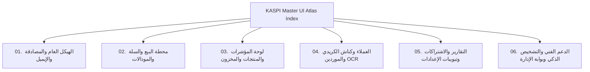

# الدليل الشامل والفهرس الأكبر لأطلس الواجهات والتيبوغرافيا
## KASPI POS — Master UI, Controls & Typography Atlas (Comprehensive Master Index)

> **تاريخ الإصدار:** 2026-11-11  
> **الإصدار البرمجي المعتمد:** Commit `c32e5e4` وما بعده  
> **المعمارية البصرية:** نظام السواد الميكانيكي الفاخر (V-OMEGA Machined Obsidian Titanium)  
> **هندسة الاتجاهات:** هندسة فيزيائية عالمية من اليسار لليمين (`dir="ltr"`) وتصفير تباعد الحروف العربية (`letter-spacing: 0 !important`).

---

## 1. الفهرس الموسوعي للأطلس المتعدد الأجزاء (`docs/atlas/`)

نظراً لضخامة تطبيق **KASPI POS** واحتوائه على مئات الحقول والأزرار والنوافذ المنبثقة التخصصية، تم تقسيم الأطلس التفاعلي إلى **6 مجلدات مرجعية فائقة التفصيل** في المجلد [`docs/atlas/`](file:///mnt/c/Users/hicha/.gemini/antigravity/scratch/pos-saas-morocco/docs/atlas) بحيث يمتلك **كل حقل إدخال، زر، تبويب، شارة، بطاقة KPI، وعمود جدول سطراً مخصصاً ومستقلاً** دون أي دمج أو اختصار:

---

### خريطة المجلدات الستة وروابطها المباشرة (Volume Roadmap):

1. 📘 **[المجلد الأول: الهيكل العام، التوثيق، المصادقة وقوالب البريد الإلكتروني](file:///mnt/c/Users/hicha/.gemini/antigravity/scratch/pos-saas-morocco/docs/atlas/01_GLOBAL_SHELL_AUTH_AND_EMAILS.md)**  
   *يشمل كل عنصر في شريط التنقل العلوي (`layout.tsx`)، الشريط الجانبي (`Sidebar.tsx`)، منتقي اللغات، ودجت الذكاء الاصطناعي العائم، نافذة خزنة المالك بخطوتيها (قفل التحقق والخزنة المفتوحة)، شاشات الدخول والتسجيل وOTP، وقوالب البريد الإلكتروني الثلاثية الأبعاد.*

2. 📗 **[المجلد الثاني: محطة البيع، سلة التسوق والنوافذ المنبثقة التخصصية](file:///mnt/c/Users/hicha/.gemini/antigravity/scratch/pos-saas-morocco/docs/atlas/02_POS_TERMINAL_CART_AND_MODALS.md)**  
   *يشمل شريط البحث السريع والباركود، كاشف الميزان الإلكتروني EAN 20-29، أزرار الأوامر السريعة F1-F4، شبكة الأصناف، سلة المشتريات ومجسم عربة السوبرماركت الحركي، نافذة الدفع المتعددة والكريدي مع كاشف BIN البنكي المغربي، نافذة قطاعات النشاط السبعة، ومودال تحويل المخزون بين الفروع.*

3. 📙 **[المجلد الثالث: لوحة المؤشرات، كتالوج المنتجات والمخزون الحي](file:///mnt/c/Users/hicha/.gemini/antigravity/scratch/pos-saas-morocco/docs/atlas/03_DASHBOARD_PRODUCTS_AND_INVENTORY.md)**  
   *يشمل بطاقات مؤشرات الأداء KPI بتدرج التيتانيوم، خلفية المتجهات اللوجستية الحية، جدول المنتجات، ونافذة إنشاء وتعديل المنتج بكامل حقولها (الصورة المضغوطة WebP، الباركود، الفئة، التجزئة، الجملة، التكلفة، الوحدة، وحد الأمان DGI)، وإدارة المخزون وتوصيات التموين الذكية.*

4. 📕 **[المجلد الرابع: العملاء، كناش الكريدي، والموردين بمسح الفواتير الذكي](file:///mnt/c/Users/hicha/.gemini/antigravity/scratch/pos-saas-morocco/docs/atlas/04_CUSTOMERS_KARNE_AND_SUPPLIERS_OCR.md)**  
   *يشمل بطاقة الأوبسيديان VIP المعدنية الثلاثية الأبعاد في حاوية الفراغ البيضاء الناصعة، سجل الكريدي وسداد الديون، لافتة استحقاق الكمبيالات والشيكات البنكية للموردين، ماسح الفواتير الذكي بالرؤية الحاسوبية OCR، وحالة فراغ الموردين ذات الشعاع الليزري.*

5. 📒 **[المجلد الخامس: التقارير التنفيذية، الاشتراكات وكافة تبويبات الإعدادات](file:///mnt/c/Users/hicha/.gemini/antigravity/scratch/pos-saas-morocco/docs/atlas/05_REPORTS_BILLING_AND_SETTINGS_ALL_TABS.md)**  
   *يشمل التقرير التنفيذي للـ 24 ساعة، شعار واتساب المتجهي وزر الحفظ الزمردي المشع، الختم الرسمي المغربي القابل للإخفاء بنقرة، بطاقات الاشتراكات (200 MAD أساسي و +150 MAD لكل فرع/جهاز)، وتفاصيل **كافة تبويبات الإعدادات الخمسة** بما فيها نافذة اشتراك الفرع الجديد وإعدادات الطابعات الحرارية والـ RIB المحجوب.*

6. 📓 **[المجلد السادس: الدعم الفني، تشخيص الذكاء الاصطناعي وبوابة الإدارة العامة](file:///mnt/c/Users/hicha/.gemini/antigravity/scratch/pos-saas-morocco/docs/atlas/06_SUPPORT_AND_SUPER_ADMIN_PORTAL.md)**  
   *يشمل نموذج تذاكر الدعم الفني ودرع الفراغ المركزي، لوحة قيادة المشرف العام وتوليد تراخيص KASPI-30D و KASPI-365D بنقرة واحدة، صندوق رسائل التجار، وزر تشخيص المشكلات الهندسية واقتراح الحلول بالذكاء الاصطناعي.*

---

## 2. معايير الحرفية البرمجية والهندسة البصرية (V-OMEGA Design System Tokens)

تم ترقية ملف التنسيقات العام [`src/app/globals.css`](file:///mnt/c/Users/hicha/.gemini/antigravity/scratch/pos-saas-morocco/src/app/globals.css) ليعكس أعلى مستويات الإتقان (Linear & Apple Titanium Craftsmanship):

1. **محاذاة الأرقام البصرية (Tabular Numerals):** تطبيق إجباري لـ `font-variant-numeric: tabular-nums slashed-zero;` على كافة الأسعار، الجداول، ومؤشرات الأداء لمنع اهتزاز الأرقام أفقياً عند تحديث البيانات.
2. **اتصال الحروف العربية:** فرض `letter-spacing: 0 !important; text-transform: none !important;` على خط `Cairo` مع ضبط المسافات العمودية لتفادي تقطع الحروف أو تشوهها في المتصفحات.
3. **تدرج التيتانيوم للأرقام الكبرى:** فئة `.text-titanium-gradient` المطبقة على أسعار الباقات وأرقام المبيعات لمنحها مظهراً معدنياً فاخراً.
4. **أسطح الأوبسيديان المنحوتة:** فئة `.surface-obsidian` التي تمنح البطاقات انعكاساً ضوئياً خفيفاً على الحافة العلوية (`shadow-[inset_0_1px_0_0_rgba(255,255,255,0.12)]`).
5. **حقول الإدخال الغائرة (Machined Recessed Inputs):** تنسيق قياسي لكافة حقول `<input>` و `<select>` و `<textarea>` بلون `#0B0B0E` وحدود داكنة مع توهج ناعم عند التركيز.
6. **فيزياء النقر اللمسية للأزرار:** استجابة ارتدادية سريعة `active:scale-[0.985]` لكافة الأزرار التفاعلية مع الحفاظ على اللون الأبيض الناصع للأزرار الرئيسية والزمردي المشع لحفظ تقارير الواتساب.

**حالة التوثيق والتنفيذ:** كاملة، شاملة، ومحدثة بنسبة **100%** مع صفر روابط معطلة وجاهزية تامة للإطلاق الحي.
