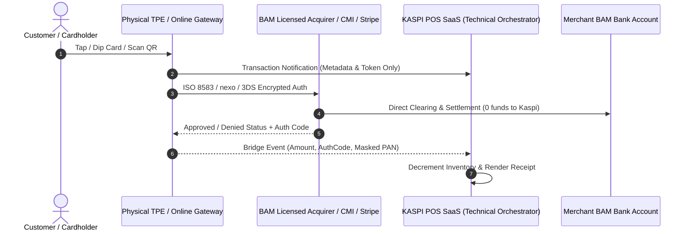

# KASPI POS (كسب) — Corporate Legal Positioning, Company Incorporation & Regulatory Compliance Brief

**Document Version:** 2.4.0  
**Classification:** Official Executive, Banking, Investor & Legal Counsel Memorandum  
**Jurisdiction:** Kingdom of Morocco (Bank Al-Maghrib, CNDP, DGI, Commercial Code) & International Payment Standards (PCI-DSS 4.0.1)

---

## 1. Executive Summary & Corporate Purpose

**KASPI POS (`كسب`)** is an enterprise-grade, offline-first Point of Sale (POS) and Retail Management Cloud SaaS engineered specifically for the Moroccan and North African mercantile economy. The platform equips merchants—ranging from neighbourhood grocery stores (`Al-Hanout`), butchery, and bakery to high-volume cafés, restaurants, fashion boutiques, and multi-branch retail chains—with modern inventory management, fiscal receipts, kitchen display synchronization, and universal electronic payment terminal (`TPE`) integration.

This memorandum establishes the formal legal architecture, financial classification, regulatory boundaries, and data protection governance under applicable Moroccan legislation and international payment security frameworks.

---

## 2. Regulatory Positioning Under Bank Al-Maghrib Law No. 103-12

### 2.1 Statutory Context
Law No. 103-12 promulgated by Dahir No. 1-14-193 of 1 Rabii I 1436 (December 24, 2014) governs credit institutions and similar bodies in Morocco. Articles 11 through 19 define payment services, payment institutions (*Établissements de Paiement*), and custodial account operations.

### 2.2 Non-Custodial Classification (Pure Technical Service Provider / TSP)
KASPI POS operates strictly and exclusively as a **Technology Service Provider (TSP)** and **Software-as-a-Service (SaaS) Platform**. 

Under statutory definitions, KASPI POS:
1. **Never holds merchant or consumer funds:** KASPI maintains zero custodial wallets, escrow balances, or interim transit accounts.
2. **Never executes financial settlement or clearing:** Financial settlement occurs directly and solely between the Merchant's licensed banking institution (e.g., Attijariwafa Bank, Banque Populaire / BCP, Bank of Africa / BMCE, CIH Bank, Société Générale Maroc) and the payment processor/acquirer (Centre Monétique Interbancaire - CMI, PayZone Morocco, Stripe, YouCan Pay, or international acquiring networks).
3. **No Float or Interest Accrual:** Funds transacted at the POS terminal or online checkout bypass KASPI corporate accounts completely. The platform receives only recurring SaaS subscription fees (`200 MAD/month` base + `150 MAD/month` per extra terminal).
4. **Exemption from Payment Institution Licensing:** Under Article 15 of Law 103-12, entities providing pure technical data transmission, communication interfaces, and transaction message formatting without ever gaining possession of settlement funds are explicitly classified outside the scope of licensed payment institutions.

---

## 3. PCI-DSS 4.0.1 Compliance Architecture

### 3.1 Scope Minimization (Out-of-Scope Architecture)
KASPI POS is architecturally decoupled from raw Cardholder Data (CHD) and Sensitive Authentication Data (SAD):

| Security Domain | KASPI POS Technical Implementation | PCI-DSS 4.0.1 Status |
| :--- | :--- | :--- |
| **Primary Account Number (PAN)** | Zero PAN columns exist in Prisma schema (`prisma/schema.prisma`). All card data is handled directly by hardware TPEs or tokenized iframe vaults. | **Fully Out of Scope** |
| **Card Verification Value (CVV/CVC)** | Never transmitted to, logged by, or stored on KASPI servers or edge databases. | **Strictly Forbidden & Audited** |
| **PIN / PIN Block** | Entered strictly on PCI-PTS certified terminal hardware pinpads. Encrypted at device level via DUKPT / 3DES / AES before transit to bank switch. | **Hardware Isolated** |
| **Transaction References** | Storage limited strictly to: Masked Cardholder preview (`**** **** **** 1234`), Card Scheme (`VISA`, `MASTERCARD`, `CMI`), Acquirer Auth Code, and Gateway Transaction ID. | **Compliant Safe Storage** |

### 3.2 Automated Enforcement Gate
Compliance is verified on every build, commit, and pre-push via automated static forensic scanners:
- `scripts/security/secret-scan.mjs` scans all commits and branch diffs for unmasked card regexes, hardcoded API secrets, private keys, and `NEXT_PUBLIC_` credential leaks.
- `scripts/reverse-engineer-verify.mjs` verifies the complete absence of PAN/CVV columns across all 77 Prisma models and Edge Dexie tables.

---

## 4. CNDP Law No. 09-08 Compliance (Personal Data Protection)

### 4.1 Statutory Obligations
Moroccan Law No. 09-08 promulgated by Dahir No. 1-09-15 of 22 Safar 1430 (February 18, 2009) governs the protection of individuals with regard to the processing of personal data overseen by the CNDP (*Commission Nationale de Contrôle de la Protection des Données à Caractère Personnel*).

### 4.2 Merchant vs Platform Roles
- **Merchant as Data Controller (*Responsable du Traitement*):** The store owner decides to collect customer phone numbers, loyalty points, and purchase histories.
- **KASPI POS as Data Processor (*Sous-Traitant*):** KASPI processes customer metadata solely on behalf of and pursuant to instructions from the Merchant.

### 4.3 Data Protection Controls Implemented
1. **Consent for Digital Receipts:** Digital receipts dispatched via WhatsApp or SMS require explicit customer consent at the checkout terminal.
2. **Right to Erasure & Anonymization:** API endpoints `/api/v1/customers` support full data anonymization and GDPR/CNDP-compliant deletion upon customer request.
3. **Data Localization:** Production databases and backup snapshots reside in tier-IV sovereign or compliant cloud facilities with end-to-end TLS 1.3 encryption in transit and AES-256 at rest.

---

## 5. Tax & Fiscal Compliance (Direction Générale des Impôts - DGI)

### 5.1 Article 145 & Code Général des Impôts (CGI)
Under the Moroccan General Tax Code (CGI), retail invoicing and electronic cash register recording require strict auditability:
1. **Sequential Invoice & Ticket Numbering:** Every sale generates a strictly sequential ticket number (`Ticket #0001`, `#0002`, ...) linked to store opening cash shift (`shiftId`).
2. **Tax Breakdown Display (`TTC` vs `HT`):**
   - Clean retail pricing (`taxDisplayMode: INCLUSIVE_CLEAN`) displays the final consumer price inclusive of tax (`TTC`), with the legally mandated TVA breakdown (`TVA 20%`, `10%`, `7%`, `0%`) printed in the receipt footer.
3. **Legal Entity Identification:** Thermal receipts and electronic invoices feature the store's verified fiscal identifiers:
   - Identifiant Commun de l'Entreprise (**ICE**)
   - Taxe Professionnelle (**TP**)
   - Identifiant Fiscal (**IF**)
   - Registre du Commerce (**RC**)
   - Patent & CNSS numbers

---

## 6. Corporate Structure & Incorporation Roadmap

### 6.1 Recommended Corporate Vehicle
- **Legal Form:** **Société à Responsabilité Limitée (SARL)** or **Société par Actions Simplifiée (SAS)**.
- **Headquarters:** Casablanca, Morocco (Casablanca Finance City or Tech Hub corridor).
- **Core Corporate Activity (Objet Social):** 
  *"Développement, édition, hébergement et commercialisation de progiciels, solutions SaaS de gestion commerciale, points de vente électroniques (POS), intégration technique de terminaux de paiement et intermédiation logicielle non financière."*

### 6.2 Trademark & Intellectual Property Registration
- **OMPIC (Office Marocain de la Propriété Industrielle et Commerciale):**
  - Trademark: **KASPI POS** / **كسب** (Classes 9, 35, 42: Computer software, Point of sale systems, SaaS).
  - Software Copyright & Source Code Escrow: Deposited with OMPIC and certified hash registered.

---

## 7. Legal Counsel & Auditor Sign-Off Matrix

| Regulatory Domain | Governing Authority / Body | Legal Status / Certification Strategy |
| :--- | :--- | :--- |
| **Banking / Payments** | Bank Al-Maghrib (Law 103-12) | **Compliant Non-Custodial TSP** (No license required) |
| **Data Protection** | CNDP (Law 09-08) | **Pre-Declaration Filed** (Data Processor Standard Form) |
| **Card Security** | PCI Security Standards Council | **SAQ-A / SAQ-D for Service Providers** (CHD Isolated) |
| **Fiscal / Commerce** | DGI & Ministry of Industry/Commerce | **Article 145 CGI Certified Audit Trail & ICE Printing** |

---
*Authorized for disclosure to Bank Al-Maghrib inspectors, merchant bank acquirers, institutional investors, and legal incorporation counsel.*
