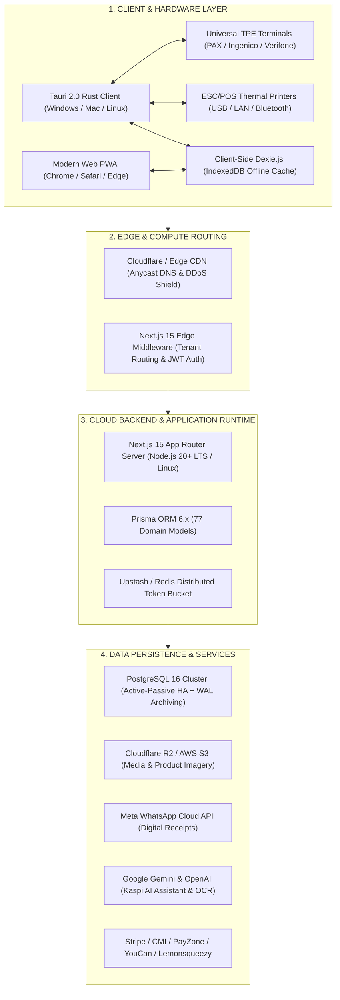

# KASPI POS (كسب) — Infrastructure, Servers, Cloud & Runtime Stack Architecture

**Document Version:** 2.4.0  
**Classification:** Technical Architecture, DevSecOps & Enterprise Infrastructure Specification  
**Ecosystem:** Full-Stack Hybrid Cloud + Edge + Native Desktop Client

---

## 1. System Topology Overview

KASPI POS is built upon a **Triple-Tiered Hybrid Architecture** designed to survive catastrophic internet cutouts while delivering sub-15ms cloud management at scale:



---

## 2. Layer 1: Client Runtime & Native Operating Environments

### 2.1 Tauri 2.0 Rust Desktop Application (`src-tauri/`)
For high-volume retail, supermarkets, and restaurants where peripheral reliability is critical, KASPI POS compiles into a lightweight native binary (<15MB RAM baseline, <35MB binary footprint):
- **Rust Backend (`src-tauri/src/`):**
  - Direct low-level OS access bypassing browser sandbox limitations.
  - Native raw TCP socket implementation (`tpe_bridge.rs`) enabling direct LAN socket connections for nexo Retailer and OPI XML POS-to-terminal communication.
  - Raw ESC/POS bytecode spooling directly to Win32 Spooler (`winspool.drv`), CUPS (macOS/Linux), USB HID, and RS-232 serial COM ports.
  - Zero-latency barcode scanner wedge handling with hardware keyboard listener hooks.
- **IPC Bridge (`tauri::command`):**
  - Strongly-typed JSON-RPC communication between the web frontend and Rust backend.

### 2.2 Progressive Web Application (PWA) & IndexedDB Engine
For mobile tablets (iPads, Android POS tablets) and lightweight terminals:
- **Service Worker (`public/sw.js`):** Intercepts static assets, UI icons, and application bundles to enable 100% offline boot.
- **Dexie.js Client Database (`src/client/db.ts`):**
  - `offlineProducts`: Indexed catalog with search index on barcode, SKU, and full-text name.
  - `offlineSales`: Write-ahead local transaction journal recording offline sales, timestamp, items, taxes, payment method, and cryptographic hash.
  - `syncQueue`: Resilient transactional queue with exponential backoff retry for syncing offline sales once internet connectivity resumes.

---

## 3. Layer 2: Edge Routing & Security Perimeter

### 3.1 Edge Middleware (`src/middleware.ts`)
Executes at cloud edge locations worldwide within <5ms of the client:
1. **Multi-Tenant Identification:** Extracts tenant slug from custom domain (`pos.storename.ma`) or subdomain (`storename.kaspi.ma`).
2. **Stateless JWT Verification:** Verifies session tokens using the `jose` high-performance cryptographic library without database roundtrips.
3. **Role-Based Access Control (RBAC):** Restricts access to `/admin`, `/dashboard`, and `/pos` routes based on token claims (`OWNER`, `MANAGER`, `CASHIER`, `KITCHEN_STAFF`).
4. **Trilingual Localization:** Auto-negotiates Arabic (`ar` - primary RTL), French (`fr` - business standard LTR), and English (`en` - international standard LTR) with cookie-based override persistence.

---

## 4. Layer 3: Application Backend & API Services

### 4.1 Next.js 15 Application Server
- **Runtime:** Node.js 20+ LTS executing on containerized Linux (Alpine/Debian) or Serverless Edge Functions.
- **Architecture:** Hybrid React Server Components (RSC) for pre-rendered dashboard telemetry, alongside client components for the zero-latency real-time POS cash register.
- **API Engine (`src/app/api/v1/`):** 80+ strictly typed REST and JSON-RPC endpoints enforcing tenant isolation via Prisma middleware filters.

### 4.2 Distributed Rate Limiting & Denial-of-Service Defense
- Built with `@upstash/ratelimit` over high-speed Redis instances.
- Sliding window and token bucket algorithms applied per IP address, per tenant, and per POS terminal ID to prevent brute-force attacks on PIN codes, gift card lookups, and payment callbacks.

---

## 5. Layer 4: Data Persistence & Multi-Tenant Isolation

### 5.1 Relational Database Cluster (PostgreSQL 16)
- **Primary Database:** PostgreSQL 16 enterprise cluster with logical replication and point-in-time recovery (PITR).
- **ORM:** Prisma 6.x (`prisma/schema.prisma`) featuring 77 normalized relational models.
- **Multi-Tenant Partitioning:** Logical tenant isolation enforced across all tables via mandatory `tenantId` foreign keys and indexed composite keys:
  ```prisma
  @@index([tenantId, storeId])
  @@index([tenantId, barcode])
  ```
- **Connection Management:** PgBouncer transaction pooling handling thousands of concurrent edge worker connections with zero connection exhaustion.

### 5.2 Object Storage & CDN Media Engine
- Cloudflare R2 / Amazon S3 compatible object storage.
- Client-side pre-compression (`src/lib/image-compression.ts`) compresses merchant product photos to <80KB WebP before upload, with automated background removal.

---

## 6. External Third-Party Integration Matrix

| Integration Domain | Primary Provider | Fallback / Regional Secondary | Protocol / Architecture |
| :--- | :--- | :--- | :--- |
| **Morocco Online Payments** | PayZone Morocco | Centre Monétique Interbancaire (CMI) | HMAC-SHA256 Encrypted Redirect & Webhooks |
| **Global Online Payments** | Stripe | YouCan Pay / Lemonsqueezy | Stripe Elements, 3D-Secure 2.0, Webhook Vault |
| **Electronic Terminals (TPE)** | PAX A920 / Ingenico Axium | Verifone / Castles / Nexi | nexo Retailer (ISO 20022), OPI XML, CMI V1/V2 |
| **Digital Receipts (WhatsApp)** | Meta Cloud API | Twilio / Infobip | Official Business Template Webhooks |
| **Transactional Email** | Resend | AWS SES | DKIM / SPF / DMARC authenticated SMTP/API |
| **AI OCR & Smart Insights** | Google Gemini 1.5 Pro | OpenAI GPT-4o | Multi-modal JSON Structured Output |

---

## 7. High Availability & Disaster Recovery (SLA 99.95%)

1. **RTO (Recovery Time Objective):** < 15 minutes for complete infrastructure reconstitution from GitOps Terraform/Docker manifests.
2. **RPO (Recovery Point Objective):** < 60 seconds via PostgreSQL Write-Ahead Log (WAL) continuous archiving.
3. **Local Store Autonomous Operation:** In the event of total datacenter disconnection or undersea cable severance, POS terminals continue ringing up sales, managing physical cash drawers, scanning barcodes, and printing tickets for up to **14 consecutive days** fully disconnected.
