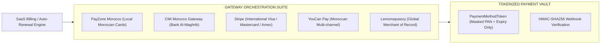

# KASPI POS (كسب) — Payment Gateway Orchestration, Recurring Billing & Unit Economics

**Document Version:** 2.4.0  
**Classification:** Financial Engineering, SaaS Monetization & Investor Economics  
**Source Implementation:** `src/lib/payments/` & `src/app/api/billing/`

---

## 1. SaaS Pricing Architecture & The "200 + 150" Business Rule

KASPI POS rejects complex hidden pricing tiers, punitive transaction percentage cuts, and locked hardware leases. The monetization model is built on **complete commercial clarity**:

$$\text{Monthly SaaS Fee (MAD)} = 200 + (\max(0, \text{Postes} - 1) \times 150)$$

| Plan Component | Monthly Price (TTC) | Features & Entitlements Included |
| :--- | :--- | :--- |
| **Primary Cash Register (1st Poste)** | **200 MAD / month** | **100% of All Features Unlocked:** Unlimited products, offline Dexie.js database, fiscal receipts, inventory tracking, multi-user RBAC, KDS, WhatsApp receipts, AI Copilot, and Universal TPE Hub. |
| **Additional Cash Registers (Per Extra Poste)** | **+150 MAD / month** | Full POS register license synchronized to master store inventory and centralized telemetry. |
| **Transaction Processing Commission** | **0.0% (Zero)** | KASPI charges **0% transaction fee** on retail sales. Merchants keep 100% of their sales proceeds. |

---

## 2. Multi-Gateway Orchestration Engine (`src/lib/payments/`)

The payment orchestration architecture supports automatic smart routing across international and Moroccan acquiring gateways:

### 2.1 Supported Payment Gateways

1. **PayZone Morocco (`PayzoneMoroccoGateway.ts`):** High-conversion domestic payment gateway handling Moroccan CMI-network debit cards, Carte Bancaire, and local banking apps.
2. **Centre Monétique Interbancaire (`CmiMoroccoGateway.ts`):** Direct integration with CMI's national payment switch with 3D-Secure 2.0 OTP authentication.
3. **Stripe (`StripePaymentGateway.ts`):** Full recurring billing with Stripe Billing, Customer Portal, and auto-renew card mandate.
4. **YouCan Pay (`YouCanPaymentGateway.ts`):** Moroccan alternative gateway with mobile wallet support.
5. **Lemonsqueezy (`LemonsqueezyPaymentGateway.ts`):** Global Merchant of Record (MoR) for international tenants outside Morocco.

---

## 3. Merchant Trading Streak & Gamification (`StoreDailyStreak`)

To drive daily product stickiness and lower churn below 1.5%, KASPI POS features an automated **Gamified Daily Store Streak Engine**:

- **Active Tracking:** Every finalized sale through the POS register or offline sync updates the store's trading streak in `StoreDailyStreak`.
- **Visual Display:** Live badge displayed in the POS header and executive dashboard:
  - `🔥 14 يوم متواصل` (14 Consecutive Trading Days)
- **Retention Benefits:** Merchants maintaining 30+ day streaks unlock VIP technical support channels and exclusive beta access to new AI features.

---

## 4. SaaS Unit Economics & Scalable Financial Projections

### 4.1 Cost to Serve per Merchant Store (COGS)
| Infrastructure & Service Line | Monthly Cost per Active Store (MAD) | Technical Provider |
| :--- | :--- | :--- |
| Cloud Compute & Edge Routing (Next.js / Cloudflare) | 3.50 MAD | Vercel / Cloudflare Edge |
| Managed PostgreSQL & Redis Clustering | 4.00 MAD | Supabase / AWS RDS / Upstash |
| WhatsApp Cloud API (e-Receipts) | 2.50 MAD | Meta Business Platform |
| AI Inference & Vision OCR | 2.00 MAD | Google Gemini / OpenAI |
| Payment Gateway Transaction Cost on 200 MAD Fee | 4.80 MAD | Stripe / PayZone (approx. 2.4%) |
| **Total Monthly Cost of Goods Sold (COGS)** | **16.80 MAD** | |

### 4.2 Gross Margin Analysis
$$\text{Gross Margin per Base Store} = \frac{200 - 16.80}{200} = \mathbf{91.6\%}$$

$$\text{Gross Margin on Extra Poste (+150 MAD)} = \frac{150 - 3.50}{150} = \mathbf{97.7\%}$$

### 4.3 Scale Projections Matrix (50 to 25,000 Active Postes)

| Active Postes | Average Postes per Store | Active Stores | Monthly Recurring Revenue (MRR) | Annual Recurring Revenue (ARR) | Monthly COGS | Monthly Gross Profit | Gross Margin % |
| :--- | :--- | :--- | :--- | :--- | :--- | :--- | :--- |
| **50** | 1.25 | 40 | **8,500 MAD** | **102,000 MAD** | 710 MAD | 7,790 MAD | **91.6%** |
| **250** | 1.40 | 179 | **43,150 MAD** | **517,800 MAD** | 3,365 MAD | 39,785 MAD | **92.2%** |
| **1,000** | 1.50 | 667 | **183,350 MAD** | **2,200,200 MAD** | 13,005 MAD | 170,345 MAD | **92.9%** |
| **5,000** | 1.60 | 3,125 | **968,750 MAD** | **11,625,000 MAD** | 64,060 MAD | 904,690 MAD | **93.4%** |
| **10,000** | 1.70 | 5,882 | **2,029,400 MAD** | **24,352,800 MAD** | 126,460 MAD | 1,902,940 MAD | **93.8%** |
| **25,000** | 1.80 | 13,889 | **5,347,200 MAD** | **64,166,400 MAD** | 316,670 MAD | 5,030,530 MAD | **94.1%** |

---

## 5. Investment & Commercial Takeaway

KASPI POS combines software margins (>91%) with an infrastructure-light, zero-custodial regulatory footprint. The platform delivers enterprise software quality at a price point accessible to every corner shop in Morocco.
