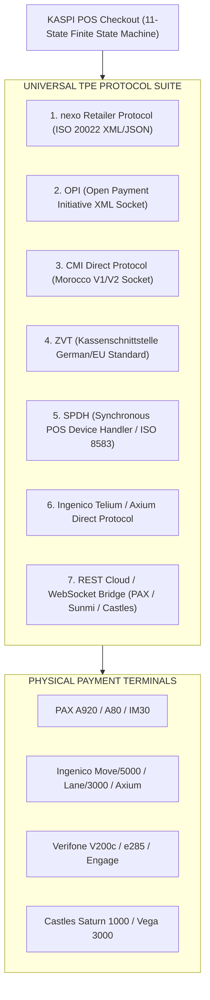
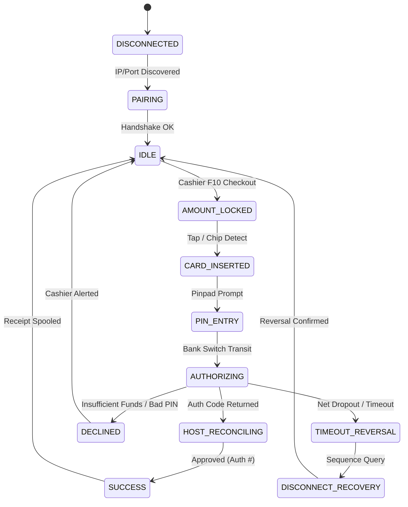

# KASPI POS (كسب) — Universal 7-Protocol TPE Terminal Integration Hub Specification

**Document Version:** 2.4.0  
**Classification:** Financial Terminal Engineering, Protocol Specification & Hardware Bridge  
**Source Implementation:** `src/lib/tpe/` & `src-tauri/src/tpe_bridge.rs`  
**Official Reference Standards:** `docs/KASPI_UNIVERSAL_TPE_SOURCES.md`

---

## 1. System Vision & The "Zero-Amount-Reentry" Imperative

In conventional retail environments across Morocco and emerging markets, electronic payment terminals (TPE) operate as isolated islands. The cashier rings up a sale of `247.50 MAD` on the POS, then manually re-types `247.50` on the physical terminal pinpad. This manual re-entry creates severe operational defects:
1. **Cashier Typo Errors:** Typing `24.75` (undercharging by 90%) or `2475.00` (overcharging and infuriating the consumer).
2. **Double Checkout Latency:** Adds 8 to 15 seconds per transaction during peak retail rush hours.
3. **Internal Merchant Theft:** Ringing up a cash sale on the POS while taking a card payment on the TPE, or vice versa, causing cash shift discrepancies.

**The KASPI Universal TPE Hub** completely eliminates manual re-entry by establishing a direct, bi-directional hardware link between KASPI POS and the merchant's physical payment terminal over local Ethernet LAN, USB, or RS-232 serial. The exact checkout total is electronically locked, transmitted to the terminal, and authorized in real-time.

---

## 2. The 7 Global Supported Protocol Families

KASPI POS implements clean, modular, strongly-typed parsers, frame builders, and network adapters across 7 major payment terminal protocols:

### 2.1 Protocol 1: nexo Retailer Protocol (ISO 20022 XML/JSON)
- **Standard Body:** nexo standards (formerly EPAS). Supported by Adyen, Worldline, Nexi, PAX, Ingenico, and Verifone nexo builds.
- **Specification:** `SaleToPOIRequest` / `SaleToPOIResponse` XML/JSON framing over TLS-TCP LAN sockets (port `2018` or `8443`).
- **Core Operations Implemented:**
  - `PaymentRequest`: Initiates sale with SaleID, TransactionID, Amount, and Currency (`MAD`, `EUR`, `USD`).
  - `PaymentResponse`: Extracts POITransactionID, AuthorizationCode, MaskedPAN, and EMV CardData.
  - `ReversalRequest`: Automated void for aborted or interrupted transactions.
  - `ReconciliationRequest`: End-of-day bank settlement report.
  - `DiagnosisRequest`: Hardware health check, paper level, and communication test.

### 2.2 Protocol 2: OPI (Open Payment Initiative XML)
- **Standard Body:** OPI European Retail Consortium. The universal standard for international hypermarkets, retail chains, and forecourt fuel stations.
- **Specification:** Duplex XML socket messaging over TCP (port `8001` or `8009`).
- **Core Operations Implemented:**
  - `<ServiceRequest Type="CardPayment">`: Sends clean transactional payload with `<Amount>` and `<Currency>`.
  - `<ServiceResponse>`: Handles async cardholder prompts (`CARD_INSERTED`, `WAITING_FOR_PIN`, `ONLINE_AUTHORIZING`).

### 2.3 Protocol 3: CMI Direct Protocol (Morocco V1 & V2)
- **Standard Body:** Centre Monétique Interbancaire (CMI) Morocco.
- **Specification:** Serial RS-232 (`9600-115200 baud, 8N1`) and TCP socket connection (`port 4000`) for Moroccan merchant terminals.
- **Framing Structure:** `[STX] [LEN_2] [MSG_TYPE_2] [PAYLOAD] [ETX] [LRC_XOR]`.
- **Supported Terminal Models:** PAX S800/S900 CMI, Ingenico ICT220/ICT250 CMI, Verifone VX520 CMI.

### 2.4 Protocol 4: ZVT (Zentraler Kreditausschuss / Kassenschnittstelle)
- **Standard Body:** German Banking Industry Committee (DK / ZKA). Ubiquitous across Central Europe, Switzerland, and international hotel chains.
- **Specification:** Binary hex byte protocol over TCP (port `20007`) or serial.
- **Core Commands:** `06 01` (Registration), `06 00` (Authorization), `06 30` (End of Day Settlement), `06 20` (Diagnosis).

### 2.5 Protocol 5: SPDH (Synchronous POS Device Handler / ISO 8583 Dialect)
- **Standard Body:** Banking Card Interoperability standard for high-throughput retail lanes.
- **Specification:** Fixed/variable field bitmapped ISO 8583 messages (`MTI 0200` Sale Request, `0210` Sale Response, `0400` Reversal).

### 2.6 Protocol 6: Ingenico Telium / Axium Direct Protocol
- **Specification:** Dedicated native Ingenico protocol utilizing byte-stuffed framing (`DLE` / `STX` / `ETX` / `CRC16`) communicating directly with Telium Tetra and Android Axium OS terminals.

### 2.7 Protocol 7: REST Cloud / WebSocket Bridge
- **Specification:** HTTPS JSON REST API / Secure WebSocket interface connecting Android SmartPOS terminals (PAX A920, Sunmi P2, Castles Saturn 1000) over local Wi-Fi or cloud push messaging.

---

## 3. The 11-State Finite State Machine (`TpeTransactionBridge.ts`)

To guarantee absolute financial integrity, the transaction lifecycle is governed by an **immutable 11-State Machine**:

### 3.1 Zero Amount Re-entry Rule
The moment the cashier triggers checkout (`F10`), KASPI POS freezes the checkout total, formats the protocol-specific amount frame, and transmits it directly to the terminal. The terminal's screen illuminates with the exact amount (e.g., `MAD 150.00`). Neither the cashier nor the consumer can alter the amount on the terminal.

### 3.2 Network Dropout & Disconnect Recovery Guard
If the LAN cable or Wi-Fi drops while the cardholder is entering their PIN or during bank authorization:
1. The bridge enters `DISCONNECT_RECOVERY`.
2. An automatic 3-stage reconnect backoff polls the terminal IP.
3. Upon reconnection, a `TransactionStatusRequest` is immediately issued using the original transaction sequence number (`STAN`).
4. If the bank approved the sale before the drop, KASPI POS automatically finalizes the ticket without double-charging the customer. If the sale was unconfirmed, an automated `ReversalRequest` is dispatched.

---

## 4. The 4-Path Receipt Printing Architecture

KASPI POS supports 4 distinct, adaptive receipt printing destinations:

1. **Path 1: Integrated TPE Terminal Printer:** Spools the receipt directly onto the payment terminal's internal thermal paper printer (`print_tpe_receipt`).
2. **Path 2: Dedicated POS ESC/POS Thermal Printer (58mm/80mm):** High-speed silent printing via native Tauri Rust bridge (`winspool.drv` / CUPS / USB RAW).
3. **Path 3: Browser Silent Spooler:** Fallback printing via an isolated hidden `<iframe>` with zero UI flicker.
4. **Path 4: WhatsApp Automated e-Receipt:** Dispatches a cryptographic digital PDF ticket directly to the customer's WhatsApp in <2 seconds.
