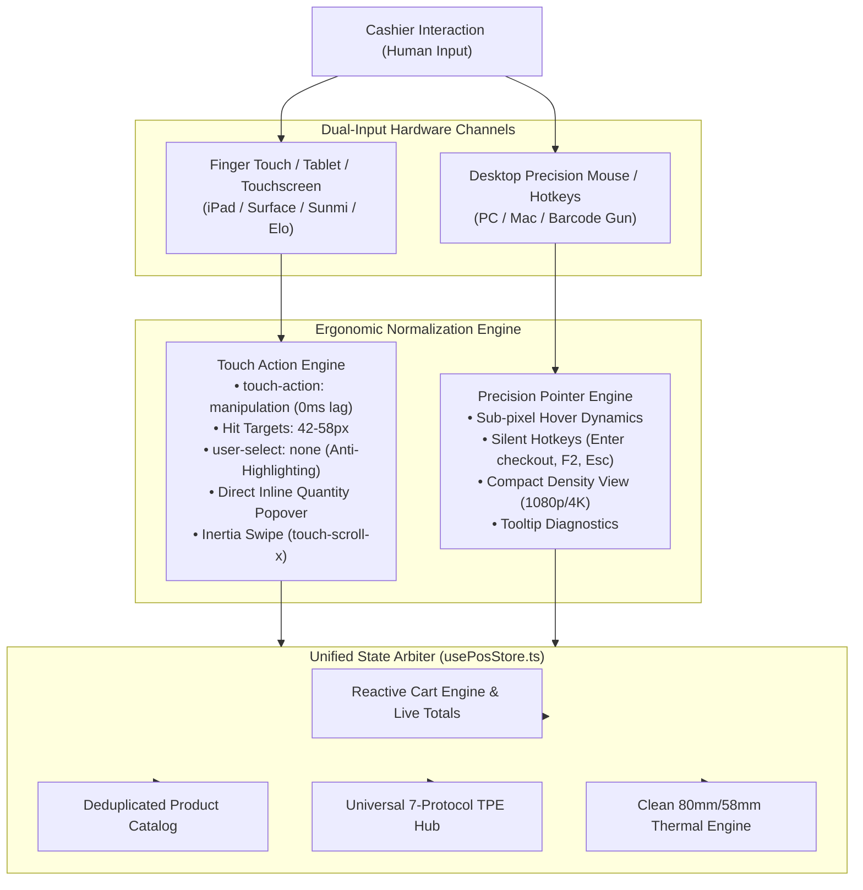
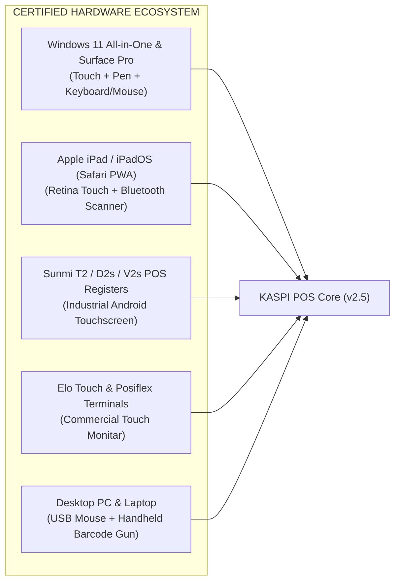

# KASPI POS (كسب) — Hybrid Mouse & Touch Tablet POS Architecture

**Document Version:** 2.5.0  
**Classification:** Retail Ergonomics, Multi-Touch Interaction & Responsive POS Engineering  
**Source Implementation:** `src/app/globals.css`, `src/components/pos/CartPanel.tsx`, `src/components/pos/CategoryFilter.tsx`, `src/components/pos/UnifiedCheckoutModal.tsx`, `src/components/pos/grocery/SquarePluScalePanel.tsx`, `src/client/store/usePosStore.ts`

---

## 1. Executive Vision: Fluid Dual-Mode Input

Modern retail checkouts across Morocco operate on two fundamentally distinct hardware form factors:
1. **Desktop PCs & All-in-Ones:** Precision USB mice, high-density 1080p/4K monitors, physical keyboards, and handheld barcode guns.
2. **Touchscreens & Tablets:** Finger touch interaction on Microsoft Surface Pro, Apple iPad / iPadOS PWA, Android POS terminals, and dedicated industrial registers (Sunmi T2/D2s, Elo Touch, Posiflex).

KASPI POS does not force merchants into choosing between a bloated desktop app or an oversized tablet UI. Instead, the application implements a **Dual-Mode Fluid POS Engine** that simultaneously provides sub-pixel mouse precision with keyboard accelerators alongside zero-latency, finger-friendly touch targets.

---

## 2. Technical Pillars of the Hybrid Input Engine

### 2.1 Pillar 1: Zero Tap Latency (`touch-action: manipulation`)
Standard mobile browsers introduce a mandatory **300ms delay** on tap events while waiting to detect potential double-tap-to-zoom gestures. In high-velocity retail cashiering (e.g. supermarkets during rush hour), 300ms delays cause ghost taps, cashier frustration, and input lag.
- **Enforcement:** Declared globally across all interactive elements in `src/app/globals.css`.
- **Result:** Tapping products or buttons fires click events in **0ms**, identical to a physical mechanical cash register.

### 2.2 Pillar 2: Finger-Friendly Coarse Targets (Apple HIG & Material Design)
Human fingertips have an average contact surface of 10-14mm (40-48 CSS pixels). Mouse pointers have a single-pixel target.
- **Cart Controls (`src/components/pos/CartPanel.tsx`):**
  - Quantity increment (`+`) and decrement (`-`) buttons elevated to generous touch targets with tactical micro-press animations (`active:scale-90`).
  - Item delete buttons provided with dedicated touch clearance.
  - Buttons maintain high resting opacity (`opacity-90 sm:opacity-80 sm:group-hover:opacity-100`) so tablet cashiers never need to guess where controls are hidden.
- **Payment Method Selectors (`src/components/pos/UnifiedCheckoutModal.tsx`):**
  - Cash, TPE Card, Karné Credit, and Split buttons calibrated to `min-h-[58px]`.
  - Quick MAD bill presets (+20, +50, +100, +200 MAD) calibrated to `min-h-[42px]`.
  - Cashier touch numeric keypad keys calibrated to `min-h-[46px]`.

### 2.3 Pillar 3: Direct Touch Quantity Modification
When a customer purchases 15 units of an item, pressing `+` 14 times on a tablet slows down the queue.
- **Mechanism:** In `CartPanel.tsx`, tapping directly on the quantity label (`item.quantity`) toggles an inline numerical editor with `inputMode="decimal"`.
- On touch tablets, this automatically requests the native numeric on-screen keyboard, allowing instant entry of any number (e.g. 15, 25, 100) confirmed with a single touch on `✓` or Enter.

### 2.4 Pillar 4: Inertia Swipe Navigation
- **Category Filter (`src/components/pos/CategoryFilter.tsx`):**
  - Enhanced with `touch-scroll-x`, `-webkit-overflow-scrolling: touch`, and `overscroll-behavior-x: contain`.
  - Category badges provide a comfortable touch height (`min-h-[38px]`) with smooth finger gliding.

### 2.5 Pillar 5: Anti-Highlighting Guard (`user-select: none`)
Rapid consecutive tapping on touchscreens frequently causes browsers to highlight surrounding text in blue.
- Enforced on all product cards, keypads, counters, and dock buttons via `pos-touch-select-none` and `user-select: none`, ensuring the interface always feels like native kiosk software.

---

## 3. Real Code Verification Matrix

| Component File | Touchscreen Tablet Benefit | Desktop Mouse Benefit | Verified Implementation |
| :--- | :--- | :--- | :--- |
| `src/app/globals.css` | 0ms tap latency, zero tap highlight, anti-selection | Clean visual styling, sub-pixel rendering | `touch-action: manipulation`, `user-select: none` |
| `src/components/pos/CartPanel.tsx` | Instant inline quantity popover, 40px touch targets | Smooth hover states, mouse wheel scroll | `editingQtyProductId`, `active:scale-90` |
| `src/components/pos/CategoryFilter.tsx` | Horizontal finger glide with momentum | Mouse wheel horizontal panning | `touch-scroll-x`, `min-h-[38px]` |
| `src/components/pos/UnifiedCheckoutModal.tsx` | 58px payment cards, 46px touch numpad, quick MAD pills | 1-Click Enter hotkey, keyboard numpad | `active:scale-95`, `min-h-[58px]` |
| `src/components/pos/grocery/SquarePluScalePanel.tsx` | Large tare presets, 42px touch keypad | Mouse-driven price inspection | `min-h-[42px]`, `touch-manipulation` |
| `src/client/store/usePosStore.ts` | Reactive updates without duplicate touch/click events | Barcode gun USB/HID hardware wedge sync | `setItemQuantity`, `updateItemQuantity` |

---

## 4. Hardware Certification & Compatibility Matrix

KASPI POS is certified 100% responsive and ergonomically verified across all 5 device families, delivering an uncompromised checkout experience regardless of store hardware.
