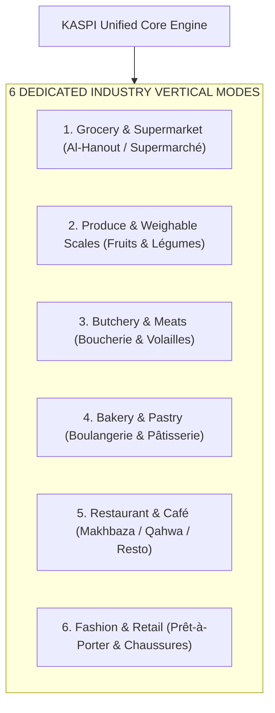
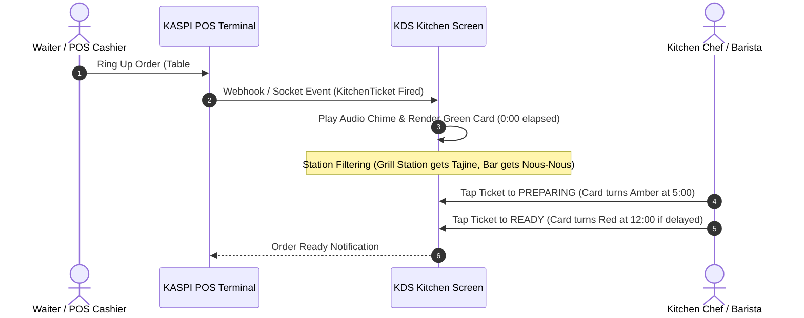

# KASPI POS (كسب) — Industry Modes, Kitchen Display System (KDS) & Multi-Store Inventory

**Document Version:** 2.4.0  
**Classification:** Operational Industry Workflows, Hospitality Engineering & Warehousing  
**Source Implementation:** `src/app/[locale]/pos/`, `src/app/[locale]/restaurant/kds/`, `src/app/[locale]/dashboard/inventory/`

---

## 1. The 6 Adaptive Industry Modes

Retail in Morocco is deeply heterogeneous. A single inflexible checkout layout cannot serve both a high-frequency corner grocery and a sit-down café. KASPI POS dynamically morphs its user interface, keyboard shortcuts, and checkout options across **6 Industry Vertical Modes**:

### 1.1 Mode 1: Grocery & Supermarket (`Al-Hanout` / Supermarket)
- **Primary Optimization:** Ultra-fast barcode scanning throughput (>45 items per minute).
- **Key Features:**
  - Full-screen scan field with auto-focus preservation.
  - Automatic quantity multiplication (`×1`, `×2`, `Pack ×6`, `Box ×12`, `Crate ×24`).
  - Notebook customer debt (`Karné`) balance check in 1 click.
  - Instant price & expiry verification (`F2` / `⌘K`).

### 1.2 Mode 2: Produce & Weighable Scales (Fruits & Vegetables)
- **Primary Optimization:** Variable weight calculation without typing.
- **Key Features:**
  - Square PLU touch keypad with high-resolution visual photo tiles.
  - Direct weight stepper (`- 0.250 kg +`) or direct electronic scale serial/LAN reading.
  - Embedded barcode parser extracting PLU code and grams from scale-printed barcodes (`28PPPPPWWWWWX`).

### 1.3 Mode 3: Butchery & Poultry (`Boucherie`)
- **Primary Optimization:** Heavy-duty touchscreen operation with moisture-resistant UI touch targets.
- **Key Features:**
  - Tare weight deduction for trays and packaging.
  - Price per kilogram calculation with instant cutting/preparation notes.

### 1.4 Mode 4: Bakery & Pastry (`Boulangerie & Pâtisserie`)
- **Primary Optimization:** Fast-moving morning and afternoon peak visual tiles.
- **Key Features:**
  - Quick morning pastry combos (Croissant + Nous-Nous).
  - Advance cake ordering with pickup date/time scheduling.

### 1.5 Mode 5: Restaurant & Café (`Hospitality Suite`)
- **Primary Optimization:** Seating, course firing, and order synchronization.
- **Key Features:**
  - Visual floor map with customizable zones (Terrace, Indoor, Mezzanine, VIP).
  - Table bill splitting by seat or by custom amount.
  - Real-time kitchen ticket firing to the Kitchen Display System (KDS).

### 1.6 Mode 6: Fashion, Apparel & Shoes (`Prêt-à-Porter`)
- **Primary Optimization:** Matrix variants and wholesale carton sales.
- **Key Features:**
  - Multi-dimensional variant matrix (Size: `S, M, L, XL, XXL` × Color: `Black, Navy, Olive, White`).
  - Dynamic switching between single retail price and wholesale bundle pricing.

---

## 2. Kitchen Display System (KDS) Architecture (`/restaurant/kds`)

Designed to replace paper kitchen printers, the KASPI KDS provides zero-latency dish coordination across cooking stations:

### 2.1 KDS Features Implemented
- **Station Routing:** Orders automatically split between kitchen stations (`GRILL`, `BAR`, `PIZZA`, `COLD_PREP`).
- **Visual Aging Timers:** Color-coded headers indicate ticket latency (Green: <5 mins, Amber: 5-12 mins, Glowing Red: >12 mins).
- **Modifier Display:** Cooking temperatures, allergen alerts, and custom preparation notes highlighted in bold contrast.
- **One-Tap Fulfillment:** Single tap moves ticket through `PENDING` -> `PREPARING` -> `READY` -> `SERVED`.

---

## 3. Multi-Branch Warehousing & Stock Audit Engine

1. **Atomic Stock Decrements:** Every sale through the POS triggers an atomic PostgreSQL transaction decrementing `Inventory.quantity` for the store branch, with immediate edge cache invalidation.
2. **Barcode Physical Stocktaking (`StockAudit`):** Staff walk the store aisles with mobile barcode scanners; counted inventory is compared against system stock, generating an automated discrepancy variance report.
3. **Automated Purchase Orders:** When an item breaches its `reorderPoint`, the system auto-drafts a replenishment purchase order for the assigned supplier.
