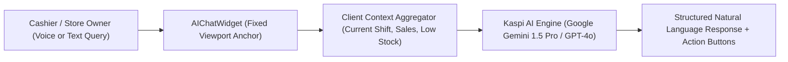

# KASPI POS (كسب) — Kaspi AI Copilot, Vision OCR & WhatsApp Automation Architecture

**Document Version:** 2.4.0  
**Classification:** Artificial Intelligence Architecture, Computer Vision & Omnichannel Messaging  
**Source Implementation:** `src/components/common/AIChatWidget.tsx`, `src/app/api/v1/inventory/ocr/`, `src/app/api/v1/notifications/whatsapp/`

---

## 1. Kaspi AI Smart Assistant Architecture (`AIChatWidget.tsx`)

Retail store managers are constantly interrupted while attempting to analyze spreadsheets. **Kaspi AI** embeds a context-aware natural language copilot directly into the POS and dashboard:



### 1.1 Context-Aware Intelligence Capabilities
- **Real-Time Revenue Telemetry:** "شحال بعنا اليوم؟" (How much did we sell today?) -> Returns exact sales count, gross revenue, and comparison to previous week's performance.
- **Stock Depletion Warnings:** "شنو خاصنا نشريو؟" (What do we need to reorder?) -> Surfaces products currently below their minimum safety thresholds.
- **Margin Optimization:** Analyzes slow-moving stock and suggests promotional bundles or price adjustments.
- **Natural Language Command Execution:** "فتح الصندوق" (Open cash drawer) or "بدل الصنف لـ بقالة" (Change category to grocery).

---

## 2. Multi-Modal Computer Vision Supplier Invoice OCR (`/api/v1/inventory/ocr`)

Moroccan retail inventory procurement is overwhelmingly paper-based. Wholesale delivery drivers hand handwritten or dot-matrix printed delivery slips (*Bons de Livraison*) to the merchant. Manually typing 40 line items into a POS takes 25 minutes and invites human error.

### 2.1 The Automated OCR Pipeline
1. **Image Ingestion:** Store owner snaps a smartphone photo of the supplier invoice directly in the KASPI dashboard.
2. **Client-Side Pre-Processing:** `src/lib/image-compression.ts` enhances contrast, corrects perspective keystone distortion, and compresses the image to <150KB.
3. **Structured Multi-Modal Extraction:** Transmitted to the multi-modal AI backend with strict JSON Schema constraints:
   ```json
   {
     "supplierName": "Centrale Danone S.A.",
     "supplierIce": "001524389000012",
     "invoiceNumber": "BL-2026-9941",
     "invoiceDate": "2026-11-17",
     "items": [
       {
         "rawText": "Lait UHT Demi-Ecreme 1L x 12",
         "matchedSku": "SKU-MLK-004",
         "quantity": 24,
         "unitCost": 8.75,
         "vatRate": 14.0
       }
     ]
   }
   ```
4. **Automated Stock Ingestion:** The merchant reviews the extracted table in a single glance, taps **"Confirm & Ingest"**, and inventory levels and wholesale cost bases are instantly updated across the PostgreSQL database.

---

## 3. WhatsApp Cloud API Digital Receipts & Merchant Alerts

Through direct integration with the Meta WhatsApp Cloud API, KASPI POS bridges the physical store register to consumer smartphones:

### 3.1 Digital Customer Receipts
- Upon sale finalization, the cashier enters the customer's mobile phone number or taps their saved loyalty profile.
- In <2.0 seconds, the customer receives an official verified WhatsApp message containing:
  - Clean store branding and greeting in Arabic or French.
  - Itemized receipt breakdown and total paid.
  - Direct PDF download link with vector Code 128 barcode for returns.

### 3.2 Automated Store Owner Alerts
- **Daily Shift Summary:** When the cashier closes the register at night, a private WhatsApp report is dispatched to the store owner detailing total cash, TPE totals, credit issued, and cash drawer discrepancies.
- **Stock Shortage Alarms:** Instant WhatsApp alert if a critical high-velocity SKU drops to zero stock.
