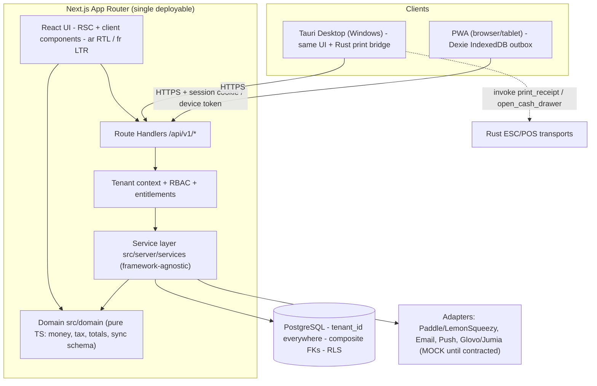

# ARCHITECTURE

> Status: **Design (Phase 0)** — no app code exists yet. Update this file whenever a decision changes (add an ADR, never silently rewrite history).

## 1. System Overview



## 2. Architecture Decision Records

| ADR | Decision | Reason / Consequence |
|---|---|---|
| ADR-001 | **Next.js App Router** hosts UI **and** API (Route Handlers under `/api/v1`). Business logic lives in `src/server/services/*` with no `next/*` imports. | User directive. Keeps a path to extract a standalone API (Fastify/Cloud Run) later as the Master Plan suggests. |
| ADR-002 | **Single package** (no monorepo). Tauri added in Phase 4 under standard `src-tauri/`. Shared pure logic in `src/domain/`. | pnpm not installed; Tauri's default layout wraps the same web app; avoids workspace tooling overhead. Revisit if a separate API package is extracted. |
| ADR-003 | **NextAuth.js v5 (Auth.js) + @auth/prisma-adapter**: Combines **GoogleProvider** (OAuth) for instant frictionless sign-in with **CredentialsProvider** (email/password with argon2id). Standard NextAuth models (`accounts`, `sessions`, `verification_tokens`) stored in PostgreSQL, with user profile linking to `tenant_memberships` for strict multi-tenant authorization. Devices retain separate revocable device tokens for sync. | Standardizes enterprise OAuth & credentials authentication across web, PWA, and desktop clients. |
| ADR-004 | **Tenant scoping via `tenantDb(ctx)`** — a Prisma Client extension that injects `tenant_id` into every `where`/`data` for tenant models and throws if a tenant model is accessed through the raw client. Plus composite FKs and (Phase 1, task P1-12) PostgreSQL **RLS** with `set_config('app.tenant_id', …, true)` inside request transactions. | Defense in depth (Constitution Art. 1). |
| ADR-005 | **Money = `decimal.js`** (Prisma `Decimal`), DB `NUMERIC(12,2)`; API transports money as strings; Zod schemas validate `^\d{1,10}(\.\d{1,2})?$`. | Constitution Art. 2. |
| ADR-006 | **Prices tax-inclusive (TTC) by default** (`tenants.prices_include_tax = true`), configurable. | Moroccan retail displays TTC; invoices still show HT/TVA/TTC split. |
| ADR-007 | **Receipt numbers per device**: `{STORE_CODE}-{DEVICE_CODE}-{seq:000000}`; device code + sequence allocated on device registration → unique per `(tenant_id, store_id)` and safe offline. **Legal invoice numbers** are server-only, gapless per `(tenant_id, series, year)` via row-locked `document_sequences`. | Offline tickets need a number at print time; invoices need strict sequencing. |
| ADR-008 | **Stock** = `inventory_movements` ledger + `stock_levels` cache updated in the same transaction; nightly/CI reconciliation asserts `SUM(ledger) == cache`. Negative stock allowed by default (offline sales are facts) but flagged; setting `allow_negative_stock`. | Plan §3, §6.3. |
| ADR-009 | **Sync cursor** = monotonically increasing `server_seq BIGINT` (global sequence, set by trigger on insert/update) on syncable tables; pull = `WHERE tenant_id=? AND server_seq > cursor ORDER BY server_seq LIMIT n`. Soft deletes (`deleted_at`) so deletions sync. | Plan: "updated_at alone is not enough". |
| ADR-010 | **Charts: Recharts** (only). **CSV: Papa Parse**. **Barcode camera: @zxing/browser**. **PDF: @react-pdf/renderer** or pdf-lib (decide in Phase 3 after Arabic font test). | Plan: one lib per concern. |
| ADR-011 | **Payments**: `BillingProvider` interface; `MockBillingProvider` (labelled MOCK, dev only) until Paddle/Lemon Squeezy sandbox keys exist. | Constitution Art. 7. |
| ADR-012 | **Multilingual Support (i18n)**: `next-intl` supporting **Arabic (`ar`, RTL default)**, **French (`fr`, LTR)**, and **English (`en`, LTR)**. URL routing via `[locale]` prefix, cookie detection, and Tailwind logical utilities (`ms-*`, `pe-*`). | Complete linguistic coverage for Moroccan retail, tourists, and international business. |
| ADR-013 | **Cloud Deployment Strategy**: Multi-stage `Dockerfile` (Node.js standalone output) and production-ready `docker-compose.yml` supporting Oracle Cloud Always Free (ARM64 Ampere / x86_64), GitHub Codespaces, and Google Cloud Run. | Documented in `docs/DEPLOYMENT.md` for low-cost, scalable deployment. |
| ADR-014 | **Competitor Smart Migration (Importer)**: Native import engine supporting presets for competitors (Caissa, POSNEX, Excel/CSV) to migrate products, stock, customer debt, and sales history with zero friction. | Removes the primary switching barrier for Moroccan merchants switching from legacy local POS software. |
| ADR-015 | **Data Portability (One-Click Exporter)**: Complete export of products, historical sales, invoices, and customer ledgers in standardized CSV/JSON/SQLite packages. | Builds merchant trust and satisfies Moroccan CNDP data sovereignty requirements. |
| ADR-016 | **Anonymized Market Business Intelligence (B2B)**: Privacy-preserving aggregation of anonymized retail market trends across Moroccan regions (e.g. top-selling FMCG in Casablanca vs Rabat) to generate B2B industry reports. | Secondary high-margin recurring revenue stream alongside $10/mo SaaS subscriptions. |
| ADR-017 | **Zero-Leakage Infrastructure Cost Optimization**: Docker and Next.js standalone container deployment sized to run entirely within Oracle Cloud Always Free Tier (4 ARM cores, 24GB RAM, 200GB storage), guaranteeing $0/mo infrastructure floor. | Ensures 95%+ gross margins on $10/month subscription pricing. |

## 3. Directory Layout (target)

```
pos-saas-morocco/
├─ docs/                      # persistent memory (this folder)
├─ catalog/sources.json|csv   # third-party source & license registry
├─ prisma/
│  ├─ schema.prisma
│  ├─ migrations/             # SQL visible & reviewed (incl. RLS, triggers)
│  └─ seed.ts                 # DEV ONLY, data tagged DEMO
├─ src/
│  ├─ app/                    # Next.js App Router
│  │  ├─ [locale]/(auth)/login, register
│  │  ├─ [locale]/(app)/dashboard, pos, products, sales, customers, reports, settings
│  │  └─ api/v1/**/route.ts   # thin: parse → auth ctx → service → JSON
│  ├─ domain/                 # PURE TS, no IO: money.ts, tax.ts, totals.ts, receipt.ts, sync-schema.ts
│  ├─ server/
│  │  ├─ db/                  # prisma client, tenantDb extension, tx helpers
│  │  ├─ auth/                # password, session, device tokens, getRequestContext()
│  │  ├─ rbac/                # permissions matrix, assertCan()
│  │  ├─ entitlements/        # plan limits
│  │  ├─ services/            # products, sales, inventory, invoices, sync, billing...
│  │  ├─ adapters/            # billing, email, push, delivery (MOCKs labelled)
│  │  └─ http/                # error envelope, request_id, idempotency, rate limit
│  ├─ client/                 # Dexie db, outbox, sync engine, hooks
│  ├─ components/
│  └─ i18n/                   # messages ar.json / fr.json
├─ tests/
│  ├─ unit/                   # domain (money/tax/totals)
│  ├─ integration/            # services against real Postgres (test DB)
│  └─ isolation/              # cross-tenant suite — RELEASE-BLOCKING
├─ src-tauri/                 # Phase 4
├─ docker-compose.yml         # postgres:16 for dev/test
└─ .env.example
```

## 4. Request Lifecycle (every API call)

```mermaid
sequenceDiagram
    participant C as Client
    participant R as Route Handler
    participant A as getRequestContext
    participant S as Service
    participant D as PostgreSQL
    C->>R: HTTP + cookie/device token (+ Idempotency-Key)
    R->>R: assign request_id, Zod-parse input (no tenant_id accepted)
    R->>A: resolve session → user → active membership
    A-->>R: ctx {userId, tenantId, role, storeIds, plan}
    R->>S: service(ctx, input)
    S->>S: assertCan(ctx, permission) + entitlement check
    S->>D: BEGIN; set_config(app.tenant_id); idempotency lookup; writes; COMMIT
    S-->>R: result (money as strings)
    R-->>C: 2xx JSON or {error:{code,message,request_id}}
```

## 5. Money & Tax Algorithm (`src/domain/totals.ts`)
All arithmetic in `Decimal`, rounding `ROUND_HALF_UP` to 2 dp **per line**, then totals are sums of rounded line values.

Tax-inclusive (default):
```
gross_i   = round(qty_i × unit_price_i) − line_discount_i
tax_i     = round(gross_i × rate_i / (100 + rate_i))
net_i     = gross_i − tax_i
```
Tax-exclusive:
```
net_i     = round(qty_i × unit_price_i) − line_discount_i
tax_i     = round(net_i × rate_i / 100)
gross_i   = net_i + tax_i
```
Sale: `subtotal = Σnet`, `tax_total = Σtax`, `grand_total = Σgross` (cart-level discount is allocated proportionally to lines before tax, remainder cent to the largest line). `change_due = paid_total − grand_total` (cash only, ≥ 0). Property-based tests ensure `subtotal + tax_total == grand_total` always.

## 6. Offline Sync Protocol
1. Client creates op `{client_op_id: uuidv4, op_type, schema_version, device_id, created_at_device, payload}`; writes to Dexie `outbox` in a transaction with local sale record **before** showing success.
2. Sync engine pushes batches (≤ 50) to `POST /api/v1/sync/push` with device token; per op the server: checks `sync_operations(tenant_id, client_op_id)` → if exists, returns stored result; else executes the service (same code path as online) in a transaction and stores the result.
3. Results per op: `applied | duplicate | conflict | rejected` (with code). Conflicts go to an admin review queue (`sync_conflicts`).
4. Pull: `GET /api/v1/sync/pull?cursor=` returns catalog/price/stock changes since `server_seq`, paginated, plus `entitlement` snapshot with `offline_grace_until`.
5. Server time (`completed_at`) is the audit reference; `offline_created_at` is kept but never trusted for ordering of money.
6. Backoff: 1s, 2s, 4s … max 5 min, jitter; triggered on `online` event and interval.

## 7. RBAC Matrix (Extended 8 Roles)
| Permission | owner | admin | branch_manager | manager | warehouse_keeper | accountant | cashier | auditor |
|---|---|---|---|---|---|---|---|---|
| tenant.settings / billing | ✔ | ✔ (no cancel) | | | | | | |
| members.manage | ✔ | ✔ | assigned branch | | | | | |
| stores.manage / create | ✔ | ✔ | | | | | | |
| products.write / prices | ✔ | ✔ | | ✔ | | | | |
| products.read / cost_price | ✔/✔ | ✔/✔ | ✔/✔ | ✔/✔ | ✔/✗ | ✔/✔ | ✔/✗ | ✔/✔ |
| sales.create | ✔ | ✔ | ✔ | ✔ | | | ✔ | |
| sales.refund / void | ✔ | ✔ | ✔ | ✔ | | | approval | |
| stock_transfers.initiate/receive | ✔ | ✔ | ✔ | ✔ | ✔ | | | |
| inventory.adjust | ✔ | ✔ | ✔ | ✔ | ✔ | | | |
| procurement.po.create/receive | ✔ | ✔ | ✔ | ✔ | ✔ | ✔ (create/view) | | |
| invoices.read / write | ✔/✔ | ✔/✔ | ✔/✔ | ✔/✔ | | ✔/✔ | view | ✔/✗ |
| z_reports.view / close | ✔/✔ | ✔/✔ | ✔/✔ | ✔/✔ | | ✔/✔ | own session | ✔/✗ |
| reports.read (consolidated HQ) | ✔ | ✔ | assigned stores | assigned stores | | ✔ | own shift | ✔ |
| audit_logs.read | ✔ | ✔ | assigned branch | | | | | ✔ |

## 8. Environments
- **dev**: Postgres 16 via `docker compose` (or any local Postgres via `DATABASE_URL`); `.env.local`.
- **test**: separate database `pos_test`, migrated with `prisma migrate deploy` before integration tests; truncated between suites.
- **staging/prod**: managed Postgres (e.g. Supabase Pro / Cloud SQL), app on Cloud Run/Vercel. Not configured yet.

## 9. AI Assistant Architecture (ADR-018: Free Tier AI with Zero-Downtime Failover)
- **Framework**: Vercel AI SDK (`ai`, `@ai-sdk/google`, `@ai-sdk/groq`, `@ai-sdk/react`) + `ai-failover` package.
- **Model Tiers**:
  1. **Primary**: Google Gemini 2.5 Flash via `@ai-sdk/google` (15 RPM / 1,500 RPD free tier).
  2. **Fallback**: Groq Llama 3.3 70B Versatile via `@ai-sdk/groq` (30 RPM / 14,400 RPD free tier).
  - When rate limits, timeouts, or provider 5xx errors occur on Gemini, `ai-failover` seamlessly falls back to Groq without client disruption.
- **Persistent Context Memory**:
  - `AIChatSession`: scoped to `tenant_id` (or nullable for Super Admin platform monitoring) and `user_id`.
  - `AIChatMessage`: stores ordered roles (`user`, `assistant`, `system`) and content in PostgreSQL.
- **Tenant-Guarded Function Calling (Tools)**:
  - `getTodaySales`: aggregates tenant's completed sales for today.
  - `getLowStockProducts`: queries tenant's products with stock < 5.
  - `getTopSellingProducts`: returns tenant's top 3 selling products over the last 7 days.
  - Strict tenant filtering: all tools execute with `tenantId` extracted from the server session, preventing cross-tenant leakage.
- **Client Presentation**:
  - Reusable `AIChatWidget` floating panel in bottom-right corner.
  - Streaming responses via `useChat` hook, with RTL Arabic and LTR French/English typography.

## 10. Phase 6 Enterprise Architecture (Multi-Store, OCR, WhatsApp, Voice & Predictions)

### 10.1 Multi-Store HQ & Atomic Stock Transfers
- **HQ Aggregation**: Centralized tenant-level view rolling up sales, GMV, and inventory health across branches.
- **Atomic Stock Transfers (`stock_transfers` & `stock_transfer_items`)**:
  - State machine: `draft` → `in_transit` → `completed` (or `canceled`).
  - When marked `in_transit`: Stock is deducted from `source_store_id` via an `inventory_movement` record with type `transfer_out`.
  - When marked `completed`: Stock is credited to `dest_store_id` via `transfer_in`.
  - Supports discrepancy tracking (`received_qty` vs `quantity`) for partial shrinkage identification.

### 10.2 Smart OCR for Supplier Invoices (Gemini Vision)
- **Workflow**:
  1. Cashier or warehouse keeper captures or uploads paper supplier invoice photo.
  2. Creates an `InvoiceScanJob` record with status `pending`.
  3. Worker sends image payload to Google Gemini 3.5 Flash Vision (`gemini-3.5-flash-lite`) with structured JSON schema prompt.
  4. Extracted fields: Supplier ICE, Invoice Number, Issue Date, Line items (Item description, Quantity, Unit Price HT, Tax Rate), Subtotal HT, Total TVA, Total TTC.
  5. Matches or creates `Supplier` record, checks existing products by barcode/name, and creates a pre-populated `PurchaseOrder` in `draft` status for human verification.

### 10.3 WhatsApp Business Notifications Engine
- **Digital Receipts**:
  - Replaces thermal paper printing on customer request.
  - Generates compact receipt summary and web-view link sent via WhatsApp Cloud API or Twilio.
  - Respects Moroccan CNDP privacy guidelines via explicit customer opt-in (`customers.whatsapp_consent = true`).
- **Automated End-of-Day Z-Report**:
  - Daily scheduled job aggregates store cash sessions, card sales, customer credits, and tax breakdown into a `ZReport` record.
  - Automatically formats a Darija/French markdown summary and pushes it directly to the business owner's verified WhatsApp number at closing time.

### 10.4 AI Voice POS (Speech-to-Cart)
- **Input Pipeline**: Web Speech API (in-browser) or audio chunk streaming to Whisper/Gemini.
- **Moroccan Darija / French / Arabic Intent Resolution**:
  - Tokenizes phrases like:
    - `"zid jouj coca w wahed bimo"` → `[action: ADD, qty: 2, query: "coca"], [action: ADD, qty: 1, query: "bimo"]`
    - `"nqqes wahda"` → `[action: DECREMENT, qty: 1, target: LAST_ITEM]`
    - `"khelles b la carte"` → `[action: SET_PAYMENT, method: CARD]`
  - Runs fuzzy search against local Dexie product cache and dispatches cart actions to Zustand POS store.

### 10.5 Predictive Stock Analytics & Velocity Forecasting
- **Rolling Velocity Model**:
  - Calculates daily sales velocity: \(V = \frac{\sum_{i=1}^{30} \text{SoldUnits}_i}{30}\).
  - Estimates runway: \(\text{DaysRemaining} = \left\lfloor \frac{\text{CurrentStock}}{V} \right\rfloor\).
  - Alerts triggered when \(\text{DaysRemaining} \le \text{SupplierLeadTime} + 2\).
  - Automated reorder recommendation: \(\text{SuggestedQty} = (V \times 14) - \text{CurrentStock}\).
  - Persisted in `stock_predictions` table for dashboard badge alerts and automated PO drafting.

### 10.6 Super Admin BYOK (Bring Your Own Key) Engine
- **Custom AI Provider Injection**:
  - Super Admin can configure third-party LLM endpoints stored securely in `SystemSetting` (`providerName`, `apiKey`, `baseUrl`, `isActive`).
  - Supports standard OpenAI API, Anthropic (via OpenAI compatibility layer), self-hosted vLLM, or Ollama.
  - Dynamically resolved and prioritized at runtime in `src/lib/ai-router.ts`:
    - Priority 1: Active BYOK endpoints from `SystemSetting`
    - Priority 2: Google Gemini Multi-Key Pool (`gemini-3.5-flash-lite`, native vision)
    - Priority 3: OpenRouter (`openrouter/auto`)
    - Priority 4: Groq Pool (`openai/gpt-oss-20b`)

### 10.7 Multimodal Chat & Document Inspection Architecture
- **Attachments Pipeline**:
  - `AIChatWidget` provides a paperclip attachment input supporting images (JPEG, PNG, WEBP) and PDF documents.
  - Files are converted to Base64 Data URIs on the client and dispatched via AI SDK files payload.
  - Persisted in PostgreSQL `ai_chat_messages` (`image_url`, `document_url`) for historical context recall.
  - In `src/app/api/ai/chat/route.ts`, historical and incoming messages with attachments are constructed into multi-part content arrays: `[{ type: 'text' }, { type: 'image', image: url }, { type: 'file', data: url, mimeType: 'application/pdf' }]`.
  - Vision filtering in `ai-router.ts`: requests containing images/documents are automatically routed only to vision-capable candidates (Gemini, BYOK Vision), bypassing text-only models.

### 10.8 AI Product Onboarding Vision Pipeline
- **Page & Endpoint**: `/[locale]/dashboard/products/ai-onboard` & `POST /api/ai/product-onboarding`.
- **Workflow**:
  1. Cashier snaps or uploads a photo of a product package or packaging barcode.
  2. Image payload is sent to Gemini Vision via `generateTextWithRouter`.
  3. AI extracts commercial name, scans EAN barcode, assigns Moroccan retail category, and suggests Moroccan MAD retail price (`salePrice`) and cost price (`costPrice`).
  4. Response is presented in an interactive review form where cashier adjusts details and clicks "Save Product" to commit atomically to `Product` and `Category` tables via `POST /api/v1/products`.
