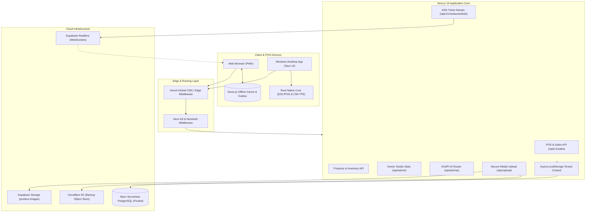

# KASPI POS — Current System Architecture

---

## 1. Multi-Tenant Isolation Flow

1. **Authentication:** The user logs in via NextAuth credentials or OAuth. A session JWT is issued with `maxAge: 30 days` containing `userId`, `defaultTenantId`, and `isSuperAdmin`.
2. **Context Resolution:** `getRequestContext()` in `src/server/auth/context.ts` parses the cookie or Bearer token, determines the active tenant, and verifies the user holds an active `TenantMembership`.
3. **Execution Scope:** `runWithTenantContext(ctx, fn)` wraps the operation inside Node's `AsyncLocalStorage`. All database transactions and queries automatically receive the active `tenantId`.
4. **Super Admin Guard:** Routes under `/admin` and `/api/admin/*` require `checkSuperAdminUser()` which verifies `user.isSuperAdmin === true`. Unauthorized users are safely redirected without crashing.

---

## 2. Real-Time Kitchen Display System (KDS) Architecture

1. When an order is placed on the POS, a `KitchenTicket` is persisted to PostgreSQL via `/api/v1/restaurant/kds/tickets`.
2. The server endpoint immediately executes `broadcastKitchenTicket(tenantId, "ticket:created", ticket)`.
3. Using Supabase Realtime Broadcast, the event is emitted over WebSocket to channel `kds-tenant-${tenantId}`.
4. Active kitchen displays subscribed to the channel update their UI state instantaneously (0ms polling) and trigger an audible alert chime.

---

## 3. High-Integrity Financial & Invoicing Subsystem

- **DGI Morocco Compliance (CGI Art. 145):** Invoices require continuous, gap-less sequential numbering.
- **Atomic Locking:** `generateNextInvoiceNumber()` uses PostgreSQL `SELECT ... FOR UPDATE` row locks inside a transactional block to prevent race conditions during peak concurrent checkouts.
- **Deterministic 4-Tier Payment Engine (`src/lib/fees.ts`):** Calculates exact gateway processing fees (Stripe 2.9% + $0.30, YouCanPay 3.9% + 2 MAD, CMI 2.0%) and performs dynamic 70/30 fee splitting for physical payment terminals based on tenant device count.
