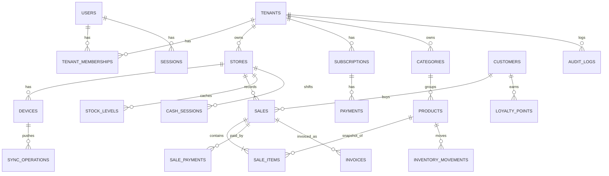

# DATABASE DESIGN (PostgreSQL 16 + Prisma)

> Status: **Design (Phase 0)** — `prisma/schema.prisma` not yet created. This document is the contract; the schema must match it. Any deviation → update here first.

## 1. Global Conventions
- PK: `id UUID` default `gen_random_uuid()` (Prisma `@default(uuid()) @db.Uuid`).
- Columns `snake_case` via `@map`; models PascalCase; tables plural via `@@map`.
- Timestamps `TIMESTAMPTZ` (`@db.Timestamptz(6)`), `created_at DEFAULT now()`, `updated_at @updatedAt`.
- Money `NUMERIC(12,2)` (`Decimal @db.Decimal(12,2)`); quantity `NUMERIC(12,3)`; tax rate `NUMERIC(5,2)`; points `INTEGER`. **No Float anywhere** — CI grep `Float` in `schema.prisma` must return nothing.
- Enum-like status columns: Prisma `enum` (PostgreSQL enum types).
- JSONB for snapshots / provider payloads (redacted).
- Soft delete `deleted_at` on syncable catalog tables (products, categories, customers).
- `server_seq BIGINT` on syncable tables, set by trigger from global sequence `sync_seq` on INSERT/UPDATE (ADR-009).

## 2. Tenant Isolation Rules
1. Every tenant table: `tenant_id UUID NOT NULL REFERENCES tenants(id)` + index leading with `tenant_id`.
2. Every tenant table that is referenced by another tenant table has `@@unique([tenantId, id])`.
3. Child → parent references are **composite**: `@relation(fields: [tenantId, productId], references: [tenantId, id])`. This makes cross-tenant links physically impossible.
4. Because `tenant_id` is NOT NULL and shared across composite FKs, nullable composite relations must use `onDelete: NoAction` / `Restrict` (never `SetNull`, which would try to null `tenant_id`). Business entities are soft-deleted/archived, not hard-deleted.
5. RLS (migration in P1-12): `ALTER TABLE … ENABLE ROW LEVEL SECURITY; CREATE POLICY tenant_isolation ON … USING (tenant_id = current_setting('app.tenant_id', true)::uuid)`; app runs as a non-owner role `pos_app`; migrations run as owner.

### Non-tenant tables (justified exceptions)
| Table | Why no tenant_id |
|---|---|
| `users` | A person can belong to several tenants (via `tenant_memberships`). `default_tenant_id` is a UI preference only. |
| `sessions` | Bound to user; active tenant stored as `active_tenant_id` but re-verified against membership on every request. |
| `plans` | Global product catalog of subscription plans (free/trial/pro) and limits. |
| `webhook_events` | Arrives before tenant resolution; `tenant_id` nullable, filled after mapping. |
| `rate_limit_buckets` (optional) | Infra. |

## 3. Entity Relationship (core)



## 4. Tables

Legend: **T** = has `tenant_id`; **S** = syncable (`server_seq`, `deleted_at`); **I** = idempotency key unique per tenant; **$** = has money columns.

### Phase 1 — Identity & Tenancy
| Table | Flags | Key columns | Constraints |
|---|---|---|---|
| `tenants` | — | legal_name, display_name, slug, ice?, tax_id?, rc_number?, address?, city?, country_code CHAR(2)='MA', currency CHAR(3)='MAD', timezone='Africa/Casablanca', locale='ar', prices_include_tax=true, allow_negative_stock=true, status enum(trialing/active/past_due/suspended/closed) | `UNIQUE(slug)` |
| `users` | — | auth_provider='local', provider_subject, email (lower-cased), password_hash?, full_name, phone?, default_tenant_id?, is_active, last_login_at? | `UNIQUE(auth_provider, provider_subject)`, `UNIQUE(email)` for local provider |
| `sessions` | — | user_id, token_hash (SHA-256), active_tenant_id?, expires_at, ip?, user_agent?, revoked_at? | `UNIQUE(token_hash)` |
| `tenant_memberships` | T | user_id, role enum(owner/admin/manager/cashier/auditor), permissions_override JSONB?, store_ids UUID[]? (null = all stores), status enum(invited/active/revoked) | `UNIQUE(tenant_id, user_id)` |
| `invitations` | T | email, role, token_hash, expires_at, accepted_at?, invited_by | `UNIQUE(token_hash)` |
| `stores` | T | code, name, address?, phone?, timezone?, is_active | `UNIQUE(tenant_id, code)`, `UNIQUE(tenant_id, id)` |
| `audit_logs` | T | actor_user_id?, action, entity_type, entity_id?, before_state JSONB?, after_state JSONB?, reason?, ip INET?, device_id?, request_id | append-only (REVOKE UPDATE/DELETE from app role) |
| `idempotency_records` | T,I | key, scope (endpoint), request_hash, response_status, response_body JSONB, created_at, expires_at | `UNIQUE(tenant_id, scope, key)`; same key + different `request_hash` → 422 `IDEMPOTENCY_KEY_REUSED` |

### Phase 2 — Catalog, POS, Inventory, Customers
| Table | Flags | Key columns | Constraints |
|---|---|---|---|
| `categories` | T,S | parent_id?, name, sort_order, is_active | `UNIQUE(tenant_id,id)`; composite FK parent; partial unique `(tenant_id, name) WHERE parent_id IS NULL` + `(tenant_id, parent_id, name)` |
| `tax_rates` | T | code, label, rate NUMERIC(5,2), is_default | `UNIQUE(tenant_id, code)`; seeded with Moroccan TVA 20/14/10/7/0 (to be validated by accountant) |
| `products` | T,S,$ | category_id?, sku, barcode?, name, description?, unit enum(piece/kg/liter/service), sale_price, cost_price?, tax_code?, tax_rate, track_stock, is_active, low_stock_threshold NUMERIC(12,3)?, version BIGINT | `UNIQUE(tenant_id, sku)`; partial `UNIQUE(tenant_id, barcode) WHERE barcode IS NOT NULL AND deleted_at IS NULL`; `CHECK(sale_price >= 0)`; trigram index on name (pg_trgm) |
| `devices` | T | store_id, device_code (e.g. `D01`), name, platform enum(pwa/desktop), token_hash, app_version?, last_sync_at?, revoked_at?, next_receipt_seq BIGINT | `UNIQUE(tenant_id, store_id, device_code)`, `UNIQUE(token_hash)` |
| `customers` | T,S | name, phone?, normalized_phone?, email?, tax_identifier?, ice?, address?, marketing_consent, consent_at?, consent_source? | index `(tenant_id, normalized_phone)` (not unique) |
| `cash_sessions` | T,$ | store_id, device_id?, user_id, opening_cash, expected_cash?, counted_cash?, discrepancy?, status(open/closed), opened_at, closed_at?, z_report JSONB? | partial unique one open session per `(tenant_id, device_id) WHERE status='open'` |
| `sales` | T,I,$ | store_id, device_id?, cash_session_id?, cashier_user_id, customer_id?, client_sale_id, idempotency_key, receipt_number, status enum(draft/completed/voided/refunded/part_refunded), subtotal, discount_total, tax_total, grand_total, paid_total, change_due, payment_method enum(cash/card/transfer/split/credit), channel enum(pos/online/glovo/jumia), is_training bool, offline_created_at?, completed_at?, voided_at?, void_reason? | `UNIQUE(tenant_id, client_sale_id)`, `UNIQUE(tenant_id, idempotency_key)`, `UNIQUE(tenant_id, store_id, receipt_number)`, `CHECK(grand_total = subtotal + tax_total)` |
| `sale_items` | T,$ | sale_id, product_id?, line_no, product_name_snapshot, sku_snapshot?, quantity, unit_price, discount_amount, tax_rate, tax_amount, net_amount, line_total, cost_snapshot? | composite FK `(tenant_id, sale_id)`, composite FK `(tenant_id, product_id)` NoAction; `CHECK(quantity > 0)` |
| `sale_payments` | T,$ | sale_id, method, amount, reference? | composite FK |
| `refunds` + `refund_items` | T,I,$ | sale_id, reason, approved_by?, totals; items reference sale_item_id + quantity | `UNIQUE(tenant_id, idempotency_key)`; refunded qty ≤ sold qty (service check + test) |
| `inventory_movements` | T,I | store_id, product_id, movement_type enum(sale/purchase/return/adjustment/transfer_in/transfer_out/waste), quantity_delta NUMERIC(12,3), unit_cost?, reference_type?, reference_id?, reason?, idempotency_key, created_by? | `UNIQUE(tenant_id, idempotency_key)`; append-only |
| `stock_levels` | T,S | store_id, product_id, quantity NUMERIC(12,3) | `PK/UNIQUE(tenant_id, store_id, product_id)`; updated only in the movement transaction |
| `document_sequences` | T | store_id?, kind (invoice/credit_note), series, year, next_value BIGINT | `UNIQUE(tenant_id, kind, series, year)`; allocated with `UPDATE … RETURNING` row lock |
| `product_import_jobs` | T | status(previewing/ready/committed/failed), file_ref, total_rows, valid_rows, error_rows JSONB, created_by | — |

### Phase 3 — Reports, Invoices, Billing
| Table | Flags | Key columns | Constraints |
|---|---|---|---|
| `plans` | — | code(free/trial/pro), price NUMERIC(12,2), currency, interval, limits JSONB (`max_active_products`, `max_stores`, `max_users`) | `UNIQUE(code)` |
| `subscriptions` | T | provider enum(paddle/lemonsqueezy/manual/mock), provider_customer_id?, provider_subscription_id?, plan_code, status enum(trialing/active/past_due/canceled/paused), billing_interval, current_period_start?, current_period_end?, trial_end_at?, grace_until?, cancel_at_period_end | `UNIQUE(provider, provider_subscription_id)` |
| `payments` | T,$ | subscription_id?, provider, provider_transaction_id, amount, currency, provider_fee?, status enum(pending/paid/failed/refunded/disputed), paid_at?, provider_payload JSONB (redacted) | `UNIQUE(provider, provider_transaction_id)` |
| `webhook_events` | (tenant nullable) | provider, event_id, event_type, signature_valid, received_at, processed_at?, status(received/processed/failed/ignored), attempts, payload_redacted JSONB, error? | `UNIQUE(provider, event_id)` |
| `invoices` | T,I,$ | store_id, sale_id?, customer_id?, invoice_number, kind(invoice/credit_note), original_invoice_id?, status enum(draft/issued/voided/credited), issued_at?, due_date?, seller_snapshot JSONB, buyer_snapshot JSONB, lines_snapshot JSONB, subtotal, tax_total, grand_total, tax_breakdown JSONB, currency, payment_method, schema_version INT, external_compliance_ref?, idempotency_key | `UNIQUE(tenant_id, invoice_number)`, `UNIQUE(tenant_id, idempotency_key)`; trigger blocks UPDATE of financial fields when status ≠ draft |
| `loyalty_points` | T,I | customer_id, sale_id?, delta_points INT, reason enum(earn/redeem/refund/adjustment/expiry), expires_at?, actor_user_id? | `UNIQUE(tenant_id, idempotency_key)` |

### Phase 4 — Offline / Desktop
| Table | Flags | Key columns | Constraints |
|---|---|---|---|
| `sync_operations` | T | device_id, client_op_id UUID, op_type, schema_version, status(applied/duplicate/conflict/rejected), server_result JSONB, received_at | `UNIQUE(tenant_id, client_op_id)` |
| `sync_conflicts` | T | sync_operation_id, kind, details JSONB, resolved_by?, resolved_at?, resolution | — |

### Phase 5 — Advanced
`notifications` (T), `backup_jobs` (global), `suppliers`, `purchase_orders`, `purchase_order_lines` (T,$), `stock_transfers` (T), `dining_tables`, `kitchen_tickets`, `kitchen_ticket_items` (T, feature-flagged), `price_lists` (T,$), `customer_ledger` (T,$ — credit sales).

## 5. Local (client) Schema — Dexie (Phase 4)
```
db.version(1).stores({
  products:  'id, tenantId, sku, barcode, name, serverSeq',
  stock:     '[storeId+productId]',
  outbox:    'clientOpId, state, createdAt',     // state: pending|syncing|synced|conflict|failed
  localSales:'clientSaleId, receiptNumber, createdAt, state',
  meta:      'key'                                // cursor, deviceId, deviceCode, nextReceiptSeq, graceUntil
})
```
Money stored as **strings** in IndexedDB too.

## 6. Migration Policy
- `prisma migrate dev` locally; every migration's SQL committed and reviewed. Raw SQL (RLS, triggers, partial indexes, CHECKs, pg_trgm) added via `--create-only` then edited.
- Forward-only in production; rollback = new corrective migration (documented).
- Test DB rebuilt with `prisma migrate reset --force` in CI.
