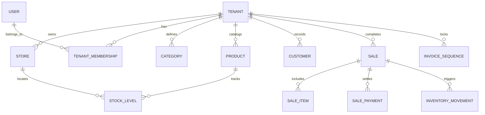

# KASPI POS (كسب) — Complete Database Schema & Multi-Tenant Model
**Database Engine:** PostgreSQL 16+ (Neon Serverless)
**ORM:** Prisma 6.19.3
**Multi-Tenant Model:** Shared Database, Shared Process, Row-Level Security (RLS) via `tenant_id`

---

## 1. Schema Entity Relationship Diagram



---

## 2. Core Tables & Indexing Strategy

### 2.1 `tenants` (Core Tenant Profile)
```sql
CREATE TABLE tenants (
    id UUID PRIMARY KEY DEFAULT gen_random_uuid(),
    slug VARCHAR(64) UNIQUE NOT NULL,
    legal_name VARCHAR(255) NOT NULL,
    display_name VARCHAR(255) NOT NULL,
    ice VARCHAR(15), -- Identifiant Commun de l'Entreprise (Morocco)
    tax_id VARCHAR(32), -- Identifiant Fiscal (IF)
    rc_number VARCHAR(64), -- Registre de Commerce
    max_devices INTEGER DEFAULT 1,
    status VARCHAR(32) DEFAULT 'trialing',
    created_at TIMESTAMPTZ DEFAULT NOW(),
    updated_at TIMESTAMPTZ DEFAULT NOW()
);
```

### 2.2 `sales` (DGI Article 145 CGI Certified)
```sql
CREATE TABLE sales (
    id UUID PRIMARY KEY DEFAULT gen_random_uuid(),
    tenant_id UUID NOT NULL REFERENCES tenants(id) ON DELETE CASCADE,
    store_id UUID NOT NULL REFERENCES stores(id),
    cashier_user_id UUID NOT NULL REFERENCES users(id),
    customer_id UUID REFERENCES customers(id),
    client_sale_id UUID NOT NULL,
    idempotency_key VARCHAR(128) NOT NULL,
    receipt_number VARCHAR(64) NOT NULL, -- Sequential e.g. REC-2026-000842
    status VARCHAR(32) DEFAULT 'completed',
    subtotal DECIMAL(12, 2) NOT NULL,
    tax_total DECIMAL(12, 2) NOT NULL,
    discount_total DECIMAL(12, 2) DEFAULT 0.00,
    grand_total DECIMAL(12, 2) NOT NULL,
    paid_total DECIMAL(12, 2) NOT NULL,
    change_due DECIMAL(12, 2) DEFAULT 0.00,
    payment_method VARCHAR(32) NOT NULL,
    completed_at TIMESTAMPTZ,
    created_at TIMESTAMPTZ DEFAULT NOW(),
    UNIQUE (tenant_id, id),
    UNIQUE (tenant_id, client_sale_id),
    UNIQUE (tenant_id, idempotency_key)
);
CREATE INDEX idx_sales_tenant_date ON sales(tenant_id, completed_at DESC);
```

### 2.3 `invoice_sequences` (Gapless Locking Table)
```sql
CREATE TABLE invoice_sequences (
    tenant_id UUID NOT NULL REFERENCES tenants(id) ON DELETE CASCADE,
    period VARCHAR(32) NOT NULL, -- e.g. "2026"
    next_val BIGINT NOT NULL DEFAULT 1,
    updated_at TIMESTAMPTZ DEFAULT NOW(),
    PRIMARY KEY (tenant_id, period)
);
```
