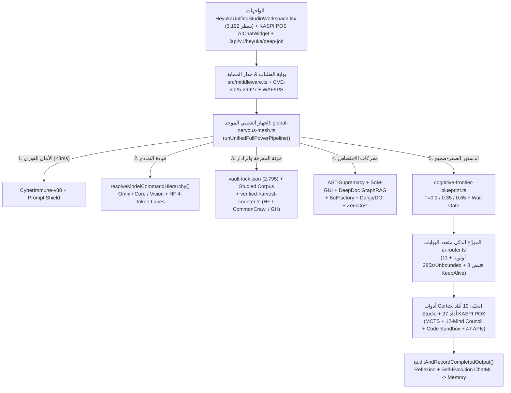

# الموسوعة والمرجع المعماري الشامل لمنظومة النماذج والمصادر (`v1.0` -> `v109.1`)
# HEYUKA & KASPI POS — Complete AI Models, Reasoning, Sources & Audit Master Bible

> **تاريخ الجرد والأوديت الحي:** `2026-11-23` • **الإصدار المنشور على الإنتاج:** [`8dad7ac`](https://kaspi-pos.vercel.app) (`Vercel: success`) • **حزمة الاختبارات الشاملة:** `81/81 (100.0%)` من المحاولة الأولى • **نقطة الإيقاظ الحية:** `8/8 (100%)`
> **ملاحظة منهجية:** كل مسار ملف، اسم دالة، نموذج، عدد، وحالة خادم في هذا المرجع مأخوذة **مباشرةً** من الكود الفعلي، جرد شجرة الاعتماديات (`Import-Graph Audit`)، ونتائج الاختبار الحي على `https://kaspi-pos.vercel.app` دون أي افتراض أو تضخيم.

---

## الفهرس التنفيذي السريع (كيف تقرأ هذه الخريطة لتطوير المنظومة جذرياً)

| الرقم | المحور | الملفات المحورية المباشرة |
| :---: | :--- | :--- |
| **1** | **الجرد الفعلي الشامل للمستودع (Topology)** | `src/lib/heyuka/` (`53`) • `src/lib/zebra-x/` (`76`) • `src/app/api/v1/` (`115`) • `vault/vault-lock.json` (`2,795`) • `training/` (`14`) • `deploy/` (`9`) |
| **2** | **هرم النماذج الثلاثة ومصفوفة البوابات المجانية (11 أولوية)** | [`src/lib/ai-router.ts`](../src/lib/ai-router.ts) • [`src/lib/heyuka/compute/hf-token-pool.ts`](../src/lib/heyuka/compute/hf-token-pool.ts) • [`src/lib/zebra-x/dominance/secret6_omni_router.ts`](../src/lib/zebra-x/dominance/secret6_omni_router.ts) |
| **3** | **كيف تفكّر النماذج ملّيثانيةً بملّيثانية (Reasoning + Tools + Streams)** | [`src/lib/heyuka/global-nervous-mesh.ts`](../src/lib/heyuka/global-nervous-mesh.ts) • [`src/lib/heyuka/cognitive-frontier-blueprint.ts`](../src/lib/heyuka/cognitive-frontier-blueprint.ts) • [`src/lib/heyuka/unified-antigravity-cortex.ts`](../src/lib/heyuka/unified-antigravity-cortex.ts) |
| **4** | **الموسوعة الكاملة لجميع المصادر (2,795 خزنة + 47 API + 15 ذهبي + 120 شريحة)** | [`vault/vault-lock.json`](../vault/vault-lock.json) • [`src/lib/zebra-x/core/cognitive-brain-registry.ts`](../src/lib/zebra-x/core/cognitive-brain-registry.ts) • [`src/lib/zebra-x/tools/public-apis-hub.ts`](../src/lib/zebra-x/tools/public-apis-hub.ts) • [`src/lib/heyuka/swarm-node-registry.ts`](../src/lib/heyuka/swarm-node-registry.ts) |
| **5** | **أوديت جراحي صادق للواقع الحي: ما يعمل الآن vs الفجوات الحقيقية** | القياس الحي الفعلي من `/api/v1/omniscience/live-stats` و`/api/v1/heyuka/deep-job` و`/api/v1/heyuka/chat-web` و`.github/workflows/eternal-public-study-loop.yml` |
| **6** | **خريطة التحول الجذري 10x (ماذا تغيّر وأين ليتضاعف الأداء فوراً)** | جدول جراحي محدد بالملفات والأسطر والوظائف لتحويل النماذج والذاكرة والزحف لقفزة نوعية جذرية |

---

## 1. الخريطة الهيكلية الشاملة للمنظومة (`System Anatomy`)



### الأرقام الهيكلية المُحقّقة من القرص:
- **`src/lib/heyuka/`**: **`53`** ملفاً (النواة العصبية، البناء التلقائي، البث، التطور الذاتي، الموزّع، مسبار الرصد الكوني، محركات الويب 3D/Media).
- **`src/lib/zebra-x/`**: **`76`** ملفاً (7 أسرار معرفية `v87`، 5 أسرار أوميغا `v88`، 7 محركات هيمنة `v90`، 5 قوى خارقة `v95`، كتالوجات `v14`–`v100`، و47 API عمومية).
- **`src/app/api/v1/`**: **`115`** مسار API فعلياً + `/api/ai/chat` لمستشار `KASPI POS`.
- **`vault/vault-lock.json`**: **`2,795`** مصدراً مصنفاً ومفحوصاً (`0` روابط ميتة) موزعة على **62 حزمة**.
- **`training/`**: **`14`** سكربت بايثون عبر 9 مجلدات (`crawler`, `evolution`, `ingestion`, `memory`, `pretrain`, `sovereign_models`, `storage`, `sync`, `telemetry`).
- **`deploy/`**: **`9`** ملفات بنية تحتية (`Caddyfile`, `docker-compose.yml`, `cf-worker-node.ts`, `hf-space-dockerfile`, `universal-worker.py`, إلخ).
- **`.github/workflows/`**: **`9`** مسارات أتمتة سحابية (`eternal-public-study-loop.yml` كل 6 ساعات بـ 20 عاملاً متوازياً).

---

## 2. هرم النماذج الثلاثة ومصفوفة البوابات المجانية الكاملة (`AI Models & Router`)

### أ. القيادة الهرمية للنماذج الثلاثة (`3-Model Command Hierarchy`)
تم تقنين الدور التخصصي للنماذج الثلاثة عبر [`resolveModelCommandHierarchy()`](../src/lib/heyuka/compute/hf-token-pool.ts#L28-L82) ودعمه داخل [`getRouterCandidates()`](../src/lib/ai-router.ts):

| الدور (`modelRole`) | المهمة القيادية | مسار التوكن على HF (`hfLane`) | نماذج Hugging Face المفضلة (بالترتيب) | حرارة الاستدلال التكيفية (`temperature`) |
| :--- | :--- | :--- | :--- | :--- |
| **`heyuka-omni`** | المنسق الأعلى والاستراتيجي متعدد المجالات، مستشار `KASPI POS` والقرارات المجمّعة | `model_1_omni` (`HF_TOKEN`) | `Qwen/Qwen2.5-72B-Instruct` -> `deepseek-ai/DeepSeek-R1` -> `meta-llama/Llama-3.3-70B-Instruct` -> `Qwen/Qwen2.5-Coder-32B-Instruct` | `0.35` (متوازن) أو `0.65` (إبداعي/استراتيجي) |
| **`heyuka-core`** | مهندس البرمجة، الـ AST، الجبر، والامتثال الجبائي المغربي (DGI / TVA / ICE) | `model_2_core` (`HF_TOKEN_2`) | `deepseek-ai/DeepSeek-R1` -> `Qwen/Qwen2.5-Coder-32B-Instruct` -> `Qwen/Qwen2.5-72B-Instruct` | **`0.10`** (`strict_deterministic` — صفر هلوسة في الكود والحساب) |
| **`heyuka-vision`** | خبير الرؤية، لقطات الشاشة، DOM/Set-of-Mark، المشاهد ثلاثية الأبعاد والوسائط | `model_3_vision` (`HF_TOKEN_3` / `HF_TOKEN_4`) | يتقدم إلى بوابات الرؤية (`Gemini 3.8` / `OpenRouter Vision` / `gpt-4o`) + `Qwen/Qwen2.5-72B-Instruct` | `0.35` – `0.65` حسب السياق |

> **ملاحظة السلسلة السيادية (`HEYUKA_SOVEREIGN_HF_MODEL`):** إذا تم تعريف متغير البيئة `HEYUKA_SOVEREIGN_HF_MODEL` (مثلاً `zuvyrismail/heyuka-omni-v1` أو `zuvyrismail/heyuka-astra-brain` بعد تدريبه)، يقفز تلقائياً إلى **المرتبة #1** في قائمة `preferredHfModels` لجميع الأدوار.

---

### ب. التسلسل الهرمي للبوابات الـ 11 في [`src/lib/ai-router.ts`](../src/lib/ai-router.ts)
عند كل طلب استدلال، يبني [`getRouterCandidates(scope)`](../src/lib/ai-router.ts) قائمة المرشحين وفق هذا الترتيب الحرفي:

1. **Priority `-1` — السيرفر الخاص بالمتصل (`callerComputeUrl`)**: أي خادم Ollama / vLLM / Llamafile يحدده المستخدم (مع حماية SSRF في `isSafeCallerComputeUrl` تمنع `169.254.*` و`.internal`). `$0` تكلفة على المالك.
2. **Priority `-0.5` — مفاتيح الجلسة المؤقتة من المتصفح (`byokKeys`)**: مفاتيح يدخلها المستخدم في المتصفح (`sessionStorage` فقط — لا تُخزن على القرص ولا في Git) لـ `Groq` (`openai/gpt-oss-120b`), `Gemini` (`gemini-flash-latest`), `OpenRouter` (`openrouter/free`), `GitHub Models` (`DeepSeek-R1`).
3. **Priority `0` — BYOK المشفرة للمستأجر (`SystemSetting` DB)**: عبر `getDecryptedTenantByokCredentials(tenantId)`.
4. **Priority `1` — مفاتيح المالك العالمية (`allowOwnerPaidProviders`)**: مقفولة افتراضياً (`false`) إلا بتفويض صريح.
5. **Priority `2` — مجموعة Groq السريعة (`GROQ_API_KEYS` / `GROQ_API_KEY`)**:
   - النماذج: `openai/gpt-oss-120b` (سقف `5,500` توكن)، `openai/gpt-oss-20b` (سقف `2,600` توكن)، `qwen/qwen3.8-27b` (سقف `850` توكن — يُستبعد تلقائياً عندما تتجاوز الأدوات/النظام `6,000` حرف!).
6. **Priority `3` — مسبح OpenRouter المجاني للرؤية والأدوات (`OPENROUTER_API_KEY`)**:
   - النماذج (`supportsVision: true`): `google/gemma-4-31b-it:free`, `google/gemma-4-26b-a4b-it:free`, `openrouter/free`, `nvidia/nemotron-3.5-super-vl:free`, `inclusionai/ling-3.2-flash:free`.
7. **Priority `4` — Google Gemini (`GOOGLE_API_KEYS` / `GOOGLE_GENERATIVE_AI_API_KEY`)**:
   - النماذج (`supportsVision: true`, `65,536` توكن): `gemini-3.8-flash`, `gemini-flash-latest`, `gemini-3.7-flash`.
8. **Priority `5` — Mistral AI (`MISTRAL_API_KEYS`)**: `mistral-small-latest` (`supportsVision: true`).
9. **Priority `6` & `7` (مقيدة بالمالك فقط — `PAID_OWNER_ENV_PROVIDERS`)**: Together (`Llama-3.3-70B-Instruct-Turbo`) وDeepSeek API المباشر. تُفلتر خارجياً للمجاني.
10. **Priority `7.5` — بوابات Frontier السريعة المجانية (OpenAI-Compatible)**:
    - **GitHub Models** (`https://models.inference.ai.azure.com`): `DeepSeek-R1`, `gpt-4o` (Vision), `Llama-3.3-70B-Instruct`.
    - **Cerebras Wafer-Scale** (`https://api.cerebras.ai/v1`): `llama-3.3-70b`, `qwen-3-32b`.
    - **SambaNova RDU** (`https://api.sambanova.ai/v1`): `Meta-Llama-3.3-70B-Instruct`, `DeepSeek-R1`.
11. **Priority `8` — مسبح Hugging Face 4-Token (`https://router.huggingface.co/v1`)**: يدوّر `HF_TOKEN`..`HF_TOKEN_4` حسب دور الهرم (`Omni`/`Core`/`Vision`) مع تتبع فترة تبريد `modelCooldownUntil` عند HTTP `429/503/401/404`.
12. **Priority `9` + خطتي الإنقاذ الأخيرتين**:
    - `LOCAL_AI_BASE_URL` (خادم محلي).
    - **Pollinations Zero-Key HTTP** (`https://text.pollinations.ai/openai`, مهلة `45s`).
    - **الدماغ السيادي المحلي بدون إنترنت** ([`runLocalOnDeviceHeyukaBrain()`](../src/lib/heyuka/local-sovereign-brain.ts)): يعمل `100%` داخل المعالج الحتمي ولا يترك أي طلب يموت بـ `429/503`.

---

## 3. كيف تفكّر النماذج وتنفّذ خطوةً بخطوة (`Cognitive & Execution Lifecycle`)

### أ. خط المعالجة قبل توليد أول حرف (Pre-Inference Pipeline — `~2–6ms` بالذاكرة الساخنة)
في كل استدعاء حقيقي على [`chat-web`](../src/app/api/v1/heyuka/chat-web/route.ts), [`council`](../src/app/api/v1/studio/council/route.ts), [`solve-any`](../src/app/api/v1/dominance/solve-any/route.ts), [`deep-job`](../src/app/api/v1/heyuka/deep-job/route.ts), أو [`KASPI POS AI Advisor`](../src/app/api/ai/chat/route.ts):

1. **الدرع السيبراني المناعي (`CyberImmune-v88`)**: فحص فوري (`inspectInputWithCyberImmuneShield`) لاكتشاف حقن الأوامر (Prompt Injection) وتصنيف الثقة (`allow` / `quarantine_untrusted` / `block`).
2. **التصنيف الشديد والهرمي (`Scenario & Hierarchy`)**:
   - `classifyExtremeScenario(prompt)` لتحديد الوضع الدقيق.
   - `resolveModelCommandHierarchy(...)` لتحديد الدور (`heyuka-omni` / `heyuka-core` / `heyuka-vision`) ومسار التوكن.
   - `resolveOptimalInferenceHyperparams(...)` لاختيار `temperature` (`0.1` للحتمي، `0.35` للتنفيذي، `0.65` للإبداعي/الاستراتيجي) و`topP`.
3. **قراءة الخزنة والذاكرة الحية بعمق (`Deep Source Grounding`)**:
   - `ensureFullVaultDigested()` + `readVaultLockSummary()` من `vault/vault-lock.json` (`2,795` مصدر).
   - `searchStudiedKnowledgeCorpus({ limit: 12, includeWebFirst: true })` (الويب المزحوف والمزامَن حديثاً أولاً، ثم الخزنة).
   - `searchSovereignVault({ clusterId, limit: 8 })` للمصادر المصنفة داخل نفس التجمع المعرفي.
   - `collectVerifiedHarvestStats()` لقراءة حالة `zuvyrismail/heyuka-omni-vault` وCommon Crawl وGitHub Actions (أُلغيت مهلات البتر `900ms/1000ms/1200ms` في `v109.1`).
4. **تشغيل المحركات المتخصصة السياقية (Context Micro-Engines)**:
   - عند وجود ملفات كود: `analyzeRepoAstAndDependencies()` (`AST-Supremacy-v90.2` لفحص معرّفات DOM المفقودة وثغرات SAST) + `indexInteractiveElementsSetOfMark()` (`SoM-GUI-v91` لفهرسة أزرار ومدخلات HTML).
   - عند وجود جداول أو نصوص طويلة: `parseLayoutAwareDocAndGraph()` (`DeepDocGraphRAG-v91` لبناء رسم بياني للكيانات والجداول).
   - عند طلبات البوتات (WhatsApp/Telegram): `compileCustomBotBlueprint()` (`BotFactory-v21`).
   - عند مصطلحات تجارية مغربية بالدارجة (`كريدي`, `بون`, `كمبيالة`, `سلعة`, `جملة`, `تقسيط`, `راس المال`, `تيڤيا`): `resolveDarijaCommercialTerms()` (`Darija-DGI-v88`).
   - عند طلبات النشر السحابي (`Vercel`/`Cloudflare`/`Supabase`/`Turso`): `buildZeroCostConnectorScaffold()`.
5. **بناء الدستور الصفر-ضجيج (`Astra Cognitive Blueprint`)**:
   - يُحقن عبر [`buildCognitiveFrontierBlueprint()`](../src/lib/heyuka/cognitive-frontier-blueprint.ts) وفق النمط الموحد:
     **`فهم الهدف -> التخطيط -> بوابة النقد الصامت ("Wait" Gate) -> التجريب والتنفيذ بالأدوات قبل الإجابة (`Execute-Before-Answer`) -> التسليم الكامل بدون `TODO`***.

---

### ب. أثناء التفكير والتوليد والبث المستمر (`Streaming Thinking + Tool Loop + 8s KeepAlive`)

```
[Client UI / Fetch] <-- NDJSON Lines (8s keepalive heartbeat) <-- [streamStudioNdjsonWithRouter]
   ├─ type: "phase"           -> حالة المرحلة الحالية ("Initializing / Searching / Sandbox...")
   ├─ type: "power_telemetry" -> الإثبات الحي (الهرم، المحركات المنفذة، عدد المصادر، الحرارة، زمن النبض)
   ├─ type: "keepalive"       -> نبضة كل 8 ثوانٍ تصفر مؤقت الجمود في المتصفح (stallBudgetMs = 300s/node)
   ├─ type: "think_delta"     -> استخراج reasoning-delta أو ما بداخل وسوم <think>...</think> بسلسلة حية
   ├─ type: "action_step"     -> خطوات تنفيذ الأدوات الفعلية (read/edit/search/run/verify)
   ├─ type: "file_update"     -> بث ملفات الكود مباشرة نحو محرر الاستوديو الأيمن
   ├─ type: "text_delta"      -> النص النظيف النهائي خارج </think>
   └─ type: "done"            -> الحمولة الكاملة المدققة + تفعيل مواصلة التلقائي إن بقي أي اقتطاع
```

- **أدوات Cortex الحيّة في Studio (`19` أداة في [`unified-antigravity-cortex.ts`](../src/lib/heyuka/unified-antigravity-cortex.ts))**:
  `listWorkspaceFiles`, `inspectWorkspaceFile`, `searchWorkspaceFiles`, `writeWorkspaceFile`, `editWorkspaceFile`, `webSearchAndFetch`, `runAndVerifyCode`, `computeExactFinance`, `queryVaultOrApi`, `studyAndCrawlSource`, `reasonWithMctsTree` (`Secret #2 PUCT`), `simulateWorldOrMarket` (`Secret #3 3D/Market`), `inventWithArcAndTriz` (`Secret #4`), `forgeAndRunSkill` (`Secret #5`), `validateMoroccoDgiAndFx` (`Secret #10 Art.145/TVA`), `solveTopsisOrEmitInteractiveWidget` (`Dominance #1 + Morph UI`), `getOmniscienceLiveStats`, `executeMcpBusTool` (`MCP Bus v94`), `analyzeMobileHardwareOrSeo` (`MobileDiag + SEO`).
- **أدوات مستشار KASPI POS ([`src/app/api/ai/chat/route.ts`](../src/app/api/ai/chat/route.ts)) — `27` أداة** تشمل بيانات المتجر الحية (`getTodaySales`, `getLowStockProducts`, `getTopSellingProducts`, `predictStockDemand`, `getLastCustomer`, `getLastReceiptTicket`, `getUserActivityLog`), تقارير PDF/XLSX، تأكيد إجراءات البيع والمخزون، البحث/توليد الصور، وتنفيذ الأدوات الكونية + السندبوكس + مجلس Swarm + SuperAdmin Platform Tools (`getPlatformStats`, `getPlatformRevenue`, `getAllTenantsList`, `getTenantDetails`, `getAIUsageStats`).
- **مجلس الفيتو والمحكمة الداخلية (12 عقلاً متخاصماً في [`secret6_adversarial_council.ts`](../src/lib/zebra-x/cognition/secret6_adversarial_council.ts))**:
  1. `Strategic Planner` • 2. `Systems Architect` • 3. `Surgical Coder` • 4. `Data & SQL Expert` • 5. `UX & RTL Designer` • 6. `3D & Media Director` • 7. `Scientific Analyst` • 8. `KASPI TVA & Finance Auditor` (وزن `1.3`) • 9. `Security Veto Guard` (أعلى وزن **`1.5`** — يرفع فيتو ضد SAST/SSRF/Secrets) • 10. `Red-Team Devil's Advocate` (وزن `1.35`) • 11. `QA Verification Engineer` • 12. `Maestro Synthesizer` (دمج RRF، وزن `1.4`).

### ج. زمن الاستجابة غير المحدود وإدارة المهام العميقة (`v109.1 Unbounded Execution`)
تم إزالة القواطع الزمنية القصيرة (`14s/18s firstActivityTimer`، `22s/24s/50s Vercel horizon`، `62s stallBudgetMs`):
- `maxDuration = 300` في `chat-web`, `ai/chat`, `studio/council`, `studio/ingest`, `dominance/solve-any`, `cognition/awaken-and-test`, و`heyuka/deep-job`.
- [`resolveRouterBudgets()`](../src/lib/ai-router.ts#L25-L36): يرفع السقف إلى `285s` على Vercel و`3,600s` (ساعة كاملة مع 32 قفزة استكمال تلقائي) عند تفعيل `HEYUKA_UNBOUNDED_TIMEOUT=1` أو على خادم VPS/Docker الخاص بك.
- نبض **`keepalive`** كل `8` ثوانٍ + إمكانية **مهام عميقة غير متزامنة (`/api/v1/heyuka/deep-job`)** تعمل بنظام `POST` (`202 Accepted`) + `GET ?jobId=...`.

---

## 4. الموسوعة الكاملة لجميع المصادر والذاكرة الموزعة (`2,795+ Sources Encyclopedia`)

### أ. الخزنة المصنفة المؤمنة (`vault/vault-lock.json` — `schemaVersion: v35.1-lock`, الإجمالي `2,795` إدخالاً فريداً)

| المجموعة الإصدارية | الحزم المشمولة داخل `vault-lock.json` | العدد المحقّق | التغطية التقنية الفعلية |
| :--- | :--- | :---: | :--- |
| **V7–V10.0 تأسيس وأمن** | `v7.0-v10.0` (`38`), `v10.0-cyber` (`20`), `v10.0-fleet` (`12`) | **70** | نواة الأمان السيبراني والأسطول والمصادقة |
| **V14–V19 التقييم والمعرفة الطويلة** | `v14.x` (`64`), `v15.1` (`22`), `v15.2` (`56`), `v15.3` (`6`), `v15.4` (`5`), `v16.0` (`6`), `v17.0` (`100`), `v18.0` (`100`), `v19.0` (`25`) | **384** | معايير التقييم، السياق الطويل YaRN/RoPE، التفكير والدرع من 10 طبقات، التوجيه الجزئي |
| **V20–V28 الهندسة والروبوتات والإبداع** | `v20.2` (`25`), `v20.3` (`25`), `v20.4` (`25`), `v21.0` (`10`), `v21.2` (`21`), `v21.4` (`12`), `v22.0` (`100`), `v23.0` (`15`), `v24.0` (`16`), `v25.0` (`19`), `v25.2` (`62`), `v26.0` (`31`), `v27.0` (`12`), `v28.0` (`25`) | **398** | SAST، Bot Factory، QR TLV، إصلاح الهواتف ADB/iOS، IDE وبراءات الاختراع Google Patents (`150M+`)، الألعاب 3D |
| **V30–V39 المصادر الكبرى والأرشيف الدائم** | `v30.0` (`74`), `v31.0` (`94`), `v34.0` (`100`), `v35.0` (`100`), `v35.1` (`100`), `v36.0` (`100`), `v37.0` (`100`), `v38.0` (`100`), `v39.0` (`11`) | **779** | GitHub Signals، مستودعات Open-Source، الفيديو الطويل، الخزنة الدائمة، الصوت والصورة 3D وإخراج المشاريع |
| **V52–V60 الاستوديو الشامل والعمل دون نت** | `v52.0` (`100`), `v53.0` (`100`), `v54.0` (`100`), `v55.0` (`100`), `v56.0` (`100`), `v57.0` (`99`), `v58.0` (`99`), `v59.0` (`98`), `v60.0` (`15`) | **811** | أتمتة PC/OS/Shell/Webcam، استوديو Antigravity الثنائي، Swarm 3/6/12x، مصنع المتصفح، CRDT، وLAN/Offline Vault |
| **Public APIs Hub** | `public-apis-hub` | **47** | 47 واجهة برمجية عمومية حية بلا مفاتيح (موثقة أدناه بالاسم) |
| **V87–V90.7 الأسرار والهيمنة والأوميغا** | `v87.1` (`20`), `v87.2` (`16`), `v87.3` (`17`), `v87.4` (`15`), `v87.5` (`15`), `v87.6` (`15`), `v87.7` (`16`), `v88.0` (`27`), `v89.0` (`10`), `v90.1` (`12`), `v90.2` (`31`), `v90.3` (`20`), `v90.4` (`20`), `v90.5` (`13`), `v90.6` (`10`), `v90.7` (`13`) | **270** | اللعب الذاتي، MCTS، محاكاة السوق/الفيزياء، الذكاء السائل، نحت الأدوات، محكم الـ 12 عقلاً، ذاكرة System-1، Cyber Immune، الدارجة/DGI، التميز في البرمجة والأعمال والعلوم |
| **V97–V100 الزحف الكوني الموزع** | `v97.0` (`18`), `v99.0` (`10`), `v100.0` (`8`) | **36** | Bloom/HyperLogLog الموزع، Double-Read المستنسخ، وتقسيم الشرائح الـ 120 |
| **المجموع المفهرس في `vault-lock.json`** | **62 حزمة موحدة** | **`2,795`** | يتحقق منه [`v52_v54` و`v90..v109`](../vault/vault-lock.json) بـ `0` روابط ميتة |

---

### ب. التجمعات المعرفية الـ 18 (`COGNITIVE_BRAIN_CLUSTERS` في [`cognitive-brain-registry.ts`](../src/lib/zebra-x/core/cognitive-brain-registry.ts))
1. `patents_and_inventions_150m` — محرك براءات الاختراع العالمية (Google Patents `150M+` & Scholar)
2. `pdf_office_and_documents` — استوديو PDF, Word (.docx), Excel (.xlsx) والمستندات
3. `image_svg_and_vision_studio` — توليد الصور وإزالة الخلفيات والرسوم المتجهة SVG
4. `zip_vfs_and_file_packaging` — ضغط PKZIP ونظام الملفات الافتراضي VFS
5. `code_ide_and_surgical_editing` — البرمجة الذاتية، محرر الصيغ Syntax IDE، والترقيع الجراحي
6. `games_3d_video_and_audio` — العوالم ثلاثية الأبعاد 3D، الألعاب، الفيديو والصوت
7. `live_search_and_47_public_apis` — موجه البحث الحي والـ 47 واجهة عمومية بلا مفاتيح
8. `robotics_agents_and_mobile_lab` — الروبوتات ROS2 وبوتات الأفعال ومختبر إصلاح الهواتف
9. `kaspi_pos_merchant_intelligence` — الذكاء التجاري والضريبي وتذاكر الحراري لـ KASPI POS
10. `hardware_cad_voip_testing_and_physics` — عتاد WebUSB/ESC-POS، التصميم الصناعي DXF، الصوتيات WebRTC، والإيميل EML
11. `pc_keyboard_mouse_and_virtual_desktop_bots` — تحكم PC بالكامل ومزرعة أسطح المكتب الافتراضية (`v52`)
12. `sovereign_os_shell_file_surgeon_and_sentinel` — نواة Shell، جراح الملفات الشامل وحارس 24/7 (`v53`)
13. `ai_computer_os_webcam_and_self_unblocking` — حاسوب AI المتكامل مع كاميرا الويب وكسر العوائق (`v54`)
14. `google_ai_studio_dual_brand_workspace` — استوديو الماركتين المزدوج مع الطرفية والمتصفح الحي (`v55 + v58`)
15. `elastic_swarm_3_6_12_and_worker_bots` — سرب التوسع المرن 3->6->12 نموذج وكتيبة البوتات (`v56`)
16. `browser_autopilot_oauth_cloud_factory` — متصفح Autopilot، OAuth، ومصنع البنية السحابية (`v57`)
17. `multiplayer_crdt_huddles_and_gamification` — التعديل الجماعي اللحظي CRDT وغرف الصوت والتحفيز (`v59`)
18. `airgapped_offline_vault_and_lan_mesh` — الخزنة المعزولة بالكامل وشبكة LAN المحلية (`v60`)

---

### ج. جميع الـ 47 واجهة برمجية عمومية حية بلا مفاتيح (`PUBLIC_API_CATEGORIES`)
مربوطة مباشرة عبر [`queryPublicApiHub`](../src/lib/zebra-x/tools/public-apis-hub.ts) وتُفحص حياً دورياً في اختبار E2E:
- **المنتجات والتجارة والمالية:** `openfoodfacts`, `openbeautyfacts`, `openproductfacts`, `fx_rates` (`fawazahmed0`), `frankfurter_fx`, `crypto_market` (`CoinGecko`), `gleif_company`, `world_bank`, `remote_jobs` (`Arbeitnow`)
- **الموسوعة والكتب وبراءات الاختراع والعلوم:** `wikipedia`, `wikidata_sparql`, `duckduckgo`, `openalex_science`, `openfda_drug`, `pubmed_papers`, `soilgrids_agri`, `nasa_power_agri`, `paleobiology_fossils`, `open_tree_of_life`, `patents_inventor`, `google_patents`, `nobel_prize`, `hacker_news`, `openlibrary_books` (+ مرآة `gutendex.com`), `gbif_biodiversity`, `rxnav_drugs`, `disease_health_stats`
- **الجغرافيا والطقس والمدن الذكية والطيران والأمان:** `weather`, `geocode` (`Nominatim`), `b2b_overpass` (`Photon`), `country_info`, `transit_stops`, `smart_city_poi`, `air_quality`, `nador_marine_weather`, `osrm_routing`, `usgs_earthquakes`, `nasa_eonet_events`, `nhtsa_recalls_vehicles`, `opensky_flights`, `cyber_threat_intel` (`OSV.dev`)
- **الوسائط والتصميم 3D والمحتوى:** `iconify_logos`, `openverse_media` (+ مرآة حية `Wikimedia Commons`), `met_museum` (`AIC`), `polyhaven_3d`, `wger_workouts`, `themealdb_recipes`

---

### د. المصادر الذهبية الـ 15 وشبكة الزحف السحابية الـ 120 شريحة (`Planetary Corpus Engine`)
1. **المصادر الذهبية الـ 15 ([`golden_sources_priority.py`](../training/crawler/golden_sources_priority.py))**:
   `FineWeb-Edu`, `The Stack v2 (600+ Languages)`, `Wikipedia & Wikidata (AR/FR/EN)`, `arXiv`, `OpenAlex (250M+ Papers)`, `PubMed Central`, `Lean Mathlib4 & OEIS`, `Project Gutenberg & Open Library`, `Common Crawl (110B+ Index)`, `Internet Archive`, `AtlasIA Moroccan Darija`, `CAMeL Lab Arabic NLP`, `OpenStreetMap / Nominatim`, `OpenFoodFacts`, `World Bank`.
2. **طوبولوجيا الـ 120 شريحة عبر 6 أسراب مجانية (`MULTI_CLOUD_120_POOLS`)**:
   - `github_actions_matrix`: شرائح `0..19` (`20` عامل متوازي في `.github/workflows/eternal-public-study-loop.yml` كل `6` ساعات — `0 */6 * * *`)
   - `hf_spaces_docker`: شرائح `20..44` (`25` شريحة via `deploy/swarm-nodes/hf-space-dockerfile` + `universal-worker.py`)
   - `cloudflare_edge_workers`: شرائح `45..84` (`40` شريحة via `deploy/swarm-nodes/cf-worker-node.ts`)
   - `kaggle_colab_warc`: شرائح `85..99` (`15` شريحة تدريب/زحف WARC مجاني)
   - `gitlab_vercel_cron`: شرائح `100..109` (`10` شرائح)
   - `browser_p2p_mesh`: شرائح `110..119+` (`10+` شرائح من متصفحات المستخدمين)
3. **خط أنابيب التدريب والتكامل السيادي الـ 14 في `training/`**:
   - الزحف والاكتشاف: `autonomous_web_discoverer.py`, `golden_sources_priority.py`, `multi_cloud_swarm_director.py`, `planetary_crawl_secrets.py`, `web_scale_crawler.py`
   - التنقية والذاكرة والتخزين: `massive_curator.py`, `immortal_nano_vault.py`, `external_vault_offloader.py`, `hf_token_pool.py`, `multi_vault_union.py`, `remote_omniscience_radar.py`
   - التطور والمزامنة وبناء النماذج السيادية (`zuvyrismail/heyuka-*`):
     - `training/evolution/secret1_self_play.py`
     - `training/sync/auto_distributed_memory_sync.py` (مزامنة HF Hub + `POST /api/v1/studio/ingest` `hot_sync`)
     - `training/sovereign_models/merge_heyuka_flagship.py` (يُولّد وصفات MergeKit الحقيقية: `heyuka-core-32b-v1` بـ DARE-TIES، `heyuka-pos-7b-v1` بـ SLERP، و`heyuka-omni-moe-v1` بـ Mixtral MoE)
     - `training/sovereign_models/train_grpo_dpo_sovereign.py` (وصفة Kaggle 2xT4 / Colab T4 بـ Unsloth QLoRA + SFT + DPO + GRPO + مدققات DGI المغربية لإنتاج `zuvyrismail/heyuka-astra-brain`).

---

## 5. الأوديت الجراحي الصادق للواقع الحي الآن (`Honest Production Audit — Live Inspection 2026-11-23`)

بناءً على الاختبار الحي المباشر لنشر الإنتاج `8dad7ac` على `https://kaspi-pos.vercel.app` ومطابقته مع ملفات `.env.local` و`.github/workflows`:

### ما تم التحقق من عمله حياً الآن 100%:
- `GET /api/v1/omniscience/live-stats?refresh=1` -> `HTTP 200`, متصل حياً بـ Hugging Face `zuvyrismail/heyuka-omni-vault` (`1 crystal = 4,266B`, `2 manifests`), `Common Crawl CC-MAIN-2026-47` (`130` فهرساً), `vaultedSourcesCount = 2,795`, `studyLoopRuns = 1 (success)`.
- `GET /api/v1/cognition/awaken-and-test` -> `HTTP 200`, **`8/8 (100%)`** مسابير حية حقيقية (`latencyMs = 2137.98`).
- `POST /api/v1/studio/council` -> `HTTP 200`, `ptVersion = v109.1`, `vaultLock = 2,795`, `engines = 7`.
- `POST /api/v1/dominance/solve-any` -> `HTTP 200`, `ptVersion = v109.1`, `role = heyuka-core`, `temp = 0.1`.
- `POST -> GET /api/v1/heyuka/deep-job` -> `HTTP 202 -> 200` (`jobId` شغال وتقدم لحظي).
- `GET /api/v1/studio/ingest` -> `HTTP 200`, `totalCorpus = 2,795`, `awakened = 8`.
- `POST /api/v1/heyuka/chat-web` (`stream: true`) -> `HTTP 200`, يبث أحداث `['done', 'phase', 'power_telemetry', 'text_delta', 'think_delta']` مع إجابة من `1,392` حرف و`role = heyuka-core`, `temp = 0.1`.
- كل الوحدات في `src/lib/` متصلة فعلياً بالبنية الحية باستثناء `shield/tmp-storage.ts` و`engine/three/furShaders.ts` المصنفَين كمرآة متجاوزة/قديمة في [`HEYUKA_MASTER_UNIFICATION_PLAN.md`](./HEYUKA_MASTER_UNIFICATION_PLAN.md).

### الفجوات الـ 7 الحقيقية الموجودة حالياً في الإنتاج (التي يكشفها هذا الأوديت بوضوح تام):

1. **مفاتيح `HF_TOKEN` الأربعة موجودة محلياً في `.env.local` فقط، و`0` على بيئة Vercel الإنتاجية!**
   - **الدليل الحي من الإنتاج:** أعاد `/api/v1/omniscience/live-stats` حياً على `kaspi-pos.vercel.app`: `"poolActiveTokens": 0` و`"0 HF key(s)"`! بينما في `.env.local` المحلي توجد جميع المتغيرات الـ 6 (`HF_TOKEN`, `HF_TOKEN_2`, `HF_TOKEN_3`, `HF_TOKEN_4`, `HF_DATASET_REPO`, `HF_REPO_ID`).
   - **الأثر:** على خادم Vercel الحي الآن، البوابات الهرمية الـ 4 على Hugging Face Router (`DeepSeek-R1`, `Qwen-72B`, `Qwen-Coder-32B`, `Llama-3.3-70B`) غير نشطة ما لم تُضاف المفاتيح الأربعة في لوحة إعدادات **Vercel Environment Variables** (أو في GitHub Secrets لـ Actions)!

2. **الذاكرة الحية في Vercel Serverless تتطاير عند إعادة تشغيل الحاوية (`Ephemeral In-Memory / /tmp State`):**
   - **الدليل من الكود:** `meshState` في `global-nervous-mesh.ts`، الوحدات المضافة عبر `hot_sync` في `knowledge-corpus-engine.ts`، طابور `deepJobsStore` في `deep-job-queue.ts`، متجهات التعلم في `self-evolution-engine.ts`، ومعدل `selfPlayElo` (`1200` على خادم Vercel البارد مقابل `1968` محلياً) تقطن حالياً في الذاكرة RAM / `/tmp`. إذا بدّلت Vercel الحاوية، تعود للأصل حتى تتم مزامنة خارجية!

3. **دالة `void (async () => ...)` داخل `/api/v1/heyuka/deep-job` عرضة لتجميد CPU في Vercel Serverless بمجرد عودة `HTTP 202`:**
   - على خوادم VPS/Docker الدائمة تعمل الخلفية بلا نهاية؛ أما في Vercel Functions فيُنهي المحيط الافتراضي وحدة المعالجة بعد إغلاق استجابة `202` ما لم تُغلّف بـ `after()` من `next/server` أو تُدفع لـ Upstash QStash / Cloudflare Worker.

4. **ملف [`.github/workflows/eternal-public-study-loop.yml`](../.github/workflows/eternal-public-study-loop.yml) لا يستدعي `auto_distributed_memory_sync.py --hub-url` بعد خطوة الدمج (`merge-shards`) حتى الآن:**
   - يرفع بالفعل `.crystal` و`multi_shard_union_manifest.json` إلى Hugging Face كل 6 ساعات (وقد حقق 1 تشغيل ناجح)، لكنه لم ينفّذ بعد الخطوة الآلية لضرب `POST https://kaspi-pos.vercel.app/api/v1/studio/ingest` (`action: "hot_sync"`) لتغذية الكوربس الساخن فوراً.

5. **ترتيب الأولويات في `ai-router.ts` يضع `Groq (Priority 2)` بسقف `850–5500` توكن قبل `GitHub Models (7.5)` و`Hugging Face DeepSeek-R1/Qwen-72B (Priority 8)`:**
   - حين يتوفر مفتاح Groq مع مفتاح HF/GitHub، سيفوز Groq بالطلب الأول دائماً حتى في مهام البرمجة والتفكير العميق التي تتفوق فيها نماذج `72B`/`DeepSeek-R1`!

6. **قاعدة أولوية الكلمات مقابل التعيين الصريح في [`resolveModelCommandHierarchy()`](../src/lib/heyuka/compute/hf-token-pool.ts#L50-L79):**
   - لوحظ عملياً في فحص `DEEP_JOB` رقم 5 على الإنتاج: إرسال `model: "heyuka-omni"` مع كلمة `"Vision"` داخل نص البرومبت أظهر `role = heyuka-vision` لأن الشرط `(!m.includes("core") && hasVisionCue)` سمح للكلمة بتجاوز التحديد الصريح `"heyuka-omni"`.

7. **النماذج السيادية الخاصة المدمجة (`zuvyrismail/heyuka-omni-v1` و`heyuka-astra-brain`) جاهزة كوصفات وتدريب ولم تُرفع أوزانها بعد إلى HF Hub:**
   - السكربتات `merge_heyuka_flagship.py` و`train_grpo_dpo_sovereign.py` مختبرة وجاهزة، لكن يلزم تشغيلها مرة على GPU مجاني (Kaggle 2xT4 أو Colab) وضبط متغير `HEYUKA_SOVEREIGN_HF_MODEL` لتدخل في الإنتاج كأوزان خاصة بك 100%.

---

## 6. خريطة التحول الجذري (`Radical 10x Transformation Roadmap`)

إذا أردت تغيير كل شيء جذرياً في قفزة واحدة لاحقاً عبر تطوير هذه الخريطة تحديداً، فهذا هو الترتيب الدقيق للأماكن ذات الأثر الأعلى:

| القفزة الجذرية | الفجوة المستهدفة | الملف والوظيفة الواجب تطويرهما | النتيجة الفورية المتوقعة |
| :---: | :--- | :--- | :--- |
| **#1** | `poolActiveTokens = 0` على Vercel | لوحة **Vercel Env** + **GitHub Secrets**: إضافة `HF_TOKEN`..`HF_TOKEN_4` + `GITHUB_MODELS_TOKEN` + `CEREBRAS_API_KEY` + `GROQ_API_KEYS` | تفعيل فوري لـ `DeepSeek-R1` و`Qwen-72B` و4 قنوات تدوير حقيقية بلا اختناق مجاني في الإنتاج |
| **#2** | ذاكرة `RAM`/`/tmp` المؤقتة في Serverless | [`prisma/schema.prisma`](../prisma/schema.prisma) + [`knowledge-corpus-engine.ts`](../src/lib/heyuka/training/knowledge-corpus-engine.ts) + [`deep-job-queue.ts`](../src/lib/heyuka/deep-job-queue.ts) -> حفظ الكوربس الساخن، `meshState`, `Self-Play Elo`, و`DeepJobs` داخل جدول PostgreSQL (`SystemSetting` أو جدول `HeyukaMemoryUnit` / Turso / Upstash Redis) | ذاكرة أبدية مشتركة بين كل حاويات Vercel (`0%` ضياع بين الطلبات وإعادة التشغيل) |
| **#3** | تجميد مهام الخلفية في `deep-job` بعد `202` | [`src/app/api/v1/heyuka/deep-job/route.ts`](../src/app/api/v1/heyuka/deep-job/route.ts) -> استخدام `import { after } from "next/server"` لتشغيل الـ async job أو تشغيله عبر Cloudflare Worker / VPS دائماً (`HEYUKA_UNBOUNDED_TIMEOUT=1`) | مهام عميقة غير محدودة تكتمل 100% حتى بعد إغلاق اتصال المتصفح |
| **#4** | تفوق الجودة في الاستدلال قبل السرعة | [`src/lib/ai-router.ts`](../src/lib/ai-router.ts) (`getRouterCandidates`) -> إعادة ترتيب المسبح ديناميكياً حسب `modelRole` (`heyuka-core` يبدأ بـ `DeepSeek-R1`/`Qwen-Coder-32B` قبل نموذج `20b`، و`heyuka-vision` يبدأ بـ Gemini/OpenRouter VL قبل أي نموذج نصي) | تحسن فوري جذري في دقة الكود المعقد والرياضيات والضرائب والرؤية |
| **#5** | ربط الزحف الأبدي بالخادم الحي تلقائياً | [`.github/workflows/eternal-public-study-loop.yml`](../.github/workflows/eternal-public-study-loop.yml) (`merge-shards`) -> إضافة خطوة `python3 training/sync/auto_distributed_memory_sync.py --hub-url https://kaspi-pos.vercel.app` بعد `multi_vault_union.py` | كل دفعة زحف عالمية كل 6 ساعات تصبح حاضرة فوراً داخل إجابات النماذج بدون تدخل يدوي |
| **#6** | أولوية الاختيار الصريح للهرم | [`src/lib/heyuka/compute/hf-token-pool.ts`](../src/lib/heyuka/compute/hf-token-pool.ts) (`resolveModelCommandHierarchy`) -> جعل التعيين الصريح `heyuka-omni` / `heyuka-core` / `heyuka-vision` يعلو على الكلمات المفتاحية داخل النص (ويُفعل التصنيف التلقائي فقط لـ `"auto"`) | التزام صارم 100% بدور النموذج الذي اختاره المستخدم أو المسار |
| **#7** | أوزان HEYUKA السيادية الخاصة | تشغيل [`training/sovereign_models/merge_heyuka_flagship.py`](../training/sovereign_models/merge_heyuka_flagship.py) و[`train_grpo_dpo_sovereign.py`](../training/sovereign_models/train_grpo_dpo_sovereign.py) على Kaggle 2xT4 مجاناً ثم ضبط `HEYUKA_SOVEREIGN_HF_MODEL` | نموذج سيادي مدرب خصيصاً على بياناتك المغربية والعربية والبرمجية |
