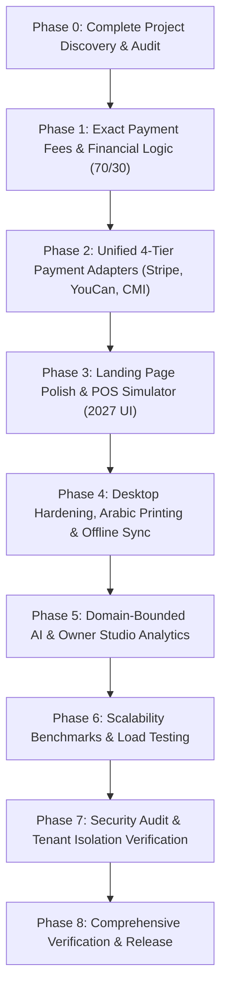

# KASPI POS — Master Engineering Implementation Roadmap

---

## Roadmap Milestones & Verifiable Deliverables

| Milestone | Deliverable File(s) | Primary Responsibility | Target Exit Criteria |
| :--- | :--- | :--- | :--- |
| **M1: Discovery** | `docs/PROJECT_DISCOVERY.md` `docs/CURRENT_ARCHITECTURE.md` `docs/TECHNICAL_DEBT.md` | Principal Architect | Complete codebase inventory documented |
| **M2: Fee Engine** | `src/lib/fees.ts` `src/lib/__tests__/fees.test.ts` `src/components/pos/CheckoutModal.tsx` | Financial Engineer | Exact fee formulas with integer rounding & test coverage |
| **M3: Payments** | `src/lib/payments/types.ts` `src/lib/payments/stripe.ts` `src/lib/payments/youcanpay.ts` `src/lib/payments/cmi.ts` `src-tauri/src/tpe_bridge.rs` | Integration Engineer | Unified payment adapter interface & webhook handlers |
| **M4: Landing UI** | `src/components/landing/InteractivePosSimulator.tsx` `src/components/landing/DevicePricingCalculator.tsx` | UI/UX Architect | 2027 dark design, serrated receipt, Nike/Coca-Cola/Big Mac items |
| **M5: Core Hardening** | `src-tauri/src/printer.rs` `src/server/db/invoice-sequence.ts` `src/client/sync-engine.ts` | Systems Engineer | Concurrency-safe DGI numbering & Arabic RTL thermal printing |
| **M6: AI & Admin** | `src/app/api/ai/chat/route.ts` `src/app/admin/page.tsx` | AI & Analytics Engineer | Strict domain restriction & real MRR/tenants Recharts dashboard |
| **M7: Scalability** | `scripts/load-test.ts` `scripts/test-tenant-isolation.ts` | DevOps & QA Director | Verified cross-tenant isolation & latency benchmarks |
| **M8: Final Release** | `docs/FINAL_COMPLETION_REPORT.md` | CTO & Release Owner | `prisma generate`, `prisma db push`, `tsc`, `next build`, `cargo check` Exit 0 |
