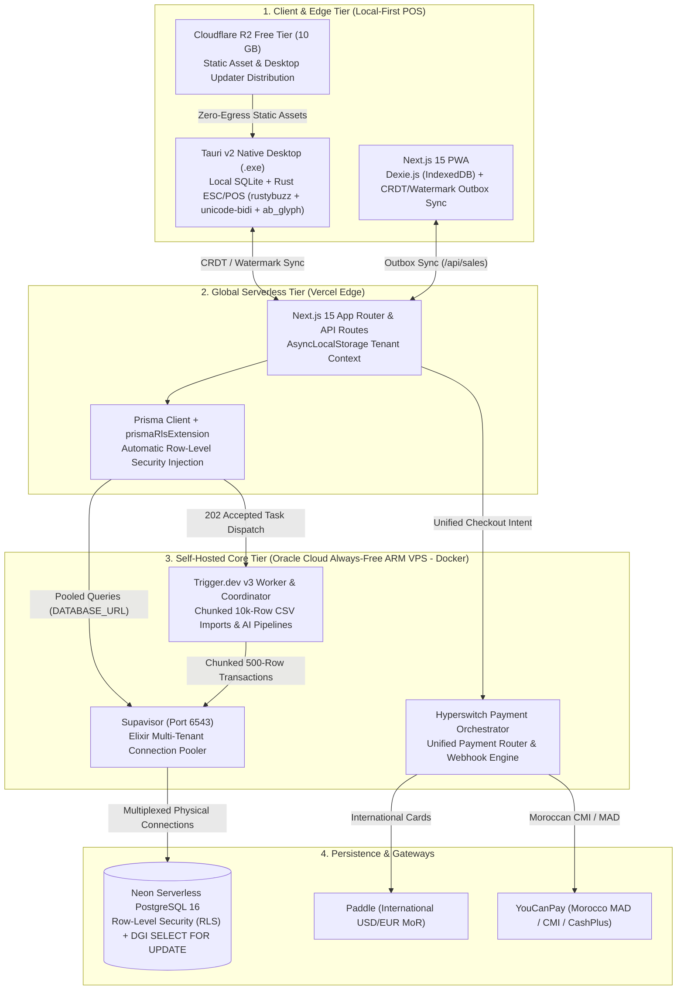

# KASPI POS (كسب) — Master Enterprise Architecture (100,000+ Merchants)

## 1. Executive Summary & Hybrid Topology

**KASPI POS** is engineered to scale to **100,000+ Moroccan retail merchants and restaurants** with zero single points of failure and near-zero infrastructure cost by combining **Serverless Edge Compute**, **Always-Free ARM Cloud Infrastructure**, **Serverless PostgreSQL**, and a **Local-First Desktop/PWA Engine**.

---

## 2. Infrastructure Matrix

| Layer | Technology | Hosting Target | Role in Architecture |
| :--- | :--- | :--- | :--- |
| **Frontend & Edge API** | Next.js 15 App Router, React 19 | **Vercel** + **Cloudflare R2** | Global Edge SSR, API Gateway, Static Asset & Tauri Updater CDN |
| **Desktop & Offline POS** | Tauri v2 (Rust) + Local SQLite + Dexie.js | **Merchant Terminal (Windows/Web)** | 100% Offline POS checkout, local catalog cache, USB thermal printing |
| **Connection Pooler** | **Supavisor** (Docker) | **Oracle Cloud VPS** (4 ARM OCPUs, 24 GB RAM) | Multiplexes 100,000+ ephemeral serverless connections into Neon PostgreSQL |
| **Background Workers** | **Trigger.dev v3** (Docker) | **Oracle Cloud VPS** (Self-Hosted) | Long-running 10,000-row CSV imports, AI invoice OCR, daily WhatsApp Z-reports |
| **Payment Orchestrator** | **Hyperswitch** (Docker) | **Oracle Cloud VPS** (Self-Hosted) | Smart payment routing across **YouCanPay** (MAD/CMI) and **Paddle** (USD/EUR) |
| **Primary Database** | **PostgreSQL 16** | **Neon.tech** | ACID storage, PostgreSQL Row-Level Security (RLS), DGI `SELECT FOR UPDATE` sequences |

---

## 3. How the 7 Critical Architectural Risks Are Solved

### Risk 1: Internet Outages in Moroccan Shops → **Tauri + Local SQLite + Dexie.js (CRDT / Watermark Sync)**
- **Problem**: Moroccan retail shops ("Hanouts", cafés, pharmacies) experience intermittent ISP or cellular drops. A cloud-dependent wrapper freezes at checkout.
- **Solution**:
  - **Dual Local Storage Engine**: In the browser/PWA, **Dexie.js (IndexedDB)** maintains `localProducts`, `localSales`, and a transactional outbox (`sync_queue`). Inside the native desktop app, **Tauri + SQLite** persists state on disk while **Cloudflare R2** serves cached static assets with zero egress fees.
  - **CRDT & Watermark Synchronization**: Catalog updates pull incrementally using `serverSeq` high-watermarks (`WHERE server_seq > last_watermark`). Offline sales push idempotently from `sync_queue` using `clientSaleId` UUIDs and exponential backoff as soon as `window.ononline` fires.

### Risk 2: Serverless Database Connection Exhaustion → **Supavisor (VPS) Routing to Neon**
- **Problem**: Spikes of 10,000+ concurrent Vercel serverless invocations opening raw TCP/SSL handshakes will immediately exhaust PostgreSQL's `max_connections` limit (`FATAL: too many connections`).
- **Solution**:
  - **Supavisor on Oracle Cloud VPS**: All application traffic connects to **Supavisor** (`DATABASE_URL` on port `6543` in transaction pooling mode with `?pgbouncer=true&connection_limit=1`).
  - Supavisor maintains a warm, multiplexed pool of physical connections to **Neon PostgreSQL**, while `DIRECT_URL` (port `5432`) is reserved exclusively for Prisma schema migrations (`prisma db push` / `prisma migrate deploy`).

### Risk 3: Vercel 10-Second Serverless Timeouts → **Trigger.dev v3 (VPS Self-Hosted Worker)**
- **Problem**: Parsing, validating, and inserting a 10,000-row merchant product catalog CSV or running multi-step AI vision onboarding exceeds Vercel's 10-second Hobby timeout.
- **Solution**:
  - **Trigger.dev v3 Self-Hosted on Oracle Cloud VPS**: When a merchant uploads a CSV to `POST /api/products/import`, the route immediately registers a `ProductImportJob`, dispatches the `"import-csv"` task to Trigger.dev (`TRIGGER_API_URL`), and returns **`202 Accepted`** in `< 150ms`.
  - The Trigger.dev worker streams and parses up to `10,000` rows via `papaparse` and executes chunked `500-row` Prisma transactions without timeout constraints.

### Risk 4: Moroccan DGI Tax Compliance (Article 145 CGI) → **PostgreSQL `SELECT FOR UPDATE` Gap-Less Sequences**
- **Problem**: Moroccan Direction Générale des Impôts (DGI) regulations strictly forbid gaps, duplicates, or timestamp-based random numbers in official tax invoice series (`FAC-2026-000001`). Concurrent checkouts using `COUNT(*) + 1` or `Date.now()` violate tax law under race conditions.
- **Solution**:
  - **Dedicated `InvoiceSequence` Table (`invoice_sequences`)**: Tracks `(tenantId, year, prefix, lastNumber)` per merchant and fiscal year.
  - **Pessimistic Row-Level Locking (`SELECT ... FOR UPDATE`)**: Inside an atomic database transaction (`generateNextInvoiceNumber`), PostgreSQL locks the tenant's sequence row for the current year (`SELECT "id", "last_number" FROM "invoice_sequences" WHERE "tenant_id" = $1 AND "year" = $2 AND "prefix" = $3 FOR UPDATE`), increments `last_number` by `1`, and commits the `Invoice` record in the exact same transaction—guaranteeing **zero gaps** even if a transaction rolls back.

### Risk 5: Disconnected & Reversed Arabic Script on Thermal Printers → **Rust (`rustybuzz` = HarfBuzz port, `unicode-bidi` = FriBidi's UAX #9, `ab_glyph`, `image`) Raster ESC/POS**
- **Problem**: Generic 58mm/80mm USB thermal printers lack Arabic codepages, causing raw text commands to print Arabic letters disconnected (`م ر ح ب ا`) and Left-to-Right.
- **Solution**:
  - **Native Rust Shaping & Rasterization Pipeline (`src-tauri/src/main.rs`)**:
    1. **BiDi Reordering (`unicode-bidi`, same UAX #9 algorithm as FriBidi)**: Applies the Unicode Bidirectional Algorithm (UAX #9) so mixed Arabic RTL product names and LTR prices (`120.00 MAD`) align in visual order.
    2. **Contextual Glyph Shaping (`rustybuzz`, a pure-Rust port of HarfBuzz)**: Shapes Arabic Unicode codepoints into their connected contextual glyph forms (Isolated, Initial, Medial, Final, and `Lam-Alef` ligatures).
    3. **Rasterization (`ab_glyph` + `image`) & `GS v 0`**: Draws real glyph outlines from embedded Noto Sans Arabic / Noto Sans fonts (SIL OFL) onto a 384px (58mm) / 576px (80mm) 1-bit canvas, then emits ESC/POS **`GS v 0` (`0x1D 0x76 0x30`)** in 128-row bands.
    4. **Transport**: Windows print spooler (RAW datatype, USB printers installed in Windows), `tcp://ip:9100` (LAN printers), or a device path (`COM3`, `\\localhost\POS80`).
  - **Why not the C libraries `harfbuzz_rs` / `fribidi`?** They need native HarfBuzz/FriBidi builds (vcpkg) on the Windows MSVC GitHub Actions runner, and `fribidi` has no maintained Windows build path. The pure-Rust ports implement the same algorithms and keep the `.exe` CI build dependency-free.

### Risk 6: Multi-Gateway Payment Fragmentation → **Hyperswitch (VPS) Orchestrating Paddle & YouCanPay**
- **Problem**: Moroccan merchants require local **CMI / CashPlus / MAD** checkout (**YouCanPay**), while international franchises and foreign cards require a global Merchant of Record (**Paddle**). Maintaining separate checkout state machines and retry logic in frontend code creates brittle billing flows.
- **Solution**:
  - **Hyperswitch on Oracle Cloud VPS**: Acts as a single open-source Rust payment switch (`HYPERSWITCH_API_URL`).
  - KASPI POS creates a unified payment intent via Hyperswitch, which routes `MAD` transactions to **YouCanPay** and `USD`/`EUR` subscriptions to **Paddle**, normalizing webhooks into a single idempotent lifecycle.

### Risk 7: Multi-Tenant Data Leakage → **PostgreSQL Row-Level Security (RLS) + `prismaRlsExtension` (`AsyncLocalStorage`)**
- **Problem**: In a shared-schema multi-tenant database serving 100,000+ merchants, a single omitted `where: { tenantId }` clause in an API route or AI tool could expose another merchant's data.
- **Solution**:
  - **Database-Level Enforcement (PostgreSQL RLS)**: Every tenant-scoped table has `ENABLE ROW LEVEL SECURITY` and `FORCE ROW LEVEL SECURITY` with a strict `tenant_isolation_policy` (`"tenant_id"::text = current_setting('app.current_tenant_id', true)`).
  - **Application-Level Propagation (`prismaRlsExtension` + `AsyncLocalStorage`)**: Request authentication binds `tenantId` into Node's `AsyncLocalStorage`. The global `prismaRlsExtension` intercepts every Prisma query and executes `SELECT set_config('app.current_tenant_id', ${tenantId}, true)` inside a transaction before running the query.
