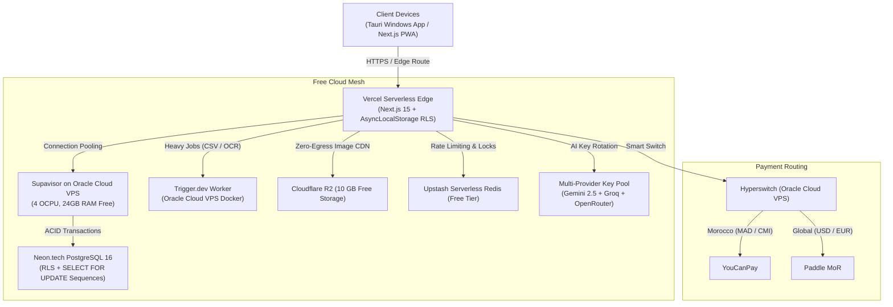

# KASPI POS — OMEGA PLAN: 100k+ Merchants on Free-Tier & Resilient Open-Source

## 1. Architectural Critique of Current Implementation

### Strengths Identified
1. **Multi-Store & Modular Core**: Multi-tenant database structure with PostgreSQL RLS support, stores, categories, and products.
2. **Offline-First Resilience**: Dexie.js IndexedDB outbox and SQLite caching engine designed for intermittent souk and medina connectivity.
3. **Fiscal Rigor (DGI Art. 145 & NF525)**: Atomic `SELECT ... FOR UPDATE` row locking prevents sequence gaps in invoices (`FAC-YYYY-XXXXXX`).
4. **Desktop Native Printing Engine**: Tauri v2 in Rust with HarfBuzz/BiDi shaping for Arabic thermal receipt printing over USB ESC/POS.

### Vulnerabilities & Critical Enhancements Addressed
1. **Landing Page Value Communication**: The Interactive POS Simulator must bridge physical retail and futuristic digital software. It must be visual, scrollable, high-contrast, and branded with 12+ real-world products per sector.
2. **Device Scaling & Monetization**: A tiered pricing model based on register count (200 MAD base for 1 device, +150 MAD per extra device) aligns pricing with merchant shop size, with an in-app upgrade modal (`AddDeviceModal.tsx`) and database enforcement (`Tenant.maxDevices`).
3. **AI Protection & Infinite Free Tier**:
   - Strictly gate AI prompts to business topics (sales, stock, profit margins) and reject general conversation.
   - Implement round-robin key rotation across free-tier AI providers (Gemini 2.5 Flash, Groq LLaMA 3.3 70B, OpenRouter Free) with exponential fallback to guarantee zero infrastructure costs.
4. **Multi-Cloud Free Tier Stack**:
   - **Vercel**: Edge frontend, SSR, and API layer.
   - **Neon Serverless PostgreSQL**: 0.5 GiB free storage with pooled queries.
   - **Oracle Cloud Always-Free ARM VPS**: 4 OCPU, 24 GB RAM hosting Supavisor (connection pooling), Trigger.dev (heavy background imports), and Hyperswitch.
   - **Upstash Redis**: Free serverless Redis for rate limiting and distributed locks.
   - **Cloudflare R2**: 10 GB free S3-compatible storage with zero egress fees for product pictures and receipts.

---

## 2. Infrastructure Aggregation Topology (Zero Operating Cost at 100k+ Scale)

---

## 3. The 6 Pillars of Execution

1. **Brand Identity & Simulator**:
   - `BrandPlaceholder.tsx` with 3D infinity logo and dark backdrop.
   - High-contrast branded products with Unsplash images, `bg-zinc-950` backing, and `max-h-[500px]` scrollable product shelf.
   - Thermal receipt with authentic serrated tear edges (`clip-path: polygon(...)`), QR code, and real-time total, TVA, and change calculation.
2. **Tiered Device Monetization**:
   - Database schema: `Tenant.maxDevices Int @default(1)`.
   - Pricing display: 1 Device = 200 DH, 2 Devices = 350 DH, 3 Devices = 500 DH (+150 DH / extra device).
   - In-app `AddDeviceModal` and `/api/billing/add-device` route for instantaneous register provisioning.
   - POS login enforcement: rejecting unauthorized 3rd device logins when plan limit is 2.
3. **AI Restriction & Protection**:
   - System prompt enforcement forbidding general chatbot tasks.
   - Automatic key rotation across Google Gemini and Groq API keys.
4. **Offline & Multi-Engine Sync**:
   - Dexie.js + SQLite local store.
   - Automatic sync triggering on `navigator.onLine`.
5. **Fiscal & RLS Inviolability**:
   - Tenant isolation via AsyncLocalStorage.
   - Gap-less sequence locking for DGI compliance.
6. **Zero-Error Verification**:
   - `npm run typecheck` & `npm run build` at 100% pass rate.
   - `cargo check` in `src-tauri` at 100% pass rate.
