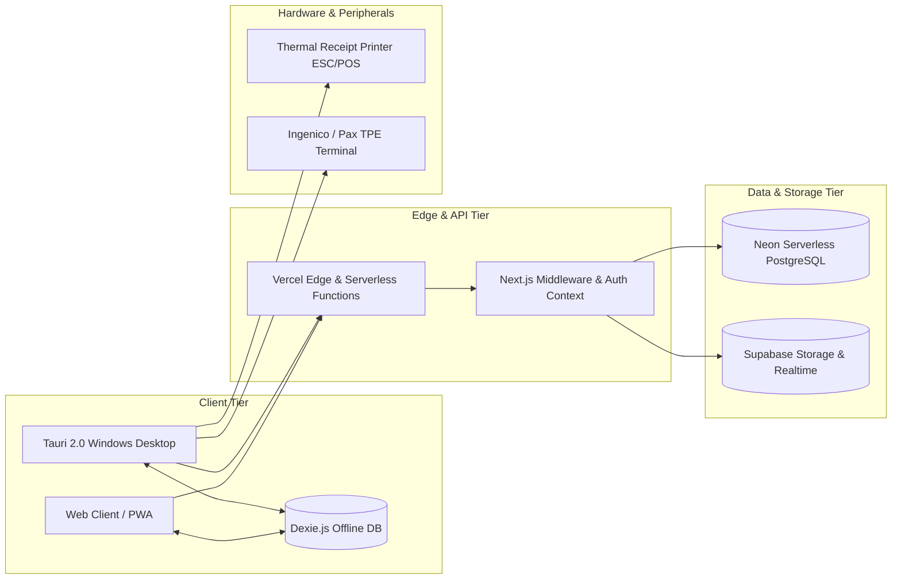

# KASPI POS (كسب) — System Architecture Specification
**Architecture Document**
**Version:** 2.0.0

---

## 1. High-Level Architecture Overview

KASPI POS is architected as an offline-capable, multi-tenant Point of Sale and ERP SaaS tailored for Moroccan commerce.



---

## 2. Multi-Tenancy Isolation Model

### 2.1 Schema Design
Every tenant-scoped table contains `tenant_id UUID NOT NULL` indexed with composite primary or unique keys:
- `@@unique([tenantId, id])`
- `@@index([tenantId, createdAt])`

### 2.2 PostgreSQL Row-Level Security (RLS) & AsyncLocalStorage
Tenancy context is resolved in Next.js Server App Router via `getRequestContext()`.
When executing database queries:
1. `runWithTenantContext({ tenantId, userId })` binds the tenant context to `AsyncLocalStorage`.
2. The Prisma Client Extension automatically prepends `SELECT set_config('app.current_tenant_id', tenantId, true)`.
3. PostgreSQL RLS policies enforce isolation at the database kernel level:
   ```sql
   CREATE POLICY tenant_isolation_policy ON products
     USING (tenant_id = current_setting('app.current_tenant_id', true)::uuid);
   ```

---

## 3. Financial & Fee Splitting Engine

Moroccan card transactions (CMI / TPE) incur a 2.0% processing fee. KASPI dynamically splits this fee between the customer and merchant based on the merchant's active device tier:

| Active Devices | Customer Share (%) | Merchant Share (%) | Example on 100.00 DH | Customer Pays | Merchant Receives |
|---|---|---|---|---|---|
| **1 Device** | 70% | 30% | 2.00 DH fee (1.40 DH / 0.60 DH) | **101.40 DH** | **99.40 DH** |
| **2 Devices** | 60% | 40% | 2.00 DH fee (1.20 DH / 0.80 DH) | **101.20 DH** | **99.20 DH** |
| **3+ Devices** | 50% | 50% | 2.00 DH fee (1.00 DH / 1.00 DH) | **101.00 DH** | **99.00 DH** |

All arithmetic is executed in minor units (integer centimes) to guarantee:
$$\text{customerFee} + \text{merchantFee} \equiv \text{totalFee}$$

---

## 4. DGI Moroccan Fiscal Compliance (Article 145 CGI)

Moroccan fiscal law strictly prohibits missing numbers in sales invoice sequences.
KASPI POS implements atomic database sequence locking:
```sql
SELECT next_val FROM invoice_sequences
WHERE tenant_id = $1 AND period = $2
FOR UPDATE;
```
Receipt numbers follow the strict standard: `REC-YYYY-XXXXXX` (e.g., `REC-2026-000842`).

---

## 5. Offline-First Synchronization Architecture

1. **Local Writes:** When network is unavailable, transactions are written instantly to Dexie.js `offlineSales` table and queued in `sync_queue`.
2. **Local Stock Updates:** Dexie decrements local cached stock counts so cashiers do not sell depleted stock offline.
3. **Outbox Processor:** Background worker monitors `window.addEventListener('online')` and periodic intervals.
4. **Idempotent Sync:** Every sale contains a client-generated UUID `clientSaleId` and `idempotencyKey` preventing duplicate charges.
